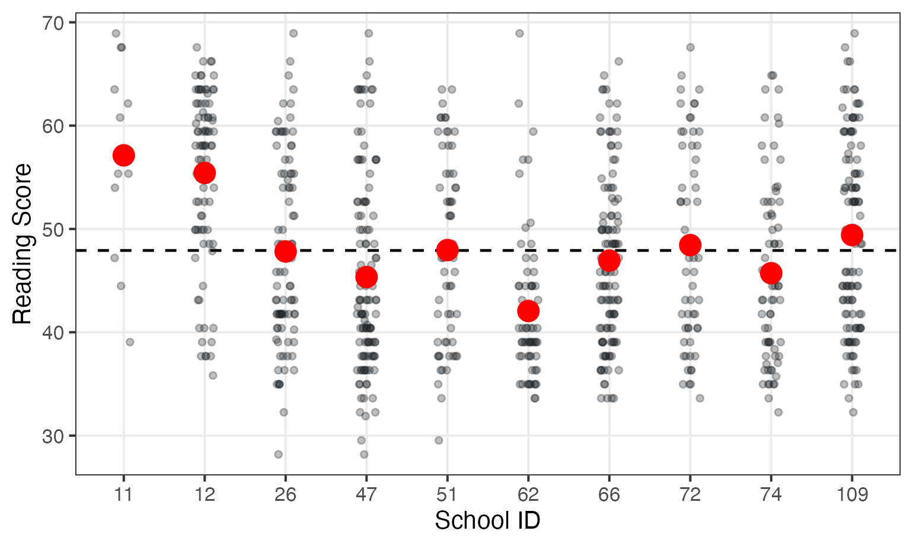
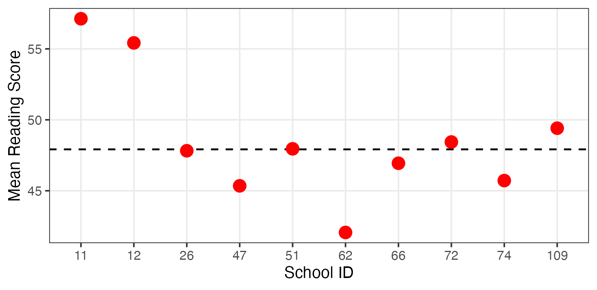
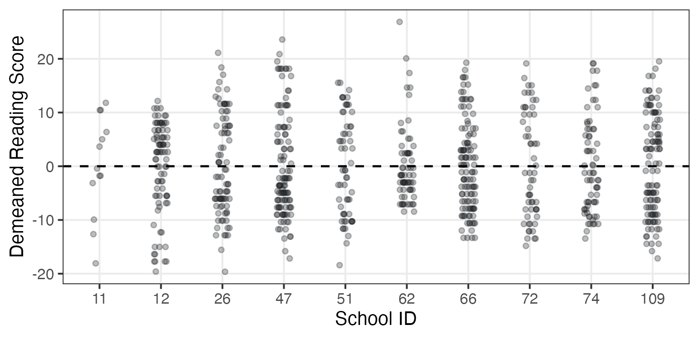
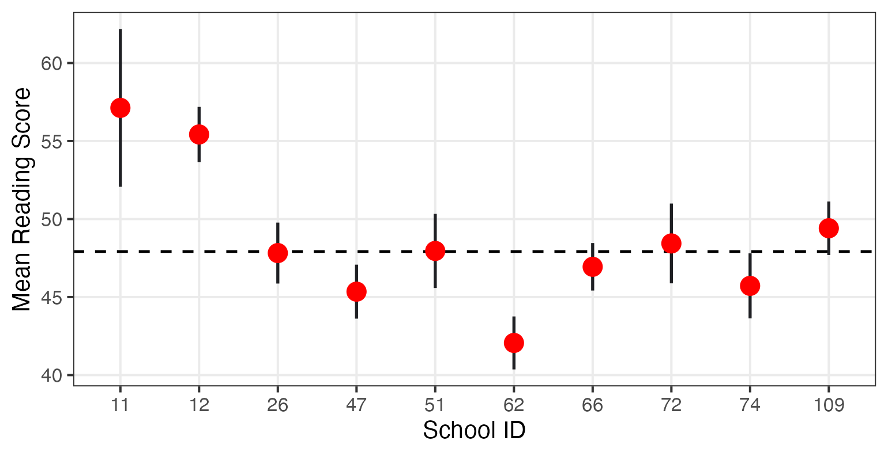
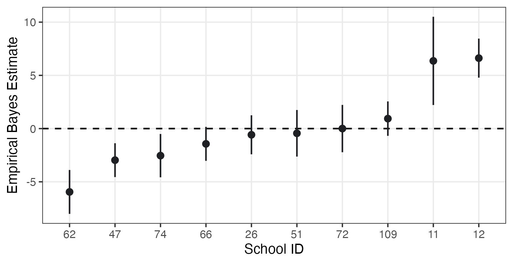
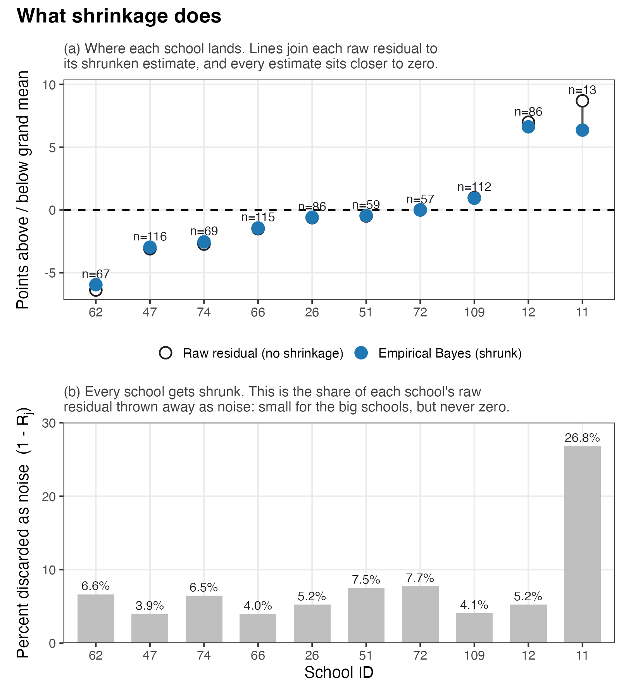
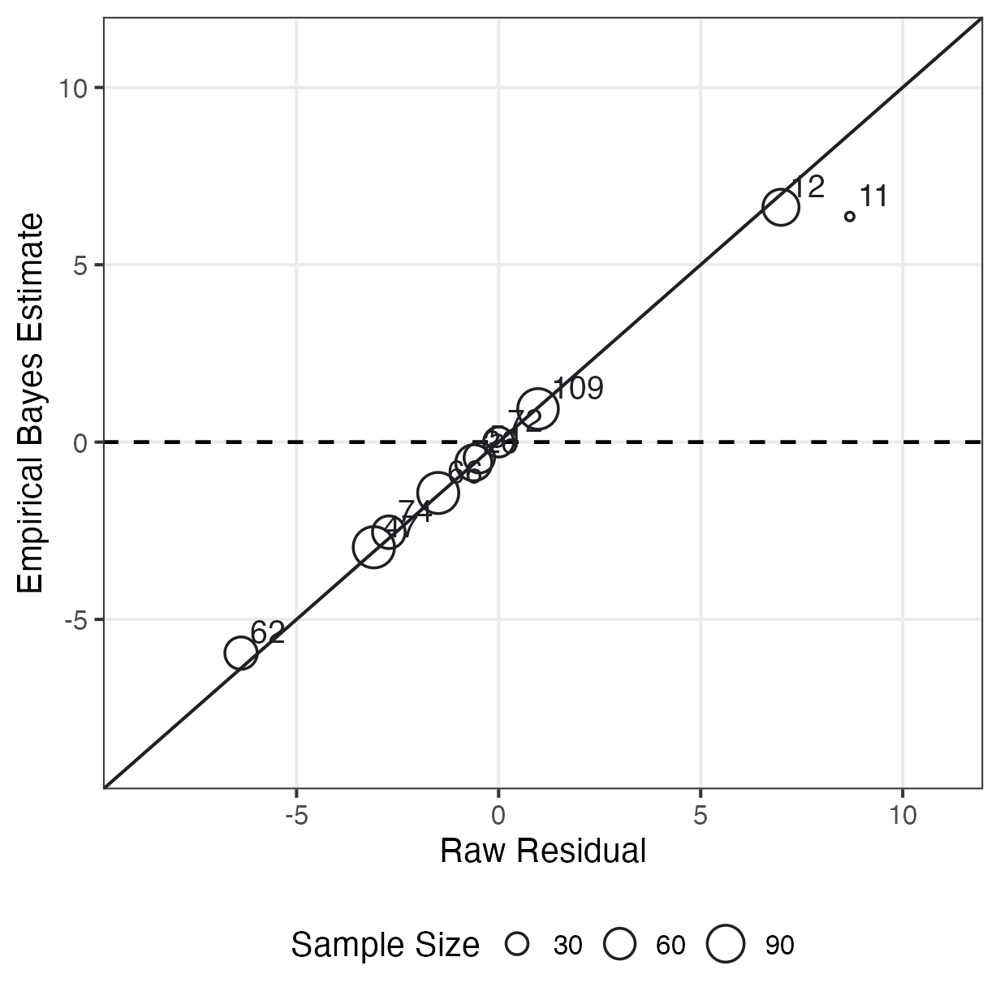

# Introduction and Variance Components Models {#sec-variance-components}

:::: chapter-lead
::: lead-label
The chapter in one paragraph
:::

Multilevel data means our observations arrive in **groups**: students in schools, patients in hospitals, repeated measures in people. When that happens, two observations from the same group tend to be more alike than two from different groups, which violates the conditional independence assumption behind ordinary regression. The **variance components model** is the simplest repair. It uses no predictors at all. All it does is split the total variation in the outcome into a **between-group** piece ($\tau^2$) and a **within-group** piece ($\sigma^2$). These two quantities buy us two things. First, the **intra-class correlation (ICC)**, which tells us what share of the variation lives between groups and, equivalently, how correlated two observations from the same group are. Second, better estimates of each **individual group's** mean, because the model automatically corrects for the fact that a group mean computed from a handful of observations is mostly noise. That correction has three names (**shrinkage**, **partial pooling**, and **Empirical Bayes**), and they all mean the same thing.
::::

## What multilevel data is, and why it matters {#sec-mlm-data}

> "Once you see hierarchy *anywhere*, you start to see it *everywhere*."

### The structure {#sec-structure}

Data often have structure. Some standard examples:

| Level 1 (the observation) | Level 2 (the group)   | What we call it         |
|---------------------------|-----------------------|-------------------------|
| Students                  | Schools               | Clustered / nested data |
| Patients                  | Hospitals             | Clustered / nested data |
| Repeated measures         | People                | Longitudinal data       |
| Item responses            | Persons **and** items | Cross-classified data   |

Note the numbering: by convention, **level 1 is the lower, more granular level**. Students are level 1; schools are level 2.

::: callout-tip
## The core intuition

I am more similar to myself across time than I am to other people measured at the same time. Two students in the same school share teachers, peers, curriculum, leadership, and neighborhood; two students in different schools do not. Similarity within groups is the whole phenomenon.
:::

### What goes wrong if we ignore the structure {#sec-ignore}

Start with an ordinary regression of achievement on socioeconomic status:

$$\text{score}_i = \beta_0 + \beta_1 \text{SES}_i + e_i$$

This model assumes the residuals $e_i$ are **conditionally independent**. If students are nested in schools, and schools have *any* effect on achievement, that assumption is violated: everyone in a "good" school gets a shared positive nudge, so their residuals are correlated.

**Two things go wrong, not one.**

**The standard errors.** Ordinary regression thinks it has 780 independent pieces of information when it really has something closer to 780 students in only 10 schools. Standard errors come out too small, confidence intervals too narrow, and $p$-values too small. In Luke Miratrix's phrase, our inferences become **"overly optimistic and wrong."**

The direction is not guaranteed. Roughly, for predictors that vary mostly *between* clusters, ignoring clustering makes standard errors too small, so we are overly optimistic. For predictors that vary mostly *within* clusters, it can push them the other way and make us overly **pessimistic**: also wrong, just wrong in a direction that costs us findings instead of inventing them. We will see a concrete example of the pessimistic case when we get to longitudinal data.

**The coefficient itself.** It is tempting to say the OLS slope is fine and only its uncertainty is wrong. That is not always true. When a predictor varies both within and between schools, there can be two different relationships: a **within-school slope** (do higher-$X$ students score higher than other students in the same school?) and a **between-school slope** (do schools with higher average $X$ have higher average scores?). These slopes need not be equal. A pooled OLS slope combines information from both, so when the within- and between-school relationships differ, the single OLS coefficient does not cleanly represent either one. Unpacking these two sources of association is the subject of @sec-within-between.

### Mixing up levels: two fallacies {#sec-fallacies}

Both are errors of applying a finding at one level to a different level (see Robson & Pevalin, Ch. 1).

| Fallacy | Direction | Example |
|----|----|----|
| **Ecological** | Group $\rightarrow$ individual | Low-income neighborhoods have higher crime rates, so low-income residents are more likely to commit crime |
| **Atomistic** | Individual $\rightarrow$ group | In the 2000 US presidential election, wealthier *voters* preferred the Republican candidate, but *states* with wealthier populations did not. |

Multilevel models are the fix because they keep **both levels in one model** and let us ask separate questions of each.

### What multilevel models actually do

They **explicitly account for the structure of the data** instead of pretending it is not there. That lets us model:

- the shared influence of schools or teachers on student achievement,
- individual variation in growth over time,
- the shared influence of item difficulty and rater severity on performance ratings.

> Our perspective (influenced by Richard McElreath): multilevel models should be the **default** in social science research, especially in education. You should have to justify *not* using them.

## Our running dataset {#sec-dataset}

We use one simple dataset for the first four chapters, and layer complexity onto it.

**Source.** Gilbert, Kim, & Miratrix ([2023](https://journals.sagepub.com/doi/pdf/10.3102/10769986231171710?casa_token=x3jNXUGSOLcAAAAA:zaf5NeBKTwW6o0bXHueUS4Tak0FzZDBJVcDXUAE8txGAUDeCRyNhOhqsPLQb-q220kcrwRsOz2WS)), *Journal of Educational and Behavioral Statistics*. Full sample: 7,797 grade 3 students in 110 schools. In this chapter we use a **random sample of 10 schools**, giving 780 students.

| Variable | Level | What it is |
|----|----|----|
| `read_comp` | 1 (student) | Outcome. End-of-year reading comprehension, 30-item researcher-designed test |
| `std_baseline` | 1 (student) | Beginning-of-year state standardized reading score (used starting in @sec-random-intercepts) |
| `cluster_id` | 2 (school) | School identifier |

The 10-school sample is available to download as [`jebs_sub.csv`](../data/jebs_sub.csv), so you can fit every model in this book yourself.

The outcome scale is arbitrary, as test scores usually are. It was set so that $\mu = 50$ and $\sigma = 10$ in the **full** sample. In our 10-school subsample the mean is 47.92 and the SD is 9.54.

Introducing some notation:

- $n_j$: the number of students in school $j$. Different for every school here, from 13 to 116.
- $J$: the number of schools. Ten.
- $N$: the total number of students. 780, which is the ten $n_j$ values added up.

::: callout-important
## Two levels of sampling

This is the habit of mind to build. We sampled *schools*, and then we sampled *students inside those schools*. So there are two sample sizes that matter: 780 students and 10 schools. School sizes range from 13 to 116 students. The number of **groups** usually matters more than the number of individuals for how well we can estimate between-group variation.
:::

## Decomposing variation {#sec-decomposing}

### The research question

> **How do reading comprehension scores vary within and between schools?**

Notice this is a question about **variation**, not about the effect of a predictor. That is what a variance components model is for.

### Total variation splits into two pieces

Let $Y_{ij}$ be the reading score for student $i$ in school $j$. Then

$$\underbrace{\text{Var}(Y_{ij})}_{\text{Total variance}} \;=\; \underbrace{\tau^2}_{\substack{\text{Between-school} \\ \text{(variance of school means)}}} \;+\; \underbrace{\sigma^2}_{\substack{\text{Within-school} \\ \text{(variance around school means)}}}$$

The important part is that we will **estimate** these two pieces with a model rather than compute them directly from the data. As the next section shows, that difference matters a great deal.

### Seeing both layers at once

Black dots are individual students. Red dots are school means. The dashed line is the grand mean.

{#fig-two-layers}

Now the same variation, pulled apart into its two components (@fig-between and @fig-within):

{#fig-between}

{#fig-within}

**What to conclude from these three pictures:**

1.  There is a lot of total variation in reading comprehension.
2.  Schools differ from each other in average performance.
3.  There is **more** variation *within* schools than *between* them. The black dots spread wider than the red dots. This is typical in education data: most of the variation in student achievement is between students in the same school, not between schools.

## The problem: observed school means are too spread out {#sec-overdispersion}

### Why we cannot just compute the SD of the school means

The obvious move is to take the 10 school means, compute their standard deviation, and call that the between-school variation. In our data that gives **4.54**.

That number is **too big**, and it's important to know why.

An **observed** school mean is not the school's truth. It is the truth *plus sampling error*: we only sampled some of the school's students, and which ones we happened to get moves the average around. So the spread of the observed means contains both real differences and sampling noise:

$$\underbrace{\text{Var}(\overline{Y}_{j})}_{\substack{\text{Variance of the} \\ \textit{observed}\text{ school means}}} \;=\; \underbrace{\tau^2}_{\substack{\text{Real differences} \\ \text{between schools}}} \;+\; \underbrace{\frac{\sigma^2}{n_j}}_{\substack{\text{Sampling error} \\ \text{(shrinks as } n_j \text{ grows)}}}$$

This is called **overdispersion** due to measurement error. The observed spread overstates the real spread, and it overstates it most when the schools are small.

@fig-overdispersion makes it obvious. Each error bar is the uncertainty in that school's mean:

{#fig-overdispersion}

There are two ways to fix this: subtract off the $\sigma^2/n_j$ term by hand, or fit a model that handles it automatically. We will do the second.

::: callout-note
## Look ahead

When we fit the model, our estimate of the between-school SD will be $\widehat{\tau} = 4.08$, noticeably smaller than the raw 4.54. That gap *is* the sampling error we just removed.
:::

## The variance components model {#sec-vc-model}

### Hierarchical form {#sec-vc-hierarchical}

We write $Y_{ij}$ as a sum of pieces, one equation per level:

$$
\begin{aligned}
\textbf{Level 1 (students):} && Y_{ij} &= \beta_{0j} + e_{ij} \\
\textbf{Level 2 (schools):} && \beta_{0j} &= \gamma_{0} + u_{j} \\
&& u_j &\sim N(0, \tau^2) \\
&& e_{ij} &\sim N(0, \sigma^2)
\end{aligned}
$$

Every symbol, in plain language:

| Symbol | Name | In words |
|----|----|----|
| $Y_{ij}$ | Outcome | Reading score for student $i$ in school $j$ |
| $\beta_{0j}$ | School mean | The **true** mean score for school $j$ |
| $\gamma_{0}$ | Grand mean | The average across all schools: the center of the whole system |
| $u_j$ | School residual (**random effect**) | How far school $j$'s true mean sits from the grand mean |
| $e_{ij}$ | Student residual | How far student $i$ sits from their own school's true mean |
| $\tau^2$ | Between-school variance | How much school means vary around the grand mean |
| $\sigma^2$ | Within-school variance | How much students vary around their school's mean |
| $u_j \sim N(0, \tau^2)$ | Distributional assumption | The school effects come from a population of schools that is normally distributed around mean zero, and $\tau^2$ says how heterogeneous those schools are. |
| $e_{ij} \sim N(0, \sigma^2)$ | Distributional assumption | Within each school, students' residuals (their deviations from that school's predicted value) are normally distributed with mean zero, and $\sigma^2$ says how much those deviations vary. |

::: callout-warning
## Notation warning

Different sources use different letters. In the notation we use throughout: $\beta_{0j}$ is school $j$'s *true mean*, and $u_j$ is that school's *departure from the grand mean*. Because $\beta_{0j} = \gamma_0 + u_j$ and $\gamma_0$ is a constant, $\text{Var}(\beta_{0j}) = \text{Var}(u_j) = \tau^2$, so it makes no difference to the variance decomposition which one you name. Rabe-Hesketh & Skrondal use $\psi$ for $\tau^2$, $\theta$ for $\sigma^2$, and $\rho$ for the ICC.
:::

### Reduced form {#sec-vc-reduced}

Substitute the level-2 equation into the level-1 equation and you get a single line:

$$Y_{ij} = \gamma_{0} + u_j + e_{ij}$$

In words: **a student's score is the overall mean, plus their school's departure from that mean, plus their own departure from their school's mean.**

Both forms describe the identical model. Hierarchical form shows the *structure*: which quantity lives at which level. Reduced form shows the *arithmetic*, and it is the form that maps most directly onto R code.

{#fig-structural}

### The same model in R {#sec-vc-r}

``` r
lmer(read_comp ~ 1 + (1 | cluster_id), data = jebs)
```

The mapping, term by term. **You will do this constantly, in both directions.**

- $Y_{ij}$ is `read_comp`, the outcome, sitting to the left of the `~`.
- $\gamma_0$ is the `1`. It is written explicitly here, but R includes an intercept by default.
- $u_j$ is `(1 | cluster_id)`. This is the random effect: give each `cluster_id` its own intercept.
- $e_{ij}$ does not appear. It is always included by default, exactly as in `lm`.
- $\tau^2$ and $\sigma^2$ do not appear either. They are *estimated*, and reported in the output under `Random effects`, as standard deviations rather than variances.

Read `(1 | cluster_id)` out loud as **"an intercept, varying by cluster_id."** The thing to the left of the bar is what varies; the thing to the right of the bar is what it varies across.

### Two names for one model

- **Variance components model**, because with no predictors, all it does is decompose variance.
- **Random intercepts model**, because each school gets its own intercept.

You will also hear *null model*, *empty model*, and *unconditional means model*. All the same thing. It is the baseline that every later model gets compared to.

### The output, and what every number means {#sec-vc-output}

```         
Linear mixed model fit by REML ['lmerMod']
Formula: read_comp ~ 1 + (1 | cluster_id)
   Data: jebs
REML criterion at convergence: 5650.06
Random effects:
 Groups     Name        Std.Dev.
 cluster_id (Intercept) 4.084
 Residual               8.913
Number of obs: 780, groups:  cluster_id, 10
Fixed Effects:
(Intercept)
      48.43
```

Now map every number. This is the core skill of the book: **map each number to a Greek letter, then use each number in a sentence.** For simplicity, we don't restate that these numbers are *estimates of population parameters* every time, but keep in mind that all of these values have sampling error.

**`(Intercept)` = 48.43.** This is $\widehat{\gamma_0}$, the grand mean.

> We estimate that the average school in our population has a mean reading score of about 48.4 points.

**`cluster_id (Intercept)` = 4.084.** This is $\widehat{\tau}$, the between-school SD.

> School mean reading scores have a standard deviation of about 4.1 points. Under the assumption that school means are normally distributed, about 95% of school means fall within $\pm 2(4.08) \approx 8$ points of 48.4, so roughly 40 to 57.

**`Residual` = 8.913.** This is $\widehat{\sigma}$, the within-school SD.

> Within any given school, students' scores have a standard deviation of about 8.9 points around their own school's mean.

**`groups: cluster_id, 10` and `Number of obs: 780`.** These are $J = 10$ schools and $N = 780$ students: our two sample sizes.

Three things to watch for:

- **`lmer` reports SDs, not variances.** $\widehat{\tau} = 4.08$, so $\widehat{\tau}^2 = 16.68$. $\widehat{\sigma} = 8.91$, so $\widehat{\sigma}^2 = 79.44$. Square before you compute an ICC (introduced below). This is the most common arithmetic slip in this chapter.
- **REML, not plain ML.** The output says REML (restricted maximum likelihood), which is `lmer`'s default and gives less biased variance estimates than ordinary ML with few groups. Conceptually it is still maximum likelihood: find the parameter values that make the observed data most probable.
- **`4.08` versus `4.54`.** The model's estimate of between-school SD is smaller than the raw SD of the observed school means, exactly as @sec-overdispersion predicted. The model removed the sampling noise.

## The Intra-class correlation (ICC): the descriptive statistic of multilevel models {#sec-icc}

### The formula {#sec-icc-formula}

$$\text{ICC} \;=\; \frac{\tau^2}{\tau^2 + \sigma^2} \;=\; \frac{\text{Between-school variance}}{\text{Total variance}}$$

For our model:

$$\text{ICC} = \frac{4.084^2}{4.084^2 + 8.913^2} = \frac{16.68}{16.68 + 79.44} = \frac{16.68}{96.12} = 0.174$$

> "The descriptive statistic of multilevel models." (Andrew Ho)

### Two interpretations of the ICC {#sec-icc-interp}

Any time an ICC appears, be ready to use the number in a sentence **in two ways**.

#### Between-group difference: a proportion of variance {.unnumbered}

> About 17% of the total variation in reading comprehension is attributable to differences between schools.

**What this actually means.** Students' reading scores differ from each other by a lot. Ask how much of that spread you could account for if the *only* thing you knew about a student was which school they attend. The answer is 17%. The remaining 83% is within schools, meaning differences among students attending the same school.

Put it another way: if every school in the sample were somehow made identical tomorrow (if every school average was reset to 48.4) while students kept their individual differences, the total variance in scores would drop by only 17%. Most of the spread would still be there.

If it helps, this behaves like an $R^2$ for a model whose one and only predictor is school membership.

::: {.callout-note collapse="true"}
## Aside: why the ICC is not the $R^2$ from school fixed effects

The difference is instructive. If we run `lm(read_comp ~ factor(cluster_id))` on our data, using school indicators and nothing else, the $R^2$ is **0.137**, compared with an ICC of **0.174**. Three numbers are in play:

|     Value | Where it comes from                                    |
|----------:|:-------------------------------------------------------|
| **0.206** | Variance ratio based on the 10 *observed* school means |
| **0.174** | ICC based on the estimated variance components         |
| **0.137** | $R^2$ from the school fixed effects model              |

*These numbers answer different questions.* The **0.206** uses the observed school means as if their differences were entirely between-school differences. But observed school means also contain sampling error, especially for schools with small $n_j$, so their spread contains both true between-school variation and noise.

The **0.137** answers a different question. The ordinary $R^2$ asks what proportion of the total sums of squares in *this particular sample* is explained by allowing each observed school to have its own mean. Because it is based on individual-level sums of squares, schools with more students contribute more heavily. With equally sized schools, we would generally expect this unadjusted fixed-effects $R^2$ to exceed the ICC in finite samples because the fixed-effects model fits the noisy observed school means directly, whereas the random-effects model separates between-school variance from sampling noise. Here, however, school sizes range from 13 to 116 students, so that simple relationship no longer holds. Thus, the fixed-effects $R^2$ should not be interpreted as another estimate of the ICC.

The ICC, by contrast, comes from the estimated variance components. It is a model-based estimate of the *population proportion of variance that lies between schools.* The distinction is therefore between describing how much the observed schools explain in this particular sample and estimating how much schools vary in the population from which they are assumed to come.

More briefly:

- **0.206:** How spread out do my observed school means look?
- **0.137:** How much of the variation in this sample can be explained by knowing which of these 10 schools a student attends?
- **0.174:** According to the random-effects model, what proportion of population variance is between schools?

**Does adjusted** $R^2$ fix this? No. R also reports an *adjusted* $R^2$, which here is **0.127**. The adjustment docks the model for fitting nine extra parameters, which is a sensible thing to do, but it is still describing this one sample. Adjusting a description does not turn it into an estimate of the population. If you want the between-school share, use the ICC.
:::

#### Within-group similarity: a correlation {.unnumbered}

> The expected correlation in reading comprehension scores between two students drawn at random from the same school is about 0.17.

**What this actually means.** This is the interpretation that trips people up. Pick a student at random from some school. Now pick a *classmate* of theirs at random. How much does knowing the first student's score tell you about the second?

An ICC of 0.17 means that the scores of two students from the same school have a correlation of 0.17, which is a weak positive relationship. Think back to what a correlation looks like on a scatterplot: with a strong positive correlation, the points cluster tightly around an upward-sloping line, so knowing one person's score tells us a lot about the other person's likely score. With a correlation of only 0.17, the points would be much more scattered. There is a slight upward tendency, but knowing one student's score tells us only a little about another student from the same school. For example, if one student scores 1 SD above the overall mean (about 58 when the mean is 48.4), our best prediction for another student from that school is only 0.17 SD above the mean, or about 50. So even knowing that one student scored well above average moves our prediction for another student at that school only slightly above average.

Now compare that to two students from **different** schools. There the expected correlation is 0: the first student's score tells us nothing at all about the second.

So the ICC is the answer to: *how much more alike are two students who share a school than two students who don't?* Here, a little.

#### They are the same number {.unnumbered}

Both sentences describe the shared piece $u_j$. Schools differing from one another and classmates resembling one another are not two facts; they are one fact seen from two directions. If schools were identical, classmates would be no more alike than strangers. If classmates were highly alike, schools would have to differ a lot. The next section shows this algebraically.

### Why the two interpretations are the same thing {#sec-icc-same}

Understanding this, rather than memorizing it, is what makes both interpretations stick. Take two students, $Y$ and $Y'$, from the **same** school. The correlation between their scores is

$$\rho(Y, Y') = \frac{\text{Cov}(Y, Y')}{\sqrt{\text{Var}(Y)\text{Var}(Y')}}$$

Now work on the numerator, the covariance. Covariance measures **what two things have in common**, so to compute it we need to know what each student's score is *made of*. That is exactly what the model tells us, so we substitute it in. Replace each $Y$ with $\gamma_0 + u_j + e_{ij}$ and then ask which pieces the two students share and which they do not.

Two of the three pieces drop out. $\gamma_0$ is a constant, the same number for everybody, and a constant never covaries with anything. The individual residuals $e_{ij}$ are independent of each other and of $u_j$ (that is what the model assumes), so they contribute nothing either. What remains is $u_j$, and the two students have **the same** $u_j$, because they are in the same school. It is the one piece they hold in common. So

$$\text{Cov}(Y, Y') = \text{Cov}(u_j, u_j) = \text{Var}(u_j) = \tau^2$$

And the denominator is just the total variance, $\tau^2 + \sigma^2$, for each of them. Hence

$$\rho(Y, Y') = \frac{\tau^2}{\tau^2 + \sigma^2} = \text{ICC}$$

The shared piece $u_j$ is simultaneously "how much schools differ" and "what makes classmates alike." That is the whole idea.

### Reading the extremes {#sec-icc-extremes}

| ICC | What it means | Do we need an MLM? |
|----|----|----|
| $0$ | School means are all identical. Knowing a student's school tells you nothing. | No: ordinary regression is fine (with some caveats that may become clear in later chapters) |
| $\approx 0.10$–$0.25$ | Typical range for student achievement nested in schools | Yes |
| $1$ | No variation within schools at all; every student in a school is identical. All variation is between schools. | An MLM is not useful either: you effectively have $J$ observations, not $N$ |

At a high level, the ICC answers a prior question: **is a multilevel model necessary in the first place?**

Two cautions. A small ICC does **not** mean clustering is safe to ignore: even modest ICCs badly distort standard errors once cluster sizes are large. And the ICC is **descriptive**, not causal: "17% of variance is attributable to schools" is not a claim that schools *cause* 17% of achievement differences, since schools differ in who enrolls as well as in what they do.

## Comparing groups: shrinkage and Empirical Bayes {#sec-shrinkage}

### The question

Recall what the variance components model is: a model with **no predictors**, which splits the outcome into a grand mean, a school departure, and a student departure,

$$Y_{ij} = \gamma_0 + u_j + e_{ij}$$

and estimates how much schools vary ($\tau^2$) and how much students vary within schools ($\sigma^2$). @sec-icc used those two numbers to answer our first question, about variance decomposition.

Now the second question, and it is a different kind of question. Instead of asking about schools **as a group**, we ask about schools **one at a time**:

> **What is our best estimate of an individual school's effect, and how uncertain is it?**

The answer comes from $u_j$, the term in the model that says how far school $j$ sits from the grand mean. We do not observe $u_j$; it is a quantity in the model, not a column in the data. But having fit the model, we can *estimate* it for each school, and we write that estimate $\widehat{u_j}$.

The obvious answer is to take the school's observed mean and subtract the grand mean. And that answer is **not wrong**. A school's observed mean is an unbiased estimate of that school's true mean: across repeated samples of students from that school, the observed means would be centered on the true mean. If we estimated each school using only its own data, this is the natural estimate we would use.

The issue is not bias. It is **total error**. For a school with few students, the observed mean is unbiased but very noisy, so any single one of them is likely to be far from the truth even though they are centered on it. Shrinkage trades a little bias for a large reduction in that noise, and comes out closer to the truth on average. That is the argument, and it is worth being precise about it, because "the raw mean is contaminated" overstates the case.

When school 11 scores 8.7 points above the grand mean, that 8.7 is a mix of **two different things added together**:

- **A real school effect.** Something about school 11 (its teachers, its curriculum, the students who enroll there) genuinely pulls scores up. This is the part we are trying to measure. It is the $u_j$ in our model.
- **Sampling noise.** We did not test every child in school 11. We tested 13 of them. If those 13 happened to be stronger readers than the school's typical child, the observed average comes out high for a reason that has nothing to do with the school. Test a different 13 children and you would get a different number. This is the part we want to remove.

Looking at the observed gap alone, we cannot see which is which; the two are baked into the same number. But @sec-overdispersion gave us the tool: the noise part has variance $\sigma^2 / n_j$, and it gets *smaller* as $n_j$ gets bigger. So the model can work out roughly **how much** of any given school's gap is likely to be noise, using nothing but that school's sample size and the two variance components we already estimated. Here is the repair.

### The shrinkage factor {#sec-shrinkage-factor}

$$\widehat{u_j} \;=\; \underbrace{(\overline{Y_j} - \widehat{\gamma_0})}_{\text{raw residual}} \;\times\; \underbrace{\frac{\tau^2}{\tau^2 + \frac{\sigma^2}{n_j}}}_{\text{shrinkage factor } R_j}$$

Take the two pieces one at a time.

**The raw residual,** $\overline{Y_j} - \widehat{\gamma_0}$. This is the naive answer: take school $j$'s observed average score $\overline{Y_j}$, subtract the grand mean $\widehat{\gamma_0}$, and you have "how far above or below average this school scored." For school 12, that is $55.4 - 48.4 = +7.0$ points. For school 62, $42.1 - 48.4 = -6.4$ points. Positive means above average, negative means below, zero means dead average. It is a perfectly sensible number, and an unbiased one. The trouble is that part of that gap is real school difference and part is the luck of which students we happened to sample, and for a small school the second part can be most of it.

**The shrinkage factor,** $R_j$. This is a multiplier between 0 and 1 that says **what fraction of the raw residual we believe.**

Multiplying by a number between 0 and 1 makes something smaller. Take school 11's raw residual of $+8.69$ and multiply by its $R_j$ of $0.732$: you get $+6.36$. Still clearly above average, but less far above than the raw number claimed. Take school 62's $-6.37$ and multiply by $0.934$: you get $-5.95$. Still below average, but less far below. Whichever side of the grand mean a school started on, multiplying by a fraction pulls it **in toward zero**, and zero is the grand mean. That pull is the "shrinkage," and it is why these are called shrunken estimates. Note that nothing ever crosses to the other side in a variance components model: a school that scored above average stays above average. It just moves in closer.

Where does $R_j$ come from? It is built out of the two things we just separated: the real school effect and the sampling noise. It is common to call the part you are trying to measure the **signal** and the part contaminating it the **noise**, and that is all those two words mean here.

- The **numerator** is $\tau^2$: real variation between schools. This is the signal, the thing we want to detect.
- The **denominator** is $\tau^2 + \sigma^2/n_j$: that same signal, plus $\sigma^2/n_j$, the sampling variance of this school's mean. That second term is the noise.

So $R_j$ is $\dfrac{\text{signal}}{\text{signal} + \text{noise}}$. In words: of everything pushing a school's observed average away from the grand mean, what share is the real school difference rather than the luck of which students we happened to test? Multiply the raw residual by that share and you keep the part you believe.

Note the $n_j$ sitting in the denominator. The bigger the school, the smaller $\sigma^2/n_j$ becomes, the smaller the noise term, and the closer $R_j$ climbs to 1. Big schools are measured precisely, so we keep almost all of their raw residual. Small schools are measured poorly, so we keep less of theirs.

::: callout-tip
## The shrinkage factor is a reliability

Specifically, it is the reliability of *the school's average score*: how trustworthy that one number is as a measurement of the school. This is reliability in the Classical Test Theory sense: observed mean = true score + error, and reliability = true variance / observed variance. A school average built from 13 students is an unreliable measurement of that school, so we trust it less and lean more on the grand mean.

**Use the number in a sentence.** For school 12, $R_j = 0.948$: about 95% of the variation among observed school means *of this size* reflects real differences between schools, so we keep 95% of school 12's raw residual and discount the remaining 5% as sampling noise. For school 11, $R_j = 0.732$: only about 73% of the variation in a 13-student school mean is real, so we keep 73% of its raw residual and throw away 27% as noise.
:::

### The ICC and the shrinkage factor are based on the same formula {#sec-icc-vs-r}

Put them side by side:

$$\text{ICC} = \frac{\tau^2}{\tau^2 + \sigma^2}
\qquad\qquad
R_j = \frac{\tau^2}{\tau^2 + \frac{\sigma^2}{n_j}}$$

The **only** difference is that the ICC uses $\sigma^2$, the noise in a *single student's* score, while $R_j$ uses $\sigma^2/n_j$, the noise in a *school mean* built from $n_j$ students. Set $n_j = 1$ and $R_j$ becomes the ICC exactly.

Two consequences:

- $R_j \geq \text{ICC}$ as long as $n_j > 1$. Averaging students reduces noise, so a school mean is a more reliable measurement of a school than one student's score is.
- As $n_j \rightarrow \infty$, $R_j \rightarrow 1$ and shrinkage vanishes. With enough students, the observed mean *is* the truth.

Here is the plainest way to say it. Both numbers answer the same question (*how much of what I am looking at is real?*) but they ask it about **different things**:

- The **ICC** asks it about **one student's score**. How much of the spread in individual scores is real between-school difference?
- The **shrinkage factor** asks it about **one school's average score**. How much of the spread in school averages is real between-school difference?

A school average is built by averaging $n_j$ students together, and averaging cancels out individual flukes. So a school average is a cleaner measurement than any single student's score, which is exactly why $R_j$ comes out larger than the ICC, and why it climbs as schools get bigger.

### Empirical Bayes intuition {#sec-eb-intuition}

Imagine two products on Amazon:

- Brand A: 5.0 stars from **3** reviews.
- Brand B: 4.6 stars from **3,000** reviews.

Which is actually better? Nearly everyone says B, and that instinct is exactly Empirical Bayes. You automatically discount Brand A's average toward what you know about products in general, because three reviews is almost no information. Brand B's average, built on 3,000 reviews, needs no discounting. The multilevel model does this arithmetic for you, and the amount of discounting is $1 - R_j$.

Another framing of the same idea: $\widehat{u_j}$ is a **precision-weighted average** of two estimates: what this school's own data says, and what all the schools together say. Weight goes to whichever is measured more precisely.

### Our ten schools {#sec-ten-schools}

Everything above, computed. `Raw resid.` is $\overline{Y_j} - \widehat{\gamma_0}$; $R_j$ is the shrinkage factor; $\widehat{u_j}$ is the Empirical Bayes estimate.

| School | $n_j$ | $\overline{Y_j}$ | Raw resid. | $R_j$ | $\widehat{u_j}$ | SE$(\widehat{u_j})$ |
|---:|---:|---:|---:|---:|---:|---:|
| 62 | 67 | 42.1 | $-6.37$ | 0.934 | $-5.95$ | 1.05 |
| 47 | 116 | 45.3 | $-3.09$ | 0.961 | $-2.97$ | 0.81 |
| 74 | 69 | 45.7 | $-2.72$ | 0.935 | $-2.54$ | 1.04 |
| 66 | 115 | 46.9 | $-1.49$ | 0.960 | $-1.44$ | 0.81 |
| 26 | 86 | 47.8 | $-0.62$ | 0.948 | $-0.58$ | 0.94 |
| 51 | 59 | 48.0 | $-0.48$ | 0.925 | $-0.44$ | 1.12 |
| 72 | 57 | 48.4 | $0.00$ | 0.923 | $0.00$ | 1.13 |
| 109 | 112 | 49.4 | $0.98$ | 0.959 | $0.94$ | 0.83 |
| 12 | 86 | 55.4 | $6.99$ | 0.948 | $6.62$ | 0.94 |
| 11 | 13 | 57.1 | $8.69$ | **0.732** | $6.36$ | **2.12** |

: Raw residuals, shrinkage factors, and Empirical Bayes estimates for the ten schools.

Read the last two rows of the table against each other. They are the lesson of this whole section.

**School 11** has 13 students, a raw residual of $+8.69$, and $R_j = 0.732$. Two ways to say what that 0.732 means:

> In a school with only 13 students, roughly 73% of the variation in that school's average score is real between-school difference. So we keep 73% of its raw residual (its $+8.69$ point gap above the grand mean of the ten schools) and throw the other 27% away as sampling noise. That leaves $+6.36$.

> Equivalently: school 11's average score is a 73% reliable measurement of school 11. Just over a quarter of what makes it look extreme is the luck of which 13 children we tested.

**School 12** has 86 students, a raw residual of $+6.99$, and $R_j = 0.948$. The same two ways:

> In a school with 86 students, roughly 95% of the variation in that school's average score is real between-school difference. So we keep 95% of its $+6.99$ point raw residual and discard only 5% as noise. That leaves $+6.62$, barely a move.

> Equivalently: school 12's average score is a 95% reliable measurement of school 12. Almost nothing about its position is sampling luck.

**Why this matters.** On raw means, school 11 looks like the best school in the sample: it sits highest. After accounting for how little data stands behind it, the model puts school 12 on top instead. And school 11's standard error, at 2.12, is more than double anyone else's. Same data, different conclusion about which school is strongest, purely because we took sample size seriously.

### Standard errors and the caterpillar plot {#sec-se}

$$\text{SE}(\widehat{u_j}) \;=\; \sqrt{\frac{\frac{\sigma^2}{n_j}}{\tau^2 + \frac{\sigma^2}{n_j}}\,\tau^2} \;=\; \sqrt{(1 - R_j)\,\tau^2}$$

The second form, $\sqrt{(1 - R_j)\,\tau^2}$, is the one to remember, and it is easier to read than it looks. Rewrite it as

$$\text{SE}(\widehat{u_j}) = \tau \sqrt{1 - R_j}$$

If $R_j$ is the share of a school's raw residual we believe, then $1 - R_j$ is the share we do **not** believe: the noise share. So **a school's standard error is the between-school SD scaled down by how much of that school's data we trust.**

The two extremes make it concrete:

- If $R_j = 1$ (a perfectly measured school), then $\text{SE} = 0$. We know that school's effect exactly.
- If $R_j = 0$ (a school with no usable information), then $\text{SE} = \tau$. We are back to knowing nothing about this school beyond the fact that it is a school; our uncertainty is the entire spread of schools.

Real schools sit between. School 12 ($R_j = 0.948$) gives $4.08\sqrt{0.052} = 0.93$. School 11 ($R_j = 0.732$) gives $4.08\sqrt{0.268} = 2.11$: more than double, and the widest bar in @fig-caterpillar.

So standard errors shrink when $n_j$ is larger (more students, less sampling noise, higher $R_j$) and when $\sigma^2$ is smaller (students within a school are more alike, so their average pins the school down more precisely).

#### Reading the caterpillar plot {.unnumbered}

{#fig-caterpillar}

**What zero means here.** The y-axis is $\widehat{u_j}$, a school's departure from the grand mean, not its score. So zero is not "no reading ability." **Zero is the average school.** A school plotted at $+6$ scores about 6 points above the typical school in the sample; a school at $-6$ scores about 6 points below.

**What it means when an interval excludes zero.** Each vertical bar is a 95% confidence interval around that school's estimate, and it tells us the range of values for that school's true effect that are compatible with our data. If the bar does **not** cross the zero line, then "this school is exactly average" is not among the plausible values: we have enough evidence to say this school really does differ from the typical school. If the bar **does** cross zero, then average is still on the table, and we cannot confidently distinguish that school from the middle of the pack.

Look at the plot and notice how many bars cross zero. With ten schools and this much within-school variation, most schools are *not* distinguishable from average. This is the sort of caution that gets lost when people rank schools by their raw averages.

#### Seeing the shrinkage directly {.unnumbered}

@fig-shrink-movement shows what shrinkage actually did to each school. The hollow circle is the **raw residual**: the school's observed average minus the grand mean, with no correction at all. The filled circle is the Empirical Bayes estimate after shrinking. The line joining them is the correction.

{#fig-shrink-movement}

**Panel (a)** is on the actual scale of the outcome, and on that scale most of those lines are too short to see. Almost every school here has enough students to be measured well, so almost every school barely budges. School 11 is the exception, dropping from $+8.69$ all the way to $+6.36$, and in doing so falling from first place to second.

**Panel (b)** is there because "too short to see" is not the same as "zero." It plots $1 - R_j$, the percentage of each school's raw residual discarded as noise, and every single bar is above zero. School 11 loses 26.8% of its raw residual. The rest lose between 3.9% and 7.7%: small, but real. **Every group gets shrunk. No group escapes it.** The large schools simply have less taken away, because their averages are measured more reliably in the first place.

One detail in panel (b) worth catching: school 72 hardly moves at all in panel (a), yet panel (b) shows it discarding 7.7% of its raw residual, one of the larger shares. There is no contradiction. School 72's raw residual is essentially zero to begin with, and 7.7% of nearly nothing is nearly nothing. The size of the *correction* depends on both how unreliable a school's average is and how far from the grand mean it started.

@fig-shrinkage shows the same thing a different way.

{#fig-shrinkage}

**How to read it.** Each circle is a school. Its position left-to-right is that school's raw residual; its position bottom-to-top is that school's Empirical Bayes estimate. The diagonal is the line where those two numbers would be **equal**, so if shrinkage did nothing at all, every school would sit exactly on that diagonal, since its shrunk estimate would just equal its raw residual.

That is the point of drawing the line: it is a reference for "no shrinkage." **How far a school sits off the diagonal is how much it got shrunk.** Points fall inside the line (below it on the right, above it on the left) because shrinking always moves an estimate toward zero. The big circles hug the diagonal closely, because large schools barely shrink. The smallest circle, school 11, sits farthest from it.

**Shrinkage is largest when the group is small and when its raw mean is extreme.**

### Are the shrunken estimates "biased"? {#sec-bias}

Yes, deliberately. To see why that is acceptable, it helps to be clear about what the word means.

**What "biased" means.** An estimator is biased if, on average over many repeated samples, it does not land on the truth: it is systematically off in one direction. Our $\widehat{u_j}$ is biased because we multiply every raw residual by a number smaller than 1, which always pulls the estimate toward zero. If school 11's true effect really is $+8$, we will tend to report something smaller than $+8$. That is a systematic pull, not random error, so it is bias.

**Why we accept it.** Bias is only one of two ways an estimate can be wrong. The other is **variance**: how much the estimate bounces around from sample to sample. Raw residuals are unbiased but wildly variable for small schools: test a different 13 students at school 11 and the raw residual could easily come back $+3$ or $+14$. Shrunk estimates are slightly biased but far steadier.

What we actually care about is **total error**: how far off we are, typically, counting both problems. Because squared error is roughly bias-squared plus variance, accepting a small amount of bias to remove a large amount of variance is a **net win**. Across the ten schools, the shrunk estimates are closer to the truth on average than the raw residuals are, despite being biased.

**An analogy.** The Amazon example from earlier is the same trade. Judging Brand A by its literal 5.0-star average is unbiased; that is genuinely what those three reviewers said. But it is a terrible predictor of the next customer's experience. Guessing "somewhat above average, but I doubt it is really a 5.0" is biased downward and much more often right.

This is the **bias–variance tradeoff**, and it is why we prefer shrunken estimates to raw means even though they are biased. It will come back throughout the book.

::: callout-important
## Why this shrinkage factor?

Empirical Bayes is not merely a reasonable compromise between the raw mean and the grand mean. Under this model it is the **optimal** one. The shrinkage factor $R_j$ is precisely the weight that minimizes expected squared error, and any other weighting (keeping more of the raw residual, or less) does worse on average. So shrinkage is not a cautious hedge or a matter of taste. Given the model, it is the best available answer to "how good is this school?", and $R_j$ is not a tuning choice but a derived quantity.
:::

## Vocabulary decoder {#sec-vocab}

The literature uses many synonyms. Nothing here is a distinction; these are just different names.

| Term | Also called |
|----|----|
| Variance components model | Random intercepts model with no predictors; null model; empty model; unconditional means model |
| $u_j$ | Random effect; school residual; group offset; level-2 residual; BLUP |
| $\widehat{u_j}$ | Empirical Bayes estimate; shrunken estimate; partially pooled estimate; BLUP |
| Shrinkage factor $R_j$ | Reliability (of the group's mean score); precision weight |
| BLUP | "Best Linear Unbiased Predictor": another name for $\widehat{u_j}$. See the note below the table |
| Partial pooling | Shrinkage; Empirical Bayes; borrowing strength |
| $\tau^2$ | Between-group variance; level-2 variance; intercept variance; $\psi$ (Rabe-Hesketh & Skrondal); $\sigma^2_\alpha$ (Gelman & Hill) |
| $\sigma^2$ | Within-group variance; residual variance; level-1 variance; $\theta$ (R-H&S) |
| ICC | $\rho$; intraclass correlation coefficient |
| Clustered data | Nested data; hierarchical data; grouped data; multilevel data |

**A word on BLUP,** since it appears constantly in software documentation and in papers, and the acronym is genuinely confusing. It stands for **Best Linear Unbiased Predictor**, and it is just another name for $\widehat{u_j}$: the shrunken, Empirical Bayes estimate of a group's random effect. Taking the words apart:

- **Predictor**, not *estimator*. This is the meaningful distinction. We *estimate* fixed parameters like $\gamma_0$ and $\tau^2$: quantities that have one true value out there in the world. We *predict* random effects like $u_j$, because in the model $u_j$ is itself a random draw from a distribution rather than a fixed constant. Different word, because it is a different kind of quantity.
- **Unbiased** here means unbiased *as a predictor of a randomly drawn* $u_j$, averaging over all schools. This is not a contradiction of @sec-bias: $\widehat{u_j}$ is still shrunk toward zero for any one particular school. The two statements are about different things, which is exactly why the acronym causes trouble.
- **Linear** does *not* mean "it makes a straight line on a graph," which is the natural guess and the wrong one. It means $\widehat{u_j}$ is a **linear function of the observed scores**: you get it by multiplying each student's score by some number and adding the results up. Nothing more exotic than that happens to the data: no squaring, no logs, no dividing one score by another. You can see it in our own formula. Since $\overline{Y_j}$ is just the school's scores added up and divided by $n_j$, $$\widehat{u_j} = R_j(\overline{Y_j} - \widehat{\gamma_0}) = \frac{R_j}{n_j}\left(y_{1j} + y_{2j} + \cdots + y_{n_jj}\right) - R_j\widehat{\gamma_0}$$ Every score enters multiplied by the same constant $R_j/n_j$, and then a constant is subtracted. That is what "linear in the data" means.
- **Best** means that among all predictors built that way, this one has the smallest expected squared error: it is the most accurate of the linear options.

In practice, when you read "BLUP," think "the shrunken estimate of a group's effect."

## Common mistakes {#sec-mistakes}

1.  **Forgetting to square.** `lmer` prints standard deviations, but the ICC needs variances. $\dfrac{4.08}{4.08+8.91} = 0.31$ is wrong; $\dfrac{4.08^2}{4.08^2+8.91^2} = 0.17$ is right. Note how far apart those two answers are; this is not a rounding-level mistake. The reverse trap also exists: if a problem hands you $\tau^2 = 2$ and $\sigma^2 = 2$, those are already variances, so do **not** square them again. Always ask which one you have been given.

2.  **Calling the SD of observed group means the between-group SD.** See @sec-overdispersion. The SD of observed group means is inflated by sampling error, and inflated most when groups are small. This happens when someone computes group averages in a spreadsheet, takes their SD, and reports it as "between-school variation" without ever fitting a model.

3.  **Giving only one interpretation of the ICC.** There are always two (a proportion of variance and a correlation), and being able to produce both on demand is the whole point of the exercise. If you can only produce one, you have half the concept.

4.  **Thinking one observation per person means the data are not multilevel.** The clustering comes from the grouping, not from repeated measures. One reading score per student is still multilevel data when the students sit in schools.

5.  **Reading the ICC as a causal claim about schools.** It is descriptive. "17% of variance is attributable to schools" does not mean schools *cause* 17% of achievement differences; schools differ in whom they enroll as much as in what they do.

6.  **Assuming a small ICC means clustering can be ignored.** Even ICCs near 0.05 badly distort standard errors once clusters are large, because the damage depends on both the ICC *and* the cluster size. A small ICC is a reason to expect small differences between schools, not a license to run OLS.

7.  **Mixing up levels.** $n_j$ is the number of *students in a school*; $J$ is the number of *schools*; $N$ is the total number of students. All three matter, and they matter for different things: $n_j$ drives how well we estimate any one school, while $J$ drives how well we estimate $\tau^2$, the variation among schools.

8.  **Confusing** $\beta_{0j}$ with $u_j$. Both describe school $j$, but on different scales. $\beta_{0j}$ is the school's true mean **on the score scale**: for school 12 it is about 55, a number you could read off a score report. $u_j$ is the same school expressed as a **departure from the grand mean**: about $+6.6$, a number centered at zero. They differ by exactly $\gamma_0 = 48.4$. If a quantity looks like a test score, it is $\beta_{0j}$; if it is centered at zero and can be negative, it is $u_j$.

9.  **Reporting raw group means as "school effects"** when Empirical Bayes estimates are available and better. This is how small schools end up at the top and bottom of published rankings.

10. **Reading a random effect as a coefficient you estimated.** $\gamma_0$ is a fixed effect: one number, estimated directly, with a standard error. $u_j$ is not estimated the same way: the model estimates the *distribution* the $u_j$ come from (that is $\tau^2$), and $\widehat{u_j}$ is a prediction of where school $j$ falls in that distribution. This is why the output reports $\widehat{\tau}$ and not a list of ten school coefficients.

11. **Forgetting that shrinkage depends on the group, not the model.** There is no single shrinkage factor for a dataset. Every group gets its own $R_j$, because every group has its own $n_j$.

## Quick reference {#sec-quickref}

::::::::::: quickref
::: {}
**Hierarchical form**

$$
\begin{aligned}
Y_{ij} &= \beta_{0j} + e_{ij} \\
\beta_{0j} &= \gamma_{0} + u_{j} \\
u_j &\sim N(0, \tau^2) \\
e_{ij} &\sim N(0, \sigma^2)
\end{aligned}
$$
:::

::: {}
**Reduced form**

$$Y_{ij} = \gamma_{0} + u_j + e_{ij}$$

**R**

``` r
lmer(y ~ 1 + (1 | group_id), data = dat)
```
:::

::: {}
**Variance decomposition**

$$\text{Var}(Y_{ij}) = \tau^2 + \sigma^2$$
:::

::: {}
**Overdispersion of observed group means**

$$\text{Var}(\overline{Y}_j) = \tau^2 + \frac{\sigma^2}{n_j}$$
:::

::: {}
**ICC**

$$\text{ICC} = \frac{\tau^2}{\tau^2 + \sigma^2}$$
:::

::: {}
**Shrinkage factor (reliability of the group mean)**

$$R_j = \frac{\tau^2}{\tau^2 + \frac{\sigma^2}{n_j}}$$
:::

::: {}
**Empirical Bayes estimate**

$$\widehat{u_j} = (\overline{Y_j} - \widehat{\gamma_0}) \times R_j$$
:::

::: {}
**Standard error of the EB estimate**

$$\text{SE}(\widehat{u_j}) = \sqrt{(1 - R_j)\,\tau^2}$$
:::
:::::::::::

## Worked examples {#sec-worked}

### Computing and interpreting an ICC

*A variance components model of patients* $i$ nested within hospitals $j$, where the outcome is a recovery score, yields $\widehat{\gamma_0} = 60$, $\widehat{\tau}^2 = 3$, $\widehat{\sigma}^2 = 9$.

**(a) What is the ICC?**

::: {.callout-tip collapse="true" icon="false"}
## Show solution

$$\text{ICC} = \frac{\tau^2}{\tau^2 + \sigma^2} = \frac{3}{3 + 9} = \frac{3}{12} = 0.25$$
:::

**(b) Interpret it in two ways.**

::: {.callout-tip collapse="true" icon="false"}
## Show solution

- *Between-group difference:* 25% of the total variation in recovery scores is attributable to differences between hospitals. The remaining 75% is differences among patients treated at the same hospital.
- *Within-group similarity:* two patients drawn at random from the same hospital have an expected correlation of 0.25 in their recovery scores. Two patients from different hospitals have an expected correlation of 0.
:::

**(c) Write the `lmer` code, where the outcome is `y` and the clustering variable is `hospital`.**

::: {.callout-tip collapse="true" icon="false"}
## Show solution

``` r
lmer(y ~ 1 + (1 | hospital), data = dat)
```

Two things to notice. The estimates were handed to us as **variances** here ($\widehat{\sigma}^2 = 9$), whereas `lmer` output gives **standard deviations**; always check which you have. And this ICC of 0.25 is noticeably larger than our reading example's 0.17, meaning hospitals differ from one another more than our schools did.
:::

### Shrinkage arithmetic

*Suppose* $\tau^2 = 0.3$, $\sigma^2 = 0.6$, and a group has $n_j = 25$ observations. Find the ICC and the shrinkage factor.

::: {.callout-tip collapse="true" icon="false"}
## Show solution

$$\text{ICC} = \frac{0.3}{0.3 + 0.6} = \frac{0.3}{0.9} = 0.333$$

$$R_j = \frac{\tau^2}{\tau^2 + \frac{\sigma^2}{n_j}} = \frac{0.3}{0.3 + \frac{0.6}{25}} = \frac{0.3}{0.3 + 0.024} = \frac{0.3}{0.324} = 0.926$$

So a third of the variance is between groups, but the group mean is 93% reliable: averaging 25 observations removed most of the noise. Only 7% of this group's raw residual gets shrunk away. Notice how far apart 0.333 and 0.926 are: same $\tau^2$ and $\sigma^2$, completely different questions.
:::

## Check your understanding {#sec-self-check}

Try each one before opening the answer. The section reference points to the fuller explanation.

::::::::::::::::: self-check
::: {.callout-note collapse="true" icon="false"}
## Explain what makes data multilevel, and why one observation per person is still multilevel data.

Data are multilevel when observations come in groups, so that two observations from the same group are more alike than two from different groups. What creates the clustering is the *grouping*, not repeated measurement. One reading score per student is still multilevel data as long as those students sit in schools. *See @sec-structure.*
:::

::: {.callout-note collapse="true" icon="false"}
## Say what goes wrong in ordinary regression when clustering is ignored, and specifically what happens to standard errors.

Ordinary regression assumes residuals are conditionally independent. Clustering violates that, because everyone in a good school shares the same upward nudge. The damage is to standard errors rather than coefficients: OLS believes it has 780 independent observations when it really has 780 students in only 10 schools, so standard errors come out too small, intervals too narrow, and $p$-values too small: "overly optimistic and wrong." *See @sec-ignore.*
:::

::: {.callout-note collapse="true" icon="false"}
## Distinguish the ecological from the atomistic fallacy.

The **ecological** fallacy reasons from group to individual: low-income neighborhoods have higher crime rates, so *this* low-income resident must be more likely to offend. The **atomistic** fallacy reasons from individual to group: immigrants have elevated mental-health risk, so *every* immigrant community needs the same program. Multilevel models fix both by keeping the two levels in one model. *See @sec-fallacies.*
:::

::: {.callout-note collapse="true" icon="false"}
## Write the variance components model in hierarchical and reduced form, and define every symbol.

Hierarchical: $Y_{ij} = \beta_{0j} + e_{ij}$ with $\beta_{0j} = \gamma_0 + u_j$, where $u_j \sim N(0,\tau^2)$ and $e_{ij} \sim N(0,\sigma^2)$. Reduced: $Y_{ij} = \gamma_0 + u_j + e_{ij}$. Here $\gamma_0$ is the grand mean, $\beta_{0j}$ is school $j$'s true mean, $u_j$ is that school's departure from the grand mean, $e_{ij}$ is the student's departure from their school's mean, $\tau^2$ is between-school variance, and $\sigma^2$ is within-school variance. *See @sec-vc-hierarchical and @sec-vc-reduced.*
:::

::: {.callout-note collapse="true" icon="false"}
## Write the `lmer` code from the equation, and the equation from the `lmer` code.

`lmer(read_comp ~ 1 + (1 | cluster_id), data = jebs)`. The outcome is left of the `~`; the `1` is $\gamma_0$; `(1 | cluster_id)` is $u_j$, read as "an intercept, varying by cluster_id"; $e_{ij}$ is included automatically. Going the other direction, whatever sits to the left of the bar is what varies, and whatever sits to the right is what it varies across. *See @sec-vc-r.*
:::

::: {.callout-note collapse="true" icon="false"}
## Take any line of `lmer` output and use the number in a sentence.

Intercept 48.43: the average school scores about 48.4 points. `cluster_id (Intercept)` 4.08: school means have an SD of about 4.1 points, so roughly 95% of schools fall between about 40 and 57. `Residual` 8.91: within a school, students vary with an SD of about 8.9 points. Remember that `lmer` prints SDs, not variances. *See @sec-vc-output.*
:::

::: {.callout-note collapse="true" icon="false"}
## Explain why the SD of observed group means overstates the true between-group SD.

An observed school mean is the school's truth plus sampling error, because we tested only some of its students. So $\text{Var}(\overline{Y}_j) = \tau^2 + \sigma^2/n_j$: the observed spread carries a noise term on top of the real one. This is overdispersion, and it is worst for small schools. In our data the raw SD of school means is 4.54 while the model's $\widehat{\tau}$ is 4.08; the gap is the noise the model removed. *See @sec-overdispersion.*
:::

::: {.callout-note collapse="true" icon="false"}
## Compute the ICC from variance components, and interpret it in two ways.

$\text{ICC} = \tau^2/(\tau^2+\sigma^2) = 16.68/96.12 = 0.174$. **Between-group difference:** about 17% of the total variation in reading comprehension is attributable to differences between schools. **Within-group similarity:** two students drawn at random from the same school have an expected correlation of about 0.17; two students from different schools would correlate 0. *See @sec-icc-formula and @sec-icc-interp.*
:::

::: {.callout-note collapse="true" icon="false"}
## Say what ICC = 0 and ICC = 1 would each mean.

ICC $=0$: school means are identical, knowing a student's school tells you nothing, and ordinary regression is fine. ICC $=1$: no variation within schools at all, every student in a school is identical, and you effectively have $J$ observations rather than $N$. A multilevel model earns its keep between those extremes. *See @sec-icc-extremes.*
:::

::: {.callout-note collapse="true" icon="false"}
## Explain shrinkage, and say when it is largest.

Multiply a school's raw residual by $R_j$, a number between 0 and 1, and the estimate moves in toward zero, toward the grand mean. Shrinkage is largest when the group is **small** and when its raw mean is **extreme**. School 11, with 13 students, falls from $+8.69$ to $+6.36$; the large schools barely budge. *See @sec-shrinkage-factor.*
:::

::: {.callout-note collapse="true" icon="false"}
## Interpret a shrinkage factor as a reliability, using the number in a sentence.

$R_j$ is the reliability of the school's average score. For school 11, $R_j = 0.732$: roughly 73% of the variation in a 13-student school average is real between-school difference, so we keep 73% of its raw residual and discard 27% as sampling noise. For school 12, $R_j = 0.948$: its average is a 95% reliable measurement of that school. *See @sec-shrinkage-factor and @sec-ten-schools.*
:::

::: {.callout-note collapse="true" icon="false"}
## State how the shrinkage factor relates to the ICC.

Same basic formula, different question. The ICC is $\tau^2/(\tau^2+\sigma^2)$ and asks what proportion of the variation in individual students' scores is between schools. $R_j$ is $\tau^2/(\tau^2+\sigma^2/n_j)$ and asks how reliably a school's observed mean reflects its true mean. If $n_j = 1$ then $R_j$ becomes the ICC. As we average more students, individual student-level noise tends to cancel out, so the school mean becomes more reliable. Thus, $R_j \geq \text{ICC}$ always, and $R_j \rightarrow 1$ as $n_j$ gets very large. *See @sec-icc-vs-r.*
:::

::: {.callout-note collapse="true" icon="false"}
## Say why one school's standard error is bigger than another's.

$\text{SE}(\widehat{u_j}) = \tau\sqrt{1-R_j}$, so the uncertainty in a school's effect is the between-school SD scaled by the share of that school's data we do *not* trust. Standard errors are smaller when $n_j$ is larger and when $\sigma^2$ is smaller. School 11's SE is 2.12 while school 12's is 0.93, entirely because school 11 has 13 students and school 12 has 86. *See @sec-se.*
:::

::: {.callout-note collapse="true" icon="false"}
## Explain why we prefer shrunken estimates even though they are biased.

Biased means systematically off in one direction, and shrunken estimates are: they are always pulled toward the grand mean. But bias is only one way to be wrong; the other is variance, and raw residuals for small groups bounce around wildly from sample to sample. Since squared error is roughly bias-squared plus variance, trading a little bias for a large cut in variance leaves us closer to the truth on average. *See @sec-bias.*
:::
:::::::::::::::::

## Going deeper {#sec-deeper}

All from Luke Miratrix's online MLM handouts:

- [ICC derivation](https://lmiratrix.github.io/MLM/icc_derivation.html): the full proof that the two interpretations are equivalent
- [Inflated variance derivation](https://lmiratrix.github.io/MLM/inflated_variance.html): the overdispersion result from @sec-overdispersion
- [Pooling](https://lmiratrix.github.io/MLM/pooling.html): pooled/unpooled versus fixed/random, sorted out carefully
- [ICC visualizer](https://lmiratrix.github.io/MLM/icc_viz.html): set the ICC and watch the data change. Predict what ICC $= 0$ and ICC $= 1$ look like *before* moving the slider
- [Model representations](https://lmiratrix.github.io/MLM/model_representations.html): hierarchical, reduced, and matrix forms side by side

## Code for this chapter's figures {#sec-vc-code}

Every figure in this chapter is computed live from the data by one R script, so the figures and the numbers in the text cannot drift apart. It fits the variance components model and then builds each figure in turn. [Download `01-figures.R`](../code/01-figures.R) and the data it reads, [`jebs_sub.csv`](../data/jebs_sub.csv), then run the script from a folder where the data sits at `data/jebs_sub.csv`.

::: {.callout-note collapse="true" icon="false"}
## Show the full script

``` r

```
:::

## What comes next {.unnumbered}

The variance components model is deliberately bare: no predictors at all. @sec-random-intercepts adds a student-level covariate (the beginning-of-year pretest) to get the **random intercepts model**, then asks how to do **inference**: standard errors, confidence intervals, and tests for both the fixed effects and the variance components.
