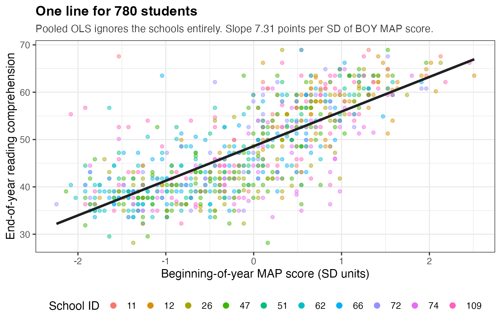

# Random Intercepts Models and Inference {#sec-random-intercepts}

:::: chapter-lead
::: lead-label
The chapter in one paragraph
:::

@sec-variance-components's model had no predictors. This chapter adds one — `std_baseline`, each student's **beginning-of-year (BOY)** Measures of Academic Progress (MAP) reading score — and that changes the meaning of many things we built in the last chapter. Our outcome, `read_comp`, is the **end-of-year (EOY)** reading comprehension score, so the whole chapter is about predicting EOY from BOY. The model is now the **random intercepts model**: every school gets its own intercept, all schools share one slope on MAP. Four things move at once. First, $\tau^2$ and $\sigma^2$ become **residual** variances, what is left after adjusting for MAP. Second, $\gamma_0$ becomes a conditional prediction, the expected score at MAP $= 0$ in the average school. Third, $\widehat{u_j}$ stops meaning "how far above or below average this school scored" and starts meaning **value-added**: how far above or below average it scored *given where its students started*. The ten schools reorder. Fourth, **inference** — testing a variance is not the same move as testing a slope, because a variance cannot be negative and the null sits at the very edge of what is possible. That asymmetry is why the second half of the chapter uses likelihood ratio tests and profile intervals instead of $z$-statistics.
::::

## Where we left off, and what changes {#sec-ri-recap}

The variance components model used no predictors, splitting each score into a grand mean, a school departure, and a student departure:

$$Y_{ij} = \gamma_0 + u_j + e_{ij}, \qquad u_j \sim N(0, \tau^2), \qquad e_{ij} \sim N(0, \sigma^2)$$

Fit to our 780 students in 10 schools it gave $\widehat{\gamma_0} = 48.43$, $\widehat{\tau} = 4.084$, and $\widehat{\sigma} = 8.913$ — those last two are the `Std.Dev.` column of the `Random effects` block. In words: the average school scored 48.43 at EOY, school averages scattered around that with a standard deviation of 4.08 points, and students scattered around their own school's average with a standard deviation of 8.91 points. `lmer` prints **standard deviations**, and the ICC needs **variances**, so square them first — $4.084^2 = 16.68$ and $8.913^2 = 79.44$ — and then

$$\text{ICC} \;=\; \frac{\widehat{\tau}^2}{\widehat{\tau}^2 + \widehat{\sigma}^2} \;=\; \frac{16.68}{16.68 + 79.44} \;=\; \frac{16.68}{96.12} \;=\; 0.174$$

About 17% of the variation in EOY reading scores sat between schools rather than within them. Read the other way, the same 0.174 says two students drawn at random from the same school have an expected correlation of about 0.17 in their EOY reading scores. We also took each school's raw departure from the grand mean and shrank it toward zero by that school's **shrinkage factor**, $R_j = \tau^2 / (\tau^2 + \sigma^2/n_j)$. That factor is a number between 0 and 1 indicating what share of the raw departure we keep, where $n_j$ is the number of students in school $j$, so bigger schools keep more of theirs (@sec-ri-smaller-r works one through). The result is $\widehat{u_j}$; we computed a standard error for each and plotted the ten in a caterpillar plot.

All of that still holds. We are adding **one covariate** to a structure that is already built — and the covariate changes what the old pieces *mean*, on top of which we now have to say how sure we are about them.

## Why the school residuals are not causal effects {#sec-ri-not-causal}

Here is @sec-variance-components's caterpillar plot from the variance components model on our ten schools. Each dot is one school's $\widehat{u_j}$; each vertical bar runs from $\widehat{u_j} - 1.96\,\text{SE}$ to $\widehat{u_j} + 1.96\,\text{SE}$; the dashed line at zero is the average school.

{#fig-ri-caterpillar-vc}

A natural next question: **which of these ten schools is best?**

We want to rank the schools from this plot, but the plot cannot support that ranking. Students are **not randomly assigned to schools**. Families choose neighborhoods and districts draw attendance zones, so the school a third grader attends has been correlated with their home, their prior schooling, and their reading skill for years. A school sitting low may be teaching badly, or may simply enroll students who started lower.

**Some terminology**:

- A **raw residual** is what a school actually scored minus what the model expected it to score. In the variance components model the expectation is just the grand mean, $\widehat{\gamma_0} = 48.43$, so school 62's raw residual is $42.06 - 48.43 = -6.37$ points. "Raw" because nothing has been done to it yet.
- A **school residual** is that raw residual after shrinkage — the $\widehat{u_j}$ the model actually reports, $-5.95$ for school 62. It is the raw residual pulled toward zero, and it still describes an **outcome**: how far this school's students ended up from average.
- A **causal effect** is a claim about a **contribution**: how much attending this school moved its students. Nothing on the caterpillar plot estimates that.

**School 62 is a good example.** It sits at the far left, and with 67 students its position is not a small-sample artifact. The $-5.95$ is real: those 67 students did finish that far below the average. But *real* is not the same as *caused by the school*, and it is the second one we would need before calling school 62 a "bad school." One question remains: **what were these students' reading levels at the beginning of the year?** Starting the year behind and finishing the year behind is what we should have predicted. Starting where everyone else did and still finishing last is a different result. A raw residual cannot tell those two apart, because it does not use where students started.

## Value-added models {#sec-ri-vam}

A **value-added model** (VAM) is the standard policy response: measure students on the way in, put that measurement into the model as a covariate, and read whatever school differences are left over as the school's contribution. VAMs underlie school accountability systems in many states.

Our baseline measure is `std_baseline`, the **Measures of Academic Progress (MAP)**, a standardized reading test used widely across the US, taken here at the **beginning of the year (BOY)**. It is reported as a Z-score, so one unit is one standard deviation and $\text{MAP} = 0$ is an average student in the full study our ten schools were drawn from — 7,797 students in 110 schools. Our outcome, `read_comp`, is reading comprehension measured at the **end of the year (EOY)**.

**They are two different tests, not the same test twice.** BOY is the MAP test, reported as a Z-score, so an average student sits at 0 and our 780 students run from $-2.2$ to $+2.5$. EOY is a *researcher-designed* reading comprehension test on a rescaled points scale: our students average 47.92 on it, with a standard deviation of 9.54, running from 28.2 to 68.9. Both scales were fixed on that same full study — MAP was Z-scored across all 7,797 students, and the EOY points scale was set to average 50 with a standard deviation of 10 there — which is why our ten schools sit a little under both marks, at $-0.09$ on BOY and 47.92 on EOY. Whenever you interpret a regression coefficient of EOY on BOY, remember the units on either side: one SD on the BOY test predicts $\widehat{\beta_1}$ points on the EOY test.

::: callout-warning
## Closer to causal, but not there yet

Conditioning on a BOY test score makes $\widehat{u_j}$ a much more plausible estimate of a school's contribution than the raw residual was — the raw residual being what a school scored minus what the model expected, with no adjustment at all for who enrolled. It is "a much more plausible estimate of a school's causal effect," and the operative word is *more*. This is not a randomized experiment. What is left to worry about is narrower than it first appears. A confounder has to affect how much students *grow* during the year, over and above what the BOY score already records. Prior instruction, for instance, certainly raised these students' scores — but that is already in the BOY test, so it does not bias the estimate on its own. It only matters if it keeps helping them *through* the year we are measuring. Family resources, attendance and peers qualify on the same terms. The more accurate description is "the school's average outcome, adjusted for the one baseline test we measured."
:::

The chapter explores three questions, on the same 780 students in 10 schools:

1.  Which schools are most effective at improving grade 3 reading comprehension?
2.  To what extent do students who do well on the BOY MAP test do well on the EOY test?
3.  How can we model this relationship under **complete pooling** (one line for all 780 students, school ignored), **partial pooling** (each school gets its own intercept, and the ten intercepts are treated as related to one another), and **no pooling** (ten completely separate regressions)? @sec-ri-three-ways sets all three side by side.

## Complete pooling: what ordinary regression assumes {#sec-ri-complete-pooling}

Before anything multilevel, fit the model most people would: regress end-of-year reading on beginning-of-year reading, saying nothing about schools.

$$Y_{i} = \beta_0 + \beta_1 \text{MAP}_{i} + e_i, \qquad e_i \sim N(0, \sigma^2)$$

Look at the subscripts: only $i$, over all 780 students, with no $j$. That absence *is* complete pooling — the model has no term for the fact that these students came from ten different schools.

``` r
lm(read_comp ~ std_baseline, data = jebs)
```

| Term           | Estimate |     SE |    $t$ |
|:---------------|---------:|-------:|-------:|
| `(Intercept)`  |  48.6033 | 0.2286 | 212.65 |
| `std_baseline` |   7.3120 | 0.2340 |  31.25 |

The residual SD is $\widehat{\sigma} = 6.35$ — in ordinary regression this is the **root mean squared error**, the typical size of a residual — and $R^2 = 0.557$, on three parameters: $\beta_0$, $\beta_1$, $\sigma^2$. One unit of the predictor is one standard deviation on the BOY test.

> Two students differing by one standard deviation on the BOY MAP test are predicted to differ by 7.31 points at EOY, and a student with an average BOY score is predicted to score 48.60 at EOY.

**What** $\widehat{\sigma} = 6.35$ means. Without MAP, your best guess for any student is the overall average, and you would typically miss by about **9.54 points** — that number is simply the standard deviation of `read_comp` across all 780 students. With MAP in the model you guess off the line instead, and you typically miss by about **6.35 points** — that is $\widehat{\sigma}$, the standard deviation of the residuals. One BOY test score cuts the typical miss by a third, which makes MAP a strong predictor by any standard in education research. It is tempting to stop with this model.

**The assumption we are violating.** Ordinary regression assumes the residuals $e_i$ are **conditionally independent**: once we account for MAP, one student's residual should tell us nothing about another's. But classmates share teachers, curriculum, peers, and leadership. Adding MAP only changes the question to "are they still correlated *after* adjusting for BOY scores?" They are, and you can check it directly: take this model's 780 residuals, average them within each school, and those ten school averages have a standard deviation of about **2.1 points**. That is real school-to-school variation. Pooled OLS has no term for it, so all of it goes into $e_i$ and is treated as student-level noise.

{#fig-ri-pooled-ols}

**What that costs us depends on the predictor.** For anything that varies mostly *between* schools — the intercept, or any school-level variable — pooled OLS treats 780 observations as independent when it effectively has closer to 10. Its standard errors come out **too small**, its confidence intervals **too narrow**, and its $p$-values **too small**, so we claim more certainty than is warranted. For a predictor that varies mostly *within* schools, like MAP, the distortion is much milder and can even run the other way, with OLS standard errors slightly too large. @sec-ri-clustering-se puts both numbers on the table. Either way, the repair is to put schools into the equation.

## The random intercepts model {#sec-ri-model}

@sec-variance-components handled schools by giving each one its own intercept: $Y_{ij} = \gamma_0 + u_j + e_{ij}$, where $\gamma_0$ is the grand intercept and $u_j$ is school $j$'s departure from it. We do the same again, now including MAP: each school gets its own intercept — hence **random intercepts model** — while all ten share one MAP slope.

### Hierarchical form {#sec-ri-hierarchical}

$$\begin{aligned}
\textbf{Level 1 (students):} && Y_{ij} &= \beta_{0j} + \beta_1 \text{MAP}_{ij} + e_{ij} \\
\textbf{Level 2 (schools):} && \beta_{0j} &= \gamma_{0} + u_{j} \\
&& u_j &\sim N(0, \tau^2) \\
&& e_{ij} &\sim N(0, \sigma^2)
\end{aligned}$$

Every symbol, in plain language:

| Symbol | Name | In words |
|------------------|------------------|-------------------------------------|
| $Y_{ij}$ | Outcome | End-of-year reading score for student $i$ in school $j$ |
| $\beta_{0j}$ | School intercept | School $j$'s **true** predicted score at $\text{MAP} = 0$ |
| $\text{MAP}_{ij}$ | Level-1 predictor | That student's BOY MAP score, in standard deviation units |
| $\gamma_{0}$ | Grand intercept | The predicted score at $\text{MAP} = 0$ in the average school |
| $\beta_1$ | Slope on MAP | Predicted difference in $Y$ per one-SD difference in MAP — **one number, shared by all ten schools** |
| $u_j$ | School residual (**random effect**) | How far school $j$'s intercept sits from the grand intercept, *adjusting for MAP* |
| $e_{ij}$ | Student residual | How far student $i$ sits from their own school's line, once MAP has been accounted for |
| $\tau^2$ | Between-school variance | How much school intercepts vary, once MAP is accounted for |
| $\sigma^2$ | Within-school variance | How much students vary around their own school's line |

**A reminder on what "adjusting for" means.** *Adjusting for*, *accounting for*, *controlling for* and *conditioning on* are four names for the same operation, and you will see all four. They mean: compare only things that are alike on that variable. When we adjust for MAP, every statement the model makes is a statement about students who started the year at the same place. So $\widehat{u_j}$ is no longer "how far above or below average did this school score" — it is what is left of that comparison *after* BOY scores are held fixed. Every variance, every ICC, and every $\widehat{u_j}$ in this model carries that same "among students who started alike" clause.

The two distributional assumptions are the last two lines of the equation above: school departures are normal around zero with variance $\tau^2$, and student departures are normal around zero with variance $\sigma^2$. Both are the same assumptions @sec-variance-components made, except that each is now *conditional on MAP*. Notice which coefficient carries a $j$: $\beta_{0j}$ varies by school, $\beta_1$ does not. Ten intercepts, one slope.

### Reduced form {#sec-ri-reduced}

Substitute the level-2 equation into the level-1 equation:

$$Y_{ij} = \gamma_{0} + \beta_1 \text{MAP}_{ij} + u_j + e_{ij}$$

In words: **a student's score is the average school's prediction at MAP = 0, plus the amount their own MAP score predicts on top of that, plus their school's departure from the average school, plus their own departure from their school's line.**

### The same model in R {#sec-ri-r}

``` r
lmer(read_comp ~ 1 + std_baseline + (1 | cluster_id), data = jebs)
```

The new term goes in the **fixed** part of the formula — everything outside the parentheses. "Fixed" means one number estimated once for the whole dataset, the same for every school; the **random** part, inside the parentheses, is what is allowed to vary from school to school. So putting `std_baseline` outside the parentheses means "one slope for everybody." Inside would mean a slope varying by school — that comes in @sec-random-slopes.

### The output, and what every number means {#sec-ri-output}

```         
Linear mixed model fit by REML ['lmerMod']
Formula: read_comp ~ 1 + std_baseline + (1 | cluster_id)
   Data: jebs
REML criterion at convergence: 5067.237
Random effects:
 Groups     Name        Std.Dev.
 cluster_id (Intercept) 1.79
 Residual               6.16
Number of obs: 780, groups:  cluster_id, 10
Fixed Effects:
 (Intercept)  std_baseline
       48.82          7.21
```

The `REML criterion at convergence` is a measure of how well the model fits, used for comparing models rather than interpreted on its own; ignore it for now. The console rounds everything else, so the numbers below come from `broom.mixed::tidy(mlm1)`, which returns the fixed effects and both standard deviations in one table.

| Term                               | Estimate |     SE |   $Z$ |
|:-----------------------------------|---------:|-------:|------:|
| $\widehat{\gamma_0}$ `(Intercept)` |  48.8154 | 0.6193 | 78.83 |
| $\widehat{\beta_1}$ `std_baseline` |   7.2097 | 0.2437 | 29.58 |

The $Z$ column is the estimate divided by its own standard error — how many standard errors the estimate sits away from zero. It is called $Z$ rather than $t$ because a multilevel model compares it to a normal distribution instead of a $t$ distribution; @sec-ri-z-vs-t explains why.

> A student with an average BOY MAP score (i.e., MAP $= 0$) in an average school (i.e., in a school with $u_j = 0$) is predicted to score about 48.82 at EOY, and two students differing by one SD in BOY MAP are predicted to differ by about 7.21 points at EOY.

**`cluster_id (Intercept)` = 1.7902** is $\widehat{\tau}$, so $\widehat{\tau}^2 = 3.20$. **`Residual` = 6.1598** is $\widehat{\sigma}$, so $\widehat{\sigma}^2 = 37.94$. Remember: `lmer` prints **standard deviations**.

> Among students with the same BOY MAP score, school means differ with an SD of about 1.79 points, so roughly 95% of schools fall within $\pm 2(1.79) = \pm 3.58$ points of the average school. Within a school, students scatter around their own school's line with an SD of about 6.16 points.

The random intercepts model estimates four parameters — $\gamma_0$, $\beta_1$, $\sigma^2$ and $\tau^2$ — against three for pooled OLS, which has only $\beta_0$, $\beta_1$ and $\sigma^2$. The one extra is $\tau^2$, and it is what makes ten different school intercepts possible.

![**The trellis plot**, one panel per school. The solid line is pooled OLS, with a slope of **7.31**, and it is the *same line in all ten panels*. The dashed line is the random intercepts model, with a slope of **7.21**, shifted up or down by that school's $\widehat{u_j}$. The ten dashed lines never cross *one another*, because all ten share that one slope. Solid against dashed is a different comparison: the two models fitted slightly different slopes, 7.31 and 7.21, so the two lines are near-parallel but not exactly parallel. In school 66's panel they actually cross, because school 66's $\widehat{u_j}$ is only $-0.25$ (@tbl-ri-ten-schools lists all ten) — its dashed line sits almost on top of the solid one.](images/02/fig02_trellis.png){#fig-ri-trellis}

### Where each parameter appears on the graph {#sec-ri-graph}

Overlay the ten fitted lines on one set of axes. This is the **spaghetti plot**.

![The ten fitted school lines from `lmer(read_comp ~ 1 + std_baseline + (1 | cluster_id))`, with each parameter estimate marked where it appears. $\widehat{\gamma_0}$ is the height of the average school's line at MAP $= 0$. $\widehat{\beta_1}$ is the slope, and it is the *same* slope on every line. $\widehat{\tau}$ is the **vertical spread of the whole bundle**, which is why the double-headed arrow is drawn as one SD up and one SD down from the middle line rather than between any two lines. The two curves are those spreads drawn as distributions on a shared scale, placed at different points along the line. The blue one, low on the left, is the normal the ten school intercepts are treated as draws from, with $\widehat{\tau} = 1.79$ as its standard deviation. The much taller gray one is the normal students are treated as scattering around their own school's line, with $\widehat{\sigma} = 6.16$; it is drawn on school 74's line, the lowest of the ten, and the ring marks its center. Because the ten lines are parallel, each spread is identical at every value of MAP, so either curve could be drawn anywhere along the line. The size difference between them is the ICC.](images/02/fig11_parameters_on_plot.png){#fig-ri-parameters}

$\widehat{\gamma_0} = 48.82$ is a height. Stand at MAP $= 0$ on the horizontal axis and read off the middle of the bundle.

$\widehat{\beta_1} = 7.21$ is a slope — rise over run, measured on any one of the lines. All ten have the same slope, which is exactly what "random intercepts, common slope" means, and it is why no two of them ever cross.

$\widehat{\tau} = 1.79$ is not a distance measured directly on the plot. It is the **vertical spread of the bundle**: not the gap between any particular pair of lines, and not the distance from the top line down to the bottom one. The model treats the ten school intercepts as draws from a normal distribution, and $\widehat{\tau}$ is the standard deviation of *that distribution* — the distribution of all the schools our ten were drawn from, not of the ten heights printed on the page.

So read $\widehat{\tau}$ by looking at the bundle and asking **how thick is the spaghetti?** Concretely: about 95% of schools should sit within $\pm 2(1.79) = \pm 3.58$ points of the middle line, and our ten do — the highest sits 2.11 points above it and the lowest 3.19 points below, a bundle 5.30 points thick, which is about what ten draws from a distribution that wide produce. And $\tau^2$ is that same spread, squared: $\tau^2 = 0$ would mean all ten lines sat exactly on top of one another. Ours is 3.20, a thin bundle.

$\widehat{\sigma} = 6.16$ is on the plot too, as the tall gray curve drawn on school 74's line — the spread of individual students around their own school's line. Both curves are drawn on the same scale, and the comparison between them is the point: student scatter is about $6.16 / 1.79 = 3.4$ times as wide as school-to-school scatter. That is the residual ICC of 0.078 in picture form. Most of what is left after adjusting for BOY MAP is variation between students inside a school, not variation between schools.

### What changes when you add a covariate {#sec-ri-changes}

Four meanings change.

**1.** $\tau^2$ and $\sigma^2$ are now *residual* variances. In the variance components model they were unconditional. Now they are what is **left over** after adjusting for MAP: $\widehat{\tau}^2 = 3.20$ is how much schools differ *among schools serving students who started at the same place*, and $\widehat{\sigma}^2 = 37.94$ is how much classmates differ *beyond what their BOY scores already told us*. Every variance in a model with predictors is conditional on those predictors.

**2.** $\gamma_0$ is a conditional prediction, not the average outcome. It is the predicted EOY score for a student with $\text{MAP} = 0$ — an average BOY score — sitting in a school with $u_j = 0$ (i.e., an average school). It is not the average score in our data. Our 780 students averaged 47.92, while $\widehat{\gamma_0} = 48.82$. Two things separate those numbers. First, our students average slightly below zero on MAP, at $-0.09$, so the model is predicting for someone a touch stronger than our typical student. Second, $\widehat{\gamma_0}$ weights the ten schools closer to equally rather than weighting each of the 780 students equally, so it lands nearer the average of the ten school means than the average of the students.

**3.** $\beta_1$ is the predicted difference in $Y$ per one-SD difference in MAP. A one-SD difference in BOY MAP scores predicts a difference of $\widehat{\beta_1} = 7.21$ points in EOY reading. One caution about that sentence: it is comparing students *within* schools and *across* schools at the same time, and the model assumes those two comparisons give the same answer. @sec-within-between takes them apart.

**4.** $u_j$ is now the school effect *adjusting for baseline* — the value added. In @sec-variance-components, $\widehat{u_j}$ answered "how far above or below average did this school score?" Now it answers a different question: *given where its students started, how far above or below did this school score?* Enrolling strong or struggling readers does not by itself change it.

### What adding MAP does to the variance components {#sec-ri-variance}

Put the two models side by side. Both were fit to the same 780 students in 10 schools; only one term differs.

|                           | VC model (Chapter 1) | VAM (this chapter) |
|:--------------------------|---------------------:|-------------------:|
| $\widehat{\tau}^2$        |                16.68 |               3.20 |
| $\widehat{\sigma}^2$      |                79.44 |              37.94 |
| ICC                       |                0.174 |              0.078 |
| SD of the $\widehat{u_j}$ |                 3.92 |               1.63 |

**The** $\sigma^2$ drop, from 79.44 to 37.94, is 52.2%. Among students in the *same* school, their BOY MAP scores account for 52.2% of the variance in how much they differ from one another at EOY. The 37.94 that is left is how much classmates still differ once we compare only students who arrived at the same BOY score.

**The** $\tau^2$ drop, from 16.68 to 3.20, is 80.8%. So 80.8% of the apparent differences between schools were differences in where their students started — already there at BOY, and still visible at EOY. The 3.20 that is left is how much schools still differ among schools serving students who arrived at the same BOY score.

**The ICC drop** gives us the **residual ICC**: $3.20/(3.20 + 37.94) = 0.078$.

> About 8% of the variation that is left over after adjusting for BOY MAP lies between schools rather than within them. Read the other way, the same 0.078 says two students drawn at random from the same school, *matched on their BOY MAP scores*, have an expected correlation of about 0.08 in their EOY reading scores.

Set that against 0.174, the correlation for two classmates we did *not* match on BOY scores. Most of what made classmates alike was that they arrived alike.

**Where the** $\tau^2$ drop comes from. Schools do not enroll the same students. Some schools' students arrive with higher BOY MAP scores than others, and because MAP predicts EOY scores, those schools tend to have higher EOY averages — not because of anything the school did, but because of who enrolled. In the VC model that difference could only appear in $\tau^2$, the between-school variance. Once MAP is in the model, the $\beta_1 \text{MAP}_{ij}$ term accounts for it instead.

Adding MAP is the *only* difference between the two models, so the entire drop belongs to it: all $16.68 - 3.20 = 13.48$ points of between-school variance are what the $\beta_1 \text{MAP}_{ij}$ term now accounts for. **The drop in** $\widehat{\tau}^2$ reflects who enrolled where, not school quality.

::: callout-tip
## Sources of variation

Adding MAP does not make the observed scores less variable. It **explains** part of why they vary, leaving less *unexplained* variance behind — and it explains variation at both levels.

*As a percentage*, MAP explains more of the between-school variance than of the within-school variance: $13.48 / 16.68 = 80.8\%$ between, against $41.50 / 79.44 = 52.2\%$ within. That holds even though MAP itself varies mostly between students inside the same school (@sec-ri-clustering-se).

**But in absolute terms it runs the other way.** Between-school variance falls by $16.68 - 3.20 = 13.48$ variance units. Within-school variance falls by $79.44 - 37.94 = 41.50$ variance units — more than three times as much. So MAP explains a larger *percentage* of the between-school variance, but a larger *amount* of the variance within schools.
:::

## How the school estimates change under the VAM {#sec-ri-vam-schools}

The previous sections built the model; this one applies it to our **answer**. Our first research question is *which schools are most effective at improving grade 3 reading comprehension?* In @sec-variance-components we answered it with $\widehat{u_j}$ from the variance components model. Now we ask it again with the VAM's $\widehat{u_j}$. The machinery is identical. What changed is what the number *means*.

### "Better or worse" than what? {#sec-ri-better-worse}

The key idea:

> $\widehat{u_j}$ is not a comparison between one school's scores and the other schools' scores. It is a comparison between a school's scores and a **prediction**.

Both models make that comparison. What changed between the two chapters is **what the model predicts**.

- Under the **variance components model** there is nothing in the model to tell one school from another before we look at its scores, so the prediction is the same for all ten: the grand mean, $\widehat{\gamma_0} = 48.43$. A school's $\widehat{u_j}$ can only answer *did this school score above or below average?*
- Under the **VAM** the prediction is built separately for each school out of its own students' BOY scores. A school whose students arrived behind is predicted to finish behind. Now $\widehat{u_j}$ answers a different question: *did this school score above or below what its own students' starting point predicted?*

The 780 students' scores are identical under both models. Only the expectation they are compared against changes, and that is why the ten schools reorder.

![The same two schools under both models. The blue dashed line is what the variance components model expects of every school, 48.43. The black line is what the VAM expects, which depends on where a school's students started. The crimson dot is the school's actual average. School 62 sits far below the blue line — worst of the ten — but its dot lands inside the black ring, meaning it scored essentially what the VAM expected. School 12 sits well above the blue line and only a little above the black ring.](images/02/fig09_above_expectation.png){#fig-ri-above-expectation}

@sec-ri-school-62 walks school 62 through both models, number by number.

::: callout-important
## In short

"Better" and "worse" in a value-added model never mean *higher scores* and *lower scores*. They mean **higher or lower than the model predicted for a school whose students started where these students started**.

So a school whose students arrive far behind is *expected* to finish behind, and a school that finishes exactly where it was predicted to finish has a $\widehat{u_j}$ of zero — not a negative one. Starting lower does not make a school look worse. It lowers the standard it is measured against, which is the purpose of the adjustment: to stop measuring schools by who enrolled in them.
:::

### The ten schools, before and after {#sec-ri-ten-schools}

The table shows all ten schools, sorted by their @sec-variance-components estimate. **Mean BOY MAP** is the average BOY MAP score of that school's students, in SD units. **EOY average** is what its students actually averaged on the outcome. **VC model** is Chapter 1's $\widehat{u_j}$, with no predictors; **VAM** is this chapter's, adjusting for BOY MAP; **Change** is VAM minus VC model — how far each school's estimate moved when we went from the variance components model to the VAM. A negative Change means the school looked better before we adjusted for where its students started; a positive Change means it looks better after.

| School | $n_j$ | Mean BOY MAP | EOY average | $\widehat{u_j}$ VC model | $\widehat{u_j}$ VAM | Change |
|----------:|----------:|----------:|----------:|----------:|----------:|----------:|
| 12 | 86 | $+0.666$ | $55.42$ | $+6.62$ | $+1.58$ | $-5.04$ |
| 11 | 13 | $+0.593$ | $57.12$ | $+6.36$ | $+2.11$ | $-4.25$ |
| 109 | 112 | $-0.085$ | $49.41$ | $+0.94$ | $+1.09$ | $+0.15$ |
| 72 | 57 | $-0.188$ | $48.44$ | $+0.00$ | $+0.81$ | $+0.81$ |
| 51 | 59 | $-0.229$ | $47.96$ | $-0.44$ | $+0.66$ | $+1.10$ |
| 26 | 86 | $+0.068$ | $47.82$ | $-0.58$ | $-1.30$ | $-0.72$ |
| 66 | 115 | $-0.222$ | $46.94$ | $-1.44$ | $-0.25$ | $+1.19$ |
| 74 | 69 | $+0.089$ | $45.72$ | $-2.54$ | $-3.19$ | $-0.65$ |
| 47 | 116 | $-0.226$ | $45.35$ | $-2.97$ | $-1.67$ | $+1.30$ |
| 62 | 67 | $-0.963$ | $42.06$ | $-5.95$ | $+0.16$ | $+6.11$ |

: The ten schools under the variance components model and the value-added model.

*School 11 has the highest EOY average of the ten, 57.12, but not the largest* $\widehat{u_j}$ under the VC model. With only 13 students its shrinkage factor under that model is $R_{11} = 0.732$, so its raw departure from the VC model's grand mean of 48.43 is $57.12 - 48.43 = 8.69$, which shrinks to $8.69 \times 0.732 = +6.36$, while school 12, with 86 students, keeps almost all of its smaller raw departure. @sec-ri-smaller-r lists the shrinkage factors for both schools.

Two things happen at once. The estimates **compress** — the SD of the ten $\widehat{u_j}$ falls from 3.92 to 1.63 — and the schools **reorder**.

{#fig-ri-caterpillar-compare}

### School 62 in detail {#sec-ri-school-62}

School 62's 67 students averaged **42.06**, the lowest EOY average of the ten and **5.86 points** below the sample mean of **47.92**, so any metric built on average scores alone puts it last. Its average BOY MAP of $-0.963$ is also the lowest of the ten.

#### The same school, computed twice {.unnumbered}

Compute $\widehat{u_{62}}$ twice, once with no baseline in the model and once with it. The only row that differs between the two columns is **what the model expected**.

$$\widehat{u_j} \;=\; \underbrace{\left(\text{what they got} \;-\; \text{what the model expected}\right)}_{\text{the raw residual}} \;\times\; \underbrace{R_j}_{\substack{\text{the shrinkage factor,} \\ \text{between 0 and 1}}}$$

where $R_j$, the **shrinkage factor** (also called the **reliability**), is

$$R_j \;=\; \frac{\tau^2}{\tau^2 + \dfrac{\sigma^2}{n_j}}.$$

$R_j$ is the share of the raw residual the model keeps. A big school with a lot of real between-school variation to detect gets an $R_j$ near 1 and keeps almost all of its raw residual; a small school gets an $R_j$ nearer 0 and is pulled hard toward zero.

**One formula, both models.** "What the model expected" always means the model's prediction *before* using anything school-specific — the part of the equation that does not contain $u_j$, since $u_j$ is what we are solving for. Without a covariate, that prediction is just $\widehat{\gamma_0}$, the same 48.43 for every school. With MAP in the model it is $\widehat{\gamma_0} + \widehat{\beta_1}\overline{\text{MAP}_j}$, which is different for every school. That single change is what the two columns below are showing.

|   | **No baseline in the model** | **Baseline in the model** |
|:-----------------------|:-----------------------|:-----------------------|
| The model | $Y_{ij} = \gamma_0 + u_j + e_{ij}$ | $Y_{ij} = \gamma_0 + \beta_1\text{MAP}_{ij} + u_j + e_{ij}$ |
| Who does the model expect school 62 to look like? | Like any other school | Like *students who started where its students started* |
| What it expects them to score | $48.43$, the grand mean | $41.87$, from $\widehat{\gamma_0} + \widehat{\beta_1}(-0.963) = 48.8154 + 7.2097(-0.963)$ |
| What they actually scored | $42.06$ | $42.06$ |
| Raw residual (got $-$ expected) | $42.06 - 48.43 = -6.37$ | $42.06 - 41.87 = +0.19$ |
| Shrink by $R_{62}$ | $\times\, 0.934$ | $\times\, 0.850$ |
| $\widehat{u_{62}}$ | $\mathbf{-5.95}$ (SE $1.05$) | $\mathbf{+0.16}$ (SE $0.69$) |
| Verdict | Lowest of the ten | Close to average |

The "what they actually scored" row is **the same number in both columns**; the row above it is what differs. On the left, with no covariate, the model predicts the grand mean of 48.43 for every school, and school 62 falls 6.37 points below. On the right, MAP puts these students 0.963 SD below average, so the prediction is 41.87, and they scored 42.06.

::: callout-important
## Key point

Nothing about the students' actual scores changed. What changed was *our expectation for them*. A school residual is never a statement about a school on its own; it is always a **comparison to an expectation**, and the expectation is built by whatever is in the model. So "the covariate made school 62 look better" is loose language: the covariate did not favor school 62, it changed the comparison being made.
:::

#### So what *is* $\widehat{u_j}$ now? A three-way split {.unnumbered}

Read the reduced form's right-hand side as three answers to "why did this student score what they scored?"

$$Y_{ij} \;=\; \gamma_0 \;+\; \underbrace{\beta_1 \text{MAP}_{ij}}_{\substack{\text{what their BOY MAP} \\ \text{score predicts}}} \;+\; \underbrace{u_j}_{\substack{\text{how far their } \textbf{school} \\ \text{sits from the average school}}} \;+\; \underbrace{e_{ij}}_{\substack{\text{how far the } \textbf{student} \\ \text{sits from their own school}}}$$

The school residual is the middle term, and *residual* does exactly the work it does in ordinary regression: **what is left after the model has explained what it can.** The only thing that changed between the two chapters is how much the model can explain before that middle term begins. Under the VC model it explained nothing, so $u_j$ held both the school's contribution and its students' baseline advantage. With MAP in the model, baseline differences go to $\beta_1$ and $u_j$ is what remains. The same term now has a narrower meaning.

### School 12, the mirror image (and school 47, which stays negative) {#sec-ri-school-12}

The same logic runs in reverse. School 12's students averaged **55.42** at EOY on an average BOY MAP of $+0.666$. Its VC-model $\widehat{u_j} = +6.62$ was the highest of the ten, and adjusting for BOY scores drops it to $+1.58$. School 11 does the same thing, $+6.36$ down to $+2.11$, while school 109 — average BOY MAP $-0.085$, essentially the sample average — barely moves, $+0.94$ to $+1.09$. Schools enrolling stronger readers are adjusted down; those enrolling weaker readers, up.

**But the adjustment is not automatic.** It would be wrong to read this as "arrive low, be forgiven"; consider school 47. Its students also arrived below the sample average, at an average BOY MAP of $-0.226$, and its predicted score is lower: its estimate moves up from $-2.97$ to $-1.67$. It is still negative. Starting behind meant a lower expected score for school 47, not a positive estimate, because its students finished below even that. **Starting lower does not raise the estimate.** It lowers the score the model expects from that school — and the school still has to finish above that lowered expectation to have a positive $\widehat{u_j}$. School 62 did. School 47 did not.

::: callout-note
## Why value-added models exist at all

Ranking schools by raw outcomes is not a rough approximation to ranking them by effectiveness — it is much closer to ranking them by *who enrolls*. If you want to measure what a school adds, you have to adjust for what its students brought with them.
:::

### Every shrinkage factor gets *smaller* {#sec-ri-smaller-r}

The VAM is the better model, and yet **every school's shrinkage factor falls**:

|  School | $n_j$ | $R_j$ under VC | $R_j$ under VAM |
|--------:|------:|---------------:|----------------:|
|      11 |    13 |          0.732 |           0.523 |
|      62 |    67 |          0.934 |           0.850 |
| 12 / 26 |    86 |          0.948 |           0.879 |
|      47 |   116 |          0.961 |           0.907 |

Why does a better model shrink each school *more*? Look at what $R_j$ actually is:

$$R_j \;=\; \frac{\tau^2}{\tau^2 + \dfrac{\sigma^2}{n_j}} \;=\; \frac{\text{real differences between schools}}{\text{real differences} \;+\; \text{noise in this school's average}}$$

**Why both parts shrank.** $\widehat{\sigma}^2$ fell because MAP explains a lot about how classmates differ from one another: once we compare only students who arrived at the same BOY score, 52.2% of the within-school variance is gone, from 79.44 down to 37.94. $\widehat{\tau}^2$ fell for a different reason. Schools differ in their students' average BOY score, and once MAP is in the model, that difference is accounted for by $\beta_1 \text{MAP}_{ij}$ rather than by $u_j$. @sec-ri-variance has the detail; adding MAP is the only change between the two models, so the whole drop in $\widehat{\tau}^2$ — $16.68 - 3.20 = 13.48$ — belongs to that one term. Between-school differences turned out to be the more MAP-explainable of the two, so the numerator fell 80.8% while the noise term fell only 52.2%.

That difference is what moves $R_j$. Compare the two denominators for school 11. Under the VC model it is $16.68 + 79.44/13 = 16.68 + 6.11$, and the noise term is 27% of it. Under the VAM it is $3.20 + 37.94/13 = 3.20 + 2.92$, and the noise term is 48% of it. Note what did *not* happen: the noise did not grow. In absolute terms it fell, from 6.11 to 2.92. But $R_j$ is a **share**, and the signal above it fell faster, so noise now makes up nearly half the denominator instead of a quarter. Written out for school 11 and its 13 students, under the VC model and then the VAM:

$$R_{11} = \frac{16.68}{16.68 + \frac{79.44}{13}} = 0.732, \qquad\qquad R_{11} = \frac{3.20}{3.20 + \frac{37.94}{13}} = 0.523$$

**Two things to be clear about here.** First, **this could have gone the other way.** Had MAP explained proportionally more of the *within*-school variance than of the between-school variance, every $R_j$ would have *risen*. A better model does not automatically shrink more. What settles the direction is which of the two variances falls by the larger percentage, and in this data set it was $\widehat{\tau}^2$.

Second, **this does not contradict @sec-ri-clustering-se**, and the box in @sec-ri-variance puts numbers on why. @sec-ri-clustering-se says MAP is mostly a *within*-school variable — 81% of MAP's own variation is between students inside the same school. Those are two different questions. The first asks where a predictor's own variation sits; the second asks how much of the outcome's variance it explains. A predictor can vary mostly within schools and still explain much of the variation between schools. Put more plainly, even relatively small between-school differences in BOY MAP can explain a large share of why schools differ in EOY reading scores.

**Does a smaller** $R_j$ mean we know less about school 11? No — its standard error went *down*, from 2.11 to 1.24. But the smaller $R_j$ is not the reason for that, and the distinction matters, because on its own it works the other way. The formula from @sec-variance-components:

$$\text{SE}(\widehat{u_j}) \;=\; \widehat{\tau}\sqrt{1 - R_j}, \qquad 4.08\sqrt{1 - 0.732} = 2.11 \;\longrightarrow\; 1.79\sqrt{1 - 0.523} = 1.24$$

**Two things in that formula changed, and they move it in opposite directions.** $\widehat{\tau}$ fell from 4.08 to 1.79, which more than halves the standard error. The $\sqrt{1 - R_j}$ factor moved the other way, from $0.52$ to $0.69$, because a smaller $R_j$ leaves a larger $1 - R_j$ — that alone would raise the standard error by about a third. The fall in $\widehat{\tau}$ is much the larger of the two, so the estimate came out more precise **despite** the smaller shrinkage factor, not because of it.

## Three ways to handle groups {#sec-ri-three-ways}

Three things can be done with the grouping, and the random intercepts model is the middle one. All three appear below for comparison.

**Complete pooling.** Ignore school entirely: one intercept, one slope, one regression for all 780 students.

$$Y_{i} = \beta_0 + \beta_1 \text{MAP}_{i} + e_i, \qquad e_i \sim N(0, \sigma^2)$$

**No pooling.** Fit ten separate regressions, sharing nothing across schools — each school gets its own intercept, its own slope, and its own residual variance.

$$Y_{ij} = \alpha_{0j} + \alpha_{1j} \text{MAP}_{ij} + e_{ij}, \qquad e_{ij} \sim N(0, \sigma_j^2)$$

**Partial pooling.** Give each school its own intercept, but treat those ten intercepts as draws from one common distribution.

$$Y_{ij} = \gamma_{0} + \beta_1 \text{MAP}_{ij} + u_j + e_{ij}, \qquad u_j \sim N(0, \tau^2), \qquad e_{ij} \sim N(0, \sigma^2)$$

The single line separating partial pooling from no pooling is $u_j \sim N(0, \tau^2)$. That one assumption makes the ten schools related to one another rather than ten unrelated problems, and it is why a school with 13 students can borrow strength from the other nine schools.

{#fig-ri-three-pooling}

### The trade-offs

| Metric | Pooled OLS | MLM (random intercepts) | Separate OLS |
|------------------|------------------|------------------|------------------|
| *Complexity* | Simple | Moderate | High |
| *Number of parameters* | 3 | 4 | 30 |
| *Intercept / slope assumptions* | Common intercept **and** common slope | Common slope; intercept varies by school | Nothing in common |
| *Group membership* | Arbitrary and meaningless | Draws from a common population | Distinct but unrelated groups |
| *Pooling strategy* | Complete pooling | Partial pooling | No pooling |
| *Bias* | High | Moderate | Low |
| *Variance* | Low | Moderate | High |
| *MAP slope in our data* | 7.31 | 7.21 | 2.69 to 8.66 across the ten |

The parameter counts make the case. The MLM gets ten school-specific intercepts for *one* extra parameter over pooled OLS, because it estimates the distribution the intercepts are drawn from rather than the ten intercepts themselves. Separate regressions use 30 parameters for less.

### Why not just fit separate regressions? School 11 {#sec-ri-school-11}

One school shows the case against no pooling. School 11's separate-regression slope is **2.69**, with a standard error of **2.67** — almost as large as the estimate itself, so its confidence interval comfortably contains zero.

> Thirteen students give a very imprecise slope.

Take 2.69 at face value and you would conclude that BOY achievement barely predicts EOY outcomes at school 11 — a conclusion driven entirely by sample size. By assuming one common slope, the MLM uses all 780 students to estimate $\widehat{\beta_1} = 7.21$, with the schools differing only in height. We give up the possibility that schools differ in slope (@sec-random-slopes gives it back) in exchange for a far more precise slope.

#### Separate regressions, or one regression with school-by-MAP interactions? {.unnumbered}

A natural question: *what is the difference between separate regressions for each school and a fixed effects regression model with two-way interactions between school membership and MAP?* The two candidates are ten separate calls to `lm(read_comp ~ std_baseline)`, one per school, versus a single regression in which both the intercept and the slope are allowed to depend on school:

``` r
lm(read_comp ~ std_baseline * factor(cluster_id), data = jebs)
```

**The fitted lines are identical.** Every intercept and every slope comes out the same from both approaches — school 11's $55.53$ and $2.69$, school 62's $47.58$ and $5.73$, all ten pairs. That is not a coincidence. The interacted model gives each school its own intercept *and* its own slope, so its least-squares problem splits into ten separate within-school problems, which is exactly what running ten regressions does.

**What differs is the residual variance, and so every standard error.** Ten separate regressions estimate ten separate $\sigma_j^2$, each one from its own school's residuals only — school 11's comes from 13 students, which is why its slope of 2.69 carries a standard error of 2.67. The interacted model estimates **one** $\sigma^2$ pooled across all 780 students, far more stable, at the cost of an assumption the separate regressions never make: that all ten schools scatter their students around their lines by the same amount. Count the parameters: $10 + 10 + 10 = 30$ against $10 + 10 + 1 = 21$.

**Both fits, school by school.** @fig-ri-separate-vs-interaction plots every school's MAP slope twice, once from its own regression and once from the interacted model.

![Every school's MAP slope, estimated both ways. Each pair of dots sits at exactly the same height, because the two approaches give identical estimates. What differs is the interval around them. School 11, on the far left, is fitted on its own 13 students, and its interval runs from about $-3.2$ to $+8.6$ — that is $2.69 \pm 2.20 \times 2.67$, using the 11-degrees-of-freedom cutoff from the degrees-of-freedom box in @sec-ri-z-vs-t. The interacted model, which borrows one pooled $\sigma^2$ from all 780 students, narrows that to about $-0.8$ to $+6.1$, more than 40% tighter, though still wide enough to contain zero.](images/02/fig_separate_vs_interaction.png){#fig-ri-separate-vs-interaction}

The lines match; the uncertainty differs. And *neither* is what our multilevel model does: both are no pooling on the coefficients, and only under the MLM does school 11's intercept borrow from the other nine.

## Inference for fixed effects {#sec-ri-inference-fixed}

::: callout-tip
## The short version

Testing a fixed effect in a multilevel model is the same arithmetic you already know: divide the estimate by its standard error, and see whether the answer is bigger than 1.96. The only thing that changes is which distribution we compare that answer to — a normal instead of a $t$. This section explains why the swap happens and what it costs.
:::

We have an estimate, $\widehat{\beta_1} = 7.21$ points per SD of BOY MAP. Now the usual question: could a number that size arise if BOY MAP and EOY reading were unrelated?

$$H_0: \beta_1 = 0 \qquad\qquad H_A: \beta_1 \neq 0$$

Nothing there is new. What changes is the machinery underneath.

### Why we use $z$ where OLS uses $t$ {#sec-ri-z-vs-t}

A $t$-test and a $z$-test are the *same arithmetic*. Both compute

$$\text{test statistic} \;=\; \frac{\text{estimate} - \text{null value}}{\text{standard error of the estimate}}$$

and both ask the same question: how many standard errors is my estimate away from the null value? What differs is **the reference distribution** — the thing you compare that answer against. For $z$ it is a standard normal. For $t$ it is a $t$ distribution on some number of degrees of freedom.

::: callout-note
## Degrees of freedom

Degrees of freedom count how many independent pieces of information are left over after you estimate the things you had to estimate. Fit a line to $N$ students and you spend two pieces on the intercept and the slope, so the residual variance is built from $N - 2$ independent pieces. That count is its degrees of freedom.

The fewer degrees of freedom you have, the less certain you are about $\widehat{\sigma}$ *itself* — and since you are dividing by $\widehat{\sigma}$, that extra uncertainty shows up in the tails of the $t$ distribution, which are fatter as a result. Fit school 11's own line to its 13 students and the residual variance has $13 - 2 = 11$ degrees of freedom, where the two-sided 5% cutoff is **2.20**. Fit the interacted model to all 780 students and it has $780 - 20 = 760$ — one piece spent on each of the ten intercepts and ten slopes — where the cutoff is **1.96**. On infinitely many it is exactly 1.96, the normal's cutoff. So "how many degrees of freedom" is really the question "how well do we know the variance we are dividing by?"
:::

@fig-ri-z-vs-t draws the normal against two $t$ distributions and marks each one's 5% cutoff.

{#fig-ri-z-vs-t}

> **The statistic is the same; only the reference distribution changes.** Switching from $t$ to $z$ does not change the number you compute, only what you compare it against.

**Why the reference distribution changes.** In ordinary regression the standard error of a slope depends on $\widehat{\sigma}^2$ — **one** estimated variance — and it is precisely that fact that makes the ratio follow a $t$ distribution on $N - k$ degrees of freedom. A multilevel model does not meet that condition. The standard error of $\widehat{\beta_1}$ depends on $\widehat{\tau}^2$ **and** $\widehat{\sigma}^2$, tangled up with each other and with our unequal school sizes, so the ratio is not $t$ distributed and there is no degrees-of-freedom number that would make it so. We fall back on large-sample theory, treat $Z = \widehat{\beta_1}/\text{SE}$ as a standard normal, and reject at 5% when $|Z| \geq 1.96$. This is called a **Wald test**.

> "In MLM, there are multiple variances, so the test statistics are not $t$ distributed. Instead, we pray that the normal approximation kicks in." — Josh Gilbert

**What this costs.** The normal approximation is only good when the sample is large — and "large" here depends partly on the number of **groups**, not just the individuals. We have 780 students but only $J = 10$ schools. With ten groups the approximation is poor for predictors that mostly vary at the group level, which means a $Z$ of 1.9 or 2.1 is not something to take at face value: the true cutoff might not be 1.96 at all. A slope like ours, at $Z = 29.58$, is safe. It might be worth treating a borderline result from ten groups as a suggestion rather than a finding.

### The arithmetic for our model {#sec-ri-wald}

Our estimate is $\widehat{\beta_1} = 7.2097$ and its standard error is $0.2437$, both taken straight from the output table in @sec-ri-output. Divide the first by the second:

$$Z \;=\; \frac{\widehat{\beta_1}}{\text{SE}(\widehat{\beta_1})} \;=\; \frac{7.2097}{0.2437} \;=\; 29.58$$

Our slope sits 29.58 standard errors away from zero, against a threshold of 1.96. The 95% interval uses the same two numbers:

$$\widehat{\beta_1} \pm 1.96 \times \text{SE}(\widehat{\beta_1}) \;=\; 7.2097 \pm 1.96(0.2437) \;=\; (6.73,\; 7.69)$$

> Our data are consistent with a difference of anywhere between about 6.73 and 7.69 points per standard deviation of BOY MAP. Zero is nowhere near that interval.

The same machinery applied to the intercept gives $\widehat{\gamma_0} = 48.8154$ divided by its standard error of $0.6193$, or $Z \approx 78.8$. That test is of little interest. Its null hypothesis is $\gamma_0 = 0$, which would mean predicting a score of zero on a test whose scores average about 48 — an implausible value, so rejecting it tells us nothing. The **standard error** does matter: at 0.6193 it is nearly three times the OLS one, and @sec-ri-clustering-se is about why.

### Why `lme4` prints no $p$-values {#sec-ri-no-pvalues}

Fit this model in R and you get standard errors and $Z$ statistics but no $p$-values. This is deliberate. A $p$-value needs a reference distribution, and for a $t$ that means knowing the degrees of freedom — what the output would call the **denominator degrees of freedom**, the count belonging to the variance estimate in the denominator of the test statistic. In a multilevel model that count is not well defined: there is more than one variance in the denominator, and no single number describes how much information went into them. Rather than print a figure that implies precision it does not have, or use the normal approximation, `lme4` prints nothing. Stata reports them anyway, and `lmerTest` will add them:

``` r
lmerTest::lmer(read_comp ~ std_baseline + (1 | cluster_id), data = jebs)
```

Report the estimate, the standard error, and either $Z$ or the interval — that trio carries everything a $p$-value would.

### What clustering did to the standard errors {#sec-ri-clustering-se}

Ignoring clustering does not simply make every standard error too small. Which way a standard error moves, and how far, depends on **where that predictor's variation lies** — between the groups, or within them. Our two models put numbers on it.

| Coefficient          | OLS SE | MLM SE |
|:---------------------|-------:|-------:|
| Intercept            | 0.2286 | 0.6193 |
| `std_baseline` (MAP) | 0.2340 | 0.2437 |

Both went up, but not by remotely the same amount. The intercept's standard error went from 0.2286 to 0.6193 — the multilevel model estimates the average school's level far less precisely than pooled OLS did. The slope's went from 0.2340 to 0.2437, a change too small to affect any conclusion. The reason is where each predictor's variation sits.

**The intercept is a between-school quantity.** $\gamma_0$ describes where schools sit on average, so pinning it down means knowing how much schools vary — and we have only ten schools to learn that from. Pooled OLS treats that number as estimated from 780 independent observations. The multilevel model treats it as much closer to 10, and its standard error reflects that smaller effective sample.

**MAP is mostly a within-school variable.** We can measure that directly by fitting a variance components model to MAP itself, `lmer(std_baseline ~ (1 | cluster_id))`, which gives MAP an ICC of **0.188**. So only about 19% of the variation in BOY MAP scores is between schools; the other 81% is between students sitting in the same school. (@sec-within-between makes this within/between split the main event.) So the slope is estimated mostly by comparing classmates to each other, and in any such comparison both students share the same school — whatever that school contributes cancels out. Clustering therefore costs the slope almost nothing.

::: callout-tip
## Two implications

First, "the MLM gives bigger standard errors" is a tendency, not a rule. For a predictor whose variation sits almost entirely within groups, the multilevel standard error can come out *smaller* than OLS's. Second, the quantity that tells you what will happen is the ICC of the **predictor**, not the ICC of the outcome. See Huang ([2018](https://psycnet.apa.org/record/2018-36388-001)) for more.
:::

## Inference for variance components {#sec-ri-inference-vc}

::: callout-tip
## The short version

We cannot test $\tau^2 = 0$ with a $z$-test, because a variance is not allowed to be negative and that breaks the assumptions behind the normal approximation. We use a **likelihood ratio test** instead — fit the model with and without the random intercept, ask how much better the fit got — and then cut the resulting $p$-value in half.
:::

The second question is whether $\tau^2$ is zero: do schools genuinely differ once we adjust for BOY MAP, or is the spread among our ten $\widehat{u_j}$ consistent with noise?

The natural move is to write $H_0: \tau^2 = 0$ against $H_A: \tau^2 \neq 0$, divide $\widehat{\tau}^2$ by its standard error, and compare to 1.96. That approach is not valid. **A variance cannot be negative.** A two-sided alternative says the truth could sit on either side of zero — but one of those sides, $\tau^2 < 0$, holds values a variance is not permitted to take. Half the alternative is empty, so that side contributes nothing to the test. The only direction the truth can differ from zero is upward, so the alternative should be one-sided:

$$H_0: \tau^2 = 0 \qquad\qquad H_A: \tau^2 > 0$$

**One-sidedness creates a further problem.** A parameter's **parameter space** is just the set of values it is allowed to take. For a slope, that is every number, positive and negative. For a variance, it is zero and everything above it — and nothing at all below. So when we write $H_0: \tau^2 = 0$, the null value is sitting at the very **edge** of what the parameter is permitted to be. Every standard large-sample result we might reach for — the normal approximation, the symmetric Wald interval, the usual $\chi^2$ reference — assumes the truth could have landed on either side of the null. Here it cannot.

**What the null distribution actually looks like.** Suppose $\tau^2$ really were zero and we drew sample after sample. About half the time the estimate would come back at exactly zero, because the fitting routine cannot return a negative variance. That carries through to the test: the null distribution of the likelihood ratio statistic is a **mixture**, half of its probability at exactly zero and the other half a $\chi^2$ on 1 degree of freedom.

This is often called a **spike and slab** (which is sometimes used in Bayesian modeling). Both words are literal. The **spike** is the pile of probability sitting at exactly zero. The **slab** is what spreads out over the values above it.

{#fig-ri-spike-slab}

This is also why `lmer` sometimes reports a random-effect variance of exactly 0.00 and warns about a **singular fit**. It has landed on that spike.

### The likelihood ratio test {#sec-ri-lrt}

With the $z$-test unavailable, we use a **likelihood ratio (LR) test**. A model's **likelihood** is how probable our data would be if that model's parameter values were the truth; a better-fitting model gives the data we actually saw a higher likelihood. We work with the logarithm of it, the **log-likelihood**, only because the raw numbers are extremely small. Fit the model **without** the random intercept, then **with** it, and compare:

$$\chi^2 = -2\left(\text{logLik}_{\text{reduced}} - \text{logLik}_{\text{full}}\right)$$

The two models have identical fixed parts and differ by exactly one parameter, $\tau^2$, so the test carries 1 degree of freedom. Adding a parameter can never make a model fit worse, so this number is always positive — even when $\tau^2$ is truly zero, the fit will improve a little just by chance. The question is therefore whether it improved by more than chance alone would have given us. The reference distribution below says how large this number usually gets when the extra parameter adds nothing.

#### What a $\chi^2$ distribution is {.unnumbered}

**Every hypothesis test in this book has the same three-step shape**, and only the middle step ever changes:

$$\textbf{test statistic} \;\longrightarrow\; \textbf{reference distribution} \;\longrightarrow\; \boldsymbol{p}\textbf{-value}$$

First reduce the data to one number that grows as evidence against the null grows — for a slope, $Z = \widehat{\beta_1}/\text{SE}$; here, $-2$ times the difference in log-likelihoods. Then ask what values that number would take *if the null were true*: a normal for a $z$-test, a $t$ for a $t$-test, a $\chi^2$ here. Then read off how far into the tail your number fell.

So a **chi-squared distribution** is simply another reference distribution. It is what you get by taking **draws from a standard normal** — random numbers pulled from the bell curve centered at 0 with SD 1 — squaring them, and adding them up. One squared normal gives you $\chi^2_1$; two gives $\chi^2_2$; the count is the **degrees of freedom**. Building it that way gives it two features visible in the figure. **It is never negative**, because squaring anything gives a positive number, so unlike the normal it lies entirely to the right of zero. And **it is right-skewed**, bunched near small values with a long trailing tail, the skew heaviest when the degrees of freedom are low.

For a $\chi^2_1$ the 5% critical value is **3.84**, which applies any time two nested models differ by one parameter. That $1.96^2 = 3.84$ is no coincidence — squaring a two-sided 5% $z$-test *is* a one-degree-of-freedom chi-squared test.

**Our result.** Comparing pooled OLS with the random intercepts model, R reports $\chi^2 = 28.98$ on 1 degree of freedom, with $p = 7.30 \times 10^{-8}$. That far exceeds the critical value of 3.84.

{#fig-ri-chisq}

**Then the correction.** That $p$-value came from an ordinary $\chi^2_1$, which ignores the edge problem. Because the true null distribution carries a spike at exactly zero, the ordinary $\chi^2_1$ puts too much probability in its tail and its $p$-value comes out too **large**. So the likelihood ratio test as R reports it — the one that reads its $p$-value off a plain $\chi^2_1$ — is **conservative**: it under-rejects, calling fewer results significant than it should. The repair is to halve:

$$p_{\text{corrected}} = \frac{7.30 \times 10^{-8}}{2} = 3.65 \times 10^{-8}$$

Stata halves it for you. R does not.

``` r
performance::test_likelihoodratio(ols, mlm1)   # an lm against an lmer
anova(mlm_small, mlm_big)                      # two lmer fits
```

Use `anova()` when both models are `lmer` fits, and `performance::test_likelihoodratio()` when one of them is an `lm`.

**Does the halving matter here?** No. Both $p$-values sit far below 0.05, so schools do differ in value-added even after adjusting for BOY MAP. But an uncorrected $p$ of 0.08 halves to 0.04, turning a failure to reject into a rejection. Halve routinely.

**Two limits on the halving rule.** It repairs the *edge* problem, so it applies only to variance components — an LR test on a fixed effect has no edge and must not be halved. And it repairs *one* edge at a time: a random slope adds both $\tau_1^2$ and an intercept–slope covariance, so its null becomes a mixture of $\chi^2_1$ and $\chi^2_2$ rather than a simple halving. @sec-random-slopes returns to this.

**What rejecting actually tells you.** Something about the **data-generating process** — about the world, not about the model: two students from the same school resemble each other *beyond* what their BOY MAP scores account for, so their residuals are not independent. Pooled OLS assumes exactly that independence, which is why the standard errors in @sec-ri-complete-pooling are too small for anything measured mostly between schools. The reverse does not hold — with only ten schools this test has little power, so failing to reject would not have proved schools are alike. A related point: no variance is truly zero, so the test is really asking whether we have enough schools to detect the variance that is surely there, and with ten, often we do not.

## Confidence intervals for variance components {#sec-ri-profile-ci}

::: callout-tip
## The short version

A profile confidence interval is built by trying out lots of possible values for $\tau$ one at a time and asking, for each one, whether a model held at that value could still have produced our data. The values that are not rejected are the interval.
:::

The LR test told us $\tau^2$ is not zero. The more useful question is which values of $\tau^2$ are actually plausible. Symmetric Wald intervals are out for the same reason a $z$-test was — the parameter cannot go below zero — so we use a **profile confidence interval** instead.

**How it is built.** It takes five steps:

1.  Fix $\tau^2$ at one specific value and hold it there.
2.  Re-optimize everything else — the fixed effects, $\sigma^2$ — to fit as well as they possibly can *given* that fixed $\tau^2$.
3.  Record how good the resulting fit is.
4.  Repeat for a whole range of candidate values.
5.  Keep every value where the fit was still acceptable. Those values are the interval.

In practice it amounts to running down a list like this one:

| Force $\tau$ to be... | Could a model held at that value still have produced our data? |
|:-----------------------------------|:-----------------------------------|
| $0.5$ | No — the fit gets much worse |
| $0.9$ | Barely no; this is about where the bottom of the interval falls |
| $1.3$ | Yes |
| $1.79$ | Yes, and better than any other value — this is $\widehat{\tau}$ |
| $2.5$ | Yes |
| $3.1$ | Barely no; about where the top of the interval falls |
| $4.0$ | No — the fit gets much worse |

Everything answering "yes" is inside the interval. For our data that turns out to be roughly $0.95$ to $3.05$.

**Why this is called "test inversion."** An ordinary hypothesis test starts from one candidate value and asks whether the data reject it. Here we run that same test at *every* candidate value and collect the ones we fail to reject. It is the identical machinery, run backwards, which is what "inversion" means. This is what a confidence interval is in any setting: the set of null values the data would not reject.

``` r
confint(mlm1, method = "profile")
```

| Parameter                  |  2.5% | 97.5% |
|:---------------------------|------:|------:|
| `.sig01` ($\tau$)          |  0.95 |  3.05 |
| `.sigma` ($\sigma$)        |  5.86 |  6.48 |
| `(Intercept)` ($\gamma_0$) | 47.57 | 50.12 |
| `std_baseline` ($\beta_1$) |  6.73 |  7.69 |

**Watch the naming.** These are unhelpfully labeled. `.sig01` is $\tau$, the standard deviation of the first random effect. `.sigma` is $\sigma$, the residual standard deviation. Neither one is a variance, so square them before reporting a variance or computing an ICC.

> The SD of school value-added is estimated at $\widehat{\tau} = 1.79$ points, and our data are consistent with values anywhere between about 0.95 and 3.05. Squaring both endpoints — using `confint`'s unrounded $0.9541$ and $3.0520$, since squaring the rounded pair falls a hundredth low — puts $\tau^2$ between 0.91 and 9.31.

Three things to read off it. The interval **excludes zero**, which is the same conclusion the LR test reached by a different route. It is **wide and lopsided** — the upper end is more than three times the lower — which is what ten schools can tell you about how much schools vary. The lopsidedness is expected: with a parameter that cannot go below zero, there is simply more room to be wrong on the high side than the low side, so a symmetric interval is not appropriate.

Set the $\tau$ row against the $\sigma$ row, which is narrow, because $\sigma$ is estimated from 780 students while $\tau$ is estimated from 10 schools. The last row is a sanity check: the profile interval for $\beta_1$, $(6.73, 7.69)$, agrees with the Wald interval we computed in @sec-ri-wald.

**A quick note.** Profiling refits the model many times, so it is slow on large datasets and rare in applied work — but when a reviewer asks how precisely you estimated $\tau^2$, this is the tool.

## Vocabulary decoder {#sec-ri-vocab}

Same warning as in @sec-vocab: almost nothing below is a distinction, just different names for the same thing.

| Term | Also called |
|------------------------------------|------------------------------------|
| Random intercepts model **with** a predictor | Conditional model; covariate-adjusted model; mixed model |
| Value-added model (VAM) | Covariate-adjustment model; conditional status model; adjusted school effects |
| Complete pooling | Pooled OLS; `lm(y ~ x)`; one line for everybody |
| Partial pooling | Random intercepts; shrinkage; Empirical Bayes; borrowing strength |
| No pooling | Separate regressions; group-by-group OLS; cousin of school fixed effects |
| Fixed effects (**our** sense) | The $\gamma$'s and $\beta$'s; "the fixed part". See the note below |
| Fixed effects (**econometrics** sense) | Cluster dummies in OLS; the within estimator; `lm(y ~ x + factor(group))` |
| Random effect | $u_j$; group-level residual; level-2 residual; BLUP; "the random part" |
| Wald test | $z$-test; normal-approximation test; $Z = \widehat{\beta}/\text{SE}(\widehat{\beta})$ |
| Likelihood ratio test | LR test; LRT; deviance test; `anova()`; `performance::test_likelihoodratio()` |
| Profile confidence interval | Profile likelihood interval; `confint(mod, method = "profile")` |
| `.sig01` | $\widehat{\tau}$ — the between-group **standard deviation**, not the variance |
| `.sigma` | $\widehat{\sigma}$ — the within-group residual **standard deviation** |
| Residual variance components | Conditional variance components; unexplained $\tau^2$ and $\sigma^2$ |
| Residual ICC | Conditional ICC; adjusted ICC; the ICC *given* the covariates |
| Marginal / conditional $R^2$ | Explained by the fixed effects alone / by fixed **and** random together |
| `lmerTest` | The add-on package that prints $p$-values for `lmer` fixed effects |

**A word on "fixed effect" and "random effect".**

- **In our notation, the distinction is what gets its own parameter.** A **fixed effect** is one number for the whole dataset, estimated directly with a standard error. A **random effect** varies by group and is a draw from $u_j \sim N(0, \tau^2)$, which is why `lmer` prints $\widehat{\tau}$ and not ten school coefficients.
- **In econometrics, "fixed effects model" names an estimation strategy:** cluster dummies on the right-hand side, `lm(read_comp ~ std_baseline + factor(cluster_id))`, with "random effects model" reserved for the `lmer` fit. "I used fixed effects" means **no pooling on the intercepts** — each school gets its own, fitted from its own students with no borrowing — but a *single* common MAP slope, as in our MLM column. So it sits between two of the columns above: the common slope of the MLM, the no-borrowing intercepts of separate OLS.
- **Neither word means what it sounds like.** "Fixed" does not mean known — $\widehat{\gamma_0}$ has a standard error of 0.62. "Random" does not mean arbitrary, but *drawn from a distribution we are estimating*.

One practical consequence: the dummy-variable approach never assumes a school's departure is uncorrelated with its students' MAP scores. Ours does, and @sec-within-between examines whether it holds.

## Common mistakes {#sec-ri-mistakes}

1.  **Reading** $\widehat{\gamma_0}$ as the average outcome. $\widehat{\gamma_0} = 48.82$ is a *prediction* — the expected EOY score for a student with an average BOY MAP score (i.e., MAP $= 0$) in an average school (i.e., in a school with $u_j = 0$). It is not the average score in the data, which is $47.92$. (@sec-ri-changes says why the two differ.)

2.  **Reading the residual ICC as "clustering no longer matters."** The ICC fell from $0.174$ to $0.078$, but the clustering did not go away — it moved into the fixed part of the model, inside $\beta_1\text{MAP}_{ij}$. An ICC of $0.078$ across schools averaging 78 students — 780 students in ten schools, ranging from 13 to 116 — still badly biases standard errors that ignore it: our own intercept's SE went from $0.2286$ under OLS to $0.6193$ under the MLM, and every interval built on it widens to match.

3.  **Calling value-added causal.** Conditioning on BOY MAP removes the part of the starting gap that **MAP measures**, not the part it misses — family resources, attendance, peers, and anything else that keeps helping students grow *during* the year (@sec-ri-vam).

4.  **Ranking schools on point estimates and ignoring the standard errors.** School 12's value-added is $+1.58$ (SE $0.62$) and school 109's is $+1.09$ (SE $0.55$), so the ordering between them is noise. School 11 has the highest estimate of all, $+2.11$, on 13 students — and its interval still contains zero.

5.  **Running a** $z$-test on a variance component. Dividing $\widehat{\tau}^2 = 3.20$ by a standard error and comparing to $1.96$ is wrong in principle. Under $H_0$ the parameter sits at the edge of what it is allowed to be, and the null is a spike-and-slab mixture that nothing symmetric can measure.

6.  **Forgetting to halve the** $p$-value from a likelihood ratio test on a variance component. The standard LR test is **conservative** (@sec-ri-lrt), so halving can turn a reported $p = 0.06$ into a real $p = 0.03$. Stata halves automatically; R does not.

7.  **Treating `.sig01` as a variance.** `confint` reports $0.95$ to $3.05$ for `.sig01`, and those are values of $\tau$, a standard deviation. Square them before reporting a variance or computing an ICC.

## Quick reference {#sec-ri-quickref}

:::::::::::: quickref
::: {}
**Hierarchical form**

$$\begin{aligned}
Y_{ij} &= \beta_{0j} + \beta_1 \text{MAP}_{ij} + e_{ij} \\
\beta_{0j} &= \gamma_{0} + u_{j} \\
u_j &\sim N(0, \tau^2) \\
e_{ij} &\sim N(0, \sigma^2)
\end{aligned}$$
:::

::: {}
**Reduced form**

$$Y_{ij} = \gamma_{0} + \beta_1 \text{MAP}_{ij} + u_j + e_{ij}$$

**R**

``` r
lmer(read_comp ~ 1 + std_baseline +
       (1 | cluster_id), data = jebs)
```
:::

::: {}
**Residual variance decomposition**

$$\text{Var}(Y_{ij} \mid \text{MAP}_{ij}) = \tau^2 + \sigma^2$$
:::

::: {}
**Residual ICC**

$$\text{ICC}_{\text{resid}} = \frac{\tau^2}{\tau^2 + \sigma^2} = \frac{3.20}{3.20 + 37.94} = 0.078$$
:::

::: {}
**Shrinkage factor (residual variance components)**

$$R_j = \frac{\tau^2}{\tau^2 + \frac{\sigma^2}{n_j}}$$
:::

::: {}
**Empirical Bayes estimate and its SE**

$$\widehat{u_j} = \left(\overline{Y_j} - \text{expected}_j\right) \times R_j$$

$$\text{SE}(\widehat{u_j}) = \widehat{\tau}\sqrt{1 - R_j}$$

where $\text{expected}_j$ is the fixed part: $\widehat{\gamma_0}$ with no covariate, or $\widehat{\gamma_0} + \widehat{\beta_1}\overline{\text{MAP}_j}$ with MAP.
:::

::: {}
**Wald** $z$ statistic and interval

$$Z = \frac{\widehat{\beta}}{\text{SE}(\widehat{\beta})}, \qquad \widehat{\beta} \pm 1.96\,\text{SE}(\widehat{\beta})$$

Reject $H_0$ at 5% if $|Z| \geq 1.96$.
:::

::: {}
**Likelihood ratio statistic**

$$\chi^2 = -2\left(\ell_{\text{reduced}} - \ell_{\text{full}}\right)$$
:::

::: {}
**Null for one variance component, and the halving rule**

$$H_0: \tau^2 = 0 \;\Longrightarrow\; \tfrac{1}{2}\chi^2_0 + \tfrac{1}{2}\chi^2_1$$

$$p_{\text{correct}} = \tfrac{1}{2}\Pr\!\left(\chi^2_1 \geq \chi^2_{\text{obs}}\right)$$
:::
::::::::::::

## Worked examples {#sec-ri-worked}

### Reading a random intercepts model end to end

*Our 780 students in 10 schools, fit by `lmer(read_comp ~ 1 + std_baseline + (1 | cluster_id))`:* $\widehat{\gamma_0} = 48.82$ (SE $0.6193$), $\widehat{\beta_1} = 7.21$ (SE $0.2437$), $\widehat{\tau} = 1.7902$, $\widehat{\sigma} = 6.1598$. School 62 has $n_j = 67$ students and an average BOY MAP score of $-0.963$.

**(a) Interpret both fixed effects.**

::: {.callout-tip collapse="true" icon="false"}
## Show solution

$\widehat{\gamma_0} = 48.82$: a student with an average BOY MAP score (i.e., MAP $= 0$) in an average school (i.e., in a school with $u_j = 0$) is predicted to score about 48.82 at EOY. Two traps here — this is a *prediction*, not the sample's average outcome (which is 47.92), and "an average school" specifically means one whose $u_j$ is zero. $\widehat{\beta_1} = 7.21$: two students differing by one SD in BOY MAP are predicted to differ by about 7.21 points at EOY. Resist saying "causes," and resist saying "within school" — this slope blends within and between.
:::

**(b) Compute the residual ICC.**

::: {.callout-tip collapse="true" icon="false"}
## Show solution

`lmer` prints standard deviations, so square them first: $1.7902^2 = 3.20$ and $6.1598^2 = 37.94$. (Square the *unrounded* SDs. Squaring the rounded 6.16 gives 37.95, a hundredth high.)

$$\text{ICC}_{\text{resid}} = \frac{\widehat{\tau}^2}{\widehat{\tau}^2 + \widehat{\sigma}^2} = \frac{3.20}{3.20 + 37.94} = \frac{3.20}{41.14} = 0.078$$

Both readings, since either may be asked for. About 8% of the variation that is **left over** after adjusting for BOY MAP lies between schools rather than within them. Equivalently, two students in the same school **who scored the same at BOY** have an expected correlation of about 0.08 in their EOY scores — against 0.174 for two classmates we did not match on BOY.
:::

**(c) Compute school 62's shrinkage factor and standard error.**

::: {.callout-tip collapse="true" icon="false"}
## Show solution

$$R_{62} = \frac{\widehat{\tau}^2}{\widehat{\tau}^2 + \frac{\widehat{\sigma}^2}{n_{62}}} = \frac{3.20}{3.20 + \frac{37.94}{67}} = 0.850, \qquad \text{SE}(\widehat{u_{62}}) = \widehat{\tau}\sqrt{1 - R_{62}} = 1.79\sqrt{1 - 0.850} = 0.69$$

$R_{62} = 0.850$ means we keep 85% of school 62's raw residual — that is, of the $+0.19$ by which it exceeded the model's prediction — and discard the other 15% as noise, giving $\widehat{u_{62}} = +0.16$ (@sec-ri-school-62 has the full arithmetic). Read the two together: $+0.16$ with a standard error of $0.69$ is a school statistically indistinguishable from average. This is the result for the lowest-scoring school in the sample — not that it is good, but that we cannot tell it apart from average once we account for where its students started.
:::

### Our own LR test, including the halving

*Comparing `lm(read_comp ~ std_baseline)` with the VAM, R reports* $\chi^2 = 28.98$ on 1 df, $p = 7.30 \times 10^{-8}$.

**(a) Where does the single degree of freedom come from?**

::: {.callout-tip collapse="true" icon="false"}
## Show solution

Pooled OLS estimates three parameters ($\beta_0$, $\beta_1$, $\sigma^2$); the random intercepts model estimates four (those three plus $\tau^2$). They differ by exactly one, $\tau^2$, so the test carries 1 df against $H_A: \tau^2 > 0$.
:::

**(b) Measure it, then halve it.**

::: {.callout-tip collapse="true" icon="false"}
## Show solution

The 5% critical value of $\chi^2_1$ is 3.84 and ours is 28.98, so we reject easily. Per @sec-ri-lrt, halve the $p$-value for the edge problem: $p_{\text{corrected}} = 3.65 \times 10^{-8}$. Pure bookkeeping at this magnitude, but do it anyway.
:::

**(c) Give an example of an LR test that must *not* be halved.**

::: {.callout-tip collapse="true" icon="false"}
## Show solution

Compare @sec-variance-components's variance components model, `lmer(read_comp ~ (1 | cluster_id))`, against this chapter's VAM. The two differ by the fixed effect on MAP, and the LR test gives $\chi^2 = 585.37$ on 1 df, $p < 2.2 \times 10^{-16}$ — with **no halving**, because the parameter we added is a fixed effect, and a fixed effect has no edge to sit on. The halving rule attaches to the *kind of parameter*, not the kind of test.
:::

**(d) Does the profile interval agree?**

::: {.callout-tip collapse="true" icon="false"}
## Show solution

The profile interval puts $\tau$ between 0.95 and 3.05 — unrounded, $0.9541$ and $3.0520$ — so $\tau^2$ between $0.9541^2 = 0.91$ and $3.0520^2 = 9.31$. Zero is excluded, agreeing with the LR test.
:::

## Check your understanding {#sec-ri-self-check}

Try each one before opening the answer. The section reference points to the fuller explanation.

:::::::::::::::::: self-check
::: {.callout-note collapse="true" icon="false"}
## Write the model in hierarchical and reduced form, and define every symbol.

$Y_{ij} = \beta_{0j} + \beta_1 \text{MAP}_{ij} + e_{ij}$ with $\beta_{0j} = \gamma_0 + u_j$; reduced, $Y_{ij} = \gamma_0 + \beta_1 \text{MAP}_{ij} + u_j + e_{ij}$. *See @sec-ri-model.*
:::

::: {.callout-note collapse="true" icon="false"}
## Move between the equation and the `lmer` call in both directions.

`lmer(read_comp ~ 1 + std_baseline + (1 | cluster_id))`. The covariate is a fixed-part term; the random part is unchanged. *See @sec-ri-r.*
:::

::: {.callout-note collapse="true" icon="false"}
## Interpret $\widehat{\gamma_0}$ and $\widehat{\beta_1}$ in sentences, using the numbers.

$\widehat{\gamma_0} = 48.82$: a student with an average BOY MAP score (i.e., MAP $= 0$) in an average school (i.e., in a school with $u_j = 0$) is predicted to score about 48.82 at EOY. It is a prediction, not the sample average of 47.92. $\widehat{\beta_1} = 7.21$: two students differing by 1 SD in BOY MAP are predicted to differ by about 7.21 points at EOY. *See @sec-ri-output.*
:::

::: {.callout-note collapse="true" icon="false"}
## Say what a value-added model is and why we condition on a baseline test.

Students are not randomly assigned to schools, so a raw school mean mixes up what the school does with who enrolled there. Putting the BOY test in the model makes $u_j$ a departure from what the students' *own starting scores* predicted. *See @sec-ri-vam.*
:::

::: {.callout-note collapse="true" icon="false"}
## Explain why $\widehat{\tau}^2$ fell by 80.8%, from 16.68 to 3.20.

Schools differ in their students' BOY scores, and MAP now accounts for that difference. Adding MAP is the only change between the two models, so the whole $13.48$-point drop is what that one term now carries. The between-school gap was *explained*, not shown to have been smaller than we thought. *See @sec-ri-variance.*
:::

::: {.callout-note collapse="true" icon="false"}
## Compute and interpret the residual ICC.

$3.20/(3.20 + 37.94) = 0.078$. Both readings: about 8% of the variation *left over* after adjusting for BOY MAP lies between schools rather than within them; equivalently, two students in the same school with the same BOY score have an expected correlation of about 0.08 in their EOY scores. *See @sec-ri-variance.*
:::

::: {.callout-note collapse="true" icon="false"}
## Say what $\widehat{u_j}$ is measured against, and why a covariate can move a school.

Against a **prediction**, not against the other schools' scores. The VC model expects 48.43 from every school; the VAM expects 41.87 from school 62, built from its own students' BOY scores. School 62 averaged 42.06 — far below the first expectation, just above the second. "Better" and "worse" mean higher or lower *than predicted from where the students started*, never higher or lower scores. Starting lower is not enough: school 47 also arrived below average and still came out at $-1.67$. *See @sec-ri-better-worse and @sec-ri-school-12.*
:::

::: {.callout-note collapse="true" icon="false"}
## Explain why school 62 moved from worst to average.

Its students arrived with the lowest average BOY MAP of the ten, so the model expects less of them. It predicts $41.87$ for a school whose students start there, and they averaged $42.06$ — just above that lowered expectation. So its estimate goes from $-5.95$ under the VC model to $+0.16$ under the VAM. *See @sec-ri-school-62.*
:::

::: {.callout-note collapse="true" icon="false"}
## Say why $R_j$ fell for every school even though the model improved.

$\widehat{\tau}^2$ fell 80.8% while $\widehat{\sigma}^2$ fell only 52.2%, so what is left of the noise term $\sigma^2/n_j$ takes up a bigger *share* of the bottom of the fraction: for school 11 it goes from 27% of the denominator to 48%, and $R_{11}$ drops from 0.732 to 0.523. Its standard error still falls, from 2.11 to 1.24 — but because $\widehat{\tau}$ fell from 4.08 to 1.79, not because $R_j$ fell. *See @sec-ri-smaller-r.*
:::

::: {.callout-note collapse="true" icon="false"}
## Compare complete, partial, and no pooling.

Complete pooling: 3 parameters, high bias, low variance. Partial pooling: 4 parameters, with the ten departures treated as draws from $u_j \sim N(0,\tau^2)$, moderate on both. No pooling: 30 parameters, low bias, high variance. *See @sec-ri-three-ways.*
:::

::: {.callout-note collapse="true" icon="false"}
## Explain why the intercept's SE moved a long way and the slope's hardly moved.

The intercept is a between-school quantity and we have only 10 schools to pin it down, so its SE goes from 0.2286 under OLS to 0.6193 under the MLM. MAP is mostly a within-school variable — about 81% of its variation is between students sitting in the same school — so its slope's SE goes only from 0.2340 to 0.2437. *See @sec-ri-clustering-se.*
:::

::: {.callout-note collapse="true" icon="false"}
## Carry out and interpret a Wald $z$-test on a fixed effect, and build its interval.

$Z = 7.2097/0.2437 = 29.58$, far past 1.96, so reject $H_0: \beta_1 = 0$. The interval is $7.2097 \pm 1.96(0.2437)$, or 6.73 to 7.69. We use $z$ rather than $t$ because with more than one variance in the standard error the statistic is not $t$ distributed. *See @sec-ri-wald.*
:::

::: {.callout-note collapse="true" icon="false"}
## Explain why a $z$-test is the wrong tool for a variance component.

A variance cannot be negative, so the null value of zero sits at the edge of the parameter space, and the null distribution is a spike-and-slab mixture that no symmetric test can measure. *See @sec-ri-inference-vc.*
:::

::: {.callout-note collapse="true" icon="false"}
## Run and interpret an LR test for a variance component, with the halving.

$\chi^2 = -2(\ell_{\text{reduced}} - \ell_{\text{full}})$ with the fixed effects held constant: 28.98 on 1 df, against a critical value of 3.84, giving $p = 7.30 \times 10^{-8}$, halved to $3.65 \times 10^{-8}$. *See @sec-ri-lrt.*
:::

::: {.callout-note collapse="true" icon="false"}
## Explain what a profile confidence interval is and read `confint` output.

Force $\tau$ to a candidate value, re-optimize everything else, record the fit, repeat across a range, and keep every value the data would not reject. `.sig01` runs 0.95 to 3.05 — values of $\tau$, a standard deviation, not a variance — and the interval excludes zero. *See @sec-ri-profile-ci.*
:::
::::::::::::::::::

## Going deeper {#sec-ri-deeper}

From Luke Miratrix's online MLM handouts, plus the mixed models FAQ:

- [Pooling](https://lmiratrix.github.io/MLM/pooling.html) — the three strategies together
- [Likelihood ratio tests](https://lmiratrix.github.io/MLM/lr_test.html) — where the divide-by-two rule applies
- [Clarification on fixed effects and identification](https://lmiratrix.github.io/MLM/fixed_effects.html) — the dialect problem
- [How Empirical Bayes over-shrinks](https://lmiratrix.github.io/MLM/examining_shrinkage.html) — why the $\widehat{u_j}$ spread is too narrow
- [Connecting the three dots](https://lmiratrix.github.io/MLM/model_cheat_sheet.html) — equation, syntax, output
- [Interpreting coefficients](https://lmiratrix.github.io/MLM/interpreting_coefficients.html) — with a second level in the model
- [The mixed models FAQ](https://bbolker.github.io/mixedmodels-misc/glmmFAQ.html) — Bates on denominator degrees of freedom

**Further reading.** Rabe-Hesketh & Skrondal, Chapter 2 (pp. 73–87). Written for Stata, so the code can be skimmed; the derivations and figures cannot. Their $\psi$ is our $\tau^2$, $\theta$ our $\sigma^2$, $\rho$ the ICC.

## Code for this chapter's figures {#sec-ri-code}

Every figure in this chapter is computed live from the data by one R script, so the figures and the numbers in the text cannot drift apart. It fits the three models used throughout (`ols`, `mlm0`, `mlm1`) and then builds each figure in turn. [Download `02-figures.R`](../code/02-figures.R) and the data it reads, [`jebs_sub.csv`](../data/jebs_sub.csv), then run the script from a folder where the data sits at `data/jebs_sub.csv`.

::: {.callout-note collapse="true" icon="false"}
## Show the full script

``` r

```
:::

## What comes next {.unnumbered}

$\widehat{\beta_1} = 7.21$ carries two meanings at once. It answers "among students in the same school, how much better does a student with a higher BOY MAP score do at EOY?" *and* "among schools, how much better do schools with a higher average BOY MAP score do at EOY?" The model assumes those are the same number, and in education data they routinely are not. @sec-within-between takes the slope apart into a **within-school effect**, a **between-school effect**, and the **contextual effect** between them.
