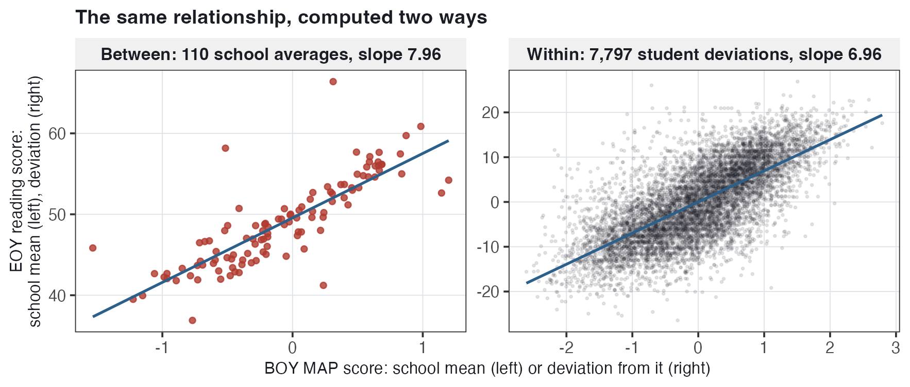
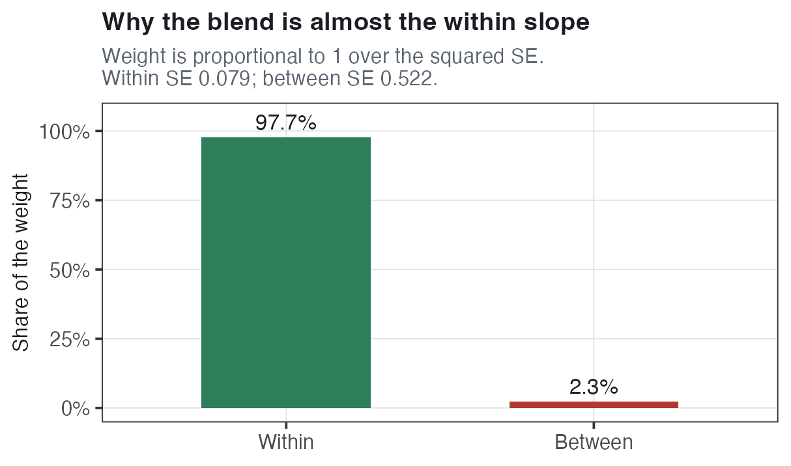
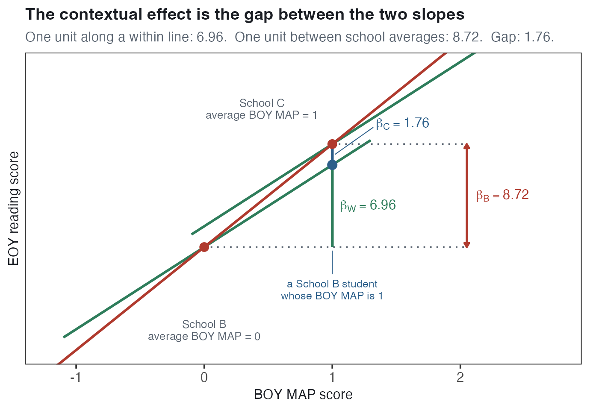
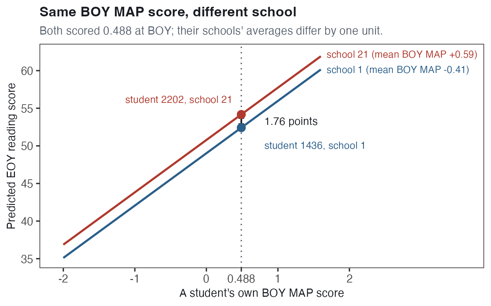
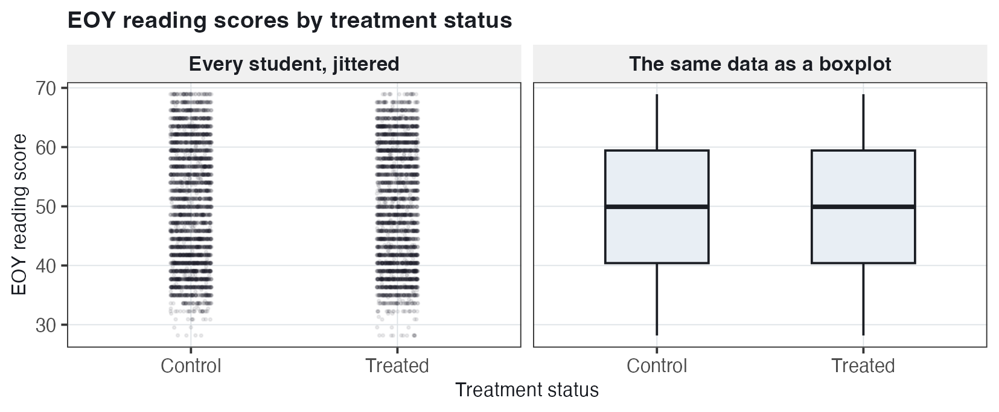
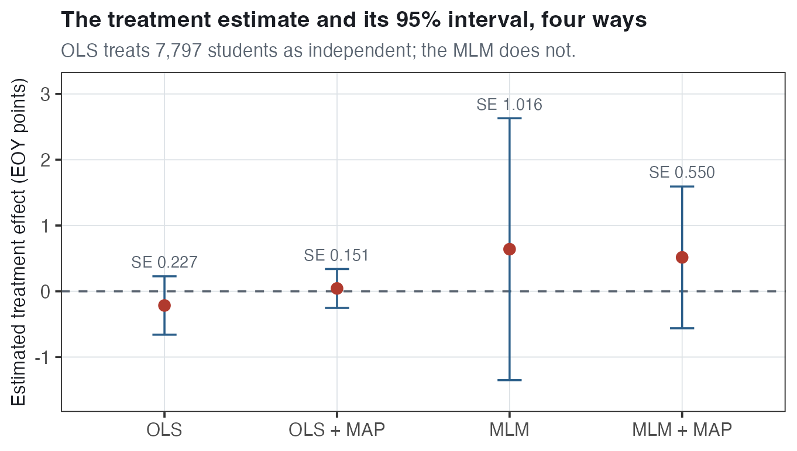
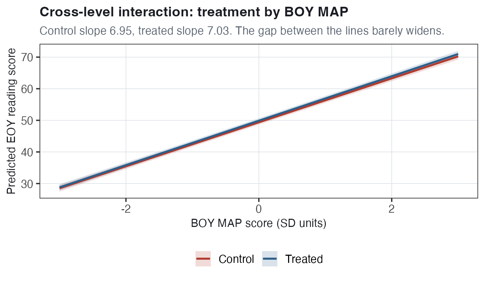
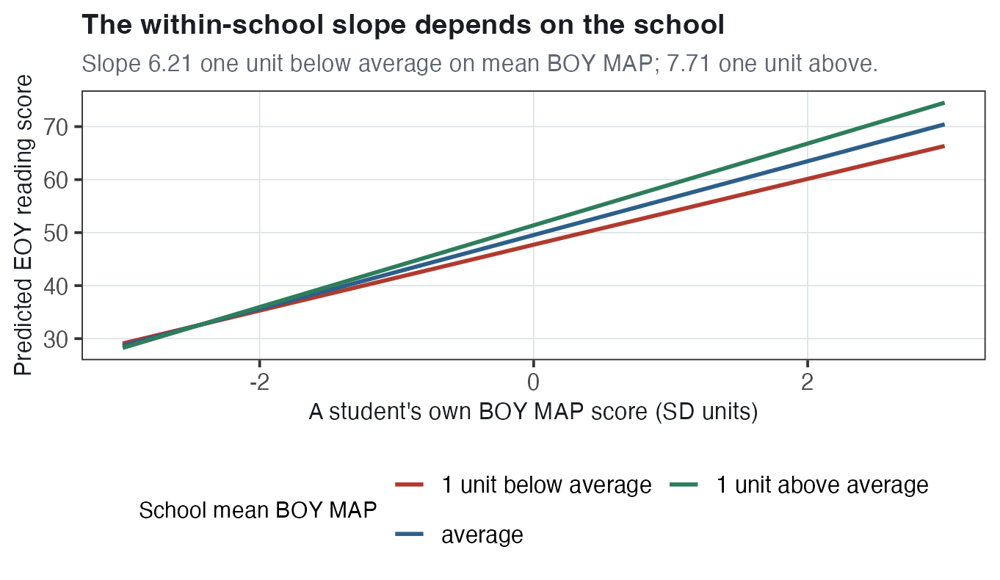

# Within, Between, and Contextual Effects {#sec-within-between}

:::: chapter-lead
::: lead-label
The chapter in one paragraph
:::

This chapter is about one predictor, a student's **beginning-of-year (BOY)** MAP reading score, and the fact that it can be used to make two different comparisons. We can compare **two students in the same school** who have different BOY scores. Or we can compare **two schools** whose *average* BOY scores differ. The first comparison gives the **within-school slope**, $\beta_W$; the second gives the **between-school slope**, $\beta_B$. An ordinary regression that ignores the schools altogether gives a third number, the **total slope** $\beta_T$, which mixes the two. The random intercepts model from @sec-random-intercepts reports a single slope on MAP, and that single slope is also a blend of the two. The chapter then shows two ways to get both slopes separately, and both use the school's average BOY score, `sch_map`, as an extra predictor. The **Mundlak model** keeps the student's own score and adds `sch_map`; its coefficient on `sch_map` is the **contextual effect** $\beta_C = \beta_B - \beta_W$, the extra difference associated with attending a higher-scoring school for two students with the same BOY MAP score. The **REWB model** (random effects within and between) uses **group-mean centering**, also called **demeaning**: it subtracts the school's average from each student's score and puts that centered score in alongside `sch_map`, so the two coefficients are $\beta_W$ and $\beta_B$ directly. The second half of the chapter turns to predictors that describe the school rather than the student — here, whether the school was randomly assigned to the reading intervention, `treat`. Because treatment was assigned to whole schools, the information about it comes from 110 schools rather than 7,797 students, which is what the **effective sample size** measures. Finally, in a **cross-level interaction** a school-level variable changes the slope on a student-level variable: does the intervention work differently for students who arrived with higher BOY scores?
::::

## New data for this chapter {#sec-wb-data}

Chapters 1 and 2 used a subsample: 10 schools and 780 students. This chapter uses **all 7,797 students in 110 schools**. The reason is that with only 10 schools there is very little information about how schools differ from one another, and this chapter is about exactly that difference. With 110 schools it can be measured more precisely. The full data are available as [`jebs_full.csv`](../data/jebs_full.csv).

This means **many numbers from the last two chapters change.** Pay close attention to the new variables; knowing them well helps interpretation later on.

| Feature | Value |
|:-----------------------------------|:-----------------------------------|
| Students | 7,797 |
| Schools | 110 |
| Students per school | 1 to 151, averaging about 71 |
| `read_comp` (EOY reading comprehension) | mean 50.00, SD 10.00 |
| `std_baseline` (a student's own BOY MAP score) | mean 0, SD 1 |
| `sch_map` (the average BOY MAP score in the student's school) | one value per school |
| `demeaned_map` (`std_baseline` minus `sch_map`, i.e., group-mean centered) | averages 0 in every school |
| `treat` (1 if the school got the intervention, 0 if not) | 56 of 110 schools |

Two notes on the variables. **The two tests are different instruments.** `std_baseline` is the MAP reading test given at the beginning of the year and reported as a Z-score, so a score of 0 means "average on the BOY test across the whole study." `read_comp` is a separate, researcher-designed reading comprehension test given at the end of the year. **Both are on convenient scales.** `read_comp` has mean 50 and SD 10, so a 10-point difference is one standard deviation of the outcome. `std_baseline` has mean 0 and SD 1, so "one unit of MAP" and "one standard deviation of MAP" are the same thing. Because `sch_map` is an average of `std_baseline` scores, it is on that same scale: one unit of `sch_map` is one point on the MAP Z-score scale.

We begin with @sec-random-intercepts's random intercepts model. One note on notation first: in the last chapter we wrote this slope as $\beta_1$, and in this chapter we call it $\beta_{RI}$. Nothing about the model changes. The subscript stands for *random intercepts*, so that the name of a slope always tells you which model it came from — and that matters here, because by the end of @sec-wb-three there are three more slopes on this same predictor to keep apart. Written in one line:

$$Y_{ij} = \gamma_0 + \beta_{RI} \text{MAP}_{ij} + u_j + e_{ij}, \qquad u_j \sim N(0, \tau^2), \qquad e_{ij} \sim N(0, \sigma^2)$$

$Y_{ij}$ is the EOY score of student $i$ in school $j$. $\gamma_0$ is the **grand intercept**, one number for everybody. $\beta_{RI}$ is the slope on the student's own BOY MAP score. $u_j$ is school $j$'s **departure** from the grand intercept — how far school $j$ sits above or below the overall line, shared by every student in that school. $e_{ij}$ is the student's own departure from their school's line. $\tau^2$ is the variance of the school departures (school-level variation) and $\sigma^2$ the variance of the student departures (student-level variation). Fit to the full data:

$$\widehat{\gamma_0} = 49.63, \qquad \widehat{\beta_{RI}} = 6.99, \qquad \widehat{\tau} = 2.68, \qquad \widehat{\sigma} = 6.15$$

Read the same way as in @sec-random-intercepts: in an average school, a student with an average BOY MAP score is predicted to score 49.63 at EOY; two students who differ by one unit in BOY MAP are predicted to differ by 6.99 points at EOY (within OR across schools). We come back to that 6.99.

## The assumption inside $u_j \sim N(0, \tau^2)$ {#sec-wb-assumption}

The four standard assumptions of a random intercepts model are:

- **Linearity.** The relationship between the predictor and the (average) outcome is a straight line.
- **Normality.** The school departures $u_j$ and the student departures $e_{ij}$ are both normally distributed.
- **Homoskedasticity.** Both kinds of departure have constant variance. Students are spread around their school's line by the same amount in every school, and schools are spread around the overall line by the same amount whether their average BOY score is low or high.
- **Conditional independence.** Once the predictors and the school departures are accounted for, what is left over is unrelated from one observation to the next.

### The part of normality that is easy to miss {#sec-wb-normality}

Writing $u_j \sim N(0, \tau^2)$ says more than "the school departures are normally distributed." It says their **mean is zero** — and not only zero across all 110 schools together, but zero *at every level of the predictor*. Written compactly:

$$\mathbb{E}[u_j \mid \text{MAP}_{ij}] = 0$$

Read the pieces out loud: $\mathbb{E}[\,\cdot\,]$ means "the expected (average) value of," and the vertical bar means "among schools where." So the line says *the average school departure is zero among schools at any given level of MAP* — among low-MAP schools, among average-MAP schools, among high-MAP schools. Wherever you look, the school departures should scatter randomly around zero.

**A concrete picture of the assumption failing.** Suppose the schools whose students arrive with low BOY scores tend to have $u_j$ around $-2$, and the schools whose students arrive with high BOY scores tend to have $u_j$ around $+2$. Across all schools the departures still average to zero. But they are not unrelated to MAP: knowing a school's average BOY score tells you which sign its departure is likely to have. That is the pattern the assumption rules out.

**Why it matters.** If high-MAP schools systematically carry an extra positive departure, then MAP and $u_j$ are correlated, and the model cannot separate "this part of the outcome is associated with MAP" from "this part is an unrelated school departure." The two get mixed into one slope. In plain terms: the model has assumed that a school's unmeasured advantage or disadvantage, $u_j$, is unrelated to its students' BOY scores, and in real data it usually is not. Schools that enroll higher-scoring students also tend to have other advantages — resources, experienced teachers, peers — and all of that ends up in $u_j$.

**What it looks like in the data.** When the assumption fails, the relationship between BOY and EOY scores *across schools* comes out different from the relationship *within schools*. That is the whole first half of this chapter: the between-school slope and the within-school slope are not the same number.

**Two names.** This condition is called the **random effects assumption**. In econometrics its failure is called **level-2 endogeneity**. A predictor is *endogenous* when it is correlated with the error term of the model, and the "level 2" says which error term: the school-level one, $u_j$. Both names describe the same thing — $u_j$ is supposed to be unrelated to the predictors, and it often is not.

::: callout-note
## What we are going to do

Take the one slope on MAP and split it into two: the slope from comparing students *inside* a school, and the slope from comparing *schools* to each other. Fit each on its own and see whether they are the same. If they are, the assumption holds and one slope is enough. If they are not, we need a model that reports both.
:::

## Three regressions we could have run {#sec-wb-three}

Before interpreting any slope, ask *who is being compared to whom*. With clustered data there are three possible answers, and we fit all three.

- **Everybody at once (i.e., total regression/complete pooling/OLS).** Ignore schools and compare any two students in the full sample. The slope mixes together differences **within schools and between schools** into one overall association.
- **Between schools.** Compare two schools that differ in their average BOY MAP score. The slope asks how much higher the average EOY score tends to be in the school whose students started higher on average.
- **Within schools.** Compare two students in the same school who differ in BOY MAP. The slope asks how much higher the EOY score tends to be for the student who started higher, holding the school constant.

The last two require us to separate MAP into its **school-average** and **within-school** pieces before fitting the model. That is, we need two new variables.

### First, two new variables {#sec-wb-demeaning}

Subtracting the school's average from each student's score is called **demeaning**, or **group-mean centering**. Here is a short example: if school A has three students with BOY scores 1, 2, and 3, its average is 2, and the demeaned scores are $1-2 = -1$, $2-2 = 0$, and $3-2 = 1$. A raw score says where a student sits in the whole study; a demeaned score says where the student sits **in their own school**.

Demeaning has two consequences. **Every school's average becomes exactly zero**, because the students above average and the students below average now balance out — in every school separately. So a demeaned variable carries no information about which school is which. **That is the point.** A regression on demeaned variables cannot be picking up differences between schools, because those differences have been removed. Whatever it finds comes from comparing students to their own classmates. **That coefficient is the within-school slope** — the association between MAP and the outcome using only within-school comparisons. This is exactly what a **fixed effects** model does — a model in which each school has its own separate intercept, which we meet in @sec-wb-fe — so the within slope and the fixed effects slope are the same number.

**Doing it in R.** Our data already contains `sch_map` and `demeaned_map`, but this is how they are built from `std_baseline`, the student's own BOY MAP score:

``` r
jebs <- jebs |>
  group_by(cluster_id) |>                          # work school by school
  mutate(sch_map      = mean(std_baseline),        # the school's average
         demeaned_map = std_baseline - sch_map) |> # each student minus it
  ungroup()                                        # always ungroup afterward
```

`group_by(cluster_id)` makes `mean(std_baseline)` compute a separate average for each school, and because it sits inside `mutate()`, that average is written onto every row of the school. We can do the same thing above with our outcome variable, `read_comp`, and it produces `sch_read` and `demeaned_read`.

Here is the result for the first five students in school 1, whose average BOY MAP score is $-0.411$:

| `id` | `cluster_id` | `std_baseline` | `sch_map` | `demeaned_map` |
|-----:|-------------:|---------------:|----------:|---------------:|
|  100 |            1 |       $-0.605$ |  $-0.411$ |       $-0.194$ |
|  284 |            1 |       $-1.917$ |  $-0.411$ |       $-1.506$ |
|  398 |            1 |          0.379 |  $-0.411$ |          0.790 |
|  404 |            1 |       $-0.386$ |  $-0.411$ |          0.025 |
|  460 |            1 |       $-1.534$ |  $-0.411$ |       $-1.123$ |

Read across a row: the student id, the school id, the student's own BOY MAP score, then their school's average, then the difference between the two. Student 404 arrived at $-0.386$, below the **overall** average of 0 but a shade *above* her **own** school's average, so her demeaned score is $+0.025$. Reading down the `sch_map` column shows what a level-2 variable looks like in a data set: one value, repeated for every student in the school.

To check the demeaning worked, every school's average of `demeaned_map` should be zero:

``` r
jebs |> group_by(cluster_id) |> summarise(check = mean(demeaned_map))
```

**One student, done by hand.** Student 422 attends school 13, which has 104 students. Her own BOY MAP score is **1.417**. School 13's average is **0.459**. Her demeaned score is

$$1.417 - 0.459 = 0.958$$

So her raw score has two parts: a **between part**, 0.459, which is where her school sits relative to all 110 schools; and a **within part**, 0.958, which is how far she sits above her own classmates. The two parts sum to her raw score, $0.459 + 0.958 = 1.417$. The same happens to the outcome: her EOY score of 64.857, minus school 13's average of 52.977, gives a demeaned outcome of 11.880. The within regression uses only the within parts. The between regression uses only the between parts.

{#fig-wb-decomposition width="78%"}

### Total regression/complete pooling/OLS: ignore clustering {#sec-wb-total}

The simplest thing to do is pretend the schools are not there. Put all 7,797 students in one ordinary regression of EOY reading on the student's own BOY MAP score, `std_baseline`:

$$Y_i = \beta_0 + \beta_T\, \text{MAP}_i + e_i$$

``` r
lm(read_comp ~ std_baseline, data = jebs)
```

$$\widehat{\beta_T} = 7.46 \quad (\text{SE } 0.0754), \qquad R^2 = 0.557$$

**Interpretation.** Take any two students in the study whose BOY MAP scores differ by one unit. They are predicted to differ by 7.46 points at EOY. Note what this comparison leaves out: whether the two students attend the same school. Some comparisons are between students in the same school, while others are between students in different schools, so 7.46 mixes the two kinds of comparison together. The next two regressions separate them.

### The between regression: means on means {#sec-wb-between}

Collapse each school to a single row, with its average BOY MAP score and its average EOY reading score (i.e., the `sch_map` and `sch_read` variables we created in @sec-wb-demeaning). That leaves 110 rows. Then run an ordinary regression on those 110 points:

$$\overline{Y}_j = \beta_0 + \beta_B\, \overline{\text{MAP}}_j + u_j$$

The bar means "the average of, within school $j$." $\overline{Y}_j$ is school $j$'s average EOY score (`sch_read` in the data) and $\overline{\text{MAP}}_j$ is its average BOY score (`sch_map`). The $u_j$ in this equation is school $j$'s residual: how far its average EOY score sits off the between-school line. We use the same letter on purpose: the random intercept $u_j$ of the random intercepts model — school $j$'s departure from the grand intercept, shared by every student in that school — can be thought of, roughly, as this between-school residual. In R:

``` r
agg <- jebs |> distinct(cluster_id, sch_map, sch_read)   # one row per school
lm(sch_read ~ sch_map, data = agg)
```

$$\widehat{\beta_B} = 7.96 \quad (\text{SE } 0.5225), \qquad R^2 = 0.683$$

**Interpretation.** Two schools whose average BOY MAP scores (`sch_map`) differ by one unit are predicted to differ by 7.96 points in average EOY reading score. This is a substantial between-school difference: schools that start one unit apart in average BOY MAP are predicted to finish nearly eight points apart in average EOY reading. The $R^2$ says that differences in average BOY score account for about 68% of the variation in schools' average EOY scores.

### The within regression: demeaned on demeaned {#sec-wb-within}

Now use only the demeaned (group-mean-centered) variables, so that every comparison happens inside a school. Subtracting each school's average removes all school-to-school variation from the regression by construction, which is exactly what a fixed effects model does (statistics students may know this as the Frisch–Waugh–Lovell theorem).

$$Y_{ij} - \overline{Y}_j = \beta_0 + \beta_W\,(\text{MAP}_{ij} - \overline{\text{MAP}}_j) + e_{ij}$$

``` r
lm(demeaned_read ~ demeaned_map, data = jebs)
```

$$\widehat{\beta_W} = 6.96 \quad (\text{SE } 0.0793), \qquad R^2 = 0.497$$

The intercept is 0.00, and it has to be, because both variables now average zero by construction.

**Interpretation.** Two students in the same school whose BOY MAP scores differ by one unit are predicted to differ by 6.96 points at EOY. Because they attend the same school, everything about that school — its funding, its curriculum, its neighborhood, its principal — is the same for both of them and cannot be what is driving the difference.

**The** $R^2$. Within schools, about half (49.7%) of the student-to-student variation in EOY scores is accounted for by student-to-student differences in BOY scores. It is not half of the variation in EOY scores overall, because between-school differences were removed before fitting this regression.

{#fig-wb-between-within width="82%"}

### The three slopes are not the same {#sec-wb-not-same}

$$\widehat{\beta_W} = 6.96 \qquad \widehat{\beta_T} = 7.46 \qquad \widehat{\beta_B} = 7.96$$

The between slope is a full point steeper than the within slope. One unit of BOY MAP is associated with about 7.96 more EOY points when we compare school averages, but only about 6.96 more when we compare students inside a school. Put simply: comparing schools and comparing classmates give different answers, which is exactly what the random effects assumption is supposed to rule out.

The total/completely pooled slope, 7.46, sits between the two. Because the comparison it makes is not restricted to students who share a school, it is a mixture of the two rather than either one on its own, and with our numbers it lands almost exactly midway: half a point above the within slope and half a point below the between slope. The total/pooled slope is not a simple weighted average of the within and between slopes: its exact location depends on how much a predictor — here, BOY MAP — varies within versus between schools and on how much influence schools of different sizes have in the student-level regression.

**Why might the between and within slopes differ?** The between-school slope, $\beta_B$, says that schools whose students arrive with higher average BOY MAP scores also tend to have higher average EOY scores. That relationship may reflect more than students' own prior achievement — for example, school resources, teacher experience, or peer composition may also differ across schools. The within-school slope, $\beta_W$, does not pick up those between-school differences because it compares students who attend the same school.

{#fig-wb-rb137 width="80%"}

::: callout-note
## The two slopes can even have opposite signs

Within a hospital, sicker patients get more aggressive treatment and might have worse outcomes, so the within-hospital slope of outcome on treatment intensity is negative. Across hospitals, the better hospitals treat more aggressively and have better outcomes, so the between-hospital slope is positive. A model that reports one slope would report something in between that describes neither comparison. This is a version of **Simpson's paradox**: a relationship that holds inside every group can reverse when the groups are lumped together.
:::

## What the random intercepts model reports {#sec-wb-ri}

Two of those three slopes are the clean comparisons: 7.96 between schools and 6.96 within schools. The random intercepts model instead estimates a **single common MAP slope** — the dashed black line in @fig-wb-rb137 — using the student's own BOY MAP score:

``` r
lmer(read_comp ~ std_baseline + (1 | cluster_id), data = jebs)
```

$$\widehat{\beta_{RI}} = 6.99 \quad (\text{SE } 0.0790)$$

That 6.99 is neither the pure within slope nor the pure between slope, because the model has not explicitly separated those two sources of variation in BOY MAP. Instead, it is a weighted average of the two, where the weights depend on **precision**: the more precisely estimated slope contributes more to the combined estimate. Precision is just a numerical way to represent "how well pinned down is this estimate?" It is calculated as $1/\text{SE}^2$, so a smaller standard error means greater precision and therefore more weight. For our two slopes:

$$\text{precision of } \widehat{\beta_W} = \frac{1}{0.07933^2} = 158.9, \qquad\qquad \text{precision of } \widehat{\beta_B} = \frac{1}{0.5225^2} = 3.7$$

The within slope is about 43 times as precisely estimated as the between slope, because it comes from 7,797 students while the between slope comes from 110 school averages. So the within slope gets almost all of the weight: $158.9/(158.9 + 3.7) = 0.977$. Written as a formula,

$$\beta_{RI} = \underbrace{\frac{V(\beta_B)}{V(\beta_B) + V(\beta_W)}}_{\text{weight on the within slope}}\beta_W \;+\; \underbrace{\frac{V(\beta_W)}{V(\beta_B) + V(\beta_W)}}_{\text{weight on the between slope}}\beta_B$$

where $V(\cdot)$ is a squared standard error. The subscripts look backwards at first: the weight on the *within* slope has the *between* variance on top. That is right — when the between slope is imprecise, $V(\beta_B)$ is large, and the formula puts the weight on the other slope. With our numbers, $0.977 \times 6.96 + 0.023 \times 7.96 = 6.98$, close to the fitted 6.99. The two are close rather than identical because this formula sets its weights from the standard errors of the two separate regressions, while the multilevel model's weights come from its own estimates of $\tau^2$ and $\sigma^2$ and the school sizes.

{#fig-wb-weights width="66%"}

There is a second way to read $\beta_{RI}$: it is the predicted difference in EOY score per one-unit difference in BOY MAP, comparing students **from the same school OR from different schools**. The total/complete-pooling OLS slope also reflects both the within-school and between-school relationships, but it does not estimate those two slopes separately and then average them. Instead, it fits one line through all students while ignoring school membership, so both the differences among students within schools and the differences between schools influence that one slope; larger schools also have more influence because they contribute more students. The random-intercepts slope also reflects both the within-school and between-school relationships, but it weights those sources of information by precision, which is why it falls much closer to the within-school slope here.

**Put simply:** the random-intercepts model reported 6.99 because almost all of the weight falls on the within-school slope of 6.96, which is estimated much more precisely, and very little falls on the between-school slope of 7.96, which is estimated less precisely. That makes sense here: the within-school relationship is informed by differences among **7,797 students**, whereas the between-school relationship is informed by differences among only **110 schools**. A "precision-weighted average" therefore does not mean halfway between the two slopes — it means the more precise slope contributes much more, which is why 6.99 ends up so close to 6.96.

{#fig-wb-four-slopes width="72%"}

**Then why fit the random intercepts model at all?** If the two slopes really are the same, the random-intercepts slope estimate is the most efficient thing to report: its standard error, 0.0790, is smaller than the standard error of either separate slope — the within-school slope or the between-school slope. The problem is what happens when the two slopes are not the same, as here. Then 6.99 is not the within slope and not the between slope, even though it happens to sit very close to the within slope of 6.96 in these data. It is still a blend of the two, so it does not cleanly describe either the within-school comparison or the between-school comparison. Call it "an uninterpretable mush of effects at different levels," or just a "mushy average."

### Where the blend comes from {#sec-wb-blend}

Here is why the random intercepts model can only produce one slope. The **assumption** in question is the one from @sec-wb-assumption: that the within-school and between-school slopes are the same number. Start from a student's own MAP score and add zero to it, where the zero is written as a school average minus itself:

$$\text{MAP}_{ij} = \text{MAP}_{ij} + \underbrace{\big(\overline{\text{MAP}}_j - \overline{\text{MAP}}_j\big)}_{=\;0}$$

Now just rearrange the terms:

$$\text{MAP}_{ij} = \underbrace{(\text{MAP}_{ij} - \overline{\text{MAP}}_j)}_{\text{within part}} + \underbrace{\overline{\text{MAP}}_j}_{\text{between part}}$$

So a student's MAP score can always be thought of as two pieces: how far that student is above or below their own school's average PLUS the average MAP score of their school.

For student 422, the student's MAP score is 1.417, and the school mean is 0.459. So:

$$1.417 = (1.417-0.459) + 0.459 = 0.958 + 0.459$$

The 0.958 is the student's within-school deviation: how far above their own school mean they are. The 0.459 is the between-school part: the average BOY MAP score for that student's school.

Nothing about the student's score has changed; her score has been written as two pieces. Now put those two pieces into the random intercepts model in place of $\text{MAP}_{ij}$:

$$Y_{ij} = \gamma_0 + \beta_{RI}\underbrace{(\text{MAP}_{ij} - \overline{\text{MAP}}_j)}_{\text{within part}} + \beta_{RI}\underbrace{\overline{\text{MAP}}_j}_{\text{between part}} + u_j + e_{ij}$$

The same $\beta_{RI}$ sits in front of both pieces. That is the constraint: the within part and the between part are forced to have the same slope, whether or not that matches the data. If we want the two pieces to have different slopes, we need a model with two coefficients. That is the Mundlak model.

**How often is this checked in practice?** Rarely, which is why we make a point of it. Antonakis and colleagues ([2021](https://journals.sagepub.com/doi/abs/10.1177/1094428119877457)) reviewed 204 articles from organizational science and applied psychology journals. Only 106 handled the random effects assumption properly, and once the usual requirements on the predictors were also applied, only **25** of the 204 were left that "potentially reported trustworthy multilevel estimates."

## The Mundlak model {#sec-wb-mundlak}

**The fix** is to add the school's average BOY MAP score, `sch_map`, to the model as a second predictor, alongside the student's own score:

$$Y_{ij} = \gamma_0 + \beta_W\, \text{MAP}_{ij} + \beta_C\, \overline{\text{MAP}}_j + u_j + e_{ij}, \qquad u_j \sim N(0, \tau^2), \qquad e_{ij} \sim N(0, \sigma^2)$$

- $\text{MAP}_{ij}$ is student $i$'s own BOY MAP score (`std_baseline`), unchanged.
- $\overline{\text{MAP}}_j$ is the average BOY MAP score in student $i$'s school (`sch_map`), the same number for every student in their school.
- $\beta_W$ is the coefficient on the student's own score. It will turn out to be the **within-school slope**.
- $\beta_C$ is the coefficient on the school average. It is the **contextual effect**, the new quantity in this chapter.
- $u_j$ and $e_{ij}$ are the school and student departures, as before.

This is the **Mundlak model**, named after a 1978 paper. The one-line summary is that we are now *controlling for school-mean differences in the covariate* — that is, $\overline{\text{MAP}}_j$.

### Why adding one term separates the two comparisons {#sec-wb-mundlak-why}

Take the two MAP terms and use the same add-zero step as in @sec-wb-blend, rewriting the student's own score as its within part plus its between part:

$$\begin{aligned}
\beta_W\,\text{MAP}_{ij} + \beta_C\,\overline{\text{MAP}}_j
 &= \beta_W\big[(\text{MAP}_{ij} - \overline{\text{MAP}}_j) + \overline{\text{MAP}}_j\big] + \beta_C\,\overline{\text{MAP}}_j \\
 &= \beta_W(\text{MAP}_{ij} - \overline{\text{MAP}}_j) + \beta_W\,\overline{\text{MAP}}_j + \beta_C\,\overline{\text{MAP}}_j \\
 &= \beta_W\underbrace{(\text{MAP}_{ij} - \overline{\text{MAP}}_j)}_{\text{within part}} + (\beta_W + \beta_C)\underbrace{\overline{\text{MAP}}_j}_{\text{between part}}
\end{aligned}$$

Line one splits the student's score into two pieces. Line two multiplies through. Line three collects the two terms that both multiply the school average. Now look at what the model says: the **within part** is multiplied by $\beta_W$, and the **between part** is multiplied by $\beta_W + \beta_C$. Two pieces, two different slopes — which is what the random intercepts model could not do.

So the between-school slope is $\beta_B = \beta_W + \beta_C$, and the coefficient on `sch_map` is the amount by which the between slope exceeds the within slope: $\beta_C = \beta_B - \beta_W$. That is why it is called a *difference* in slopes.

### Fitting it {#sec-wb-mundlak-fit}

``` r
# std_baseline: student's own BOY MAP.  sch_map: the school's average BOY MAP
lmer(read_comp ~ std_baseline + sch_map + (1 | cluster_id), data = jebs)
```

| Term                                 | Estimate |     SE |    $Z$ |
|:-------------------------------------|---------:|-------:|-------:|
| $\widehat{\gamma_0}$ `(Intercept)`   |  49.7406 | 0.2602 | 191.15 |
| $\widehat{\beta_W}$ `std_baseline`   |   6.9569 | 0.0799 |  87.06 |
| $\widehat{\beta_C}$ `sch_map`        |   1.7595 | 0.5124 |   3.43 |
| $\widehat{\tau}$ `sd(Intercept)`     |   2.5066 |        |        |
| $\widehat{\sigma}$ `sd(Observation)` |   6.1476 |        |        |

*A note on the* $Z$ column. It is the estimate divided by its standard error, and an estimate more than about two standard errors from zero ($Z$ past 1.96) is one we would not attribute to chance. `lmer` labels the column `t value`, but for a coefficient in a multilevel model (`lmer` calls the coefficients "fixed effects" — a different use of the phrase from the fixed effects *model* of @sec-wb-fe) we compare it to a normal distribution rather than a $t$, so this book calls it $Z$. The last two rows are variance components, and `lmer` does not report standard errors for them; that is why those cells are blank.

**Three numbers come out of this one table.**

- The within slope: $\widehat{\beta_W} = 6.9569$. This is **exactly** the within slope we fit by hand in @sec-wb-within. Adding `sch_map` to the model has recovered the within-school comparison on the student's own score.
- The contextual effect: $\widehat{\beta_C} = 1.7595$.
- The between slope, by addition: $\widehat{\beta_B} = \widehat{\beta_W} + \widehat{\beta_C} = 6.9569 + 1.7595 = 8.7164$.

That last number is a between slope we have not seen before, and it is *not* the 7.96 from @sec-wb-between. The two differ because the means-on-means regression counts every school equally, while the multilevel model weights larger schools more heavily; @sec-wb-two-between works through it. The model in @sec-wb-rewb reports 8.72 directly.

### Interpreting the coefficients {#sec-wb-mundlak-interp}

$\widehat{\gamma_0} = 49.74$. In an average school (one with $u_j = 0$) whose average BOY MAP score is 0, a student with a BOY MAP score of 0 is predicted to score 49.74 at EOY.

$\widehat{\beta_W} = 6.96$, the within-school slope. Two students **in the same school** whose BOY MAP scores differ by one unit are predicted to differ by 6.96 points at EOY. In other words: if a student has a higher BOY score than their classmates, do they do better at EOY? Yes, by about 7 points per unit.

$\widehat{\beta_B} = 8.72$, the between-school slope. Two **schools** whose average BOY MAP scores differ by one unit are predicted to differ by 8.72 points in average EOY score. Does being in a school with a higher average BOY score go with higher EOY scores? Yes, by about 8.7 points per unit.

$\widehat{\beta_C} = 1.76$, the contextual effect. Of two students from different schools who have the same BOY MAP score, the one whose school's average BOY MAP score is one unit higher is predicted to score 1.76 points higher at EOY. The next section works through it.

$\widehat{\tau} = 2.51$ and $\widehat{\sigma} = 6.15$. School-level variation and student-level variation. A typical school's average sits about 2.5 EOY points away from where the model predicts it; a typical student sits about 6.1 points away from their own school's line.

### The contextual effect {#sec-wb-contextual}

The contextual effect is the difference between the two slopes:

$$\beta_C = \beta_B - \beta_W = 8.72 - 6.96 = 1.76$$

{#fig-wb-rb140 width="78%"}

Start at School B's average student and move one unit to the right along School B's within line: that is a rise of $\beta_W = 6.96$. Now compare with the average student of School C, whose school average is one unit higher: that student sits $\beta_B = 8.72$ above where we started. The gap between the two, $1.76$, is the contextual effect.

There are two correct ways to say what $\beta_C$ means, and you should be able to interpret both.

**As a difference between slopes.** The between-school comparison is 1.76 points steeper than the within-school comparison. If the two slopes were identical, $\beta_C$ would be zero and the Mundlak model would be the random intercepts model again. Here $\widehat{\beta_C} = 1.76$ with a standard error of 0.51, so the difference between the two slopes is well established.

**Holding the student's own score fixed.** Take two students with the **same** BOY MAP score, one in a school whose average BOY MAP score is one unit higher than the other's. The student in the higher-scoring school is predicted to score **1.76 points higher** at EOY. This is the reading that gives the effect its name: the two students have the same individual score, so whatever difference remains is tied to the *context* they sit in rather than to their own scores. In other words: a student in a higher-scoring school is predicted to score higher even if their own score is the same.

**Two real students.** Student 1436 attends school 1, whose average BOY MAP score is $-0.41$. Student 2202 attends school 21, whose average is $+0.59$. Both students have a BOY MAP score of 0.488. The two schools' averages differ by one unit, so the Mundlak model predicts student 2202 to score 1.76 points higher:

$$\begin{aligned}
\text{student 1436:}\quad & 49.7406 + 6.9569(0.48825) + 1.7595(-0.41089) = 52.414\\
\text{student 2202:}\quad & 49.7406 + 6.9569(0.48825) + 1.7595(0.59013) = 54.176
\end{aligned}$$

The first two terms are identical because the two students have the same score. The whole difference, $54.176 - 52.414 = 1.76$ points, comes from the third term.

{#fig-wb-two-students width="76%"}

::: callout-important
## Why "contextual"

The school average is not a property of the student; it is a property of the setting the student is in. Once the student's own BOY score is in the model, any remaining association with the school's average is about the setting rather than the student's own score. It is an association, not a causal effect: students were not randomly assigned to schools, so part of it may reflect which students end up in which schools. It is a question of *where you are* versus *who you are compared to your peers*: $\beta_W$ is about who you are relative to your classmates, and $\beta_C$ is about where you are.
:::

### What happened to the variance components {#sec-wb-mundlak-vc}

Adding `sch_map` changed $\widehat{\tau}$, the school-level variation. In the random intercepts model it was 2.6766, so $\widehat{\tau}^2 = 7.16$. In the Mundlak model it is 2.5066, so $\widehat{\tau}^2 = 6.28$. The between-school variance fell by 0.88, about 12%. That is what we should expect: `sch_map` describes schools, so it can account for some of why schools differ.

The student-level variation barely moved: $\widehat{\sigma}$ went from 6.1467 to 6.1476, so $\widehat{\sigma}^2$ went from 37.78 to 37.79. That too is what we should expect. `sch_map` is the same number for every student in a school, so knowing it does not help explain why one student in that school scored higher than another. In Murnane and Willett's words, school-level predictors tend to explain school-level variation and student-level predictors tend to explain student-level variation, "although the separation is not always exclusive."

## REWB: the same model, written so it reports $\beta_B$ {#sec-wb-rewb}

Sometimes we want the between slope reported directly rather than adding $\beta_W + \beta_C$ ourselves. **Group-mean centering** does that. Instead of the student's raw score, put the **demeaned** score in the model, alongside the school average:

$$Y_{ij} = \gamma_0 + \beta_W\,(\text{MAP}_{ij} - \overline{\text{MAP}}_j) + \beta_B\, \overline{\text{MAP}}_j + u_j + e_{ij}$$

This is **REWB**, for Random Effects Within and Between. The within part carries $\beta_W$ and the between part carries $\beta_B$ — exactly the two pieces we regrouped in @sec-wb-mundlak-why, now given their own coefficients from the start.

``` r
# demeaned_map = std_baseline (own BOY MAP) - sch_map (school average)
lmer(read_comp ~ demeaned_map + sch_map + (1 | cluster_id), data = jebs)
```

| Term                                 | Estimate |     SE |    $Z$ |
|:-------------------------------------|---------:|-------:|-------:|
| $\widehat{\gamma_0}$ `(Intercept)`   |  49.7406 | 0.2602 | 191.15 |
| $\widehat{\beta_W}$ `demeaned_map`   |   6.9569 | 0.0799 |  87.06 |
| $\widehat{\beta_B}$ `sch_map`        |   8.7164 | 0.5062 |  17.22 |
| $\widehat{\tau}$ `sd(Intercept)`     |   2.5066 |        |        |
| $\widehat{\sigma}$ `sd(Observation)` |   6.1476 |        |        |

**Interpreting each term.**

- $\widehat{\gamma_0} = 49.74$. In an average school whose average BOY MAP score is 0, a student who is exactly average *for that school* (demeaned score 0) is predicted to score 49.74 at EOY. Same number as Mundlak's intercept, because a student with a raw score of 0 in a school whose average is 0 is also average for their school.
- $\widehat{\beta_W} = 6.96$. Two students in the same school who differ by one unit in BOY MAP are predicted to differ by 6.96 points at EOY. Identical to the Mundlak within slope.
- $\widehat{\beta_B} = 8.72$. Two schools whose average BOY MAP scores differ by one unit are predicted to differ by 8.72 points in average EOY score. This is the between slope we computed by adding the Mundlak model's two coefficients; REWB reports it directly, with its own standard error.
- $\widehat{\tau} = 2.51$, $\widehat{\sigma} = 6.15$. Unchanged from Mundlak.

**Why the two are the same model.** Start from REWB and multiply out the demeaned term:

$$\begin{aligned}
\text{REWB:} \quad & \gamma_0 + \beta_W(\text{MAP}_{ij} - \overline{\text{MAP}}_j) + \beta_B \overline{\text{MAP}}_j + u_j + e_{ij} \\
\text{Distribute:} \quad & \gamma_0 + \beta_W \text{MAP}_{ij} - \beta_W \overline{\text{MAP}}_j + \beta_B \overline{\text{MAP}}_j + u_j + e_{ij} \\
\text{Group terms:} \quad & \gamma_0 + \beta_W \text{MAP}_{ij} + (\beta_B - \beta_W)\, \overline{\text{MAP}}_j + u_j + e_{ij} \\
\text{Mundlak:} \quad & \gamma_0 + \beta_W \text{MAP}_{ij} + \beta_C\, \overline{\text{MAP}}_j + u_j + e_{ij}
\end{aligned}$$

The third line and the fourth are the same equation, because $\beta_C$ *is* $\beta_B - \beta_W$. REWB rearranges into Mundlak with nothing assumed and nothing dropped.

**These two models are the same model.** Same intercept, same within slope, same $\widehat{\tau}$ and $\widehat{\sigma}$, same fit to the data. The only difference is the coefficient on `sch_map`: in Mundlak it is the contextual effect ($\beta_C$, how much *steeper* the between comparison is), and in REWB it is the between slope itself ($\beta_B$, how steep). The identity ties them together:

$$\widehat{\beta_W} + \widehat{\beta_C} = 6.9569 + 1.7595 = 8.7164 = \widehat{\beta_B}$$

| To get this effect | From Mundlak: `std_baseline + sch_map` | From REWB: `demeaned_map + sch_map` |
|:-----------------------|:-----------------------|:-----------------------|
| Within, $\beta_W$ = 6.96 | read the coefficient on `std_baseline` | read the coefficient on `demeaned_map` |
| Between, $\beta_B$ = 8.72 | add the two: $6.96 + 1.76$ | read the coefficient on `sch_map` |
| Contextual, $\beta_C$ = 1.76 | read the coefficient on `sch_map` | subtract: $8.72 - 6.96$ |

### Two between slopes, and why they differ {#sec-wb-two-between}

We now have two numbers both called "the between slope": 7.96 from the means-on-means regression in @sec-wb-between, and 8.72 from the REWB model. The relationship $\beta_B = \beta_W + \beta_C$ only works with the second: $6.96 + 1.76 = 8.72$, not 7.96 — where 1.76 is the Mundlak coefficient on `sch_map`, the contextual effect.

Nothing is wrong. The two regressions **weight the schools differently**, and our schools range from 1 student to 151.

- The means-on-means regression treats each school as one data point. A school with 2 students counts exactly as much as a school with 151.
- The multilevel model weights each school by how much information it carries, so larger schools count for more.

With every school the same size the two would agree. Ours are very unequal, so they do not. If you are reporting from a Mundlak or REWB model, use the model's between-school slope, 8.72, because that is the value implied by $\beta_B = \beta_W + \beta_C$.

### All five slopes, compared {#sec-wb-five}

| Quantity | The comparison it makes | Which model reports it | Our value |
|:-----------------|:-----------------|:-----------------|-----------------:|
| Total/pooled slope, $\beta_T$ | any two students in the study, sharing a school or not | `std_baseline` in a plain regression with no school terms | 7.46 |
| Within slope, $\beta_W$ | two students in the **same school** who differ by one unit in BOY MAP | `std_baseline` in Mundlak; `demeaned_map` in REWB; the demeaned regression of @sec-wb-within | 6.96 |
| Between slope, $\beta_B$ | two **schools** whose average BOY MAP differs by one unit | `sch_map` in REWB; or $\beta_W + \beta_C$ from Mundlak | 8.72 |
| Contextual effect, $\beta_C$ | two students with the **same** BOY MAP score, in schools whose averages differ by one unit | `sch_map` in Mundlak; or $\beta_B - \beta_W$ from REWB | 1.76 |
| Random intercepts slope, $\beta_{RI}$ | a precision-weighted blend of within and between; no single clean comparison | `std_baseline` in a model with no `sch_map` | 6.99 |

The middle three come from one fitted model, written two ways. $\beta_B$ and $\beta_C$ differ by exactly $\beta_W$, because moving from one school's average student to another's changes the student's own score by one unit as well ($\beta_W$ of the 8.72) and changes the school context by one unit ($\beta_C$ of it). $\beta_{RI}$ is the one number the random intercepts model reports when it is forced to use a single slope, and it is the reason the other three exist. $\beta_T$ is what you get when you ignore the clustering entirely.

## Fixed effects, random intercepts, Mundlak, and REWB {#sec-wb-fe}

Here are four ways to handle the school structure, side by side:

$$\begin{aligned}
\text{Fixed effects:} && Y_{ij} &= \alpha_j + \beta_W \text{MAP}_{ij} + e_{ij} \\
\text{Random intercepts:} && Y_{ij} &= \gamma_0 + \beta_{RI} \text{MAP}_{ij} + u_j + e_{ij} \\
\text{Mundlak:} && Y_{ij} &= \gamma_0 + \beta_W \text{MAP}_{ij} + \beta_C \overline{\text{MAP}}_j + u_j + e_{ij} \\
\text{REWB:} && Y_{ij} &= \gamma_0 + \beta_W (\text{MAP}_{ij} - \overline{\text{MAP}}_j) + \beta_B \overline{\text{MAP}}_j + u_j + e_{ij}
\end{aligned}$$

with $u_j \sim N(0, \tau^2)$ in the last three.

**Fixed effects.** Every school gets its own free intercept $\alpha_j$, estimated as a separate parameter with no distribution attached. Because each school's level is captured by its own $\alpha_j$, the slope can only come from comparing students inside schools, so fixed effects returns $\beta_W$ and nothing else — in other words, "fixed effects is all within, all the time." It makes no assumption about whether the school effects are correlated with MAP, which is why it is not affected by the problem in @sec-wb-assumption: a school's unmeasured advantages cannot mix into the slope, because each school's level is estimated separately.

**Random intercepts.** The 110 school departures are treated as draws from one normal distribution, and we estimate that distribution's variance $\tau^2$ instead of 110 separate intercepts. That is one parameter instead of 110, and it makes the between-school comparison available. But it carries the random effects assumption: that $u_j$ is unrelated to MAP, so that the within and between slopes are the same number.

**Mundlak and REWB.** Both keep the random intercepts structure and add the school mean, which separates the two comparisons and removes the assumption. Mundlak reports the within slope and the contextual effect; REWB reports the within slope and the between slope. Same model, two labelings.

Here are the trade-offs of the fixed and random approaches, adapted from Rabe-Hesketh and Skrondal.

| Property | Fixed effects | Random effects |
|:-----------------------|:-----------------------|:-----------------------|
| Target of inference | these clusters | the population of clusters |
| Minimum number of clusters | 2 | 10 or more |
| Assumptions on cluster effects | none | normal, constant variance, uncorrelated with $X$ |
| Level-2 covariates? | no | yes |
| Minimum cluster size | 2, but needs to be large to estimate $\alpha_j$ well | any, if many clusters have at least 2 |
| Parsimony | low: one intercept per cluster | high: one variance parameter, $\tau^2$ |
| Within-cluster slopes | yes | yes, with Mundlak or REWB |

**Target of inference** is about what you want to generalize to: fixed effects describes these 110 schools and says nothing about any other school, while random effects treats the 110 as a sample from a population of schools and describes that population. **Minimum number of clusters** is about $\tau^2$: a variance estimated from fewer than about ten draws is too unstable to be useful, whereas fixed effects needs only two clusters to have something to compare. **Parsimony** is a parameter count: fixed effects estimates one intercept per cluster, 110 of them here, while random effects estimates a single number, $\tau^2$. **Minimum cluster size** is where our own data are a problem for fixed effects: two of our 110 schools have a single student, who contributes no within-school comparison at all. Random effects handles them, because a tiny school just carries little information rather than none.

The row that matters most for the rest of this chapter is **level-2 covariates**. Fixed effects cannot include them at all, and @sec-wb-fe-collinear explains why.

## Level 2 predictors: adding treatment {#sec-wb-level2}

### What the data are {#sec-wb-trial}

These data come from a **randomized controlled trial**. Students received a literacy curriculum called the Model of Reading Engagement (MORE). Treated students got science *and* social studies content; control students got science content only. The variable `treat` is 1 for treated and 0 for control.

This is a **cluster randomized trial**: treatment was assigned to **schools**, not to individual students. Every student in a treated school is treated; every student in a control school is not. 56 of the 110 schools were assigned to treatment, covering 3,896 of the 7,797 students.

A variable that takes the same value for every member of a cluster is a **level-2 variable**. `sch_map` was already one — every student in a school shares the school's average BOY MAP score. `treat` is another.

### The research questions

1.  Did the treatment **cause** an improvement in reading comprehension?
2.  Does treatment effectiveness **vary** by where students started?

Question 1 is the first genuinely causal question in this book, and it is causal for a specific reason: schools were *randomly assigned*. Random assignment is what makes a difference in outcomes attributable to the treatment rather than to whatever else distinguishes the two groups of schools. Compare @sec-random-intercepts's value-added estimates, where students were not randomly assigned to schools and we were careful to say $\widehat{u_j}$ was not a causal effect.

### What ordinary regression would say {#sec-wb-trial-ols}

Ignore the school structure and regress EOY reading on treatment, one row per student:

$$Y_i = \beta_0 + \beta_1 \text{treat}_i + e_i$$

| Term          | Estimate |     SE |     $t$ |
|:--------------|---------:|-------:|--------:|
| `(Intercept)` |   50.108 | 0.1601 |  312.96 |
| `treat`       | $-0.216$ | 0.2265 | $-0.95$ |

(Remember: an ordinary regression has one error variance, so its test statistic is a $t$; the multilevel tables below use $Z$ because a coefficient in a multilevel model is compared to a normal distribution rather than a $t$, as in @sec-wb-mundlak-fit.) Read the table and it says treated students scored 0.216 points *lower*, with a standard error of 0.227 — a small negative estimate that is not large relative to its standard error.

{#fig-wb-treatment width="80%"}

### The multilevel version {#sec-wb-trial-mlm}

A school-level variable goes **in the equation for the intercept**. In **hierarchical form**, one equation per level:

$$\begin{aligned}
\textbf{Level 1 (students):}\quad Y_{ij} &= \beta_{0j} + e_{ij} \\
\textbf{Level 2 (schools):}\quad \beta_{0j} &= \gamma_0 + \gamma_1 \text{treat}_j + u_j \\
u_j &\sim N(0, \tau^2), \qquad e_{ij} \sim N(0, \sigma^2)
\end{aligned}$$

Each school has its own intercept $\beta_{0j}$, its average EOY score. The second line is a regression *at the school level*: a school's average equals a grand intercept $\gamma_0$, plus $\gamma_1$ if the school was treated, plus $u_j$. Here $u_j$ is what is left over for school $j$ once its treatment status is accounted for — how far its average sits above or below what a school with that treatment status is predicted to score. `treat` carries only a $j$ subscript because it is a property of the school.

Substituting the second line into the first gives the **reduced form**, which is the model R fits:

$$Y_{ij} = \gamma_0 + \gamma_1 \text{treat}_j + u_j + e_{ij}$$

``` r
lmer(read_comp ~ 1 + treat + (1 | cluster_id), data = jebs)
```

| Term                                 | Estimate |     SE |   $Z$ |
|:-------------------------------------|---------:|-------:|------:|
| $\widehat{\gamma_0}$ `(Intercept)`   |   48.820 | 0.7178 | 68.01 |
| $\widehat{\gamma_1}$ `treat`         |    0.640 | 1.0158 |  0.63 |
| $\widehat{\tau}$ `sd(Intercept)`     |   5.0784 |        |       |
| $\widehat{\sigma}$ `sd(Observation)` |   8.6615 |        |       |

**Interpretation.** $\widehat{\gamma_0} = 48.82$: the average control school is predicted to have an average EOY score of 48.82. $\widehat{\gamma_1} = 0.64$: the average treated school is predicted to sit 0.64 EOY points above the average control school. Equivalently, a student in a treated school is predicted to score 0.64 points higher than a student in a control school. $\widehat{\tau} = 5.08$: school-level variation; after accounting for treatment status, schools still differ from one another by about 5 points, typically, in their average outcome. That is about half a standard deviation of the outcome. $\widehat{\sigma} = 8.66$: student-level variation; a typical student sits about 8.7 points from their own school's average.

**Two things changed from the ordinary regression.**

*The estimate flipped*, from $-0.216$ to $+0.640$. This is the same weighting issue as in @sec-wb-two-between. Ordinary least squares (OLS, plain regression with no random effects) counts every *student* equally, so the largest schools dominate the estimate. The multilevel model weights each school by the information it carries. That puts large schools in between: they count for more than in the means-on-means regression of @sec-wb-two-between, where every school counts once, but for less than under OLS, where every student counts once.

*The standard error went from 0.227 to 1.016*, about four and a half times larger. Neither estimate is distinguishable from zero, but the OLS standard error is far too small for what the data can support. The next section says why.

**Why treatment explains almost nothing.** $\widehat{\tau}^2 = 5.0784^2 = 25.79$, compared with 25.58 in a model with no predictors at all — essentially no reduction in between-school variance; the small increase just reflects re-estimation. Because `treat` is a school-level variable, it can directly explain between-school differences, not differences among students within the same school. So any variance reduction we would expect from `treat` would primarily show up in the school-level variance, $\tau^2$, and because the estimated treatment effect is tiny (0.64 points) it explains almost none of it. And it leaves $\sigma^2$ essentially unchanged — 75.02 either way — for the reason in @sec-wb-mundlak-vc: a variable that is identical for everyone in a school says nothing about why classmates differ.

### Why the standard error is so much bigger {#sec-wb-ess}

This is the most important idea in the second half of the chapter.

Ordinary regression assumes 7,797 independent observations. They are not independent: students in the same school resemble each other. And treatment does not vary within a school — it varies only across the 110 schools. So the information we have about the treatment effect is governed by the number of *schools*, not the number of students.

The **effective sample size** (ESS) puts a number on this. Put simply: it is the number of independent observations that would carry the same information as our clustered sample does.

$$\text{ESS} = \frac{N}{1 + \text{ICC}\,(\bar{n}-1)}$$

$N$ is the total number of students, $\bar{n}$ is the average number of students per school, and the ICC is the intraclass correlation from @sec-variance-components — the share of the variation in EOY scores that lies between schools. The denominator is the factor by which clustering inflates the variance of our estimates.

A model with no predictors at all estimates $\widehat{\tau}^2 = 25.58$ and $\widehat{\sigma}^2 = 75.02$, so the ICC — the share of the variation that is between schools, $\tau^2/(\tau^2 + \sigma^2)$ — is $25.58/(25.58 + 75.02) = 0.254$. Our $\bar{n} = 7797/110 = 70.88$. So

$$\text{ESS} = \frac{7797}{1 + 0.254\,(70.88-1)} = \frac{7797}{1 + 17.75} = \frac{7797}{18.75} = 415.8$$

**Interpretation.** For estimating a school-level effect, our 7,797 students carry about as much information as **416 independent students** would. That is a reduction by a factor of nearly 19, and it is why the standard error on `treat` increased so much. This is not a problem with the model; it reflects the fact that students within the same school are partly redundant sources of information about a school-level treatment. **In research, we would generally prefer more independent schools rather than simply more students within the same schools**, because adding schools gives us more independent information for estimating a school-level effect.

::: callout-tip
## Consider the extremes to interpret the formula

If the ICC were 1, every student in a school would have an identical score — Murnane and Willett say the students would be behaving "as clones of one another" — so a school of 100 students would carry exactly as much information as 1 student. The ESS would be $N/\bar{n}$, which for 1,000 students in 10 schools of 100 is 10: the number of schools. If the ICC were 0, students would be unrelated to their schoolmates and clustering would make no difference: the ESS would be $N = 1{,}000$. Real data sit between the two, and the ICC says where. Importantly, even a fairly small ICC can have a huge effect on the sample size required: in Murnane and Willett's example, increasing the ICC from 0 to just .10 raises the required sample from roughly 650 to 3,750.

This also answers a design question: when planning a cluster trial, is it better to add students or add schools? Adding whole new schools raises $N$ without raising $\bar{n}$, so the effective sample size rises almost in step. Adding students to the schools you already have raises $\bar{n}$ too, and each extra student in a school that is already in the study adds less new information than the one before. In Murnane and Willett's words, statistical power in a cluster-randomized design "lies much more in the number of clusters than in the number of participants per cluster."
:::

### Covariates improve precision {#sec-wb-covariates}

Add the student's own BOY MAP score alongside treatment:

$$\begin{aligned}
\textbf{Level 1:}\quad Y_{ij} &= \beta_{0j} + \beta_1 \text{MAP}_{ij} + e_{ij} \\
\textbf{Level 2:}\quad \beta_{0j} &= \gamma_0 + \gamma_1 \text{treat}_j + u_j
\end{aligned}$$

``` r
lmer(read_comp ~ 1 + treat + std_baseline + (1 | cluster_id), data = jebs)
```

| Term                                 | Estimate |     SE |    $Z$ |
|:-------------------------------------|---------:|-------:|-------:|
| $\widehat{\gamma_0}$ `(Intercept)`   |   49.373 | 0.3878 | 127.31 |
| $\widehat{\gamma_1}$ `treat`         |    0.515 | 0.5498 |   0.94 |
| $\widehat{\beta_1}$ `std_baseline`   |    6.995 | 0.0790 |  88.51 |
| $\widehat{\tau}$ `sd(Intercept)`     |   2.6833 |        |        |
| $\widehat{\sigma}$ `sd(Observation)` |   6.1466 |        |        |

**The standard error on treatment nearly halved**, from 1.016 to 0.550. The covariate did this by reducing both kinds of leftover variation.

- Student-level variation fell: $\widehat{\sigma}^2$ went from $8.6615^2 = 75.02$ to $6.1466^2 = 37.78$, a drop of about 50%. A student's own BOY score explains a lot of why classmates differ at EOY.
- School-level variation fell too: $\widehat{\tau}^2$ went from 25.79 to $2.6833^2 = 7.20$. Schools differ partly because their students arrived with different BOY scores, and MAP accounts for that.

Both drops shrink the standard error, because a standard error is computed from the variation the model has *not* explained. The ICC computed from these leftover variances also fell, from $25.79/(25.79 + 75.02) = 0.256$ to $7.20/(7.20 + 37.78) = 0.160$. That 0.160 is a **residual ICC**: it describes how much of the *unexplained* variation sits between schools once MAP is in the model. It is not a new answer to "how clustered are EOY scores?" — that is still the 0.254 from the model with no predictors, because it describes the outcome itself rather than what is left after a predictor. The residual ICC is the one that matters for the standard error on `treat`, and a smaller one means a larger effective sample size.

**The treatment estimate itself moved slightly**, from 0.640 to 0.515. That is what random assignment should produce. Because schools were randomized, the treated and control groups were already alike at baseline, so the covariate is not there to correct for groups that started out different. It is there to reduce unexplained variation.

**So what is the answer to research question 1:** Did the treatment **cause** an improvement in reading comprehension? Our best estimate comes from this last model, the multilevel model with `treat` and the BOY covariate: a treatment effect of 0.515 EOY points with a standard error of 0.550. The rough 95% interval is $0.515 \pm 1.96(0.550)$, which runs from $-0.56$ to $+1.59$. Zero is comfortably inside it, so we cannot say the intervention improved reading comprehension.

{#fig-wb-treatment-se width="72%"}

## Why fixed effects cannot do this {#sec-wb-fe-collinear}

Under fixed effects, every school has its own intercept $\alpha_j$. Try to add treatment to that model:

$$Y_{ij} = \alpha_j + \beta_1 \text{MAP}_{ij} + \gamma_1 \text{treat}_j + e_{ij}$$

This model cannot be estimated. The $\alpha_j$ — one free intercept per school — are **collinear** with treatment, which means one can be perfectly predicted from the other. If we know which school a student is in, we know with complete certainty whether they were treated, because treatment was assigned at the school level and does not vary within a school.

So there is no way to separate "the effect of being in school 7" from "the effect of being treated." Any treatment effect you might attribute to $\gamma_1$ could equally be attributed to the 56 treated schools' $\alpha_j$ values, and the data cannot distinguish between those explanations. The model is **under-identified**: more parameters than the data can pin down. As Murnane and Willett put it, once the school intercepts are in the model they account for all of the school-level variation in the outcome, and no other school-level predictor can be added.

This is a genuine advantage of the random effects approach. By replacing 110 free intercepts with a single variance parameter $\tau^2$, the multilevel model can still include school-level predictors.

## Cross-level interactions {#sec-wb-crosslevel}

### The idea

Research question 2 was: *does treatment effectiveness vary by where students started?* Perhaps the intervention helps students who arrived behind more than others, or perhaps it builds on existing skill and helps stronger readers more.

That is a question about whether the **slope** on a student-level variable (BOY MAP) depends on a **school-level** variable (treatment). Because the two variables live at different levels, this is called a **cross-level interaction**. One warning before we fit it: ordinary regression is an even poorer guide to precision here than it was for treatment on its own. The product term varies only across the 110 schools, just as `treat` does, so an OLS standard error on it is too small for the same reason and by even more.

### Hierarchical form {#sec-wb-cl-hier}

Until now only the intercept varied by school. Now let the slope vary **systematically with treatment status too** — though not yet as a random effect — and write a level-2 equation for it:

$$\begin{aligned}
\textbf{Level 1:}\quad Y_{ij} &= \beta_{0j} + \beta_{1j}\, \text{MAP}_{ij} + e_{ij} \\
\textbf{Level 2:}\quad \beta_{0j} &= \gamma_{00} + \gamma_{01}\text{treat}_j + u_j \\
\beta_{1j} &= \gamma_{10} + \gamma_{11}\text{treat}_j
\end{aligned}$$

Two things to notice. First, $\beta_1$ now has a $j$ subscript: the slope can differ from school to school. Second, the double subscripts on the $\gamma$'s are bookkeeping. The first digit says which level-1 coefficient the term belongs to (0 for the intercept, 1 for the slope); the second says which level-2 predictor it goes with (0 for the constant, 1 for `treat`).

**The slope equation has no** $u_j$. That matters. In this model the slope takes exactly two values: $\gamma_{10}$ in control schools and $\gamma_{10} + \gamma_{11}$ in treated schools. Two control schools have *identical* slopes; so do two treated schools. There is no school-to-school scatter in the slopes beyond what treatment explains. A **random slopes** model (@sec-random-slopes) adds a departure term to the slope equation so that each school can have its own slope, the same way each school already has its own intercept.

### Reduced form

Substitute both level-2 equations into the level-1 equation and multiply out:

$$Y_{ij} = \gamma_{00} + \gamma_{01}\text{treat}_j + \gamma_{10}\text{MAP}_{ij} + \gamma_{11}(\text{treat}_j \times \text{MAP}_{ij}) + u_j + e_{ij}$$

**It is just an interaction.** The product term $\text{treat}_j \times \text{MAP}_{ij}$ is the part of the model in which the slope depends on treatment. In R, `*` expands to both variables on their own (the **main effects**) plus their product:

``` r
# treat: 1 if the school was treated.  std_baseline: student's own BOY MAP
lmer(read_comp ~ 1 + treat * std_baseline + (1 | cluster_id), data = jebs)
```

| Term                                         | Estimate |     SE |    $Z$ |
|:---------------------------------------------|---------:|-------:|-------:|
| $\widehat{\gamma_{00}}$ `(Intercept)`        |   49.371 | 0.3882 | 127.18 |
| $\widehat{\gamma_{01}}$ `treat`              |    0.520 | 0.5503 |   0.95 |
| $\widehat{\gamma_{10}}$ `std_baseline`       |    6.954 | 0.1143 |  60.83 |
| $\widehat{\gamma_{11}}$ `treat:std_baseline` |    0.077 | 0.1582 |   0.49 |
| $\widehat{\tau}$ `sd(Intercept)`             |   2.6859 |        |        |
| $\widehat{\sigma}$ `sd(Observation)`         |   6.1468 |        |        |

### Interpreting all four coefficients {#sec-wb-cl-interp}

The clean way to read an interaction is to write the model out separately for each group.

**Control schools** ($\text{treat} = 0$), where both treatment terms drop out:

$$Y_{ij} = 49.371 + 6.954\,\text{MAP}_{ij} + u_j + e_{ij}$$

**Treated schools** ($\text{treat} = 1$), where both switch on:

$$Y_{ij} = (49.371 + 0.520) + (6.954 + 0.077)\,\text{MAP}_{ij} + u_j + e_{ij} = 49.891 + 7.031\,\text{MAP}_{ij} + u_j + e_{ij}$$

- $\widehat{\gamma_{00}} = 49.37$. In an average control school, a student with a BOY MAP score of 0 is predicted to score 49.37 at EOY.
- $\widehat{\gamma_{01}} = 0.52$. The treatment effect **for a student whose BOY MAP score is 0**: such a student is predicted to score 0.52 points higher in a treated school than in a control school. Because MAP is standardized, a score of 0 is the average student, which makes this a sensible number. If MAP were not centered at a meaningful value, this coefficient would describe the treatment effect at whatever score happened to be zero.
- $\widehat{\gamma_{10}} = 6.95$. Among **control** schools, two students who differ by one unit in BOY MAP are predicted to differ by 6.95 points at EOY.
- $\widehat{\gamma_{11}} = 0.077$. This is the **difference between the MAP slopes in treated and control schools**. In control schools, a one-unit higher BOY MAP score is associated with 6.95 more EOY points. In treated schools, it is associated with 7.03 more EOY points. So the slopes differ by only about $7.03 - 6.95 = 0.08$ points — essentially no difference. The same interaction can be read another way: $\gamma_{11}$ tells us how the treatment effect changes as BOY MAP increases. At BOY MAP = 0, the estimated treatment effect is 0.52 points. At BOY MAP = 1, it is $0.52 + 0.08 = 0.60$ points. At BOY MAP = 2, it would be $0.52 + 2(0.08) = 0.68$ points. So each one-unit increase in BOY MAP increases the estimated treatment effect by about 0.08 points.

**Is the 0.08 real?** Its standard error is 0.158, so $Z = 0.077/0.158 = 0.49$, nowhere near 1.96. A rough 95% interval runs from about $-0.23$ to $+0.39$ and comfortably contains zero. We have **no evidence** that treatment effectiveness varies by baseline achievement. The answer to research question 2, on this data, is that we cannot detect any such variation.

{#fig-wb-crosslevel width="72%"}

### Other cross-level questions

The pattern generalizes to any question of the form "does a level-1 relationship depend on a level-2 characteristic?" One example: does the relationship between student SES and achievement vary by whether a school is public or private? Another example: does teacher experience change the strength of the relationship between student effort and achievement? In each case the level-2 variable multiplies the level-1 one, exactly as `treat` multiplied `std_baseline` above.

### The interacted Mundlak model {#sec-wb-interacted-mundlak}

This one is more advanced. It uses the same machinery on the Mundlak model. The school's average BOY MAP score, `sch_map`, is itself a level-2 variable, so we can ask whether the **within-school slope depends on the school's average**:

$$Y_{ij} = \gamma_0 + \beta_W\, \text{MAP}_{ij} + \beta_C\, \overline{\text{MAP}}_j + \beta_{WC}\,(\text{MAP}_{ij} \times \overline{\text{MAP}}_j) + u_j + e_{ij}$$

- $\text{MAP}_{ij}$ is the student's own BOY MAP score (`std_baseline`) and $\overline{\text{MAP}}_j$ is the school's average (`sch_map`), as in @sec-wb-mundlak.
- $\beta_W$ is now the within-school slope **in a school whose average BOY MAP is 0**.
- $\beta_C$ is now the contextual effect **for a student whose own BOY MAP is 0**.
- $\beta_{WC}$, the new term, says how much the within-school slope changes for each one-unit increase in the school's average.
- $\gamma_0$, $u_j$ and $e_{ij}$ are the grand intercept and the school and student departures, as before.

``` r
lmer(read_comp ~ 1 + std_baseline * sch_map + (1 | cluster_id), data = jebs)
```

| Term                                          | Estimate |     SE |    $Z$ |
|:----------------------------------------------|---------:|-------:|-------:|
| $\widehat{\gamma_0}$ `(Intercept)`            |   49.548 | 0.2608 | 189.96 |
| $\widehat{\beta_W}$ `std_baseline`            |    6.961 | 0.0798 |  87.19 |
| $\widehat{\beta_C}$ `sch_map`                 |    1.831 | 0.5070 |   3.61 |
| $\widehat{\beta_{WC}}$ `std_baseline:sch_map` |    0.751 | 0.1696 |   4.43 |
| $\widehat{\tau}$ `sd(Intercept)`              |   2.4736 |        |        |
| $\widehat{\sigma}$ `sd(Observation)`          |   6.1412 |        |        |

The coefficient on `sch_map` is 1.831 here rather than the 1.76 of @sec-wb-mundlak. Both are right. In a model with an interaction, a main effect is read at the other variable's zero, so 1.831 is the contextual effect for a student whose own BOY MAP is 0. The model in @sec-wb-mundlak had no interaction, so one number had to serve for every student.

**This interaction is statistically significant**, with $Z = 4.43$. Reading $\widehat{\beta_{WC}} = 0.751$: the within-school slope is 0.751 points steeper for each one-unit increase in the school's average BOY MAP score:

- In a school one unit **below** average on `sch_map`: within slope $= 6.961 - 0.751 = 6.21$
- In an average school: within slope $= 6.961$
- In a school one unit **above** average: within slope $= 6.961 + 0.751 = 7.71$

**What we are seeing.** In schools that enrolled higher-scoring students, a one-unit difference between two classmates' BOY scores is associated with a larger EOY difference than the same one-unit difference would be in a lower-scoring school. Two classmates one unit apart at BOY are predicted to end the year 6.2 points apart in a low-average school and 7.7 points apart in a high-average school. Students spread out more by the end of the year in higher-achieving schools.

{#fig-wb-interacted-mundlak width="72%"}

## Vocabulary decoder {#sec-wb-vocab}

| Term | What it means here |
|:-----------------------------------|:-----------------------------------|
| Total/pooled/OLS effect, $\beta_T$ | The slope from an ordinary regression that ignores the clustering: any two students in the study, whether or not they share a school |
| Within effect, $\beta_W$ | The slope from comparing students inside the same school: two classmates who differ by one unit in BOY MAP |
| Between effect, $\beta_B$ | The slope from comparing schools: two schools whose average BOY MAP differs by one unit |
| Contextual effect, $\beta_C$ | $\beta_B - \beta_W$; the extra difference for two students with the same BOY MAP score in schools whose averages differ by one unit |
| Group-mean centering, demeaning | Subtracting each school's average from a variable: `demeaned_map = std_baseline - sch_map`, the student's own BOY MAP score minus the school's average |
| Grand-mean centering | Subtracting the overall average; does not separate within from between |
| Mundlak model | `lmer(y ~ x + x_mean + (1 | school))`: the raw student score plus the school mean. Reports $\beta_W$ and $\beta_C$ |
| REWB | Random Effects Within and Between: `lmer(y ~ x_demeaned + x_mean + (1 | school))`. Same model as Mundlak; reports $\beta_W$ and $\beta_B$ |
| Random effects assumption | That $u_j$ is unrelated to the predictors, $E[u_j \mid X] = 0$. When it holds, the within and between slopes are the same number, because a school's average MAP is then unrelated to the school's unmeasured advantages; when it fails, they differ |
| Level-2 endogeneity | The econometric name for the random effects assumption failing: the school-level error $u_j$ is correlated with a predictor |
| Fixed effects (the coefficients) | The parts of a multilevel model that are the same for every school, as opposed to $u_j$ and $e_{ij}$ |
| A fixed effects model | A different thing: a model with a separate free intercept for every school and no distribution over them |
| Level-1 / level-2 variable | Varies within a school / is the same for everyone in a school |
| Cross-level interaction | A level-2 variable changing the slope on a level-1 variable |
| Cluster randomized trial | Whole schools, not individual students, are assigned to treatment |
| Effective sample size | The number of independent observations that would carry the same information as the clustered sample |
| Precision | One divided by a squared standard error; a tightly estimated number has a large precision |
| Residual (conditional) ICC | The ICC computed from what the model has *not* explained, once predictors are in it |
| Standard error (SE) | How far an estimate would typically move if the study were rerun on a fresh sample |

## Common mistakes {#sec-wb-mistakes}

1.  **Reading the random intercepts slope as a within-school effect.** It is a blend of within and between. It sits very close to the within slope in our data (6.99 against 6.96) because the within slope has almost all the precision, but that is a fact about these data, not a rule.

2.  **Expecting the blend to sit halfway between the two slopes.** The weights are set by the standard errors, not split evenly. Here the within slope has 97.7% of the weight, so 6.99 sits almost on top of the within slope, 6.96, and nowhere near halfway to the between slope, 7.96.

3.  **Using the means-on-means between slope in the identity.** $\beta_C = \beta_B - \beta_W$ works with the multilevel model's between slope: $8.72 - 6.96 = 1.76$. It does not work with 7.96, the means-on-means between slope. The two between slopes differ because the schools are different sizes and the two regressions weight them differently.

4.  **Reading the contextual effect as the whole between-school association.** $\beta_C = 1.76$ is the *extra* amount, on top of the within slope. The whole between-school association is $\beta_B = 8.72$.

5.  **Interpreting** $\beta_C$ without holding the student's own score fixed. The sentence has to include "for two students with the same BOY MAP score." Without that clause it describes $\beta_B$, badly.

6.  **Expecting a school-level predictor to reduce** $\sigma^2$. A variable that is the same for every student in a school generally cannot explain why classmates differ. Adding `sch_map` (the school's average BOY MAP score) moved $\widehat{\sigma}^2$ from 37.78 to 37.79; adding `treat` left it at 75.02.

7.  **Trusting an OLS standard error on a school-level predictor.** Under OLS the treatment effect had a standard error of 0.227; under the multilevel model it was 1.016. OLS assumed 7,797 independent observations when the effective sample size was about 416.

8.  **Adding a school-level predictor to a fixed effects model.** It is collinear with the school intercepts and the model cannot be estimated.

9.  **Reading a main effect in an interaction model as an overall effect.** In the cross-level model, $\widehat{\gamma_{01}} = 0.52$ is the treatment effect *for a student with BOY MAP* $= 0$, not averaged over all students. It is sensible only because MAP is standardized so that 0 is the average student.

10. **Confusing a cross-level interaction with a random slope.** In the cross-level model, the slope takes exactly two values, one for control schools and one for treated schools. In a random slopes model, every school has its own slope, drawn from a distribution. See @sec-random-slopes.

11. **Concluding "no effect" from a wide interval.** All four treatment estimates are indistinguishable from zero, but the multilevel intervals are wide: $-1.35$ to $+2.63$ without the covariate, $-0.56$ to $+1.59$ with it. Both contain effects a district would care about. "We could not detect an effect" is the accurate statement.

## Quick reference {#sec-wb-quickref}

Notation: $X_{ij}$ is a student-level predictor (our BOY MAP score), $\overline{X}_j$ is its school average (`sch_map`), and $W_j$ is a school-level predictor (our `treat`).

::::::::::: quickref
::: {}
**The two comparisons**

$$\text{Between:}\quad \overline{Y}_j = \beta_0 + \beta_B \overline{X}_j + u_j$$

$$\text{Within:}\quad Y_{ij} - \overline{Y}_j = \beta_0 + \beta_W(X_{ij} - \overline{X}_j) + e_{ij}$$
:::

::: {}
**The random intercepts blend**

$$\beta_{RI} = \frac{V(\beta_B)}{V(\beta_B)+V(\beta_W)}\beta_W + \frac{V(\beta_W)}{V(\beta_B)+V(\beta_W)}\beta_B$$
:::

::: {}
**Mundlak** (reports $\beta_W$ and $\beta_C$)

$$Y_{ij} = \gamma_0 + \beta_W X_{ij} + \beta_C \overline{X}_j + u_j + e_{ij}$$

$$\beta_C = \beta_B - \beta_W$$
:::

::: {}
**REWB** (reports $\beta_W$ and $\beta_B$)

$$Y_{ij} = \gamma_0 + \beta_W (X_{ij} - \overline{X}_j) + \beta_B \overline{X}_j + u_j + e_{ij}$$

$$\beta_B = \beta_W + \beta_C$$
:::

::: {}
**Level-2 predictor, hierarchical form**

$$Y_{ij} = \beta_{0j} + e_{ij}, \qquad \beta_{0j} = \gamma_0 + \gamma_1 W_j + u_j$$
:::

::: {}
**Cross-level interaction, reduced form**

$$Y_{ij} = \gamma_{00} + \gamma_{01}W_j + \gamma_{10}X_{ij} + \gamma_{11}(W_j \times X_{ij}) + u_j + e_{ij}$$
:::

::: {}
**Effective sample size**

$$\text{ESS} = \frac{N}{1 + \text{ICC}\,(\bar{n}-1)}$$

where $\text{ICC} = \tau^2/(\tau^2+\sigma^2)$ and $\bar{n}$ is the average cluster size.
:::

::: {}
**The `lmer` calls**

- Random intercepts: `lmer(y ~ x + (1 | cluster))`
- Mundlak: `lmer(y ~ x + x_mean + (1 | cluster))`
- REWB: `lmer(y ~ x_demeaned + x_mean + (1 | cluster))`
- Level-2 predictor: `lmer(y ~ w + (1 | cluster))`
- Cross-level interaction: `lmer(y ~ w * x + (1 | cluster))`
:::
:::::::::::

**Our numbers on the full data (7,797 students, 110 schools)**

| Quantity                                        |            Value |
|:------------------------------------------------|-----------------:|
| Total/pooled slope, $\widehat{\beta_T}$         |             7.46 |
| Within slope, $\widehat{\beta_W}$               |             6.96 |
| Between slope, means on means                   |             7.96 |
| Between slope, multilevel, $\widehat{\beta_B}$  |             8.72 |
| Random intercepts slope, $\widehat{\beta_{RI}}$ |             6.99 |
| Contextual effect, $\widehat{\beta_C}$          |             1.76 |
| ICC with no predictors                          |            0.254 |
| Effective sample size                           |        about 416 |
| Treatment effect, multilevel with covariate     | 0.515 (SE 0.550) |

## Worked examples {#sec-wb-worked}

### Example 1: reading a Mundlak model

*A researcher studies 4,000 patients across 80 clinics. The outcome is a health score, and the predictor is a patient's number of prior visits. They fit a Mundlak model and get* $\widehat{\gamma_0} = 60$, $\widehat{\beta_W} = 2$ on the patient's own visits, and $\widehat{\beta_C} = 3$ on the clinic mean visits.

**(a) What is the between-clinic slope?**

::: {.callout-tip collapse="true" icon="false"}
## Show solution

$\widehat{\beta_B} = \widehat{\beta_W} + \widehat{\beta_C} = 2 + 3 = 5$.
:::

**(b) Interpret** $\widehat{\beta_W}$ and $\widehat{\beta_C}$, one sentence each.

::: {.callout-tip collapse="true" icon="false"}
## Show solution

$\widehat{\beta_W} = 2$: two patients **at the same clinic** whose prior visits differ by one are predicted to differ by 2 points on the health score.

$\widehat{\beta_C} = 3$: two patients with **the same number of prior visits**, one at a clinic whose average patient has one more prior visit than the other's, are predicted to differ by 3 points.
:::

**(c) What would it mean if** $\widehat{\beta_C}$ were zero?

::: {.callout-tip collapse="true" icon="false"}
## Show solution

The within and between slopes would be equal, the random effects assumption would hold, and a plain random intercepts model would report one slope that describes both comparisons.
:::

**(d) The researcher refits as REWB. What changes?**

::: {.callout-tip collapse="true" icon="false"}
## Show solution

Only the coefficient on the clinic mean, which becomes 5 rather than 3. Same intercept, same $\widehat{\beta_W}$, same variance components. The two are the same model written differently.
:::

### Example 2: a cluster randomized trial

*A district randomizes 40 of its 80 schools to a new math curriculum, with 50 students in each school. A no-predictor model estimates* $\widehat{\tau}^2 = 4$ and $\widehat{\sigma}^2 = 16$.

**(a) What is the ICC?**

::: {.callout-tip collapse="true" icon="false"}
## Show solution

$\text{ICC} = 4/(4+16) = 4/20 = 0.20$. About 20% of the variation in math scores is between schools.
:::

**(b) There are 4,000 students. What is the effective sample size?**

::: {.callout-tip collapse="true" icon="false"}
## Show solution

Here $N = 4{,}000$ and the average cluster size is $\bar{n} = 50$, so

$$\text{ESS} = \frac{4000}{1 + 0.20(50-1)} = \frac{4000}{1+9.8} = \frac{4000}{10.8} = 370.4$$

For estimating a school-level effect, 4,000 students carry about as much information as 370 independent students would.
:::

**(c) Write the model with treatment in hierarchical form.**

::: {.callout-tip collapse="true" icon="false"}
## Show solution

$$\begin{aligned}
\textbf{Level 1:}\quad
Y_{ij} &= \beta_{0j} + e_{ij} \\[4pt]
\textbf{Level 2:}\quad
\beta_{0j} &= \gamma_0 + \gamma_1\text{treat}_j + u_j \\[4pt]
\textbf{Random terms:}\quad
u_j &\sim N(0,\tau^2), \qquad e_{ij} \sim N(0,\sigma^2)
\end{aligned}$$
:::

**(d) Write the `lmer` call, with the outcome `math`, the treatment `treat`, and the clustering variable `school`.**

::: {.callout-tip collapse="true" icon="false"}
## Show solution

``` r
lmer(math ~ 1 + treat + (1 | school))
```
:::

**(e) They also want to know whether the curriculum works better for students who started stronger, using a standardized pretest. Write that call and say what the new coefficient means.**

::: {.callout-tip collapse="true" icon="false"}
## Show solution

``` r
lmer(math ~ 1 + treat * pretest + (1 | school))
```

The coefficient on `treat:pretest` is the difference between the pretest slope in treated schools and the pretest slope in control schools — how much more (or less) a higher pretest score is associated with under the new curriculum.
:::

**(f) Could they estimate the treatment effect with school fixed effects instead?**

::: {.callout-tip collapse="true" icon="false"}
## Show solution

No. Treatment is the same for everyone in a school, so it is collinear with the school intercepts and the model cannot be estimated.
:::

## Check your understanding {#sec-wb-self-check}

Try each one before opening the answer. The section reference points to the fuller explanation.

:::::::::::::::::::: self-check
::: {.callout-note collapse="true" icon="false"}
## State the assumption a random intercepts model makes about a level-1 slope, and point to where it lives in the equation.

It assumes the within-school and between-school slopes are the same number. It lives in $u_j \sim N(0,\tau^2)$: the mean-zero part is the assumption that $u_j$ is unrelated to the predictors, $E[u_j \mid \text{MAP}] = 0$. *See @sec-wb-assumption.*
:::

::: {.callout-note collapse="true" icon="false"}
## Describe the total, between and within regressions and say what each compares.

Total: all 7,797 students in one ordinary regression, slope 7.46; it compares any two students, whether or not they share a school. Between: one point per school, 110 school averages, slope 7.96; it compares schools. Within: subtract each school's average from both variables and use all 7,797 students, slope 6.96; it compares classmates. *See @sec-wb-three.*
:::

::: {.callout-note collapse="true" icon="false"}
## Explain what demeaning is and do it in R.

Subtract each school's average from each student's score, so every school's average becomes zero and only within-school differences remain. `group_by(cluster_id) |> mutate(demeaned_map = std_baseline - mean(std_baseline)) |> ungroup()`. *See @sec-wb-demeaning.*
:::

::: {.callout-note collapse="true" icon="false"}
## Explain why the random intercepts model reported 6.99.

It is a precision-weighted average of the within slope (6.96) and the between slope (7.96). The within slope has a standard error of 0.0793 and the between slope 0.5225, so the within slope carries about 98% of the weight. *See @sec-wb-ri.*
:::

::: {.callout-note collapse="true" icon="false"}
## Write the Mundlak model and say what each term is.

$Y_{ij} = \gamma_0 + \beta_W \text{MAP}_{ij} + \beta_C \overline{\text{MAP}}_j + u_j + e_{ij}$: the student's own score with the within slope, the school's average score with the contextual effect, a school departure, and a student departure. *See @sec-wb-mundlak.*
:::

::: {.callout-note collapse="true" icon="false"}
## Interpret the contextual effect two ways, using a number.

As a difference in slopes: the between-school comparison is 1.76 points steeper than the within-school one. Holding the student fixed: two students with the same BOY MAP score, in schools whose averages differ by one unit, are predicted to differ by 1.76 points at EOY. *See @sec-wb-contextual.*
:::

::: {.callout-note collapse="true" icon="false"}
## State the identity linking the three slopes, and say which between slope it uses.

$\beta_B = \beta_W + \beta_C$, so $6.96 + 1.76 = 8.72$. The 8.72 is the multilevel model's between slope, not the 7.96 from the means-on-means regression; they differ because the two regressions weight schools of different sizes differently. *See @sec-wb-mundlak and @sec-wb-two-between.*
:::

::: {.callout-note collapse="true" icon="false"}
## Say what REWB is and how it relates to Mundlak.

The same model with the demeaned score in place of the raw score, so the coefficient on the school mean is $\beta_B$ instead of $\beta_C$. Identical fit, identical within slope, identical variance components. *See @sec-wb-rewb.*
:::

::: {.callout-note collapse="true" icon="false"}
## Distinguish a level-1 from a level-2 variable, with examples from our data.

A level-1 variable varies among students within a school; `std_baseline` (the student's own BOY MAP score) is one. A level-2 variable is the same for everyone in a school; `treat` and `sch_map` (the school's average BOY MAP score) are both level-2. *See @sec-wb-trial.*
:::

::: {.callout-note collapse="true" icon="false"}
## Write a model with a level-2 predictor in hierarchical form and reduce it.

$Y_{ij} = \beta_{0j} + e_{ij}$ with $\beta_{0j} = \gamma_0 + \gamma_1 \text{treat}_j + u_j$, which reduces to $Y_{ij} = \gamma_0 + \gamma_1\text{treat}_j + u_j + e_{ij}$. *See @sec-wb-trial-mlm.*
:::

::: {.callout-note collapse="true" icon="false"}
## Explain why the standard error on a level-2 predictor is so much larger in a multilevel model than in OLS.

The variable only varies across schools, so the information about it comes from the number of schools, not the number of students. Our treatment SE went from 0.227 under OLS to 1.016 under the multilevel model. *See @sec-wb-ess.*
:::

::: {.callout-note collapse="true" icon="false"}
## Compute and interpret an effective sample size.

$\text{ESS} = N/(1+\text{ICC}(\bar{n}-1))$. With $N = 7{,}797$, an ICC of 0.254 and $\bar{n} = 70.88$, $\text{ESS} = 415.8$: our sample carries about as much information about a school-level effect as 416 independent students would. *See @sec-wb-ess.*
:::

::: {.callout-note collapse="true" icon="false"}
## Say why a level-2 predictor barely changes $\sigma^2$.

It is the same for every student in a school, so it cannot explain why classmates differ from one another, and $\sigma^2$ is the variance of exactly those differences. *See @sec-wb-mundlak-vc.*
:::

::: {.callout-note collapse="true" icon="false"}
## Explain why fixed effects cannot include a level-2 predictor.

The school intercepts are collinear with it: knowing the school tells you the predictor's value with certainty, so the two cannot be separately estimated. *See @sec-wb-fe-collinear.*
:::

::: {.callout-note collapse="true" icon="false"}
## Write a cross-level interaction in hierarchical and reduced form.

Hierarchical: $Y_{ij} = \beta_{0j} + \beta_{1j}X_{ij} + e_{ij}$ with $\beta_{0j} = \gamma_{00} + \gamma_{01}W_j + u_j$ and $\beta_{1j} = \gamma_{10} + \gamma_{11}W_j$. Reduced: $Y_{ij} = \gamma_{00} + \gamma_{01}W_j + \gamma_{10}X_{ij} + \gamma_{11}(W_j \times X_{ij}) + u_j + e_{ij}$. *See @sec-wb-crosslevel.*
:::

::: {.callout-note collapse="true" icon="false"}
## Interpret all four coefficients in a cross-level interaction model.

Write the model out for each group. Control: intercept 49.371, slope 6.954. Treated: intercept 49.891, slope 7.031. So $\gamma_{01}$ is the treatment effect at MAP $= 0$ and $\gamma_{11}$ is the difference between the two slopes. *See @sec-wb-cl-interp.*
:::

::: {.callout-note collapse="true" icon="false"}
## Say what distinguishes a cross-level interaction from a random slope.

In the interaction model the slope takes one value per group of a measured school variable, with no other school-to-school variation. In a random slopes model every school has its own slope, drawn from a distribution. That is @sec-random-slopes. *See @sec-wb-mistakes, mistake 10.*
:::
::::::::::::::::::::

## Going deeper {#sec-wb-deeper}

From Luke Miratrix's online MLM handouts:

- [Within, between, and contextual effects](https://lmiratrix.github.io/MLM/within_v_between.html) — the closest match to this entire chapter, centering and the Mundlak model included
- [Clarification on fixed effects and identification](https://lmiratrix.github.io/MLM/fixed_effects.html) — for @sec-wb-fe and @sec-wb-fe-collinear
- [The Mundlak visualizer](https://lmiratrix.github.io/MLM/rewb_viz.html) — move the sliders and watch the within and between slopes come apart
- [The centering visualizer](https://lmiratrix.github.io/MLM/centering_viz.html)

@fig-wb-rb137 and @fig-wb-rb140 are redrawn from Raudenbush and Bryk (2002), pages 137 and 140. Rabe-Hesketh and Skrondal Chapter 3 gives the blend formula formally.

**Further reading.** Murnane & Willett (2010), *Methods Matter*, Chapter 7. It is the causal-inference framing for the randomized half of this chapter: why randomly assigning schools to `treat` supports a causal claim, what the ICC does to the effective sample size and to statistical power, and why cluster-level covariates are especially useful. Several sentences in @sec-wb-level2 and @sec-wb-fe-collinear are theirs.

## Code for this chapter's figures {#sec-wb-code}

Every figure in this chapter is computed live from the data by one R script. It fits the models used throughout and then builds each figure in turn. [Download `03-figures.R`](../code/03-figures.R) and the data it reads, [`jebs_full.csv`](../data/jebs_full.csv), then run the script from a folder where the data sits at `data/jebs_full.csv`.

::: {.callout-note collapse="true" icon="false"}
## Show the full script

``` r

```
:::

## What comes next {.unnumbered}

@sec-random-slopes picks up the loose thread from @sec-wb-cl-hier. There we let the slope vary by school, but only as a function of treatment status, with nothing left over. **Random slopes models** add a departure term to the slope equation, so each school gets its own slope drawn from a distribution, the same way each school currently gets its own intercept. That brings a new variance parameter for the slopes, and a covariance between the intercept and slope departures — whether schools that start higher also have steeper slopes.
