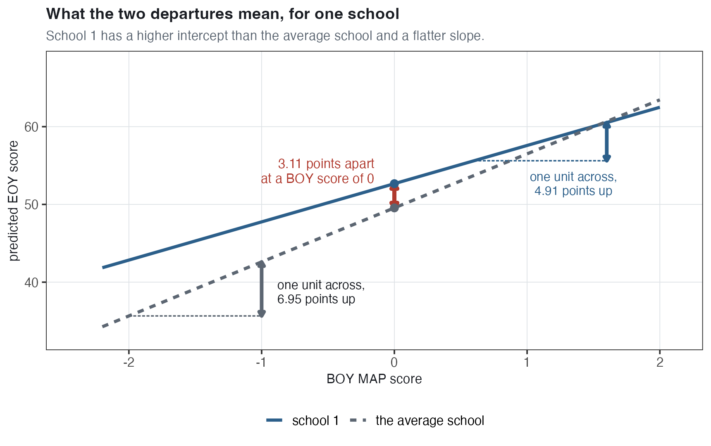
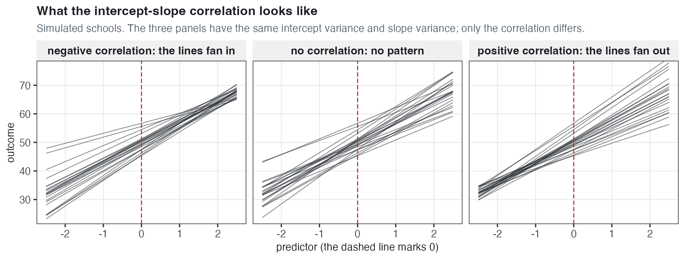
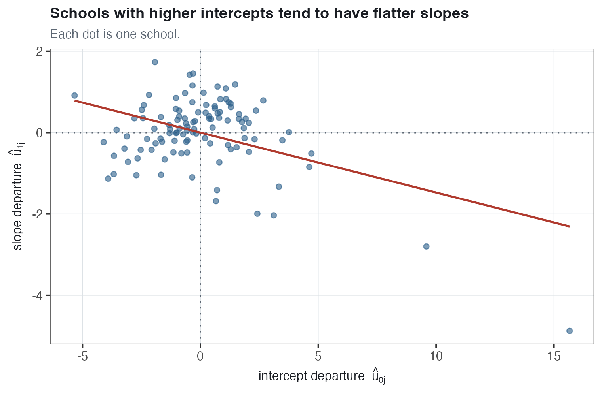
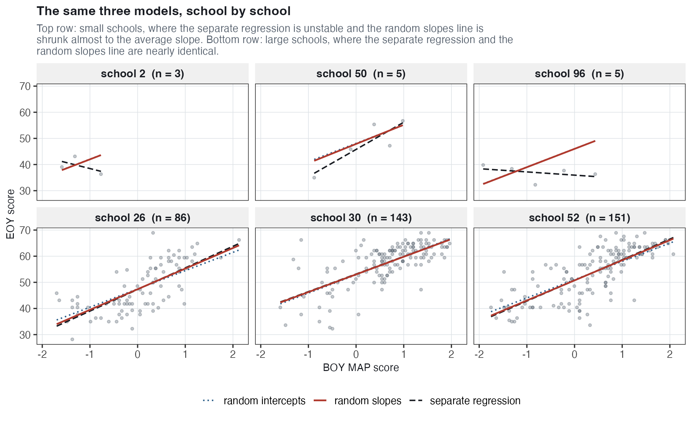
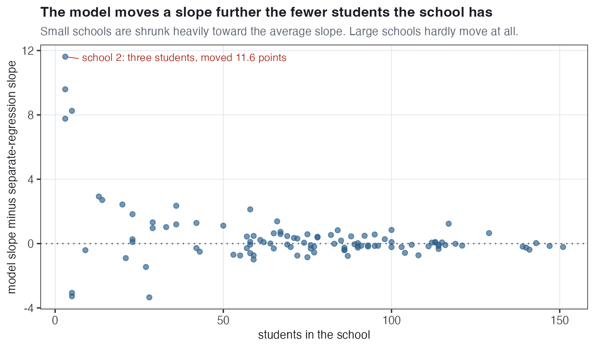
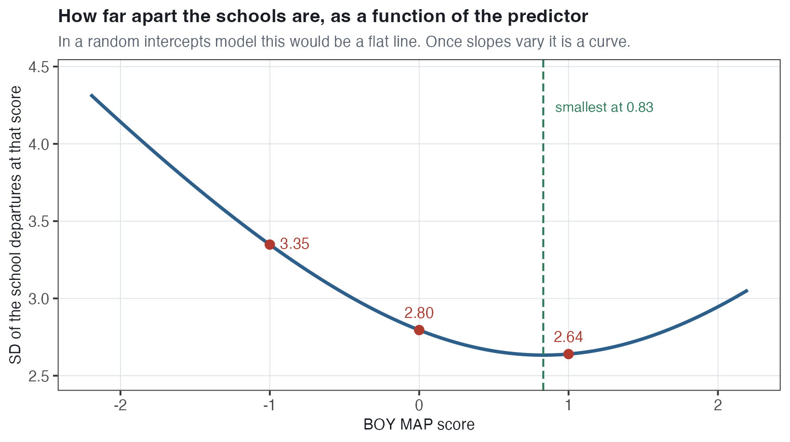
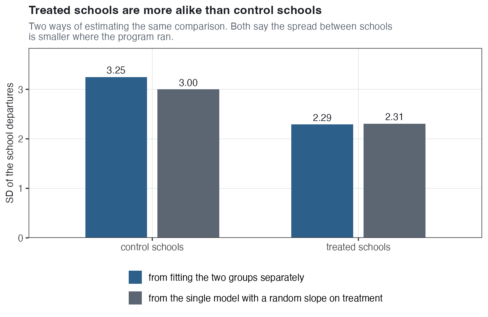

# Random Slopes Models {#sec-random-slopes}

::: byline
Adapted from course notes by Bill Young.
:::

::: chapter-lead
::: lead-label
The chapter in one paragraph
:::
Every model so far has given each school its own intercept and then required every school to have the same slope. Schools could differ in their average end-of-year score, but the association between a student's beginning-of-year reading score and their end-of-year score had to be the same number in every school. This chapter removes that restriction. In a **random slopes model** each school gets its own intercept *and* its own slope, and the pair is drawn from a single distribution described by three numbers: the variance of the intercepts, the variance of the slopes, and the relationship between them. The new variance is $\tau_1^2$, the variance of the school slopes, and the new quantity is $\rho$, the **intercept–slope correlation** — whether schools with higher/lower intercepts also have steeper/flatter slopes. Everything else in the chapter follows from those two additions. Letting the slope vary makes the standard error on the average slope much larger, because a new sample of schools would have new slopes as well as new intercepts. It makes each school's own slope an estimate that is **shrunk** toward the average, heavily for a school with three students and hardly at all for a school with 151. It introduces **scale dependence**: once the fitted lines are no longer parallel, the variance between schools depends on *where along the predictor you measure it*, so the intercept variance and the correlation both change if you move the zero point of the predictor. And the Mundlak and REWB models, which were two ways of writing one model when only the intercept varied, stop being the same model once the slope varies too.
:::

## Where we left off, and the two symbols that change {#sec-rs-recap}

Everything here is built on the **random intercepts model**, restated in full. With $Y_{ij}$ the end-of-year (EOY) reading score of student $i$ in school $j$, and $\text{MAP}_{ij}$ that student's own beginning-of-year (BOY) MAP reading score:

$$Y_{ij} = \gamma_0 + \beta_{RI}\,\text{MAP}_{ij} + u_j + e_{ij}, \qquad u_j \sim N(0, \tau^2), \qquad e_{ij} \sim N(0, \sigma^2)$$

-   $\gamma_0$ is the **grand intercept**: the predicted EOY score for a student with a BOY score of 0 in an average school.
-   $\beta_{RI}$ is the slope on the student's own BOY score, **one number shared by all 110 schools**.
-   $u_j$ is school $j$'s **departure** from the grand intercept — how far that school's line is above or below the average line. It is the same number for every student in the school.
-   $e_{ij}$ is the student's own departure from their school's line.
-   $\tau^2$ is the variance of the school departures; $\sigma^2$ is the variance of the student departures.

Fitted to our data, $\widehat{\gamma_0} = 49.63$, $\widehat{\beta_{RI}} = 6.99$, $\widehat{\tau} = 2.68$, $\widehat{\sigma} = 6.15$. In words: a student with an average BOY score in an average school is predicted to score 49.63 at EOY, and two students whose BOY scores differ by one unit are predicted to differ by 6.99 EOY points.

**This chapter changes the geometry of that model.** Because there is a single $\beta_{RI}$, the 110 school lines are **parallel**. They have different intercepts and never cross. That is why the vertical spread of the 110 lines is the same at every BOY score, and why a single number, $\widehat{\tau} = 2.68$, can describe how far apart the schools are without our having to say *where* we measured it.

::: {.callout-note}
## Two notational changes, and nothing else moves
First, the level-1 slope. In @sec-within-between we called it $\beta_{RI}$ to mark which model it came from. This chapter calls the average slope $\gamma_1$, so that the intercept and the slope get matching names: $\gamma_0$ is the average intercept and $\gamma_1$ is the average slope. Earlier chapters called $\gamma_0$ the grand intercept; it is the same quantity. Second, the school departure. Until now there was only one, written $u_j$ with variance $\tau^2$. Now there are two, so they get numbered: $u_{0j}$ is the departure in the *intercept* (the 0 refers to the intercept) with variance $\tau_0^2$, and $u_{1j}$ is the departure in the *slope* (the 1 refers to the slope) with variance $\tau_1^2$. Wherever you read $\tau^2$ in earlier material, read $\tau_0^2$ here. No model has changed; only the labels have.
:::

### Our data {#sec-rs-data}

| Feature | Value |
|:---|:---|
| Students | 7,797 |
| Schools | 110 |
| Students per school | 1 to 151, averaging about 71 |
| `read_comp` (EOY reading comprehension) | mean 50.00, SD 10.00 |
| `std_baseline` (a student's own BOY MAP score) | mean 0, SD 1 |
| `sch_map` (the average BOY MAP score in the student's school) | one value per school |
| `demeaned_map` (`std_baseline` minus `sch_map`) | averages 0 in every school |
| `treat` (1 if the school got the reading intervention, 0 if not) | 56 of 110 schools |

These are the same 7,797 students as in @sec-within-between, available as [`jebs_full.csv`](../data/jebs_full.csv). Two reminders about the scales, because the interpretations below depend on them. The two tests are **different instruments**: `std_baseline` is the MAP reading test given at the start of the year, reported as a Z-score, so 0 means "average across the whole study" and one unit is one standard deviation. `read_comp` is a separate researcher-designed comprehension test given at the end of the year, with mean 50 and SD 10, so ten EOY points is one standard deviation of the outcome. A slope of 6.99 therefore says that one SD of BOY score corresponds to about two thirds of a SD of EOY score.

## Why one slope is not enough {#sec-rs-why}

The random intercepts model assumes that the association between BOY and EOY scores is the same in every school. That is an assumption, not a finding. There are two alternatives to it.

At one extreme, **complete pooling**: ignore schools entirely and fit one line to all 7,797 students. At the other extreme, **no pooling**: fit a completely separate regression inside each school, each one using only its own students. That gives 108 lines rather than 110, because two schools have a single student and a single point has no line through it. The random intercepts model is between the two on the intercept — it lets intercepts vary but pools them toward the overall average — while pooling the slope completely.

{#fig-rs-three-models width="100%"}

Look at the right-hand panel. Some of those lines have a **negative slope**: they say that in that school, students who arrived reading better finished the year reading worse. A slope carries information only when a school has at least three students: two of our schools have one student and two have two, and a line through two points fits them perfectly whatever their scores. That leaves 106 schools with a usable estimate. Across those 106 the slopes run from $-4.62$ to $11.14$, and four are negative.

That spread is not mostly real. A separate regression uses only the students in one school, and some of our schools are very small. **School 2 has three students.** All three arrived below average on BOY MAP, and the one with the highest BOY score happened to have the lowest EOY score, so the line through those three points slopes down: a slope of $-4.62$ with a standard error of $6.76$. A standard error that large means the estimate is almost uninformative — the data are consistent with almost any slope. The negative slope is noise, not a finding about that school.

This is the failure of the no-pooling approach: each school is estimated in isolation, so its estimate draws on no information from the other 109 schools. A model that let the slopes vary *and* pooled them toward the overall average would keep the real variation and discard most of the noise. That is the random slopes model.

## The random slopes model {#sec-rs-model}

### Hierarchical form {#sec-rs-hier}

Write the model in two levels. At **level 1**, inside a school, a student's EOY score depends on their own BOY score through an intercept and a slope that both carry a $j$ subscript, meaning both belong to that school:

$$Y_{ij} = \beta_{0j} + \beta_{1j}\,\text{MAP}_{ij} + e_{ij}, \qquad e_{ij} \sim N(0, \sigma^2)$$

At **level 2**, each of those two school-specific quantities is written as the overall average plus that school's departure from it:

$$\begin{aligned}
\beta_{0j} &= \gamma_0 + u_{0j} \\[2pt]
\beta_{1j} &= \gamma_1 + u_{1j}
\end{aligned}$$

That is the whole model.

-   $\beta_{0j}$ is **school $j$'s own intercept** — its predicted EOY score at a BOY MAP score of 0. It equals the average intercept $\gamma_0$ plus that school's intercept departure $u_{0j}$.
-   $\beta_{1j}$ is **school $j$'s own slope** — the EOY points associated with one unit of BOY score *in that school*. It equals the average slope $\gamma_1$ plus that school's slope departure $u_{1j}$.
-   In the random intercepts model the second line did not exist; the slope was $\beta_1$ with no $j$, one number for everybody. Adding $u_{1j}$ is the entire structural change.

{#fig-rs-anatomy width="80%"}

School 1 makes both departures concrete. Its intercept is 52.667 against an average of 49.554, so $\widehat{u_{01}} = +3.113$: at a BOY score of 0, school 1 is predicted to be 3.113 EOY points above the average school. Its slope is 4.914 against an average of 6.949, so $\widehat{u_{11}} = -2.035$: school 1's own fitted line rises 4.914 EOY points per BOY unit, against 6.949 for the average school, which is 2.035 points less. That 4.914 is the model's estimate for school 1, already shrunk toward the average — a separate regression on school 1's own students alone gives 4.07.

### The distribution the two departures come from {#sec-rs-dist}

A random intercepts model needs one distribution, $u_j \sim N(0, \tau^2)$. A random slopes model needs a distribution over **pairs**, because each school contributes an intercept departure and a slope departure together, and those two may be related. The pair is drawn from a **multivariate normal** distribution — the two-dimensional version of the bell curve, which is described by the variance of each piece plus the relationship between them:

$$\begin{bmatrix} u_{0j} \\ u_{1j} \end{bmatrix} \sim N\left( \begin{bmatrix} 0 \\ 0 \end{bmatrix}, \; \Sigma \right), \qquad \Sigma = \begin{bmatrix} \tau_0^2 & \tau_{01} \\ \tau_{01} & \tau_1^2 \end{bmatrix}$$

$\Sigma$ (capital sigma) is called the **covariance matrix** of the random effects. Its three distinct entries are:

-   $\tau_0^2$, the variance of the intercept departures: how much school intercepts differ from one another.
-   $\tau_1^2$, the variance of the slope departures: how much schools differ in steepness.
-   $\tau_{01}$, the **covariance** between the two: whether a school with a higher-than-average intercept also tends to have a higher-than-average slope.

**A note on notation.** Some presentations write $\rho$ in that off-diagonal slot rather than $\tau_{01}$, so $\rho$ there means the covariance. This book writes $\tau_{01}$ throughout wherever the covariance is meant, and reserves $\rho$ for the correlation that software prints. The two are different numbers related by $\tau_{01} = \rho\,\tau_0\,\tau_1$, and @sec-rs-rho-cov works through why the distinction matters when you put one into a formula.

Both means are zero, which is simply a statement that the departures are measured *from* the average — a school with no departure at all is exactly on the average line.

::: {.callout-tip}
## Covariance and correlation are two versions of the same fact, and the difference matters numerically
A **covariance** says which way two quantities move together, but its size depends on the units of both. A **correlation** is the covariance divided by the two standard deviations,
$$\rho = \frac{\tau_{01}}{\tau_0\,\tau_1},$$
which removes the units and constrains the answer to lie between $-1$ and $+1$. Going the other way, $\tau_{01} = \rho\,\tau_0\,\tau_1$. Keep both forms in mind: software reports the correlation, while formulas built from $\Sigma$ need the covariance. @sec-rs-rho-cov returns to this with our own numbers.
:::

### Reduced form {#sec-rs-reduced}

Substituting the two level-2 lines into the level-1 line gives the model as a single equation:

$$Y_{ij} = \underbrace{(\gamma_0 + u_{0j})}_{\text{this school's intercept}} + \underbrace{(\gamma_1 + u_{1j})}_{\text{this school's slope}}\text{MAP}_{ij} + e_{ij}$$

and multiplying out:

$$Y_{ij} = \gamma_0 + \gamma_1 \text{MAP}_{ij} + u_{0j} + u_{1j}\text{MAP}_{ij} + e_{ij}$$

The hierarchical and reduced forms describe the identical model. The hierarchical form shows the structure — which quantities belong to schools and which to students. The reduced form shows the arithmetic, and it maps directly onto the R code.

The term $u_{1j}\text{MAP}_{ij}$ is a **product** of a school-level quantity and a student-level quantity. A product of two predictors is an interaction, so a random slope is an interaction between the predictor and the school itself. The difference from an ordinary interaction is that the school side of it is not a variable we measured; it is an unobserved departure with a distribution attached.

### Fitting it in R {#sec-rs-r}

``` r
# random intercepts: one slope for everybody
lmer(read_comp ~ 1 + std_baseline + (1 | cluster_id), jebs)

# random slopes: each school gets its own slope as well
lmer(read_comp ~ 1 + std_baseline + (1 + std_baseline | cluster_id), jebs)
```

The only change is inside the parentheses. Read `(1 | cluster_id)` as "let the intercept vary by school," and `(1 + std_baseline | cluster_id)` as "let the intercept **and the slope on** `std_baseline` vary by school." The intercept is still included — `(std_baseline | cluster_id)` is shorthand for `(1 + std_baseline | cluster_id)`, and the two are identical. The covariance between the two departures is estimated automatically; nothing extra needs to be requested.

## Reading the output {#sec-rs-output}

Fitting the random slopes model to all 7,797 students gives six numbers.

| Part of the model | Term | Estimate | SE |
|:---|:---|---:|---:|
| Fixed | $\widehat{\gamma_0}$, average intercept | 49.554 | 0.287 |
| Fixed | $\widehat{\gamma_1}$, average slope | 6.949 | 0.140 |
| Random | $\widehat{\tau_0}$, SD of school intercepts | 2.795 |  |
| Random | $\widehat{\tau_1}$, SD of school slopes | 1.130 |  |
| Random | $\widehat{\rho}$, intercept–slope correlation | $-0.336$ |  |
| Random | $\widehat{\sigma}$, SD of student departures | 6.063 |  |

Each one in a sentence:

-   $\widehat{\gamma_0} = 49.554$. A student with a BOY MAP score of 0 in an average school is predicted to score 49.554 on the EOY test.
-   $\widehat{\gamma_1} = 6.949$. Averaging over schools, a one-unit difference in BOY MAP score goes with 6.949 more EOY points. This is now an *average of school slopes*, not a single slope that applies everywhere. It is **not** a pure within-school slope: this model still makes the random effects assumption, $E[u_{0j} \mid X] = E[u_{1j} \mid X] = 0$, so like $\beta_{RI}$ in @sec-within-between it pools within-school and between-school information rather than isolating the within-school comparison. @sec-rs-rewb separates the two.
-   $\widehat{\tau_0} = 2.795$. School intercepts have a standard deviation of 2.795 EOY points. Two schools one SD apart in intercept differ by about 2.8 EOY points at a BOY score of 0.
-   $\widehat{\tau_1} = 1.130$. School slopes have a standard deviation of 1.130. @sec-rs-tau1 turns this into a usable sentence.
-   $\widehat{\rho} = -0.336$. Schools with higher intercepts tend to have flatter slopes, moderately so. @sec-rs-rho explains this.
-   $\widehat{\sigma} = 6.063$. Within a school, students scatter around their school's own fitted line with a standard deviation of 6.063 EOY points.

Note what $\widehat{\tau_0}$ now means. In the random intercepts model, $\widehat{\tau}$ described the spread between schools because the lines were parallel and the spread was the same everywhere. Here the lines are not parallel, so 2.795 is the spread between schools **at a BOY MAP score of 0** and nowhere else. @sec-rs-scale is about that qualification.

### What $\tau_1$ means, in a sentence {#sec-rs-tau1}

$\widehat{\tau_1} = 1.130$ is a standard deviation, so it can be turned into a range using the normal distribution the slopes are **assumed** to come from: about 95% of a normal distribution is within 1.96 SDs of its mean. That assumption is part of the model, not something the data established. Applying it to the slopes:

$$\text{PI} \approx \gamma_1 \pm 1.96 \times \tau_1 \approx 6.95 \pm 1.96 \times 1.13 \approx [4.74,\; 9.16]$$

**We expect about 95% of the population of school-specific slopes to lie between 4.74 and 9.16.** (Computed from the unrounded estimates the lower bound is 4.73; the 4.74 here comes from the rounded 6.95 and 1.13. It is the same interval either way.) In every school, arriving with a higher BOY score is associated with a higher EOY score; the schools differ in how much, not in whether.

Whether a large $\gamma_1$ is good news is a separate question, and a normative one. A strong BOY–EOY relationship means a student's BOY score accounts for much of their EOY score. A weak one means the year's schooling did more to compensate for differences students arrived with. Our 6.949 is strong: two thirds of an SD of EOY score for each SD of BOY score. Even a school two standard deviations below average on slope still has a slope of $6.95 - 2 \times 1.13 = 4.69$. On the scales set out in @sec-rs-data that is 0.47 SD of the EOY test for each SD of BOY score, against 0.69 in the average school — smaller, but still clearly positive.

{#fig-rs-slope-spread width="76%"}

::: {.callout-important}
## This is a prediction interval, not a confidence interval, and the difference is not a technicality
A **confidence interval** on $\gamma_1$ answers "how precisely do we know the *average* slope?" It is built from the standard error, $0.1402$, and it is narrow: $6.949 \pm 1.96 \times 0.1402$, or $[6.67, 7.22]$. A **prediction interval** answers a different question — "how spread out are the *individual schools*?" — and it is built from $\tau_1 = 1.130$, which is eight times larger than the standard error. Collecting more schools would shrink the confidence interval toward a point, because we would know the average better. It would not shrink the prediction interval, because schools would still differ from one another by just as much. One describes our uncertainty; the other describes the world. (Strictly, a full prediction interval would also include the uncertainty about $\gamma_1$ itself, which would widen it slightly. The version above ignores that.)
:::

### What happened to the standard error on the slope {#sec-rs-se}

The two models give nearly the same slope with very different standard errors:

|                   | Average slope |     SE |
|:------------------|--------------:|-------:|
| Random intercepts |         6.995 | 0.0790 |
| Random slopes     |         6.949 | 0.1402 |

The estimate barely moved. The standard error rose by 77%, from 0.0790 to 0.1402. Nothing went wrong; the two models are answering slightly different questions.

Under the random intercepts model, the slope is a single fixed quantity and the only thing that varies from sample to sample is which students we happened to draw. Under the random slopes model, each school has its own slope drawn from a distribution, so a new sample of 110 schools would have 110 **new slopes** as well as new students. That extra source of variation has to be carried in the standard error. Put another way: the random intercepts model reports uncertainty about the slope *in these particular schools*, while the random slopes model reports uncertainty about the slope *in schools like these*. The second is the harder question, so the answer is less precise.

The practical consequence is that if the slopes really do vary and you fit a random intercepts model anyway, your standard error on the slope will be too small and your confidence intervals too narrow.

## The intercept–slope correlation {#sec-rs-rho}

$\widehat{\rho} = -0.336$ is the one genuinely new kind of quantity in this chapter.

### What it is

$\rho$ is an ordinary correlation, computed across the 110 schools, between two things each school has: its intercept departure $u_{0j}$ and its slope departure $u_{1j}$. Like any correlation it runs from $-1$ to $+1$, and like any correlation it describes a **tendency across the group**, not a rule that every member follows.

-   **Positive $\rho$**: schools with higher intercepts also tend to have steeper slopes. Draw the lines and they **fan out** — the schools that are ahead at low BOY scores get further ahead at high ones, so the gaps between schools widen as you move right.
-   **Negative $\rho$**: schools with higher intercepts tend to have flatter slopes. The lines **fan in** — schools that were far apart at low BOY scores come closer together as you move right. @sec-rs-scale adds a qualification: they converge only up to a point, and past it they begin to spread again.
-   **$\rho$ at exactly $+1$ or $-1$**: a school's slope is an exact linear function of its intercept, with no scatter at all. Geometrically the fanning is complete: every line passes through one common point, and at that point on the predictor the schools are not merely close but identical. With our estimates and $\rho = -1$ the crossing would be at $m = \tau_0/\tau_1 = 2.795/1.130 = 2.47$ — at a BOY score of 2.47 every school would be predicted to produce the same EOY score. (@sec-rs-appendix returns to $\rho = -1$ in a fitted model, where it means something quite different: not this substantive extreme but a sign that the data cannot identify the covariance.)
-   **$\rho$ near zero**: knowing a school's intercept tells you nothing about its slope. Which lines cross which has nothing to do with the intercepts. The lines are still closest together at a predictor value of zero and spread further apart as you move away in either direction, by the same amount on each side, because the slopes still differ even though their differences are unrelated to the intercepts.

{#fig-rs-rho-meaning width="100%"}

### Our $-0.336$, in words {#sec-rs-rho-ours}

**Schools that score higher at a BOY score of zero tend to have flatter BOY–EOY slopes.** Put a number on it. A school one standard deviation above average in intercept — about 2.8 EOY points — is expected to differ in slope by $\rho\,\tau_1 = -0.336 \times 1.130 = -0.38$ points, so about $6.949 - 0.380 = 6.57$ instead of 6.949. That is a real difference, and a small one: a school well above average in intercept is still expected to have a slope of more than six and a half EOY points per BOY point. Be careful about what $\rho$ does and does not say. Nothing here is a directional model: $u_{0j}$ and $u_{1j}$ are two correlated random variables, neither one predicting the other, so the right reading is a tendency for the pair to move together and not a share of one explained by the other. The tendency is also modest. Knowing a school is above average at a BOY score of 0 shifts our expectation of its slope down by a few tenths of a point; it does not tell us what that school's slope is, and plenty of schools run against the pattern altogether.

{#fig-rs-rho-scatter width="72%"}

The scatter shows what "moderate" looks like. The fitted line slopes downward, but the main cloud is close to shapeless and the tilt leans heavily on the two schools far out on the right: correlate the other 108 and you get $-0.025$. Plenty of schools are in the two quadrants that run against the tendency — above average on both, or below average on both. The one school far out on the right is an extreme case of the pattern: an intercept 15.7 points above the average school, more than five times $\tau_0$, and the flattest slope in the data, 2.07 against the average 6.949.

A negative correlation here has a readable substantive meaning. The schools that do best with students who arrive at the average are also the schools where a student's starting score matters least — where the gap between a student who arrived ahead and a student who arrived behind is smallest by the end of the year. Whether that is good news depends on what is wanted from the system: it means gaps between students narrow most in the highest-scoring schools, and it also means those schools do least for the students who arrived furthest ahead.

::: {.callout-warning}
## Read $\rho$ against where zero is
$u_{0j}$ is the school's departure *at a BOY score of 0*, so $\rho$ describes the relationship between a school's slope and its intercept *at that one point on the predictor*. If you score the predictor so that 0 means something else, then $\rho$ becomes a different number describing a different comparison. @sec-rs-scale shows exactly how much it moves.
:::

### What $\rho$ is good for {#sec-rs-rho-use}

The clearest use for $\rho$ comes from a different design, and the argument is Raudenbush and Bloom's (2015). Suppose a program is evaluated in many sites, and within each site individuals are randomly assigned to receive it or not. Fitting a random slopes model with the treatment indicator as the predictor makes each site's slope its own **program impact**, and each site's intercept the average outcome among its untreated people. The correlation between the two then answers a question a policymaker would actually ask (see @fig-rs-rho-meaning while reading the two cases below):

-   **Negative $\rho$**: the sites where untreated people do worst are the sites where the program does most. The program does most where untreated outcomes are lowest, so it tends to **reduce inequality** between sites.
-   **Positive $\rho$**: the sites where untreated people already do best are the sites where the program does most. The program adds most where outcomes were already highest, so it tends to **widen inequality** between sites.

That is a substantive finding about who a program helps, and it is not available from the average program impact alone. Two programs can have identical average program impacts and opposite signs on $\rho$, and they would be very different policies.

Our own model is not of that kind — the predictor is a student's BOY score rather than a randomly assigned treatment, so its $\rho$ describes an association rather than a distribution of program impacts. The reading in @sec-rs-rho-ours remains correct, but it is the weaker, observational version of this idea.

### The trap: the correlation is not the covariance {#sec-rs-rho-cov}

The correlation and the covariance describe the same relationship, and substituting one where the other belongs produces a wrong number rather than a slightly-off one.

-   In output tables, $\rho$ is the **correlation**, $-0.336$, bounded between $-1$ and $+1$.
-   In the covariance matrix $\Sigma$ and in any formula built from it, the off-diagonal entry is the **covariance**, $\tau_{01} = \rho\,\tau_0\,\tau_1$.

**The correlation,** $\rho = -0.336$. A unitless number between $-1$ and $+1$. It says how *tightly* the two departures move together, and its size can be compared across any two studies.

**The covariance,** $\tau_{01} = -1.06$. The same relationship, left in the units of the two quantities being related. For our model

$$\tau_{01} = \rho\,\tau_0\,\tau_1 = -0.336 \times 2.795 \times 1.130 = -1.06$$

and going back the other way, $\rho = \tau_{01}/(\tau_0\tau_1) = -1.06/(2.795 \times 1.130) = -0.336$.

They are the same relationship because one is the other multiplied by the two standard deviations. Dividing the covariance by $\tau_0$ and $\tau_1$ removes the units and rescales the number onto $[-1, +1]$; multiplying puts them back. Both always have the same sign, so both say here that a higher intercept goes with a flatter slope.

**What $-1.06$ means on its own:** not much. Its units are EOY points (from the intercept departure) times EOY points per BOY point (from the slope departure), which is not a quantity anyone has intuition for. Doubling the EOY scale would quadruple it while leaving the relationship itself unchanged. That is exactly why output tables report the correlation instead. The covariance exists for the formulas: it is the off-diagonal entry of $\Sigma$, and it is what the variance expression in @sec-rs-scale-why needs. Put the correlation into that formula in place of the covariance and the answer is wrong — @sec-rs-appendix shows a case where it comes out 5.93 instead of 2.31.

## Shrinkage: what happens to each school's own slope {#sec-rs-shrinkage}

The model estimates a slope for every school, but it does not use each school's own slope as its estimate. It **shrinks** each school's estimate toward the overall average, and it shrinks small schools much harder than large ones.

The logic is the same as the shrinkage of school intercepts in @sec-variance-components and @sec-random-intercepts. A school's own data give a noisy estimate of its true slope; the other 109 schools give information about what school slopes look like in general. A school with plenty of students has a precise estimate of its own, so it is pulled toward the average only slightly. A school with three students has essentially no information of its own, so the sensible estimate for it is close to the average.

{#fig-rs-trellis width="95%"}

The top row shows this. In **school 2** (three students) the separate regression gives a slope of $-4.62$; the random slopes model gives that school 7.00. In **school 96** (five students) the separate regression is again negative, at $-1.24$, and the model returns 7.02. Both end up at the overall average slope of 6.949, or a shade above it.

That "shade above" looks wrong at first — shrinking an estimate of $-4.62$ toward an average of 6.949 should not carry it *past* the average. It does here. The model does not shrink the slope on its own; it estimates the **pair** $(u_{0j}, u_{1j})$ together, and the two are correlated at $\rho = -0.336$. When a school's own slope carries almost no information, the pair is pulled toward what that school's intercept suggests, and with a negative $\rho$ a below-average intercept raises the estimated slope slightly above average. School 2 has three students and an intercept departure of $-0.56$, and that adjustment is enough to put its estimate just past the average.

Read this as a tendency and not a formula. How far a school's estimate is adjusted depends on how little information its own slope carries, not on its intercept alone. School 96's intercept departure is $-3.56$, six times school 2's, but its slope ends up barely above school 2's, because with five students its own negative slope still counts for something. Across all 110 schools, 61 are below average on intercept; 33 of those are above average on slope, as the negative correlation implies, and 28 are below average on slope as well. The tendency is real and it is far from a rule. Four of the 106 schools end up on the opposite side of the average from their own separate-regression slope. Schools 2 and 96 are two of them.

In the bottom row the schools have between 86 and 151 students, and the separate regression and the random slopes line are nearly identical: those three schools move by 0.39, 0.03 and 0.21 points respectively, against school 2's 11.62. The random intercepts line still differs from the other two in two of them, because it is forced onto the one common slope of 6.995 no matter what the school's own students show.

{#fig-rs-movement width="76%"}

The effect of shrinkage on the collection as a whole is to remove most of the apparent spread, because most of that spread was noise:

|                                    | Range of slopes    |    SD | Negative slopes |
|:-----------------------------------|:-------------------|------:|----------------:|
| Separate regressions (106 schools) | $-4.62$ to $11.14$ | 2.451 |               4 |
| Random slopes model (110 schools)  | 2.07 to 8.68       | 0.880 |               0 |

The separate regressions suggest schools differ far more in slope than they do, including some where reading ahead at the start of the year predicted reading behind at the end. The model says the real spread is much smaller and that no school has a negative slope. Note also that the SD of the fitted school slopes, 0.880, is smaller than $\widehat{\tau_1} = 1.130$. That is not a contradiction: $\tau_1$ estimates the spread of the **true** school slopes, while the fitted values are shrunken estimates, and shrunken estimates are always less spread out than the quantity they estimate.

::: {.callout-note}
## Why the fitted departures do not reproduce $\widehat{\rho}$
Because the fitted departures are shrunk, the correlation you get by taking the 110 pairs $(\widehat{u_{0j}}, \widehat{u_{1j}})$ and correlating them is *not* the model's $\widehat{\rho}$. In our data the model reports $-0.336$ while correlating the fitted departures gives $-0.435$. Shrinkage pulls the slope departures in much further — their SD is 78% of $\tau_1$ — while the intercept departures (93% of $\tau_0$) and the covariance between them (94%) barely move. Dividing a covariance that shrank very little by a slope SD that shrank a lot makes the ratio — the correlation — come out larger in magnitude. **Trust the model's $-0.336$**: it is the estimate of the population quantity, and it already accounts for the fact that each school's departures are estimated with error. The correlation among the fitted values is a description of the fitted values.
:::

## Do we need the random slope? {#sec-rs-lrt}

$\widehat{\tau_1} = 1.130$ is not zero, but no estimate is ever exactly zero. The question is whether the data support letting slopes vary at all, and that is a comparison between two models — one with the random slope and one without.

The tool is the **likelihood ratio test**. The likelihood of a model is how probable our data would be if that model's parameter values were the truth. Adding parameters can only make a model fit at least as well, so the question is whether the improvement is bigger than we would expect from the extra flexibility alone. The test statistic compares the two log-likelihoods, writing $\ell$ for the log-likelihood of a fitted model:

$$\chi^2 = -2\left(\ell_{\text{simpler}} - \ell_{\text{richer}}\right)$$

``` r
anova(ri, rs)
```

| Model             | Parameters |     $\ell$ | $\chi^2$ |  df | p                       |
|:------------------|-----------:|-----------:|---------:|----:|:------------------------|
| Random intercepts |          4 | $-25356.0$ |          |     |                         |
| Random slopes     |          6 | $-25305.6$ |    100.8 |   2 | $< 2.2 \times 10^{-16}$ |

Putting the table's two log-likelihoods into the formula: $\chi^2 = -2\left(-25356.0 - (-25305.6)\right) = -2(-50.4) = 100.8$. Against a $\chi^2$ distribution with 2 degrees of freedom, a statistic of 5.99 would already be at the conventional 5% cutoff; 100.8 is far above it. Letting slopes vary fits these data far better than forcing them equal.

**Two things about this test differ from the single-variance version in @sec-ri-lrt.**

**The degrees of freedom are 2, not 1.** Adding a random slope adds *two* parameters, not one: the slope variance $\tau_1^2$ and the intercept–slope covariance $\tau_{01}$. Counting parameters, the random intercepts model estimates four ($\gamma_0$, $\gamma_1$, $\tau_0^2$, $\sigma^2$) and the random slopes model estimates six (those four plus $\tau_1^2$ and $\tau_{01}$). The difference is two.

**The usual correction does not apply cleanly.** In @sec-random-intercepts we tested a single variance component and halved the p-value, because a variance cannot be negative, so the null value is at the **boundary** of what the parameter is allowed to be, and the reference distribution is a mixture rather than a plain $\chi^2$. Here only one of the two added parameters is bounded: $\tau_1^2$ cannot be negative, but the covariance $\tau_{01}$ is free to take either sign. The correct reference distribution is a mixture of $\chi^2_1$ and $\chi^2_2$ rather than either one alone, and simply halving is not the right adjustment. The direction of the error is the same as before — the uncorrected test is **conservative**, so it under-rejects. With a statistic of 100.8 the distinction changes nothing here. It would matter for a borderline result: a statistic of 5.99 gives $p = 0.050$ against a plain $\chi^2_2$ and about $0.032$ against the mixture.

::: {.callout-tip}
## What is usually done in practice
In practice the random slope is usually kept when there is any theoretical reason to expect slopes to differ across clusters, even if the test is not decisive, because wrongly omitting it understates the standard error on the fixed slope (@sec-rs-se), while wrongly including it loses a little precision. The test answers whether these data are strong enough to establish that slopes vary, not whether the model ought to allow it.
:::

## Scale dependence: the answer depends on where zero is {#sec-rs-scale}

This is the hardest idea in the chapter, and it follows from one geometric fact. Once the school lines are no longer parallel, **how far apart they are depends on where along the predictor you measure**.

### What it looks like in our data {#sec-rs-scale-data}

{#fig-rs-scale width="88%"}

Read the figure by picking a BOY score on the horizontal axis and looking at how far the shaded band reaches above and below the average line there. That distance is how far apart the schools are *for students at that BOY score*. Pick a different BOY score and you get a different distance: in the random intercepts model it was the same everywhere, and here it is not.

The band is widest on the left, narrows through the middle, and is narrowest a little past a BOY score of 0 before widening again. The SD of the school departures is 3.35 EOY points at a BOY score of $-1$, 2.80 at 0, and 2.64 at $+1$. In words: among students who arrived a full SD below the study average, the school departures have a standard deviation of about 3.35 EOY points; among students who arrived a full SD above it, about 2.64. So which school a student attends matters more for students who started behind than for students who started ahead.

The second number above each red bar is the intercept–slope correlation the model reports when zero is moved to that point: $-0.62$ at $-1$, $-0.34$ at 0, and $+0.07$ at $+1$. Those come from three separate refits of the same data, not from one fit — the next section sets them out in a table.

That is the same fact @sec-rs-rho stated as a correlation. A negative $\rho$ means the school lines are converging as the predictor rises through zero, and a band that is still narrowing there is what that looks like. @sec-rs-scale-why gives the formula behind the shape and shows where the narrowing stops and reverses.

### Why $\tau_0$ and $\rho$ both move when you move zero {#sec-rs-scale-why}

Remember what $u_{0j}$ actually is: school $j$'s departure from the average line **at whatever counts as zero**. Slide zero along to a BOY score of $m$ and the school's departure there is a different quantity, so it has a different variance. Write that variance as $V(u_{0j} \mid m)$, read as "the between-school variance given that zero sits at $m$":

$$V\!\left(u_{0j} \mid m\right) = \tau_0^2 + 2\,\tau_{01}\,m + \tau_1^2\,m^2$$

It is a parabola in $m$, not a constant. (The three terms come from the general rule for the variance of a sum, because the departure at $m$ is built from both $u_{0j}$ and $u_{1j}$: the two variances plus twice the covariance, with the $m$'s carried through.) At $m = 0$ it collapses to $\tau_0^2$, which is what the output prints. Putting in our estimates, $\tau_0^2 = 7.814$, $\tau_{01} = -1.060$ and $\tau_1^2 = 1.276$:

$$\begin{aligned}
\text{at } m = -1: &\quad 7.814 + 2(-1.060)(-1) + 1.276(1) = 11.210, &\quad \sqrt{11.210} &= 3.348 \\
\text{at } m = 0: &\quad 7.814 = \tau_0^2, &\quad \sqrt{7.814} &= 2.795 \\
\text{at } m = +1: &\quad 7.814 + 2(-1.060)(1) + 1.276(1) = 6.970, &\quad \sqrt{6.970} &= 2.640
\end{aligned}$$

Those are the three red bars in @fig-rs-scale.

{#fig-rs-variance-curve width="74%"}

$\tau_0^2$ is defined as the variance of the school departures *at a predictor value of zero*. So if you re-center the predictor — subtract 1 from everyone's BOY score, say, which moves the zero point — then $\tau_0^2$ becomes the variance at the new zero, which is a different number off that parabola. And because the intercept has changed, its relationship with the slope changes too, so $\rho$ moves as well.

Refitting the model with zero moved confirms it:

| Where zero is | $\widehat{\tau_0}$ | $\widehat{\tau_1}$ | $\widehat{\rho}$ | $\widehat{\sigma}$ |
|:---|---:|---:|---:|---:|
| At BOY $= -1$ | 3.348 | 1.130 | $-0.618$ | 6.063 |
| At BOY $=0$ (fitted) | 2.795 | 1.130 | $-0.336$ | 6.063 |
| At BOY $= +1$ | 2.640 | 1.130 | $+0.072$ | 6.063 |

Read the $\widehat{\rho}$ column down: the correlation goes from clearly negative to essentially zero, and **its sign flips**, purely by changing where zero is. The data have not changed and the fit has not changed — the same 110 lines are in the same places — but two of the reported numbers are different, because they were answering a question about a specific point on the predictor and we moved that point.

**What does not move:** three of the six estimates are the same at every re-centering. $\gamma_1$, the average slope, stays at 6.949; $\tau_1$, the SD of the school slopes, stays at 1.130; and $\sigma$, the student-level SD, stays at 6.063. A slope is a rate of change, and a rate does not depend on where you start measuring from, so nothing about the slopes is affected by moving zero. $\sigma$ describes students within a school and never involved the zero point at all.

**What moves:** $\gamma_0$, $\tau_0$ and $\rho$ — the three quantities that are defined *at* a predictor value of zero. The cleanest way to see why is that $u_{0j}$ is itself **defined** as school $j$'s departure at $X = 0$. Move zero and $u_{0j}$ becomes a different random variable, so its variance $\tau_0^2$ and its correlation with $u_{1j}$ are describing something else. Move zero and you are asking about a different point on the predictor, so you get different answers.

Putting those two lists together: of the two parameters that describe how schools differ from one another, $\tau_0$ and $\tau_1$, only $\tau_1$ is the same wherever zero is. $\tau_0$ answers a question about one specific point on the predictor, so moving that point changes the answer. There is no single number for how far apart the schools are that is free of where zero sits — the parabola above is the whole answer, and $\tau_0$ is only its value at one point.

The parabola has a lowest point, and it can be found by hand: the variance is smallest at $m = -\tau_{01}/\tau_1^2 = 1.060/1.276 = 0.83$. At a BOY MAP score of 0.83 — a little under one standard deviation above the study average — the between-school SD reaches its smallest value, 2.63, and at that point the intercept–slope correlation is exactly zero.

::: {.callout-important}
## Two practical consequences
**One.** Center your predictors somewhere meaningful before fitting, and say where zero is when you report $\tau_0$ or $\rho$. "The intercept–slope correlation is $-0.34$" is an incomplete statement; "$-0.34$ at the study-average BOY score" is a complete one. Our BOY MAP variable is already standardized, so zero is the average student in the study and the reported numbers describe that comparison.

**Two.** The **intraclass correlation**, or ICC — the share of the total variation that is between schools rather than within them, $\tau_0^2/(\tau_0^2 + \sigma^2)$ — has the same problem. Its numerator is the between-school variance, and once slopes vary that variance is a function of the predictor, so the ICC is too. An ICC quoted from a random slopes model is the ICC *at a predictor value of zero*, not a single summary of the whole data set.
:::

## Within and between, revisited {#sec-rs-rewb}

@sec-within-between separated one slope into two comparisons: the **within-school slope** $\beta_W$, from comparing two students in the same school, and the **between-school slope** $\beta_B$, from comparing two schools whose average BOY scores differ. Two models did the separating, and both add `sch_map`, the school's average BOY score, as a second predictor.

-   **Mundlak** keeps the student's own raw score and adds the school average: `lmer(read_comp ~ std_baseline + sch_map + (1 | cluster_id))`. Its coefficient on `sch_map` is the **contextual effect** $\beta_C$, the extra difference associated with attending a higher-scoring school for two students with the same BOY score.
-   **REWB** (random effects within and between) replaces the raw score with the **demeaned** score, `demeaned_map` $=$ `std_baseline` $-$ `sch_map`, and adds the school average: `lmer(read_comp ~ demeaned_map + sch_map + (1 | cluster_id))`. Its two coefficients are $\beta_W$ and $\beta_B$ directly.

With random intercepts these are two ways of writing one model. They fit identically and their coefficients convert into each other by $\beta_B = \beta_W + \beta_C$.

### They stop being the same model {#sec-rs-rewb-differ}

Adding a random slope to both models makes them two different models.

``` r
lmer(read_comp ~ std_baseline  + sch_map + (std_baseline  | cluster_id), jebs)  # Mundlak
lmer(read_comp ~ demeaned_map  + sch_map + (demeaned_map  | cluster_id), jebs)  # REWB
```

{#fig-rs-mundlak-rewb width="86%"}

|   | Within slope | Between slope |
|:---|---:|---:|
| **Random intercepts** — Mundlak | 6.957 | 8.716 (as $\beta_W + \beta_C$) |
| **Random intercepts** — REWB | 6.957 | 8.716 |
| **Random slopes** — Mundlak | 6.899 | 9.427 (as $\beta_W + \beta_C$) |
| **Random slopes** — REWB | 6.898 | 9.178 |

Reading two of those numbers as sentences, using the REWB row under random slopes: a within slope of 6.898 says that two students **in the same school** whose BOY scores differ by one unit are predicted to differ by 6.898 EOY points. A between slope of 9.178 says that two **schools** whose average BOY scores differ by one unit are predicted to differ by 9.178 EOY points in their average outcome. The between comparison is the steeper of the two, which is the pattern from @sec-within-between.

The contextual effect is the difference between them. Under random intercepts it is 1.759, so $6.957 + 1.759 = 8.716$, which is exactly the between slope in the table. Under random slopes the Mundlak model reports a contextual effect of 2.528, and $6.899 + 2.528 = 9.427$ — which is not the 9.178 that REWB reports directly.

Under random intercepts the two rows agree to four decimals. Under random slopes the within slopes still agree to within 0.001, but the between slopes differ by 0.249. That gap is worth keeping in proportion: the two between slopes are 9.427 (95% CI $[8.47, 10.39]$) and 9.178 (95% CI $[8.26, 10.10]$), so each sits comfortably inside the other's interval. The problem with the Mundlak version is not that it gives a significantly different fixed effect; it is that its $\tau_1$ is describing a mixture of two things, which is what the next subsection is about. The two models also no longer fit the data equally well. Comparing them gives a difference in **deviance** — the quantity $-2\ell$ from @sec-rs-lrt, where a smaller value means a better fit — of 7.19, and it is REWB that has the smaller of the two. That difference has **zero** degrees of freedom.

A test with zero degrees of freedom is not a test. Both models estimate exactly seven parameters, and neither is a special case of the other, so there is no null hypothesis being examined. The informative part is that the deviances differ **at all**. Two parameterizations of one model must fit identically; these do not, so they are two different models.

### Why the two come apart {#sec-rs-rewb-why}

The reason is in what each model allows to vary across schools.

A student's raw BOY score contains two pieces of information: how that student compares to their own classmates, and what kind of school they are in. Writing it out,

$$\text{MAP}_{ij} = \underbrace{(\text{MAP}_{ij} - \overline{\text{MAP}}_j)}_{\text{within piece}} + \underbrace{\overline{\text{MAP}}_j}_{\text{between piece}}$$

-   In the **Mundlak** version, the raw score is the one in the random part: `(std_baseline | cluster_id)`. Because the raw score contains both pieces, the random slope lets **both** the within-school and the between-school components vary across schools.
-   In the **REWB** version, the demeaned score is the one in the random part: `(demeaned_map | cluster_id)`. The demeaned score contains only the within piece, so the random slope lets **only the within-school component** vary across schools.

Those are different assumptions about what varies, so they are different models, and they give different answers. The Mundlak version's slope variance is a blend of two things — genuine school-to-school variation in the within-school slope, and variation that belongs to the between-school comparison — which makes $\tau_1$ hard to interpret in that model. The two fits report different random parts as well: $\widehat{\tau_1} = 1.124$ with $\widehat{\rho} = -0.550$ under Mundlak, against $\widehat{\tau_1} = 1.186$ with $\widehat{\rho} = -0.491$ under REWB, for what is nominally the same quantity.

::: {.callout-important}
## The recommendation, and the reason for it
Use **REWB** when you want a random slope. It fits these data slightly better, and, more importantly, its $\tau_1$ has a clean meaning — the variation across schools in the within-school slope — and its coefficients are the two comparisons you want to talk about. The Mundlak version's fixed part is still fine; it is the random part that becomes a mixture of two things. This is a case where two models that were interchangeable in a simpler setting come apart once the setting is richer, and the fix is to pick the parameterization whose pieces you can describe.
:::

The full argument, including the term **conflated random slope** for the Mundlak version's random part, is in Rights and Sterba (2023), "On the Common but Problematic Specification of Conflated Random Slopes in Multilevel Models," *Multivariate Behavioral Research* 58(6), 1106–1133, <https://doi.org/10.1080/00273171.2023.2174490>.

## Two harder cases {#sec-rs-appendix}

This material goes beyond the core of the topic, but the questions it answers are the ones that come up as soon as anyone starts fitting these models.

### Can you have a random slope without a random intercept? {.unnumbered}

You can write it, but it rarely makes sense, and Rabe-Hesketh and Skrondal advise against it. Dropping the random intercept forces every school to have **the same intercept** while allowing their slopes to differ, so all 110 lines pass through a single point and fan out from it. That is a strong and usually unmotivated claim: it says schools differ in how much EOY score is associated with one BOY point, but are identical in outcome for a student at BOY $=0$.

A related question: can you have a random slope without the **fixed** slope, the $\gamma_1$, alongside it? Rarely. Dropping $\gamma_1$ would let each school's slope differ from the others while forcing the average of those slopes to be zero, which is almost never what anyone means. Usually, we want a common average slope plus school-specific departures from that average. So in practice, the fixed slope stays in the model whenever its random slope is included.

### Can you put a random slope on a level-2 predictor? {.unnumbered}

A **level-1** variable varies among students within a school; `std_baseline` is one. A **level-2** variable is the same for everyone in a school; `treat` is one, because whole schools were assigned to the reading intervention.

The conventional teaching is that a random slope requires a level-1 predictor. The intuition is straightforward: a random slope means "each school has its own slope for this variable," and to estimate a slope inside a school you need that variable to vary inside the school. `treat` does not — every student in a treated school has $\text{treat} = 1$ — so there is no within-school relationship to estimate.

Rabe-Hesketh and Skrondal put the conventional view directly: "It is generally not a good idea to include a random coefficient for a covariate that does not vary at a lower level than the random coefficient itself... Because we cannot estimate the effect of type of school for individual schools, it also appears impossible to estimate the variability of the effect of type of school between schools. However, level-2 random coefficients of level-2 covariates can be used to construct heteroskedastic random intercepts" (p. 213). That last sentence is the one that matters here, and it is what the rest of this section works through.

The counter-argument is that multilevel estimation does not work school by school. It pools across all clusters at once, and in doing so it can estimate variances and covariances involving level-2 predictors even though no single cluster supplies enough data on its own. So the model is estimable, and the next subsection shows what it estimates.

### What it looks like in our data {.unnumbered}

``` r
lmer(read_comp ~ treat + std_baseline + (treat | cluster_id), jebs)
```

| Term                                         |       Estimate |
|:---------------------------------------------|---------------:|
| $\widehat{\gamma_0}$, intercept              |          49.35 |
| Coefficient on `treat`                       | 0.55 (SE 0.55) |
| Coefficient on `std_baseline`                |           6.99 |
| $\widehat{\tau_0}$, SD of school intercepts  |           3.00 |
| $\widehat{\tau_1}$, SD of `treat` departures |           5.30 |
| $\widehat{\rho}$                             |        $-1.00$ |
| $\widehat{\sigma}$                           |           6.15 |

Four of those numbers read the same way they would in any model. The intercept of 49.35 is the predicted EOY score for a control-school student with a BOY score of 0. The coefficient on `treat`, 0.55, says schools that ran the intervention are predicted to score 0.55 EOY points above control schools — but its standard error is also 0.55, so the estimate is not distinguishable from no difference at all. The coefficient on `std_baseline`, 6.99, says a one-unit difference in BOY score goes with 6.99 more EOY points, averaging over schools. And $\widehat{\sigma} = 6.15$ says students scatter around their own school's line with an SD of 6.15 EOY points.

The random part is where this model runs into trouble. A correlation of exactly $-1.00$ is a signal, not a finding. It means the estimated covariance matrix is at the boundary of the parameter space — the edge of the set of values it is allowed to take — and the software reports warnings about the fit when this happens.

Here the problem is **structural**: `treat` does not vary within schools. Every student in a control school has `treat = 0`, and every student in a treated school has `treat = 1`. Therefore, the school-specific random part is $u_{0j} + u_{1j}\,\text{treat}_j$, and $\text{treat}_j$ is either 0 or 1. So there are only **two** distinct quantities the data can identify: how spread out the control schools are, and how spread out the treated schools are. The random-effects model has **three** parameters to describe them ($\tau_0^2$, $\tau_1^2$, $\tau_{01}$). Three parameters cannot be recovered from two quantities. Every combination of $\tau_0^2$, $\tau_1^2$ and $\tau_{01}$ that reproduces those two spreads fits the data exactly as well as every other, so there is no single best answer — there is a whole ridge of equally good ones. Running the fit and holding the two group spreads fixed, every correlation from about $-0.64$ down to $-1.00$ has two matching values of $\tau_1$ that reproduce them, and all of those combinations return the same fit criterion to six decimal places. At $\rho = -1.00$ the two are 0.69 and 5.30. `lmer` stops at $-1.00$, the boundary of the parameter space. So the reported correlation of $-1$ should not be interpreted as evidence that the true intercept–slope correlation is actually $-1$; it is a symptom that the model cannot separately identify these random-effect parameters from these data.

In short: because treatment does not vary within a school, the data contain only one random departure per school, not a separately identifiable random intercept and random treatment slope.

### Reading it as a difference in spread {.unnumbered}

The model can identify two quantities, and they support a sensible interpretation. Using the variance formula from @sec-rs-scale-why with $\text{treat}$ in place of the predictor:

$$V(u_{0j} \mid \text{treat}_j = 0) = \tau_0^2 \qquad V(u_{0j} \mid \text{treat}_j = 1) = \tau_0^2 + 2\tau_{01} + \tau_1^2$$

The bar does the same job it did in @sec-rs-scale-why: it says where the intercept is being measured, not that we are conditioning on a school's treatment status. The first line is the spread among control schools, the second the spread among treated schools.

With $\tau_0 = 2.998$, $\tau_1 = 5.304$ and $\rho = -1.00$, the covariance is $\tau_{01} = -1.00 \times 2.998 \times 5.304 = -15.90$, and

$$\sqrt{8.99 + 2(-15.90) + 28.13} = \sqrt{5.32} = 2.31$$

So the model says the school-to-school spread is **3.00 EOY points among control schools and 2.31 among treated schools**: schools that ran the program are more alike than schools that did not. What the model is describing is unequal variance across the two groups. That is **heteroskedasticity**, and it is a different thing from a slope.

Fitting the two groups separately gives close to the same answer a different way: 3.25 for control schools and 2.29 for treated. The treated figure matches almost exactly; the control figure is a quarter of a point higher. Both say the same thing: control schools are the more spread out of the two.

{#fig-rs-treat-spread width="72%"}

::: {.callout-warning}
## This is where the distinction between $\rho$ and $\tau_{01}$ matters
The formula above needs the **covariance**, $-15.90$. Using the reported **correlation**, $-1.00$, in its place gives
$$\sqrt{8.99 + 2(-1.00) + 28.13} = \sqrt{35.12} = 5.93,$$
against the correct answer of 2.31 — wrong by a factor of two and a half, and in the wrong direction, since it would say treated schools are far *more* variable than control schools rather than less. Convert first: $\tau_{01} = \rho\,\tau_0\,\tau_1$.
:::

### Should you do this? {.unnumbered}

Probably not, as a way of answering a research question. The fixed part of the model is fine, but the random part is not easy to describe, the fit is at a boundary, and this specification is rarely seen in published work. If the question really is whether outcome variance differs between treated and control schools, there are models designed to say so directly — Bayesian packages such as `brms` allow a separate variance to be estimated for each group explicitly, which is both easier to interpret and easier to fit.

The practical point of this section is the diagnostic. **A reported correlation of exactly $\pm 1.00$**, or a variance reported as exactly 0, means the model has more parameters in its covariance structure than the data can identify. The response is to simplify the random part, not to report the boundary value as an estimate.

## Vocabulary decoder {#sec-rs-vocab}

| Term | What it means here |
|:---|:---|
| Random slopes model | A model in which each cluster gets its own intercept and its own slope, both drawn from a shared distribution |
| $\gamma_0$ | The average intercept across clusters: the predicted outcome at a predictor value of 0 in an average cluster |
| $\gamma_1$ | The average slope across clusters |
| $\beta_{0j}$, $\beta_{1j}$ | School $j$'s own intercept and own slope: $\gamma_0 + u_{0j}$ and $\gamma_1 + u_{1j}$ |
| $u_{0j}$ | School $j$'s intercept departure: how far its line is above or below the average line at a predictor value of 0 |
| $u_{1j}$ | School $j$'s slope departure: how much steeper or flatter its line is than the average line |
| $\tau_0^2$, $\tau_0$ | Variance and SD of the intercept departures, measured at a predictor value of 0 |
| $\tau_1^2$, $\tau_1$ | Variance and SD of the slope departures. The one of the two $\tau$'s that does not depend on where zero is |
| $\tau_{01}$ | The covariance between $u_{0j}$ and $u_{1j}$; the off-diagonal entry of $\Sigma$ |
| $\rho$ | The intercept–slope correlation, $\tau_{01}/(\tau_0\tau_1)$. This is what software prints |
| $\Sigma$ | The covariance matrix of the random effects: $\tau_0^2$ and $\tau_1^2$ on the diagonal, $\tau_{01}$ off it |
| $\sigma^2$, $\sigma$ | Variance and SD of the student departures around their own school's line |
| Multivariate normal | The several-dimensional bell curve; here, the joint distribution of the pair $(u_{0j}, u_{1j})$ |
| Fanning in / fanning out | What a negative / positive $\rho$ looks like near the predictor's zero: cluster lines converging / diverging as the predictor increases. A negative $\rho$ converges only up to $m = -\tau_{01}/\tau_1^2$ and spreads again beyond it |
| Complete pooling / no pooling | One line fitted to everybody, ignoring clusters / a separate line inside each cluster, using only its own data. A multilevel model is between the two |
| Shrinkage, partial pooling | Pulling each cluster's own estimate toward the overall average, by an amount that depends on how much data that cluster has |
| Prediction interval on slopes | $\gamma_1 \pm 1.96\tau_1$; the range expected to contain about 95% of cluster slopes. Not a confidence interval |
| ICC (intraclass correlation) | The share of the total variation that is between clusters rather than within them, $\tau_0^2/(\tau_0^2+\sigma^2)$. Under random slopes it is the value at a predictor of 0 |
| Scale dependence | The fact that $\tau_0$, $\rho$ and the ICC all change if you move the zero point of the predictor, once slopes vary |
| Deviance | $-2\ell$, where $\ell$ is the log-likelihood. A smaller deviance means a better fit; differences in deviance are what a likelihood ratio test compares |
| Likelihood ratio test | Comparing two nested models by how much better the richer one fits, against a reference distribution |
| Boundary problem | A variance cannot be negative, so testing whether it is zero puts the null at the edge of the parameter space and the usual reference distribution does not apply |
| Heteroskedasticity | Unequal variance across groups or across levels of a predictor |
| Singular / boundary fit | A fit reporting a correlation of exactly $\pm 1$ or a variance of exactly 0; a sign the random part is over-specified |
| Mundlak model | The raw score plus the cluster mean as two predictors; its coefficient on the cluster mean is the contextual effect |
| REWB | Random Effects Within and Between: the demeaned score plus the cluster mean, giving the within and between slopes directly |
| Level-1 / level-2 variable | Varies within a cluster / is the same for everyone in a cluster |

## Common mistakes {#sec-rs-mistakes}

1.  **Reading $\gamma_1$ as "the" slope.** It is the *average* of the cluster slopes. In our data individual school slopes run from about 2.07 to 8.68 around an average of 6.95, so 6.95 describes the typical school and not any particular one.

2.  **Reporting $\tau_1^2$ when you mean $\tau_1$.** The variance is on the squared scale of the slope and has no direct reading. The SD is what goes into a sentence. In our model $\tau_1^2 = 1.276$ and $\tau_1 = 1.130$; only the second belongs in "95% of schools fall between 4.74 and 9.16."

3.  **Treating $\gamma_1 \pm 1.96\tau_1$ as a confidence interval.** It describes how spread out the schools are, not how precisely the average is known. Our prediction interval is $[4.74, 9.16]$; the confidence interval on $\gamma_1$ is about $[6.67, 7.22]$. More data would shrink the second and not the first.

4.  **Plugging the reported correlation into a formula that needs the covariance.** Convert first: $\tau_{01} = \rho\,\tau_0\,\tau_1$. In the level-2 example of @sec-rs-appendix this is the difference between an answer of 2.31 and an answer of 5.93.

5.  **Quoting $\rho$ or $\tau_0$ without saying where zero is.** Both are defined at a predictor value of 0. Moving zero from the study average to one SD below it changes our $\rho$ from $-0.336$ to $-0.618$; moving it one SD above changes it to $+0.072$.

6.  **Reading a moderate $\rho$ as a rule.** $-0.336$ is a tendency across 110 schools. Plenty of individual schools are above average on both intercept and slope, or below average on both.

7.  **Expecting the correlation of the fitted departures to equal $\widehat{\rho}$.** It does not, because the fitted departures are shrunken. Ours gives $-0.435$ against a model estimate of $-0.336$.

8.  **Counting one degree of freedom for a random slope.** It adds two parameters, $\tau_1^2$ and $\tau_{01}$, so the likelihood ratio test has 2 df.

9.  **Halving the p-value the way you would for a single variance component.** Only one of the two added parameters is bounded below, so the right reference distribution is a mixture of $\chi^2_1$ and $\chi^2_2$, and halving is not the correction.

10. **Reporting a correlation of exactly $\pm 1.00$ as a finding.** It is a sign that the random part has more parameters than the data can identify.

11. **Assuming Mundlak and REWB are interchangeable.** They are, with random intercepts. With a random slope they are different models: ours differ by 0.249 in the between slope and by 7.19 in deviance.

12. **Keeping a random intercepts model after finding that slopes vary.** The fixed slope will be about right, but its standard error will be too small — 0.0790 against 0.1402 in our data.

## Quick reference {#sec-rs-quickref}

::: quickref
::: {}
**Hierarchical form**

$$\begin{aligned}
Y_{ij} &= \beta_{0j} + \beta_{1j}X_{ij} + e_{ij} \\[2pt]
\beta_{0j} &= \gamma_0 + u_{0j} \\[2pt]
\beta_{1j} &= \gamma_1 + u_{1j}
\end{aligned}$$
:::

::: {}
**Reduced form**

$$Y_{ij} = \gamma_0 + \gamma_1 X_{ij} + u_{0j} + u_{1j}X_{ij} + e_{ij}$$
:::

::: {}
**The random part**

$$\begin{bmatrix} u_{0j} \\ u_{1j} \end{bmatrix} \sim N\left(\begin{bmatrix}0\\0\end{bmatrix}, \Sigma\right), \quad \Sigma = \begin{bmatrix} \tau_0^2 & \tau_{01} \\ \tau_{01} & \tau_1^2\end{bmatrix}$$

$$e_{ij} \sim N(0,\sigma^2), \qquad \rho = \frac{\tau_{01}}{\tau_0\tau_1}$$
:::

::: {}
**Variance between clusters at predictor value $m$**

$$V(u_{0j} \mid m) = \tau_0^2 + 2\tau_{01}m + \tau_1^2 m^2$$

Smallest at $m = -\tau_{01}/\tau_1^2$.
:::

::: {}
**Prediction interval on cluster slopes**

$$\gamma_1 \pm 1.96\,\tau_1$$
:::

::: {}
**The `lmer` calls**

-   Random intercepts: `lmer(y ~ x + (1 | cluster))`
-   Random slopes: `lmer(y ~ x + (x | cluster))`, identical to `(1 + x | cluster)`
-   REWB with a random slope: `lmer(y ~ x_demeaned + x_mean + (x_demeaned | cluster))`
-   Testing the random slope: `anova(ri_model, rs_model)`
:::
:::

**Our numbers on the full data (7,797 students, 110 schools)**

| Quantity                                           |                  Value |
|:---------------------------------------------------|-----------------------:|
| Average intercept, $\widehat{\gamma_0}$            |     49.554 (SE 0.2867) |
| Average slope, $\widehat{\gamma_1}$                |      6.949 (SE 0.1402) |
| SD of school intercepts, $\widehat{\tau_0}$        |                  2.795 |
| SD of school slopes, $\widehat{\tau_1}$            |                  1.130 |
| Intercept–slope correlation, $\widehat{\rho}$      |               $-0.336$ |
| Intercept–slope covariance, $\widehat{\tau_{01}}$  |               $-1.060$ |
| SD of student departures, $\widehat{\sigma}$       |                  6.063 |
| Prediction interval on school slopes               |           4.74 to 9.16 |
| Same slope under random intercepts                 |      6.995 (SE 0.0790) |
| Likelihood ratio test for the random slope         | $\chi^2 = 100.8$, 2 df |
| Fitted school slopes                               |           2.07 to 8.68 |
| Separate-regression slopes                         |       $-4.62$ to 11.14 |

## Worked examples {#sec-rs-worked}

### Example 1: reading a random slopes model

*A researcher studies 3,000 employees across 120 firms. The outcome is a job-satisfaction score, and the predictor is years of tenure, centered so that 0 is the average employee. A random slopes model gives $\widehat{\gamma_0} = 70$, $\widehat{\gamma_1} = 1.5$, $\widehat{\tau_0} = 4$, $\widehat{\tau_1} = 0.5$, $\widehat{\rho} = 0.6$, $\widehat{\sigma} = 8$.*

**(a) Interpret $\widehat{\gamma_1}$.**

::: {.callout-tip collapse="true" icon="false"}
## Show solution
Averaging over firms, a one-year difference in tenure goes with 1.5 more points of job satisfaction. It is the average of the 120 firm slopes. Because the random effects assumption is still in force it is not a pure within-firm slope, so "two employees at the same firm" overstates what it isolates.
:::

**(b) Use $\widehat{\tau_1}$ in a sentence.**

::: {.callout-tip collapse="true" icon="false"}
## Show solution
Firm slopes have a standard deviation of 0.5, so we expect about 95% of firms to have a tenure slope between $1.5 - 1.96(0.5) = 0.52$ and $1.5 + 1.96(0.5) = 2.48$. In most firms an extra year of tenure is associated with somewhere between half a point and two and a half points of satisfaction.
:::

**(c) Interpret $\widehat{\rho} = 0.6$.**

::: {.callout-tip collapse="true" icon="false"}
## Show solution
Firms where the average-tenure employee is more satisfied also tend to be firms where satisfaction rises more steeply with tenure. Drawn as lines, the firms fan out: they differ by more at high tenure than at average tenure. Read it as a tendency for the two departures to move together, not as one accounting for the other — plenty of firms run against it.
:::

**(d) What is the covariance between the two departures?**

::: {.callout-tip collapse="true" icon="false"}
## Show solution
$\widehat{\tau_{01}} = \widehat{\rho}\,\widehat{\tau_0}\,\widehat{\tau_1} = 0.6 \times 4 \times 0.5 = 1.2$.
:::

**(e) How far apart are firms at three years above average tenure, compared with at average tenure?**

::: {.callout-tip collapse="true" icon="false"}
## Show solution
At average tenure the SD is $\widehat{\tau_0} = 4$. At $m = 3$:

$$V(u_{0j} \mid m) = \tau_0^2 + 2\tau_{01}m + \tau_1^2m^2 = 16 + 2(1.2)(3) + 0.25(9) = 16 + 7.2 + 2.25 = 25.45, \qquad \sqrt{25.45} = 5.04$$

So the SD of the firm departures is about 4 points among average-tenure employees and about 5 points among employees three years further along. The firms are more different from one another at higher tenure, which is what the positive $\rho$ said.
:::

**(f) A firm one SD below average in intercept and one SD above average in slope: what does it predict for an employee two years above average tenure?**

::: {.callout-tip collapse="true" icon="false"}
## Show solution
That firm's own line is $\beta_{0j} = \gamma_0 + u_{0j} = 70 - 4 = 66$ and $\beta_{1j} = \gamma_1 + u_{1j} = 1.5 + 0.5 = 2$. At two years above average tenure the prediction is $66 + 2(2) = 70$ points.
:::

### Example 2: a boundary fit

*A colleague fits a random slopes model of patient recovery on treatment intensity across 40 hospitals and reports $\widehat{\tau_0} = 3.0$, $\widehat{\tau_1} = 1.5$, $\widehat{\rho} = -1.00$, with a convergence warning. They ask whether the negative correlation means hospitals that start higher improve more slowly.*

**(a) What does the $-1.00$ actually indicate?**

::: {.callout-tip collapse="true" icon="false"}
## Show solution
Not a substantive finding. A correlation of exactly $-1$ is the boundary of the parameter space, and reaching it means the model's covariance structure has more parameters than these data can identify. With 40 hospitals there may simply not be enough clusters to estimate three variance parameters.
:::

**(b) What would you suggest?**

::: {.callout-tip collapse="true" icon="false"}
## Show solution
Simplify the random part and refit — either constrain the intercept–slope covariance to zero, or drop the random slope entirely and compare fits. If the boundary value disappears once the structure is simplified, it was an identification problem rather than a feature of the data.
:::

**(c) Suppose the predictor is instead a 0/1 indicator of whether the hospital runs a particular program — the same value for every patient in the hospital. Does the reading change?**

::: {.callout-tip collapse="true" icon="false"}
## Show solution
Yes. With a binary level-2 predictor there are only two quantities to estimate — the spread among clusters with 0 and the spread among clusters with 1 — and three parameters describing them, so the fit is not identified and a boundary value of $\rho$ is a common result. In that case the model is best read as saying the two groups have different variances, and the two group variances are $\tau_0^2$ and $\tau_0^2 + 2\tau_{01} + \tau_1^2$.
:::

## Check your understanding {#sec-rs-self-check}

Try each one before opening the answer. The section reference points to the fuller explanation.

::: self-check
::: {.callout-note collapse="true" icon="false"}
## Write a random slopes model in hierarchical and reduced form and say what every term is.
Hierarchical: $Y_{ij} = \beta_{0j} + \beta_{1j}X_{ij} + e_{ij}$ with $\beta_{0j} = \gamma_0 + u_{0j}$ and $\beta_{1j} = \gamma_1 + u_{1j}$. Reduced: $Y_{ij} = \gamma_0 + \gamma_1X_{ij} + u_{0j} + u_{1j}X_{ij} + e_{ij}$. The pair $(u_{0j}, u_{1j})$ is multivariate normal with covariance matrix $\Sigma$. *See @sec-rs-model.*
:::

::: {.callout-note collapse="true" icon="false"}
## Say what changes when you move from random intercepts to random slopes.
The slope gains a $j$ subscript. Structurally that adds one term, $u_{1j}X_{ij}$, and two parameters, $\tau_1^2$ and $\tau_{01}$. The cluster lines stop being parallel. *See @sec-rs-recap and @sec-rs-model.*
:::

::: {.callout-note collapse="true" icon="false"}
## Write the `lmer` call and explain the change.
`lmer(y ~ x + (x | cluster))`. Replacing the `1` inside the parentheses with the variable name lets that variable's slope vary by cluster; the intercept stays in automatically. *See @sec-rs-r.*
:::

::: {.callout-note collapse="true" icon="false"}
## Interpret all six estimates from a random slopes model, each in a sentence.
Ours: intercept 49.554, average slope 6.949, intercept SD 2.795, slope SD 1.130, correlation $-0.336$, student SD 6.063. *See @sec-rs-output.*
:::

::: {.callout-note collapse="true" icon="false"}
## Use $\tau_1$ in a sentence.
$\gamma_1 \pm 1.96\tau_1$. With 6.95 and 1.13: about 95% of schools have a slope between 4.74 and 9.16, so every school shows a positive relationship and they differ in strength. *See @sec-rs-tau1.*
:::

::: {.callout-note collapse="true" icon="false"}
## Distinguish a prediction interval on cluster slopes from a confidence interval on $\gamma_1$.
The first, $[4.74, 9.16]$, describes how spread out schools are and is built from $\tau_1$. The second, about $[6.67, 7.22]$, describes how precisely the average is known and is built from the standard error. More data shrinks the second only. *See @sec-rs-tau1.*
:::

::: {.callout-note collapse="true" icon="false"}
## Explain why the standard error on the slope grows when the slope is allowed to vary.
A new sample of clusters would have new cluster slopes as well as new students, and that extra variation is carried in the standard error. It went from 0.0790 to 0.1402 in our data. *See @sec-rs-se.*
:::

::: {.callout-note collapse="true" icon="false"}
## Interpret an intercept–slope correlation in plain language, for any sign.
Positive: clusters with higher intercepts have steeper slopes, and the lines fan out. Negative: clusters with higher intercepts have flatter slopes, and the lines fan in. Near zero: no pattern. Ours is $-0.336$, a moderate tendency for schools with higher scores at an average BOY score to show a weaker BOY–EOY relationship. *See @sec-rs-rho.*
:::

::: {.callout-note collapse="true" icon="false"}
## Convert between the correlation and the covariance.
$\tau_{01} = \rho\,\tau_0\,\tau_1$ and $\rho = \tau_{01}/(\tau_0\tau_1)$. Software prints the correlation; formulas built from $\Sigma$ need the covariance. *See @sec-rs-dist and @sec-rs-rho-cov.*
:::

::: {.callout-note collapse="true" icon="false"}
## Describe what shrinkage does to cluster slopes.
Each cluster's slope is pulled toward the average by an amount depending on how much data that cluster has. School 2, with three students, went from a separate-regression slope of $-4.62$ to 7.00; schools with over a hundred students barely move. *See @sec-rs-shrinkage.*
:::

::: {.callout-note collapse="true" icon="false"}
## Say why the correlation among the fitted departures differs from $\widehat{\rho}$.
The fitted departures are shrunken, and the slope departures shrink much harder than the intercept departures while the covariance between them barely shrinks. Ours: $-0.435$ against a model estimate of $-0.336$. Trust the model estimate. *See @sec-rs-shrinkage.*
:::

::: {.callout-note collapse="true" icon="false"}
## Test whether a random slope is needed, and state the degrees of freedom correctly.
`anova(ri, rs)`. It has 2 df because the random slope adds both $\tau_1^2$ and $\tau_{01}$. Ours gave $\chi^2 = 100.8$. *See @sec-rs-lrt.*
:::

::: {.callout-note collapse="true" icon="false"}
## Explain why the usual halving of the p-value does not apply here.
Only $\tau_1^2$ is bounded below; the covariance is free to take either sign, so the reference distribution is a mixture of $\chi^2_1$ and $\chi^2_2$. The uncorrected test is conservative. *See @sec-rs-lrt.*
:::

::: {.callout-note collapse="true" icon="false"}
## Explain scale dependence and what it does to $\tau_0$, $\rho$ and the ICC.
Once the lines are not parallel, the spread between clusters depends on where along the predictor you look: $V(u_{0j} \mid m) = \tau_0^2 + 2\tau_{01}m + \tau_1^2m^2$. Since $\tau_0$ and $\rho$ are defined at a predictor value of zero, moving zero changes both, and the ICC with them. Ours: $\rho$ runs from $-0.618$ to $+0.072$ across one SD either side. *See @sec-rs-scale.*
:::

::: {.callout-note collapse="true" icon="false"}
## Say which parameters are unaffected by where zero is.
$\tau_1$, $\gamma_1$ and $\sigma$. A rate does not depend on where you start measuring. *See @sec-rs-scale-why.*
:::

::: {.callout-note collapse="true" icon="false"}
## Explain why Mundlak and REWB stop being the same model.
The raw predictor contains both a within and a between piece, so putting it in the random part lets both vary across clusters; the demeaned predictor contains only the within piece. Different assumptions, different models. Ours differ by 0.249 in the between slope. Use REWB when you want a random slope. *See @sec-rs-rewb.*
:::

::: {.callout-note collapse="true" icon="false"}
## Read a reported correlation of exactly $\pm 1.00$.
As a sign that the random part is over-specified, not as a finding. With a binary level-2 predictor the model is unidentified by construction — two identifiable quantities described by three parameters — so a boundary value is a common result. *See @sec-rs-appendix.*
:::

::: {.callout-note collapse="true" icon="false"}
## Read a random slope on a level-2 predictor as a statement about spread.
The two group variances are $\tau_0^2$ and $\tau_0^2 + 2\tau_{01} + \tau_1^2$. In our data that gives a school-level SD of 3.00 among control schools and 2.31 among treated schools. *See @sec-rs-appendix.*
:::
:::

## Going deeper {#sec-rs-deeper}

From Luke Miratrix's online MLM handouts:

-   [Random slopes visualizer](https://lmiratrix.github.io/MLM/rand_slopes_viz.html) — move $\tau_0$, $\tau_1$ and $\rho$ and watch the lines fan in and out. The fastest way to build intuition for @sec-rs-rho
-   [A visual guide to parameters](https://lmiratrix.github.io/MLM/visual_tour_of_nulls.html) — pictures of what each parameter does, one at a time, including the case $\tau_0^2 = 0$ discussed in @sec-rs-appendix
-   [How empirical Bayes over-shrinks](https://lmiratrix.github.io/MLM/examining_shrinkage.html) — the mechanics behind @sec-rs-shrinkage, including why the correlation of the fitted departures overstates $\rho$

On the material in @sec-rs-scale and @sec-rs-rewb, Rights and Sterba (2023), *Multivariate Behavioral Research* 58(6), 1106–1133, is the paper behind the Mundlak–REWB result. Gelman and Hill's chapter on varying slopes has a short section on interpreting intercept–slope correlations that makes the scale-dependence point with a clean before-and-after pair of figures.

**An empirical application.** Tainsh et al. (2026), on preoperative visual acuity before cataract surgery, in *Clinical Ophthalmology*, uses patients within ophthalmology practices. Two things to keep in mind while reading it. The outcome is logMAR visual acuity, where **lower is better**, so every coefficient reads backwards from intuition. And it fits **random intercepts only** — no random slopes anywhere — so it connects to this chapter through @sec-rs-rewb: with no random slope, its Mundlak specification and a REWB version would fit identically, and the choice between them would have no statistical consequence. @sec-rs-rewb-differ is what happens when that stops being true.

## Code for this chapter's figures {#sec-rs-code}

Every figure in this chapter is computed live from the data by one R script. It fits the models used throughout and then builds each figure in turn. [Download `04-figures.R`](../code/04-figures.R) and the data it reads, [`jebs_full.csv`](../data/jebs_full.csv), then run the script from a folder where the data sits at `data/jebs_full.csv`.

::: {.callout-note collapse="true" icon="false"}
## Show the full script
``` r

```
:::

## What comes next {.unnumbered}

@sec-linear-growth changes the data and keeps the machinery. We move to **longitudinal data** — repeated measurements on the same people over time — where the clusters are persons and the level-1 observations are occasions. The random intercepts and random slopes structure transfers directly: a random intercept becomes "each person has their own starting level," and a random slope on time becomes "each person has their own rate of change." Everything in this chapter applies, with $\tau_1$ now describing how much growth rates differ between people and $\rho$ describing whether people who start higher also grow faster.

Two things from this chapter carry over. The standard error question from @sec-rs-se reappears as soon as a random slope on time is added, for the same reason. And scale dependence stops being a curiosity: with time as the predictor, whatever counts as time zero — usually the first measurement — is the point at which $\tau_0$ and $\rho$ are describing the people.
