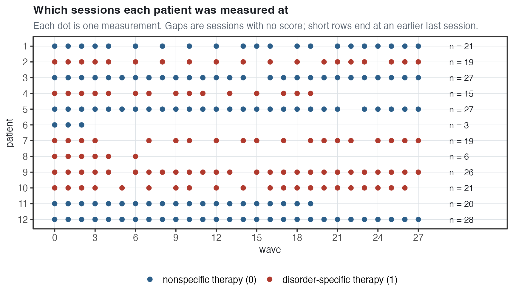
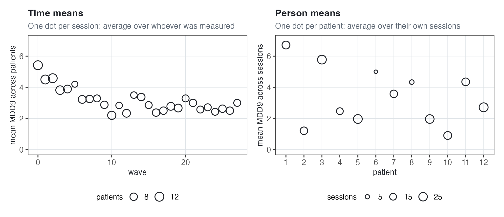
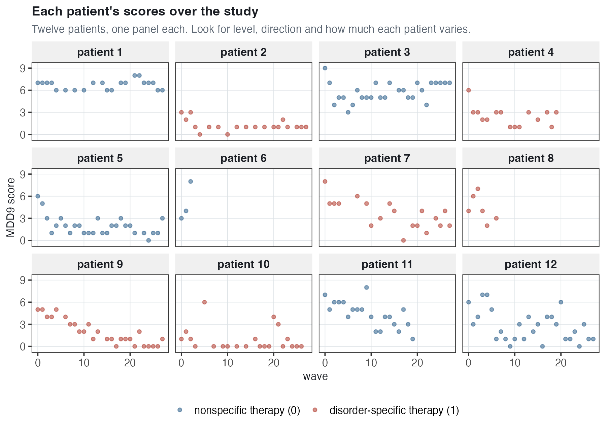
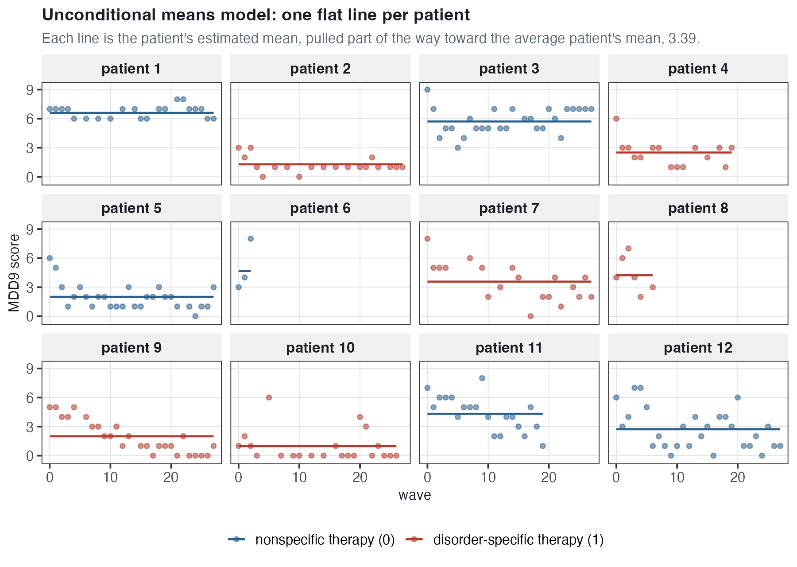
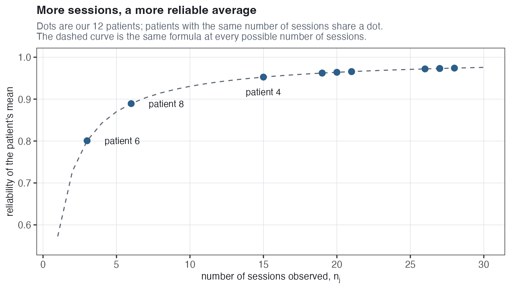
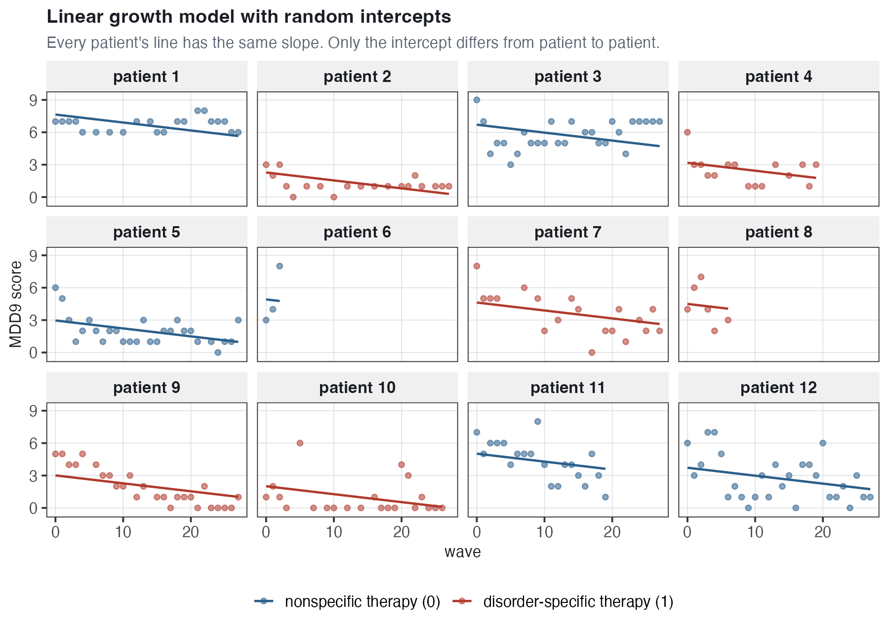
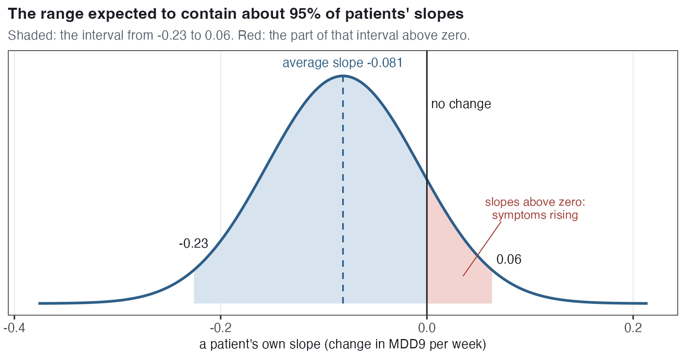
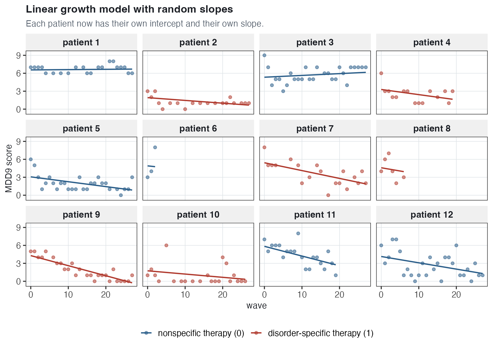
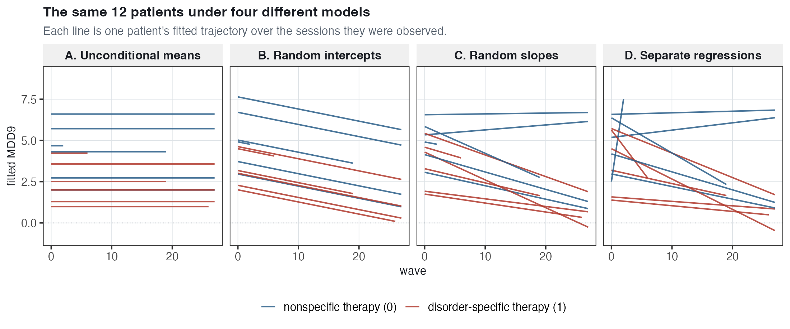
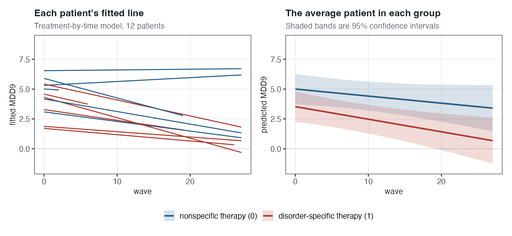

# Longitudinal Data and Linear Growth {#sec-linear-growth}

:::: chapter-lead
::: lead-label
The chapter in one paragraph
:::

This chapter changes the setting from students in schools to **repeated measurements on the same people**. The data are depression symptom counts from a psychotherapy trial, recorded at many therapy sessions for each patient, so the clusters are now **patients** and the observations inside each cluster are **measurements**, one symptom score from one session. No new model is introduced. Instead, the models from the first four chapters are fit again in this setting. The **unconditional means model** — the variance components model from @sec-variance-components — splits the variation into differences between patients and differences within a patient from one session to the next. Its intraclass correlation (ICC), 0.573, is more than three times the 0.174 from the reading data, because one person's scores resemble each other much more than two classmates' scores do. **Reliability** describes how precisely a patient's *average* score is measured, and it is the same quantity as the shrinkage factor. Adding time as a predictor gives the **linear growth model**: first with a random intercept only, so every patient changes at the same rate, then with a **random slope**, so each patient has their own rate of change. The average patient's symptom count falls by about 0.08 per week, but patients differ enough that some are expected to get slightly worse. Allowing the slope to vary more than doubles the standard error on the average rate of change, because a different sample of patients would have different rates of change. Finally, a Mundlak model for time is used to test whether patients measured later in the study differ from patients measured earlier, and here there is no evidence that they do.
::::

## The new data {#sec-lg-data}

### The study and the outcome {#sec-lg-study}

The data come from Schumacher, et al. ([2023](https://doi.org/10.1001/jamapsychiatry.2023.2823)), a randomized trial of 254 patients with chronic depression. Patients received either a **disorder-specific psychotherapy** or a **nonspecific psychotherapy**, and their symptoms were recorded at their therapy sessions over several months. This chapter uses the **first 12 patients** (`id` 1 to 12 in [`dep.csv`](../data/dep.csv)); @sec-nonlinear-growth uses the full data set. The comparison between the two therapies is the question of @sec-nonlinear-growth, and it is previewed in @sec-lg-appendix.

The outcome, `mdd9`, counts symptoms of **major depressive disorder** (MDD). The study measured symptoms with the 28-item *Inventory of Depressive Symptomatology*, and the authors collapsed those 28 items into the nine symptoms of major depressive disorder in the DSM-5 (the *Diagnostic and Statistical Manual of Mental Disorders*, 5th edition): mood, concentration, self-worth, suicidal ideation, tiredness, sleep, pleasure, psychomotor changes and appetite. Each symptom is scored 0 (none or mild) or 1 (moderate or strong), and `mdd9` is the **sum**. So it ranges from 0 (no symptom at moderate or strong intensity) to 9 (all nine), and a higher score means more depressed.

The other two variables:

- `wave` is time. It is the session number, from 0 at the first session to 27. We treat it as **time in weeks from the start of the study**, so one unit of `wave` is one week, and every interpretation below is stated in weeks.
- `treat` is 1 for a patient who received the disorder-specific therapy and 0 for the nonspecific therapy. Six of our 12 patients are in each group. It is the same for every session of a given patient.

| Feature | Value |
|:-----------------------------------|:-----------------------------------|
| Observations (rows) | 232 |
| Patients | 12 |
| Observations per patient | 3 to 28 |
| `mdd9` (number of depression symptoms, 0 to 9) | mean 3.24, SD 2.38 |
| `wave` (weeks from the start of the study) | 0 to 27 |
| `treat` (1 = disorder-specific therapy, 0 = nonspecific) | 6 patients in each group |

### What level 1 and level 2 are now {#sec-lg-levels}

Here are the first six rows, all for patient 1:

| `id` | `wave` | `treat` | `mdd9` |
|-----:|-------:|--------:|-------:|
|    1 |      0 |       0 |      7 |
|    1 |      1 |       0 |      7 |
|    1 |      2 |       0 |      7 |
|    1 |      3 |       0 |      7 |
|    1 |      4 |       0 |      6 |
|    1 |      6 |       0 |      6 |

Each row is **one measurement**: one session's score for one patient. Patient 1 contributes many rows, one per session at which their symptoms were recorded (wave 5 is missing, so that session has no score). So:

- **Level 2 is the patient.** A patient is a cluster, just as a school was.
- **Level 1 is the measurement** — one session's score for one patient. A measurement is nested within a patient, just as a student was nested within a school.

The occasion itself — wave 2, say — is not a separate level in the hierarchy. Every patient can have a wave 2 measurement, so the waves are crossed with patients, not nested in them. What is nested within patients are the **individual measurements** taken across waves, and those measurements are level 1. The variable `wave` is therefore a level-1 predictor because its value can change from one measurement occasion to the next within the same patient.

The algebra from the first four chapters is unchanged. What changes is what the letters refer to. In $\text{MDD}_{ij}$, the $j$ is the **patient** and the $i$ is the **measurement** — the $i$-th measurement of patient $j$. A level-2 variable is one that is the same for every session of a patient, like `treat`; a level-1 variable can change from session to session, like `wave`.

|   | Reading data (Chapters 1–4) | Depression data (this chapter) |
|:-----------------|:--------------------------|:--------------------------|
| Cluster (level 2), $j$ | a school | a patient |
| Observation (level 1), $i$ | a student | one measurement: one session's score |
| Within-cluster variation | how students in the same school differ | how one patient's score changes from session to session |
| Between-cluster variation | how schools differ | how patients differ |

::: callout-important
## In longitudinal data, the person is the cluster

In the reading data, a student was one row inside a school. Here a patient is the whole group, and their own measurements are its members. Within-person variation is the session-to-session change in one patient's scores; between-person variation is how patients differ from each other.
:::

### How much data there is, and how unbalanced it is {#sec-lg-balance}

Multilevel data have more than one sample size. Here there are **232 observations** and **12 patients**. The 232 are not spread evenly:

| Patient      |   1 |   2 |   3 |   4 |   5 |   6 |   7 |   8 |   9 |  10 |  11 |  12 |
|:-------------|----:|----:|----:|----:|----:|----:|----:|----:|----:|----:|----:|----:|
| Observations |  21 |  19 |  27 |  15 |  27 |   3 |  19 |   6 |  26 |  21 |  20 |  28 |

All 12 patients were measured at waves 0, 1 and 2, but no later wave has all 12: 11 patients at wave 3, 9 at wave 4, only 5 at wave 5, and between 6 and 10 at each wave from 6 to 27. A data set in which every person is measured at the same occasions is called **balanced**. These data are **unbalanced**, which is the usual situation in practice.

{#fig-lg-timeline width="86%"}

A multilevel model does not need balanced data. Each patient contributes whatever sessions they have, and no patient has to be dropped because a session is missing. The means and slopes of patients with few observations are, however, estimated less precisely. Patient 6, with three scores, is the main example of this in @sec-lg-reliability and @sec-lg-rs.

## Looking at the data before modeling {#sec-lg-explore}

### Overall descriptives

Across all 232 observations, `mdd9` has a mean of **3.24**, a median of **3**, an SD of **2.38**, and ranges from 0 to 9.

*Interpretation.* In a typical session a typical patient reports about three of the nine symptoms at moderate or strong intensity, and scores vary by about 2.4 symptoms around that. That SD of 2.38 mixes two kinds of variation that the rest of the chapter separates: patients differ from one another, and each patient's score changes from session to session.

### Time means and person means {#sec-lg-means}

{#fig-lg-means width="96%"}

The **time means** (left) average across patients at each wave. They start at 5.42 at wave 0 and are between 2.2 and 3.5 at every wave from 10 on, which suggests symptoms fall over time. Two cautions. The later dots average over fewer patients, as the circle sizes show. And they average over *different* patients: patients 6 and 8, whose own means are 5.00 and 4.33, stop contributing after the first weeks. So part of the drop could come from which patients are still being measured rather than from change within patients, and the two cannot be separated using the time means alone.

The **person means** (right) average across time for each patient. They range from 0.90 (patient 10) to 6.71 (patient 1), so patients differ a great deal in how many symptoms they typically report.

### Sources of variation {#sec-lg-sources}

{#fig-lg-sources width="84%"}

This is the same kind of picture used for schools in @sec-variance-components (@fig-overdispersion), with patients in place of schools. It shows the two sources of variation the variance components model separates:

- **Between patients:** how far the red diamonds are spread around the dashed line. Patient 1's diamond is near 6.7 and patient 10's is near 0.9.
- **Within a patient:** how far the grey dots in one column are spread around that column's diamond. Patient 1's scores are all between 6 and 8; patient 12's range from 0 to 7.

The red bars are approximate 95% confidence intervals for each patient's mean: the mean plus or minus 1.96 standard errors, where the standard error is the patient's own SD divided by the square root of their number of sessions. Their length depends on how many sessions the patient has and on how much that patient's scores vary. Patient 6 has only three sessions, with scores 3, 4 and 8, so their interval is the widest, 2.01 to 7.99; patient 8, with six sessions, has 2.84 to 5.82. Patient 12 has the most sessions, 28, but their scores range from 0 to 7, so their interval (1.94 to 3.49) is longer than patient 1's (6.44 to 6.99), whose 21 scores are all between 6 and 8. In @sec-lg-reliability, the number-of-sessions part is expressed as a single number, the reliability, which uses one within-patient variance, $\sigma^2$, for every patient.

### Empirical growth trajectories {#sec-lg-trellis}

{#fig-lg-trellis-raw width="90%"}

A plot of $y$ against time, one panel per person, is called a **trellis plot**, and its points are each person's **empirical growth trajectory** — the observed path of their scores before any model is fitted. Making one is the first step in any longitudinal analysis. The habit of looking carefully before modeling is sometimes called *disciplined perception*. Here is what this plot shows:

- **Levels differ.** Patient 1 is near 7 throughout; patients 2 and 10 are near 1.
- **Directions differ.** Patients 5, 7, 9 and 11 clearly decline. Patients 1 and 2 are roughly flat. Patient 3 rises slightly after an early dip.
- **Scores vary from session to session.** Even a patient with a clear trend has scores that go up and down by a symptom or two from week to week.
- **Some patients have very little data.** Patient 6 has three points and patient 8 has six.
- **The two therapy groups do not separate by eye** with only six patients in each.

In @sec-lg-ucm through @sec-lg-rs, a sequence of models is fitted to these data, each describing more of what this plot shows.

## The unconditional means model {#sec-lg-ucm}

### The model

The first model has no time in it at all. For measurement $i$ of patient $j$:

$$\begin{aligned}
\text{MDD}_{ij} &= \beta_{0j} + e_{ij} \\
\beta_{0j} &= \gamma_0 + u_j \\
u_j &\sim N(0, \tau^2) \\
e_{ij} &\sim N(0, \sigma^2)
\end{aligned}$$

- $\beta_{0j}$ is patient $j$'s **own mean** — the score they would average over a very large number of sessions.
- $\gamma_0$ is the **average of the patient means**: the mean for an average patient.
- $u_j$ is patient $j$'s **departure** from that average. It is the same for every session of patient $j$.
- $e_{ij}$ is the departure of one session's score from the patient's own mean.
- $\tau^2$ is the variance of the patient departures (between-patient variation) and $\sigma^2$ the variance of the session departures (within-patient variation). Both kinds of departure are **assumed** to be normally distributed with mean zero. This is an assumption of the model, not something estimated from the data.

This is the **variance components model** from @sec-variance-components, written for patients and sessions instead of schools and students. In R:

``` r
lmer(mdd9 ~ 1 + (1 | id), data = dep)
```

The first `1` is the fixed intercept, $\gamma_0$, and `(1 | id)` is each patient's own departure from it, $u_j$.

This model is usually **unrealistic**. It assumes that a patient's symptoms do not change systematically over time: each patient has a mean, and every session is that mean plus a random session-to-session departure, $e_{ij}$ (called noise below). Symptoms are not expected to stay flat over months of therapy. It is still a useful baseline, for three reasons. It splits the variation into between-patient and within-patient parts, and the ICC is computed from those two parts (@sec-lg-icc). So is the reliability of each patient's average (@sec-lg-reliability). And it is the baseline every later model is compared to: when time is added, we can see how much of the within-patient variation was change over time.

### Fitting it {#sec-lg-ucm-fit}

| Term                                 | Estimate |     SE |
|:-------------------------------------|---------:|-------:|
| $\widehat{\gamma_0}$ `(Intercept)`   |   3.3862 | 0.5378 |
| $\widehat{\tau}$ `sd__(Intercept)`   |   1.8123 |        |
| $\widehat{\sigma}$ `sd__Observation` |   1.5660 |        |

$\widehat{\gamma_0} = 3.386$. *Interpretation.* An average patient's mean is about 3.4 symptoms out of 9. Its standard error, 0.538, is large because the estimate is based on only 12 patients.

$\widehat{\tau} = 1.812$. *Interpretation.* Patients' own means differ from the average patient's by about 1.8 symptoms in SD terms. Under the normality assumption, a patient one SD above average has a mean of about $3.386 + 1.812 = 5.20$ symptoms and a patient one SD below has about $3.386 - 1.812 = 1.57$.

$\widehat{\sigma} = 1.566$. *Interpretation.* A patient's score in any one session is typically about 1.6 symptoms away from that patient's own mean.

### What the fitted lines look like {#sec-lg-ucm-lines}

{#fig-lg-trellis-m0 width="90%"}

**Is it a good fit?** For patients whose scores are roughly flat, such as 1 and 2, the flat line describes them well. For patients whose scores fall, such as 5, 9 and 11, it does not: the line is too low at the start and too high at the end.

**Where is partial pooling?** Each line is not the patient's raw mean. It is pulled toward the average patient's 3.39. Patient 6 averages 5.00 over three sessions, but the line is at 4.68. Patient 12 averages 2.71 over 28 sessions, and the line is at 2.73, almost exactly at that raw mean. The fewer sessions a patient has, the further the line is pulled. The exact amount is in @sec-lg-reliability.

**What is going on with patient 9?** Their scores start at 5 and are 0 or 1 at most sessions from wave 17 on, but their fitted line is flat at 2.00. Nearly all of their early scores are above the line and nearly all of their late scores are below it.

**Are the** $e_{ij}$ normal with mean zero? Writing $e_{ij} \sim N(0, \sigma^2)$ means more than "the session departures average zero." It means they average zero **at every point in time**: among early sessions, among late sessions, among middle sessions alike. Written compactly,

$$\mathbb{E}[e_{ij} \mid \text{wave}_{ij}] = 0,$$

where $\mathbb{E}[\,\cdot\,]$ means "the expected (average) value of" and the bar means "among sessions at a given wave." Patient 9's departures do not meet this. They are positive early and negative late, so their average depends on the wave. That pattern means the model is missing a predictor that changes over time — here, time itself. @sec-lg-growth adds it.

## The ICC with repeated measures {#sec-lg-icc}

The ICC has the same definition as before, with patients as the clusters:

$$\text{ICC} = \frac{\tau^2}{\tau^2 + \sigma^2} = \frac{\text{between-patient variance}}{\text{total variance}}$$

From the unconditional means model, $\widehat{\tau}^2 = 1.8123^2 = 3.284$ and $\widehat{\sigma}^2 = 1.5660^2 = 2.452$, so

$$\widehat{\text{ICC}} = \frac{3.284}{3.284 + 2.452} = \frac{3.284}{5.736} = 0.573$$

### The two interpretations

**1. Between-patient differences.** Differences between patients account for **57%** of the total variance in symptom counts.

*Interpretation.* Of all the variation in the 232 scores, a little more than half comes from which patient the score belongs to — some patients consistently report many symptoms and others few. The other 43% is variation within a patient from one session to the next.

**2. Within-patient similarity.** The correlation between two scores drawn from the **same** patient is **0.573**.

*Interpretation.* Pick two of one patient's sessions at random. The total SD of a single score under this model is $\sqrt{5.736} = 2.395$ symptoms. Suppose the first score is one SD above the average, at about $3.386 + 2.395 = 5.78$. Our best guess for the second score from the same patient is then 0.573 SDs above average, which is $0.573 \times 2.395 = 1.37$ symptoms above, or about 4.76. So one of a patient's scores is a good guide to another of their scores. Two scores from *different* patients have a correlation of zero: one is no guide to the other.

### Why it is so much higher than in the reading data {#sec-lg-icc-higher}

In the reading data from @sec-variance-components and @sec-random-intercepts (a sample of 10 schools), the ICC from the variance components model was **0.174**: about 17% of the variation in end-of-year reading scores was between schools. Here the ICC is more than three times that.

The reason is what the members of a cluster share. Two students in the same school share the school — its teachers, its curriculum, its neighborhood — but they are still two different people. Two measurements from the same patient share *everything about that patient*: their underlying severity, their circumstances, how they tend to answer the questionnaire. A person is a much tighter cluster than a school, so repeated measures on one person are far more alike than students in one school. This is why high ICCs are typical of longitudinal data.

## Reliability of a patient's average {#sec-lg-reliability}

The ICC is about **single measurements**: the correlation between two scores from the same patient. Reliability is about **averages**: it is the correlation between two *averages* of $n_j$ measurements each from the same patient. Put another way, if we average a patient's scores over all $n_j$ of their sessions, how highly would that average correlate with another average score derived from another $n_j$ sessions?

$$R_j = \frac{\tau^2}{\tau^2 + \dfrac{\sigma^2}{n_j}}$$

$R_j$ is the **reliability of patient** $j$'s average. It has a $j$ subscript because it depends on $n_j$, the number of sessions patient $j$ has. Each piece:

- $\tau^2$ is the true between-patient variance, estimated at 3.284: how much patients' real means differ.
- $\sigma^2 / n_j$ is the **sampling variance of a patient's average**: how much an average of $n_j$ sessions would vary around that patient's true mean from one set of sessions to another. Averaging $n_j$ sessions divides the session-level variance $\sigma^2$ by $n_j$, so the more sessions, the less the average varies.
- The whole fraction is the share of the variation in *observed* patient averages that reflects real differences between patients, rather than session-to-session noise.

Compare the reliability formula with the ICC. The only change is that $\sigma^2$ has become $\sigma^2/n_j$. With a single session ($n_j = 1$) the two are identical; each additional session makes the noise term $\sigma^2/n_j$ smaller, so the reliability gets closer to 1.

**Reliability worked example: two patients.**

- **Patient 6, three sessions.** $\sigma^2/3 = 2.452/3 = 0.817$, so $R_6 = 3.284 / (3.284 + 0.817) = 3.284/4.101 = 0.801$. *Interpretation.* About 80% of the variation in three-session averages reflects real differences between patients; the other 20% is noise from which three sessions happened to be recorded.
- **Patient 12, 28 sessions.** $\sigma^2/28 = 2.452/28 = 0.088$, so $R_{12} = 3.284/(3.284 + 0.088) = 3.284/3.372 = 0.974$. *Interpretation.* With 28 sessions, about 97% of the variation in averages like patient 12's is real, and only 3% is noise.

{#fig-lg-reliability width="82%"}

Reliability increases quickly with the number of sessions. With three sessions it is already 0.80; with 15 sessions it is above 0.95, and further sessions change it very little.

::: callout-tip
## Reliability is the shrinkage factor

The estimate of patient $j$'s departure from the average patient, $\widehat{u_j}$, is their raw departure multiplied by their reliability:

$$\widehat{u_j} = \underbrace{\left(\bar{y}_j - \widehat{\gamma_0}\right)}_{\text{raw residual}} \times \underbrace{\frac{\tau^2}{\tau^2 + \sigma^2/n_j}}_{\text{shrinkage factor } R_j}$$

The raw residual is how far patient $j$'s raw mean, $\bar{y}_j$, is from the average patient's mean, $\widehat{\gamma_0}$. The shrinkage factor is the reliability $R_j$, a number between 0 and 1, so multiplying by it pulls the departure toward zero, which is where the average patient is. The patient's estimated mean is $\widehat{\gamma_0} + \widehat{u_j}$.

For **patient 6**, the raw residual is $5.0000 - 3.3862 = 1.6138$, so $\widehat{u_6} = 1.6138 \times 0.8007 = 1.292$ and their estimated mean is $3.3862 + 1.292 = 4.68$: 80% of their 1.61-symptom departure from the average is kept, so their estimated mean is 4.68 rather than 5.00. For **patient 12**, the raw residual is $2.7143 - 3.3862 = -0.6719$, so $\widehat{u_{12}} = -0.6719 \times 0.9740 = -0.654$ and their estimated mean is $3.3862 - 0.654 = 2.73$: 97% is kept, so the estimate is almost the same as the raw mean. These are the fitted lines for patients 6 and 12 in @fig-lg-trellis-m0. A less reliable average is pulled further toward the average patient.
:::

The same idea appears in measurement as **Cronbach's** $\alpha$, the reliability of a test score built from several items: more items, more reliable total. Here the sessions play the role of the items. The connection comes up again with cross-classified models.

## Adding time: the linear growth model {#sec-lg-growth}

### What we want to know {#sec-lg-rqs}

With these data we can ask four research questions:

1.  Do depression symptoms increase or decrease over time?
2.  How much do individual patients' trajectories vary?
3.  In @sec-nonlinear-growth: does the disorder-specific therapy reduce symptoms more than the nonspecific one?
4.  In @sec-nonlinear-growth: how can we model trajectories that are not straight lines?

@sec-lg-growth through @sec-lg-mundlak address the first two. @sec-lg-appendix previews the third.

### The model

To answer whether symptoms change over time, put `wave` into the model as a predictor. With a random intercept, this is the **random intercepts model** from @sec-random-intercepts, with time in place of the beginning-of-year reading score:

$$\begin{aligned}
\text{MDD}_{ij} &= \beta_{0j} + \beta_1 \text{wave}_{ij} + e_{ij} \\
\beta_{0j} &= \gamma_0 + u_j \\
u_j &\sim N(0, \tau^2) \\
e_{ij} &\sim N(0, \sigma^2)
\end{aligned}$$

and in reduced form, substituting the second line into the first,

$$\text{MDD}_{ij} = \gamma_0 + \beta_1 \text{wave}_{ij} + u_j + e_{ij}$$

- $\beta_{0j}$ is patient $j$'s own **intercept**: their predicted score at wave 0, the start of the study. In growth models the intercept is often called **initial status**.
- $\beta_1$ is the **rate of change**: the change in predicted symptoms per week. It has no $j$, so it is **one number for every patient**.
- $\gamma_0$ is the average patient's intercept, and $u_j$ is patient $j$'s departure from it.

So each patient gets their own starting level, but every patient changes at the same rate. In R, `1 + wave` is $\gamma_0 + \beta_1\text{wave}_{ij}$ and `(1 | id)` is $u_j$:

``` r
lmer(mdd9 ~ 1 + wave + (1 | id), data = dep)
```

### Fitting it and reading the output {#sec-lg-ri-fit}

| Term                                 |  Estimate |     SE |     $Z$ |
|:-------------------------------------|----------:|-------:|--------:|
| $\widehat{\gamma_0}$ `(Intercept)`   |    4.2129 | 0.5377 |    7.83 |
| $\widehat{\beta_1}$ `wave`           | $-0.0736$ | 0.0120 | $-6.12$ |
| $\widehat{\tau}$ `sd__(Intercept)`   |    1.7581 |        |         |
| $\widehat{\sigma}$ `sd__Observation` |    1.4525 |        |         |

The $Z$ column is the estimate divided by its standard error, computed by R before rounding; an estimate more than about two standard errors from zero is one we would not attribute to chance.

$\widehat{\gamma_0} = 4.21$. *Interpretation.* An average patient (one with $u_j = 0$) is predicted to report 4.21 symptoms at wave 0, the first session.

$\widehat{\beta_1} = -0.074$. *Interpretation.* Averaging over patients, each additional week in the study is associated with 0.074 fewer symptoms. Over the 27 weeks that is $0.0736 \times 27 = 1.99$, about two fewer symptoms from the first session to the last. Is the change significant? $Z = -6.12$ is far beyond $\pm 1.96$, so the decline is well established.

Explaining that to a clinician without equations: *on average, patients in this study report about one fewer moderate-or-strong symptom for every 13 or 14 weeks of therapy, or about two fewer over the half year.* Both groups received therapy, so this describes change during therapy, not the effect of therapy compared with no therapy.

::: callout-warning
## $\widehat{\beta_1}$ is not a pure within-patient rate of change

The model assumes that the patient departures $u_j$ average zero at every value of `wave`, so under the model a patient measured mostly early and a patient measured mostly late are assumed to be comparable. Under that assumption the single slope combines change *within* patients with differences *between* patients who happen to be observed at different times. In @sec-lg-mundlak the two are separated, and in these data there is no evidence that they differ, though with 12 patients the between-patient part is estimated very imprecisely.
:::

$\widehat{\tau} = 1.76$. *Interpretation.* At any given week, patients' predicted symptom levels differ by about 1.8 in SD terms. Because every patient's line has the same slope, that spread is the same at every week.

$\widehat{\sigma} = 1.45$. *Interpretation.* A session's score is typically about 1.45 symptoms from the patient's own line. That is down from 1.57 in the unconditional means model: part of what looked like session-to-session noise was the trend over time.

### What the fitted lines look like {#sec-lg-ri-lines}

{#fig-lg-trellis-m1 width="90%"}

This is clearly better than the flat lines. Patients 5, 9 and 11 now have lines that follow their decline. But every line has the **same** slope of $-0.074$, and that does not fit everyone. Patients 1 and 3 have declining lines although their own scores do not decline. Patient 9's scores fall faster than the common slope.

**What is going on with patient 6?** Their three scores are 3, 4 and 8 — rising sharply. Under this model they have the same downward slope as everyone else, because a random intercepts model has one slope for all patients.

## Random slopes: each patient's own rate of change {#sec-lg-rs}

### The model {#sec-lg-rs-model}

To let the time trend **vary by patient**, give the slope a $j$ subscript. This is the random slopes model from @sec-random-slopes, and in longitudinal analysis it is often a reasonable starting point.

$$\begin{aligned}
\text{MDD}_{ij} &= \beta_{0j} + \beta_{1j} \text{wave}_{ij} + e_{ij} \\
\beta_{0j} &= \gamma_0 + u_{0j} \\
\beta_{1j} &= \gamma_1 + u_{1j} \\
\begin{bmatrix} u_{0j} \\ u_{1j} \end{bmatrix} &\sim N\left( \begin{bmatrix} 0 \\ 0 \end{bmatrix}, \Sigma \right), \qquad
\Sigma = \begin{bmatrix} \tau_0^2 & \tau_{01} \\ \tau_{01} & \tau_1^2 \end{bmatrix} \\
e_{ij} &\sim N(0, \sigma^2)
\end{aligned}$$

- $\beta_{0j}$ is patient $j$'s own intercept (their predicted symptoms at wave 0) and $\beta_{1j}$ is their **own rate of change** per week.
- $\gamma_0$ and $\gamma_1$ are the averages of those across patients: the average intercept and the **average rate of change**. The slope that was $\beta_1$ in @sec-lg-growth is called $\gamma_1$ here, because it is now an average of patient slopes rather than one slope for everybody.
- $u_{0j}$ is patient $j$'s departure from the average intercept and $u_{1j}$ is their departure from the average rate of change.
- The pair $(u_{0j}, u_{1j})$ is **assumed** to come from a two-dimensional normal distribution with covariance matrix $\Sigma$. Its three entries are $\tau_0^2$, the variance of the intercepts; $\tau_1^2$, the variance of the rates of change; and $\tau_{01}$, the **covariance** between a patient's intercept departure and slope departure. The correlation version of $\tau_{01}$ is $\rho = \tau_{01}/(\tau_0\tau_1)$, and $\rho$ is what R prints.

In R, `1 + wave` outside the parentheses is $\gamma_0 + \gamma_1\text{wave}_{ij}$, and `(1 + wave | id)` is $u_{0j} + u_{1j}\text{wave}_{ij}$, each patient's departure from that average trend. Putting `wave` inside the parentheses is what lets the slope vary by patient. R includes the `1` even when it is left out, so `lmer(mdd9 ~ wave + (wave | id))` fits the same model; writing it out shows every part.

``` r
lmer(mdd9 ~ 1 + wave + (1 + wave | id), data = dep)
```

### The reduced form, two ways {#sec-lg-rs-reduced}

Substituting the two level-2 lines into level 1 gives the reduced form, which can be grouped in two ways:

$$\begin{aligned}
\text{MDD}_{ij} &= \underbrace{\gamma_0 + \gamma_1 \text{wave}_{ij}}_{\text{average trend}} + \underbrace{u_{0j} + u_{1j} \text{wave}_{ij}}_{\text{patient's departure from it}} + e_{ij} \\[6pt]
\text{MDD}_{ij} &= \underbrace{(\gamma_0 + u_{0j})}_{\text{patient's own intercept}} + \underbrace{(\gamma_1 + u_{1j})}_{\text{patient's own slope}} \text{wave}_{ij} + e_{ij}
\end{aligned}$$

The first line separates the **average patient's trajectory** from how far patient $j$'s trajectory is from it. The second line regroups the same terms into **patient** $j$'s own line: an intercept and a slope that both belong to that patient. The two lines are the same equation; only the grouping differs.

### Fitting it and reading the output {#sec-lg-rs-fit}

| Term                                     |  Estimate |     SE |     $Z$ |
|:-----------------------------------------|----------:|-------:|--------:|
| $\widehat{\gamma_0}$ `(Intercept)`       |    4.2607 | 0.4888 |    8.72 |
| $\widehat{\gamma_1}$ `wave`              | $-0.0814$ | 0.0260 | $-3.13$ |
| $\widehat{\tau_0}$ `sd__(Intercept)`     |    1.5924 |        |         |
| $\widehat{\tau_1}$ `sd__wave`            |    0.0738 |        |         |
| $\widehat{\rho}$ `cor__(Intercept).wave` | $-0.1137$ |        |         |
| $\widehat{\sigma}$ `sd__Observation`     |    1.3368 |        |         |

$\widehat{\gamma_0} = 4.26$. *Interpretation.* The average patient is predicted to report 4.26 symptoms at wave 0.

$\widehat{\gamma_1} = -0.081$. *Interpretation.* Averaging over patients, each additional week is associated with 0.081 fewer symptoms, or $0.0814 \times 27 = 2.20$ fewer over the 27 weeks. As in @sec-lg-ri-fit, this pools change within patients with differences between patients, under the same assumption.

$\widehat{\tau_0} = 1.59$. *Interpretation.* At wave 0, patients' predicted starting levels differ by about 1.6 symptoms in SD terms. Now that every patient has their own slope, the lines are no longer parallel, so how much patients' predicted scores differ depends on the week. $\tau_0$ describes the spread at **wave 0 specifically**, the start of the study.

$\widehat{\tau_1} = 0.074$. *Interpretation.* Patients' own rates of change differ from the average rate by about 0.074 symptoms per week in SD terms. The next subsection turns this into a range.

$\widehat{\rho} = -0.11$. *Interpretation.* This is the estimated correlation, among patients like these, between a patient's true intercept departure $u_{0j}$ and true slope departure $u_{1j}$. It describes the true departures, not the 12 shrunken estimates reported for our patients, which correlate only $-0.01$ (@sec-lg-shrinkage makes the same point about $\tau_1$). It is negative: patients who start with more symptoms than average tend to have a more negative slope than average, so their symptoms fall a little faster. The correlation is weak, and @sec-lg-appendix shows there is no evidence it differs from zero. It is a symmetric association between the two departures, not evidence that a patient's starting level causes their rate of change. The covariance, which is the off-diagonal entry of $\Sigma$, is $\widehat{\tau_{01}} = \widehat{\rho}\,\widehat{\tau_0}\,\widehat{\tau_1} = -0.114 \times 1.592 \times 0.074 = -0.013$.

$\widehat{\sigma} = 1.34$. *Interpretation.* A session's score is typically about 1.34 symptoms from the patient's own line, down again from 1.45: letting each patient have their own slope accounted for more of the session-to-session variation.

### Putting $\tau_1$ in a sentence {#sec-lg-tau1}

$\widehat{\tau_1} = 0.074$ is a standard deviation, and the patient slopes are **assumed** to follow a normal distribution around the average. About 95% of a normal distribution is within 1.96 SDs of its mean, so

$$\widehat{\gamma_1} \pm 1.96\,\widehat{\tau_1} = -0.081 \pm 1.96(0.074) = [-0.23,\ 0.06]$$

**We expect about 95% of patients like these to have a rate of change between** $-0.23$ and $+0.06$ symptoms per week.

*Interpretation.* Over ten weeks, that is a range from about 2.3 fewer symptoms to about 0.6 more. Most patients improve, some substantially. But the interval **includes zero**, so under the model a minority of patients are expected to get slightly worse over the study. The average rate of change describes the typical patient, not every patient. In the full 110-school reading data of @sec-random-slopes, the same calculation for the slope on the beginning-of-year score gave $[4.74, 9.16]$ (@sec-rs-tau1), positive from end to end, so nearly every school was expected to show a positive relationship. Here, the direction of change differs from patient to patient.

{#fig-lg-slope-interval width="82%"}

::: callout-important
## This is a prediction interval, not a confidence interval

$[-0.23, 0.06]$ describes how spread out the *patients* are, and it is built from $\tau_1$. It is expected to cover about 95% of the *true* patient slopes, not 95% of the 12 shrunken estimates for our patients, which are less spread out than the true slopes because of shrinkage (@sec-lg-shrinkage). The confidence interval on the average, $\widehat{\gamma_1} \pm 1.96\,\text{SE} = -0.081 \pm 1.96(0.026) = [-0.132, -0.030]$, describes how precisely the *average* rate of change is known, and it is built from the standard error. More patients would narrow the confidence interval but not the prediction interval: with a larger sample the spread of patients' rates of change is estimated more precisely, but the spread itself does not get smaller.
:::

### What the fitted lines look like, and shrinkage {#sec-lg-shrinkage}

{#fig-lg-trellis-m2 width="90%"}

Each patient now has their own line. Patient 3's line has a slightly positive slope, patient 1's is nearly flat, and patient 9's has a steep negative slope. Compare the random intercepts plot in @fig-lg-trellis-m1, where they all had the same slope.

**Where is partial pooling?** Look at **patient 6** again. Their three scores rise from 3 to 8, and a straight line fitted to those three points alone has a slope of **+2.50 symptoms per week**. Under the random slopes model, patient 6's slope is $-0.068$ — close to the average of $-0.081$, and in the opposite direction from their own data. With three observations, patient 6's own slope is measured so poorly that it is pulled almost all the way to the average. A patient with many sessions has a slope that is measured well, and the model's estimate is close to the slope from their own data.

![Orange dots: a separate regression on each patient's own data. Blue dots: the random slopes model. For 11 of the 12 patients the blue dot is closer to the average, $-0.081$ (dashed), than the orange dot. The exception is patient 4, whose own slope, $-0.081$, is already almost exactly the average; their estimate is $-0.086$, because a patient's intercept and slope are estimated together and patient 4's intercept was pulled up toward the average. Patient 6's own slope, $+2.50$, is too far right to draw on this scale.](images/05/fig10_shrinkage.png){#fig-lg-shrinkage width="84%"}

For patients with 15 or more sessions, the random slopes estimate is within about 0.05 of the separate-regression slope. For **patient 8**, with six sessions, the separate-regression slope is $-0.486$ and the random slopes estimate is $-0.108$. Patient 6's slope is pulled furthest of all.

One consequence: the model's 12 estimated patient slopes have an SD of 0.060, smaller than $\widehat{\tau_1} = 0.074$. That is not a contradiction. $\tau_1$ estimates the spread of the patients' **true** slopes; the reported slopes are shrunken estimates, and shrunken estimates are always less spread out than the quantity they estimate. Report $\widehat{\tau_1}$ as the spread of rates of change, not the SD of the 12 reported slopes.

### Do we need the random slopes? {#sec-lg-lrt}

Compare the two models with a **likelihood ratio test**. The test statistic is $-2$ times the difference in the two models' log-likelihoods, $\ell$. A model's likelihood is how probable our data would be if that model's estimates were the true values, and $\ell$ is its logarithm, so a larger $\ell$ (here, a less negative one) means a better fit. Adding parameters can only make $\ell$ larger or leave it unchanged, so the question is whether the improvement is bigger than the extra parameters alone would produce. For this comparison R refits both models by maximum likelihood:

``` r
anova(m1, m2)    # m1: random intercepts; m2: random slopes
```

| Model             | Parameters |     $\ell$ | $\chi^2$ |  df | p        |
|:------------------|-----------:|-----------:|---------:|----:|:---------|
| Random intercepts |          4 | $-434.261$ |          |     |          |
| Random slopes     |          6 | $-423.196$ |    22.13 |   2 | 0.000016 |

$\chi^2 = -2\left(-434.261 - (-423.196)\right) = -2(-11.065) = 22.13$. For a $\chi^2$ distribution with 2 degrees of freedom, the conventional 5% cutoff is 5.99, and 22.13 is far above it.

- **Two degrees of freedom**, because the random slope adds two parameters: the slope variance $\tau_1^2$ and the covariance $\tau_{01}$. Four parameters become six.
- **The boundary.** A variance cannot be negative, so the null value $\tau_1^2 = 0$ is at the edge of what that parameter can be, and the correct reference distribution is a mixture of $\chi^2_1$ and $\chi^2_2$ rather than a plain $\chi^2_2$ (@sec-rs-lrt). The uncorrected p-value is too large, so the test is conservative: when it rejects, as here, the conclusion holds.

*Interpretation.* Even with only 12 patients, there is strong evidence that patients do not all change at the same rate. Random slopes for time are usually a good choice in longitudinal data. When a random slopes model fits much better than a random intercepts model, that is evidence that **individual change differs from person to person**: some patients improve quickly, some slowly, and a few not at all. A single average rate describes the typical patient, not each patient.

### Four models, compared {#sec-lg-four}

{#fig-lg-four-models width="100%"}

Panel by panel:

- **A. Unconditional means.** A flat line for each patient at their (shrunken) mean. No change over time.
- **B. Random intercepts.** Every patient's line has the same downward slope. The lines are parallel.
- **C. Random slopes.** Each patient has their own slope, pulled toward the average. Patients with many sessions keep most of their own trend.
- **D. Separate regressions.** A line fitted to each patient's data alone, with no pooling. Patient 6's line has a steep positive slope, +2.50, because it is fitted only to their three rising scores.

Panel C is a compromise between B and D. Slopes differ, as in D, but each one is pulled toward the average by an amount that depends on how much data the patient has. In B every slope is set equal to the average; in D none is pulled at all.

## What happened to the standard error on `wave` {#sec-lg-se}

### The two models side by side

|                             | Random intercepts |    Random slopes |
|:----------------------------|------------------:|-----------------:|
| `(Intercept)`               |     4.213 (0.538) |    4.261 (0.489) |
| `wave`                      |  $-0.074$ (0.012) | $-0.081$ (0.026) |
| SD of intercepts            |             1.758 |            1.592 |
| SD of slopes                |                   |            0.074 |
| Intercept–slope correlation |                   |         $-0.114$ |
| SD of session departures    |             1.453 |            1.337 |
| Observations                |               232 |              232 |

Standard errors are in parentheses. The estimate of the average rate of change **barely changed**, from $-0.074$ to $-0.081$. Its standard error **more than doubled**, from 0.0120 to 0.0260. The two standard errors describe different kinds of uncertainty, explained below.

A table like this sometimes also includes an ICC row (here about 0.6 and 0.7). For the random intercepts model that is the familiar $1.758^2/(1.758^2 + 1.453^2) = 0.59$. For the random slopes model there is no single ICC: the lines are not parallel, so the between-patient variance changes from week to week, and a single value of 0.7 is an average over the weeks in the data. The value at wave 0 is $1.592^2/(1.592^2 + 1.337^2) = 0.59$.

### These patients, or patients like these {#sec-lg-se-why}

- **If the random intercepts model is true**, every patient changes at the same rate. Then *which* 12 patients happen to be in the sample does not affect the estimated rate of change — any 12 patients would share the same slope — and the only uncertainty comes from session-to-session noise. The standard error describes uncertainty about **these patients**.
- **If the random slopes model is true**, every patient has their own rate of change. A different sample of 12 patients would have a different set of rates, and their average would differ from ours. That sample-to-sample variation has to be in the standard error. It describes uncertainty about **patients like these** — the population our 12 come from.

A formula from generalizability theory makes this concrete, with $J$ the number of patients. It holds only approximately:

$$\text{SE}(\widehat{\gamma_1}) \approx \sqrt{\text{SE}(\widehat{\beta_1})^2 + \frac{\tau_1^2}{J}}$$

On the left is the standard error of $\widehat{\gamma_1}$, the average rate of change in the random slopes model (@sec-lg-rs). Under the square root, $\widehat{\beta_1}$ is the one common slope in the random intercepts model (@sec-lg-growth). The two slopes are written with different letters because they come from different models. (Some presentations write these as $\beta_{1RS}$ and $\beta_{1RI}$, and write $\text{Var}(\beta_{1RI})$ for the squared standard error.) The two pieces under the square root:

- $\text{SE}(\widehat{\beta_1})^2$ is the squared standard error from the random intercepts model, $0.01202^2 = 0.0001445$: the uncertainty from session noise alone.
- $\tau_1^2/J$ is the variance of an average of $J$ patient slopes drawn from a population with slope variance $\tau_1^2$: $0.07385^2/12 = 0.0004545$. It is the extra uncertainty that comes from which patients were sampled.

Both pieces are variances, so they add before the square root is taken. The first piece, $0.0001445$, is the uncertainty we had under the random-intercepts model. The second piece, $0.0004545$, is the **additional uncertainty introduced when we allow patients to have different slopes**. That second piece is about three times as large as the first, so the total variance is about four times as large. Taking the square root gives $0.0245$, which is about twice the original random-intercepts SE of $0.0120$. **So allowing the slope to vary across patients substantially increases the standard error of the average slope.**

The fitted random-slopes SE is $0.0260$, while the simplified formula gives $0.0245$. Those two numbers are close; the small difference is because the formula is only an approximation to the full multilevel-model calculation. The important comparison is $0.0120$ versus about $0.025$: once patients are allowed to have different rates of change, uncertainty about **which patients were sampled** becomes a major part of the standard error.

::: callout-tip
## What this means in practice

If patients differ in their rates of change, the random intercepts standard error on the average rate is too small, and the evidence looks stronger than it is. With the random slope in the model, the standard error describes uncertainty about the usual question of interest: how fast patients like these change, on average.
:::

Luke Miratrix's [random slopes visualizer](https://lmiratrix.github.io/MLM/rand_slopes_viz.html) lets you change the average slope, the spread of slopes and the intercept–slope correlation and see the patient lines change. It shows what each parameter does to a set of trajectories.

## A Mundlak model for time {#sec-lg-mundlak}

### Why within and between usually matter less here {#sec-lg-mundlak-why}

In the full 110-school reading data of @sec-within-between, the beginning-of-year (BOY) score varied both within schools (students in one school had different scores) and between schools (schools had different average scores), and in a random intercepts model the slope within schools (6.96) was different from the slope between schools (8.72). Time can vary in the same two ways. **Within** a patient, `wave` changes from session to session. **Between** patients, the *average* `wave` at which a patient was measured can differ.

When time is the only level-1 variable, the between part is usually small. Longitudinal studies generally measure everyone on about the same schedule, so most people's average time is about the same, and there is little between-person variation in time to separate. If people are measured on different schedules — some mostly early in a study, some mostly late — it can matter, and the model can control for it.

In our data the variable `mean_wave` is each patient's average `wave` over their own sessions. For eight patients it is between 13 and 15. For patients 4 and 11 it is 9.0 and 9.5, and for patients 6 and 8, whose scores stop early, it is 1.00 and 2.67.

### Fitting it {#sec-lg-mundlak-fit}

The Mundlak model adds the cluster mean of the predictor alongside the predictor itself — here, `mean_wave` alongside `wave`:

``` r
lmer(mdd9 ~ 1 + wave + mean_wave + (1 + wave | id), data = dep)
```

| Term                                     |  Estimate |     SE |     $Z$ |
|:-----------------------------------------|----------:|-------:|--------:|
| `(Intercept)`                            |    4.8757 | 1.3625 |    3.58 |
| `wave` (within-patient rate of change)   | $-0.0808$ | 0.0260 | $-3.10$ |
| `mean_wave` (contextual effect of time)  | $-0.0553$ | 0.1140 | $-0.49$ |
| $\widehat{\tau_0}$ `sd__(Intercept)`     |    1.6462 |        |         |
| $\widehat{\tau_1}$ `sd__wave`            |    0.0739 |        |         |
| $\widehat{\rho}$ `cor__(Intercept).wave` | $-0.0923$ |        |         |
| $\widehat{\sigma}$ `sd__Observation`     |    1.3369 |        |         |

The coefficient on `wave` is now the **within-patient** rate of change: averaging over patients, each additional week within a patient is associated with 0.081 fewer symptoms. It is essentially the same as the $-0.081$ in the random slopes model, so in these data separating the within-patient change makes no difference.

The coefficient on `mean_wave` is the **contextual effect** of time. *Interpretation.* Take two patients at the **same** wave, one whose sessions were on average a week later than the other's. The one measured later on average is predicted to report 0.055 fewer symptoms. With $Z = -0.49$, there is no evidence of any such difference: once the week itself is in the model, we cannot distinguish patients measured later on average from patients measured earlier.

What would a contextual effect of time mean if there were one? That patients whose measurements are concentrated later in the study differ systematically from those measured mostly early — for example, if the patients whose scores stop early were more severely depressed, or less. That is a question about **who** is in the data at a given time, separate from how any one patient changes.

Two notes. With only 12 patients there is very little information about between-patient differences in timing. And with a random slope in the model, the Mundlak model and the **REWB** model (random effects within and between, which uses the demeaned time, `wave` $-$ `mean_wave`, in place of `wave`) are no longer the same model (@sec-rs-rewb). Putting the raw `wave` in the random part lets both its within-patient and its between-patient parts vary across patients, while the demeaned version lets only the within-patient part vary. REWB is the better choice here, because with the demeaned time in the random part, $\tau_1$ describes only how the within-patient rate of change varies across patients.

**Mundlak models are most useful in longitudinal data** when there are other **time-varying** (level-1) covariates — anything measured at each session that can differ from week to week, such as hours of sleep, medication dose, a stressful life event that week, or alcohol use. A patient's sleep varies within the patient over time and also differs on average between patients, and the within-patient and between-patient slopes on sleep can be very different.

## Extending the model {#sec-lg-appendix}

This section goes a step further. With only 12 patients, none of the results here are conclusive; @sec-nonlinear-growth fits the same models to the full data.

### Testing the correlation {.unnumbered}

The random slopes model estimates a correlation between patients' intercepts and slopes, $\widehat{\rho} = -0.11$. To ask whether it differs from zero, fit the model without it and compare. With a double bar in the random part, `(1 + wave || id)`, the model still has a random intercept and a random slope, but their correlation is fixed at zero:

``` r
m4 <- lmer(mdd9 ~ 1 + wave + (1 + wave || id), data = dep)   # no correlation
anova(m4, m2)
```

The test has 1 degree of freedom (one parameter, the covariance, is removed), and the result is $\chi^2 = 0.07$, $p = 0.79$. There is no evidence that patients' starting levels and rates of change are related. With 12 patients, there is very little information about the correlation either way.

### Treatment by time {.unnumbered}

In longitudinal data the question of interest is usually not whether two groups differ on average, but whether they **change differently over time** — an interaction with time. Adding `treat` at level 2, to both the intercept and the slope:

$$\begin{aligned}
\textbf{Level 1:} \qquad && \text{MDD}_{ij} &= \beta_{0j} + \beta_{1j}\text{wave}_{ij} + e_{ij} \\[2pt]
\textbf{Level 2:} \qquad && \beta_{0j} &= \gamma_{00} + \gamma_{01}\text{treat}_j + u_{0j} \\[2pt]
                          && \beta_{1j} &= \gamma_{10} + \gamma_{11}\text{treat}_j + u_{1j}
\end{aligned}$$

with the same $\Sigma$ and $e_{ij} \sim N(0, \sigma^2)$ as before. The $\gamma$'s now have two subscripts: the first is the level-1 coefficient the equation is for (0 for the intercept, 1 for the slope), and the second is the level-2 term (0 for the constant, 1 for `treat`). Substituting:

$$\text{MDD}_{ij} = \gamma_{00} + \gamma_{01}\text{treat}_j + \gamma_{10}\text{wave}_{ij} + \gamma_{11}\text{treat}_j \times \text{wave}_{ij} + u_{0j} + u_{1j}\text{wave}_{ij} + e_{ij}$$

Five questions about this model, answered:

1.  **In a randomized controlled trial (RCT), what should** $\gamma_{01}$ be? About zero. It is the difference between the groups at wave 0, before therapy has had time to work, and random assignment should make the groups alike at the start.
2.  **In this RCT, what would we hope** $\gamma_{11}$ is? Negative. It is the difference in rates of change, disorder-specific minus nonspecific therapy, so a negative value means symptoms fall faster with the disorder-specific therapy.
3.  **How does the meaning of the** $u$ terms change? They are now departures from the patient's **own group's** average line, not from the overall average line.
4.  **The `lmer` code:** `lmer(mdd9 ~ 1 + wave * treat + (1 + wave | id), data = dep)`. The `*` adds both main effects and their interaction.
5.  **How many parameters?** Eight: four fixed effects ($\gamma_{00}$, $\gamma_{01}$, $\gamma_{10}$, $\gamma_{11}$), three in $\Sigma$ ($\tau_0^2$, $\tau_1^2$, $\tau_{01}$), and $\sigma^2$.

### Did the treatment reduce depression? {.unnumbered}

| Term                                     |  Estimate |     SE |     $Z$ |
|:-----------------------------------------|----------:|-------:|--------:|
| $\widehat{\gamma_{00}}$ `(Intercept)`    |    5.0054 | 0.6447 |    7.76 |
| $\widehat{\gamma_{10}}$ `wave`           | $-0.0592$ | 0.0376 | $-1.57$ |
| $\widehat{\gamma_{01}}$ `treat1`         | $-1.4746$ | 0.9130 | $-1.62$ |
| $\widehat{\gamma_{11}}$ `wave:treat1`    | $-0.0462$ | 0.0535 | $-0.86$ |
| $\widehat{\tau_0}$ `sd__(Intercept)`     |    1.4726 |        |         |
| $\widehat{\tau_1}$ `sd__wave`            |    0.0770 |        |         |
| $\widehat{\rho}$ `cor__(Intercept).wave` | $-0.3189$ |        |         |
| $\widehat{\sigma}$ `sd__Observation`     |    1.3355 |        |         |

$\widehat{\gamma_{00}} = 5.01$. *Interpretation.* An average patient in the nonspecific-therapy group is predicted to report 5.01 symptoms at wave 0.

$\widehat{\gamma_{10}} = -0.059$. *Interpretation.* An average patient in the nonspecific-therapy group is predicted to lose 0.059 symptoms per week.

$\widehat{\gamma_{01}} = -1.47$. *Interpretation.* At wave 0, patients in the disorder-specific group are predicted to report 1.47 fewer symptoms than those in the nonspecific group. Random assignment should make this close to zero. With six patients per group, a chance difference this large at the start is not surprising, and with $Z = -1.62$ it is not distinguishable from zero.

$\widehat{\gamma_{11}} = -0.046$. *Interpretation.* On average, symptoms in the disorder-specific group fall 0.046 per week faster, so the average rate in that group is $-0.0592 + (-0.0462) = -0.105$ per week against $-0.059$. That is the direction we would hope for, but with $Z = -0.86$ there is no evidence of a difference.

So, with 12 patients: no evidence that the disorder-specific therapy reduced symptoms faster. The question is answered with the full data in @sec-nonlinear-growth.

{#fig-lg-treatment width="96%"}

In the left panel, compare each patient's line with panel C of @fig-lg-four-models, which is the random slopes model with no treatment term: the lines are now pulled toward their **own group's** average trajectory rather than toward one overall trajectory.

### Overly pessimistic and wrong? {.unnumbered}

This is the pessimistic case promised in @sec-ignore.

|                 | Ordinary regression | Random intercepts |
|:----------------|--------------------:|------------------:|
| `(Intercept)`   |       4.190 (0.274) |     4.213 (0.538) |
| `wave`          |    $-0.075$ (0.018) |  $-0.074$ (0.012) |
| SD of residuals |               2.299 |             1.453 |

The estimates from the two models are nearly the same, but their standard errors differ, and in **opposite directions**:

- **For the intercept, ordinary regression's standard error is too small**: 0.274 against 0.538. Ordinary regression assumes the 232 observations are independent, when they come from only 12 patients. The average level depends mostly on which patients were sampled, so the ordinary regression standard error is too small.
- **For `wave`, ordinary regression's standard error is too large**: 0.018 against 0.012. Time changes *within* patients, and the random intercepts model removes the stable differences between patients from the residual. Its residual variance is $1.4525^2 = 2.11$ against ordinary regression's $2.2986^2 = 5.28$, so change over time is estimated against much less noise. Ordinary regression leaves those patient differences in the residual, so its standard error on the slope is too large.

So ignoring the clustering does not only make standard errors too small. For a predictor that varies within clusters, it can make them too large. Either way, the standard errors are wrong.

## Vocabulary decoder {#sec-lg-vocab}

| Term | What it means here |
|:-----------------------------------|:-----------------------------------|
| Longitudinal data, repeated measures | Several measurements of the same people over time |
| Measurement | One score from one person at one occasion. Here, one session's score. This is level 1 |
| Occasion, wave | A time point at which people are measured. Occasions are crossed with people, not nested in them |
| Level 1 / level 2 (here) | The measurement / the person |
| Balanced / unbalanced | Every person measured at the same occasions / not. Ours are unbalanced |
| Time-varying covariate | A level-1 variable that can change from occasion to occasion, such as `wave` or weekly sleep |
| Time-invariant covariate | A level-2 variable that is the same at every occasion for a person, such as `treat` |
| Time means / person means | Averages across people at each occasion / across occasions for each person |
| Trellis plot | One panel per person, outcome against time |
| Empirical growth trajectory | A person's observed scores over time, before any model |
| Spaghetti plot | Every person's fitted line on one set of axes |
| Unconditional means model | The variance components model with people as clusters: a person mean plus noise, no time trend |
| Linear growth model | A model with time as a straight-line predictor |
| Initial status | The intercept when time 0 is the first occasion: predicted score at the start |
| Rate of change | The slope on time: predicted change per unit of time (here, per week) |
| $\gamma_0$, $\gamma_1$ | The average intercept and the average rate of change across people |
| $\beta_{0j}$, $\beta_{1j}$ | Person $j$'s own intercept and own rate of change |
| $u_{0j}$, $u_{1j}$ | Person $j$'s departures from the average intercept and the average rate of change |
| $\tau_0$, $\tau_1$ | SD of the intercepts (at time 0) and SD of the rates of change across people |
| $\tau_{01}$, $\rho$ | The covariance and the correlation between $u_{0j}$ and $u_{1j}$; $\rho = \tau_{01}/(\tau_0\tau_1)$ |
| $\sigma$ | SD of the measurement departures around a person's own line |
| ICC | Share of the total variance that is between people; also the correlation between two measurements from the same person |
| Reliability, $R_j, \alpha_j$ | $\tau^2/(\tau^2 + \sigma^2/n_j)$: how well a person's average measures their true mean. Equal to the shrinkage factor |
| Cronbach's $\alpha$ | The reliability of a score built from several items; sessions play the role of items here |
| Shrinkage, partial pooling | Pulling each person's estimate toward the average, more for people with fewer measurements |
| Prediction interval on slopes | $\gamma_1 \pm 1.96\tau_1$: the range expected to contain about 95% of people's true rates of change |
| Contextual effect of time | The coefficient on a person's average time (`mean_wave`) in a Mundlak model |

## Common mistakes {#sec-lg-mistakes}

1.  **Reading** $i$ as the person. Here $j$ is the **patient** and $i$ is the **measurement**. A level-2 variable is constant across a person's measurements; a level-1 variable can change from one measurement to the next.

2.  **Reading time means as change within people.** The mean at each wave averages over whichever people were measured that week. In unbalanced data the set of people changes, so the time means mix change over time with who is still in the data.

3.  **Dismissing the unconditional means model because it is unrealistic.** It is the baseline: the between/within split, the ICC (0.573) and the reliability of each person's average all come from it, and every later model is judged against it.

4.  **Treating the ICC as the reliability of a person's average.** The ICC is about single measurements. An average over $n_j$ measurements is more reliable: 0.80 for patient 6's three sessions and 0.97 for patient 12's 28.

5.  **Losing the units on the time slope.** $-0.074$ is per **week**. Over the 27 weeks it is about two symptoms.

6.  **Assuming every patient improves because the average slope is negative.** The prediction interval, $[-0.23, 0.06]$, includes zero: under the model, some patients are expected to get slightly worse.

7.  **Treating** $\gamma_1 \pm 1.96\tau_1$ as a confidence interval. It describes how spread out the patients are. The confidence interval on $\gamma_1$, $[-0.132, -0.030]$, describes how precisely the average is known.

8.  **Reporting the SD of the reported patient slopes as** $\tau_1$. The reported slopes are shrunken, so their SD (0.060) is smaller than $\widehat{\tau_1}$ (0.074).

9.  **Dropping the random slope because the fixed slope barely changed.** The estimate changed from $-0.074$ to $-0.081$, but its standard error changed from 0.0120 to 0.0260. Leaving out a random slope that belongs in the model makes the standard error too small.

10. **Counting one degree of freedom for a random slope.** It adds $\tau_1^2$ and $\tau_{01}$, so the likelihood ratio test has 2 df.

11. **Reading** $\widehat{\rho} = -0.11$ as a finding. It is weak, in @sec-lg-appendix there is no evidence that it differs from zero, and it describes two correlated random quantities rather than one causing the other.

12. **Reading the coefficient on `treat` as the treatment effect in a treatment-by-time model** (@sec-lg-appendix). With the interaction in the model, the coefficient on `treat` is the difference between groups at wave 0, and the difference in how fast they change is the interaction.

## Quick reference {#sec-lg-quickref}

:::::::::: quickref
::: {}
**Unconditional means model**

$$\text{MDD}_{ij} = \gamma_0 + u_j + e_{ij}$$

$$u_j \sim N(0, \tau^2), \qquad e_{ij} \sim N(0, \sigma^2)$$
:::

::: {}
**ICC and reliability of a person's average**

$$\text{ICC} = \frac{\tau^2}{\tau^2 + \sigma^2}, \qquad R_j = \frac{\tau^2}{\tau^2 + \sigma^2/n_j}$$

$$\widehat{u_j} = \left(\bar{y}_j - \widehat{\gamma_0}\right) \times R_j$$
:::

::: {}
**Linear growth model with random intercepts**

$$\text{MDD}_{ij} = \gamma_0 + \beta_1 \text{wave}_{ij} + u_j + e_{ij}$$
:::

::: {}
**Linear growth model with random slopes**

$$\begin{aligned}
\text{MDD}_{ij} &= \beta_{0j} + \beta_{1j}\text{wave}_{ij} + e_{ij} \\[2pt]
\beta_{0j} &= \gamma_0 + u_{0j} \\[2pt]
\beta_{1j} &= \gamma_1 + u_{1j}
\end{aligned}$$

$$\begin{bmatrix} u_{0j} \\ u_{1j} \end{bmatrix} \sim N\left(\begin{bmatrix}0\\0\end{bmatrix}, \Sigma\right), \quad \Sigma = \begin{bmatrix} \tau_0^2 & \tau_{01} \\ \tau_{01} & \tau_1^2\end{bmatrix}$$
:::

::: {}
**Prediction interval on rates of change**

$$\gamma_1 \pm 1.96\,\tau_1$$
:::

::: {}
**Standard error on the average rate of change, approximately**

$$\text{SE}(\widehat{\gamma_1}) \approx \sqrt{\text{SE}(\widehat{\beta_1})^2 + \tau_1^2 / J}$$

$\widehat{\gamma_1}$: random slopes; $\widehat{\beta_1}$: random intercepts.
:::

::: {}
**The `lmer` calls**

- Unconditional means: `lmer(mdd9 ~ 1 + (1 | id))`
- Random intercepts with time: `lmer(mdd9 ~ 1 + wave + (1 | id))`
- Random slopes with time: `lmer(mdd9 ~ 1 + wave + (1 + wave | id))`
- Mundlak for time: `lmer(mdd9 ~ 1 + wave + mean_wave + (1 + wave | id))`
- Testing the random slope: `anova(ri_model, rs_model)`
:::
::::::::::

**Our numbers (12 patients, 232 observations)**

| Quantity | Value |
|:----------------------------------------|------------------------------:|
| Average patient mean, unconditional means model | 3.386 (SE 0.538) |
| Between-patient SD $\widehat{\tau}$ / within-patient SD $\widehat{\sigma}$ | 1.812 / 1.566 |
| ICC | 0.573 |
| Reliability of a patient's mean | 0.80 (3 sessions) to 0.97 (28 sessions) |
| Rate of change, random intercepts | $-0.074$ per week (SE 0.0120) |
| Rate of change, random slopes | $-0.081$ per week (SE 0.0260) |
| SD of rates of change, $\widehat{\tau_1}$ | 0.074 |
| Intercept–slope correlation, $\widehat{\rho}$ | $-0.114$ |
| Prediction interval on rates of change | $-0.23$ to $0.06$ per week |
| Likelihood ratio test for the random slope | $\chi^2 = 22.13$, 2 df |
| Contextual effect of time, `mean_wave` | $-0.055$ (SE 0.114) |

## Worked examples {#sec-lg-worked}

### Example 1: one patient's line

*From the random slopes model in @sec-lg-rs, patient 11's departures are* $\widehat{u_{0,11}} = 1.5826$ and $\widehat{u_{1,11}} = -0.08103$. The model's averages are $\widehat{\gamma_0} = 4.2607$ and $\widehat{\gamma_1} = -0.08136$. Patient 11 has 20 sessions, the last at wave 19.

**(a) What are patient 11's own intercept and own slope?**

::: {.callout-tip collapse="true" icon="false"}
## Show solution

$\widehat{\beta_{0,11}} = \widehat{\gamma_0} + \widehat{u_{0,11}} = 4.2607 + 1.5826 = 5.8433$, and $\widehat{\beta_{1,11}} = \widehat{\gamma_1} + \widehat{u_{1,11}} = -0.08136 - 0.08103 = -0.16239$. Patient 11 is predicted to start with about 5.8 symptoms and to lose about 0.16 per week — twice the average rate.
:::

**(b) What does the model predict for patient 11 at their last session?**

::: {.callout-tip collapse="true" icon="false"}
## Show solution

$5.843 + 19(-0.16239) = 5.843 - 3.085 = 2.76$ symptoms. Over their 19 weeks in the study, patient 11 is predicted to go from about 5.8 symptoms to about 2.8.
:::

**(c) Patient 11 starts above average and falls faster than average. Is that consistent with the sign of the correlation?**

::: {.callout-tip collapse="true" icon="false"}
## Show solution

It is consistent with it: $\widehat{\rho} = -0.11$ means that patients who start higher tend to have more negative slopes. But the correlation is weak, so a patient's starting level is little guide to that patient's slope. Patient 11's estimated slope is based mostly on their own 20 sessions, not on the correlation.
:::

**(d) How reliable is patient 11's average symptom count, from the unconditional means model?**

::: {.callout-tip collapse="true" icon="false"}
## Show solution

$R_{11} = 3.284/(3.284 + 2.452/20) = 3.284/(3.284 + 0.123) = 3.284/3.407 = 0.964$. About 96% of the variation in 20-session averages like patient 11's reflects real differences between patients.
:::

### Example 2: a growth study in a new setting

*A study measures the oral reading fluency of 400 first-graders every month for a school year. The outcome is words read correctly per minute, and month 0 is the first measurement. Fitting a linear growth model with random slopes gives* $\widehat{\gamma_0} = 30$, $\widehat{\gamma_1} = 3.5$, $\widehat{\tau_0} = 10$, $\widehat{\tau_1} = 1.0$, $\widehat{\rho} = 0.4$, $\widehat{\sigma} = 6$.

**(a) Interpret** $\widehat{\gamma_0}$ and $\widehat{\gamma_1}$.

::: {.callout-tip collapse="true" icon="false"}
## Show solution

An average child is predicted to read 30 words correctly per minute at the first measurement. Averaging over children, each additional month is associated with 3.5 more words per minute. Because every child is measured on the same monthly schedule, children do not differ in their average measurement time, so 3.5 is in effect the within-child rate of growth. (If children were measured on different schedules, it would combine within-child change with between-child differences, as in @sec-lg-ri-fit.)
:::

**(b) Use** $\widehat{\tau_1}$ in a sentence.

::: {.callout-tip collapse="true" icon="false"}
## Show solution

Children's rates of growth have an SD of 1.0 word per minute per month, so we expect about 95% of children to grow between $3.5 - 1.96(1.0) = 1.54$ and $3.5 + 1.96(1.0) = 5.46$ words per minute per month. Unlike the depression data, this interval is positive throughout: nearly every child is expected to improve, and children differ in how fast.
:::

**(c) Interpret** $\widehat{\rho} = 0.4$.

::: {.callout-tip collapse="true" icon="false"}
## Show solution

Children who read more fluently at the first measurement tend to grow faster. Drawn as lines, the children's trajectories fan out: children differ more at the end of the year than at the start. The two departures tend to be above or below average together; this is a tendency, not a rule about any one child.
:::

**(d) What is the ICC at month 0?**

::: {.callout-tip collapse="true" icon="false"}
## Show solution

At month 0 the between-child variance is $\tau_0^2 = 100$ and the within-child variance is $\sigma^2 = 36$, so $100/(100 + 36) = 100/136 = 0.74$. At the first measurement, about 74% of the variation in fluency is between children. Because slopes vary, this is the ICC at month 0 only.
:::

**(e) Would the standard error on** $\widehat{\gamma_1}$ be larger or smaller in a random intercepts model?

::: {.callout-tip collapse="true" icon="false"}
## Show solution

Smaller. A random intercepts model assumes every child grows at the same rate, so it leaves out the sample-to-sample variation in the average rate that comes from which children were sampled. With 400 children that term is $\tau_1^2/J = 1.0^2/400 = 0.0025$. The random intercepts standard error does not include it, so it would be too small if children grow at different rates.
:::

## Check your understanding {#sec-lg-self-check}

Try each one before opening the answer. The section reference points to the fuller explanation.

:::::::::::::::::::: self-check
::: {.callout-note collapse="true" icon="false"}
## Say what level 1 and level 2 are in longitudinal data, and what $i$ and $j$ mean.

Level 2 is the person and level 1 is the measurement. In $\text{MDD}_{ij}$, $j$ is the patient and $i$ is the measurement. The person is the cluster; the waves are crossed with people and are not a level. *See @sec-lg-levels.*
:::

::: {.callout-note collapse="true" icon="false"}
## Say what balanced and unbalanced data are, and why a multilevel model can handle unbalanced data.

Balanced means everyone measured at the same occasions. Ours are not: 3 to 28 observations per patient. Each person contributes whatever measurements they have; the means and slopes of people with fewer measurements are estimated less precisely. *See @sec-lg-balance.*
:::

::: {.callout-note collapse="true" icon="false"}
## Read a trellis plot and say what it shows before any model.

Differences in level, differences in direction and steepness, session-to-session variation, and which people have little data. *See @sec-lg-trellis.*
:::

::: {.callout-note collapse="true" icon="false"}
## Write the unconditional means model and say why it is still useful to fit.

$\text{MDD}_{ij} = \gamma_0 + u_j + e_{ij}$. It assumes no change over time, but it splits the variance into between- and within-person parts, from which the ICC and reliability are computed, and it is the baseline for every later model. *See @sec-lg-ucm.*
:::

::: {.callout-note collapse="true" icon="false"}
## Interpret the ICC both ways, with numbers.

0.573. Stable differences between patients account for 57% of the variance in symptom counts; and two scores from the same patient correlate 0.573. *See @sec-lg-icc.*
:::

::: {.callout-note collapse="true" icon="false"}
## Explain why ICCs are higher in repeated-measures data than in cross-sectional data.

Measurements from one person share everything about that person; students in one school share only the school. A person is a much tighter cluster. Ours, 0.573, against 0.174 in the reading data from @sec-variance-components and @sec-random-intercepts. *See @sec-lg-icc-higher.*
:::

::: {.callout-note collapse="true" icon="false"}
## Compute and interpret the reliability of a person's average, and connect it to shrinkage.

$R_j = \tau^2/(\tau^2 + \sigma^2/n_j)$. Patient 6, three sessions: 0.801. Patient 12, 28 sessions: 0.974. It is the shrinkage factor: patient 6's mean is pulled from 5.00 to 4.68. *See @sec-lg-reliability.*
:::

::: {.callout-note collapse="true" icon="false"}
## Write the linear growth model with random intercepts and interpret the slope on time.

$\text{MDD}_{ij} = \gamma_0 + \beta_1\text{wave}_{ij} + u_j + e_{ij}$. Averaging over patients, each week is associated with 0.074 fewer symptoms, about two fewer over 27 weeks. *See @sec-lg-growth.*
:::

::: {.callout-note collapse="true" icon="false"}
## Explain a negative time slope to someone without using equations.

On average, patients report about one fewer moderate-or-strong symptom for every 13 or 14 weeks of therapy. *See @sec-lg-ri-fit.*
:::

::: {.callout-note collapse="true" icon="false"}
## Write the random slopes growth model in hierarchical and reduced form, and give the `lmer` call.

Level 1 $\text{MDD}_{ij} = \beta_{0j} + \beta_{1j}\text{wave}_{ij} + e_{ij}$; level 2 $\beta_{0j} = \gamma_0 + u_{0j}$ and $\beta_{1j} = \gamma_1 + u_{1j}$, with the pair normal with covariance matrix $\Sigma$. `lmer(mdd9 ~ 1 + wave + (1 + wave | id))`. *See @sec-lg-rs-model and @sec-lg-rs-reduced.*
:::

::: {.callout-note collapse="true" icon="false"}
## Interpret all six estimates from the random slopes model.

Average intercept 4.26, average rate $-0.081$ per week, SD of intercepts at wave 0 1.59, SD of rates 0.074, correlation $-0.11$, SD of session departures 1.34. *See @sec-lg-rs-fit.*
:::

::: {.callout-note collapse="true" icon="false"}
## Use $\tau_1$ in a sentence and say why it matters that the interval includes zero.

About 95% of patients are expected to have a rate between $-0.23$ and $0.06$ per week. Most improve, but some are expected to get slightly worse; the average describes the typical patient. *See @sec-lg-tau1.*
:::

::: {.callout-note collapse="true" icon="false"}
## Explain what happens to a patient's slope under shrinkage.

It is pulled toward the average by an amount that depends on how much data the patient has. Patient 6, three sessions: $+2.50$ from a separate regression, $-0.068$ under the model; for patients with 15 or more sessions the two differ by about 0.05 or less. *See @sec-lg-shrinkage.*
:::

::: {.callout-note collapse="true" icon="false"}
## Test whether the random slope is needed and say what the result means.

`anova(m1, m2)`: $\chi^2 = 22.13$ on 2 df. Patients do not all change at the same rate. *See @sec-lg-lrt.*
:::

::: {.callout-note collapse="true" icon="false"}
## Explain why the standard error on the time slope is larger under random slopes.

The random intercepts standard error describes uncertainty about these patients; the random slopes standard error describes uncertainty about patients like these, so its square includes about an extra $\tau_1^2/J$ for which patients were sampled. Ours is 0.0120 under random intercepts and 0.0260 under random slopes. *See @sec-lg-se.*
:::

::: {.callout-note collapse="true" icon="false"}
## Say what a contextual effect of time would mean, and whether there is one here.

That people measured mostly later differ from people measured mostly earlier, at the same week. Here the coefficient on `mean_wave` is $-0.055$ with $Z = -0.49$: no evidence. *See @sec-lg-mundlak.*
:::

::: {.callout-note collapse="true" icon="false"}
## Give examples of time-varying covariates.

Anything measured at each occasion that can change: weekly sleep, medication dose, a stressful event that week, alcohol use. *See @sec-lg-mundlak-fit.*
:::
::::::::::::::::::::

## Going deeper {#sec-lg-deeper}

From Luke Miratrix's online MLM handouts:

- [Random slopes visualizer](https://lmiratrix.github.io/MLM/rand_slopes_viz.html) — change the average slope, the spread of slopes and the correlation, and see how a set of trajectories changes.
- [A visual guide to parameters](https://lmiratrix.github.io/MLM/visual_tour_of_nulls.html) — pictures of what each parameter in a multilevel model does, one at a time.

The handout's chapter on predictors in longitudinal growth models recommends building up from a growth model whose only predictor is time (an unconditional growth model: time at level 1 and no predictors at level 2), which is what this chapter does after the unconditional means model.

## Code for this chapter's figures {#sec-lg-code}

Every figure in this chapter is computed live from the data by one R script. It fits the models used throughout and then builds each figure in turn. [Download `05-figures.R`](../code/05-figures.R) and the data it reads, [`dep.csv`](../data/dep.csv), then run the script from a folder where the data sits at `data/dep.csv`. The script keeps only the first 12 patients, as this chapter does.

::: {.callout-note collapse="true" icon="false"}
## Show the full script

``` r

```
:::

## What comes next {.unnumbered}

@sec-nonlinear-growth uses the full data set and starts with the treatment comparison that @sec-lg-appendix previews with 12 patients. It then covers research question 4 from @sec-lg-rqs: change that is **not a straight line**, modeled by adding a squared term in time (a **quadratic** growth model). After that it returns to an assumption every model in this chapter makes, that the session departures $e_{ij}$ are unrelated from one session to the next. If a patient is above their own line this week, are they likely to be above it next week too? Models that allow for that are called **autocorrelated** models, and the simplest is the **AR(1)** (autoregressive, order 1) model, in which each session's departure is related to the previous session's. Finally, it turns to **dynamic** models, which predict this week's score from last week's score.
