# Non-Linear Growth, Autocorrelation, and Dynamic Models {#sec-nonlinear-growth}

:::: chapter-lead
::: lead-label
The chapter in one paragraph
:::

This chapter uses the full depression data, 256 patients, and asks three questions about how symptoms change over time. It starts with the **treatment-by-time model** (each patient has their own intercept and slope): on average, symptoms decrease 0.026 more per week with the disorder-specific therapy, a difference distinguishable from zero. The first question is whether a straight line describes change well. In the **quadratic growth model**, each patient has their own curve; the estimated average curve decreases quickly at first and more slowly later, patients' curves differ a great deal in shape, and in a likelihood ratio test there is strong evidence that curves fit better than straight lines. The second question is about the **level-1 residuals**, $e_{ij}$: how far each measurement is from the patient's predicted line. Every model so far **assumes** these residuals are unrelated to each other, but a score above the patient's predicted line tends to be followed by another score above it: this is **autocorrelation**. The **AR(1) model** describes it with one parameter, $\phi$, for how strongly a residual is related to the same patient's previous residual; allowing for it changes the treatment estimate and its standard error only a little. The third question is about the relationship between a patient's score at one measurement and their score at the next, as something of interest in itself rather than a feature of the residuals. A **dynamic model** includes the previous score as a predictor, measured relative to the patient's usual level (the average of their previous scores): a previous score one symptom above that level is associated with 0.30 more symptoms at the next measurement. There is no evidence that the therapy changes this relationship, but patients differ in how strong it is.
::::

## Picking up where we left off: the treatment comparison {#sec-nl-recap}

### The full data {#sec-nl-data}

The data come from Schumacher, et al. ([2023](https://doi.org/10.1001/jamapsychiatry.2023.2823)), a randomized trial of psychotherapy for chronic depression. @sec-linear-growth used only the first 12 patients; this chapter uses everyone in the data file: **256 patients and 5,517 measurements**. The data are available as [`dep.csv`](../data/dep.csv).

- `mdd9` is the outcome: the number of the nine symptoms of major depressive disorder (mood, concentration, self-worth, suicidal ideation, tiredness, sleep, pleasure, psychomotor changes, appetite) that a patient reports at moderate or strong intensity.
- `wave` is the session number. As in @sec-linear-growth, we treat it as **weeks from the start of the study**, so every slope below is per week.
- `treat` is 1 for a patient who received the **disorder-specific therapy** and 0 for the **nonspecific therapy** (sometimes called "targeted" and "generic" psychotherapy).

| Feature | Value |
|:-----------------------------------|:-----------------------------------|
| Measurements (rows) | 5,517 |
| Patients | 256: 121 nonspecific, 135 disorder-specific |
| Measurements per patient | 1 to 28 (median 23) |
| `mdd9` (number of symptoms, 0 to 9) | mean 3.60, SD 2.59 |
| `wave` (weeks from the start) | 0 to 27; 243 patients measured at week 0, 139 at week 27 |

As in @sec-linear-growth, **level 1 is the measurement** (one score from one patient at one session) and **level 2 is the patient**: measurements are nested within patients. Weeks are not a level: every patient can have a week 2 measurement, so weeks are crossed with patients. In $\text{MDD}_{ij}$, $i$ is the measurement and $j$ is the patient.

### The treatment-by-time model {#sec-nl-txtime}

We start by fitting the **random slopes growth model with treatment at level 2**, so that treatment can be related to both a patient's starting level and their rate of change:

$$\begin{aligned}
\textbf{Level 1:} \qquad && \text{MDD}_{ij} &= \beta_{0j} + \beta_{1j}\,\text{wave}_{ij} + e_{ij} \\
\textbf{Level 2:} \qquad && \beta_{0j} &= \gamma_{00} + \gamma_{01}\,\text{treat}_j + u_{0j} \\
                          && \beta_{1j} &= \gamma_{10} + \gamma_{11}\,\text{treat}_j + u_{1j} \\
&& \begin{bmatrix} u_{0j} \\ u_{1j} \end{bmatrix} &\sim N\left( \begin{bmatrix} 0 \\ 0 \end{bmatrix}, \Sigma \right), \qquad
\Sigma = \begin{bmatrix} \tau_0^2 & \tau_{01} \\ \tau_{01} & \tau_1^2 \end{bmatrix} \\
&& e_{ij} &\sim N(0, \sigma^2)
\end{aligned}$$

- $\beta_{0j}$ is patient $j$'s **intercept** (their predicted score at week 0) and $\beta_{1j}$ is their **rate of change** per week (their slope). Together they define **patient** $j$'s predicted line, $\beta_{0j} + \beta_{1j}\,\text{wave}_{ij}$: the score predicted for patient $j$ at each week. "Predicted line" has this meaning throughout the chapter.
- In each $\gamma$, the first subscript is the level-1 coefficient (0 for the intercept, 1 for the slope) and the second is the level-2 term (0 for the constant, 1 for `treat`): $\gamma_{00}$ and $\gamma_{10}$ are the nonspecific group's average intercept and average rate of change, and $\gamma_{01}$ and $\gamma_{11}$ are how much higher those two averages are in the disorder-specific group.
- $u_{0j}$ and $u_{1j}$ are patient $j$'s departures from **their own group's** average intercept and average rate of change.
- The pair $(u_{0j}, u_{1j})$ is **assumed** to come from a two-dimensional normal distribution with covariance matrix $\Sigma$: $\tau_0^2$ and $\tau_1^2$ are the variances of the intercepts and of the slopes, and $\tau_{01}$ is the **covariance** of the two departures (R's output has the correlation, $\rho = \tau_{01}/(\tau_0\tau_1)$).
- $e_{ij}$ is the **level-1 residual**: how far measurement $i$ is from patient $j$'s predicted line, $e_{ij} = \text{MDD}_{ij} - (\beta_{0j} + \beta_{1j}\,\text{wave}_{ij})$. It is **assumed** normal with mean zero and variance $\sigma^2$.

**The parameter of interest is** $\gamma_{11}$: the difference in rates of change between the two therapies. Substituting the level-2 equations into level 1 gives the reduced form, in which $\gamma_{11}$ multiplies $\text{treat}_j \times \text{wave}_{ij}$, an **interaction** between a level-2 and a level-1 variable:

$$\text{MDD}_{ij} = \gamma_{00} + \gamma_{01}\,\text{treat}_j + \gamma_{10}\,\text{wave}_{ij} + \gamma_{11}\,\text{treat}_j \times \text{wave}_{ij} + u_{0j} + u_{1j}\,\text{wave}_{ij} + e_{ij}$$

In R, `treat * wave` is shorthand for `treat + wave + treat:wave` (both main effects and their interaction), and `(1 + wave | id)` is $u_{0j} + u_{1j}\,\text{wave}_{ij}$:

``` r
lmer(mdd9 ~ 1 + treat * wave + (1 + wave | id), data = dep)
```

### Did the treatment work? {#sec-nl-txresults}

| Term                                     |  Estimate |     SE |     $Z$ |
|:-----------------------------------------|----------:|-------:|--------:|
| $\widehat{\gamma_{00}}$ `(Intercept)`    |    4.7882 | 0.1970 |   24.31 |
| $\widehat{\gamma_{01}}$ `treat1`         | $-0.4552$ | 0.2711 | $-1.68$ |
| $\widehat{\gamma_{10}}$ `wave`           | $-0.0547$ | 0.0079 | $-6.94$ |
| $\widehat{\gamma_{11}}$ `treat1:wave`    | $-0.0257$ | 0.0108 | $-2.37$ |
| $\widehat{\tau_0}$ `sd__(Intercept)`     |    2.0863 |        |         |
| $\widehat{\tau_1}$ `sd__wave`            |    0.0748 |        |         |
| $\widehat{\rho}$ `cor__(Intercept).wave` | $-0.3151$ |        |         |
| $\widehat{\sigma}$ `sd__Observation`     |    1.3919 |        |         |

The $Z$ column is the estimate divided by its standard error, computed by R before rounding; an estimate more than about two standard errors from zero is one we would not attribute to chance.

$\widehat{\gamma_{00}} = 4.79$. *Interpretation.* An average nonspecific-therapy patient is predicted to report 4.79 symptoms at week 0.

$\widehat{\gamma_{01}} = -0.46$. *Interpretation.* At week 0, an average disorder-specific patient is predicted to report 0.46 fewer symptoms than an average nonspecific patient. With $Z = -1.68$ the difference is not distinguishable from zero, as expected with random assignment.

$\widehat{\gamma_{10}} = -0.055$. *Interpretation.* For an average nonspecific-therapy patient, symptoms decrease by 0.055 per week, or $0.0547 \times 24 = 1.31$ symptoms over 24 weeks.

$\widehat{\gamma_{11}} = -0.026$. *Interpretation.* Symptoms decrease 0.026 more per week in the disorder-specific group than in the nonspecific group, so the disorder-specific group's average rate is $-0.0547 + (-0.0257) = -0.0804$ per week. Over 24 weeks the extra decrease is $0.0257 \times 24 = 0.62$ symptoms. With $Z = -2.37$, there is evidence that the disorder-specific therapy causes a faster decrease.

With the first 12 patients (@sec-linear-growth), the same coefficient was $-0.046$ (SE 0.0535, $Z = -0.86$), not distinguishable from zero; with 256 patients its standard error, 0.0108, is about one fifth as large.

$\widehat{\tau_0} = 2.09$. *Interpretation.* At week 0, patients' intercepts differ from their group's average by about 2.1 symptoms in SD terms.

$\widehat{\tau_1} = 0.075$. *Interpretation.* Patients' rates of change differ from their group's average by about 0.075 symptoms per week in SD terms. About 95% of nonspecific-therapy patients are expected to have a rate between $-0.0547 - 1.96(0.0748) = -0.20$ and $-0.0547 + 1.96(0.0748) = 0.09$ per week, and about 95% of disorder-specific patients between $-0.23$ and $0.07$. Both ranges include zero: some patients in each group are expected to get slightly worse.

$\widehat{\rho} = -0.32$. *Interpretation.* Patients who start with more symptoms than their group's average tend to have more negative slopes (a faster decrease). This is an association, not evidence that a high starting level causes a faster decrease. The covariance in $\Sigma$ is $\widehat{\tau_{01}} = -0.3151 \times 2.0863 \times 0.0748 = -0.049$.

$\widehat{\sigma} = 1.39$. *Interpretation.* A measurement is typically about 1.4 symptoms away from the patient's predicted line.

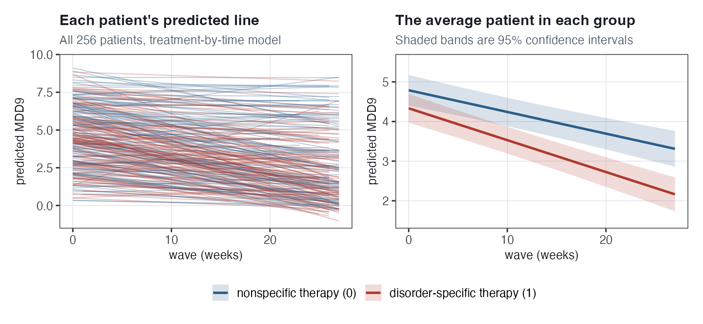{#fig-nl-treatment width="80%"}

### Is a straight line a reasonable description? {#sec-nl-straight}

Every model so far has a straight line in time: the same predicted change every week. The next question is whether that is a reasonable description of how symptoms change. Of the ways to allow a curved trajectory, this chapter focuses on **polynomials** (adding a squared term in time); @sec-nl-appendix covers two others.

## Non-linear trajectories: the quadratic growth model {#sec-nl-quadratic}

### Looking at the average trend first {#sec-nl-trend}

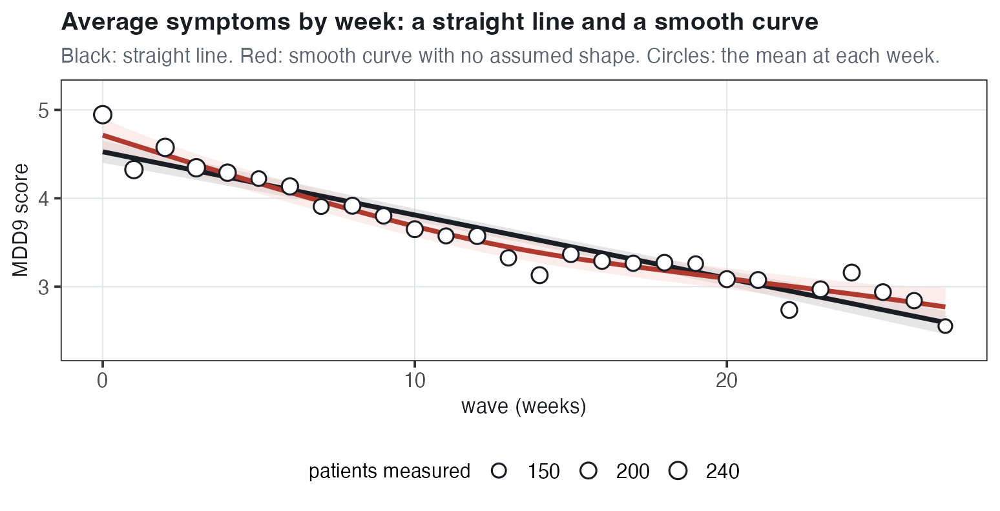{#fig-nl-marginal-trend width="72%"}

The red **smooth curve** (a LOESS curve), whose value at each week is based on the nearby measurements, is above the straight line at the start and at the end, and below it in the middle. The week means are 4.95 at week 0, 3.57 at week 12 and 2.55 at week 27: a decrease of about 1.4 symptoms over the first 12 weeks and about 1.0 over the last 15. This faster decrease in the early weeks does not match a straight line.

### The quadratic growth model {#sec-nl-quad-model}

A **quadratic** (or second-degree polynomial) trajectory adds the square of time, $\text{wave}^2_{ij}$, as a predictor. For the average patient,

$$\text{predicted MDD}_{ij} = \gamma_{00} + \gamma_{10}\,\text{wave}_{ij} + \gamma_{20}\,\text{wave}^2_{ij}$$

The curve is a **parabola**, and each coefficient describes one feature of it:

1.  $\gamma_{00}$ is the predicted score at week 0, as before.
2.  $\gamma_{10}$ is the **slope of the curve at week 0 only**: the rate of change exactly at $\text{wave}_{ij} = 0$.
3.  $\gamma_{20}$ is the **curvature**: how the slope changes from week to week (by $2\gamma_{20}$ each week; @sec-nl-quad-fixed explains the 2). A positive $\gamma_{20}$ means the slope increases each week, and a negative $\gamma_{20}$ means it decreases. When symptoms are decreasing, a positive $\gamma_{20}$ means **deceleration** (the decrease becomes less steep over time) and a negative $\gamma_{20}$ means **acceleration** (the decrease becomes steeper).

::: callout-note
## A rate of change that differs from week to week

With $\text{wave}^2_{ij}$ in the model, the rate of change is no longer the same at every week: it increases or decreases by the same amount each week. A quadratic can therefore describe symptoms that decrease quickly in the early weeks and more slowly later, like the smooth curve in @sec-nl-trend, and every statement about change must include the week it applies to.
:::

In the **quadratic growth model**, every patient has their own curve:

$$\begin{aligned}
\textbf{Level 1:} \qquad && \text{MDD}_{ij} &= \beta_{0j} + \beta_{1j}\,\text{wave}_{ij} + \beta_{2j}\,\text{wave}^2_{ij} + e_{ij} \\
\textbf{Level 2:} \qquad && \beta_{0j} &= \gamma_{00} + u_{0j} \\
                          && \beta_{1j} &= \gamma_{10} + u_{1j} \\
                          && \beta_{2j} &= \gamma_{20} + u_{2j} \\
&& \begin{bmatrix} u_{0j} \\ u_{1j} \\ u_{2j} \end{bmatrix} &\sim N\left( \begin{bmatrix} 0 \\ 0 \\ 0 \end{bmatrix}, \Sigma \right), \qquad
\Sigma = \begin{bmatrix} \tau_0^2 & \tau_{01} & \tau_{02} \\ \tau_{01} & \tau_1^2 & \tau_{12} \\ \tau_{02} & \tau_{12} & \tau_2^2 \end{bmatrix} \\
&& e_{ij} &\sim N(0, \sigma^2)
\end{aligned}$$

- $\beta_{0j}$, $\beta_{1j}$ and $\beta_{2j}$ are patient $j$'s intercept, slope at week 0 and quadratic coefficient (curvature). Together they define **patient** $j$'s predicted curve, $\beta_{0j} + \beta_{1j}\,\text{wave}_{ij} + \beta_{2j}\,\text{wave}^2_{ij}$.
- $\gamma_{00}$, $\gamma_{10}$ and $\gamma_{20}$ are the averages of these three coefficients across patients, and $u_{0j}$, $u_{1j}$, $u_{2j}$ are patient $j$'s departures from those averages.
- With three random effects, $\Sigma$ has **six** parameters. The three variances, $\tau_0^2$, $\tau_1^2$ and $\tau_2^2$, describe how much patients differ in their intercepts, their slopes at week 0 and their curvatures. The three covariances are $\tau_{01}$, the covariance between the intercept and slope departures; $\tau_{02}$, the covariance between the intercept and quadratic departures; and $\tau_{12}$, the covariance between the slope and quadratic departures (not to be confused with the variance $\tau_1^2$).
- $e_{ij}$ is the level-1 residual: how far measurement $i$ is from patient $j$'s predicted curve.
- Treatment is left out of this model for now.

Substituting the level-2 equations into level 1 gives the reduced form, here grouped into the intercept, linear and quadratic terms:

$$\text{MDD}_{ij} = \underbrace{(\gamma_{00} + u_{0j})}_{\text{intercept}} + \underbrace{(\gamma_{10} + u_{1j})}_{\text{linear}}\,\text{wave}_{ij} + \underbrace{(\gamma_{20} + u_{2j})}_{\text{quadratic}}\,\text{wave}^2_{ij} + e_{ij}$$

In R, first create the squared term, then add it to both the fixed and the random parts:

``` r
dep <- dep |> mutate(wave2 = wave^2)
lmer(mdd9 ~ 1 + wave + wave2 + (1 + wave + wave2 | id), data = dep)
```

`1 + wave + wave2` outside the parentheses is $\gamma_{00} + \gamma_{10}\,\text{wave}_{ij} + \gamma_{20}\,\text{wave}^2_{ij}$, and `(1 + wave + wave2 | id)` is $u_{0j} + u_{1j}\,\text{wave}_{ij} + u_{2j}\,\text{wave}^2_{ij}$. In all, the model has 10 parameters: three fixed effects, six in $\Sigma$, and $\sigma^2$.

### Fitting it: the average curve {#sec-nl-quad-fixed}

::: callout-warning
## A note on convergence warnings

With the code in @sec-nl-quad-model, you will see a warning that the model "failed to converge": R's fitting routine may have stopped before reaching the best estimates. Two things to try: centering and rescaling time before squaring it, for example `(wave - 13.5)/10`, which removes the warning for this model; and a different optimizer, `control = lmerControl(optimizer = "bobyqa")`, which here does not remove it. Either change can alter the estimates, most of all the random-effect SDs and correlations and the quadratic coefficient's standard error, and centering also changes what the intercept and the linear coefficient mean. The numbers in this chapter come from the uncentered code above; similar warnings appear for some other models here.
:::

| Term | Estimate | SE | $Z$ |
|:--------------------------------|------------:|------------:|------------:|
| $\widehat{\gamma_{00}}$ `(Intercept)` | 4.7079 | 0.1131 | 41.61 |
| $\widehat{\gamma_{10}}$ `wave` | $-0.1064$ | 0.0292 | $-3.64$ |
| $\widehat{\gamma_{20}}$ `wave2` | 0.00145 | 0.00102 | 1.43 |
| $\widehat{\tau_0}$ `sd__(Intercept)` | 1.6438 |  |  |
| $\widehat{\tau_1}$ `sd__wave` | 0.4405 |  |  |
| $\widehat{\tau_2}$ `sd__wave2` | 0.0152 |  |  |
| intercept–slope correlation `cor__(Intercept).wave` | 0.0086 |  |  |
| intercept–quadratic correlation `cor__(Intercept).wave2` | $-0.0535$ |  |  |
| slope–quadratic correlation `cor__wave.wave2` | $-0.9848$ |  |  |
| $\widehat{\sigma}$ `sd__Observation` | 1.3209 |  |  |

The fixed effects describe the average curve; @sec-nl-quad-random covers the random part.

$\widehat{\gamma_{00}} = 4.71$. *Interpretation.* An average patient is predicted to report 4.71 symptoms at week 0.

$\widehat{\gamma_{10}} = -0.106$. *Interpretation.* At week 0 only, the average patient's predicted symptoms are decreasing by 0.106 per week; this is not the average rate of change over the study.

$\widehat{\gamma_{20}} = 0.00145$. *Interpretation.* The quadratic term adds $\gamma_{20}\,\text{wave}^2_{ij}$ to the prediction. Without it, the prediction at week $w$ would be the straight line $4.71 - 0.106\,w$; with it, the average curve is $0.00145\,w^2$ symptoms above that line: 0.15 at week 10, 0.58 at week 20 and 1.06 at week 27. For the average patient's decreasing symptoms, this is deceleration: the decrease becomes less steep over time.

**How the weekly change changes.** The table below has the predicted change in symptoms over each of the first five weeks: the linear coefficient plus the quadratic coefficient times that week's increase in $\text{wave}^2_{ij}$.

| From week | To week | Increase in $\text{wave}^2_{ij}$ | Predicted change in symptoms |
|---------------:|---------------:|---------------:|-----------------------:|
| 0 | 1 | $1 - 0 = 1$ | $-0.105$ |
| 1 | 2 | $4 - 1 = 3$ | $-0.102$ |
| 2 | 3 | $9 - 4 = 5$ | $-0.099$ |
| 3 | 4 | $16 - 9 = 7$ | $-0.096$ |
| 4 | 5 | $25 - 16 = 9$ | $-0.093$ |

The increase in $\text{wave}^2_{ij}$ is 1, 3, 5, 7, 9: it increases by 2 every week. So each week, the quadratic part of the predicted change is $2 \times 0.00145 = 0.0029$ larger than the week before, and each weekly decrease is 0.0029 smaller than the one before it (0.003 at the table's three decimals). That is where the factor of 2 in the slope formula comes from:

$$\text{slope at week } w = \gamma_{10} + 2\,\gamma_{20}\, w = -0.1064 + 0.0029\,w$$

This formula is for the slope at a single week: $-0.106$ at week 0, $-0.067$ at week 13.5 (the middle of the study) and $-0.028$ at week 27. A change over a whole week, such as week 0 to week 1, equals the slope halfway through that week: $-0.1064 + 0.0029 \times 0.5 = -0.105$, the first row of the table.

{#fig-nl-quadratic-anatomy width="86%"}

**Is the quadratic term significant?** For the average quadratic coefficient, $Z = 1.43$, below about 2, so the average curvature on its own is not distinguishable from zero. Patients' curvatures differ a great deal (@sec-nl-quad-random), and the average of widely spread values is estimated imprecisely (SE 0.00102, about 70% of the estimate). Whether curves fit better than straight lines is a separate question, tested in @sec-nl-lrt with a likelihood ratio test.

**Where is the lowest point?** The slope, $\gamma_{10} + 2\gamma_{20} w$, is zero at $w = -\gamma_{10}/(2\gamma_{20}) = 0.1064/0.0029$, about **week 37**, ten weeks after the last week of data. So within the study the average curve is not a U shape: predicted symptoms decrease throughout.

**What changes if week 0 is placed somewhere else.** Suppose the fitted curve were rewritten, without refitting the model, with week 13.5 (the middle of the study) as time 0. The curve itself would not change, but the intercept would become the predicted score at week 13.5 (3.54 instead of 4.71) and the linear coefficient the slope at week 13.5 ($-0.067$ instead of $-0.106$). The quadratic coefficient would still be 0.00145: the slope changes by 0.0029 from every week to the next, wherever the counting of weeks starts.

For comparison, the **linear growth model with random slopes**, `lmer(mdd9 ~ 1 + wave + (1 + wave | id))`, is the treatment-by-time model of @sec-nl-txtime without `treat`, fitted to the same 256 patients. Its average slope, $-0.068$, describes the average change over the whole study and is almost the same as the slope of the average curve at mid-study, $-0.067$.

### Fitting it: how patients differ {#sec-nl-quad-random}

$\widehat{\tau_0} = 1.64$. *Interpretation.* At week 0, patients' intercepts differ from the average intercept by about 1.6 symptoms in SD terms.

$\widehat{\tau_1} = 0.44$. *Interpretation.* At week 0, patients' slopes differ from the average slope of $-0.106$ by about 0.44 symptoms per week in SD terms. This is not comparable with 0.076, the SD of patients' slopes in the linear growth model with random slopes (@sec-nl-quad-fixed), where each patient has the same slope at every week: in the quadratic model each patient's slope is different at every week, and $\tau_1$ is the SD of patients' slopes **at week 0 only**. Patient $j$'s slope at week $w$ differs from the average slope by $u_{1j} + 2w\,u_{2j}$, whose SD is 0.44 at week 0, 0.08 at week 13.5 (close to 0.076) and 0.39 at week 27: patients' rates of change differ most at the start and end of the study.

$\widehat{\tau_2} = 0.0152$. *Interpretation.* Patients' quadratic coefficients differ from the average, 0.00145, by about 0.015 in SD terms, about ten times the average itself. So a patient one SD above the average has a positive quadratic coefficient, $0.00145 + 0.0152 = 0.017$, and a patient one SD below has a negative one, $0.00145 - 0.0152 = -0.014$: some patients' curves are curved upward, like the average curve, and others' are curved downward. @sec-nl-quad-curves has the percentage of each and what each shape means for symptoms.

**The correlations.** In R's output, each covariance in $\Sigma$ is printed as a correlation.

- **Intercept–slope correlation** (from $\tau_{01}$), 0.009. Patients' predicted scores at week 0 are essentially unrelated to their slopes at week 0.
- **Intercept–quadratic correlation** (from $\tau_{02}$), $-0.053$. Patients' predicted scores at week 0 are essentially unrelated to their curvatures.
- **Slope–quadratic correlation** (from $\tau_{12}$), $-0.985$. Patients whose slope at week 0 is more negative than average (symptoms decreasing faster at the start) tend to have a larger quadratic coefficient, so their decrease becomes less steep more quickly.

The slope–quadratic correlation is $-0.985$, which is very close to $-1$. This means that patients who have a more positive-than-average slope at week 0 tend to have a more negative-than-average quadratic term, and vice versa. In other words, the two random effects are very strongly related across patients.

But there is an important qualification: the linear slope in a quadratic model is the slope at whatever time is coded as 0. Here, that is week 0. If we recentered time so that week 13.5 were coded as 0, we would be describing each patient's slope at week 13.5 instead, and its correlation with the quadratic term would be only about $-0.30$. If week 27 were coded as 0, the correlation would be about $+0.98$. The patients and their fitted curves have not changed — only the point in time at which we define the slope has changed.

So the $-0.985$ should not be interpreted as a permanent characteristic of the patients. It specifically describes the relationship between patients' slopes at week 0 and their curvature. Also, because a correlation this close to $\pm1$ can indicate that the random-effects structure is difficult to estimate, especially if there is a convergence warning, the model fit should be checked before interpreting it strongly.

$\widehat{\sigma} = 1.32$. *Interpretation.* A measurement is typically about 1.32 symptoms from the patient's predicted curve, slightly less than the 1.39 from each patient's predicted line in the linear growth model with random slopes.

::: callout-important
## What the random part describes

The three SDs describe how much patients differ in their predicted score at week 0 ($\tau_0$), their rate of change at week 0 ($\tau_1$) and their curvature ($\tau_2$). Patients' curvatures differ from each other much more than the average curvature differs from zero, so the average curve is a summary of curves with different shapes, some curved upward and some curved downward.
:::

### What the fitted curves look like {#sec-nl-quad-curves}

{#fig-nl-quadratic-spaghetti width="80%"}

**Do all patients' curves have the same shape?** No. The right panel has every patient's quadratic coefficient.

- **59% of patients have a positive coefficient** (to the right of the black line). Their predicted curve is curved upward: their slope increases each week, so a decrease in symptoms becomes less steep over time.
- **41% of patients have a negative coefficient** (to the left of the black line). Their predicted curve is curved downward: their slope decreases each week, so a decrease in symptoms becomes steeper over time.

The average coefficient (the dashed red line, 0.00145) is close to zero because the positive and negative coefficients partly cancel when they are averaged, so the average curve is much less curved than many patients' predicted curves.

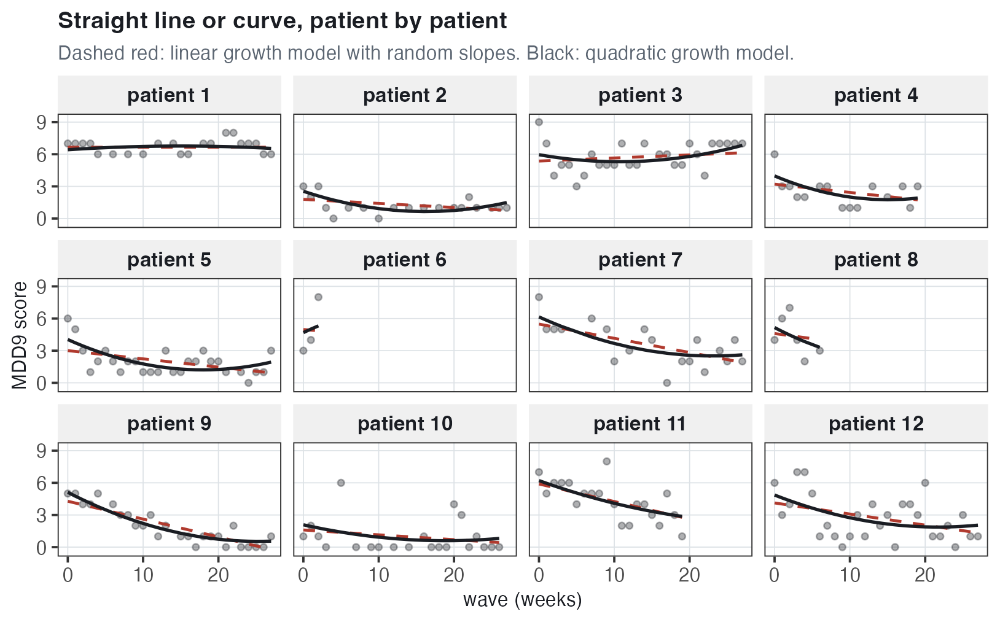{#fig-nl-trellis-quadratic width="76%"}

**Which patients does the curve describe better?** Patients whose scores are not close to a straight line: patient 3, whose scores decrease in the first weeks and increase later, and patients 4, 5 and 9, whose scores decrease quickly at first and then change little. For patient 1, whose scores are flat near 7, the line and the curve are almost the same. Patients 6 and 8 have only three and six measurements, too few to estimate a curve precisely from their own scores, so, as in @sec-linear-growth, their predicted curves are pulled toward the average curve.

### An intermediate option: one curvature for everyone {#sec-nl-intermediate}

There are intermediate options between the linear growth model with random slopes and the quadratic growth model, such as a quadratic main effect but no random slope. In the **intermediate model** shown here, the average trajectory is a curve, but there is no random slope on `wave2`, so patients differ only in their intercept and their slope at week 0:

$$\begin{aligned}
\textbf{Level 1:} \qquad && \text{MDD}_{ij} &= \beta_{0j} + \beta_{1j}\,\text{wave}_{ij} + \beta_{2}\,\text{wave}^2_{ij} + e_{ij} \\
\textbf{Level 2:} \qquad && \beta_{0j} &= \gamma_{00} + u_{0j} \\
                          && \beta_{1j} &= \gamma_{10} + u_{1j} \\
                          && \beta_{2} &= \gamma_{20} \\
&& \begin{bmatrix} u_{0j} \\ u_{1j} \end{bmatrix} &\sim N\left( \begin{bmatrix} 0 \\ 0 \end{bmatrix}, \Sigma \right), \qquad
\Sigma = \begin{bmatrix} \tau_0^2 & \tau_{01} \\ \tau_{01} & \tau_1^2 \end{bmatrix}, \qquad e_{ij} \sim N(0, \sigma^2)
\end{aligned}$$

- $\beta_2$ has no $j$ and there is no $u_{2j}$: the quadratic coefficient is the same number, $\gamma_{20}$, for every patient.
- Each patient's predicted curve is the average curve plus a straight line, $u_{0j} + u_{1j}\,\text{wave}_{ij}$. Adding a straight line to a curve changes its intercept and slope but not its curvature.

In R, `wave2` is in the fixed part but not in the random part:

``` r
lmer(mdd9 ~ 1 + wave + wave2 + (1 + wave | id), data = dep)
```

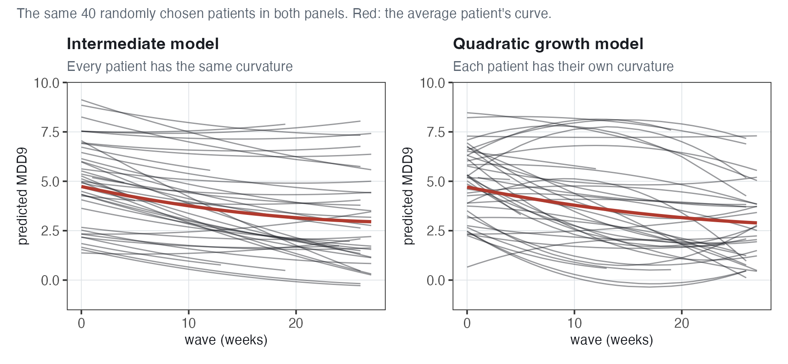{#fig-nl-intermediate width="80%"}

**What it looks like.** In the left panel, every curve has the same curvature as the red average curve. In the right panel, each curve has its own curvature: some are curved upward much more than the average curve, and others are curved downward.

**The estimates.** The average curve is similar to that of the quadratic growth model: $\widehat{\gamma_{00}} = 4.73$, $\widehat{\gamma_{10}} = -0.116$ and $\widehat{\gamma_{20}} = 0.00186$. The random part is almost the same as in the linear growth model with random slopes ($\widehat{\tau_1} = 0.076$ in both); unlike in @sec-nl-quad-random, the two are comparable, because with one curvature for everyone, each patient's slope differs from the average slope by the same amount at every week.

The quadratic coefficient's standard error, 0.00033 ($Z = 5.60$), is much smaller than the 0.00102 ($Z = 1.43$) of the quadratic growth model. There, $\gamma_{20}$ is the average of patients' widely spread curvatures ($\widehat{\tau_2} = 0.0152$), and such an average is estimated less precisely than one shared curvature. But 0.00033 is computed under the assumption that every patient has the same curvature, and in the likelihood ratio test of @sec-nl-lrt there is strong evidence that patients' curvatures differ. So for these data 0.00033 is too small, as in @sec-rs-se, where leaving out the random slope made the standard error of the average slope too small when schools' slopes differed.

### Is the better fit large enough to justify the extra parameters? {#sec-nl-lrt}

As in earlier chapters (@sec-ri-lrt, @sec-rs-lrt), the models are compared with a **likelihood ratio test**. A model's log-likelihood, $\ell$, is the logarithm of how probable our data would be if the model's estimates were the true values. It is larger (less negative) for a better fit. Adding parameters never makes it smaller, so the question is whether the increase is larger than expected by chance if the extra parameters were zero. R refits the models by maximum likelihood, which is needed to compare models with different fixed effects:

``` r
m_linear       <- lmer(mdd9 ~ 1 + wave + (1 + wave | id), data = dep)
m_intermediate <- lmer(mdd9 ~ 1 + wave + wave2 + (1 + wave | id), data = dep)
m_quadratic    <- lmer(mdd9 ~ 1 + wave + wave2 + (1 + wave + wave2 | id),
                       data = dep)
anova(m_linear, m_intermediate, m_quadratic)
```

The three models, from simplest to most complex:

| Model | What each patient has | Parameters | $\ell$ |
|:---------------|:------------------------|---------------:|---------------:|
| **A.** Linear growth model with random slopes | An intercept and a slope (a straight predicted line) | 6 | $-10330.219$ |
| **B.** Intermediate model | The average curve plus a straight-line departure (an intercept and a slope); the same curvature for everyone | 7 | $-10314.611$ |
| **C.** Quadratic growth model | An intercept, a slope and a curvature (a predicted curve); the curvature differs between patients | 10 | $-10221.980$ |

Model A's six parameters are $\gamma_{00}$, $\gamma_{10}$, $\tau_0^2$, $\tau_1^2$, $\tau_{01}$ and $\sigma^2$. Model B also has the average quadratic coefficient, $\gamma_{20}$. Model C also has the variance of the patients' quadratic departures, $\tau_2^2$, and the intercept–quadratic and slope–quadratic covariances, $\tau_{02}$ and $\tau_{12}$.

| Comparison | Question | $\chi^2$ | df | 5% cutoff |
|:------------|:--------------------|------------:|------------:|------------:|
| A against C (the main test) | Do curves, each with its own curvature, fit better than straight lines? | 216.48 | 4 | 9.49 |
| A against B | Is the average trajectory curved, when everyone has the same curvature? | 31.22 | 1 | 3.84 |
| B against C | Do patients differ in their curvature? | 185.26 | 3 | 7.81 |

Each $\chi^2$ is $-2$ times the difference in the two models' $\ell$; for A against C, $\chi^2 = -2(-10330.219 - (-10221.980)) = 216.48$. The degrees of freedom are the number of parameters added, and the 5% cutoff is the value that a $\chi^2$ with those degrees of freedom exceeds only 5% of the time if the extra parameters are zero. All three $\chi^2$ values are above their cutoffs.

- **A against C.** *Interpretation.* There is strong evidence that the quadratic growth model describes these data better than the linear growth model with random slopes.
- **A against B.** *Interpretation.* With the same curvature for every patient, there is evidence that the average trajectory is curved.
- **B against C.** *Interpretation.* There is strong evidence that patients differ in their curvature. This $\chi^2$ is 185.26 of the 216.48 for A against C, so most of the evidence for curves is about patients' curves having different shapes, not about the shape of the average curve.
- **The boundary.** Under Models A and B, $\tau_2^2 = 0$, the boundary of the parameter space (a variance cannot be negative), so for A against C and B against C the usual $\chi^2$ p-value is too large and the tests are conservative: when the usual p-value is below 0.05, as here, the correct one is too.

::: callout-tip
## Straight line or curve?

**Advantages of the quadratic growth model.** It fits these data much better than the linear growth model with random slopes: it describes the faster decrease in the early weeks, and each patient's predicted curve has its own shape.

**Disadvantages.** It has four more parameters, is harder to fit with time measured from week 0 (@sec-nl-quad-fixed), and its linear coefficient is the slope at week 0 only, so every statement about change must include a week. Adding treatment would take three treatment terms (for the intercept, the linear and the quadratic coefficient), so the treatment's effect on change would no longer be one number like $\gamma_{11}$ (@sec-nl-txresults).

**Which to use.** For the treatment's effect on the average rate of change, the treatment-by-time model of @sec-nl-txtime has one coefficient, $\gamma_{11}$; for the shape of change, the quadratic growth model describes the data better. The intermediate model of @sec-nl-intermediate (one curvature for everyone) is in between, but its standard error for the quadratic coefficient is too small here, where patients' curvatures differ; @sec-nl-appendix has another option, one mean per week.
:::

## Autocorrelation {#sec-nl-autocorr}

### The assumption about the level-1 residuals {#sec-nl-iid}

The next questions: How can we relax the assumption that the level-1 residuals, $e_{ij}$, are **independent and identically distributed** (IID: unrelated to each other and drawn from one normal distribution)? How can we model **dynamic** processes, in which a measurement is related to the previous one? Does treatment change that relationship?

In the straight-line growth models so far, a measurement's distance from the **average** line is the sum of two parts:

$$\text{MDD}_{ij} - (\text{average line at week } \text{wave}_{ij}) = \underbrace{u_{0j} + u_{1j}\,\text{wave}_{ij}}_{\text{patient's departure from the average line}} + \underbrace{e_{ij}}_{\substack{\text{residual: distance from}\\ \text{the patient's predicted line}}}$$

In @fig-nl-two-departures, for patient 1 at week 12, the average line is 3.73, the predicted line 6.65 and the score 7: a departure from the average line of $6.65 - 3.73 = 2.92$ and a residual of $e_{ij} = 7 - 6.65 = 0.35$.

{#fig-nl-two-departures width="72%"}

**Why the random effects make a patient's measurements correlated.** The first part, $u_{0j} + u_{1j}\,\text{wave}_{ij}$, is in every measurement of patient $j$, so a patient whose predicted line is well above the average line, like patient 1, tends to score well above the average at every week. Across patients, then, those with a high score at one week tend to have high scores at other weeks too: that is what it means for a patient's measurements to be correlated. With only a random intercept, the correlation is the ICC, $\tau_0^2/(\tau_0^2 + \sigma^2)$, the share of the variance around the average line that comes from differences between patients. For the treatment-by-time model with a random intercept only, `lmer(mdd9 ~ 1 + treat * wave + (1 | id))`, $\widehat{\tau_0^2} = 4.0038$ and $\widehat{\sigma^2} = 2.3080$, so it is $4.0038/(4.0038 + 2.3080) = 0.634$. *Interpretation.* A patient whose score at one week is 1 SD above their group's average for that week is predicted to score 0.63 SD above their group's average at any other week, one week or 27 weeks later, because the two measurements have only the patient's intercept in common.

The residuals $e_{ij}$ are **assumed** IID, an assumption often reasonable for different people but not necessarily for repeated measurements of one person. The question: **if a patient's score is above their predicted line at one measurement, is it likely to be above it at the next one too?** A correlation between residuals close together in time is called **autocorrelation** ("auto" because the series is correlated with its own earlier values).

::: callout-note
## Two reasons a patient's measurements can be alike

**Stable differences between patients.** Some patients have more symptoms than others throughout the study, or a faster decrease. The random intercept and slope describe these differences. With a random intercept only, measurements far apart in time are as alike as those close together.

**Circumstances that last a few weeks.** A stressful month, an illness or a good stretch at work can make a patient's scores higher or lower than their predicted line for several measurements in a row, so measurements close together in time are more alike than those far apart. This is autocorrelation.
:::

### What autocorrelation looks like {#sec-nl-ac-look}

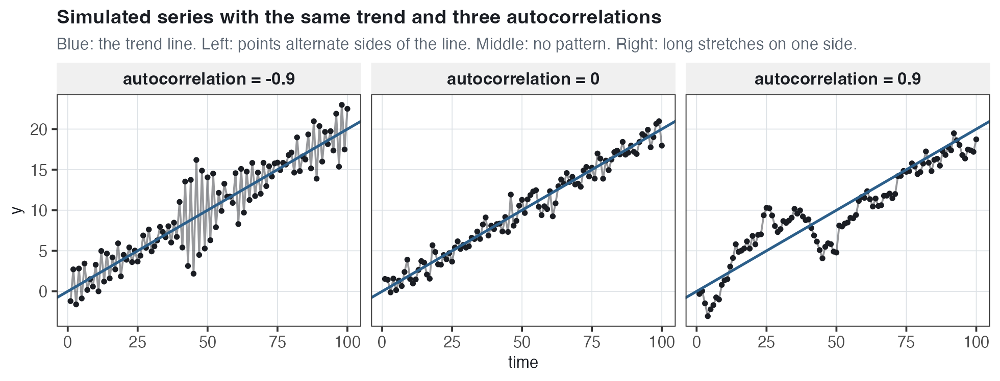{#fig-nl-autocorrelation-sim width="82%"}

- **Negative autocorrelation** (left): consecutive points tend to be on opposite sides of the trend line.
- **No autocorrelation** (middle): a point's side of the line is unrelated to the previous point's.
- **Positive autocorrelation** (right): consecutive points tend to be on the same side, in long stretches above or below the line.

Positive autocorrelation is common in data measured repeatedly over time. For example, a global stock fund's daily price in 2020 was close to the previous day's price, and far below the year's trend line for weeks after the large decrease in March.

### Are our residuals autocorrelated? {#sec-nl-ac-check}

To check, pair each residual $e_{ij}$ from the treatment-by-time model of @sec-nl-txtime with the same patient's previous residual, $e_{i-1,j}$. The diagonal stripes in the right panel of @fig-nl-residual-lag occur because the depression scores are whole numbers, so many pairs have exactly the same change in score from one measurement to the next.

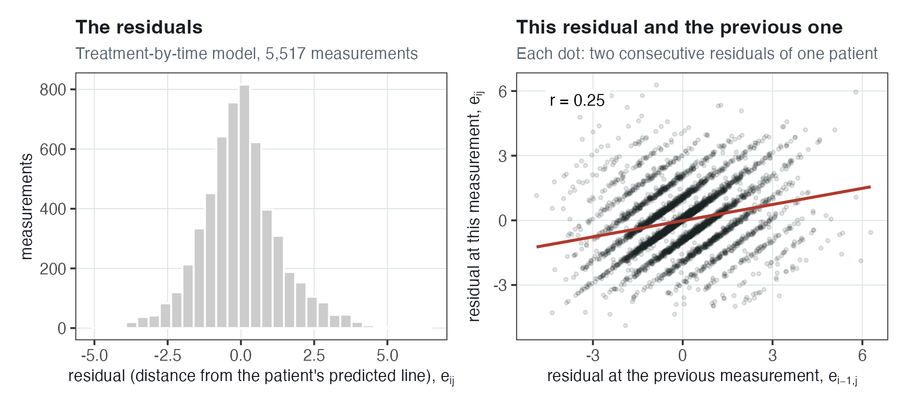{#fig-nl-residual-lag width="74%"}

**Is** $e_{i-1,j}$ correlated with $e_{ij}$? Yes. A residual and the same patient's previous residual are correlated **0.25**: a patient whose score is above their predicted line at one measurement tends to be above it at the next one too. Among the first 12 patients, the correlations computed separately for each patient with at least three pairs range from 0.56 (patient 1) to slightly below zero; across the 251 such patients, the median is 0.22 and 76% are positive. With about 20 pairs per patient, each is imprecise, so the 0.25 from all pairs is the more reliable summary.

Because of skipped sessions, 842 of the 5,261 pairs (16%) are two or more weeks apart; with only the pairs one week apart, the correlation is almost the same, 0.26.

### The AR(1) model {#sec-nl-ar1}

In the **autoregressive model of order 1**, or **AR(1)**, each residual depends on the same patient's previous residual:

$$\begin{aligned}
e_{ij} &= \phi\, e_{i-1,j} + \nu_{ij} \\
\nu_{ij} &\sim N(0, \sigma_\nu^2)
\end{aligned}$$

In words: this measurement's residual, $e_{ij}$, is $\phi$ times the same patient's previous residual, $e_{i-1,j}$, plus a new part, $\nu_{ij}$.

- $\phi$ (the Greek letter phi) is the **autoregressive parameter**: the residual is predicted to be $\phi$ times the previous residual, and here, with no other piece in the residual, $\phi$ is also the correlation between consecutive residuals of a patient ("autoregressive": the residual is regressed on its own previous value; "order 1": on one previous value).
- $\nu_{ij}$ (the Greek letter nu) is the **new part** of the residual at measurement $i$, unrelated to all of the patient's earlier residuals and **assumed** IID normal with mean zero and variance $\sigma_\nu^2$ (some presentations write $\sigma^2$ here; this chapter keeps $\sigma^2$ for a second piece of the residual, @sec-nl-ar1-fit).
- $\phi$ is **assumed** to be the same for every patient, and between $-1$ and 1.

**An example.** Suppose $\phi = 0.6$ and a patient's score is 2 symptoms above their predicted line, so the residual is 2. The next residual is predicted to be $0.6 \times 2 = 1.2$ (the new part, $\nu_{ij}$, has mean zero), then $0.6 \times 1.2 = 0.72$, then 0.43: each 0.6 times the one before, on the same side of the line but closer to zero. The correlation decreases with distance in the same way: $\phi$ one measurement apart, $\phi \times \phi = \phi^2$ two apart (the two residuals are related only through the one in between) and $\phi^k$ for $k$ apart. With $\phi = 0.6$, these are 0.60, 0.36 and 0.22 one, two and three apart, and below 0.1 from five apart. So nearby residuals are strongly related and distant ones almost unrelated, whereas under a random intercept only, two measurements of a patient are equally correlated at every distance. With $\phi = 0$, the residuals would be unrelated, as under the IID assumption; with $\phi$ close to 1, a residual would be followed by residuals of almost the same size for many measurements.

**As fitted in R, the residual has two pieces** (@sec-nl-ar1-fit): an **autocorrelated piece**, which follows the AR(1) equation, plus an **independent piece**, new at every measurement and unrelated to every other one. Because of the independent piece, $\phi$ is then not the correlation between two consecutive residuals.

### Fitting the AR(1) model {#sec-nl-ar1-fit}

The AR(1) model is the treatment-by-time model plus an `ar1()` term:

``` r
dep <- dep |> mutate(wave_f = factor(wave))
lmer(mdd9 ~ 1 + treat * wave + (1 + wave | id) + ar1(0 + wave_f | id), data = dep)
```

- `wave_f` is `wave` as a category: 28 weeks, 0 to 27.
- `ar1(0 + wave_f | id)` is the **autocorrelated piece**: one value for each patient at each week, with correlation $\phi^k$ between values $k$ weeks apart. With `0 +`, the term has no separate intercept; the patient's intercept is in `(1 + wave | id)`.
- **Skipped weeks.** Because the term is defined by `wave_f`, the correlation depends on how many **weeks** apart two measurements are: patient 1 has no measurement at week 5, so their week-4 and week-6 measurements are consecutive but two weeks apart, and their autocorrelated pieces have correlation $\phi^2$, not $\phi$.
- **The independent piece**, $\varepsilon_{ij}$ (the Greek letter epsilon), with variance $\sigma^2$, is also in the model, like the level-1 residual of the models in @sec-nl-txtime and @sec-nl-quadratic.

So, writing $a_{ij}$ for the autocorrelated piece, the residual is:

$$e_{ij} = a_{ij} + \varepsilon_{ij}, \qquad a_{ij} = \phi\, a_{i-1,j} + \nu_{ij} \quad \text{(for consecutive weeks)}$$

Both $\nu_{ij}$ and $\varepsilon_{ij}$ are new at each measurement, but $\nu_{ij}$, as part of the autocorrelated piece, is also part of later residuals: multiplied by $\phi$ at the next measurement, by $\phi^2$ at the one after, and so on. $\varepsilon_{ij}$ is part of measurement $i$ only.

In the `lmer` output, the row `id.1  wave_f0  1.27595  0.77 (ar1)` has the SD of the autocorrelated piece (1.27595) and $\phi$ (0.77); the `Residual` row (0.96436) is the SD of the independent piece.

| Term                                            |  Estimate |     SE |     $Z$ |
|:------------------------------|-------------:|-------------:|-------------:|
| $\widehat{\gamma_{00}}$ `(Intercept)`           |    4.8829 | 0.1915 |   25.49 |
| $\widehat{\gamma_{01}}$ `treat1`                | $-0.5328$ | 0.2636 | $-2.02$ |
| $\widehat{\gamma_{10}}$ `wave`                  | $-0.0592$ | 0.0078 | $-7.63$ |
| $\widehat{\gamma_{11}}$ `treat1:wave`           | $-0.0219$ | 0.0106 | $-2.06$ |
| $\widehat{\tau_0}$ SD of intercepts             |    1.7747 |        |         |
| $\widehat{\tau_1}$ SD of slopes                 |    0.0422 |        |         |
| $\widehat{\rho}$ intercept–slope correlation    |    0.0624 |        |         |
| SD of the autocorrelated piece, $a_{ij}$        |    1.2760 |        |         |
| $\widehat{\phi}$                                |    0.7739 |        |         |
| SD of the independent piece, $\varepsilon_{ij}$ |    0.9644 |        |         |

**How should we interpret** $\phi$? $\widehat{\phi} = 0.77$. *Interpretation.* The autocorrelated pieces of a patient's residuals are correlated 0.77 one week apart, $0.7739^2 = 0.60$ two weeks apart, and $0.77^k$ for $k$ weeks apart.

**Why** $\phi = 0.77$ does not mean the residuals themselves correlate 0.77.

Under this model, each residual has **two pieces**:

1.  an **autocorrelated piece**, which is correlated from one week to the next, and
2.  an **independent piece**, which is new noise at each measurement and has no relationship with other weeks.

The estimate $\widehat{\phi}=0.7739$ describes only the **first piece**. It means that the autocorrelated part of a patient's residual this week is strongly related to the autocorrelated part one week later. It does **not** mean that the two entire residuals correlate 0.77, because each entire residual also contains independent noise.

Here, the autocorrelated piece has variance $1.27595^2 = 1.628$, and the independent piece has variance $0.96436^2 = 0.930$. Together, the total residual variance is $1.628 + 0.930 = 2.558$. So only $\frac{1.628}{2.558}=0.636$ or about $64\%$ **of the residual variance** comes from the piece that can persist across weeks. The remaining $36\%$ is independent noise.

That makes the one-week residual correlation especially easy to understand: $0.7739\times0.636\approx0.49$.

In words: about $64\%$ of the residual variance is in the persistent/autocorrelated part, and that part is correlated $0.77$ from one week to the next. Once the independent noise is included, the correlation between the **whole residuals** is therefore only about **0.49**, not 0.77.

Two weeks apart, the persistent/autocorrelated parts are correlated $0.7739^2$ instead of $0.7739$, because they are related only through the week in between (@sec-nl-ar1): $0.7739^2\times0.636\approx0.38$.

So under the fitted AR(1) model, residuals from the same patient are expected to correlate about **0.49 one week apart** and **0.38 two weeks apart**. A patient who is above their predicted line one week therefore tends to remain somewhat above it the next week, but the correlation is smaller for measurements farther apart.

Finally, the **0.49 is not supposed to equal** the $r=0.25$ from @sec-nl-ac-check. The $0.25$ was the observed correlation between consecutive residuals from the treatment-by-time model of @sec-nl-txtime, **without** an AR(1) residual structure. The $0.49$ is the correlation implied by the fitted model **after explicitly separating residual variation into an autocorrelated part and an independent part**.

If you remember one thing, it is this: $\phi = 0.77$ is the correlation of the persistent/autocorrelated part of the residual from one week to the next; the correlation of the whole residuals is smaller because the residuals also contain independent noise.

::: callout-important
## Two pieces of a residual

Again, under the AR(1) model, a residual has two pieces: an autocorrelated piece, which is similar from one week to the next, for example because of circumstances that last several weeks, and an independent piece, specific to one measurement, for example how the patient felt on the day of that session. Because every residual contains both, residuals one week apart are less alike (0.49) than their autocorrelated pieces (0.77).
:::

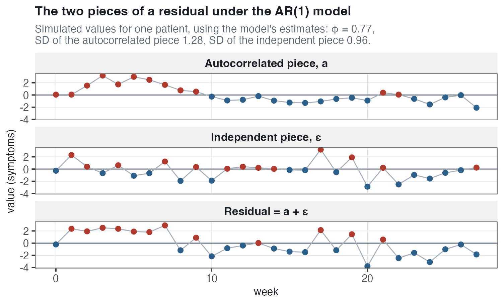{#fig-nl-two-pieces width="70%"}

The autocorrelated piece (top) is above zero for the first ten weeks and mostly below zero after that; the independent piece (middle) has no pattern. Their sum (bottom) still has stretches on one side of zero but varies more from week to week.

**What else changed.** The SD of patients' slopes is 0.042, against 0.075 in the treatment-by-time model without the AR(1) term, and the SD of the intercepts is 1.77 against 2.09. Suppose a patient's scores are unusually high for several weeks in a row. Without the AR(1) term, the only parts of the model shared by several measurements are the intercept and slope, so that stretch is described partly by a higher intercept or a different slope and partly by residuals assumed to be unrelated. With the AR(1) term, it can be described as a run of positive autocorrelated pieces, so the random intercept and slope describe less of that stretch, and their estimated SDs are smaller.

{#fig-nl-corr-by-distance width="72%"}

**The black points are computed without a model.** For one week apart, correlate the week-3 and week-4 scores of the patients measured at both weeks, repeat for all 27 pairs of consecutive weeks, and average: 0.79. Two, three and ten weeks apart, the averages are 0.76, 0.71 and 0.62. As correlations between scores, not residuals, these include the stable differences between patients.

**The gray, blue and red lines** are the correlations implied by each fitted model. With a random intercept only (gray, @sec-nl-iid), the treatment-by-time model implies 0.634 at every distance; with a random intercept and slope (blue), an almost flat 0.69 to 0.65 from one to ten weeks apart. Both are too low for nearby weeks. Only the AR(1) model (red) implies a clear decrease, from 0.79 one week apart to 0.71 three weeks apart, as in the data.

### Did AR(1) change the treatment effect? {#sec-nl-ar1-treat}

| Model                                | `treat1:wave` |     SE |     $Z$ |
|:-------------------------------------|--------------:|-------:|--------:|
| Random slopes, independent residuals |     $-0.0257$ | 0.0108 | $-2.37$ |
| Random slopes and AR(1) residuals    |     $-0.0219$ | 0.0106 | $-2.06$ |

*Interpretation.* Very little. The estimated difference in rates of change is 15% smaller with the AR(1) term and its standard error about 2% smaller (0.0106 against 0.0108). In both models the difference is more than two standard errors from zero, so the conclusion about the treatment does not change.

::: callout-tip
## Why autocorrelation matters mostly for standard errors

The estimated coefficients describe the average trajectory, and they often change very little when we change how the residuals are modeled. The standard errors are more sensitive because they depend on how much independent information the model assumes the data contain. If nearby measurements from the same patient are more similar than the model allows for, they may be counted as more independent than they really are, making the standard errors too small. Once a random intercept and slope already account for much of that within-patient similarity, adding autocorrelation may change the standard errors only a little, and not always in the same direction.
:::

### Four structures side by side {#sec-nl-four}

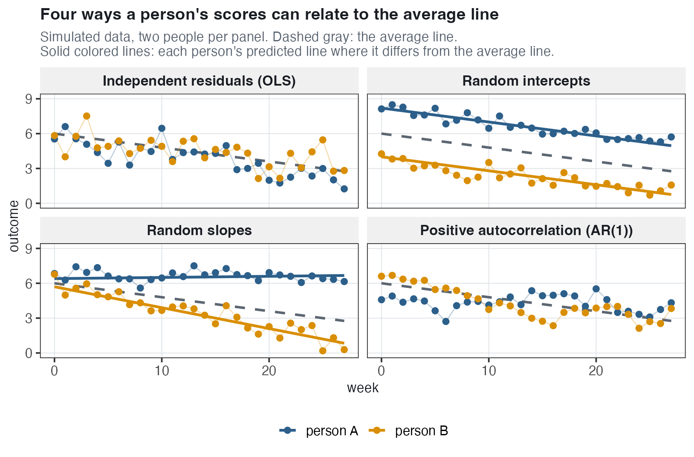{#fig-nl-four-structures width="74%"}

For each structure, ask: what do two points of the same person have in common?

- **Independent residuals (ordinary regression, OLS).** Nothing beyond the average line: each person's points scatter around the average line itself, and whether person A is above it at one week is unrelated to whether A is above it at any other week.
- **Random intercepts.** The person's intercept: the points scatter independently around a predicted line **parallel** to the average line (person A's about 2 above it, person B's about 2 below), so two points of a person are equally alike at any distance apart.
- **Random slopes.** The person's intercept and slope: the points scatter independently around a predicted line with its own slope (person A's almost flat, person B's decreasing more steeply than the average line). The predicted line's distance from the average line changes steadily, so points close in time are more alike than points far apart.
- **Positive autocorrelation, AR(1) with** $\phi > 0$. Closeness in time: with no random intercept or slope, each predicted line is the average line, but consecutive points are close to each other, in stretches above the line, then below it. Points one week apart are strongly related, and points 20 weeks apart almost unrelated.

### Where autocorrelation comes from, and when it matters {#sec-nl-ac-source}

Four points summarize autocorrelation.

- **It is often ignored, and it is sometimes useful to check for.** The check is the plot of residuals against previous residuals (@sec-nl-ac-check).
- **It generally changes the standard errors more than the coefficients.** In these data both changes were small: 15% for the coefficient, 2% for its standard error (@sec-nl-ar1-treat).
- **It can be a consequence of a time trend that is too restrictive.** If a patient's scores follow a curve but the model has a straight line for that patient, the scores are above the line for a stretch, then below it, then above it again: a pattern that looks like autocorrelation but is due to the shape of the trend.
- **In the AR(1) model, the autocorrelation is a nuisance**: a feature of the residuals to account for so that the standard errors are right, not a quantity of interest in itself.

Patient 191 is an example of the third point. Around their predicted line under the linear growth model with random slopes, the scores are above the line for weeks 0 to 3, below it from week 4 to week 15, and mostly above it from week 17 on, and consecutive residuals are correlated 0.50. Around their predicted curve under the quadratic growth model, the correlation is 0.01. Across all patients, consecutive residuals are correlated 0.25 around the predicted lines and 0.17 around the predicted curves: a better-fitting trend accounts for part of the autocorrelation, but not all of it.

**Once we include a time trend, is there any reason for nearby observations to still be related?** Yes. Even with each patient's own intercept and slope, the time trend describes only steady change. Circumstances that last more than a week, such as an illness or a stressful period, can make a patient's scores higher or lower than their predicted line for several measurements in a row, so the residuals are still correlated 0.25 with the previous residual.

## Dynamic models {#sec-nl-dynamic}

### Autocorrelation or a predictor? {#sec-nl-dyn-why}

Sometimes the relationship between a patient's consecutive measurements is itself the question. Does a week with more symptoms than usual for that patient tend to be followed by another such week? Does treatment change that? Do patients differ in it? A **dynamic model** includes the patient's previous score as a **predictor** with its own coefficient.

**Why "dynamic"?** A dynamic model describes how a process changes from one time point to the next using its own earlier values, here the patient's previous score. The coefficient on the previous score is the **dynamic effect** (interpreted in @sec-nl-dyn-fit).

::: callout-note
## AR(1) or dynamic model

Both are about the same pattern: a patient whose score is higher than predicted at one measurement tends to score higher than predicted at the next. In the AR(1) model, the pattern is part of the residuals and has no coefficient, so including it changes the standard errors but not the meaning of any coefficient. In the dynamic model, the previous score is a predictor, so the pattern has a coefficient that can be interpreted, tested, compared between therapies and allowed to differ between patients. Every other coefficient is then a comparison **holding the previous score fixed**, not directly comparable with the same coefficient in the earlier sections of this chapter.
:::

**A warning.** With the previous score as a predictor, the estimates can be biased (systematically too high or too low) in **short panels** (few measurements per person). More robust alternatives, such as instrumental-variable regression (IVR) and dynamic structural equation modeling (DSEM), are beyond the scope of this book.

### Building the previous score {#sec-nl-lag}

Each patient's previous score is computed **within that patient and in measurement order**. Then that previous score is **demeaned** by subtracting the patient's own average previous score. The important thing is that this average is calculated using **all of that patient's nonmissing lagged scores in the full dataset**, not just the few rows shown in the table below.

``` r
dep_lag <- dep |>
  group_by(id) |>                       # compute separately for each patient
  mutate(mdd9_lag   = lag(mdd9),        # the score in the patient's previous row
         c_mdd9_lag = mdd9_lag - mean(mdd9_lag, na.rm = TRUE)) |>
                                        # minus their average previous score
  ungroup()
```

| `id` | `wave` | `mdd9` | `mdd9_lag` | `c_mdd9_lag` |
|-----:|-------:|-------:|-----------:|-------------:|
|    1 |      0 |      7 |         NA |           NA |
|    1 |      1 |      7 |          7 |         0.25 |
|    1 |      2 |      7 |          7 |         0.25 |
|    1 |      3 |      7 |          7 |         0.25 |
|    1 |      4 |      6 |          7 |         0.25 |
|    1 |      6 |      6 |          6 |      $-0.75$ |

- **The previous score.** `mdd9_lag`, the **lagged** score, is simply the patient's MDD score from their previous observed measurement. For patient 1 at week 6, the previous observed measurement was week 4, where MDD was 6, so `mdd9_lag = 6`.
- **One row per patient is dropped.** The first measurement for each patient has no previous score (`NA`), so 256 rows are dropped, leaving 5,261 rows from 254 patients (two patients have only one measurement).
- **The patient's average previous score**, `mean(mdd9_lag, na.rm = TRUE)`. For each patient, R averages **all nonmissing values of `mdd9_lag` in that patient's full record**. For patient 1, that average is 6.75. You cannot reproduce 6.75 from only the six rows shown above, because the patient has additional measurements later in the dataset that are not displayed here.
- **The demeaned previous score.** `c_mdd9_lag` is how far the patient's previous score was above or below their own average previous score. So for patient 1, a previous score of 7 gives $7-6.75=0.25$ while a previous score of 6 gives $6-6.75=-0.75$.
  - *Interpretation.* A value of 0.25 means the patient's previous MDD score was 0.25 symptoms **above their usual previous-score level**; a value of $-0.75$ means it was 0.75 symptoms **below** that level.
- **Not always the previous week.** With `lag()`, the previous score is from the patient's previous **observed measurement**, not necessarily the immediately preceding calendar week. Patient 1's week-6 previous score is from week 4; 16% of pairs are two or more weeks apart (@sec-nl-ac-check).

### Why demean the previous score? {#sec-nl-demean}

Demeaning is critical because the raw previous score is guaranteed to be correlated with the random intercept.

**Every score contains the patient's intercept departure.** In the treatment-by-time model, every score of patient $j$, including the previous score, contains $u_{0j}$, the patient's departure from the average intercept. So patients with a high intercept tend to have high previous scores.

In @fig-nl-lag-intercept (left), the raw previous score is correlated 0.71 with the patient's estimated intercept departure.

**Why that is a problem.** A predictor correlated with $u_{0j}$ does not meet the random effects assumption, that the predictors are unrelated to the random effects. The raw previous score's coefficient is then a mixture of two relationships. One is between patients: a patient with many symptoms in general has high previous and current scores, which the random intercept already accounts for. The other, the one of interest, is within patients/measurements: whether a score higher than usual for that patient is followed by another score higher than usual.

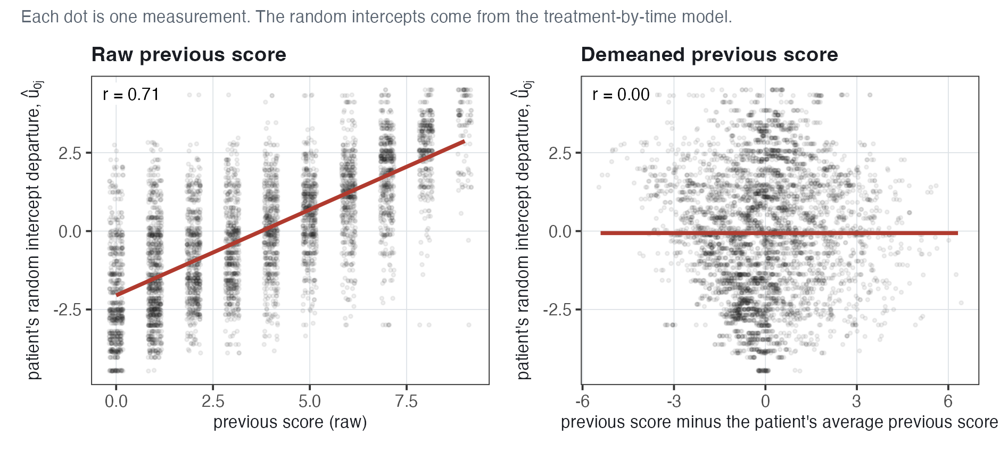{#fig-nl-lag-intercept width="78%"}

**An example.** Patient A's scores are usually around 7, and patient B's around 2. A previous score of 5 is 2 below A's usual level (fewer symptoms than usual) but 3 above B's (more symptoms than usual). The raw previous score is 5 for both; the demeaned previous score, $-2$ for A and $+3$ for B, is the comparison of interest.

**What demeaning does.** Because each patient's average is subtracted, the demeaned previous scores add up to zero within each patient. So they vary only **within** the patient and are unrelated to anything constant across the patient's measurements, such as $u_{0j}$: in the figure (right), the correlation is exactly 0. This is the same demeaning as in the REWB (random effects within and between) model of @sec-wb-rewb, where the within-school predictor was each student's beginning-of-year score minus their school's mean.

**The initial-conditions problem.** As Rabe-Hesketh and Skrondal describe it, the problem with using the **raw previous MDD score** is that it is not independent of the patient's random intercept:

1.  Every MDD score contains, in part, the patient's random intercept $u_{0j}$. A patient who tends to have higher depression scores overall will therefore tend to have a higher first score too.
2.  At the second measurement, that first score becomes the predictor `mdd9_lag`. So the predictor now contains some of the same patient-level tendency represented by $u_{0j}$.
3.  But the usual random-effects model assumes that the predictors are unrelated to the random effects. That assumption is violated here: the previous MDD score and $u_{0j}$ are related because the previous score was itself partly generated by $u_{0j}$. The problem begins with the patient's first observed score, which is why this is called the initial-conditions problem.
4.  As a result, the coefficient on the raw previous score can reflect **stable differences between patients** as well as a true **within-patient dynamic effect** from one measurement to the next. This can make the estimates **inconsistent**: adding more patients does not necessarily make the estimate converge to the true value.

Using the raw previous score instead of the demeaned one in the dynamic model of @sec-nl-dyn-fit changes the dynamic effect from 0.30 to 0.39: part of the difference between patients is counted as a relationship between consecutive measurements. Demeaning removes the correlation with $u_{0j}$, but some bias can remain in short panels (@sec-nl-dyn-why).

::: callout-important
## Why demean

The raw previous MDD score contains two things: the patient's **usual level** — their average previous MDD score, which is the average of all their scores except the last — and how far that particular previous score was above or below that usual level. The random intercept already accounts for stable differences in usual depression levels between patients. What we want from the lagged predictor is the **within-patient part**: whether the patient's previous score was unusually high or low for that patient. Demeaning removes the usual level and leaves only that deviation.
:::

### The dynamic model {#sec-nl-dyn-model}

The **dynamic model** is the treatment-by-time model with one more predictor, the demeaned previous score:

$$\begin{aligned}
\textbf{Level 1:} \qquad && \text{MDD}_{ij} &= \beta_{0j} + \beta_{1j}\,\text{wave}_{ij} + \beta_2\,\left(\text{MDD}_{i-1,j} - \overline{\text{MDD}}_{\text{prev},j}\right) + e_{ij} \\
\textbf{Level 2:} \qquad && \beta_{0j} &= \gamma_{00} + \gamma_{01}\,\text{treat}_j + u_{0j} \\
                          && \beta_{1j} &= \gamma_{10} + \gamma_{11}\,\text{treat}_j + u_{1j} \\
&& \begin{bmatrix} u_{0j} \\ u_{1j} \end{bmatrix} &\sim N\left( \begin{bmatrix} 0 \\ 0 \end{bmatrix}, \Sigma \right), \qquad
\Sigma = \begin{bmatrix} \tau_0^2 & \tau_{01} \\ \tau_{01} & \tau_1^2 \end{bmatrix}, \qquad e_{ij} \sim N(0, \sigma^2)
\end{aligned}$$

- $\text{MDD}_{i-1,j}$ is patient $j$'s previous score (`mdd9_lag`), and $\overline{\text{MDD}}_{\text{prev},j}$ is their average previous score, their usual level (also written $\overline{\text{MDD}_{i-1}}_j$). The difference in parentheses is the demeaned previous score (`c_mdd9_lag`).
- $\beta_2$ is the **dynamic effect**, assumed for now to be the same for every patient (it has no $j$).
- The rest is the treatment-by-time model of @sec-nl-txtime: $\beta_{0j} + \beta_{1j}\,\text{wave}_{ij}$ is patient $j$'s predicted line, estimated again in this model, so it differs from the one in @sec-nl-txresults.

### Fitting it and reading the output {#sec-nl-dyn-fit}

``` r
lmer(mdd9 ~ 1 + treat * wave + c_mdd9_lag + (1 + wave | id), data = dep_lag)
```

| Term                                     |  Estimate |     SE |     $Z$ |
|:-----------------------------------------|----------:|-------:|--------:|
| $\widehat{\gamma_{00}}$ `(Intercept)`    |    4.4704 | 0.1997 |   22.39 |
| $\widehat{\gamma_{01}}$ `treat1`         | $-0.4728$ | 0.2745 | $-1.72$ |
| $\widehat{\gamma_{10}}$ `wave`           | $-0.0328$ | 0.0059 | $-5.58$ |
| $\widehat{\beta_2}$ `c_mdd9_lag`         |    0.3021 | 0.0133 |   22.75 |
| $\widehat{\gamma_{11}}$ `treat1:wave`    | $-0.0217$ | 0.0080 | $-2.71$ |
| $\widehat{\tau_0}$ `sd__(Intercept)`     |    2.0990 |        |         |
| $\widehat{\tau_1}$ `sd__wave`            |    0.0483 |        |         |
| $\widehat{\rho}$ `cor__(Intercept).wave` | $-0.2413$ |        |         |
| $\widehat{\sigma}$ `sd__Observation`     |    1.3377 |        |         |

**How do we interpret** $\beta_2$? $\widehat{\beta_2} = 0.30$. *Interpretation.* This coefficient is the difference in the current MDD score per symptom that the previous score was **above or below the patient's own usual previous-score level**. Holding treatment status, patient, and the current week constant, a previous score that is 1 symptom higher than that patient's usual level is associated with a current score that is 0.30 symptoms higher. A previous score 1 symptom lower than usual is associated with a current score 0.30 symptoms lower ($Z = 22.75$, clearly distinguishable from zero).

**An example.** Take a patient whose usual level is 4. If their previous score was 6 (two above that level), their predicted score at this measurement is $0.30 \times 2 = 0.60$ above their predicted line at this week; if it was 3 (one below), 0.30 below it; if it was exactly 4 (a demeaned previous score of 0), the prediction is the value of the predicted line.

The dynamic effect can be described as depression **"stickiness"**: a patient whose score is above their usual level at one measurement is predicted to score above their predicted line at the next. This is the autocorrelation pattern of @sec-nl-autocorr, now in symptom units and as a coefficient of interest. Possible reasons for one person include rumination, sleep problems, stressful circumstances lasting more than a week, or symptoms that take time to resolve.

$\widehat{\gamma_{10}} = -0.033$. *Interpretation.* For an average patient in the nonspecific group, comparing measurements whose previous score was at the patient's usual level, predicted symptoms decrease 0.033 per week. This is closer to zero than the $-0.055$ of @sec-nl-txresults for two reasons. First, each patient's first measurement is left out: the treatment-by-time model fitted to the same 5,261 measurements has a `wave` coefficient of $-0.049$. Second, scores decrease over the study, so previous scores tend to be above the usual level early and below it late (average demeaned previous score $+0.71$ in weeks 1 to 7 and $-0.61$ in weeks 22 to 27), and part of the decrease is described by $0.30 \times$ the demeaned previous score instead of by `wave`.

$\widehat{\gamma_{11}} = -0.022$. *Interpretation.* Comparing measurements whose previous score was at the patient's usual level, symptoms decrease 0.022 per week faster in the disorder-specific group ($Z = -2.71$), still evidence of a treatment difference in the rate of change.

$\widehat{\gamma_{00}} = 4.47$ and $\widehat{\gamma_{01}} = -0.47$. *Interpretation.* An average nonspecific-therapy patient whose previous score is at their usual level is predicted to report 4.47 symptoms at week 0 (week 0 itself is not in this model's data); an average disorder-specific patient, 0.47 fewer ($Z = -1.72$, not distinguishable from zero).

$\widehat{\tau_0} = 2.10$, $\widehat{\tau_1} = 0.048$, $\widehat{\rho} = -0.24$, $\widehat{\sigma} = 1.34$. *Interpretation.* Intercepts differ by about 2.1 symptoms and slopes by about 0.05 per week in SD terms, patients with a higher intercept tend to have a more negative slope ($-0.24$), and a measurement is typically 1.34 symptoms from its prediction. A residual is now correlated $-0.06$ with the same patient's previous residual (0.25 without the previous score), so the previous score accounts for the autocorrelation.

### What the fitted lines look like {#sec-nl-dyn-plot}

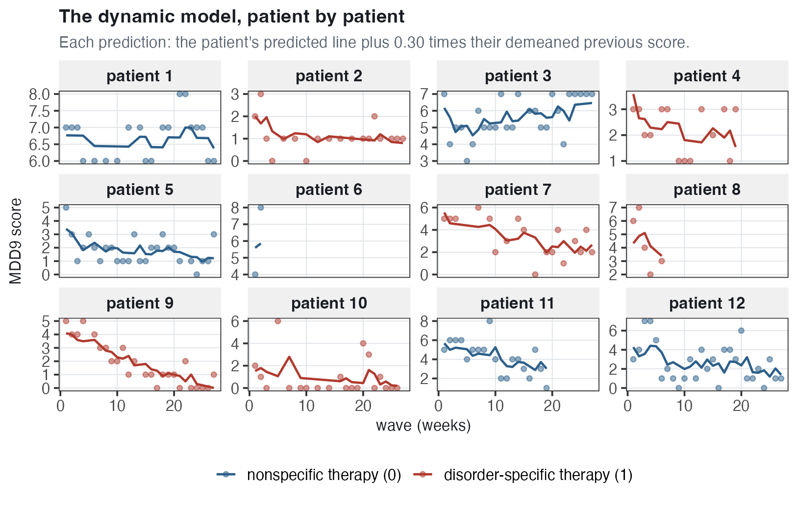{#fig-nl-dynamic-trellis width="76%"}

The predictions are not straight lines: each is the patient's predicted line (not drawn) at that week **plus** 0.30 times how far their previous score was from their usual level. Patient 10's prediction is highest at week 7 because their previous measurement (week 5) was 6, about 5 symptoms above their usual level (about 1), so the prediction is about $0.30 \times 5 = 1.5$ above their predicted line.

In @fig-nl-dynamic-effect, the left panel has patient 10's predicted line (dashed), with each prediction split into its two parts; the right panel has the same relationship for all 5,261 measurements.

{#fig-nl-dynamic-effect width="100%"}

**Reading the left panel.** Each vertical bar is $0.30 \times$ the demeaned previous score at that week, red when the previous score was above the patient's usual level and blue when it was below; the prediction (black) is at the end of the bar. Most of patient 10's previous scores are 0, about 1 below their usual level, so most predictions are 0.3 below the predicted line. The longest bars are at weeks 7, 21 and 22, after scores of 6, 4 and 3.

**Reading the right panel.** The horizontal axis is how far a measurement's previous score was from the patient's usual level, and the vertical axis is how far the measurement itself is from the patient's predicted line; 0 on both axes means a previous score at the usual level and a measurement on the line. The red line has slope $\widehat{\beta_2} = 0.30$ and intercept 0, and the circles are close to it: measurements whose previous score was about 2 above the usual level are on average 0.64 above their predicted line ($0.30 \times 2 = 0.60$), and those whose previous score was about 2 below are on average 0.63 below it. The coefficient 0.30 in the table of @sec-nl-dyn-fit is the slope of this relationship.

### Does treatment change the dynamic effect? {#sec-nl-dyn-treat}

To ask whether the therapy changes the relationship between consecutive scores, let the dynamic effect depend on treatment. Everything else is as in the dynamic model of @sec-nl-dyn-model, with $\beta_{2j}$ in place of $\beta_2$ at level 1 and one new level-2 equation:

$$\beta_{2j} = \gamma_{20} + \gamma_{21}\,\text{treat}_j$$

$\beta_{2j}$ has a $j$ because it depends on the patient's group, but there is no $u_{2j}$: patients in the same group have the same dynamic effect. $\gamma_{20}$ is the dynamic effect in the nonspecific group (not the quadratic coefficient of @sec-nl-quadratic), and $\gamma_{21}$ is how much larger it is in the disorder-specific group. In R, `treat * (wave + c_mdd9_lag)` is shorthand for `treat`, `wave`, `c_mdd9_lag` and the interactions of treatment with both:

``` r
lmer(mdd9 ~ 1 + treat * (wave + c_mdd9_lag) + (1 + wave | id), data = dep_lag)
```

| Term                                        | Estimate |     SE |   $Z$ |
|:--------------------------------------------|---------:|-------:|------:|
| $\widehat{\gamma_{20}}$ `c_mdd9_lag`        |   0.2994 | 0.0201 | 14.89 |
| $\widehat{\gamma_{21}}$ `treat1:c_mdd9_lag` |   0.0049 | 0.0268 |  0.18 |

*Interpretation.* The dynamic effect is 0.30 in the nonspecific group and $0.2994 + 0.0049 = 0.30$ in the disorder-specific group; the difference, 0.005, is a fraction of its standard error ($Z = 0.18$). So for the question "does treatment reduce autocorrelation in depression?", there is no evidence that the disorder-specific therapy changes how strongly one score is related to the next; a negative interaction distinguishable from zero would have meant a weaker relationship under that therapy. There is evidence of a therapy difference in the rate of change ($\gamma_{11}$) only.

### Does the dynamic effect differ from patient to patient? {#sec-nl-dyn-random}

::: callout-note
## Each patient has their own dynamic effect

In @sec-nl-dyn-fit, one dynamic effect applies to every patient; here, each patient has their own. For a patient whose dynamic effect is 0.1, a previous score 2 symptoms higher is associated with a predicted score 0.2 symptoms higher at the next measurement; for a patient whose dynamic effect is 0.7, 1.4 symptoms higher.
:::

To allow patients to differ in how strongly one score is related to the next, the previous score is given a random slope, and the treatment-by-dynamic-effect term of @sec-nl-dyn-treat is left out (no evidence for it). With $\beta_{0j}$ and $\beta_{1j}$ as in @sec-nl-dyn-model, the model is:

$$\begin{aligned}
\text{MDD}_{ij} &= \beta_{0j} + \beta_{1j}\,\text{wave}_{ij} + \beta_{2j}\left(\text{MDD}_{i-1,j} - \overline{\text{MDD}}_{\text{prev},j}\right) + e_{ij}, \quad e_{ij} \sim N(0, \sigma^2) \\
\beta_{2j} &= \gamma_{20} + u_{2j} \\
\begin{bmatrix} u_{0j} \\ u_{1j} \\ u_{2j} \end{bmatrix} &\sim N\left( \begin{bmatrix} 0 \\ 0 \\ 0 \end{bmatrix}, \Sigma \right), \qquad
\Sigma = \begin{bmatrix} \tau_0^2 & \tau_{01} & \tau_{02} \\ \tau_{01} & \tau_1^2 & \tau_{12} \\ \tau_{02} & \tau_{12} & \tau_2^2 \end{bmatrix}
\end{aligned}$$

- $\gamma_{20}$ is the average dynamic effect across patients (in @sec-nl-dyn-treat, the nonspecific group's dynamic effect), and $u_{2j}$ is patient $j$'s departure from it.
- In $\Sigma$, $\tau_2^2$ is the variance of patients' dynamic effects, $\tau_{02}$ the intercept–dynamic-effect covariance and $\tau_{12}$ the slope–dynamic-effect covariance. (In @sec-nl-quadratic, the same symbols were for the quadratic coefficients.)

Here this model is fitted with the raw previous score, `mdd9_lag`, not the demeaned one, so $\widehat{\gamma_{20}}$ below is the average coefficient on $\text{MDD}_{i-1,j}$, not directly comparable with the 0.30 of @sec-nl-dyn-fit:

``` r
lmer(mdd9 ~ 1 + treat * wave + mdd9_lag + (1 + wave + mdd9_lag | id),
     data = dep_lag)
```

| Term                               |  Estimate |     SE |   $Z$ |
|:-----------------------------------|----------:|-------:|------:|
| $\widehat{\gamma_{20}}$ `mdd9_lag` |    0.3972 | 0.0168 | 23.63 |
| $\widehat{\tau_2}$ `sd__mdd9_lag`  |    0.1645 |        |       |
| `cor__(Intercept).mdd9_lag`        | $-0.4189$ |        |       |
| `cor__wave.mdd9_lag`               |    0.4626 |        |       |

$\widehat{\gamma_{20}} = 0.40$. *Interpretation.* For an average patient, holding the intercept and slope fixed, a previous score one symptom higher is associated with a predicted score 0.40 symptoms higher at the next measurement.

$\widehat{\tau_2} = 0.165$. *Interpretation.* Patients' dynamic effects differ from the average by about 0.165 in SD terms: about 95% of patients are expected to have a dynamic effect between $0.3972 - 1.96(0.1645) = 0.07$ (a weak relationship between consecutive scores) and $0.3972 + 1.96(0.1645) = 0.72$ (much stronger than average).

In @fig-nl-three-dynamic, the dynamic effects of @sec-nl-dyn-fit, @sec-nl-dyn-treat and @sec-nl-dyn-random are side by side. In each panel, the horizontal axis is the previous score minus the patient's usual level, and the vertical axis is how much higher or lower the predicted score is than for a previous score at the usual level, for the same patient at the same week. So each line has intercept 0, and its slope is a dynamic effect.

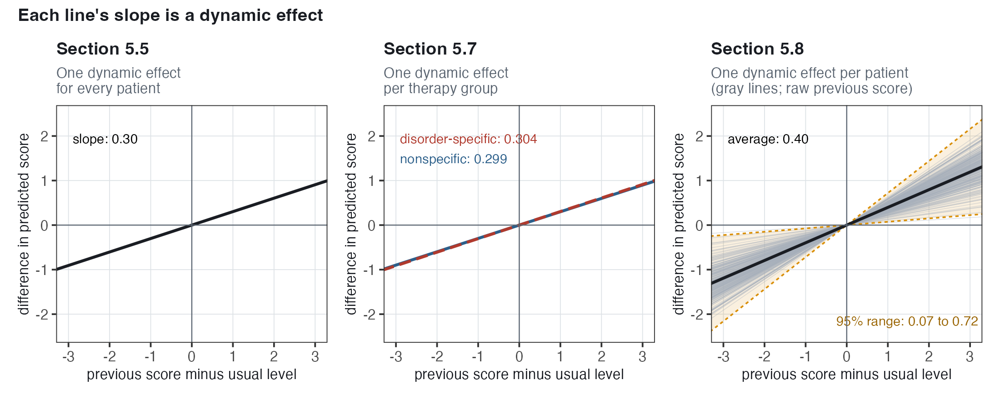{#fig-nl-three-dynamic width="100%"}

In the middle panel, the two lines are almost the same (slopes 0.299 and 0.304): the difference, 0.005, is $\widehat{\gamma_{21}}$, with $Z = 0.18$. In the right panel, the shaded band is the range in which about 95% of patients' dynamic effects are expected, 0.07 to 0.72. The gray lines are less spread out than the band (the SD of their slopes is 0.10, against $\widehat{\tau_2} = 0.165$) because each patient's estimated dynamic effect is pulled toward the average, as the curves of patients with few measurements were in @sec-nl-quad-curves. The right panel is based on the raw previous score. A patient's usual level is the same at every measurement, so a slope on the raw previous score is also a slope on the previous score minus the usual level, and the same axes apply. But the average, 0.40, is not directly comparable with the 0.30 of the other two panels, because the raw score also contains the patient's usual level (@sec-nl-demean).

**The correlations.** Patients with a higher intercept (here, the predicted score at week 0 for a previous score of 0) tend to have a smaller dynamic effect ($-0.42$), and patients with a less negative slope a larger one (0.46).

**Raw or demeaned?** With the demeaned previous score, `c_mdd9_lag`, in the same model, the average dynamic effect is 0.28 (SE 0.0178), the SD of patients' dynamic effects 0.16, and the correlation with the intercept 0.04 (nearly unrelated). The raw version's average is larger because the raw score also contains the patient's usual level (@sec-nl-demean). The correlations are not comparable either: with the demeaned score, the intercept is the predicted score at week 0 for a previous score at the usual level instead of 0. In both versions, patients differ in their dynamic effects by a similar amount.

### Extensions {#sec-nl-extensions}

Four extensions:

1.  **What about a Mundlak term?** A Mundlak model would add each patient's usual level (average previous score) as a level-2 predictor. That is almost the patient's average score (correlation above 0.99), so each patient's level is predicted from nearly that same level: its coefficient is 1.01, and the SD of the random intercepts is 0.58, against 2.10 without it (about 92% of the intercept variance accounted for). So adding a Mundlak term here is not a good idea.
2.  **The dynamic effect could itself change over time**, for example stronger early in treatment than late.
3.  **The variance of the level-1 residuals could depend on time**, for example larger in the early weeks.
4.  **The variance of the level-1 residuals could depend on treatment**, for example if one therapy makes week-to-week symptoms more stable.

## Other ways to describe the average trajectory {#sec-nl-appendix}

This section covers two alternatives to a polynomial for a curved average trajectory.

### Time fixed effects with linear random slopes {.unnumbered}

Instead of choosing a shape for the average trajectory, give **every week its own mean**:

$$\begin{aligned}
\text{MDD}_{ij} &= \alpha_i + u_{0j} + u_{1j}\,\text{wave}_{ij} + e_{ij} \\
\begin{bmatrix} u_{0j} \\ u_{1j} \end{bmatrix} &\sim N\left( \begin{bmatrix} 0 \\ 0 \end{bmatrix}, \Sigma \right), \qquad
\Sigma = \begin{bmatrix} \tau_0^2 & \tau_{01} \\ \tau_{01} & \tau_1^2 \end{bmatrix}, \qquad e_{ij} \sim N(0, \sigma^2)
\end{aligned}$$

- $\alpha_i$ is the average patient's mean at week $i$ (28 means, with no assumed shape)
- $u_{0j} + u_{1j}\,\text{wave}_{ij}$ is patient $j$'s straight-line departure from that average trajectory, with intercept $u_{0j}$ and slope $u_{1j}$.

This follows the advice of Rabe-Hesketh and Skrondal to allow more flexibility in the fixed part than in the random part: only each patient's **departure** from the average curve is assumed linear in time. One mean per week requires a shared set of weeks, as here.

In R, the categorical `wave_f` is in the fixed part and the numeric `wave` in the random part:

``` r
lmer(mdd9 ~ 1 + wave_f + (1 + wave | id), data = dep)
```

| Term          |  Estimate |     SE |
|:--------------|----------:|-------:|
| `(Intercept)` |    4.9241 | 0.1583 |
| `wave_f1`     | $-0.5643$ | 0.1264 |
| `wave_f2`     | $-0.3492$ | 0.1267 |
| `wave_f3`     | $-0.5880$ | 0.1272 |
| ...           |           |        |
| `wave_f27`    | $-2.1972$ | 0.2010 |

Week 0 is the reference week, so the intercept, 4.92, is the average patient's mean at week 0, and each `wave_f` coefficient is that week's mean minus week 0's: the week-1 mean is $4.9241 - 0.5643 = 4.36$, and the week-27 mean is $4.9241 - 2.1972 = 2.73$. The random part is almost the same as in the linear growth model with random slopes: $\widehat{\tau_0} = 2.09$, $\widehat{\tau_1} = 0.076$, $\widehat{\rho} = -0.29$, $\widehat{\sigma} = 1.39$.

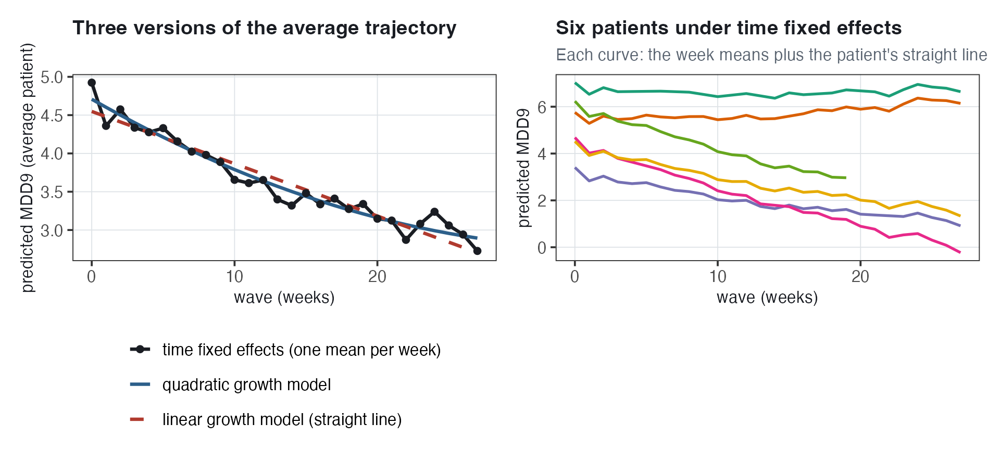{#fig-nl-time-fixed-effects width="80%"}

In the right panel, each patient's predicted curve is the week means, with their irregular changes, plus the patient's straight line, $u_{0j} + u_{1j}\,\text{wave}_{ij}$, whose steady change per week, $u_{1j}$, differs between patients. In the left panel, the quadratic curve is in the middle of the week means, a sign that it describes the average trajectory well.

### Treatment by week, and the event-study plot {.unnumbered}

With the week means interacted with treatment, each group has its own mean at every week:

``` r
lmer(mdd9 ~ 1 + wave_f * treat + (1 + wave | id), data = dep)
```

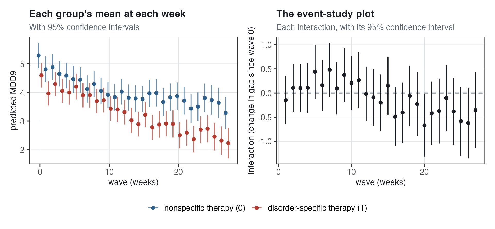{#fig-nl-event-study width="80%"}

- The coefficient on `treat1`, $-0.70$ (SE 0.3162), is the gap between the groups at week 0.
- Each interaction `wave_fk:treat1` is the gap at week $k$ minus the gap at week 0. At week 20 it is $-0.67$, so the gap is $-0.6957 + (-0.6692) = -1.36$ symptoms.

Economists call the right panel an **event-study plot**: how a difference between groups changes in each period after an event, here the start of therapy. The interactions are mostly positive in the first half of the study (a smaller gap than at week 0) and mostly negative in the second (a larger gap), but only the week-20 interval excludes zero: week by week, the gap is estimated imprecisely. The treatment-by-time interaction $\gamma_{11}$ (@sec-nl-txresults), estimated from all weeks together, is distinguishable from zero.

### Week as a random effect {.unnumbered}

In a compromise between a straight line and one mean per week, each week's departure from the line is a **random effect**:

$$\begin{aligned}
\text{MDD}_{ij} &= \gamma_{00} + \gamma_{10}\,\text{wave}_{ij} + u_i + u_{0j} + u_{1j}\,\text{wave}_{ij} + e_{ij} \\
u_i &\sim N(0, \tau^2_i), \qquad \begin{bmatrix} u_{0j} \\ u_{1j} \end{bmatrix} \sim N\left( \begin{bmatrix} 0 \\ 0 \end{bmatrix}, \Sigma \right), \qquad e_{ij} \sim N(0, \sigma^2)
\end{aligned}$$

$\alpha_i$ is week $i$'s departure from the straight line, shared by every patient measured that week and **assumed** normal with mean zero and variance $\tau^2_i$. Weeks are **crossed** with patients (@sec-nl-data): each measurement belongs to both a patient and a week. With $\tau^2_i = 0$, the model is the straight line; with a very large $\tau^2_i$, each week has its own unrestricted mean, as in time fixed effects. In between, week means are pulled toward the line, more so for weeks with fewer measurements, whose means are estimated less precisely: the same partial pooling as for patients.

``` r
lmer(mdd9 ~  wave + (wave | id) + (1 | wave), data = dep)
```

$\widehat{\tau_i} = 0.13$. *Interpretation.* Week means differ from the straight line by about 0.13 symptoms in SD terms, small compared with the SD of patients' intercepts ($\widehat{\tau_0} = 2.09$). In a version with `(1 + treat | wave)`, the treatment difference also varies by week: the SDs are 0.16 for the weeks' departures and 0.10 for the treatment difference, and the treatment-by-time coefficient is $-0.0266$ (SE 0.0111), almost the same as in @sec-nl-txresults. Crossed random effects are a topic of their own, beyond this chapter.

## Vocabulary decoder {#sec-nl-vocab}

| Term | What it means here |
|:-------------------------|:---------------------------------------------|
| Level 1 / level 2 | The measurement / the patient. Measurements are nested in patients; weeks are crossed with patients |
| Treatment-by-time model | Random slopes growth model with `treat` predicting intercept and slope |
| $\gamma_{11}$ | Difference between the therapies in average rate of change (treatment-by-time interaction) |
| Predicted line | $\beta_{0j} + \beta_{1j}\,\text{wave}_{ij}$: patient $j$'s predicted score at each week |
| Level-1 residual, $e_{ij}$ | A measurement's distance from the patient's predicted line |
| Smooth curve (LOESS) | A curve through the data with no assumed shape |
| Polynomial, quadratic | Powers of time as predictors; a quadratic includes $\text{wave}^2_{ij}$, so trajectories are parabolas |
| Linear coefficient, $\gamma_{10}$ | In a quadratic, the slope at week 0 only |
| Quadratic coefficient, $\gamma_{20}$ | The curvature: the slope changes by $2\gamma_{20}$ per week; at week $w$ it is $\gamma_{10} + 2\gamma_{20}w$ |
| Deceleration / acceleration | A rate of change that becomes less steep / steeper. For decreasing symptoms: positive / negative $\gamma_{20}$ |
| $\tau_2^2$, $\tau_{02}$, $\tau_{12}$ | Variance of the quadratic departures; intercept–quadratic and slope–quadratic covariances |
| Linear growth model with random slopes | A straight predicted line per patient: `lmer(mdd9 ~ 1 + wave + (1 + wave | id))` |
| Intermediate model | Quadratic term in the average curve only: patients differ in intercept and slope, not curvature |
| Convergence warning | R's fitting routine may not have reached the best estimates (@sec-nl-quad-fixed) |
| IID | Independent and identically distributed: unrelated to each other, from one distribution |
| Autocorrelation | Correlation of a series with its own earlier values; here, of residuals close in time |
| AR(1) | Each residual is $\phi$ times the patient's previous residual plus a new part, $\nu_{ij}$, unrelated to earlier residuals |
| $\phi$ | The autoregressive parameter: the autocorrelated piece's correlation one week apart ($\phi^k$ for $k$ weeks) |
| Autocorrelated piece / independent piece | The residual's two pieces in the `lmer` AR(1) model: correlated across weeks / new at each measurement |
| Dynamic model | A model with the previous score as a predictor |
| Lagged score, `mdd9_lag` | The patient's score at their previous measurement |
| Usual level (average previous score) | Mean of the patient's `mdd9_lag` values: all their scores except the last |
| Demeaned previous score, `c_mdd9_lag` | The previous score minus the patient's usual level |
| Dynamic effect, $\beta_2$ | Predicted-score difference per one-symptom difference in the demeaned previous score, for the same patient at the same week ("stickiness") |
| Initial-conditions problem | The first score is assumed unaffected by the random intercept, but is not, so raw-previous-score estimates are inconsistent: not closer to the true values with more patients |

## Common mistakes {#sec-nl-mistakes}

1.  **Reading the linear coefficient in a quadratic model as the average rate of change.** It is the slope at week 0 ($-0.106$; at mid-study, $-0.067$).

2.  **Forgetting the factor of 2.** The slope changes by $2\widehat{\gamma_{20}} = 0.0029$ per week, not $\widehat{\gamma_{20}}$.

3.  **Reading a positive quadratic coefficient as "symptoms get worse."** It means the decrease becomes less steep (deceleration); the average curve's lowest point, about week 37, is after the data end.

4.  **Reading** $Z = 1.43$ for the quadratic coefficient as the test of curves against straight lines. It is about the average curvature only; that test is the likelihood ratio test ($\chi^2 = 216.48$, 4 df).

5.  **Comparing** $\tau_1$ across the linear and quadratic models. Quadratic model: the SD of slopes at week 0 only (0.44). Linear growth model with random slopes: the SD of patients' slopes, one per patient (0.076).

6.  **Reading a random-effect correlation near** $\pm 1$ as a finding about patients. The slope–quadratic correlation, $-0.985$, depends on where week 0 is placed; values near $\pm 1$ often appear with a convergence warning.

7.  **Miscounting the degrees of freedom in the test of curves against straight lines.** Four ($\gamma_{20}$, $\tau_2^2$, $\tau_{02}$, $\tau_{12}$); against the intermediate model, which already has $\gamma_{20}$, three.

8.  **Assuming the random effects account for all correlation between nearby measurements.** In the treatment-by-time model (random intercept and slope), consecutive residuals are still correlated 0.25.

9.  **Reading** $\widehat{\phi} = 0.77$ as the correlation between residuals one week apart. That correlation is 0.49 under the AR(1) model; $\phi$ is the correlation of the autocorrelated piece only.

10. **Comparing dynamic effects without checking which previous score is in the model.** Demeaned versus raw previous score: 0.30 versus 0.39 in the dynamic model (@sec-nl-demean); 0.28 versus 0.40 with a random dynamic effect (@sec-nl-dyn-random). The raw score also contains the patient's usual level (@sec-nl-demean).

11. **Calling the lagged score "last week's score."** It is the previous measurement; 16% of pairs are two or more weeks apart.

## Quick reference {#sec-nl-quickref}

::::::::: quickref
::: {}
**Treatment-by-time model**

$$\begin{aligned}
\text{MDD}_{ij} &= \beta_{0j} + \beta_{1j}\,\text{wave}_{ij} + e_{ij} \\
\beta_{0j} &= \gamma_{00} + \gamma_{01}\,\text{treat}_j + u_{0j} \\
\beta_{1j} &= \gamma_{10} + \gamma_{11}\,\text{treat}_j + u_{1j}
\end{aligned}$$

$(u_{0j}, u_{1j}) \sim N(\mathbf{0}, \Sigma)$, a $2 \times 2$ $\Sigma$; $e_{ij} \sim N(0,\sigma^2)$; $\rho = \tau_{01}/(\tau_0\tau_1)$.
:::

::: {}
**Quadratic growth model**

$$\begin{aligned}
\text{MDD}_{ij} &= \beta_{0j} + \beta_{1j}\,\text{wave}_{ij} + \beta_{2j}\,\text{wave}^2_{ij} + e_{ij} \\
\beta_{kj} &= \gamma_{k0} + u_{kj}, \quad k = 0, 1, 2
\end{aligned}$$

$(u_{0j}, u_{1j}, u_{2j}) \sim N(\mathbf{0}, \Sigma)$, a $3 \times 3$ $\Sigma$. Intermediate model: $\beta_{2} = \gamma_{20}$ (no $u_{2j}$), a $2 \times 2$ $\Sigma$.
:::

::: {}
**The quadratic's slope and turning point**

$$\text{slope at week } w = \gamma_{10} + 2\gamma_{20}\,w$$

$$\text{lowest or highest point at } w = -\frac{\gamma_{10}}{2\gamma_{20}}$$
:::

::: {}
**AR(1) residuals**

$$e_{ij} = \phi\, e_{i-1,j} + \nu_{ij}, \quad \nu_{ij} \sim N(0, \sigma_\nu^2)$$

Correlation $k$ apart $= \phi^k$. In `lmer`: residual = autocorrelated piece (AR(1)) + independent piece; correlation one week apart $= \phi \times$ (the autocorrelated piece's share of the residual variance).
:::

::: {}
**Dynamic model**

$$\text{MDD}_{ij} = \beta_{0j} + \beta_{1j}\,\text{wave}_{ij} + \beta_{2}\left(\text{MDD}_{i-1,j} - \overline{\text{MDD}}_{\text{prev},j}\right) + e_{ij}$$

Level 2 as in the treatment-by-time model. Treatment by dynamic effect: $\beta_{2j} = \gamma_{20} + \gamma_{21}\,\text{treat}_j$. Random dynamic effect: $\beta_{2j} = \gamma_{20} + u_{2j}$, with a $3 \times 3$ $\Sigma$.
:::

::: {}
**The `lmer` calls**

- Treatment by time: `lmer(mdd9 ~ 1 + treat * wave + (1 + wave | id))`
- Quadratic: `lmer(mdd9 ~ 1 + wave + wave2 + (1 + wave + wave2 | id))`
- Intermediate: `lmer(mdd9 ~ 1 + wave + wave2 + (1 + wave | id))`
- AR(1): `lmer(mdd9 ~ 1 + treat * wave + (1 + wave | id) + ar1(0 + wave_f | id))`
- Dynamic: `lmer(mdd9 ~ 1 + treat * wave + c_mdd9_lag + (1 + wave | id))`
- Treatment by dynamic effect: `lmer(mdd9 ~ 1 + treat * (wave + c_mdd9_lag) + (1 + wave | id))`
- Random dynamic effect (raw previous score): `lmer(mdd9 ~ 1 + treat * wave + mdd9_lag + (1 + wave + mdd9_lag | id))`
:::
:::::::::

**Our numbers (256 patients and 5,517 measurements; in the dynamic models, 254 and 5,261)**

| Quantity | Value |
|:----------------------------------------|------------------------------:|
| Treatment difference in rate of change, $\widehat{\gamma_{11}}$ | $-0.0257$ per week (SE 0.0108) |
| Quadratic: slope at weeks 0, 13.5, 27 | $-0.106$, $-0.067$, $-0.028$ |
| Quadratic coefficient $\widehat{\gamma_{20}}$ | 0.00145 (SE 0.00102, $Z = 1.43$) |
| $\widehat{\gamma_{20}}$ in the intermediate model | 0.00186 (SE 0.00033, $Z = 5.60$) |
| LR tests: linear vs quadratic / linear vs intermediate / intermediate vs quadratic | 216.48 (4 df) / 31.22 (1 df) / 185.26 (3 df) |
| Consecutive residuals' correlation, treatment by time | 0.25 |
| AR(1): $\widehat{\phi}$ / residuals one week apart, as a whole | 0.77 / 0.49 |
| `treat1:wave` without / with AR(1) | $-0.0257$ (0.0108) / $-0.0219$ (0.0106) |
| Dynamic effect $\widehat{\beta_2}$ | 0.30 (SE 0.0133) |
| Treatment by dynamic effect | 0.005 (SE 0.027) |
| Random dynamic effect, 95% range | 0.07 to 0.72 (raw previous score) |

## Worked examples {#sec-nl-worked}

### Example 1: our patients

*Use the quadratic growth model of @sec-nl-quad-fixed (*$\widehat{\gamma_{00}} = 4.7079$, $\widehat{\gamma_{10}} = -0.1064$, $\widehat{\gamma_{20}} = 0.00145$), the AR(1) model of @sec-nl-ar1-fit ($\widehat{\phi} = 0.7739$) and the dynamic model of @sec-nl-dyn-fit ($\widehat{\beta_2} = 0.3021$).

**(a) What is the slope of the average curve at week 6 and at week 20?**

::: {.callout-tip collapse="true" icon="false"}
## Show solution

At week 6: $-0.1064 + 2(0.00145)(6) = -0.1064 + 0.0174 = -0.089$ symptoms per week. At week 20: $-0.1064 + 2(0.00145)(20) = -0.1064 + 0.0580 = -0.048$. The decrease is almost twice as steep at week 6 as at week 20.
:::

**(b) What is the predicted score of an average patient at week 20?**

::: {.callout-tip collapse="true" icon="false"}
## Show solution

$4.7079 - 0.1064(20) + 0.00145(20^2) = 4.7079 - 2.128 + 0.580 = 3.16$ symptoms.
:::

**(c) Under the AR(1) model, how correlated are two residuals of the same patient three weeks apart?**

::: {.callout-tip collapse="true" icon="false"}
## Show solution

Autocorrelated pieces: $0.7739^3 = 0.4635$, about 0.46. For the residuals as a whole, multiply by the autocorrelated piece's share: $0.4635 \times 0.636 = 0.29$.
:::

**(d) A patient's usual level (average previous score) is 3, and their previous score was 1. For the same patient at the same week, how does their predicted score differ from the prediction for a previous score of 3?**

::: {.callout-tip collapse="true" icon="false"}
## Show solution

The demeaned previous score is $1 - 3 = -2$, so the predicted score differs by $0.3021 \times (-2) = -0.60$: 0.60 fewer symptoms.
:::

**(e) In the dynamic model, the coefficient on `wave` is** $-0.033$. A colleague concludes that the therapy is less effective than in @sec-nl-txresults, where it was $-0.055$. What is wrong with that?

::: {.callout-tip collapse="true" icon="false"}
## Show solution

The coefficient $-0.033$ is the weekly change holding the previous score fixed, a different quantity from $-0.055$: part of the decrease over time is described through the previous score. Also, `wave` is the nonspecific group's rate of change; the therapies are compared by `treat1:wave`, $-0.022$ (dynamic model) and $-0.026$ (@sec-nl-txresults), both more than two SEs from zero.
:::

### Example 2: a growth study in a new setting

*A study measures 300 first-graders' oral reading fluency (words read correctly per minute) every week from week 0 to week 20. In a quadratic growth model, the estimates are* $\widehat{\gamma_{00}} = 30$, $\widehat{\gamma_{10}} = 4.0$ and $\widehat{\gamma_{20}} = -0.08$. The residuals from each child's predicted curve are modeled as AR(1), with $\widehat{\phi} = 0.5$ and no independent piece.

**(a) What is the average child's growth rate at week 0 and at week 10?**

::: {.callout-tip collapse="true" icon="false"}
## Show solution

At week 0, the linear coefficient: 4.0 words per minute per week. At week 10: $4.0 + 2(-0.08)(10) = 4.0 - 1.6 = 2.4$. For an increasing outcome, a negative quadratic coefficient means deceleration: growth is positive but slower later in the year.
:::

**(b) When does the average curve stop increasing, and is that inside the study?**

::: {.callout-tip collapse="true" icon="false"}
## Show solution

At $w = -4.0/(2 \times -0.08) = 25$ weeks, after the last week (20), so the average child's fluency increases throughout the study.
:::

**(c) A colleague says the quadratic coefficient means fluency decreases by 0.08 words per week. Correct this.**

::: {.callout-tip collapse="true" icon="false"}
## Show solution

The quadratic coefficient is not a weekly change in fluency: the weekly growth rate changes by $2 \times (-0.08) = -0.16$ each week, and fluency itself increases until week 25.
:::

**(d) How correlated are a child's residuals one, two and three weeks apart?**

::: {.callout-tip collapse="true" icon="false"}
## Show solution

0.5, $0.5^2 = 0.25$ and $0.5^3 = 0.125$.
:::

**(e) The same colleague says that because each child has their own curve, nearby residuals cannot still be related. How would you respond?**

::: {.callout-tip collapse="true" icon="false"}
## Show solution

Each child's curve describes only smooth growth. Anything that affects reading for more than a week, such as an illness, can make scores higher or lower than the predicted curve for several weeks in a row; here, consecutive residuals are correlated 0.5 even with a curve for each child.
:::

## Check your understanding {#sec-nl-self-check}

Try each one before opening the answer. The section reference points to the fuller explanation.

::::::::::::::::: self-check
::: {.callout-note collapse="true" icon="false"}
## Write the treatment-by-time model, give the `lmer` call, and interpret $\gamma_{01}$ and $\gamma_{11}$.

Equations in the quick reference; `lmer(mdd9 ~ 1 + treat * wave + (1 + wave | id))`. $\widehat{\gamma_{01}} = -0.46$: the week-0 group difference ($Z = -1.68$). $\widehat{\gamma_{11}} = -0.026$: symptoms decrease 0.026 more per week with the disorder-specific therapy ($Z = -2.37$). *See @sec-nl-txtime and @sec-nl-txresults.*
:::

::: {.callout-note collapse="true" icon="false"}
## Write the quadratic growth model with its $3 \times 3$ $\Sigma$ and give the `lmer` call.

Each patient has their own intercept, linear and quadratic coefficient; $\Sigma$ has three variances and three covariances. `lmer(mdd9 ~ 1 + wave + wave2 + (1 + wave + wave2 | id))`, after creating `wave2`. *See @sec-nl-quad-model.*
:::

::: {.callout-note collapse="true" icon="false"}
## Interpret the fixed effects of a quadratic growth model.

Linear: the slope at week 0 only. Quadratic: the curvature; the slope at week $w$ is $\gamma_{10} + 2\gamma_{20}w$, so our positive $\gamma_{20}$ means deceleration. Lowest point at $w = -\gamma_{10}/(2\gamma_{20})$, about week 37, after the data end. Moving week 0 changes the intercept and the linear coefficient only. *See @sec-nl-quad-fixed.*
:::

::: {.callout-note collapse="true" icon="false"}
## Interpret the random part of the quadratic growth model.

$\widehat{\tau_1} = 0.44$ is the SD of slopes at week 0 only, not comparable with the 0.076 of the linear growth model with random slopes. The slope–quadratic correlation, $-0.985$, describes week 0 only (about $+0.98$ with time counted from week 27). *See @sec-nl-quad-random.*
:::

::: {.callout-note collapse="true" icon="false"}
## Describe the intermediate model and carry out the likelihood ratio tests.

Intermediate (B): one curvature for everyone. A (linear) against C (quadratic): $\chi^2 = 216.48$ on 4 df, of which 185.26 (3 df) is B against C: patients differ in curvature. *See @sec-nl-intermediate and @sec-nl-lrt.*
:::

::: {.callout-note collapse="true" icon="false"}
## Give the advantages and disadvantages of the linear growth model with random slopes and the quadratic growth model.

The quadratic fits much better; it has four more parameters, its slope depends on the week, and adding treatment requires three terms instead of one. *See @sec-nl-lrt.*
:::

::: {.callout-note collapse="true" icon="false"}
## Explain why a patient's measurements are correlated and what the IID assumption on the level-1 residuals means.

Every measurement contains the patient's departure from the average line (with a random intercept only, correlation 0.634 at any distance). The residuals are assumed unrelated and drawn from one normal distribution, but in repeated measurements consecutive residuals tend to have the same sign. *See @sec-nl-iid.*
:::

::: {.callout-note collapse="true" icon="false"}
## Recognize autocorrelation and the four structures in a plot.

Positive: long stretches on one side; negative: alternating sides. Points scatter around the average line (independent), a parallel line (random intercepts) or a line with its own slope (random slopes); AR(1): stretches above the line, then below it. *See @sec-nl-ac-look and @sec-nl-four.*
:::

::: {.callout-note collapse="true" icon="false"}
## Write the AR(1) model and interpret $\phi$ with our numbers.

$e_{ij} = \phi e_{i-1,j} + \nu_{ij}$. One week apart: 0.77 for the autocorrelated pieces; $0.7739 \times 0.636 = 0.49$ for the residuals, which include the independent piece. *See @sec-nl-ar1 and @sec-nl-ar1-fit.*
:::

::: {.callout-note collapse="true" icon="false"}
## Say what happens to the treatment effect when AR(1) is added, and why.

Very little: $-0.0257$ (SE 0.0108) without AR(1), $-0.0219$ (SE 0.0106) with it. Autocorrelation generally matters more for SEs, which depend on the assumed correlations among residuals. *See @sec-nl-ar1-treat.*
:::

::: {.callout-note collapse="true" icon="false"}
## Explain how a time trend that is too restrictive can produce autocorrelation.

Around a straight line through curved scores, residuals are on one side for stretches (patient 191: 0.50 around a line, 0.01 around a curve). *See @sec-nl-ac-source.*
:::

::: {.callout-note collapse="true" icon="false"}
## Explain the difference between autocorrelation in the residuals and the previous score as a predictor.

AR(1) changes the SEs, not what the coefficients mean; in a dynamic model, the previous score has its own coefficient, and every other coefficient is a comparison at a fixed previous score. *See @sec-nl-dyn-why.*
:::

::: {.callout-note collapse="true" icon="false"}
## Build the demeaned previous score in R and explain why it is demeaned.

`lag(mdd9)` within each patient, minus the patient's average previous score (the average of all their scores except the last). The raw previous score contains the random intercept (correlation 0.71), so it does not meet the random effects assumption. *See @sec-nl-lag and @sec-nl-demean.*
:::

::: {.callout-note collapse="true" icon="false"}
## Interpret the dynamic effect, the treatment-by-dynamic-effect interaction and a random dynamic effect.

0.30: for the same patient at the same week, a previous score one symptom higher, relative to their usual level, is associated with 0.30 more symptoms now. Interaction 0.005 (SE 0.027): no evidence that the therapy changes it. Random dynamic effect (raw previous score): average 0.40, with about 95% of patients between 0.07 and 0.72. *See @sec-nl-dyn-fit, @sec-nl-dyn-treat and @sec-nl-dyn-random.*
:::
:::::::::::::::::

## Going deeper {#sec-nl-deeper}

From Luke Miratrix's online MLM handouts:

- [A flexible longitudinal model](https://lmiratrix.github.io/MLM/longitudinal.html) — one mean per week plus linear departures (@sec-nl-appendix).
- [An overview of complex error structures](https://lmiratrix.github.io/MLM/complex_error.html) — residual correlation structures such as AR(1).
- [Error messages and optimization algorithms for MLMs](https://lmiratrix.github.io/MLM/lmer_optimization.html) — convergence warnings and what to try (@sec-nl-quad-fixed).
- [Likelihood ratio tests](https://lmiratrix.github.io/MLM/lr_test.html) — the test used in @sec-nl-lrt.

**Further reading on dynamic models.** Chapters 5 and 6 of Rabe-Hesketh and Skrondal, *Multilevel and Longitudinal Modeling Using Stata*.

**An empirical application.** Relyea, Rich, Kim and Gilbert (2023), "The COVID-19 impact on reading achievement growth of Grade 3–5 students in a U.S. urban school district," *Reading and Writing*, 36(2), 317–346. Three reading tests in one school year, with measurements nested within students and students within schools. Two differences from this chapter: growth is two straight-line segments (one per half of the year), not a quadratic; and families chose in-person or remote learning, so compare how the learning-mode coefficients can be interpreted with $\gamma_{01}$ and $\gamma_{11}$ in our randomized trial (@sec-nl-txresults).

## Code for this chapter's figures {#sec-nl-code}

Every figure in this chapter is computed live from the data by one R script. It fits the models used throughout and then builds each figure in turn. [Download `06-figures.R`](../code/06-figures.R) and the data it reads, [`dep.csv`](../data/dep.csv), then run the script from a folder where the data sits at `data/dep.csv`.

::: {.callout-note collapse="true" icon="false"}
## Show the full script

``` r

```
:::

## What comes next {.unnumbered}

@sec-binary-outcomes is about **binary** outcomes, such as whether a student was held back a grade; in every model so far, the outcome is treated as continuous. It covers **logistic regression**, for the log-odds of a yes outcome, and **multilevel logistic regression**, with random intercepts on that scale for clusters such as schools.
