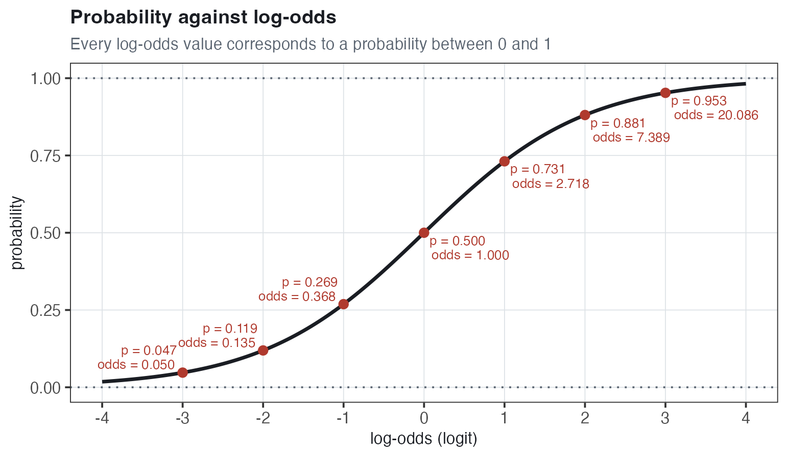
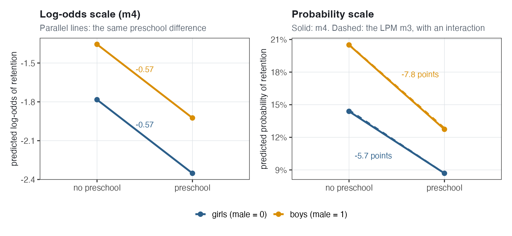
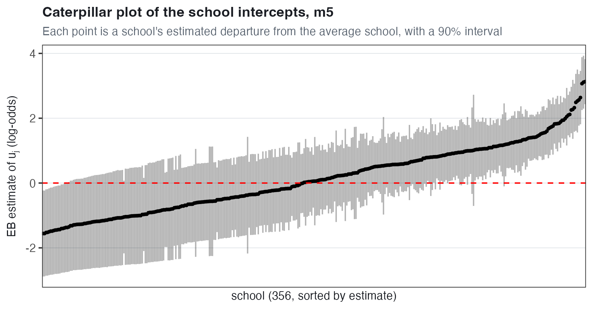
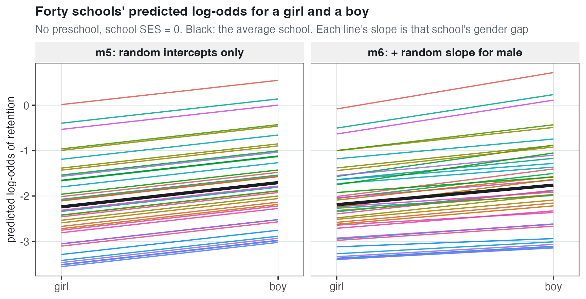
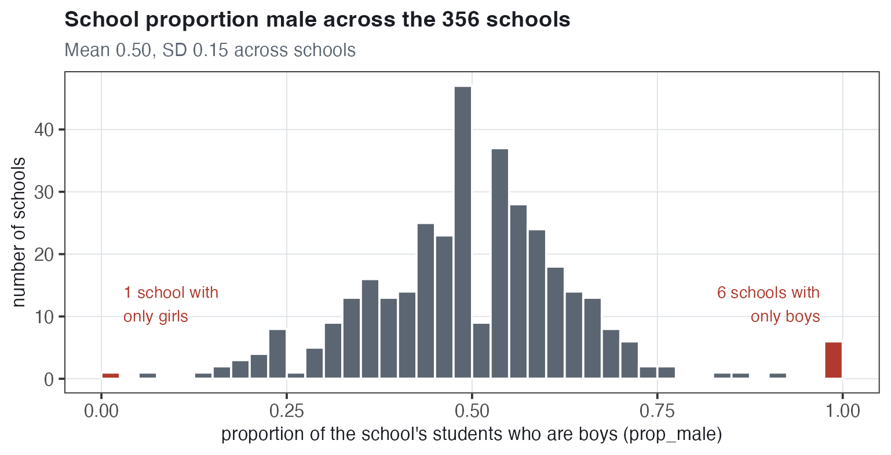

# Binary Outcomes and Multilevel Logistic Regression {#sec-binary-outcomes}

:::: chapter-lead
::: lead-label
The chapter in one paragraph
:::

This chapter is about a **binary** (0/1) outcome: whether an elementary school student in Thailand was **retained** (held back a grade). The mean of a 0/1 variable is the proportion of 1s: the mean of `retained` is 0.142, so 14.2% of the 7,516 students were retained. Because a regression predicts a mean, a model for a 0/1 outcome predicts a **probability**. The **linear probability model (LPM)** is ordinary regression on the 0/1 outcome, so each coefficient is a difference in probability: holding school SES fixed, boys' predicted probability of retention is 0.051 higher than girls', or 5.1 **percentage points**. The LPM is easy to read, but its residuals cannot be normal or have the same variance for every student, and its straight line can predict probabilities below 0 or above 1. **Logistic regression** models the **log-odds** of retention instead: the logarithm of the probability of being retained divided by the probability of not being retained. Every log-odds value corresponds to a probability between 0 and 1, the model has no residual term, and each coefficient is a difference in log-odds that can also be read as an **odds ratio** or, for chosen students, as a difference in probability. In the **random intercepts logit model**, each school has its own intercept. Schools' log-odds of retention differ by $\tau = 1.27$ in SD terms, a large difference: for a girl without preschool at school SES 0, the chance of retention is about 3% in a school 1 SD below average and about 28% in a school 1 SD above. The standard error of school SES is more than twice as large as in the single-level model, because SES has one value per school, so the information about it comes from 356 schools rather than 7,516 students. As in @sec-within-between and @sec-random-slopes, the model can be extended with a **random slope** for gender (no evidence that the boy–girl difference varies across schools) and a **Mundlak** term, the school's proportion of boys (no evidence against the **random effects assumption** that the boy–girl difference within schools equals the difference between schools). Finally, in a logit model, the difference between a boy and a girl in the same school, the **cluster-specific** coefficient (0.534 in log-odds), is not the same number as the difference between boys and girls across all schools together, the **population-averaged** coefficient (about 0.427); which one to report depends on the question. A final section covers the $\chi^2$ test of whether retention and gender are related, and the ICC of a multilevel logit model, defined for a **latent** (unobserved) continuous propensity to be retained.
::::

## A new kind of outcome {#sec-bin-outcome}

### The Thailand data {#sec-bin-data}

The data are a classic data set on grade retention in Thai elementary schools: **7,516 students in 356 schools**, available as [`thai.csv`](../data/thai.csv). The outcome is **dichotomous** (also called **binary**): it has only two values, 0 and 1.

- `retained` is 1 if the student was held back a grade at least once, and 0 if not.
- `male` is 1 for boys and 0 for girls.
- `pped` is 1 if the student had **pre-primary education** (preschool), and 0 if not.
- `sch_ses` is the **school's** average socioeconomic status (SES): one value per school, shared by all of its students. Its units are not given in the data. The average across schools is about 0 (0.01), and schools differ by about 0.38 in SD terms.
- `prop_male`, the proportion of the school's students who are boys, is built from `male` in @sec-bin-mundlak.

| Feature | Value |
|:-----------------------------------|:-----------------------------------|
| Students (rows) | 7,516 |
| Schools | 356 |
| Students per school | 2 to 41 (median 21) |
| `retained` | 1,067 retained (14.2%), 6,449 not retained |
| `male` | 3,816 boys (50.8%), 3,700 girls |
| `pped` | 3,744 with preschool (49.8%), 3,772 without |
| `sch_ses` (one value per school) | mean 0.01; SD 0.38 across schools; $-0.77$ to 1.49 |

**Levels.** Students (level 1) are nested in schools (level 2). `male`, `pped` and `retained` are student variables, so they can differ between students in the same school. `sch_ses` is a school variable. The models of @sec-bin-lpm and @sec-bin-logit have no school level: each student is $i$, and $\text{SES}_i$ is the SES of student $i$'s school. From @sec-bin-mlm on, students are $i$ and schools are $j$.

### The research questions {#sec-bin-rqs}

1.  Are male or female students more likely to be retained, controlling for SES?
2.  Is prior preschool education associated with a lower risk of retention?
3.  Does the "effect" of preschool differ for boys and girls?

"Effect" is in quotation marks because preschool was not randomly assigned: every comparison here is an association.

### The mean of a 0/1 variable {#sec-bin-mean}

The mean of a 0/1 variable is the **proportion of 1s**. Adding up `retained` counts the retained students, 1,067, and dividing by 7,516 gives the mean, $1{,}067/7{,}516 = 0.142$: 14.2% of the students were retained. In the same way, the mean of `pped` is 0.498, so 49.8% of the students had preschool, and the mean of `male` is 0.508, so 50.8% of the students are boys.

::: callout-important
## For a 0/1 outcome, a mean is a proportion, and a proportion is a probability

A regression predicts the mean of the outcome for students with given values of the predictors, for example girls without preschool. For a 0/1 outcome, that mean is the proportion of those students who were retained, which is also the probability that one of them, chosen at random, was retained. So a model for a 0/1 outcome is a model for a **probability**. This book writes probabilities both as numbers between 0 and 1 and as percentages: a probability of 0.142 is a 14.2% chance.
:::

{#fig-bin-outcome width="76%"}

In @fig-bin-outcome (right), boys were retained more often than girls with or without preschool, and students with preschool less often than students without it. The research questions ask whether these differences remain for students with the same values of the other predictors.

### Boys and girls: the cross-tabulation {#sec-bin-crosstab}

A **cross-tabulation** is a table of the number of students in each combination of two variables. The first table has counts. The second has **row proportions**: each count divided by its row total, so each row adds up to 1. For girls, $428/3{,}700 = 0.1157$ were retained and $3{,}272/3{,}700 = 0.8843$ were not.

|                    | Not retained (0) | Retained (1) | Total |
|:-------------------|-----------------:|-------------:|------:|
| Girls (`male` = 0) |            3,272 |          428 | 3,700 |
| Boys (`male` = 1)  |            3,177 |          639 | 3,816 |
| Total              |            6,449 |        1,067 | 7,516 |

|       | Not retained (0) | Retained (1) |
|:------|-----------------:|-------------:|
| Girls |           0.8843 |       0.1157 |
| Boys  |           0.8325 |       0.1675 |

*Interpretation.* 11.57% of girls and 16.75% of boys were retained. Boys' proportion is higher by $0.1675 - 0.1157 = 0.0518$, or 5.2 **percentage points**. A percentage point is the unit for a difference between two percentages ($16.75\% - 11.57\% = 5.18$ percentage points). It is different from a percent difference: boys' proportion is $0.1675/0.1157 = 1.45$ times girls', or 45% higher.

A cross-tabulation has only two variables, so boys and girls **with the same** preschool status and school SES cannot be compared in it. That comparison requires a regression. (@sec-bin-chisq has the $\chi^2$ test of whether retention and gender are related in this table.)

## The linear probability model {#sec-bin-lpm}

### The model {#sec-bin-lpm-model}

The simplest regression for a 0/1 outcome is ordinary least squares (OLS) regression, fitted as if the outcome were continuous even though it has only two values. This is the **linear probability model (LPM)**, common in economics. The first one, **m1**, has gender and school SES:

$$\begin{aligned}
\text{retained}_i &= \beta_0 + \beta_1\,\text{male}_i + \beta_2\,\text{SES}_i + e_i \\
e_i &\sim N(0, \sigma^2)
\end{aligned}$$

- $i$ is the student; schools are not in this model. $\text{retained}_i$ is 1 if student $i$ was retained and 0 if not, $\text{male}_i$ is 1 for a boy and 0 for a girl, and $\text{SES}_i$ is the SES of student $i$'s school (`sch_ses`).
- $\beta_0 + \beta_1\,\text{male}_i + \beta_2\,\text{SES}_i$ is the predicted value of a 0/1 outcome, so it is the student's **predicted probability** of retention.
- $\beta_0$ is the predicted probability for a girl ($\text{male}_i = 0$) in a school with SES 0.
- $\beta_1$ is the difference in predicted probability between boys and girls in schools with the same SES, and $\beta_2$ is the difference in predicted probability per one-unit difference in school SES, for students of the same gender.
- $e_i$ is the residual: the observed 0 or 1 minus the predicted probability. The second line is the usual OLS assumption: the residuals are normal with mean 0 and the same variance, $\sigma^2$, for every student. For a 0/1 outcome the residuals cannot be normal or have the same variance for every student; @sec-bin-lpm-problems explains why.

``` r
lm(retained ~ 1 + male + sch_ses, data = thai)
```

The `1` is $\beta_0$, and `male` and `sch_ses` are $\beta_1$ and $\beta_2$.

### What the LPM looks like {#sec-bin-lpm-look}

{#fig-bin-lpm width="74%"}

- **In @fig-bin-lpm, every student is at 0 or 1, but the predicted probabilities (the lines) are between 0.04 and 0.21, or 4% to 21%.** So no student is on either line: a student who was not retained has a residual of 0 minus the prediction (between $-0.21$ and $-0.04$), and a student who was retained 1 minus the prediction (between 0.79 and 0.96). The lines are close to the open circles: a predicted probability is a predicted proportion of 1s.
- **The two lines are parallel.** The model has no gender-by-SES interaction, so the boys' line is above the girls' line by the same amount, $\widehat{\beta_1} = 0.051$ (5.1 percentage points), at every value of school SES.
- **Both lines decrease with school SES**: students in higher-SES schools have a lower predicted probability of retention.

### Fitting it: gender and school SES (m1) {#sec-bin-m1}

| Term                              |  Estimate |     SE |     $t$ |
|:----------------------------------|----------:|-------:|--------:|
| $\widehat{\beta_0}$ `(Intercept)` |    0.1164 | 0.0057 |   20.36 |
| $\widehat{\beta_1}$ `male1`       |    0.0514 | 0.0080 |    6.40 |
| $\widehat{\beta_2}$ `sch_ses`     | $-0.0503$ | 0.0107 | $-4.72$ |

The $t$ column is the estimate divided by its standard error, computed by R before rounding; an estimate more than about two standard errors from zero is one we would not attribute to chance. `male1` is R's label for the coefficient on `male` when `male` is stored as a factor (a categorical variable), as it is after `mutate(male = factor(male))` (see @sec-bin-mundlak): it is the coefficient for `male` = 1 (boys) compared with `male` = 0 (girls).

$\widehat{\beta_0} = 0.116$. *Interpretation.* A girl in a school with SES 0 (about the average school SES) has a predicted probability of retention of 0.116: an 11.6% chance.

$\widehat{\beta_1} = 0.051$. *Interpretation.* In schools with the same SES, boys' predicted probability of retention is 0.051 higher than girls', or 5.1 percentage points. This is almost the same as the 5.2-point difference in the cross-tabulation, which does not hold school SES fixed, because boys and girls are in schools with almost the same average SES (0.006 and 0.014). So for research question 1: boys are more likely than girls to be retained in schools with the same SES, and with $t = 6.40$ the difference is distinguishable from zero.

$\widehat{\beta_2} = -0.050$. *Interpretation.* For students of the same gender, a school SES one unit higher is associated with a predicted probability of retention 0.050 lower (5.0 percentage points). One unit is large for this variable, about 2.6 SDs across schools; for a school 1 SD (0.38) higher, the predicted probability is $0.0503 \times 0.38 = 0.019$ lower, or 1.9 points.

### Adding preschool (m2) {#sec-bin-m2}

The next model, **m2**, adds preschool, $\text{pped}_i$ (1 if student $i$ had preschool, 0 if not):

$$\text{retained}_i = \beta_0 + \beta_1\,\text{male}_i + \beta_2\,\text{SES}_i + \beta_3\,\text{pped}_i + e_i, \qquad e_i \sim N(0, \sigma^2)$$

``` r
lm(retained ~ 1 + male + sch_ses + pped, data = thai)
```

| Term                              |  Estimate |     SE |     $t$ |
|:----------------------------------|----------:|-------:|--------:|
| $\widehat{\beta_0}$ `(Intercept)` |    0.1500 | 0.0070 |   21.39 |
| $\widehat{\beta_1}$ `male1`       |    0.0510 | 0.0080 |    6.38 |
| $\widehat{\beta_2}$ `sch_ses`     | $-0.0285$ | 0.0109 | $-2.61$ |
| $\widehat{\beta_3}$ `pped`        | $-0.0675$ | 0.0082 | $-8.21$ |

$\widehat{\beta_3} = -0.068$. *Interpretation.* Students who had preschool have a predicted probability of retention 0.068 lower (6.8 percentage points) than students of the same gender in schools with the same SES who did not. So for research question 2: preschool is associated with a lower probability of retention, and with $t = -8.21$ the difference is distinguishable from zero.

**Does adding `pped` change the coefficient on `male`?** Very little: it is 0.051 in both models. Boys and girls had preschool at almost the same rate (49.4% of boys and 50.2% of girls), so preschool accounts for almost none of the gender difference.

**Does it change the coefficient on `sch_ses`?** Yes: from $-0.050$ in m1 to $-0.029$ in m2, closer to zero. Students in higher-SES schools were more likely to have had preschool: in the schools above the median school SES, 62% of students had preschool, and in the other schools, 37%. So in m1, higher-SES schools have lower predicted retention partly because more of their students had preschool. In m2, which compares students with the same preschool status, a school SES one unit higher is associated with a predicted probability 2.9 percentage points lower.

$\widehat{\beta_0} = 0.150$. *Interpretation.* A girl **without** preschool in a school with SES 0 has a predicted probability of retention of 0.150 (15.0%). It is higher than m1's 0.116 because m1's intercept is for girls with and without preschool together, and girls without preschool are retained more often.

### Does the preschool difference depend on gender? (m3) {#sec-bin-m3}

Research question 3 asks whether the preschool difference is the same for boys and girls. In **m3**, with an **interaction** between gender and preschool, it can differ:

$$\text{retained}_i = \beta_0 + \beta_1\,\text{male}_i + \beta_2\,\text{SES}_i + \beta_3\,\text{pped}_i + \beta_4\,(\text{male}_i \times \text{pped}_i) + e_i, \qquad e_i \sim N(0, \sigma^2)$$

The product $\text{male}_i \times \text{pped}_i$ is 1 only for a boy with preschool and 0 for everyone else. So the preschool difference is $\beta_3$ for girls and $\beta_3 + \beta_4$ for boys, and $\beta_4$ is the difference between the two. In R, `male * pped` is shorthand for `male + pped + male:pped`:

``` r
lm(retained ~ 1 + male * pped + sch_ses, data = thai)
```

| Term                              |  Estimate |     SE |     $t$ |
|:----------------------------------|----------:|-------:|--------:|
| $\widehat{\beta_0}$ `(Intercept)` |    0.1453 | 0.0081 |   17.93 |
| $\widehat{\beta_1}$ `male1`       |    0.0603 | 0.0113 |    5.35 |
| $\widehat{\beta_3}$ `pped`        | $-0.0581$ | 0.0115 | $-5.04$ |
| $\widehat{\beta_2}$ `sch_ses`     | $-0.0282$ | 0.0110 | $-2.58$ |
| $\widehat{\beta_4}$ `male1:pped`  | $-0.0187$ | 0.0160 | $-1.17$ |

In a school with SES 0, each of the four groups has its own predicted probability, built from the coefficients that apply to it:

|   | Without preschool | With preschool | Preschool difference |
|:---|:---|:---|:---|
| Girls | $\widehat{\beta_0}$: 0.145 | $\widehat{\beta_0} + \widehat{\beta_3}$: 0.087 | $\widehat{\beta_3}$: $-5.8$ points |
| Boys | $\widehat{\beta_0} + \widehat{\beta_1}$: 0.206 | $\widehat{\beta_0} + \widehat{\beta_1} + \widehat{\beta_3} + \widehat{\beta_4}$: 0.129 | $\widehat{\beta_3} + \widehat{\beta_4}$: $-7.7$ points |

These are close to the observed percents in @fig-bin-outcome (right). With the interaction in the model, the coefficients on `male1` and `pped` each describe one group:

- $\widehat{\beta_1}$ (`male1`), 0.060. *Interpretation.* Among students **without** preschool, boys' predicted probability of retention is 6.0 percentage points higher than girls' (same school SES). In m2, 0.051 is the gender difference for all students; here it is for students without preschool only.
- $\widehat{\beta_3}$ (`pped`), $-0.058$. *Interpretation.* Among **girls**, preschool is associated with a predicted probability of retention 5.8 percentage points lower.
- $\widehat{\beta_4}$ (`male1:pped`), $-0.019$. *Interpretation.* The preschool difference is 1.9 percentage points more negative for boys than for girls. For boys it is $\widehat{\beta_3} + \widehat{\beta_4} = -0.0581 + (-0.0187) = -0.0768$: preschool is associated with a predicted probability 7.7 points lower for boys, against 5.8 points lower for girls. With $t = -1.17$, the difference between the two, 1.9 points, is not distinguishable from zero.

So for research question 3, in the LPM there is no evidence that the preschool difference differs between boys and girls. @sec-bin-logit-prob returns to this question with a logit model. There, the preschool coefficient is the same for boys and girls on the log-odds scale, but the preschool difference in probability is still larger for boys, because of the shape of the logistic curve rather than an interaction.

### Comparing the three models {#sec-bin-lpm-compare}

Putting m1, m2 and m3 side by side shows what each added term changes. Three points from the comparison (the coefficients are in the tables of @sec-bin-m1 to @sec-bin-m3):

- **The `male1` row.** 0.051 in m1 and m2, so the gender difference is the same with or without preschool in the model. In m3 it is 0.060 because, with the interaction, it is the gender difference among students without preschool only.
- **The `sch_ses` row.** $-0.050$ in m1 and $-0.029$ once preschool is in the model, because students in higher-SES schools were more likely to have had preschool.
- $R^2$ is 0.008, 0.017 and 0.017 in m1, m2 and m3: the predictors account for 0.8%, 1.7% and 1.7% of the variance in retention. A small $R^2$ is common for a 0/1 outcome. Every student's outcome is 0 or 1 while every predicted probability is between about 0.04 and 0.23, so the predictions vary much less than the outcomes, even though the differences between groups are distinguishable from zero.

## Logistic regression {#sec-bin-logit}

### Advantages and problems of the LPM {#sec-bin-lpm-problems}

The LPM is easy to fit and to read: every coefficient is a difference in probability. But it has three problems.

**1. The residuals are not normal.** For a student with predicted probability $\hat p$, the outcome is 0 or 1, so the residual has only two possible values: $1 - \hat p$ if the student was retained and $-\hat p$ if not. For a girl in a school with SES 0 under m1, $\hat p = 0.116$, so her residual is either $0.884$ or $-0.116$. A variable with two values is not normal.

**2. The residuals are heteroskedastic.** *Heteroskedastic* means that the variance is not the same for every observation. A 0/1 outcome with probability $p$ of being 1 has variance $p(1 - p)$: $0.05 \times 0.95 = 0.0475$ when $p = 0.05$ and $0.20 \times 0.80 = 0.16$ when $p = 0.20$, more than three times as large. The predicted probability depends on the predictors, so the variance of the residuals does too (@fig-bin-resid, right), while OLS assumes one variance, $\sigma^2$, for everyone.

{#fig-bin-resid width="76%"}

**3. Predictions can be outside 0 to 1.** A straight line is not limited to values between 0 and 1, so for some values of the predictors the LPM predicts an impossible probability, sometimes called "atheoretical". In our data this does not happen: m2's predicted probabilities range from 0.045 to 0.223. It would happen outside the data. In m1, a girl's predicted probability is $0.1164 - 0.0503 \times \text{SES}_i$, which equals 0 when $\text{SES}_i = 0.1164/0.0503 = 2.31$ and is negative for any higher SES, but the highest school SES in the data is 1.49.

Problems 1 and 2 can be handled: **robust standard errors** (heteroskedasticity-consistent standard errors) are computed without assuming one variance for everyone, and with 7,516 students the estimated coefficients are close to normally distributed even when the residuals are not, so the tests and confidence intervals can still be used. That is why the LPM is common in econometrics. Problem 3, and the assumption that a change of a few percentage points means the same near 0% or 100% as near 50% (next paragraph), are the reasons for using logistic regression in this book.

**Is moving from 95% to 98% the same as moving from 50% to 53%?** In the LPM, yes: both are 3 percentage points, and a coefficient is the same number of percentage points whatever the **starting probability** (the probability of the group being compared against, such as girls for the coefficient on `male`). But they are not the same change. Take the probability that an event happens. At 98% instead of 95%, the probability that it does not happen is 2% instead of 5%, less than half as large. At 53% instead of 50%, the probability that it does not happen is 47% instead of 50%, a small relative difference. So close to 0% or 100%, a few percentage points is a large change, and close to 50% it is a small one. On the log-odds scale of @sec-bin-odds, the change from 95% to 98% is 0.95 and the change from 50% to 53% is 0.12, about one eighth as large (@fig-bin-steps, left).

::: callout-tip
## When the LPM is attractive

Each LPM coefficient is a difference in probability, the same for every student, so it can be read directly: in m2, boys' predicted probability of retention is 5.1 percentage points higher than girls'. That reading is reasonable when the question is about an average difference in probability and the predicted probabilities are in a narrow range or between about 20% and 80%, where the S-shaped curve of the logit model (@sec-bin-odds) is close to a straight line. The drawbacks are the three problems above and the assumption that a few percentage points mean the same near 0% or 100% as near 50%. In these data, m2's predictions are in a narrow range, 4.5% to 22.3%, and the LPM and the logit model have almost the same predictions (@sec-bin-logit-prob).
:::

### The generalized linear model {#sec-bin-glm}

Instead of modeling the mean of $y$ (here a probability) as a straight line, a **generalized linear model (GLM)** models a **function** of the mean as a straight line:

$$f(\text{mean of } y_i) = \beta_0 + \beta_1\,x_i + \dots$$

- $y_i$ is student $i$'s outcome and $x_i$ a predictor.
- The regression is **linear on the transformed scale**: $f(\text{mean of } y_i)$, not the mean itself, equals an intercept plus a coefficient times each predictor, as in ordinary regression.
- The function $f$ is the **link function**: it links the mean of the outcome to the linear part of the model.
- $f$ is applied to the **probability** (the mean), not to the 0s and 1s themselves: the log-odds of a 0 or a 1 would be $-\infty$ or $\infty$ (@sec-bin-odds).
- For a binary outcome, a common link is the **log-odds**, or **logit**. OLS regression is the GLM with no transformation: $f(\text{mean}) = \text{mean}$, called the identity link.

### Probability, odds and log-odds {#sec-bin-odds}

Three scales describe the same chance of an event.

- The **probability** $p$, between 0 and 1.
- The **odds**, $p/(1-p)$: the probability of a 1 divided by the probability of a 0. Odds are between 0 and infinity, and odds of 1 mean $p = 0.5$.
- The **log-odds** or **logit**, $\text{logit}(p) = \log\!\left(\dfrac{p}{1-p}\right)$: the natural logarithm of the odds, `log()` in R. Log-odds are between $-\infty$ and $\infty$, and log-odds of 0 mean $p = 0.5$. Log-odds have no everyday meaning; they are the scale on which the logit model is a straight line.

**An example from the cross-tabulation.** For girls, $p = 428/3{,}700 = 0.1157$: 11.6% of girls were retained. The odds are $p/(1-p) = 0.1157/0.8843 = 0.1308$, the same as the number of retained girls divided by the number of girls not retained, $428/3{,}272$: for every 100 girls who were not retained, about 13 were retained. The log-odds are $\log(0.1308) = -2.03$, negative because fewer than half of the girls were retained. For boys, $p = 639/3{,}816 = 0.1675$, the odds are $639/3{,}177 = 0.2011$ (about 20 retained for every 100 not retained), and the log-odds are $\log(0.2011) = -1.60$.

- The **odds ratio** is $0.2011/0.1308 = 1.54$: boys' odds of retention are 1.54 times girls' odds, or 54% higher.
- The difference in **log-odds** is $-1.60 - (-2.03) = 0.43$. A difference of two logarithms is the logarithm of their ratio, $\log(a) - \log(b) = \log(a/b)$, so 0.43 is the logarithm of the odds ratio: $\log(1.54) = 0.43$.
- Going the other way, the odds ratio is $e^{0.43} = 1.54$, where $e \approx 2.718$ and $e^{x}$ (`exp()` in R) undoes the logarithm. (This $e$ is a fixed number, not the residual $e_i$ of @sec-bin-lpm.)

Converting log-odds $\eta$ (the Greek letter eta) back to a probability takes two steps: odds $= e^{\eta}$, then $p = \text{odds}/(1 + \text{odds})$, which is $\text{odds} = p/(1-p)$ solved for $p$. For girls, $e^{-2.03} = 0.131$ and $0.131/1.131 = 0.116$, the probability we started from. In one formula, the **inverse logit** is

$$p = \frac{e^{\eta}}{1 + e^{\eta}}$$

| Log-odds |   Odds | Probability |
|---------:|-------:|------------:|
|     $-3$ |  0.050 |       0.047 |
|     $-2$ |  0.135 |       0.119 |
|     $-1$ |  0.368 |       0.269 |
|        0 |  1.000 |       0.500 |
|        1 |  2.718 |       0.731 |
|        2 |  7.389 |       0.881 |
|        3 | 20.086 |       0.953 |

With these reference values, log-odds can be converted to probabilities without a calculator: log-odds of 0 is 50%, $\pm 1$ is about 73% and 27%, $\pm 2$ about 88% and 12%, and $\pm 3$ about 95% and 5%. A log-odds value between two reference values has a probability between theirs: log-odds of 1.5, for example, corresponds to a probability between 73% and 88% (it is 82%).

**Two students' log-odds are 1 and $-1$.** What is the difference in their probabilities? From the table, $0.731 - 0.269 = 0.462$: 46 percentage points. The same difference of 2 in log-odds between 1 and 3 is only 22 points ($0.953 - 0.731 = 0.222$).

{#fig-bin-logit width="70%"}

Any log-odds, however large or small, corresponds to a probability strictly between 0 and 1. So in a logit model, the LPM's third problem, predicted probabilities below 0 or above 1, cannot occur. The curve is close to a straight line between about 20% and 80% and almost flat near 0 and 1.

{#fig-bin-steps width="78%"}

**The two panels of @fig-bin-steps.** Left: 50% to 53% is a change of 0.12 in log-odds, while 95% to 98% is 0.95, about eight times larger. Right: a constant difference in log-odds, 0.43 here (the boy–girl difference from the cross-tabulation), corresponds to 10.6 percentage points when the starting probability is 50% (50% to 60.6%), but only 2.5 points when it is 5% (5% to 7.5%) and 1.7 points when it is 95% (95% to 96.7%). In a logit model, a coefficient is the same number on the log-odds scale for every student, and a different number of percentage points depending on the starting probability.

### The logistic regression model {#sec-bin-logit-model}

**Logistic regression** models the log-odds that a student is retained. The first logit model, **m4**, has gender, school SES and preschool (no interaction):

$$\log\!\left(\frac{\Pr(\text{retained}_i = 1)}{1 - \Pr(\text{retained}_i = 1)}\right) = \text{logit}\big(\Pr(\text{retained}_i = 1)\big) = \beta_0 + \beta_1\,\text{male}_i + \beta_2\,\text{SES}_i + \beta_3\,\text{pped}_i$$

- $\Pr(\text{retained}_i = 1)$ is student $i$'s probability of being retained. $\text{male}_i$, $\text{SES}_i$ and $\text{pped}_i$ are as in the LPM m2.
- $\beta_0$ is the log-odds of retention for a girl ($\text{male}_i = 0$) without preschool in a school with SES 0.
- $\beta_1$, $\beta_2$ and $\beta_3$ are differences in **log-odds**: between boys and girls, per unit of school SES, and between students with and without preschool, each holding the other two predictors fixed.

**Why is there no residual?** In the LPM, the outcome is the prediction plus a residual, $e_i$. In the logit model, the left side is the log-odds of a **probability**, and the probability is the **mean** of the 0/1 outcome, not the outcome itself. The randomness is in whether a student with probability $\Pr(\text{retained}_i = 1)$ is retained:

$$\text{retained}_i \sim \text{Bernoulli}\big(\Pr(\text{retained}_i = 1)\big)$$

A **Bernoulli** variable is 1 with probability $p$ and 0 otherwise; here $p = \Pr(\text{retained}_i = 1)$. Its variance is $p(1-p)$, so once the probability is known, the variance is known too, and there is no separate $\sigma^2$ to estimate. The Bernoulli line takes the place of the LPM's residual line, $e_i \sim N(0, \sigma^2)$. This is what is meant by saying the probability "contains the uncertainty": the probability is a mean, and how each student's 0 or 1 varies around it is set by the Bernoulli distribution.

### Fitting it (m4) {#sec-bin-m4}

In R, the function is `glm` instead of `lm`. With `family = binomial`, the outcome's distribution is binomial (a Bernoulli variable is a binomial with one trial), and its default link in R is the logit:

``` r
glm(retained ~ 1 + male + sch_ses + pped, data = thai, family = binomial)
```

| Term                              |  Estimate |     SE |      $Z$ |
|:----------------------------------|----------:|-------:|---------:|
| $\widehat{\beta_0}$ `(Intercept)` | $-1.7832$ | 0.0588 | $-30.34$ |
| $\widehat{\beta_1}$ `male1`       |    0.4278 | 0.0676 |     6.32 |
| $\widehat{\beta_2}$ `sch_ses`     | $-0.2415$ | 0.0937 |  $-2.58$ |
| $\widehat{\beta_3}$ `pped`        | $-0.5688$ | 0.0704 |  $-8.08$ |

The $Z$ column is the estimate divided by its standard error, computed by R before rounding, and is read like the $t$ of the LPM: an estimate more than about two standard errors from zero is one we would not attribute to chance. Every estimate is on the **log-odds scale**. Each can also be read on two other scales: as an **odds ratio**, $e^{\beta}$ (the number the odds are multiplied by for a one-unit difference in the predictor, such as boys compared with girls), and as a difference in **probability** for students with chosen values of the other predictors.

**m4's predictions for four students in a school with SES 0.** Each log-odds is the sum of the coefficients that apply; the odds are $e^{\text{log-odds}}$, and the probability is odds/(1 + odds).

| Student            | Log-odds                          |  Odds |   Probability |
|:-------------------|:----------------------------------|------:|--------------:|
| Girl, no preschool | $-1.783$                          | 0.168 | 0.144 (14.4%) |
| Boy, no preschool  | $-1.783 + 0.428 = -1.355$         | 0.258 | 0.205 (20.5%) |
| Girl, preschool    | $-1.783 - 0.569 = -2.352$         | 0.095 |  0.087 (8.7%) |
| Boy, preschool     | $-1.783 + 0.428 - 0.569 = -1.924$ | 0.146 | 0.127 (12.7%) |

$\widehat{\beta_0} = -1.78$. *Interpretation.* For a girl without preschool in a school with SES 0, the predicted log-odds of retention are $-1.78$. The odds are $e^{-1.7832} = 0.168$: for every 100 such girls who are not retained, about 17 are predicted to be retained. The probability is $0.168/1.168 = 0.144$, a 14.4% chance.

$\widehat{\beta_1} = 0.43$. *Interpretation.* Boys' log-odds of retention are 0.43 higher than girls' with the same preschool status and school SES. As an odds ratio, $e^{0.4278} = 1.53$: boys' odds of retention are 1.53 times girls' odds, or 53% higher, close to the 1.54 of the cross-tabulation, which did not hold preschool and school SES fixed. On the probability scale (table above), boys' predicted probability is 6.1 percentage points higher than girls' without preschool (20.5% against 14.4%) and 4.0 points higher with preschool (12.7% against 8.7%). The difference is fewer points with preschool because both probabilities are farther from 50% (@fig-bin-steps, right).

$\widehat{\beta_2} = -0.24$. *Interpretation.* For students of the same gender and preschool status, a school SES one unit higher is associated with log-odds of retention 0.24 lower: an odds ratio of $e^{-0.2415} = 0.79$, or 21% lower odds. Per SD of school SES (0.38), the difference is $-0.2415 \times 0.38 = -0.092$ in log-odds, an odds ratio of 0.91: 9% lower odds. With $Z = -2.58$, it is distinguishable from zero in this single-level model.

$\widehat{\beta_3} = -0.57$. *Interpretation.* Students with preschool have log-odds of retention 0.57 lower than students of the same gender in schools with the same SES who did not. The odds ratio is $e^{-0.5688} = 0.566$: the odds of retention for students with preschool are 0.566 times the odds for students without it, or 43% lower. (That the coefficient, $-0.57$, and the odds ratio, 0.566, are close in size is a coincidence; they are different quantities.) In a school with SES 0, preschool is associated with a predicted probability 5.7 percentage points lower for girls (8.7% against 14.4%) and 7.8 points lower for boys (12.7% against 20.5%); @sec-bin-logit-prob explains why the two differ.

::: callout-important
## One coefficient, three scales

A logit coefficient is a difference in log-odds. It is the same for any two students who differ only in that predictor, whatever their values of the other predictors, and so is the odds ratio, $e^{\beta}$. A difference in probability is not: it depends on the starting probability, which depends on the other predictors, so it has to be stated for particular values of them, as in the table above. An odds ratio of 1.53 means 1.53 times the *odds*, not 1.53 times the probability: without preschool in a school with SES 0, boys' predicted probability, 0.205, is 1.42 times girls', 0.144.
:::

### The logit model on the probability scale {#sec-bin-logit-prob}

{#fig-bin-logitprob width="74%"}

**Reading @fig-bin-logitprob.** On the probability scale, m4's predictions are slightly curved, not straight, and the gap between boys and girls is larger where the probabilities are larger (without preschool, in low-SES schools). The dashed LPM lines are close to the logit curves everywhere: the largest difference between m2's and m4's predicted probabilities for any student is 0.020, or 2.0 percentage points. The LPM tends to work best when the predicted probabilities are between about 20% and 80%; here 81% of students' predicted probabilities are below 20%, but all are in a narrow range (6.5% to 23.7% under m4), over which the logistic curve is also close to a straight line.

{#fig-bin-rq3 width="74%"}

**Research question 3 on the probability scale.** m4 has no interaction, so preschool has the same coefficient for boys and girls on the log-odds scale, $-0.57$: in @fig-bin-rq3 (left), the two lines are parallel. On the probability scale (right), they are not: in a school with SES 0, preschool is associated with a probability 5.7 points lower for girls ($0.087 - 0.144$) and 7.8 points lower for boys ($0.127 - 0.205$). As in @fig-bin-steps (right), the same difference in log-odds corresponds to more percentage points when the starting probability (here, without preschool) is closer to 50%, and boys' (0.205) is closer to 50% than girls' (0.144). The LPM m3 (dashed) has almost the same differences, 5.8 and 7.7 points, but only through its interaction term. So whether the preschool difference "differs by gender" depends on the scale.

## Multilevel logistic regression {#sec-bin-mlm}

### Why a multilevel logit model? {#sec-bin-mlm-why}

For the same reasons as a linear multilevel model:

- **Clustered data.** Students in the same school share teachers, policies and a neighborhood, so their outcomes are more alike than the outcomes of students from different schools: if one student in a school was retained, another student in the same school is more likely to have been retained too. In the single-level models of @sec-bin-lpm and @sec-bin-logit, the 7,516 students are assumed to be independent.
- **Accurate standard errors.** Treating students in the same school as independent gives the wrong standard errors: too small for a school variable like `sch_ses` (@sec-bin-m5), and too small or too large for a student variable like `male` or `pped`.
- **Contextual effects** (@sec-wb-contextual): the association between a school's average of a student variable and the outcome, for students with the same value of that variable. @sec-bin-mundlak has one: the school's proportion of boys, for students of the same gender.
- **Cross-level interactions** (@sec-wb-crosslevel): a difference between students (such as the gender difference) that depends on a school variable (such as school SES). No cross-level interaction is fitted in this chapter.

### The random intercepts logit model {#sec-bin-ri-logit}

In the **random intercepts logit model**, **m5**, each school has its own intercept on the log-odds scale:

$$\begin{aligned}
\textbf{Level 1:} \qquad && \text{logit}\big(\Pr(\text{retained}_{ij} = 1)\big) &= \beta_{0j} + \beta_1\,\text{male}_{ij} + \beta_2\,\text{pped}_{ij} \\
&& \text{retained}_{ij} &\sim \text{Bernoulli}\big(\Pr(\text{retained}_{ij} = 1)\big) \\
\textbf{Level 2:} \qquad && \beta_{0j} &= \gamma_0 + \gamma_1\,\text{SES}_j + u_j \\
&& u_j &\sim N(0, \tau^2)
\end{aligned}$$

- $i$ is the student and $j$ the school. `male` and `pped` are student variables ($ij$); SES is a school variable, so it has only a $j$ and is in the level-2 equation.
- $\beta_{0j}$ is **school $j$'s intercept**: the log-odds of retention for a girl without preschool in school $j$.
- $\beta_1$ is the difference in log-odds between a boy and a girl **in the same school** with the same preschool status, and $\beta_2$ is the difference between a student with and a student without preschool in the same school with the same gender. Both are the same in every school (no $j$). Neither is a **pure within-school comparison**: each estimate is a combination of the within-school and between-school associations, equal to the within-school one only if the random effects assumption (@sec-wb-assumption) holds (@sec-bin-mundlak separates the two for gender). Note that $\beta_2$ is now the preschool coefficient; in m4 it was $\beta_3$, and SES now has the coefficient $\gamma_1$.
- **Level 2 is a linear regression** whose outcome is the school's intercept. $\gamma_0$ is the log-odds of retention for a girl without preschool in a school with SES 0 and $u_j = 0$ (an **average school**). $\gamma_1$ is the difference in that log-odds between two schools whose SES differs by one unit. $u_j$ is how far school $j$'s intercept is above or below the intercept predicted from its SES.
- $u_j$ is **assumed** normal with mean 0 and variance $\tau^2$. $\tau$, the SD of the $u_j$, is on the log-odds scale.
- In the second line of level 1, student $i$ in school $j$ is retained (1) with probability $\Pr(\text{retained}_{ij} = 1)$ and not retained (0) otherwise. As in m4, there is no level-1 residual $e_{ij}$.

Substituting level 2 into level 1 gives the **reduced form**:

$$\text{logit}\big(\Pr(\text{retained}_{ij} = 1)\big) = \gamma_0 + \gamma_1\,\text{SES}_j + \beta_1\,\text{male}_{ij} + \beta_2\,\text{pped}_{ij} + u_j$$

In R, it is fitted with `glmer` (generalized linear mixed effects regression), which has the same formula syntax as `lmer`:

``` r
glmer(retained ~ 1 + male + sch_ses + pped + (1 | schoolid),
      data = thai, family = binomial)
```

The first `1` is $\gamma_0$; `male` and `pped` are $\beta_1$ and $\beta_2$; `sch_ses` is $\gamma_1$ (the code is the same for a school variable as for a student variable); `(1 | schoolid)` is $u_j$; and `family = binomial` is the 0/1 outcome with the logit link.

**A latent variable model.** The level-2 equation is a regression for $\beta_{0j}$, which is never observed directly, only estimated from the school's 0s and 1s: a model for an unobserved (**latent**) quantity. @sec-bin-icc has a second latent-variable view.

### Fitting it (m5) {#sec-bin-m5}

| Term                               |  Estimate |     SE |      $Z$ |
|:-----------------------------------|----------:|-------:|---------:|
| $\widehat{\gamma_0}$ `(Intercept)` | $-2.2393$ | 0.1058 | $-21.17$ |
| $\widehat{\beta_1}$ `male1`        |    0.5340 | 0.0759 |     7.04 |
| $\widehat{\gamma_1}$ `sch_ses`     | $-0.2969$ | 0.2141 |  $-1.39$ |
| $\widehat{\beta_2}$ `pped`         | $-0.6265$ | 0.0999 |  $-6.27$ |
| $\widehat{\tau}$ `sd__(Intercept)` |    1.2744 |        |          |

The $Z$ column is the estimate divided by its standard error, computed by R before rounding.

$\widehat{\gamma_0} = -2.24$. *Interpretation.* For a girl without preschool in an average school ($u_j = 0$) with SES 0, the predicted log-odds of retention are $-2.24$. The odds are $e^{-2.2393} = 0.1065$: about 11 such girls retained for every 100 not retained. The probability is $0.1065/1.1065 = 0.096$: such a girl has a 9.6% chance of being retained.

$\widehat{\beta_1} = 0.53$. *Interpretation.* For a boy and a girl in the **same school** with the same preschool status, the boy's log-odds of retention are 0.53 higher. The odds ratio is $e^{0.5340} = 1.71$: his odds are 1.71 times hers. In an average school with SES 0, a girl without preschool has a 9.6% chance of being retained, and a boy without preschool a 15.4% chance (log-odds $-2.2393 + 0.5340 = -1.7053$), about 6 percentage points higher. The estimate, 0.53, is a combination of the within-school and between-school associations (@sec-bin-ri-logit); the within-school coefficient alone, 0.54 (@sec-bin-m7), is almost the same.

$\widehat{\beta_2} = -0.63$. *Interpretation.* For two students in the same school with the same gender, the one with preschool has log-odds of retention 0.63 lower: odds $e^{-0.6265} = 0.53$ times as large, or 47% lower.

$\widehat{\gamma_1} = -0.30$. *Interpretation.* For students of the same gender and preschool status in two schools that differ only in SES (the same $u_j$), a school SES one unit higher is associated with log-odds of retention 0.30 lower: odds $e^{-0.2969} = 0.74$ times as large, or 26% lower. With $Z = -1.39$, this is not distinguishable from zero.

**Why is `sch_ses` no longer significant?** Not because the estimate changed much: it is $-0.24$ in the single-level logit m4 and $-0.30$ here. Its **standard error** is 0.2141, against 0.0937 in m4, about 2.3 times as large. School SES is the same for every student in a school, so all the information about it comes from comparing **356 schools**. In m4, the 7,516 students are assumed to be independent, so each student counts as a separate piece of information about the SES association, although students in the same school have the same SES and similar chances of retention. As a result, m4's standard error for `sch_ses` is too small. In m5, students in the same school share $u_j$, so the standard error of a school variable depends on the number of schools.

$\widehat{\tau} = 1.27$. *Interpretation.* For students of the same gender and preschool status, schools' log-odds of retention differ from the log-odds predicted by their SES by about 1.27 in SD terms. This is large: the difference between a school 1 SD above average and the average school is more than twice the log-odds difference between a boy and a girl in the same school (0.53). As an odds ratio, a school 1 SD above average has odds of retention $e^{1.2744} = 3.58$ times those of the average school. @sec-bin-tau-prob has the same SD on the probability scale.

**Why is every coefficient farther from zero than in m4?** The `male` coefficient is 0.43 in m4 and 0.53 in m5, and the preschool coefficient $-0.57$ and $-0.63$. The data are the same, but the comparisons are different: in m5, students **in the same school**; in m4, which has no school intercepts, students pooled across all schools. In a logit model the comparison of students in the same school is farther from zero (@sec-bin-curves to @sec-bin-pa-data). Likewise, m5's 9.6% for a girl without preschool at SES 0 is for the average school; averaged over all schools her chance is 14.8%, close to m4's 14.4%.

::: callout-note
## What the random intercept adds

In m5, each school has its own log-odds of retention for the same kind of student (same gender and preschool status), normally distributed around the log-odds predicted by its SES, with SD $\tau$. So $\widehat{\tau} = 1.27$ describes how much schools differ in retention; students in the same school are no longer assumed to be independent, so the standard error of a school variable is based on the 356 schools; and the gender and preschool coefficients compare students in the same school (each a combination of the within- and between-school associations, @sec-bin-ri-logit).
:::

### The school SD on the probability scale {#sec-bin-tau-prob}

Take a girl without preschool in a school with SES 0, the **reference girl**. Under m5, her log-odds of retention in school $j$ are $\widehat{\gamma_0} + u_j = -2.2393 + u_j$. A school 1 SD above average has $u_j = \widehat{\tau} = 1.2744$, and a school 2 SDs below average has $u_j = -2(1.2744)$.

| School              |                      Log-odds | Probability of retention |
|:--------------------|------------------------------:|-------------------------:|
| 2 SDs below average | $-2.2393 - 2(1.2744) = -4.79$ |             0.008 (0.8%) |
| 1 SD below average  |    $-2.2393 - 1.2744 = -3.51$ |             0.029 (2.9%) |
| Average ($u_j = 0$) |                       $-2.24$ |             0.096 (9.6%) |
| 1 SD above average  |    $-2.2393 + 1.2744 = -0.96$ |            0.276 (27.6%) |
| 2 SDs above average |  $-2.2393 + 2(1.2744) = 0.31$ |            0.577 (57.7%) |

*Interpretation.* Under m5, the reference girl has about a 3% chance of being retained in a school 1 SD below average, a 9.6% chance in the average school, and about a 28% chance in a school 1 SD above average. About 95% of schools are expected to have log-odds of retention for her between $-2.2393 - 1.96(1.2744) = -4.74$ and $-2.2393 + 1.96(1.2744) = 0.26$: a chance of retention between about 1% (0.009) and 56% (0.56). Schools differ a great deal in retention.

{#fig-bin-tau width="78%"}

**The distribution of schools is symmetric on the log-odds scale but not on the probability scale.** On the log-odds scale (@fig-bin-tau, left), the five schools are equally spaced. On the probability scale (right), the school 1 SD above average is 18 percentage points above the average school ($0.276 - 0.096 = 0.180$), and the school 1 SD below average only 6.7 points below it ($0.096 - 0.029 = 0.067$). A probability cannot be below 0, so the distribution has a long right tail: half of the schools are below the average school's 9.6%, and a few are much higher.

### The caterpillar plot {#sec-bin-caterpillar}

{#fig-bin-cater width="74%"}

**What is the scale of the vertical axis?** Log-odds. Each point is a school's **empirical Bayes (EB) estimate** of $u_j$ under m5: how far the school's log-odds of retention are above or below those of the average school, for students of the same gender and preschool status, beyond what the school's SES predicts. As in @sec-variance-components and @sec-random-intercepts, an EB estimate is **shrunk**: closer to 0 than an estimate from the school's own students alone, more so for schools with fewer students. A school at 1 has odds $e^{1} = 2.7$ times those of the average school (for the reference girl, a 22% chance of retention instead of 9.6%); a school at $-1$ has odds $e^{-1} = 0.37$ times as large (a 3.8% chance). The intervals of 92 schools are entirely above the red line (retention distinguishably higher than in the average school), 15 are entirely below it, and the other 249 include 0.

The estimates range from $-1.56$ to $3.13$ in log-odds. Their SD, 1.02, is smaller than $\widehat{\tau} = 1.27$ because each estimate is shrunk toward 0. The range is not symmetric around 0: a school's proportion retained cannot be lower than 0, and every estimate below about $-1.05$ is for a school in which no student was retained (next paragraph).

{#fig-bin-shrink width="78%"}

**Schools in which no student was retained.** In 90 of the 356 schools, no student was retained. For such a school, the observed proportion is 0, so the observed odds are 0 and the observed log-odds are $\log(0) = -\infty$: an estimate from the school's own students alone would be infinitely low. Under m5, each of these schools has a finite estimate, from $-1.56$ to $-0.37$ in log-odds, because each estimate is shrunk toward the average by an amount that depends on the school's number of students. Zero retained out of 5 is weak evidence of a low rate: if every student's probability of retention were 0.10, the probability that none of 5 students is retained would be $0.9^5 = 0.59$, but for 40 students it would be $0.9^{40} = 0.015$. So the school with 5 students and none retained has an estimate of $-0.37$, close to the average school, and the school with 40 students and none retained $-1.40$ (@fig-bin-shrink, right).

## Extending the multilevel logit model {#sec-bin-extend}

### Random slopes for `male` (m6) {#sec-bin-m6}

In m5, the difference in log-odds between boys and girls, $\beta_1$, is the same in every school. With a **random slope** (@sec-random-slopes), each school has its own. For a 0/1 predictor such as `male`, the slope is the difference between boys (`male` = 1) and girls (`male` = 0), so in **m6** each school has its own gender difference. Each school now has two random effects, numbered for the coefficient they belong to: $u_{0j}$ for the intercept, with variance $\tau_0^2$ (in m5, $u_j$ with variance $\tau^2$), and $u_{1j}$ for the gender difference:

$$\begin{aligned}
\textbf{Level 1:} \qquad && \text{logit}\big(\Pr(\text{retained}_{ij} = 1)\big) &= \beta_{0j} + \beta_{1j}\,\text{male}_{ij} + \beta_2\,\text{pped}_{ij} \\
&& \text{retained}_{ij} &\sim \text{Bernoulli}\big(\Pr(\text{retained}_{ij} = 1)\big) \\
\textbf{Level 2:} \qquad && \beta_{0j} &= \gamma_{00} + \gamma_{01}\,\text{SES}_j + u_{0j} \\
&& \beta_{1j} &= \gamma_{10} + u_{1j} \\
&& \begin{bmatrix} u_{0j} \\ u_{1j} \end{bmatrix} &\sim N\left( \begin{bmatrix} 0 \\ 0 \end{bmatrix}, \Sigma \right), \qquad
\Sigma = \begin{bmatrix} \tau_0^2 & \tau_{01} \\ \tau_{01} & \tau_1^2 \end{bmatrix}
\end{aligned}$$

- $\beta_{1j}$ is **school $j$'s gender difference** in log-odds. $\gamma_{10}$ is the average gender difference across schools, and $u_{1j}$ is how far school $j$'s gender difference is above or below that average.
- With two level-2 equations, each $\gamma$ has two subscripts, as in @sec-wb-cl-hier and @sec-linear-growth: the first is the level-1 coefficient (0 for the intercept, 1 for the gender difference), and the second is the level-2 term (0 for the constant, 1 for SES). $\gamma_{00}$ and $\gamma_{01}$ are m5's $\gamma_0$ and $\gamma_1$, and $\gamma_{10}$ takes the place of m5's $\beta_1$.
- The pair $(u_{0j}, u_{1j})$ is **assumed** to be drawn from a two-dimensional normal distribution with means 0 and covariance matrix $\Sigma$. In $\Sigma$, $\tau_0^2$ and $\tau_1^2$ are the variances of $u_{0j}$ and $u_{1j}$, and $\tau_{01}$ is their covariance; R's output has the correlation, $\rho = \tau_{01}/(\tau_0\tau_1)$.
- Because `male` is 0 for girls, the intercept $\beta_{0j}$ is the log-odds for **girls** without preschool in school $j$, and a boy without preschool in school $j$ has log-odds $\beta_{0j} + \beta_{1j}$.

Substituting level 2 into level 1 gives the reduced form:

$$\text{logit}\big(\Pr(\text{retained}_{ij} = 1)\big) = \gamma_{00} + \gamma_{01}\,\text{SES}_j + \gamma_{10}\,\text{male}_{ij} + \beta_2\,\text{pped}_{ij} + u_{0j} + u_{1j}\,\text{male}_{ij}$$

``` r
glmer(retained ~ 1 + male + sch_ses + pped + (1 + male | schoolid),
      data = thai, family = binomial)
```

`(1 + male | schoolid)` is $u_{0j} + u_{1j}\,\text{male}_{ij}$. (Writing `(male | schoolid)` fits the same model; R includes the `1` by default.)

| Term                                      |  Estimate |     SE |      $Z$ |
|:------------------------------------------|----------:|-------:|---------:|
| $\widehat{\gamma_{00}}$ `(Intercept)`     | $-2.1908$ | 0.1107 | $-19.80$ |
| $\widehat{\gamma_{10}}$ `male1`           |    0.4301 | 0.1079 |     3.99 |
| $\widehat{\gamma_{01}}$ `sch_ses`         | $-0.3377$ | 0.2153 |  $-1.57$ |
| $\widehat{\beta_2}$ `pped`                | $-0.6218$ | 0.1005 |  $-6.18$ |
| $\widehat{\tau_0}$ `sd__(Intercept)`      |    1.1969 |        |          |
| $\widehat{\tau_1}$ `sd__male1`            |    0.3945 |        |          |
| $\widehat{\rho}$ `cor__(Intercept).male1` |    0.2924 |        |          |

$\widehat{\gamma_{10}} = 0.43$. *Interpretation.* In a school with an average gender difference ($u_{1j} = 0$), a boy's log-odds of retention are 0.43 higher than a girl's with the same preschool status: odds $e^{0.4301} = 1.54$ times as large. This is smaller than m5's 0.53 because, in a logit model, the coefficient for the average school depends on how much schools differ (@sec-bin-curves to @sec-bin-pa-data), and in m6 schools differ more for boys than for girls (boys' log-odds include both $u_{0j}$ and $u_{1j}$). Averaged over all schools, the gender difference is about 0.43 in log-odds under both models. The standard error, 0.1079, is larger than m5's 0.0759: when the gender difference varies across schools, the average depends on which schools happen to be in the sample, so it is estimated less precisely.

$\widehat{\tau_0} = 1.20$. *Interpretation.* Schools' log-odds of retention **for girls** differ by about 1.20 in SD terms. This is not comparable with m5's 1.27: in m5, a school's $u_j$ is the same for boys and girls, so 1.27 is for both; in m6, $u_{0j}$ is for girls, and a boy's difference from the average school is $u_{0j} + u_{1j}$.

$\widehat{\tau_1} = 0.39$. *Interpretation.* Under m6, schools' gender differences in log-odds differ from the average, 0.43, by about 0.39 in SD terms. About 95% of schools are expected to have a gender difference between $0.4301 - 1.96(0.3945) = -0.34$ and $0.4301 + 1.96(0.3945) = 1.20$ in log-odds. A negative gender difference means that in that school girls are more likely than boys to be retained. Under m6, about 14% of schools have one: 0 is $0.4301/0.3945 = 1.09$ SDs below the average gender difference, and about 14% of a normal distribution is more than 1.09 SDs below its mean.

$\widehat{\rho} = 0.29$. *Interpretation.* Schools with higher log-odds of retention for girls tend to have a larger gender difference. For a school whose girls' log-odds are 1 SD (1.20) above average, the best guess for its gender difference is 0.29 SDs above average: $0.2924 \times 0.3945 = 0.115$ higher, or $0.4301 + 0.115 = 0.545$ instead of 0.43. (Rearranging $\rho = \tau_{01}/(\tau_0\tau_1)$, the covariance is $\widehat{\tau_{01}} = 0.2924 \times 1.1969 \times 0.3945 = 0.138$.)

{#fig-bin-slopes width="74%"}

On the left of @fig-bin-slopes, every school's line has the same slope, 0.53: the lines are parallel. On the right, each school's line has its own slope, its estimated gender difference. The estimated slopes differ only a little: none of the 356 is negative (they range from 0.18 to 0.96), although under m6 about 14% of schools' true gender differences are negative. Each estimated slope is shrunk toward the average, 0.43, as in @sec-rs-shrinkage, and strongly so here: a school has about 21 students, about 3 of them retained, so its own data contain little information about its gender difference. The 95% range from $\widehat{\tau_1}$ is for the true gender differences, not for these estimates.

### Do we need the random slope? {#sec-bin-lrt}

m5 is the special case of m6 in which every school has the same gender difference: $\tau_1^2 = 0$, and then the covariance $\tau_{01}$ is 0 as well. The two models are compared with a **likelihood ratio test**, as in @sec-rs-lrt:

``` r
anova(m5, m6)
```

| Model                            | Parameters | $-2\log L$ |    AIC |    BIC |
|:---------------------------------|-----------:|-----------:|-------:|-------:|
| m5: random intercepts            |          5 |   5446.935 | 5456.9 | 5491.6 |
| m6: random intercepts and slopes |          7 |   5443.689 | 5457.7 | 5506.2 |

- $L$ is the likelihood: the probability of the observed 0s and 1s under the fitted model. $-2\log L$ is $-2$ times its log, a numeric summary of how well the model fits the data: it is smaller for a better fit, and adding parameters never makes it larger.
- The test statistic is the difference: $\chi^2 = 5446.935 - 5443.689 = 3.246$, with **2 degrees of freedom**, because m6 has two more parameters, $\tau_1^2$ and $\tau_{01}$. The 5% cutoff is 5.99: if every school had the same gender difference, a $\chi^2$ with 2 degrees of freedom would be larger than 5.99 only 5% of the time. Here $\chi^2 = 3.246$ and $p = 0.197$: a difference in fit at least this large would occur about 20% of the time.
- AIC and BIC are fit measures with a penalty for the number of parameters; smaller is better. Both are smaller for m5.
- **The boundary.** Under the null hypothesis, $\tau_1^2 = 0$: a variance cannot be negative, so 0 is the boundary of its possible values, and the usual p-value is too large. In @sec-ri-lrt, with one variance tested, the correction was to halve the p-value. Here two parameters are tested and only $\tau_1^2$ is at the boundary, so the corrected p-value is the average of the p-values for $\chi^2 = 3.246$ with 1 and 2 degrees of freedom: $(0.072 + 0.197)/2 = 0.13$. The conclusion is the same.

*Interpretation.* There is no evidence that the gender difference in retention varies across schools. The m6 results in @sec-bin-m6 (an SD of 0.39 in the gender difference, about 14% of schools with a negative difference) are what m6 implies, but there is no evidence that $\tau_1$ is larger than 0. So we keep the simpler random intercepts model, m5, in which the gender difference is 0.53 in log-odds in every school.

### The Mundlak model: proportion male {#sec-bin-mundlak}

Every random intercepts model includes the **random effects assumption** (@sec-wb-assumption): the predictors are unrelated to the random intercepts $u_j$. For `male`, the assumption would fail if schools with more boys tended to have higher (or lower) retention for reasons not in the model. Under the assumption, the **within-school** association between gender and retention (a boy and a girl in the same school) and the **between-school** association (schools with different proportions of boys) are the same, so m5 has one coefficient, $\beta_1$, for both. We relax the assumption with a **Mundlak model**, **m7**, which adds the school mean of the predictor, the proportion of boys in the school, $\overline{\text{male}}_j$:

$$\begin{aligned}
\textbf{Level 1:} \qquad && \text{logit}\big(\Pr(\text{retained}_{ij} = 1)\big) &= \beta_{0j} + \beta_W\,\text{male}_{ij} + \beta_1\,\text{pped}_{ij} \\
&& \text{retained}_{ij} &\sim \text{Bernoulli}\big(\Pr(\text{retained}_{ij} = 1)\big) \\
\textbf{Level 2:} \qquad && \beta_{0j} &= \gamma_0 + \beta_C\,\overline{\text{male}}_j + \gamma_1\,\text{SES}_j + u_j \\
&& u_j &\sim N(0, \tau^2)
\end{aligned}$$

With level 2 substituted into level 1, the reduced form is:

$$\text{logit}\big(\Pr(\text{retained}_{ij} = 1)\big) = \gamma_0 + \beta_W\,\text{male}_{ij} + \beta_C\,\overline{\text{male}}_j + \beta_1\,\text{pped}_{ij} + \gamma_1\,\text{SES}_j + u_j$$

- $\overline{\text{male}}_j$ is the proportion of boys in school $j$ (`prop_male`), a school variable, so it is in the level-2 equation.
- $\beta_W$ is the **within-school** coefficient: the difference in log-odds between a boy and a girl in the same school.
- $\beta_C$ is the **contextual** coefficient: the difference in log-odds per difference of 1 in the school's proportion of boys, for students of the same gender.
- $\beta_B$, the **between-school** coefficient, compares whole schools, not students: two schools whose proportions of boys differ by 1 (an all-girls and an all-boys school) differ by $\beta_B$ in their average log-odds of retention (the average of their students' predicted log-odds), and two schools 10 percentage points apart differ by $0.1\,\beta_B$. As in @sec-wb-mundlak, $\beta_B = \beta_W + \beta_C$: it includes both the boy–girl difference and the difference associated with the school's proportion of boys.
- In this Mundlak equation, $\beta_1$ is the **preschool** coefficient (in m5 it was the gender coefficient). $\gamma_1$ is the school SES coefficient, and $\gamma_0$ is the log-odds for a girl without preschool in a school with SES 0, no boys ($\overline{\text{male}}_j = 0$) and $u_j = 0$.
- If the random effects assumption holds, $\beta_W = \beta_B$, so $\beta_C = 0$. Testing $\beta_C = 0$ tests the assumption.

`prop_male` is computed while `male` is still the numbers 0 and 1 (the mean of a 0/1 variable is the proportion of 1s), and `male` is turned into a category afterwards:

``` r
thai <- thai |>
  group_by(schoolid) |>                 # separately for each school
  mutate(prop_male = mean(male)) |>     # proportion of boys in the school
  ungroup() |>
  mutate(male = factor(male))
```

{#fig-bin-propmale width="68%"}

**What do the values of 0 and 1 mean?** In @fig-bin-propmale, a school at 0 has only girls in the data, and a school at 1 has only boys. There is one school with only girls (28 students) and six with only boys (4 to 40 students each). They may be single-sex schools, or schools with few students in the data: one of the six has only 4. Most schools are close to half boys: on average 50% of a school's students are boys (mean 0.50), the proportion differs from school to school by about 15 percentage points in SD terms (SD 0.15), and half of the schools are between 42% and 58% boys.

### Fitting the Mundlak model (m7) {#sec-bin-m7}

``` r
glmer(retained ~ 1 + male + prop_male + sch_ses + pped + (1 | schoolid),
      data = thai, family = binomial)
```

| Term                               |  Estimate |     SE |     $Z$ |
|:-----------------------------------|----------:|-------:|--------:|
| $\widehat{\gamma_0}$ `(Intercept)` | $-2.0021$ | 0.3066 | $-6.53$ |
| $\widehat{\beta_W}$ `male1`        |    0.5419 | 0.0765 |    7.08 |
| $\widehat{\beta_C}$ `prop_male`    | $-0.4779$ | 0.5826 | $-0.82$ |
| $\widehat{\gamma_1}$ `sch_ses`     | $-0.3091$ | 0.2143 | $-1.44$ |
| $\widehat{\beta_1}$ `pped`         | $-0.6258$ | 0.0999 | $-6.26$ |
| $\widehat{\tau}$ `sd__(Intercept)` |    1.2722 |        |         |

The preschool coefficient ($-0.63$), the school SES coefficient ($-0.31$, against $-0.30$ in m5) and $\widehat{\tau}$ (1.27) are close to m5's. The intercept, $-2.00$ against m5's $-2.24$, is now the log-odds for a girl without preschool in a school with no boys; for a school that is half boys it is $-2.0021 + (-0.4779)(0.5) = -2.24$, the same as in m5.

$\widehat{\beta_W} = 0.54$. *Interpretation.* For a boy and a girl in the same school with the same preschool status, the boy's log-odds of retention are 0.54 higher: his odds are $e^{0.5419} = 1.72$ times hers. This is almost the same as the gender coefficient in m5 (the random intercepts model without `prop_male`), 0.53.

**The between-school coefficient.** $\widehat{\beta_B} = \widehat{\beta_W} + \widehat{\beta_C} = 0.542 + (-0.478) = 0.064$. *Interpretation.* This compares whole schools, not students. For schools with the same SES, the same proportion of students with preschool, and the same $u_j$, a school whose proportion of boys is 10 percentage points higher has average log-odds of retention $0.1 \times 0.064 = 0.0064$ higher; an all-boys school, against an all-girls school, 0.064 higher. A boy and a girl in the same school differ by 0.54. The between-school difference is smaller because $\widehat{\beta_C}$ is negative.

$\widehat{\beta_C} = -0.48$. *Interpretation.* As with the contextual effect in @sec-wb-contextual, there are two ways to say what $\beta_C$ means.

**As a difference between slopes.** $\widehat{\beta_C} = \widehat{\beta_B} - \widehat{\beta_W} = 0.064 - 0.542 = -0.478$: the between-school coefficient is 0.48 smaller than the within-school coefficient. If the two were the same, $\beta_C$ would be 0, and m7 would be m5 again.

**Holding the student's own gender fixed.** For two students of the same gender and preschool status, in schools with the same SES and the same $u_j$, the one in a school whose proportion of boys is 0.1 higher (10 percentage points more boys) has log-odds of retention $0.1 \times 0.4779 = 0.048$ lower: odds $e^{-0.048} = 0.95$ times as large, about 5% lower. The two students have the same gender, so the difference is associated with the school's proportion of boys, not with their own gender. The coefficient itself, $-0.48$, is for a difference of 1 in the proportion of boys, the whole range from an all-girls school (0) to an all-boys school (1). That comparison cannot be made for two students of the same gender (an all-girls school has no boys and an all-boys school has no girls), so a difference of 0.1 is the more useful scale.

{#fig-bin-mundlak width="74%"}

**Reading @fig-bin-mundlak.** A student's `male` is 0 or 1, and a school's average of `male` is its proportion of boys, so each school's red dot is at its proportion of boys (0.25 for A, 0.75 for B), on its own green line: the average of its students' predicted log-odds. Each green line connects a girl and a boy in the same school: its slope is $\widehat{\beta_W} = 0.54$. The red line connects the two schools' averages: its slope is $\widehat{\beta_B} = 0.06$. Both ways of reading $\beta_C$ are in the figure. As a difference between slopes, the red slope minus the green slope is $0.06 - 0.54 = -0.48$. Holding gender fixed, School B's green line is 0.24 below School A's for two girls and for two boys (blue): $-0.4779 \times (0.75 - 0.25) = -0.24$. Under the random effects assumption, $\beta_C = 0$: the two green lines would be one line, and the red line would have the green lines' slope.

**Do we reject the random effects assumption?** No. $\widehat{\beta_C}$ has $Z = -0.82$ ($p = 0.41$), so there is no evidence that the within-school and between-school coefficients differ. But $\beta_C$ is estimated imprecisely: its 95% confidence interval is $-0.4779 \pm 1.96(0.5826)$, from $-1.62$ to $0.66$. For 10 percentage points more boys, that is anywhere from log-odds 0.16 lower to 0.07 higher, so the data are consistent with a negative contextual association, no contextual association, or a positive one. Schools' proportions of boys vary little (SD 0.15), so the data contain little information about $\beta_C$. Failing to reject the assumption is not evidence that it holds exactly.

::: callout-note
## Why add proportion male to a model that already has gender?

The student's own gender and the school's proportion of boys are different variables. The coefficient on `male` compares a boy and a girl; the coefficient on `prop_male` compares schools with different gender compositions, for students of the same gender. Without `prop_male`, the coefficient on `male` is a combination of the within-school and between-school associations, and it equals the within-school association only under the random effects assumption. Adding `prop_male` separates the two and tests the assumption ($\beta_C = 0$). Here the coefficient on `male` is almost the same in m5 (0.53) and m7 (0.54), and there is no evidence of a contextual association.
:::

### The average curve and the curve of the averages {#sec-bin-curves}

There are two ways to get one line or curve for all schools together. The **average line** (or **average curve**) is the line for the average school, the school with $u_j = 0$. The **line of the averages** (or **curve of the averages**) is found by averaging all schools' predicted values at each value of the predictor and connecting those averages. In a linear random intercepts model, the two are the same line. In a logit model, where the averages are averages of probabilities, they are different curves, and the curve of the averages is flatter. @fig-bin-sim is a simulation of this.

{#fig-bin-sim width="78%"}

- **Continuous outcome (left).** Every cluster's line has slope 1. The blue line fitted through all the data has slope 1.00, and the red dashed line for $u_j = 0$ is on top of it: the average line and the line of the averages are the same.
- **Dichotomous outcome (right).** Every cluster's curve has the same S shape, in a different horizontal position set by its intercept. The red dashed curve is the **average curve**, for a cluster with $u_j = 0$. The black dotted curve is the **curve of the averages**: the average of the 20 clusters' probabilities at each value of $X$; the blue curve, one logistic curve fitted through all the data with no clusters in the model (as in m4), is almost on top of it. The curve of the averages is above the red curve on the left and below it on the right, so it is **flatter**: the blue curve's slope on the log-odds scale is 0.72, against 1 for every cluster.

::: callout-tip
## Why the curve of the averages is flatter

A probability cannot be below 0 or above 1. On the left of the figure (low $X$), most clusters have probabilities near 0, but the clusters with the highest intercepts already have probabilities well above 0, so the average of the 20 probabilities is above the probability of the average cluster. On the right (high $X$), most clusters have probabilities near 1, but the clusters with the lowest intercepts still have probabilities well below 1, so the average is below the average cluster's probability. A curve that is higher on the left and lower on the right is flatter. The more the clusters' intercepts differ (the larger $\tau$), the flatter the curve of the averages.
:::

### Cluster-specific and population-averaged coefficients {#sec-bin-cs-pa}

Because the average curve is not the curve of the averages, a logit coefficient can describe either of two comparisons, and we need to decide which one we want.

- A **cluster-specific (CS)** coefficient compares students **in the same school** (or in schools with the same $u_j$). This is the coefficient in the multilevel logit model: in m5, $\widehat{\beta_1} = 0.534$ is the difference in log-odds between a boy and a girl in the same school, the same for every school, including the average school.
- A **population-averaged (PA)** coefficient compares boys and girls in the population of schools as a whole: average the boys' probability of retention over all schools, do the same for the girls, and take the difference between the log-odds of the two averaged probabilities. From the multilevel model, this requires averaging over the normal distribution of the random intercepts (**integrating** over $u_j$).

When the random intercepts are normally distributed, the PA coefficient can be approximated from the CS coefficient:

$$\beta_{\text{PA}} \approx \frac{\beta_{\text{CS}}}{\sqrt{0.346\,\tau^2 + 1}}$$

- $\beta_{\text{CS}}$ is the cluster-specific coefficient from the multilevel model (for `male` in m5, 0.534), and $\beta_{\text{PA}}$ is the population-averaged coefficient for the same predictor.
- $\tau^2$ is the **variance** of the random intercepts (not the SD $\tau$).
- 0.346 is a fixed number that is part of the approximation, the same for every data set.
- With $\tau^2 = 0$ (no differences between schools), the two coefficients are equal; for any $\tau^2 > 0$, $\beta_{\text{PA}}$ is **closer to zero** than $\beta_{\text{CS}}$, more so the larger $\tau^2$ is.
- In the simulation of @fig-bin-sim, the 20 drawn intercepts have SD 1.62. With $\tau = 1.62$, the denominator is $\sqrt{0.346 \times 1.62^2 + 1} = 1.38$, and $1/1.38 = 0.72$ is the slope of the blue curve.

{#fig-bin-cspa width="78%"}

**Our data on two scales.** On the log-odds scale (@fig-bin-cspa, left), the girls' and boys' solid lines are parallel: the difference is 0.534 in every school. On the probability scale (right), the difference depends on the school. The table has m5's predicted probabilities of retention for the reference girl and the reference boy (no preschool, school SES 0) in five schools, and the boy-minus-girl difference in each:

| School | Girls' probability | Boys' probability | Boys minus girls |
|:--------------------------|----------:|----------:|----------:|
| 2 SDs below average | 0.008 | 0.014 | 0.006 |
| 1 SD below average | 0.029 | 0.048 | 0.019 |
| Average ($u_j = 0$) | 0.0963 | 0.1538 | 0.0575 |
| 1 SD above average | 0.276 | 0.394 | 0.118 |
| 2 SDs above average | 0.577 | 0.699 | 0.122 |
| **Averaged over all schools** | **0.148** | **0.211** | **0.063** |

The bottom row is averaged over all schools, not just the five in the table: every value of $u_j$ is included, weighted by how common it is under the normal distribution with SD 1.27 (so it is not the simple average of the five rows). Averaged this way, the reference girl's probability of retention is 0.148 (14.8%) and the reference boy's is 0.211 (21.1%). On the log-odds scale, $\text{logit}(0.2110) - \text{logit}(0.1476) = -1.319 - (-1.754) = 0.435$. This is the PA coefficient computed exactly by averaging, for students without preschool in a school with SES 0 (for other values of the predictors, the exact value is slightly different).

- **The probability in the average school is not the average probability over schools.** The reference girl's probability is 0.096 (9.6%) in the average school, but 0.148 (14.8%) averaged over all schools. Schools above average are farther above 9.6% than schools below average are below it: the school 1 SD above average is 18.0 points above (27.6%), and the school 1 SD below average is only 6.7 points below (2.9%). So the average over schools is higher than the probability in the average school.
- **The PA coefficient is smaller on the log-odds scale.** The difference in log-odds between the averaged probabilities, 0.435, is smaller than the 0.534 in every school. In percentage points the order is reversed: the averaged difference, 6.3 points ($21.1\% - 14.8\%$), is larger than the 5.75 points in the average school ($15.38\% - 9.63\%$), because the averaged probabilities are closer to 50% (@fig-bin-steps, right). The CS and PA coefficients are differences in log-odds, and on that scale the PA coefficient is the smaller one.

### Applying it to our data {#sec-bin-pa-data}

The approximation with m5's estimates, step by step:

$$\widehat{\tau}^2 = 1.2744^2 = 1.624, \qquad \sqrt{0.346 \times 1.624 + 1} = \sqrt{0.5619 + 1} = \sqrt{1.5619} = 1.2498$$

$$\widehat{\beta_{\text{PA}}} \approx \frac{0.5340}{1.2498} = 0.427$$

So the PA coefficient is about 0.80 times the CS coefficient ($1/1.2498 = 0.800$). The approximation, 0.427, is close to the 0.435 computed exactly in @sec-bin-cs-pa.

- **CS**, $\widehat{\beta_{\text{CS}}} = 0.534$. *Interpretation.* For a boy and a girl in the same school, with the same preschool status, the boy's odds of retention are $e^{0.534} = 1.71$ times the girl's.
- **PA**, $\widehat{\beta_{\text{PA}}} = 0.427$. *Interpretation.* Comparing boys with girls in the population of schools as a whole (each group's probability of retention averaged over all schools), with the same preschool status and school SES, boys' odds of retention are about $e^{0.427} = 1.53$ times girls' odds, or 53% higher. This is smaller than the 1.71 for a boy and a girl in the same school.

**Why m4's coefficient is smaller than m5's.** The single-level logit m4 (@sec-bin-m4), with no school intercepts, compares a boy and a girl without regard to their schools, so its `male` coefficient, 0.428, is close to the PA approximation, 0.427: it corresponds to the blue curve of @fig-bin-sim. m5 has the cluster-specific coefficient. The two are for different questions, although m4's standard errors are computed as if the students in a school were independent, so they can be too small or too large (@sec-bin-mlm-why). (For preschool the agreement is rougher: $-0.6265 \times 0.800 = -0.501$ against m4's $-0.569$.)

::: callout-important
## Which coefficient to report

The **population-averaged** coefficient is relevant for questions about the whole population: for a ministry of education, how much higher is the retention rate of boys than girls across Thailand, and how many more boys than girls would be held back nationally? The **cluster-specific** coefficient is relevant for comparisons within a school: for a principal or a parent, how different are the chances of a boy and a girl in this school? Both are correct summaries of the same model, and the larger $\tau^2$ is, the more they differ. With a binary predictor like gender, the CS coefficient is the difference in log-odds between a boy and a girl in the same school (including the average school), and the PA coefficient is the difference in log-odds between boys' and girls' probabilities averaged over all schools.
:::

## Testing a table, and the ICC of a logit model {#sec-bin-appendix}

This section goes beyond the core of the chapter: a test for the cross-tabulation of @sec-bin-crosstab, and how to define an ICC for a model with no residual variance.

### The chi-squared test of independence {#sec-bin-chisq}

The cross-tabulation of @sec-bin-crosstab can be tested with the $\chi^2$ (chi-squared) test of independence from introductory statistics.

- **The null hypothesis** is that retention is unrelated to gender: girls and boys are retained at the same rate, the overall rate of $1{,}067/7{,}516 = 14.2\%$. Under the null hypothesis, the **expected count** of retained girls is that rate times the number of girls, $3{,}700 \times 1{,}067/7{,}516 = 525.27$. (Equivalently, the expected proportion in each cell is the product of the cell's row total and column total, each divided by 7,516.)
- **The statistic**, $\chi^2 = \sum (\text{O} - \text{E})^2/\text{E}$: for each cell, (observed $-$ expected)$^2$/expected, added up over the four cells ($\sum$ means "add up").

| Cell                | Observed | Expected | $(\text{O} - \text{E})^2/\text{E}$ |
|:--------------------|---------:|---------:|-----------------------------------:|
| Girls, not retained |    3,272 | 3,174.73 |                               2.98 |
| Girls, retained     |      428 |   525.27 |                              18.01 |
| Boys, not retained  |    3,177 | 3,274.27 |                               2.89 |
| Boys, retained      |      639 |   541.73 |                              17.46 |

The sum is $2.98 + 18.01 + 2.89 + 17.46 = 41.34$. A $2 \times 2$ table has $(2 - 1) \times (2 - 1) = 1$ degree of freedom: once the row and column totals are fixed, one cell's count determines the other three. The 5% cutoff for 1 degree of freedom is 3.84, and 41.34 is far above it. R's `chisq.test` applies a small continuity correction to $2 \times 2$ tables by default (each $|\text{O} - \text{E}|$ is reduced by 0.5 before squaring), so its output has a slightly smaller $\chi^2 = 40.92$, with $p = 1.6 \times 10^{-10}$ (0.00000000016).

*Interpretation.* Fewer girls and more boys were retained than expected if retention were unrelated to gender (428 retained girls against 525.27 expected), and a difference this large would be very unlikely by chance: retention and gender are related. As with the cross-tabulation, no other variables are held fixed.

### The ICC in a multilevel logit model {#sec-bin-icc}

In a linear random intercepts model, the ICC is

$$\text{ICC} = \frac{\tau^2}{\tau^2 + \sigma^2}$$

the share of the variance that is between clusters (here, schools), with $\tau^2$ the variance of the clusters' random intercepts and $\sigma^2$ the variance of the level-1 residuals.

::: callout-note
## The logit model has no residual variance $\sigma^2$, so its ICC is computed on an unobserved scale

The usual logit model has no level-1 residual (@sec-bin-logit-model), so there is no $\sigma^2$. If retention is viewed as the result of an unobserved continuous score, with a student retained when the score is above 0, that score has a within-school variance, fixed at $\pi^2/3 \approx 3.29$, and the ICC is the share of its variance that is between schools, $\tau^2/(\tau^2 + 3.29)$.
:::

**An alternative formulation.** Suppose each student has an unobserved score on a continuous scale, their **latent propensity** to be retained, $y^*_{ij}$: the higher the score, the more likely retention. Only whether the score is above 0 is observed, as retained (1) or not retained (0):

$$\begin{aligned}
y^*_{ij} &= \gamma_0 + \gamma_1\,\text{SES}_j + \beta_1\,\text{male}_{ij} + \beta_2\,\text{pped}_{ij} + u_j + e_{ij} \\
\text{retained}_{ij} &= 1 \text{ if } y^*_{ij} > 0, \text{ and } 0 \text{ otherwise} \\
u_j &\sim N(0, \tau^2), \qquad e_{ij} \sim \text{logistic distribution with mean 0 and variance } \pi^2/3
\end{aligned}$$

- The part before $e_{ij}$ is the same as the log-odds in m5. $e_{ij}$ is a residual for the latent propensity, not for the observed 0/1 outcome, so the model for the observed outcome still has no residual (@sec-bin-logit-model).
- A **logistic distribution** is bell-shaped like the normal, but with values far from the center slightly more likely. Its variance is **fixed** at $\pi^2/3 \approx 3.29$ (SD 1.81) because $y^*_{ij}$ is never observed: its units are unknown, so its within-school variance cannot be estimated and one value has to be chosen. With $\pi^2/3$, the probability that $y^*_{ij}$ is above 0 equals the inverse logit of m5's log-odds, so this formulation has exactly the same predicted probabilities as m5.

{#fig-bin-latent width="64%"}

In the average school (@fig-bin-latent, top), the reference girl's latent propensity is centered at her log-odds under m5, $-2.24$, and 9.6% of the area under the curve is above 0: her probability of retention. In a school 1 SD above average (bottom), the center is $-2.2393 + 1.2744 = -0.96$, and 27.6% of the area is above 0. The curve has the same spread in every school (variance $\pi^2/3 = 3.29$); only its center differs from school to school, with variance $\tau^2$. The ICC is the share of the total of these two variances that is between schools.

With $\sigma^2$ replaced by $\pi^2/3 = 3.29$, and m5's $\widehat{\tau}^2 = 1.2744^2 = 1.624$:

$$\text{ICC} = \frac{\tau^2}{\tau^2 + \pi^2/3} = \frac{1.624}{1.624 + 3.29} = 0.33$$

The value from R, the Adjusted ICC in the output of `performance::icc(m5)`, is 0.330. As in the linear case, it has two interpretations, both about the **latent** propensity, not the observed 0s and 1s:

- *Interpretation (share of variance).* 33% of the variance in students' latent propensity to be retained, for students of the same gender and preschool status in schools with the same SES, is between schools.
- *Interpretation (correlation).* The latent propensities of two such students in the same school are correlated 0.33. If one student's latent propensity is 1 SD above what the model predicts for their kind of student, our best guess for a schoolmate is 0.33 SD above; for two students in different schools, the correlation is 0.

This ICC is computed from m5, which has predictors, so it describes the variance after adjusting for gender, preschool and school SES. It is not often reported in published papers, and it is about the latent scale, not the correlation between two students' observed outcomes. (Using the SD instead of the variance gives $1.274/(1.274 + 3.29) = 0.279$, a common mistake.)

### Latent what? {#sec-bin-latent-viz}

The [Latent Logit/LPM Visualization](https://lmiratrix.github.io/MLM/latent_logit_viz.html) in Luke Miratrix's online handouts makes the same point interactively. A student passes a test when their continuous score is above a cut score, and the average score increases in a straight line over time. If the scores are normally distributed, the proportion passing over time is S-shaped, like the logit model; it is a straight line, like the LPM, only if the scores are uniformly distributed, which real scores rarely are. With the cut score (a slider) at the average score, the two shapes are similar; far from it, the straight line fits poorly, as in @sec-bin-lpm-problems.

## Vocabulary decoder {#sec-bin-vocab}

| Term | What it means here |
|:-------------------------|:---------------------------------------------|
| m1 to m7 | LPMs: m1 (gender, school SES), m2 (+ preschool), m3 (+ gender-by-preschool interaction). Logit: m4 (single-level), m5 (random intercepts), m6 (+ random slope for `male`), m7 (Mundlak, + proportion male) |
| Mean of a 0/1 variable | The proportion of 1s: 0.142 for `retained`, so 14.2% of students were retained |
| Percentage point | The unit for a difference between two percentages: 16.75% is 5.2 points above 11.57% (not 5.2% higher) |
| Linear probability model (LPM) | OLS regression on a 0/1 outcome; coefficients are differences in probability |
| Heteroskedastic | Residual variance that differs between observations; for a 0/1 outcome it is $p(1-p)$, with $p$ the predicted probability |
| Generalized linear model (GLM) | A regression in which a function of the outcome's mean (the link function), not the mean itself, equals $\beta_0 + \beta_1 x_i + \dots$ |
| Odds | $p/(1-p)$: for girls, 0.131, about 13 retained for every 100 not retained |
| Log-odds, logit | $\log(p/(1-p))$; any value from $-\infty$ to $\infty$ corresponds to a $p$ between 0 and 1 |
| Odds ratio | $e^{\beta}$: the number the odds are multiplied by for a one-unit difference in the predictor; 1.53 for boys in m4 |
| Bernoulli | A 0/1 variable that is 1 with probability $p$; its variance $p(1-p)$ is set by $p$ |
| Reference girl | A girl without preschool in a school with SES 0; in m5's average school ($u_j = 0$), a 9.6% chance of retention |
| $\tau$ (logit model) | SD of the $u_j$ in log-odds: 1.27 in m5; for the reference girl, 2.9% in a school 1 SD below average and 27.6% in one 1 SD above |
| Mundlak model | m5 plus the school mean of `male` ($\overline{\text{male}}_j$, `prop_male`): $\beta_W$ within a school, $\beta_C$ contextual, $\beta_B = \beta_W + \beta_C$ between schools |
| Random effects assumption | Predictors unrelated to $u_j$, so within- and between-school coefficients are equal |
| Cluster-specific (CS) | A coefficient comparing students in the same school: `male` in m5, 0.534 in log-odds |
| Population-averaged (PA) | A coefficient comparing probabilities averaged over all schools: for `male`, about 0.427, close to m4's 0.428 |
| Latent ICC | $\tau^2/(\tau^2 + 3.29)$: the share of the variance of the latent propensity that is between schools; 0.330 in m5 (@sec-bin-icc) |

## Common mistakes {#sec-bin-mistakes}

1.  **Reading an LPM coefficient as a percent change.** In m1, a girl in a school with SES 0 has a predicted probability of 0.116 (11.6%), and the `male` coefficient, 0.051, means a boy has a predicted probability 5.1 percentage **points** higher, not 5.1% higher (which would be only $0.116 \times 1.051 = 0.122$).

2.  **Reading a logit coefficient as a difference in probability.** The `male` coefficient in m4, 0.43, is a difference in log-odds. The difference in probability between boys and girls depends on their starting probability: in a school with SES 0, 6.1 points without preschool (20.5% against 14.4%) and 4.0 points with preschool (12.7% against 8.7%).

3.  **Confusing odds and probability.** In m5, for a girl without preschool in an average school with SES 0, the odds are $e^{-2.2393} = 0.1065$ (about 11 retained for every 100 not retained) and the probability is $0.1065/1.1065 = 0.096$ (a 9.6% chance).

4.  **Reading an odds ratio as a ratio of probabilities.** In m4, boys' odds of retention are 1.53 times girls' odds, but for students without preschool in a school with SES 0, boys' probability, 0.205, is 1.42 times girls', 0.144.

5.  **Adding a residual $e_i$ to the logit model.** The model is for the probability of retention, the mean of the 0/1 (Bernoulli) outcome. Once the probability $p$ is known, the outcome's variance, $p(1-p)$, is known too, so there is no separate residual variance.

6.  **Concluding from m5 that school SES "does not matter."** The estimate changed little ($-0.24$ in m4 to $-0.30$ in m5); its standard error is 2.3 times as large in m5 because SES varies only across 356 schools, and the single-level standard error was too small.

7.  **Reading the caterpillar plot as probabilities.** Each point is a school's estimated $u_j$ in m5, in log-odds: a school at 1 has odds $e^1 = 2.7$ times those of the average school, not a probability 1 higher.

8.  **Concluding that schools differ less in m6 because $\widehat{\tau_0} = 1.20$ is smaller than m5's $\widehat{\tau} = 1.27$.** In m6, $\widehat{\tau_0}$ is for girls only; boys' school differences also include $u_{1j}$.

9.  **Reading a non-significant $\beta_C$ as proof of the random effects assumption.** In m7, $\widehat{\beta_C} = -0.48$ has $Z = -0.82$, but its 95% confidence interval, $-1.62$ to $0.66$, includes large negative and positive values: the data are consistent with the assumption but do not show that it holds.

10. **Using $\tau$ instead of $\tau^2$.** The PA approximation and the latent ICC are computed with the variance, $\widehat{\tau}^2 = 1.624$. With the SD by mistake, the PA approximation is $0.534/\sqrt{0.346 \times 1.274 + 1} = 0.445$ instead of 0.427, and the latent ICC is 0.279 instead of 0.330.

11. **Reading m5's larger `male` coefficient as a stronger association than m4's.** 0.534 in m5 compares a boy and a girl in the same school (cluster-specific); 0.428 in m4 compares boys and girls across all schools together, close to the population-averaged coefficient.

## Quick reference {#sec-bin-quickref}

::::::::: quickref
::: {}
**Probability, odds, log-odds**

$$\text{odds} = \frac{p}{1-p}, \qquad \text{logit}(p) = \log\!\left(\frac{p}{1-p}\right)$$

$$p = \frac{e^{\eta}}{1+e^{\eta}} \;\; (\eta = \text{log-odds}), \qquad \text{odds ratio} = e^{\beta}$$

Reference values: log-odds 0, $\pm 1$, $\pm 2$, $\pm 3$ are probabilities 0.50, 0.73/0.27, 0.88/0.12, 0.95/0.05.
:::

::: {}
**Linear probability model (m2)**

$$\text{retained}_i = \beta_0 + \beta_1\,\text{male}_i + \beta_2\,\text{SES}_i + \beta_3\,\text{pped}_i + e_i$$

with the OLS assumption $e_i \sim N(0, \sigma^2)$.
:::

::: {}
**Logistic regression (m4)**

$$\begin{aligned}
\text{logit}\big(\Pr(\text{retained}_i = 1)\big) &= \beta_0 + \beta_1\,\text{male}_i + \beta_2\,\text{SES}_i + \beta_3\,\text{pped}_i \\
\text{retained}_i &\sim \text{Bernoulli}\big(\Pr(\text{retained}_i = 1)\big)
\end{aligned}$$
:::

::: {}
**Random intercepts logit model (m5)**

$$\begin{aligned}
\text{logit}\big(\Pr(\text{retained}_{ij} = 1)\big) &= \beta_{0j} + \beta_1\,\text{male}_{ij} + \beta_2\,\text{pped}_{ij} \\
\beta_{0j} &= \gamma_0 + \gamma_1\,\text{SES}_j + u_j \\
u_j &\sim N(0, \tau^2)
\end{aligned}$$
:::

::: {}
**Random slope for `male` (m6)**

$$\begin{aligned}
\text{logit}\big(\Pr(\text{retained}_{ij} = 1)\big) &= \beta_{0j} + \beta_{1j}\,\text{male}_{ij} + \beta_2\,\text{pped}_{ij} \\
\beta_{0j} &= \gamma_{00} + \gamma_{01}\,\text{SES}_j + u_{0j} \\
\beta_{1j} &= \gamma_{10} + u_{1j}
\end{aligned}$$

$$(u_{0j}, u_{1j}) \sim N(\mathbf{0}, \Sigma), \qquad \Sigma = \begin{bmatrix} \tau_0^2 & \tau_{01} \\ \tau_{01} & \tau_1^2 \end{bmatrix}, \qquad \rho = \frac{\tau_{01}}{\tau_0\tau_1}$$
:::

::: {}
**Mundlak model (m7)** (here $\beta_1$ is the preschool coefficient)

$$\begin{aligned}
\text{logit}\big(\Pr(\text{retained}_{ij} = 1)\big) &= \beta_{0j} + \beta_W\,\text{male}_{ij} + \beta_1\,\text{pped}_{ij} \\
\beta_{0j} &= \gamma_0 + \beta_C\,\overline{\text{male}}_j + \gamma_1\,\text{SES}_j + u_j \\
\beta_B &= \beta_W + \beta_C
\end{aligned}$$
:::

::: {}
**Cluster-specific and population-averaged; latent ICC**

$$\beta_{\text{PA}} \approx \frac{\beta_{\text{CS}}}{\sqrt{0.346\,\tau^2 + 1}}$$

$$\text{ICC} = \frac{\tau^2}{\tau^2 + \pi^2/3} = \frac{\tau^2}{\tau^2 + 3.29}$$
:::

::: {}
**The R calls**

``` r
# LPM (m2)
lm(retained ~ 1 + male + sch_ses + pped, data = thai)
# single-level logit (m4)
glm(retained ~ 1 + male + sch_ses + pped,
    data = thai, family = binomial)
# random intercepts logit (m5)
glmer(retained ~ 1 + male + sch_ses + pped +
        (1 | schoolid), data = thai, family = binomial)
# random slope for male (m6), and the LR test
glmer(retained ~ 1 + male + sch_ses + pped +
        (1 + male | schoolid), data = thai, family = binomial)
anova(m5, m6)
# Mundlak (m7)
glmer(retained ~ 1 + male + prop_male + sch_ses + pped +
        (1 | schoolid), data = thai, family = binomial)
# latent ICC (the Adjusted ICC line)
performance::icc(m5)
```
:::
:::::::::

**Our numbers (7,516 students in 356 schools)**

| Quantity | Value |
|:----------------------------------------|------------------------------:|
| Proportion retained: all / girls / boys | 0.142 / 0.1157 / 0.1675 (14.2% / 11.57% / 16.75%) |
| LPM (m2): `male` / `pped` | 0.051 / $-0.068$ (5.1 points higher / 6.8 points lower) |
| Logit (m4): `male` (odds ratio) | 0.428 (1.53) |
| m5: $\widehat{\gamma_0}$; reference girl's probability | $-2.24$ (log-odds); 0.096 (9.6%) |
| m5: `male` (odds ratio) / `pped` (odds ratio) | 0.534 (1.71) / $-0.627$ (0.53) |
| `sch_ses` SE: m4 / m5 | 0.0937 / 0.2141 |
| m5: $\widehat{\tau}$; reference girl at $-1$, 0, $+1$ SD | 1.27; 2.9%, 9.6%, 27.6% |
| m6: $\widehat{\tau_1}$; 95% range of school gender differences | 0.39; $-0.34$ to 1.20 (log-odds) |
| LR test, m5 vs m6 | $\chi^2 = 3.25$, 2 df, $p = 0.20$ (0.13 corrected) |
| m7: $\widehat{\beta_W}$ / $\widehat{\beta_C}$ / $\widehat{\beta_B}$ | 0.542 / $-0.478$ ($Z = -0.82$) / 0.064 |
| `male`: CS / PA approximation / m4 | 0.534 / 0.427 / 0.428 |
| Latent ICC (m5) | 0.330 |

## Worked examples {#sec-bin-worked}

### Example 1: our schools

*Use m5, the random intercepts logit model (@sec-bin-m5): $\widehat{\gamma_0} = -2.2393$, $\widehat{\beta_1} = 0.5340$ (`male`), $\widehat{\gamma_1} = -0.2969$ (`sch_ses`), $\widehat{\beta_2} = -0.6265$ (`pped`), $\widehat{\tau} = 1.2744$.*

**(a) What is the predicted probability of retention for a boy with preschool in an average school ($u_j = 0$) with SES 0?**

::: {.callout-tip collapse="true" icon="false"}
## Show solution

A boy ($\text{male}_{ij} = 1$) with preschool ($\text{pped}_{ij} = 1$) in a school with SES 0 and $u_j = 0$ has log-odds $\widehat{\gamma_0} + \widehat{\beta_1}(1) + \widehat{\beta_2}(1) + \widehat{\gamma_1}(0) + 0 = -2.2393 + 0.5340 - 0.6265 = -2.3318$. Odds: $e^{-2.3318} = 0.0971$. Probability: $0.0971/1.0971 = 0.089$, an 8.9% chance.
:::

**(b) The same boy is in a school 1 SD above average. What is his predicted probability?**

::: {.callout-tip collapse="true" icon="false"}
## Show solution

A school 1 SD above average has $u_j = \widehat{\tau} = 1.2744$, so the log-odds are $-2.3318 + 1.2744 = -1.0574$, between the reference values $-1$ (27%) and $-2$ (12%), close to $-1$. Odds: $e^{-1.0574} = 0.347$. Probability: $0.347/1.347 = 0.258$, a 25.8% chance.
:::

**(c) Interpret the preschool coefficient as an odds ratio.**

::: {.callout-tip collapse="true" icon="false"}
## Show solution

$e^{-0.6265} = 0.53$: for two students of the same gender in the same school, the one with preschool has odds of retention 0.53 times as large, or 47% lower.
:::

**(d) What is the approximate population-averaged preschool coefficient?**

::: {.callout-tip collapse="true" icon="false"}
## Show solution

First square the SD: $\widehat{\tau}^2 = 1.2744^2 = 1.624$. The denominator is $\sqrt{0.346 \times 1.624 + 1} = \sqrt{1.5619} = 1.2498$, so $\widehat{\beta_{\text{PA}}} \approx -0.6265/1.2498 = -0.501$. *Interpretation.* Across all schools together, students with preschool have odds of retention about $e^{-0.501} = 0.61$ times the odds of students without preschool (39% lower), against 0.53 times for two students in the same school (part c).
:::

### Example 2: a new setting

*A city studies whether households recycle (1 = yes, 0 = no). Households are nested in 150 neighborhoods, and some households were sent a reminder letter (`letter` = 1). A random intercepts logit model has $\widehat{\gamma_0} = -0.40$, $\widehat{\beta_1} = 0.80$ (`letter`) and $\widehat{\tau} = 1.0$.*

**(a) Write the model in hierarchical form and give the `glmer` call.**

::: {.callout-tip collapse="true" icon="false"}
## Show solution

$$\begin{aligned}
\textbf{Level 1:} \qquad && \text{logit}\big(\Pr(\text{recycle}_{ij} = 1)\big) &= \beta_{0j} + \beta_1\,\text{letter}_{ij} \\
&& \text{recycle}_{ij} &\sim \text{Bernoulli}\big(\Pr(\text{recycle}_{ij} = 1)\big) \\
\textbf{Level 2:} \qquad && \beta_{0j} &= \gamma_0 + u_j \\
&& u_j &\sim N(0, \tau^2)
\end{aligned}$$

``` r
glmer(recycle ~ 1 + letter + (1 | neighborhood), data = city, family = binomial)
```

Here $i$ is the household and $j$ the neighborhood. $\text{letter}_{ij}$ is 1 if household $i$ in neighborhood $j$ was sent the letter, and $\beta_{0j}$ is neighborhood $j$'s log-odds of recycling for a household without the letter.
:::

**(b) What is the probability of recycling in an average neighborhood without and with the letter?**

::: {.callout-tip collapse="true" icon="false"}
## Show solution

Without: log-odds $-0.40$, odds $e^{-0.40} = 0.670$, probability $0.670/1.670 = 0.401$. With: log-odds $-0.40 + 0.80 = 0.40$, odds $e^{0.40} = 1.492$, probability $1.492/2.492 = 0.599$. *Interpretation.* In an average neighborhood, about 40% of households without the letter and 60% with it are predicted to recycle, about 20 percentage points apart, a large difference because both probabilities are near 50%, where the S-shaped curve is steepest.
:::

**(c) Interpret $\widehat{\beta_1}$ as an odds ratio.**

::: {.callout-tip collapse="true" icon="false"}
## Show solution

$e^{0.80} = 2.23$: in the same neighborhood, a household that received the letter has odds of recycling 2.23 times those of a household that did not.
:::

**(d) What is the approximate population-averaged coefficient for the letter?**

::: {.callout-tip collapse="true" icon="false"}
## Show solution

$0.80/\sqrt{0.346 \times 1.0^2 + 1} = 0.80/1.160 = 0.69$. *Interpretation.* Across all neighborhoods together, households that received the letter have about $e^{0.69} = 1.99$ times the odds of recycling of households that did not, against 2.23 times for two households in the same neighborhood.
:::

**(e) What is the latent ICC, and what does it mean?**

::: {.callout-tip collapse="true" icon="false"}
## Show solution

$1.0^2/(1.0^2 + 3.29) = 0.23$. *Interpretation.* For households with the same letter status, 23% of the variance in their latent (unobserved) propensity to recycle is between neighborhoods; equivalently, the propensities of two such households in the same neighborhood are correlated 0.23.
:::

## Check your understanding {#sec-bin-self-check}

Try each one before opening the answer. The section reference points to the fuller explanation.

:::::::::::::: self-check
::: {.callout-note collapse="true" icon="false"}
## Explain why the mean of a 0/1 variable is a probability and read a cross-tabulation.

The mean of `retained`, 0.142, means 14.2% of students were retained; a regression predicts a mean, which for a 0/1 outcome is a probability. Boys' 16.75% is 5.2 percentage points above girls' 11.57%. *See @sec-bin-mean and @sec-bin-crosstab.*
:::

::: {.callout-note collapse="true" icon="false"}
## Write the LPM and interpret its coefficients as differences in probability.

m2: boys' predicted probability is 5.1 percentage points higher than girls'; preschool, 6.8 points lower. m3's interaction, $-0.019$: the preschool difference is 1.9 points larger for boys (7.7 against 5.8), not distinguishable from zero ($t = -1.17$). *See @sec-bin-lpm.*
:::

::: {.callout-note collapse="true" icon="false"}
## Give the advantages and problems of the LPM.

Easy to read; but residuals with two values (not normal) and variance $p(1-p)$ (heteroskedastic, handled with robust SEs), predictions that can be outside 0 to 1, and the same number of points assumed to mean the same near 0% or 100% as near 50%. Reasonable when predictions are in a narrow range or between about 20% and 80%. *See @sec-bin-lpm-problems.*
:::

::: {.callout-note collapse="true" icon="false"}
## Convert between probability, odds and log-odds, with and without a calculator.

$\text{odds} = p/(1-p)$, $\text{logit} = \log(\text{odds})$, $p = e^{\eta}/(1+e^{\eta})$. Log-odds 0, $\pm 1$, $\pm 2$ are 50%, 73%/27%, 88%/12%. *See @sec-bin-odds.*
:::

::: {.callout-note collapse="true" icon="false"}
## Explain why the logit model has no residual, and interpret a logit coefficient on three scales.

The probability is the mean of a Bernoulli outcome, whose variance $p(1-p)$ is set by $p$. m4, `male`: log-odds 0.43 higher; odds 1.53 times girls'; 20.5% against 14.4% without preschool at SES 0. The difference in probability depends on the starting probability. *See @sec-bin-logit-model, @sec-bin-m4 and @sec-bin-logit-prob.*
:::

::: {.callout-note collapse="true" icon="false"}
## Write the random intercepts logit model with its `glmer` call, and interpret m5.

Level 1: $\text{logit}\big(\Pr(\text{retained}_{ij} = 1)\big) = \beta_{0j} + \beta_1\,\text{male}_{ij} + \beta_2\,\text{pped}_{ij}$, Bernoulli outcome; level 2: $\beta_{0j} = \gamma_0 + \gamma_1\,\text{SES}_j + u_j$, $u_j \sim N(0, \tau^2)$. $\widehat{\gamma_0} = -2.24$: 9.6% for the reference girl in an average school; `male`, 0.53 for a boy and a girl in the same school (odds ratio 1.71; not a pure within-school comparison); $\widehat{\tau} = 1.27$: 2.9% to 27.6% from 1 SD below to 1 SD above average. *See @sec-bin-ri-logit, @sec-bin-m5 and @sec-bin-tau-prob.*
:::

::: {.callout-note collapse="true" icon="false"}
## Explain why `sch_ses` is no longer significant in m5.

Its SE is 0.2141, against 0.0937 in m4, because SES has one value per school, so the information about it comes from 356 schools; the estimate changed little. *See @sec-bin-m5.*
:::

::: {.callout-note collapse="true" icon="false"}
## Interpret a random slope for `male` and test it.

m6: $\widehat{\tau_1} = 0.39$; about 95% of schools' true gender differences between $-0.34$ and 1.20 in log-odds. LR test: $\chi^2 = 3.25$ on 2 df, $p = 0.20$ (0.13 corrected): no evidence that the gender difference varies. *See @sec-bin-m6 and @sec-bin-lrt.*
:::

::: {.callout-note collapse="true" icon="false"}
## Write and interpret the Mundlak logit model.

m7: $\widehat{\beta_W} = 0.54$ within a school; $\widehat{\beta_B} = 0.542 + (-0.478) = 0.064$ between schools; $\widehat{\beta_C} = -0.48$ two ways, as $\widehat{\beta_B} - \widehat{\beta_W}$ and for students of the same gender ($Z = -0.82$: no evidence against the random effects assumption, but a wide interval). *See @sec-bin-mundlak and @sec-bin-m7.*
:::

::: {.callout-note collapse="true" icon="false"}
## Distinguish cluster-specific and population-averaged coefficients and say when each is relevant.

CS: students in the same school (m5's `male`, 0.534). PA: probabilities averaged over all schools, compared in log-odds: $0.534/\sqrt{0.346 \times 1.624 + 1} = 0.427$, close to m4's 0.428. PA for population questions, CS for comparisons within a school. *See @sec-bin-curves, @sec-bin-cs-pa and @sec-bin-pa-data.*
:::

::: {.callout-note collapse="true" icon="false"}
## Compute and interpret the latent ICC.

$1.624/(1.624 + 3.29) = 0.33$: the share of the latent variance between schools, and the correlation between two schoolmates' latent propensities. *See @sec-bin-icc.*
:::
::::::::::::::

## Going deeper {#sec-bin-deeper}

From Luke Miratrix's online MLM handouts:

- [Interpreting GLMs](https://lmiratrix.github.io/MLM/interpreting_glms.html) — log-odds, odds ratios and probabilities from logit models.
- [Latent Logit/LPM Visualization](https://lmiratrix.github.io/MLM/latent_logit_viz.html) — the visualizer described in @sec-bin-latent-viz.
- [Within vs Between / Contextual Effects Visualization](https://lmiratrix.github.io/MLM/rewb_viz.html) — the within, between and contextual coefficients of the Mundlak model (@sec-bin-mundlak).

**An empirical application.** Ha et al. (2025), "Impact of teleretinal screening program on diabetic retinopathy screening compliance rates in community health centers: a quasi-experimental study," *BMC Health Services Research*, 25, 318. The original outcome is binary (whether a patient with diabetes was screened in the past year). The authors average it into a monthly screening rate for each health center and fit a linear regression with a 0/1 indicator for each health center and each month (fixed effects), so the program effect, 7.2 percentage points, is read like an LPM coefficient (@sec-bin-lpm).

## Code for this chapter's figures {#sec-bin-code}

Every figure in this chapter is computed live from the data by one R script. It fits the models used throughout and then builds each figure in turn. [Download `07-figures.R`](../code/07-figures.R) and the data it reads, [`thai.csv`](../data/thai.csv), then run the script from a folder where the data sits at `data/thai.csv`.

::: {.callout-note collapse="true" icon="false"}
## Show the full script

``` r

```
:::

## What comes next {.unnumbered}

This is the last chapter for now. A natural next step for the multilevel logit model is **cross-classified** data: when each student answers the same set of test items, each response belongs to one student and one item, and students and items are **crossed** (neither is nested in the other). The same `glmer` machinery handles it, with a random effect for students and another for items.
