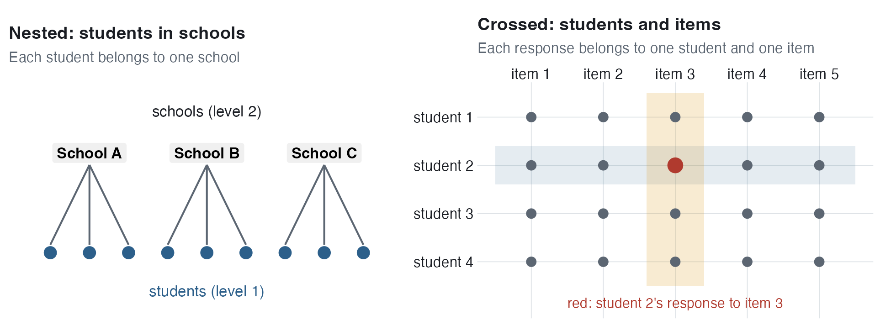
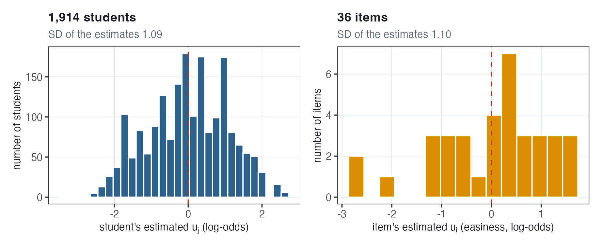
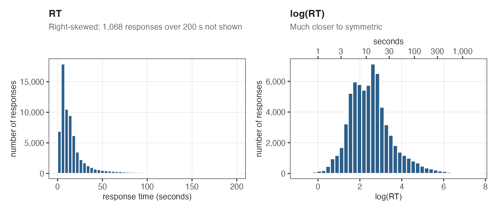
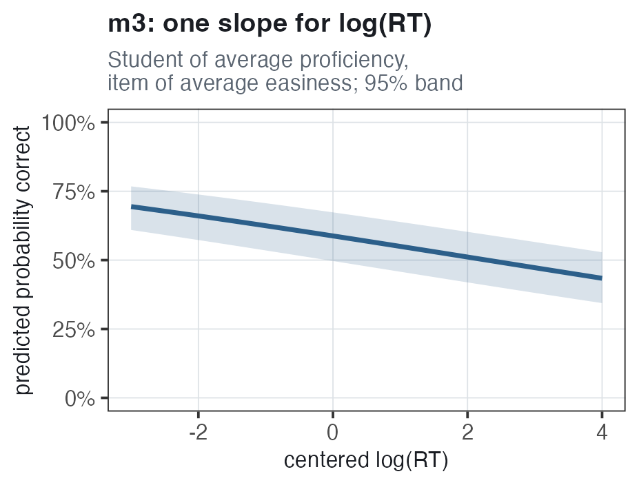

# Cross-Classified Models, Process Data, and Double Centering {#sec-cross-classified}

:::: chapter-lead
::: lead-label
The chapter in one paragraph
:::

This chapter is about **item responses**: 1,914 Grade 3 students were given the same 36 vocabulary items, for 68,538 **responses**, each scored 1 (correct) or 0 (incorrect). Each response belongs to one student and one item, and item 7 is the same item for every student, so students and items are **crossed**, not nested. In this chapter, $i$ is the **item** and $j$ is the **student**. The **cross-classified logit model**, the **one-parameter logistic (1PL) item response theory model** of educational measurement, has a random intercept for students ($u_j$) and one for items ($u_i$). For a student of average proficiency ($u_j = 0$) on an item of average easiness ($u_i = 0$), the log-odds of a correct response are 0.35, a 58.6% chance. On any item, students' log-odds differ by about 1.19 in SD terms; for any student, items' log-odds differ by about 1.11. The students' estimated $u_j$ are used as **test scores**. A score's **reliability** is the correlation between students' scores on two versions of a test. In a logit model, reliability is computed for the **latent response**: an unobserved number on the log-odds scale, centered at the student's log-odds for the item, with variance 3.29, and above 0 for a correct response. For one item, the reliability is the ICC, $\tau_j^2/(\tau_j^2 + 3.29) = 0.30$; for the average of a student's 36 latent responses (not the EB score), it is $\tau_j^2/(\tau_j^2 + 3.29/36) = 0.94$, the same form as the shrinkage factor. The items' easiness, with about 1,900 students per item, has reliability 0.9986. With student predictors (an **explanatory item response model**), English learners' log-odds are 0.80 lower than those of students with the same SES who are not English learners; the student SD is smaller (1.03 against 1.19) and the item SD is unchanged (1.11). The second half adds **process data**: how long each response took (**response time**, RT), analyzed as log(RT). A model with one slope for log(RT) ($-0.155$) assumes the same association within students and items, between students, and between items. **Double centering** splits log(RT) into three pieces, each with its own slope: the student's mean, the item's mean, and how much longer than expected the response took. A response that took longer than expected is less likely to be correct (within slope $-0.17$). Students who are slower on average are more accurate (between-student slope 0.16). Items that take longer on average have lower log-odds of a correct response (between-item slope $-0.26$), but with an SE of 0.45 this slope is not distinguishable from zero. Opposite signs within and between students are an example of **Simpson's paradox**. The SEs differ because the slopes are estimated from 68,538 responses, 1,914 students and 36 items. A final section has the Mundlak version of double centering.
::::

## A new kind of data: item responses {#sec-cc-items}

In earlier chapters, each outcome was one measurement of a student, such as a reading score. Here, each outcome is a student's answer to one item of a vocabulary test, and every student was given the same 36 items. So each answer belongs to both a student and an item, and the model in @sec-cc-logit has a random intercept for each.

### The vocabulary data {#sec-cc-data}

The data come from [Relyea et al. (2025)](https://doi.org/10.1002/rrq.70048), an evaluation of a literacy intervention, MORE, in a randomized controlled trial with Grade 3 students in a large urban school district in the southeastern United States, available as [`vocab.csv`](../data/vocab.csv). Each row of the data is one **response**: one student's answer to one item.

- `id` is the student (1 to 1,914), and `item` is the item (`vocab_q0` to `vocab_q35`, called items 0 to 35 here).
- `resp` is 1 if the response is correct and 0 if not.
- `cov_lep` is 1 if the student is an **English learner** (in the data, limited English proficient, LEP) and 0 if not.
- `cov_ses_med` and `cov_ses_high` are 1 for students from middle-SES and high-SES families; a student with 0 on both is low SES, the reference group. SES is missing for 16 students.
- `rt` is the **response time**: how many seconds the student took to answer the item (@sec-cc-rt and @sec-cc-double).

| Feature | Value |
|:-----------------------------------|:-----------------------------------|
| Responses (rows) | 68,538 |
| Students | 1,914 (1,895 answered all 36 items) |
| Items | 36 (each answered by 1,895 to 1,914 students) |
| `resp` | 56.6% of responses correct |
| `cov_lep` | 469 English learners (24.5%) |
| SES (1,898 students with a value) | low 738 (38.9%), middle 690 (36.4%), high 470 (24.8%) |
| `rt` | median 11.6 seconds; 0.4 to 1,890 seconds |

**Levels.** The response is level 1. Responses are grouped by student and by item, and both groupings are level 2; neither is nested in the other (@sec-cc-crossed). In this chapter, $i$ is the item and $j$ is the student, so $\text{resp}_{ij}$ is student $j$'s response to item $i$. In earlier chapters, $i$ was the student and $j$ the school (or $i$ the measurement and $j$ the person).

### One vocabulary item {#sec-cc-one-item}

An example of the item format: *Choose two words that best go with* **fossil**: utensil, bone, folks, footprint. A response is scored 1 if the student chose the two correct words, bone and footprint, and 0 for any other choice. So `resp` is a **binary** (0/1) outcome. The models of this chapter are multilevel logit models for the **log-odds** of a correct response: the logarithm of the probability of a correct response divided by the probability of an incorrect one.

### The research questions {#sec-cc-rqs}

1.  How much do students vary in their vocabulary knowledge? How much do vocabulary items vary in their difficulty?
2.  How **reliable** are students' average vocabulary scores?
3.  How **reliable** are items' average easiness scores?
4.  Controlling for SES, how does the vocabulary of **English learners** differ from that of students who are not English learners?

An item's **difficulty** is how hard it is; **easiness** is the reverse, and the model is written in terms of easiness. Scores are **reliable** when a student who does well on one version of the test also does well on another version, made of different items of the same kind. @sec-cc-logit and @sec-cc-reliability are about questions 1 to 3, @sec-cc-predictors is about question 4, and @sec-cc-rt and @sec-cc-double are about five new questions on response time.

### Long data: one row per response {#sec-cc-long}

Each student has up to 36 rows. The first rows are student 909's responses to items 0 to 5:

|  `id` | `item`     | `resp` | `cov_lep` | `cov_ses_high` | `cov_ses_med` |
|------:|:-----------|-------:|----------:|---------------:|--------------:|
|   909 | `vocab_q0` |      1 |         0 |              0 |             0 |
|   909 | `vocab_q1` |      0 |         0 |              0 |             0 |
|   909 | `vocab_q2` |      1 |         0 |              0 |             0 |
|   909 | `vocab_q3` |      1 |         0 |              0 |             0 |
|   909 | `vocab_q4` |      0 |         0 |              0 |             0 |
|   909 | `vocab_q5` |      0 |         0 |              0 |             0 |

One row per response is **long** format, as for longitudinal data, where each row is one measurement of a person. The student's variables, `cov_lep` and the SES indicators, have the same value on all of the student's rows. Student 909 is a low-SES student who is not an English learner.

### Nested and crossed data {#sec-cc-crossed}

Each response belongs to a student and to an item. How are the two groupings related?

- **Nested.** In @sec-binary-outcomes, each student was in exactly one school, and each school had its own students. So students are nested in schools.
- **Crossed.** Here, item 1 is the **same item** for student 1 and for student 2, and student 1 is the **same student** for item 1 and for item 2. Nearly every student answered every item, so neither grouping is nested in the other. Each response belongs to one combination of a student and an item: the response is nested in the **cross-classification** of students and items.

{#fig-cc-nest width="68%"}

**Reading @fig-cc-nest.** On the right, the red dot, student 2's response to item 3, belongs to student 2's row (blue band) and to item 3's column (orange band): student 2's other responses share the student, and the other responses to item 3 share the item. So two responses can be alike, for example both correct, for two reasons. They can come from the same student: a student with a large vocabulary answers many items correctly. Or they can be responses to the same item: an easy item is answered correctly by many students.

{#fig-cc-grid width="70%"}

**Reading @fig-cc-grid.** The rows differ: the student in the top row answered 33 of 36 items correctly, and the student in the bottom row 4 of 36. The columns differ too: in all the data, the leftmost item, item 28, was answered correctly by 83% of students, and the rightmost, item 34, by 12%. The pattern is not perfect: students with many correct responses sometimes miss an easy item. Under the model of @sec-cc-logit (m1, a Rasch model: one term for each student and one for each item), if single responses had no measurement error, the grid would be a perfect diagonal pattern: each student would answer correctly every item easier than some point and miss every harder item, so all of the blue would be in the upper left and all of the gray in the lower right. The blue and gray cells mixed along the diagonal are the measurement error in single responses (@sec-cc-latent).

::: callout-important
## Nested or crossed?

Two groupings are **nested** when each member of one grouping belongs to only one member of the other: each student is in one school. Two groupings are **crossed** when each member of either grouping is paired with many members of the other: every student answers many items, and every item is answered by many students. With crossed groupings, each response belongs to one combination of a student and an item, and the model has a random intercept for each grouping.
:::

### Three sample sizes {#sec-cc-sizes}

Nested data with students in schools have two sample sizes. Crossed data have **three**:

``` r
nrow(vocab)                      # 68,538 responses
vocab %>% distinct(id) %>% nrow()    # 1,914 students
vocab %>% distinct(item) %>% nrow()  # 36 items
```

If every student had answered every item, there would be $1{,}914 \times 36 = 68{,}904$ responses; 366 are missing, from 19 students who answered fewer than 36 items. A quantity about the items as a group, such as the items' average easiness, is based on only 36 items, so it has a large standard error (SE), however many students answered each item (@sec-cc-m1 and @sec-cc-se).

## The cross-classified logit model {#sec-cc-logit}

In @fig-cc-grid (@sec-cc-crossed), the rows (students) differ and the columns (items) differ. The **cross-classified logit model**, **m1**, has a term for each, and its two SDs are the answer to research question 1: how much do students and items vary?

### The model {#sec-cc-m1-model}

m1 has two random intercepts, one for students and one for items:

$$\begin{aligned}
\textbf{Level 1:} \qquad && \text{logit}\big(\Pr(\text{resp}_{ij} = 1)\big) &= \beta_{0ij} \\
&& \text{resp}_{ij} &\sim \text{Bernoulli}\big(\Pr(\text{resp}_{ij} = 1)\big) \\
\textbf{Level 2:} \qquad && \beta_{0ij} &= \gamma_0 + u_j + u_i \\
&& u_j &\sim N(0, \tau^2_j) \\
&& u_i &\sim N(0, \tau^2_i)
\end{aligned}$$

- $\text{resp}_{ij}$ is the response of student $j$ to item $i$: 1 if correct and 0 if not. **In this chapter, $i$ is the item and $j$ is the student.**
- $\text{logit}\big(\Pr(\text{resp}_{ij} = 1)\big)$ is the log-odds that student $j$ answers item $i$ correctly.
- $\beta_{0ij}$ ($\beta$ is the Greek letter beta) has both subscripts because each combination of a student and an item has its own log-odds.
- $\gamma_0$ ($\gamma$ is the Greek letter gamma) is the log-odds of a correct response for a **student of average proficiency** on an **item of average easiness**. A student of average proficiency is a student with $u_j = 0$, at the center of the distribution of students, and an item of average easiness is an item with $u_i = 0$, at the center of the distribution of items. Each is one student or one item, not an average over many. Item 20 (estimated $u_i = -0.02$) is close to an item of average easiness.
- $u_j$ is student $j$'s **departure**: how far student $j$'s log-odds of a correct response are above or below those of a student of average proficiency, on the same item. It is the same on all 36 items.
- $u_i$ is item $i$'s departure, its **easiness**: how far the log-odds on item $i$ are above or below the log-odds on an item of average easiness, for the same student. It is the same for every student.
- $u_j$ and $u_i$ are **assumed** to be normal with mean 0 and independent of each other, with variances $\tau^2_j$ and $\tau^2_i$. $\tau_j$ ($\tau$ is the Greek letter tau) is the SD of the students' departures and $\tau_i$ the SD of the items' departures; each is one SD for the whole grouping.
- The second line of level 1 is a Bernoulli distribution: the response is 1 with probability $p = \Pr(\text{resp}_{ij} = 1)$ and 0 otherwise. Its variance, $p(1-p)$, is set by $p$, so, as in every logit model, there is no separate residual $e_{ij}$.

Substituting level 2 into level 1 gives the **reduced form**:

$$\text{logit}\big(\Pr(\text{resp}_{ij} = 1)\big) = \gamma_0 + u_j + u_i$$

``` r
glmer(resp ~ 1 + (1 | id) + (1 | item), data = vocab, family = binomial)
```

The `1` is $\gamma_0$, `(1 | id)` is $u_j$ (one random intercept per student), `(1 | item)` is $u_i$ (one per item), and `family = binomial` is the 0/1 outcome with the logit link. The formula would be the same for nested groupings; here the groupings are crossed because of the data.

**A connection to measurement.** In educational measurement, m1 is the **one-parameter logistic (1PL) item response theory (IRT) model**, or **Rasch model**: $\text{logit}(p) = \text{ability} + \text{easiness}$, with one parameter per item. In IRT, each item's difficulty (the negative of easiness) is usually a fixed number; in m1 and in the explanatory item response model of Gilbert, Kim, & Miratrix (2023), each item's easiness is a draw from a normal distribution.

**Ability, easiness, and the reification fallacy.** In m1, $u_j$ ("ability") and $u_i$ ("easiness") are **residuals**: $u_j$ is the part of student $j$'s log-odds not accounted for by $\gamma_0$. The **reification fallacy** is treating an abstract quantity as if it were a concrete thing: calling a student's estimated $u_j$, a summary of the student's responses to these 36 items under m1's assumptions, a fixed "vocabulary ability" the student would show on any test.

### Fitting it (m1) {#sec-cc-m1}

| Term | Estimate | SE | $Z$ |
|:-----------------------------------|----------:|-------:|-------:|
| $\widehat{\gamma_0}$ `(Intercept)` | 0.3493 | 0.1879 | 1.86 |
| $\widehat{\tau_j}$ `sd__(Intercept)`, group `id` | 1.1869 | | |
| $\widehat{\tau_i}$ `sd__(Intercept)`, group `item` | 1.1141 | | |

$\widehat{\gamma_0} = 0.35$. *Interpretation.* For a student of average proficiency ($u_j = 0$) on an item of average easiness ($u_i = 0$), the predicted log-odds of a correct response are 0.35. As a probability, $e^{0.3493}/(1 + e^{0.3493}) = 0.586$: a 58.6% chance.

**A student of average proficiency, an item of average easiness, or both?** Both at once. 0.3493 is the log-odds for one combination: a student of average proficiency answering an item of average easiness. For any other student or item, that student's or item's departure is added to 0.3493:

- a student of average proficiency on item 34, the hardest item (estimated $u_i = -2.71$): log-odds $0.3493 - 2.71 = -2.36$, an 8.6% chance;
- a student 1 SD above average proficiency ($u_j = 1.1869$) on an item of average easiness: log-odds $0.3493 + 1.1869 = 1.54$, an 82.3% chance.

$\widehat{\tau_j} = 1.19$. *Interpretation.* On any item, students' log-odds of a correct response differ from those of a student of average proficiency by about 1.19 in SD terms. A student's $u_j$ is the same on every item, so the 1.19 is the same whichever item is chosen.

The table below turns $\widehat{\tau_j}$ into chances of a correct response. Each row is a student at a different distance from average proficiency, with the student's log-odds, $0.3493 + u_j$, and that student's probability of answering the item correctly. **Which item is in the table?** A probability depends on both the student and the item, so one item has to be chosen. In every row, the item is an item of average easiness ($u_i = 0$), and only the student changes.

| Student | Log-odds, $0.3493 + u_j$ | Probability of a correct response |
|:------------------|--------------------------------:|---------:|
| 2 SDs below average proficiency | $0.3493 - 2(1.1869) = -2.02$ | 0.117 (11.7%) |
| 1 SD below | $0.3493 - 1.1869 = -0.84$ | 0.302 (30.2%) |
| Average proficiency ($u_j = 0$) | 0.3493 | 0.586 (58.6%) |
| 1 SD above | $0.3493 + 1.1869 = 1.54$ | 0.823 (82.3%) |
| 2 SDs above | $0.3493 + 2(1.1869) = 2.72$ | 0.938 (93.8%) |

About 95% of students are expected to have log-odds on this item between $0.3493 - 1.96(1.1869) = -1.98$ and $0.3493 + 1.96(1.1869) = 2.68$: a chance of a correct response between about 12% and 94%. So students differ a great deal in their chances on the same item. On an easier or a harder item, the probabilities are different, but the differences in log-odds are the same (@sec-cc-curves).

**Why is 58.6% not the percent of responses that were correct, 56.6%?** The 58.6% is for one student on one item. Averaged over m1's normal distributions of $u_j$ and $u_i$, the predicted probability is 55.9%, close to 56.6%. It is below 58.6% because, from 58.6%, the same distance in log-odds is more percentage points down than up. In the table, 1 SD below is about 28 points lower (30.2%), and 1 SD above only about 24 points higher (82.3%).

$\widehat{\tau_i} = 1.11$. *Interpretation.* For any student, items' log-odds of a correct response differ from the log-odds on an item of average easiness by about 1.11 in SD terms. An item's $u_i$ is the same for every student, so the 1.11 is the same whichever student is chosen.

The table below is the table for students with the roles switched. In every row, the student is a student of average proficiency ($u_j = 0$), and only the item changes: each row is an item at a different distance from average easiness, with log-odds $0.3493 + u_i$.

| Item | Log-odds, $0.3493 + u_i$ | Probability of a correct response |
|:------------------|--------------------------------:|---------:|
| 2 SDs harder than average | $0.3493 - 2(1.1141) = -1.88$ | 0.133 (13.3%) |
| 1 SD harder | $0.3493 - 1.1141 = -0.76$ | 0.318 (31.8%) |
| Average easiness ($u_i = 0$) | 0.3493 | 0.586 (58.6%) |
| 1 SD easier | $0.3493 + 1.1141 = 1.46$ | 0.812 (81.2%) |
| 2 SDs easier | $0.3493 + 2(1.1141) = 2.58$ | 0.929 (92.9%) |

For a student of average proficiency, about 95% of items are expected to have log-odds between $0.3493 - 1.96(1.1141) = -1.83$ and $0.3493 + 1.96(1.1141) = 2.53$: a chance between about 14% and 93%.

**Students and items together.** In the table below, three students (1 SD below, at and 1 SD above average proficiency) are crossed with three items (1 SD harder than average, of average easiness and 1 SD easier). Each cell is the probability of a correct response, from the log-odds $0.3493 + u_j + u_i$.

| Student | Item 1 SD harder | Item of average easiness | Item 1 SD easier |
|:-------------------------------|---------:|---------:|---------:|
| 1 SD below average proficiency | 12.4% | 30.2% | 56.9% |
| Average proficiency ($u_j = 0$) | 31.8% | 58.6% | 81.2% |
| 1 SD above average proficiency | 60.4% | 82.3% | 93.4% |

*Interpretation.* The middle row is the item table and the middle column the student table. A student 1 SD above average proficiency on an item 1 SD harder has log-odds $0.3493 + 1.1869 - 1.1141 = 0.42$, a 60.4% chance: close to the 58.6% of a student of average proficiency on an item of average easiness, because the student and item SDs are about the same size (1.19 and 1.11).

So for research question 1: in log-odds, students differ by about 1.19 and items by about 1.11 in SD terms, about the same amount, and both differences are large.

**Why is the SE of $\widehat{\gamma_0}$ so large?** With 68,538 responses, an SE of 0.19 looks large. But $\gamma_0$ is for a student of average proficiency on an item of average easiness, and the items' average easiness is estimated from only 36 items: with a different set of 36 items, $\widehat{\gamma_0}$ would differ. An average of $n$ independent values with SD $\tau$ has variance $\tau^2/n$. If $\widehat{\gamma_0}$ is thought of as an average of 36 item departures and 1,914 student departures, its SE is about

$$\sqrt{\frac{\widehat{\tau_i}^2}{36} + \frac{\widehat{\tau_j}^2}{1{,}914}} = \sqrt{\frac{1.2412}{36} + \frac{1.4087}{1{,}914}} = \sqrt{0.0345 + 0.0007} = 0.188$$

close to the SE R prints, 0.1879. Almost all of the variance under the square root is from the items' term, 0.0345 against 0.0007, because there are 36 items and 1,914 students. The same idea applies to m4's three slopes (@sec-cc-se).

### What the model looks like {#sec-cc-curves}

In @fig-cc-curves, m1's predicted probabilities are drawn for three items: the chance of a correct response depends on both the student's $u_j$ and the item's $u_i$.

{#fig-cc-curves width="62%"}

**Reading @fig-cc-curves.** Each curve is one item. The horizontal axis is how far a student's log-odds are above or below those of a student of average proficiency, who is at 0 (dashed line). The vertical axis is that student's probability of answering the item correctly. For a student of average proficiency (the dots), the chances are 87.4% on item 28, 58.0% on item 20 and 8.6% on item 34. A student with $u_j = 2$ has log-odds 2 higher on every item, but the chances are 98.1%, 91.1% and 41.0%: about 11 percentage points higher on item 28, where a student of average proficiency already has an 87.4% chance, and about 33 and 32 points higher on items 20 and 34.

The three curves have the same S shape and differ only in horizontal position: the curves of items 20 and 34 are $-0.02 - (-2.71) = 2.69$ apart, the difference between the two items' estimated $u_i$. So a student with $u_j = 2$ has the same chance on item 34, about 41%, as a student with $u_j = 2 - 2.69 = -0.69$ on item 20. In item response theory, curves like these are called **item characteristic curves**, also abbreviated ICC; this ICC is not the intraclass correlation of @sec-cc-icc.

### The estimated random effects {#sec-cc-re}

Each student and each item also has an estimated departure; their distributions are in @fig-cc-re.

Each departure is estimated by **empirical Bayes (EB)**, as in @sec-shrinkage, @sec-ri-vam-schools and @sec-bin-caterpillar. An EB estimate is **shrunk**: it is closer to 0 than an estimate from the student's (or the item's) own responses alone, and more so when there are fewer responses.

{#fig-cc-re width="66%"}

- **Students (left).** A student at 1 has log-odds 1 higher than a student of average proficiency on every item: on an item of average easiness, $0.3493 + 1 = 1.35$, a 79.4% chance against 58.6%. The estimates range from $-3.38$ to 2.63. The bars alternate between tall and short because students with the same number correct out of 36 have the same estimate (@sec-cc-scores), so the 1,895 students who answered all 36 items have only 35 different estimates. The SD of the students' estimates, 1.09, is smaller than $\widehat{\tau_j} = 1.19$ because each estimate is shrunk toward 0. In IRT, shrunken estimates like these are called **EAP** (expected a posteriori) scores.
- **Items (right).** An item's estimate is its **easiness**: an item at 1 has log-odds 1 higher than an item of average easiness, for every student. The two hardest items, 34 and 4 (at $-2.71$ and $-2.59$), were answered correctly by 12% and 13% of the students. The two easiest, 28 and 3 (at 1.58 and 1.57), were each answered correctly by 83%. The SD of the items' estimates, 1.10, is close to $\widehat{\tau_i} = 1.11$: each item was answered by about 1,900 students, so the estimates are shrunk very little.

### Random effects as test scores {#sec-cc-scores}

A **test score** is one number that summarizes a student's responses; the simplest is the percent of items answered correctly. The students' estimated $u_j$ from m1 are often used as test scores instead. @fig-cc-score has both kinds of score, for students (left) and items (right).

{#fig-cc-score width="58%"}

**Reading @fig-cc-score.** The horizontal axes are the raw percent correct, and the vertical axes are the EB estimates, in log-odds.

- **Students who answered all 36 items (blue)** form one increasing curve: two students with the same number correct have exactly the same estimate, whichever items they answered correctly. For example, student 909 and the other 68 students with 15 of 36 correct (41.7%) all have the estimate $-0.73$. So, under m1, a student's estimate is a function of the number-correct score, and the order of the estimates is the order of the number-correct scores.
- **Students who answered fewer items (red)** are mostly near the curve. The three red points far from it are four students: one who answered only item 0, correctly (0.29); two who answered only item 0, incorrectly ($-0.80$, one point); and one who answered 7 items, all incorrectly ($-2.13$).
- **Items (right)** also form an increasing curve. Each item's estimate has an SE of about 0.06, because each item has about 1,900 responses.

**Why use random effects as test scores, and what are the arguments against?**

For:

- **They account for the items' easiness**, so students who answered fewer items, or different items, have scores on the same scale. Under m1, a student whose only response is correct would have a score of 0.16 if the item were the easiest (item 28), 0.29 if it were item 0 and 1.10 if it were the hardest (item 34): a correct answer to a hard item is stronger evidence of a large vocabulary.
- **Scores from fewer responses are shrunk more toward the average**, so a score reflects how much evidence it is based on. The four students with no correct responses have $-0.80$ (two students, each with one item answered), $-2.13$ (7 items) and $-3.38$ (36 items): one incorrect response is weak evidence of a small vocabulary, and 36 are strong evidence. The student who answered only item 0, correctly, has a score of 0.29, not a score for 100% correct.
- **Every student has a finite score**: $-3.38$ for 0 of 36 correct, where the log-odds of the raw percent correct would be $-\infty$.
- **Each score has an SE**: about 0.37 with 36 responses and about 1.0 with one.
- **They are on the log-odds scale of the model**, so they can be used directly in later models.

Against:

- **They are shrunk**, so they are less spread out than the true departures: SD 1.09, against $\widehat{\tau_j} = 1.19$.
- **They depend on the model's assumptions**: normal $u_j$, and the same curve shape for every item (@fig-cc-curves).
- **Calling them "ability" is reification** (@sec-cc-m1-model).

::: callout-important
## In m1, the log-odds of a correct response are a sum of three parts

Under m1, the log-odds that student $j$ answers item $i$ correctly are $\gamma_0 + u_j + u_i$: the log-odds for a student of average proficiency on an item of average easiness ($\widehat{\gamma_0} = 0.35$, a 58.6% chance), plus the student's departure, plus the item's departure. $\widehat{\tau_j} = 1.19$ is how much students' log-odds differ on any item, and $\widehat{\tau_i} = 1.11$ how much items' log-odds differ for any student. The students' EB estimates of $u_j$ are used as vocabulary test scores, and the items' estimates of $u_i$ as easiness. In measurement, m1 is the 1PL (Rasch) IRT model: every item's curve has the same shape, and the items differ only in easiness.
:::

## Reliability {#sec-cc-reliability}

In @sec-cc-scores, each student's estimated $u_j$ was used as a vocabulary score. This section is about research questions 2 and 3: how much can the students' scores, and the items' easiness scores, be trusted? If the same students took a different set of 36 vocabulary items of the same kind, would the students who scored high on the first set also score high on the second? This property of a score is its **reliability**.

### What is reliability? {#sec-cc-rel-what}

Reliability has two equivalent definitions:

- The **correlation**, across students, between their scores on two versions of the same test, each built from different items of the same kind.
- The **share of the variance** in students' observed scores that is variance in their **true scores**. A student's true score is the student's long-run average: the average score over many versions of the test. The rest of the variance is **measurement error**.

A reliability of 1 would mean that a student 1 SD above the average on one version is exactly 1 SD above the average on every other version. A reliability of 0 would mean that a student's score on one version contains no information about the student's score on another.

**An example with our data.** The 36 items can be split into two 18-item versions of the test: the 18 even-numbered items (0, 2, ..., 34) and the 18 odd-numbered items (1, 3, ..., 35). For the 1,895 students who answered all 36 items, the number-correct scores on the two versions are correlated 0.82. *Interpretation.* For a student 1 SD above the average on the even items, our best guess is 0.82 SD above the average on the odd items. So an 18-item number-correct score has a reliability of about 0.82: about 82% of the variance in students' 18-item number-correct scores is true-score variance, and about 18% is measurement error.

The two definitions are also the two interpretations of the ICC from @sec-icc-interp. In a logit model, the ICC and the reliability are computed for a **latent response**, explained next.

### What is a latent response? {#sec-cc-latent}

**Where does an error come from, if m1 has no $e_{ij}$?** The ICC and the reliability are ratios of variances, with an error variance in the denominator. But m1 has no error term $e_{ij}$: as in every logit model, each response's variance, $p(1-p)$, is set by its probability $p$ (@sec-cc-m1-model). So the error variance comes from a second way of writing m1, in which each 0/1 response is the result of an unobserved number, the student's **latent response** to the item, written $y^*_{ij}$. There is no $y^*_{ij}$ in the data: the data have only 0s and 1s. This is not a new model. Under it, every response has exactly the same probability of being correct as under m1 (shown below), so it has the same estimates. The only addition is an error $e_{ij}$, whose variance is used in the ICC and the reliability. In @sec-bin-icc, retention was written the same way, with a latent propensity to be retained.

$$\begin{aligned}
y^*_{ij} &= \gamma_0 + u_j + u_i + e_{ij} \\
\text{resp}_{ij} &= 1 \text{ if } y^*_{ij} > 0, \text{ and } \text{resp}_{ij} = 0 \text{ otherwise} \\
e_{ij} &\sim \text{logistic distribution with mean 0 and variance } \pi^2/3 \approx 3.29
\end{aligned}$$

with $u_j \sim N(0, \tau^2_j)$ and $u_i \sim N(0, \tau^2_i)$ as in m1. Each piece:

- $y^*_{ij}$ (read "y star") is student $j$'s latent response to item $i$. It is never observed, so it is not in the data. It is on the **log-odds scale**, in the same units as $\gamma_0$, $u_j$ and $u_i$. It is not a probability: it can be any number, negative or positive.
- $\gamma_0 + u_j + u_i$, student $j$'s log-odds of a correct response on item $i$ under m1, is the center of the latent response.
- $e_{ij}$ is the **error**: how far this one latent response is from its center. It belongs to one student and one item, a **person-by-item interaction**: for example, a student with a large vocabulary may not know the word *fossil*.
- In the second line, the response is correct (1) when the latent response is above 0, and incorrect (0) otherwise. So 0 is a cutoff on the log-odds scale, not a probability.
- A **logistic distribution** is bell-shaped like the normal. Its variance is **fixed** at $\pi^2/3 \approx 3.29$, an SD of 1.81 ($\pi$ is the Greek letter pi, 3.14159...).

**Why is the error variance fixed, and why at $\pi^2/3$?**

- *Why fixed, not estimated.* Each 0 or 1 contains only whether the latent response is above 0, not how far above or below 0 it is. If every latent response were twice as far from 0, with its center and its error both doubled, every one above 0 would still be above 0 and every one below 0 still below, so the 0s and 1s would be exactly the same. So the 0s and 1s contain no information about how spread out the latent responses are, and the error variance has to be set to a number, not estimated. Doubling would also double $\gamma_0$, $\tau_j$ and $\tau_i$, so every variance in the ICC and the reliability, the error variance included, would be 4 times as large, and their ratios would not change.
- *Why $\pi^2/3$.* It is the variance of the **standard logistic distribution**, the distribution in which the area below any value $x$ is $e^{x}/(1 + e^{x})$, the formula that turns log-odds into probabilities. With this error, $y^*_{ij}$ is above 0 when $e_{ij}$ is above $-(\gamma_0 + u_j + u_i)$. The distribution is symmetric around 0, so that probability equals the area below $\gamma_0 + u_j + u_i$, which is $e^{\gamma_0 + u_j + u_i}/(1 + e^{\gamma_0 + u_j + u_i})$: exactly m1's probability of a correct response, for every student and every item. So the two ways of writing the model agree, and $y^*_{ij}$ is in m1's units, log-odds. (With a normal error of variance 1 instead, the same idea gives the **probit** model, which has a similar S shape but coefficients on a different scale.) This is drawn for two items in @fig-cc-latent and for many students in @fig-cc-latentcurve.

{#fig-cc-latent width="72%"}

**Reading @fig-cc-latent.** The horizontal axis is the latent response, in log-odds, and the height of the curve is how common each value is. A latent response above 0, to the right of the dashed red line, is a correct response.

- **Item 20 (left).** For a student of average proficiency, the center is $\widehat{\gamma_0}$ plus item 20's estimated $u_i$, $0.3493 + (-0.0247) = 0.32$. 58.0% of the area under the curve is above 0: the probability that a student of average proficiency answers item 20 correctly, the same probability as in @fig-cc-curves.
- **Item 34 (right).** For a student of average proficiency, the center is $\widehat{\gamma_0}$ plus item 34's estimated $u_i$, $0.3493 + (-2.7116) = -2.36$, and 8.6% of the area is above 0.

The two curves have the same shape and spread; only the centers differ.

In @fig-cc-latentcurve, the latent responses of seven students to an item of average easiness are drawn below m1's S-shaped curve.

{#fig-cc-latentcurve width="47%"}

**Reading @fig-cc-latentcurve.** Both panels have the same horizontal axis: a student's $u_j$, the log-odds above or below those of a student of average proficiency.

- **Bottom.** Each bell curve, on its side, is one student's latent response. Its center, on the solid line, is the student's log-odds for the item, $0.3493 + u_j$, and its spread, from the error $e_{ij}$, is the same for every student. The higher the student's $u_j$, the higher the curve, and the more of it is above the cutoff 0.
- **Top.** Each point is the shaded share of the curve below it: 16.1% for the student with $u_j = -2$, 58.6% for $u_j = 0$ and 91.3% for $u_j = 2$. Over all values of $u_j$, these shares make up m1's S-shaped curve (@fig-cc-curves).
- **The dotted lines.** The vertical dotted line is at $u_j = -0.35$, where the solid line is at the cutoff 0: a student with this $u_j$ has a latent response centered at 0, half of it above 0, so the probability is 50% (the horizontal dotted line).

So the S-shaped curve of a logit model and a bell-shaped latent response with a fixed cutoff at 0 are two ways of drawing the same model.

### One item: the ICC {#sec-cc-icc}

The simplest test has one item, and its reliability is the ICC. In @sec-variance-components, the clusters were schools and the members of a cluster were the school's students. Here, the clusters are students and the members of a cluster are the student's latent responses, one per item:

$$\text{ICC} = \frac{\tau^2_j}{\tau^2_j + \sigma^2_e}$$

- $\tau^2_j$ is the variance of the student departures $u_j$, the **true-score** variance: how much students differ in vocabulary, in log-odds.
- $\sigma^2_e$ ($\sigma$ is the Greek letter sigma) is the **error** variance: the variance of $e_{ij}$, fixed at 3.29.

For m1, with $\widehat{\tau_j}^2 = 1.1869^2 = 1.4087$:

$$\text{ICC} = \frac{1.4087}{1.4087 + 3.29} = \frac{1.4087}{4.6987} = 0.30$$

The ICC has two interpretations, as in @sec-icc-interp.

**The ICC as a share of variance.**

- *In @sec-variance-components:* 17% of the variance in students' reading scores was between schools.
- *Here:* the variance is among the 1,914 students' latent responses to one item. These latent responses differ for two reasons: students differ in vocabulary (variance 1.4087), and each latent response has its own error (variance 3.29). All of them are to the same item, so the item's easiness is the same in every one, and differences between items are not part of this variance.

*Interpretation.* On any one item, students' latent responses differ partly because the students differ in vocabulary (30% of the variance, $1.4087/4.6987$) and partly because of the error in each single response (70%).

**The ICC as a correlation.**

- *In @sec-variance-components:* the reading scores of two students in the same school were correlated 0.17. Each pair of students came from one school, and the correlation was computed over the pairs from many schools.
- *Here:* the cluster is a student, and the members of a cluster are the student's latent responses. Take two items, item A and item B. Each student has one pair of latent responses: one to item A and one to item B. With one row per student and the two latent responses side by side, the ICC is the correlation between the two columns. This is what **across students** means: one pair per student, 1,914 pairs, as in @fig-cc-versions (left), where each point is one student.

*Interpretation.* Students' latent responses to two different items are correlated 0.30. Suppose a student's latent response to item A is 1 SD above the mean of all students' latent responses to item A. Then our best guess for the same student's latent response to item B is 0.30 SD above the mean for item B.

**Why are two items compared in @fig-cc-versions (left), when the ICC is the reliability of a one-item test?** Reliability is the correlation between students' scores on two versions of a test. On a one-item test, a student's score is the latent response to that one item, and a second version of the test is a different single item. So item A is a one-item test and item B is a second version of it, and the correlation between them across students, 0.30, is the reliability of a one-item test: the ICC. The right panel is the same comparison for two 36-item tests (@sec-cc-many). Latent responses are never observed, so @fig-cc-versions has 1,914 students simulated from m1's estimates.

{#fig-cc-versions width="68%"}

**Reading @fig-cc-versions (left).** A point's horizontal position is a student's latent response to item A, and its vertical position is the same student's latent response to item B. The correlation is 0.30. Students with a high latent response to item A tend to have a high one to item B, but many students are high on one item and low on the other: of the students in the top half on item A, 38% are in the bottom half on item B. With a correlation of 0, the share would be 50%.

So 0.30 is low: one vocabulary item is a poor measure of a student's vocabulary.

### Many items: the 36-item score {#sec-cc-many}

A test score is based on all 36 items, not on one. So the reliability of interest is about a student's **average** over many items. With $I$ the number of items on the test (36 here), the average of student $j$'s latent responses over the $I$ items is, piece by piece,

$$\overline{y}^*_j = \gamma_0 + u_j + \overline{u}_{\text{test}} + \overline{e}_j$$

- $\gamma_0$ and $u_j$ are the same on every item, so their averages are $\gamma_0$ and $u_j$.
- $\overline{u}_{\text{test}}$, the average $u_i$ of the test's $I$ items, is the test's average easiness. It is the **same number for every student** who takes the test.
- $\overline{e}_j$ is the average of student $j$'s $I$ errors. An average of $I$ independent values with variance $\sigma^2_e$ has variance $\sigma^2_e/I$, so the variance of $\overline{e}_j$ is $3.29/I$.

So the students' averages differ only because of $u_j$, with variance $\tau^2_j$, and $\overline{e}_j$, with variance $\sigma^2_e/I$. The reliability is the share of this variance that is true-score variance, from $u_j$:

$$\text{Reliability} = \frac{\tau^2_j}{\tau^2_j + \dfrac{\sigma^2_e}{I}}$$

- $\tau^2_j$ is the true-score variance, as in the ICC.
- $\sigma^2_e/I$ is the error variance of an average of $I$ latent responses. With more items it is smaller, and the reliability is closer to 1.
- With $I = 1$, the reliability is the ICC.

With $I = 36$ items, $3.29/36 = 0.0914$:

$$\text{Reliability} = \frac{1.4087}{1.4087 + 0.0914} = \frac{1.4087}{1.5001} = 0.94$$

**Why does averaging over 36 items help so much?** Because the errors partly cancel out, while the differences between students do not.

- One latent response is typically about $\sqrt{3.29} = 1.81$ above or below the student's log-odds for the item.
- A student's average over 36 latent responses is typically only about $\sqrt{0.0914} = 0.30$ above or below the student's average log-odds over those 36 items, what the average would be without any error. (This 0.30 is not the ICC; the two only round to the same number, 0.302 and 0.300.)
- The true differences between students are the same with 1 item or 36, because a student's $u_j$ is the same on every item: students' log-odds differ by about 1.19 in SD terms.

So with one item, the error (1.81) is larger than the true differences between students (1.19), and with 36 items it is much smaller (0.30).

*Interpretation (correlation).* Suppose the same students took a second version of the test, with 36 different items of the same kind. Their average latent responses on the two versions would be correlated about 0.94 across students. For a student whose average on the first version is 1 SD above the mean of all students' averages, our best guess for the second version is 0.94 SD above the mean: almost as far.

*Interpretation (share of variance).* Among students who take the same 36 items, 94% of the variance in their average latent responses is true-score variance, from differences between students in $u_j$, and 6% is measurement error.

**Reading @fig-cc-versions (right).** The points are close to a straight line: the correlation between the two versions is 0.94, against 0.30 for single items (left). Of the students in the top half on the first version, 11% are in the bottom half on the second, against 38% for single items. The axis ranges are narrower than on the left because the typical error is 0.30 for an average over 36 items, against 1.81 for one latent response.

So for research question 2: a student's average latent response over the 36 items has reliability 0.94, so a 36-item score is a highly reliable measure of vocabulary. 0.94 is for average latent responses, which are never observed: it is not the correlation between two sets of EB scores or two number-correct scores. The observed number-correct score has reliability 0.90 (@sec-cc-alpha).

**The reliability is the shrinkage factor.** In @sec-shrinkage-factor, a school's estimated departure was its raw residual multiplied by a **shrinkage factor**:

$$\widehat{u_j} = \underbrace{(\overline{y}_j - \widehat{\gamma_0})}_{\text{raw residual}} \times \underbrace{\frac{\tau^2}{\tau^2 + \sigma^2/n_j}}_{\text{shrinkage factor } R_j}$$

with $\overline{y}_j$ school $j$'s mean, $n_j$ its number of students, and $\tau^2$ and $\sigma^2$ the between-school and within-school variances. The reliability has the same form, with the student's $I$ responses in place of the school's $n_j$ students. So the more reliable a student's score, the less the student's EB estimate is shrunk toward 0: little with 36 responses (reliability 0.94), and most of the way to 0 with one response (reliability 0.30).

### Why is the item variance not in the formula? {#sec-cc-item-var}

Items differ in easiness about as much as students differ in vocabulary: $\widehat{\tau_i} = 1.11$ and $\widehat{\tau_j} = 1.19$. Yet $\tau^2_i$ is not in the reliability of a student's score, $\tau^2_j/(\tau^2_j + 3.29/I)$, because every student answers the same items. In a student's average latent response, the test's average easiness $\overline{u}_{\text{test}}$ is the same number for every student; item by item, every student's log-odds on item 34 are 2.71 lower than on an item of average easiness. A harder test lowers every student's score by the same amount, so the **order** of the students does not change. Reliability is about the order of the students, so differences between items are not part of the error.

![Left: m1's predicted log-odds of a correct response, $\widehat{\gamma_0} + \widehat{u_j} + \widehat{u_i}$, on each item, for five students whose estimated $u_j$ are at the 10th, 30th, 50th, 70th and 90th percentiles among the 1,895 students who answered all 36 items; the items are ranked from easiest (rank 1, item 28) to hardest (rank 36, item 34), so the horizontal axis is the rank, not the item number. Right: the same five students' predicted percent correct on the 18 easiest and on the 18 hardest items. Each color is one student.](images/08/fig09_ranking.png){#fig-cc-order width="74%"}

**Reading @fig-cc-order.** The five students answered 9, 16, 21, 26 and 30 of the 36 items correctly.

- **Left: log-odds.** Each line is one student. Every line is lower on the hard items at the right, by the same amount for every student, and on every item the gap between two students is the difference between their $\widehat{u_j}$. So the lines never cross: the five students are in the same order on every item.
- **Right: percent correct.** Every student has a lower predicted percent correct on the 18 hardest items than on the 18 easiest. On the easy half, the five students' predicted percents correct range from 41.7% to 92.3%; on the hard half, from 14.3% to 68.9%. The five students are in the same order on both halves. The gaps in percent differ between the halves, because the same gap in log-odds is a different number of percentage points at different probabilities (@sec-cc-curves).

So differences between items change the level of the scores, not the order. If students answered different items, $\tau^2_i$ would be part of the measurement error: a student given harder items would have a lower score for a reason unrelated to the student's vocabulary.

### Cronbach's alpha {#sec-cc-alpha}

@sec-cc-latent to @sec-cc-item-var are about latent responses, which are never observed. The score usually reported for a test is observed, such as the number-correct score (out of 36), and its reliability is usually reported as **Cronbach's $\boldsymbol{\alpha}$** ($\alpha$ is the Greek letter alpha).

**What is Cronbach's $\boldsymbol{\alpha}$?** Cronbach's $\alpha$ is a reliability for a score that is the sum or the average of item scores, such as the number-correct score. It is computed from the observed item scores, without fitting a model: from the variance of the students' total scores and the variances of the single items. It is high when students who answer one item correctly tend to answer the other items correctly too. For the 1,895 students who answered all 36 items, $\alpha = 0.90$.

*Interpretation.* Among these students, 90% of the variance in the number-correct score is true-score variance and 10% is measurement error. Equivalently, their number-correct scores on two 36-item versions of the test would be correlated about 0.90.

**Cronbach's $\boldsymbol{\alpha}$ is the reliability formula with a linear model.** The same two random intercepts can be fitted with a linear model for the 0/1 response, which has a residual $e_{ij}$ with an estimated variance $\sigma^2$:

``` r
# the 1,895 students who answered all 36 items
vocab36 <- vocab %>% group_by(id) %>% filter(n() == 36) %>% ungroup()
lmer(resp ~ 1 + (1 | id) + (1 | item), data = vocab36)
```

The `1` is $\gamma_0$, `(1 | id)` is $u_j$ and `(1 | item)` is $u_i$. The estimated student variance is 0.04116 and the residual variance $\widehat{\sigma}^2 = 0.16819$, both in the units of the 0/1 response, so they are not comparable with m1's variances in log-odds. With these two variances in place of $\tau^2_j$ and $\sigma^2_e$ in $\tau^2_j/(\tau^2_j + \sigma^2_e/I)$, with $I = 36$:

$$\frac{0.04116}{0.04116 + 0.16819/36} = \frac{0.04116}{0.04116 + 0.00467} = 0.898$$

the same as Cronbach's $\alpha$, 0.898. With 18 items, the same formula is $0.04116/(0.04116 + 0.16819/18) = 0.815$, close to the 0.82 correlation between the even-item and odd-item number-correct scores (@sec-cc-rel-what).

**Why 0.90 and not 0.94?** Both numbers come from the same formula, $\tau^2_j/(\tau^2_j + \text{error variance}/36)$, for two different scores. 0.94 is for the average latent response, with m1's student variance, 1.4087, and the logit model's error variance, 3.29. 0.90 is for the observed number-correct score, with the linear model's student variance, 0.04116, and residual variance, 0.16819. A 0/1 response contains only whether the latent response is above 0, not how far above or below 0 the latent response is. So the 0/1 responses contain less information about a student's vocabulary than the latent responses would, and the number-correct score has a lower reliability. Both 0.94 and 0.90 are high.

### How many items? {#sec-cc-how-many}

The reliability of students' scores, $\tau^2_j/(\tau^2_j + 3.29/I)$, is higher when students differ more (larger $\tau^2_j$) and when the test has more items (larger $I$).

**Why is reliability low when students are alike?** The error in a 36-item score is the same size whatever the students are like: a student's average is typically about 0.30 above or below what it would be without error (@sec-cc-many). What changes is the size of the true differences between students.

- Our students differ a lot: two students 1 SD apart differ by 1.19 in log-odds, about 4 times the typical error of 0.30. About 11% of the students in the top half on one 36-item version would be in the bottom half on another.
- If students differed half as much ($\tau_j = 0.60$), two students 1 SD apart would differ by only 0.60, twice the typical error, and about 21% would change halves. The reliability would be $0.60^2/(0.60^2 + 3.29/36) = 0.36/(0.36 + 0.0914) = 0.80$, not 0.94.
- If all students had the same vocabulary ($\tau^2_j = 0$), every difference between their scores would be error, and the reliability would be 0.

{#fig-cc-rel width="78%"}

**Reading @fig-cc-rel (left).** For our students, one item has reliability 0.30, 10 items 0.81 and 36 items 0.94. The curve increases steeply at first and then slowly: by 0.51 from 1 to 10 items, and by 0.13 from 10 to 36. For students who differ half as much ($\tau_j = 0.60$), the reliability is 0.10 with one item and only 0.80 with the same 36 items.

**How many items are needed for a reliability of 0.80, with $\widehat{\tau_j} = 1.2$ (1.1869 rounded)?** Set the reliability to 0.80 and solve for $I$:

$$\begin{aligned}
0.80 &= \frac{1.44}{1.44 + 3.29/I} \\
1.44 + \frac{3.29}{I} &= \frac{1.44}{0.80} = 1.80 \\
\frac{3.29}{I} &= 1.80 - 1.44 = 0.36 \\
I &= \frac{3.29}{0.36} = 9.1
\end{aligned}$$

Line one sets the formula equal to 0.80, with $1.2^2 = 1.44$. Line two multiplies both sides by the denominator and divides by 0.80. Line three subtracts 1.44, and line four solves for $I$. A test cannot have 9.1 items, so **10 items** are needed: with 10 items, the reliability is $1.44/(1.44 + 0.329) = 0.81$.

### Item reliability {#sec-cc-item-rel}

Research question 3 is the same question for the items: how reliable are the items' easiness scores? An item's easiness score is based on the latent responses of the students who answered it, so the error variance is divided by the number of students, $P = 1{,}914$. With m1's $\widehat{\tau_i}^2 = 1.1141^2 = 1.2412$:

$$\text{Reliability}_{\text{item}} = \frac{\tau^2_i}{\tau^2_i + \dfrac{\sigma^2_e}{P}} = \frac{1.2412}{1.2412 + \dfrac{3.29}{1{,}914}} = \frac{1.2412}{1.2412 + 0.0017} = 0.9986$$

*Interpretation.* If a second group of 1,914 students like these answered the same 36 items, the items' easiness scores from the two groups would be correlated about 0.9986 across the 36 items. For an item whose easiness score from the first group is 1 SD above the average of the items' scores, our best guess for its score from the second group is 0.9986 SD above the average: almost exactly as far. Equivalently, 99.86% of the variance in the items' easiness scores is true variance between items. So for research question 3: the items' easiness is estimated almost perfectly, because each item was answered by about 1,900 students.

**When is item reliability high, and when is it low?** It is high when many students answer each item and the items differ in easiness, and low when few students answer each item: in @fig-cc-rel (right), 0.79 with 10 students per item and 0.92 with 30. Item reliability usually receives less attention than student reliability because tests usually have **many more students than items**, so item reliability is almost always high.

::: callout-important
## Reliability is the ICC with the error variance divided by the number of responses

One latent response is a poor measure of a student (ICC 0.30); the average of 36 is a good one (0.94). In $\tau^2/(\tau^2 + 3.29/n)$, $n$ is the number of responses per student ($I = 36$) for a student's score, and per item ($P = 1{,}914$) for an item's easiness. Reliability is low when students are alike: the error is the same size, but the true differences are smaller. $\tau^2_i$ is not in a student's reliability because every student answers the same items: on a harder test, every student's score is lower by the same amount, and the students are in the same order. With a linear model, the same formula is Cronbach's $\alpha$ (0.90 for the number-correct score). The formula has the form of the shrinkage factor: the more reliable a student's score, the less the student's EB estimate is shrunk.
:::

## Adding student predictors {#sec-cc-predictors}

In m1, students' log-odds differ by about 1.19 in SD terms, but nothing in m1 describes which students have higher or lower log-odds. Here, student variables are added to m1 for research question 4: controlling for SES, how does the vocabulary of English learners differ from that of students who are not English learners?

### The model (m2) {#sec-cc-m2-model}

Controlling for SES means comparing an English learner with a student of the same SES who is not an English learner. **m2** is m1 plus three student variables. They describe the student, not the item or a single response, so they are in the level-2 equation, with the student departure $u_j$:

$$\begin{aligned}
\textbf{Level 1:} \qquad && \text{logit}\big(\Pr(\text{resp}_{ij} = 1)\big) &= \beta_{0ij} \\
&& \text{resp}_{ij} &\sim \text{Bernoulli}\big(\Pr(\text{resp}_{ij} = 1)\big) \\
\textbf{Level 2:} \qquad && \beta_{0ij} &= \gamma_0 + \gamma_1\,\text{LEP}_j + \gamma_2\,\text{MSES}_j + \gamma_3\,\text{HSES}_j + u_j + u_i \\
&& u_j &\sim N(0, \tau^2_j) \\
&& u_i &\sim N(0, \tau^2_i)
\end{aligned}$$

Substituting level 2 into level 1 gives the **reduced form**:

$$\text{logit}\big(\Pr(\text{resp}_{ij} = 1)\big) = \gamma_0 + \gamma_1\,\text{LEP}_j + \gamma_2\,\text{MSES}_j + \gamma_3\,\text{HSES}_j + u_j + u_i$$

- $\text{LEP}_j$ is 1 if student $j$ is an English learner and 0 if not. $\text{MSES}_j$ and $\text{HSES}_j$ are 1 if student $j$ is middle SES or high SES; low SES is the reference group. The three variables have only the subscript $j$: they describe the student. A student's **group** is the student's combination of English learner status and SES; there are six groups.
- $\gamma_0$ is the log-odds of a correct response for a low-SES student who is not an English learner, with $u_j = 0$, on an item of average easiness ($u_i = 0$).
- $\gamma_1$ is the difference in log-odds between an English learner and a student who is not, with the same SES and the same $u_j$, on the same item. $\gamma_2$ and $\gamma_3$ are the differences between middle-SES and low-SES students, and between high-SES and low-SES students, with the same English learner status and the same $u_j$.
- $u_j$ is now how far student $j$'s log-odds are above or below the prediction for the student's group, on the same item. "The same $u_j$" means that two students are the same distance from the predictions for their own groups. $\tau^2_j$ is the variance of these departures among students in the same group; $u_i$ and $\tau^2_i$ are as in m1.

``` r
glmer(resp ~ 1 + cov_lep + cov_ses_med + cov_ses_high + (1 | id) + (1 | item),
      data = vocab, family = binomial)
```

`cov_lep`, `cov_ses_med` and `cov_ses_high` are $\gamma_1$, $\gamma_2$ and $\gamma_3$; the rest is as in m1.

**Names for this model.** A model for item responses with student (or item) predictors is an **explanatory item response model** (the name used by Gilbert, Kim, & Miratrix, 2023), a **latent regression model** (its outcome, the student's log-odds read as vocabulary knowledge, is unobserved, or latent) or a **structural equation model** (a model of relationships among observed and latent variables).

### Fitting it (m2) {#sec-cc-m2}

The 16 students with no SES value are left out, so m2 is fitted to 1,898 students and their 67,997 responses.

| Term | Estimate | SE | $Z$ |
|:-----------------------------------|----------:|-------:|---------:|
| $\widehat{\gamma_0}$ `(Intercept)` | 0.1782 | 0.1913 | 0.93 |
| $\widehat{\gamma_1}$ `cov_lep` | $-0.7951$ | 0.0606 | $-13.11$ |
| $\widehat{\gamma_2}$ `cov_ses_med` | 0.2823 | 0.0594 | 4.75 |
| $\widehat{\gamma_3}$ `cov_ses_high` | 1.0572 | 0.0675 | 15.67 |
| $\widehat{\tau_j}$ `sd__(Intercept)`, group `id` | 1.0295 | | |
| $\widehat{\tau_i}$ `sd__(Intercept)`, group `item` | 1.1134 | | |

**Predictions for the six groups.** In every row of the table, the item is an item of average easiness ($u_i = 0$) and the student is exactly at the prediction for the student's group ($u_j = 0$); only the group changes.

| Group | Log-odds | Probability |
|:------------------------------------|:------------------------------------|---------:|
| Low SES, not an English learner | $\widehat{\gamma_0} = 0.178$ | 54.4% |
| Low SES, English learner | $\widehat{\gamma_0} + \widehat{\gamma_1} = -0.617$ | 35.0% |
| Middle SES, not an English learner | $\widehat{\gamma_0} + \widehat{\gamma_2} = 0.461$ | 61.3% |
| Middle SES, English learner | $\widehat{\gamma_0} + \widehat{\gamma_1} + \widehat{\gamma_2} = -0.335$ | 41.7% |
| High SES, not an English learner | $\widehat{\gamma_0} + \widehat{\gamma_3} = 1.235$ | 77.5% |
| High SES, English learner | $\widehat{\gamma_0} + \widehat{\gamma_1} + \widehat{\gamma_3} = 0.440$ | 60.8% |

$\widehat{\gamma_0} = 0.18$. *Interpretation.* For a low-SES student who is not an English learner, with $u_j = 0$, on an item of average easiness, the predicted log-odds of a correct response are 0.18, a probability of $e^{0.1782}/(1 + e^{0.1782}) = 0.544$: a 54.4% chance. The intercept is not m1's 0.35 because its meaning changed: in m2, it is for the reference group, low-SES students who are not English learners, not for a student of average proficiency among all students.

$\widehat{\gamma_1} = -0.80$. *Interpretation.* Comparing an English learner with a student who is not, with the same SES and the same $u_j$, on the same item, the English learner's log-odds of a correct response are 0.80 lower. For low-SES students with $u_j = 0$ on an item of average easiness, that is a 35.0% chance against 54.4%, 19.4 percentage points lower. With $Z = -13.11$ the difference is well established; its 95% confidence interval is $-0.7951 \pm 1.96(0.0606)$, from $-0.91$ to $-0.68$. So for research question 4: English learners' log-odds of answering a vocabulary item correctly are 0.80 lower than those of students with the same SES who are not English learners.

{#fig-cc-lep width="78%"}

**Reading @fig-cc-lep.** On the log-odds scale (left), the gap between the orange and blue points is the same on every item, 0.80: m2 has one English learner coefficient for all 36 items. On the probability scale (right), the gap depends on the item. The largest gap, 19.6 percentage points, is on items where the student who is not an English learner has about a 60% chance. On the hardest item, where both chances are low (7.34% and 3.45%), the gap is only 3.9 points. As in @sec-bin-odds, the same difference in log-odds is more percentage points when the probabilities are near 50%. One coefficient for all 36 items is itself a choice: the English learner difference in log-odds could differ from item to item. Gilbert, Kim, & Miratrix (2023) use an explanatory item response model in which a coefficient, there a treatment effect, can differ across items: an **item-level heterogeneous treatment effect** (@sec-cc-deeper).

$\widehat{\gamma_2} = 0.28$ **and** $\widehat{\gamma_3} = 1.06$. *Interpretation.* For students with the same English learner status and the same $u_j$, on the same item, middle-SES students' log-odds of a correct response are 0.28 higher than low-SES students', and high-SES students' are 1.06 higher. High-SES and middle-SES students differ by $1.0572 - 0.2823 = 0.77$.

**What happened to the student variance?** The student SD is smaller: 1.03 in m2 against 1.19 in m1. Fitted to the same 1,898 students, m1's variance is $1.1885^2 = 1.41$ and m2's is $1.0295^2 = 1.06$, $(1.41 - 1.06)/1.41 = 25\%$ smaller. The group differences are no longer in $u_j$: in m1, its estimates average 0.77 for high-SES students who are not English learners and $-0.86$ for low-SES English learners; in m2, they average between $-0.02$ and 0.06 in every group.

*Interpretation.* English learner status and SES together account for about 25% of the variance between students in log-odds; they are the only change from m1 to m2, so the whole decrease is associated with them. Among students in the same group, log-odds on any item still differ by about 1.03 in SD terms. For low-SES students who are not English learners, on an item of average easiness, a student 1 SD below the group's prediction has log-odds $0.1782 - 1.0295 = -0.85$, a 29.9% chance. A student 1 SD above has log-odds $0.1782 + 1.0295 = 1.21$, a 77.0% chance.

**What happened to the item variance?** Nothing: $\widehat{\tau_i}$ is 1.11 in both models. Almost the same 1,900 students answered every item, so every item's responses have the same mix of student groups: English learners gave between 24.6% and 24.7% of the responses to each item.

### What m2 assumes about English learners {#sec-cc-dif}

m2 assumes that the English learner coefficient, $-0.80$ on every item, is a difference in **vocabulary knowledge**, not **item bias**. An item is **biased** if students with the same vocabulary knowledge but in different groups have different chances of answering it correctly, for example a word that is more familiar in some home languages than in others. In measurement terms, a biased item has **differential item functioning** (DIF).

**Why is reading the 0.80 as a difference in knowledge an assumption, not a result?** With the SES terms left out, the reduced form can be grouped in two ways:

$$\gamma_0 + {\underbrace{(\gamma_1\,\text{LEP}_j + u_j)}_{\text{student}}} + u_i \qquad \text{or} \qquad \gamma_0 + u_j + \underbrace{(\gamma_1\,\text{LEP}_j + u_i)}_{\text{item, for English learners}}$$

Grouped with the student (left), English learners' vocabulary knowledge is 0.80 lower in log-odds, so their log-odds are 0.80 lower on every item. Grouped with the item (right), the 0.80 is item bias of the same size on every item: each of the 36 items would be 0.80 harder in log-odds for English learners than for other students with the same knowledge (the same $u_j$). Both groupings contain the same terms, so each response has the same predicted log-odds under both. So the two readings cannot be told apart using the data, and reading $\gamma_1$ as a difference in knowledge is the assumption. m2 has one English learner coefficient for all 36 items, so it has no term for bias that differs from item to item, such as one word that is much less familiar to English learners than the others.

::: callout-note
## Student variables can account only for differences between students

English learner status and SES are the same on all of a student's responses, so in m2 they are in the level-2 equation with $u_j$. Together they account for about 25% of the variance between students ($\widehat{\tau_j}$ is 1.19 in m1 and 1.03 in m2) and none of the variance between items ($\widehat{\tau_i}$ is 1.11 in both models). The English learner coefficient, $-0.80$, is one difference in log-odds for all 36 items, and reading it as a difference in vocabulary knowledge rather than item bias is an assumption.
:::

### What about the Mundlak model? {#sec-cc-no-mundlak}

Can m2 be extended to a Mundlak model, with separate within-student and between-student slopes? No. In the **Mundlak** model of @sec-wb-mundlak and @sec-bin-mundlak, the cluster mean of a level-1 predictor (such as each school's proportion of boys) was added as a predictor, so that the within-cluster and between-cluster associations were no longer forced to be equal. Here, every predictor is a **student** variable, the same on all of a student's responses, so there is no within-student association; item variables, such as whether the word is a noun, are likewise the same on all of an item's responses. A level-1 predictor would have to differ both across one student's responses and across one item's responses, as response time does.

## Process data: response time {#sec-cc-rt}

So far, the outcome in every model has been one fact about each response: whether it was correct. The data also contain how long each response took, its **response time** (RT). Unlike English learner status and SES, response time differs from response to response, both across one student's responses and across one item's responses: it is a level-1 predictor. @sec-cc-rt and @sec-cc-double are about whether responses that take longer are more or less likely to be correct, first with one slope for response time (m3) and then with three (m4).

### Five new questions {#sec-cc-rt-questions}

Response time is an example of **process data**: data about how a response was produced, not only whether it was correct. With response time in the data, there are five new questions, numbered separately from the research questions of @sec-cc-rqs:

1.  How can **response process** data be used to understand students' vocabulary knowledge better?
2.  Do students who **respond more slowly** have higher accuracy?
3.  Are items that **take longer** more difficult?
4.  Is there a **speed–accuracy tradeoff** at the response level? A speed–accuracy tradeoff means that a response that takes longer than its expected time is more likely to be correct.
5.  How can the Mundlak and REWB (random effects within and between) models of @sec-within-between be extended to cross-classified data?

Are students who respond quickly more accurate, because they know the words well (**fluency**), or less accurate, because they answer quickly when they are uncertain? Response time is `rt`, in seconds: for example, student 909's responses to items 0, 1 and 2 took 78.4, 19.3 and 7.6 seconds.

### Response time and its logarithm {#sec-cc-log-rt}

Should response time be used in seconds, or as the logarithm of seconds, log(RT)? The answer depends on its distribution.

**Reading log(RT).** With the natural logarithm, `log()` in R, a ratio of two response times is a difference in log(RT). $\log(10) = 2.30$, $\log(30) = 3.40$ and $\log(90) = 4.50$, so 30 seconds is $3.40 - 2.30 = 1.10$ above 10 seconds in log(RT), and 90 seconds is $4.50 - 3.40 = 1.10$ above 30 seconds: in both pairs, 3 times as long. A difference of 1 in log(RT) is a response $e^{1} = 2.72$ times as long ($e^{x}$ is the inverse of the logarithm), and a difference of $\log(2) = 0.69$ is a response twice as long.

{#fig-cc-rt width="78%"}

**Reading @fig-cc-rt.** Response time in seconds (left) is **right-skewed**: most responses took between a few seconds and about 30 seconds, and a few took much longer, up to 1,890 seconds (more than 31 minutes). The median is 11.6 seconds, and the mean, 25.2 seconds, is more than twice the median because of the few very long responses. The logarithm (right), the usual transformation for right-skewed data, is much closer to symmetric. On its top axis, 1, 10, 100 and 1,000 seconds are equally spaced.

**Centering.** For interpretation, log(RT) is centered at its **grand mean**, the mean of log(RT) over all 68,538 responses, which is 2.51. That is, 2.51 is subtracted from every response's log(RT):

``` r
vocab <- vocab %>%
  mutate(ln_rt = log(rt),                    # log of response time
         c_ln_rt = ln_rt - mean(ln_rt))      # centered at the grand mean, 2.51
```

The result, **centered log(RT)** (`c_ln_rt`), is 0 for a typical response, one that took $e^{2.51} = 12.3$ seconds (close to the median, 11.6 seconds). A positive value is a response that took longer than 12.3 seconds, and a negative value one that took less. A response 1 higher in centered log(RT) took 2.72 times as long ($e^{1} = 2.72$), so a centered log(RT) of 1 is $12.3 \times 2.72 = 33.5$ seconds, and $-1$ is $12.3/2.72 = 4.5$ seconds. Centering makes the intercept of a model with log(RT) the log-odds for a 12.3-second response. Without centering, it would be for a 1-second response ($\log(1) = 0$), and only 0.2% of responses were that fast.

### Response time by student and by item {#sec-cc-rt-by}

Like correct responses, response times can differ between students and between items.

{#fig-cc-rtbox width="78%"}

**Reading @fig-cc-rtbox.** Each box is one student (left) or one item (right). On the vertical axis, a log(RT) of 2 is $e^{2} = 7.4$ seconds, 3 is $e^{3} = 20.1$ seconds and 4 is $e^{4} = 54.6$ seconds.

- **By student (left).** Some students respond quickly and others slowly, across items: student 3's median response took 6.4 seconds, a log(RT) of 1.85, and student 1's took 18.2 seconds, a log(RT) of 2.90. **Within-student** variation, the differences among one student's responses, is also large: the middle half of student 7's responses is between about 6 and 93 seconds.
- **By item (right).** Some items are quick and others slow, across students. The median response to item 0 took 113 seconds, much longer than for items 1 to 11, whose medians are from 11.0 to 16.1 seconds. **Within-item** variation is also large: on every item, some students took less than 2 seconds and some took several minutes.

So log(RT) differs in three ways: between students, between items, and within students and items, where a response can be faster or slower than expected for its student and item.

### Response time and accuracy {#sec-cc-rt-acc}

Before any model with student or item terms: over all 68,538 responses together, are responses that take longer more or less likely to be correct?

{#fig-cc-rtacc width="64%"}

**Reading @fig-cc-rtacc.** On the horizontal axis, a centered log(RT) of 0 is a response of 12.3 seconds, $-2$ is about 1.7 seconds and 2 is about 91 seconds. The two curves are estimates of the proportion of responses that were correct at each value.

- **The blue curve**, with no assumed shape, is low for very fast responses: responses under 3 seconds (5.2% of all responses) were correct only 27.3% of the time. It is highest, about 71%, for responses of about 6 seconds, about 60% at 12.3 seconds, and between about 48% and 57% for responses longer than about 30 seconds. (It is not limited to 0 to 1, so at the fastest times it is slightly below 0.)
- **The red curve** is the **marginal** logistic curve: one logistic regression of `resp` on centered log(RT), with the responses not grouped by student or by item. *Interpretation.* Comparing a response with one that took 2.72 times as long (1 higher in centered log(RT), because $e^{1} = 2.72$), without regard to the student or the item, the longer response has log-odds of a correct response 0.045 lower: almost flat, from 59.9% at centered log(RT) $-3$ (about 0.6 seconds) to 52.2% at 4 (about 11 minutes).

### One slope for response time (m3) {#sec-cc-m3}

In **m3**, centered log(RT) is added to m1 as one more predictor. Unlike the curves in @fig-cc-rtacc, m3 has a student departure and an item departure. So m3, with one slope for log(RT), is a first answer to new questions 2 to 4 (@sec-cc-rt-questions). Centered log(RT), $\text{RT}_{ij}$, differs from response to response, so it is in the level-1 equation:

$$\begin{aligned}
\textbf{Level 1:} \qquad && \text{logit}\big(\Pr(\text{resp}_{ij} = 1)\big) &= \beta_{0ij} + \beta_1\,\text{RT}_{ij} \\
&& \text{resp}_{ij} &\sim \text{Bernoulli}\big(\Pr(\text{resp}_{ij} = 1)\big) \\
\textbf{Level 2:} \qquad && \beta_{0ij} &= \gamma_0 + u_j + u_i \\
&& u_j &\sim N(0, \tau^2_j) \\
&& u_i &\sim N(0, \tau^2_i)
\end{aligned}$$

Substituting level 2 into level 1 gives the **reduced form**:

$$\text{logit}\big(\Pr(\text{resp}_{ij} = 1)\big) = \gamma_0 + \beta_1\,\text{RT}_{ij} + u_j + u_i$$

- $\text{RT}_{ij}$ is the **centered log(RT)** of student $j$'s response to item $i$ (`c_ln_rt`).
- $\gamma_0$ is the log-odds of a correct response for a student of average proficiency ($u_j = 0$) on an item of average easiness ($u_i = 0$), for a response of 12.3 seconds ($\text{RT}_{ij} = 0$).
- $\beta_1$ is the difference in log-odds of a correct response for a difference of 1 in centered log(RT), a response 2.72 times as long, for the same $u_j$ and $u_i$: responses from students with the same departure, to items of the same easiness. $\beta_1$ has no subscript: m3 has one slope for every response, student and item.
- $u_j$ and $u_i$ are the student's and the item's departures, as in m1, now for responses with the same log(RT). Both are **assumed** normal with mean 0, with variances $\tau^2_j$ and $\tau^2_i$.

``` r
glmer(resp ~ 1 + c_ln_rt + (1 | id) + (1 | item), data = vocab, family = binomial)
```

`c_ln_rt` is $\beta_1$; the rest is as in m1.

| Term | Estimate | SE | $Z$ |
|:-----------------------------------|----------:|-------:|---------:|
| $\widehat{\gamma_0}$ `(Intercept)` | 0.3549 | 0.1879 | 1.89 |
| $\widehat{\beta_1}$ `c_ln_rt` | $-0.1550$ | 0.0122 | $-12.75$ |
| $\widehat{\tau_j}$ `sd__(Intercept)`, group `id` | 1.2019 | | |
| $\widehat{\tau_i}$ `sd__(Intercept)`, group `item` | 1.1137 | | |

$\widehat{\gamma_0} = 0.35$. *Interpretation.* For a student of average proficiency on an item of average easiness, a response of 12.3 seconds has predicted log-odds of a correct response 0.35, a probability of $e^{0.3549}/(1 + e^{0.3549}) = 0.588$: a 58.8% chance.

$\widehat{\beta_1} = -0.155$. *Interpretation.* Comparing a response with one that took 2.72 times as long, for the same $u_j$ and the same $u_i$, the longer response has log-odds of a correct response 0.155 lower. For a student of average proficiency on an item of average easiness, that is 55.0% for a response of 33.5 seconds against 58.8% for a response of 12.3 seconds, 3.8 percentage points lower. With $Z = -12.75$, the slope is clearly distinguishable from zero.

**What is $\beta_1$ a slope for?** Responses differ in log(RT) for three reasons (@fig-cc-rtbox): some students are slower than others, some items take longer than others, and a response can take longer or shorter than expected for its student and item. m3 has one slope for all three, so m3 assumes that the association is the same for each. Holding $u_j$ and $u_i$ the same does not make $-0.155$ a comparison within one student only: if the three associations differ, $-0.155$ is a combination of them and need not equal any of them (@sec-cc-double). $\widehat{\beta_1}$ also differs from the slope of the red curve in @fig-cc-rtacc, $-0.045$, which has no student or item terms.

$\widehat{\tau_j} = 1.20$ **and** $\widehat{\tau_i} = 1.11$. *Interpretation.* For responses with the same log(RT), students' log-odds on any item differ by about 1.20 in SD terms, and items' by about 1.11 for any student. Neither SD is smaller than in m1 (1.19 and 1.11); @sec-cc-m4 explains why $\widehat{\tau_j}$ is slightly larger.

{#fig-cc-m3pred width="52%"}

**Reading @fig-cc-m3pred.** The curve is m3's prediction for one student on one item, a student of average proficiency ($u_j = 0$) on an item of average easiness ($u_i = 0$); only the response time changes.

- **The horizontal axis** is centered log(RT). A value $c$ is a response $e^{c}$ times as long as 12.3 seconds, so 0 is 12.3 seconds, $-3$ is $12.3 \times e^{-3} = 0.6$ seconds and 4 is $12.3 \times e^{4} = 672$ seconds, about 11 minutes.
- **The curve.** In log-odds, m3's prediction is a straight line, $0.3549 - 0.155 \times \text{centered log(RT)}$: 0.155 lower for each step of 1 to the right. On the probability scale, the same prediction is a gently bending curve: 69.4% at $-3$, 58.8% at 0 and 43.4% at 4. So for this student on this item, the longer the response, the lower the predicted chance that it is correct.
- **The band** is a 95% confidence band: at each response time, a range of plausible values for the predicted probability. It is wide: at 0, from about 50% to 67%, the log-odds $0.3549 \pm 1.96 \times 0.1879$ (m3's $\widehat{\gamma_0}$ and its SE), from $-0.01$ to 0.72.
- **A wide band, but a clear decrease.** The band is wide for the same reason that the SE of $\widehat{\gamma_0}$ is large in m1 (@sec-cc-m1): the level of the curve depends on the items' average easiness, which is estimated from only 36 items, so with a different set of 36 items, the whole curve could be higher or lower. The slope is estimated much more precisely: its SE is 0.0122, and its 95% confidence interval, $-0.179$ to $-0.131$, is negative throughout. So we are unsure of the level of the curve, but confident that it decreases.

## Three slopes: double centering {#sec-cc-double}

In m3, centered log(RT) has one slope, $\widehat{\beta_1} = -0.155$. But, just as we said in @sec-cc-m3, a response can take a long time for three reasons: the student is slow on most items, the item takes a long time for most students, or this one response took longer than expected for its student and item. Is the association between response time and accuracy the same for all three? In this section, centered log(RT) is split into three pieces, and m4 has a separate slope for each.

### The random effects assumption, twice {#sec-cc-assumption}

The reduced form of m3 is $\text{logit}\big(\Pr(\text{resp}_{ij} = 1)\big) = \gamma_0 + \beta_1\,\text{RT}_{ij} + u_j + u_i$. What does m3 assume?

Every random intercepts model includes the **random effects assumption** of @sec-wb-assumption: the predictors are unrelated to the random effects. m3 has **two** random effects, so m3 assumes two things at once:

- students' response times are unrelated to the student departures, $u_j$;
- items' response times are unrelated to the item departures, $u_i$ (the items' easiness).

With two random effects, the random effects assumption is **stronger** than with one. In @sec-wb-blend, a model with one coefficient on a student variable assumed that the within-school and between-school associations were the same. In the same way, with one coefficient for response time, m3 assumes that the slope is **identical at three levels**, each a different question:

- **The response level (within).** Of two responses by the same student with the same expected time, is the one that took longer more or less likely to be correct? The expected time is the time predicted from the student's mean time and the item's mean time.
- **The student level.** Are students who are slower on average more or less accurate than students who are faster on average?
- **The item level.** Are items that take longer on average harder or easier than items that take less time?

The assumption for $u_j$ means that the within slope equals the student slope, and the assumption for $u_i$ that the within slope equals the item slope. But the three questions can have different answers. One informal name for this problem of one slope for three levels is "**Mundlak monsters**".

### Adding zero twice {#sec-cc-zero}

Adding zero, as for the random intercepts model in @sec-wb-blend, makes the three levels visible in m3's equation. Two means are used, both computed from the centered values (@sec-cc-drt explains why):

- $\overline{\text{RT}}_j$ is student $j$'s **mean** centered log(RT), over the items the student answered. A positive value is a student who is slower than average.
- $\overline{\text{RT}}_i$ is item $i$'s **mean** centered log(RT), over the students who answered the item. A positive value is an item that takes longer than average.

Adding and subtracting the student's mean, and then the item's mean, adds zero twice:

$$\text{RT}_{ij} = \text{RT}_{ij} \underbrace{- \overline{\text{RT}}_j + \overline{\text{RT}}_j}_{=\,0} \underbrace{- \overline{\text{RT}}_i + \overline{\text{RT}}_i}_{=\,0}$$

Substituting the right side into m3:

$$\begin{aligned}
\text{logit}\big(\Pr(\text{resp}_{ij} = 1)\big) &= \gamma_0 + \beta_1\,\text{RT}_{ij} + u_j + u_i \\
&= \gamma_0 + \beta_1\big(\text{RT}_{ij} - \overline{\text{RT}}_j + \overline{\text{RT}}_j - \overline{\text{RT}}_i + \overline{\text{RT}}_i\big) + u_j + u_i \\
&= \gamma_0 + {\underbrace{\beta_1\big(\text{RT}_{ij} - \overline{\text{RT}}_j - \overline{\text{RT}}_i\big)}_{\text{within}}} + {\underbrace{\beta_1\,\overline{\text{RT}}_j}_{\text{student}}} + {\underbrace{\beta_1\,\overline{\text{RT}}_i}_{\text{item}}} + u_j + u_i
\end{aligned}$$

Line one is m3. Line two replaces $\text{RT}_{ij}$ with the same quantity plus two zeros, so nothing changes. Line three multiplies $\beta_1$ into the parentheses and groups the terms into three pieces: **within**, how much longer or shorter this response took than expected for this student on this item; **student**, the student's mean; and **item**, the item's mean. All three pieces have the same coefficient, $\beta_1$. So m3 assumes that the within, student and item slopes are equal.

::: callout-important
## One slope for a response-level predictor is three equal slopes

Centered log(RT) is the sum of three pieces: how far the response is from the time expected for its student and item, the student's mean, and the item's mean. A model with one coefficient for log(RT), such as m3, has the same coefficient on all three pieces. Equal coefficients on the three pieces are the random effects assumption for both $u_j$ and $u_i$: the association between response time and accuracy is assumed to be the same within students and items, between students, and between items.
:::

### Double-centered response time {#sec-cc-drt}

For each piece to have its own slope, each piece has to be a variable in the data. In the **REWB** (random effects within and between) model of @sec-wb-rewb, a predictor was split into two, the school mean and the student's value minus the school mean, each with its own slope. With crossed data there are three pieces: the student's mean, the item's mean, and the within piece. The within piece is called **double-centered** log(RT), because two means are subtracted from centered log(RT). Each slope is then the slope at one level, so the REWB version is easier to interpret than the Mundlak version in @sec-cc-appendix.

$$\text{drt}_{ij} = \underbrace{\text{RT}_{ij}}_{\text{centered}} - \underbrace{\overline{\text{RT}}_i}_{\text{item mean}} - \underbrace{\overline{\text{RT}}_j}_{\text{student mean}}$$

- $\text{RT}_{ij}$ is centered log(RT) (`c_ln_rt`), $\overline{\text{RT}}_j$ the student's mean of it (`p_ln_rt`, "p" for "person") and $\overline{\text{RT}}_i$ the item's mean (`i_ln_rt`). $\text{drt}_{ij}$ is `d_rt`.
- $\overline{\text{RT}}_j + \overline{\text{RT}}_i$ is the log(RT) **expected** for this student on this item: the student's usual time plus the item's usual time, both measured from the grand mean. So $\text{drt}_{ij}$ is how much longer (positive) or shorter (negative) the response took than expected: a value of 1 is $e^{1} = 2.72$ times the expected time, and $-1$ is $e^{-1} = 0.37$ times.

``` r
vocab <- vocab %>%
  group_by(id) %>%
  mutate(p_ln_rt = mean(c_ln_rt)) %>%        # student's mean centered log(RT)
  group_by(item) %>%
  mutate(i_ln_rt = mean(c_ln_rt)) %>%        # item's mean centered log(RT)
  ungroup() %>%
  mutate(d_rt = c_ln_rt - p_ln_rt - i_ln_rt) # double-centered log(RT)
```

**Why center at the grand mean first?** With raw log(RT), $\text{RT}_{ij} + 2.51$, each raw mean would also include the grand mean, 2.51, and $(\text{RT}_{ij} + 2.51) - (\overline{\text{RT}}_j + 2.51) - (\overline{\text{RT}}_i + 2.51) = \text{drt}_{ij} - 2.51$: 2.51 is added once and subtracted twice, and $\gamma_0$ would no longer be the log-odds for a response at the expected time.

**Student 909, two responses.** Student 909's mean centered log(RT) is $\overline{\text{RT}}_{909} = 0.1955$: this student's responses took slightly longer than the average response, $e^{0.1955} = 1.22$ times as long. In the table, `rt` is the response time in seconds, and $\text{RT}_{ij}$ is the response's centered log(RT), its log(RT) minus the grand mean, 2.51 (@sec-cc-log-rt): $\log(78.40) - 2.51 = 4.36 - 2.51 = 1.85$ for item 0, a response much longer than 12.3 seconds, and $\log(7.62) - 2.51 = 2.03 - 2.51 = -0.48$ for item 2, a response shorter than 12.3 seconds. "Expected" is the student's mean plus the item's mean, and $\text{drt}_{ij}$ is $\text{RT}_{ij}$ minus "Expected".

| Item | `rt` (s) | $\text{RT}_{ij}$ | $\overline{\text{RT}}_j$ | $\overline{\text{RT}}_i$ | Expected, $\overline{\text{RT}}_j + \overline{\text{RT}}_i$ | $\text{drt}_{ij}$ |
|:-----|------:|-------:|-------:|-------:|-------:|-------:|
| 0 | 78.40 | 1.8494 | 0.19546 | 2.11536 | 2.3108 | $-0.4614$ |
| 2 | 7.62 | $-0.4818$ | 0.19546 | 0.15733 | 0.3528 | $-0.8346$ |

- **Item 0.** The response took 78.4 seconds, much longer than the average response ($\text{RT}_{ij} = 1.85$). But responses to item 0 take much longer on average than responses to any other item ($\overline{\text{RT}}_i = 2.12$). So the expected value for this student on this item is $0.19546 + 2.11536 = 2.3108$, and $\text{drt}_{ij} = 1.8494 - 2.3108 = -0.4614$. *Interpretation.* The response was **faster** than expected for this student on this item: $e^{-0.4614} = 0.63$ times the expected time. Its centered log(RT) is high, but its double-centered log(RT) is negative.
- **Item 2.** $\text{drt}_{ij} = -0.4818 - 0.3528 = -0.8346$: the response took $e^{-0.8346} = 0.43$ times the expected time.

{#fig-cc-909 width="64%"}

**Reading @fig-cc-909.** The black dashes differ from item to item only by the item means, so item 0's dash, at $0.19546 + 2.11536 = 2.31$, is far above the others. Student 909's slowest response compared with its expected time is on item 30, with $\text{drt}_{ij} = 2.91$ ($e^{2.91} = 18$ times the expected time), and it was incorrect. Of this student's 13 responses slower than expected (red), 2 were correct (15%). Of the 23 faster than expected (blue), 13 were correct (57%). @sec-cc-m4 has the estimate from all 68,538 responses.

### The three pieces {#sec-cc-pieces}

The three pieces, the double-centered value and the student's and the item's means, add up to centered log(RT): $\text{RT}_{ij} = \text{drt}_{ij} + \overline{\text{RT}}_j + \overline{\text{RT}}_i$. Before m4, two questions about the pieces are answered: are they related, and how much of the variation in log(RT) is in each?

**Are the pieces related to one another?** No: they are **uncorrelated by construction**. For each student who answered all 36 items, and for each item, the double-centered values average to about 0, so the double-centered value is unrelated to both means. And every student answered the same items, so slow and fast students answered the same mix of slow and fast items: the student means are unrelated to the item means. With 366 responses missing, the correlations are within 0.003 of 0 rather than exactly 0. By the **Frisch–Waugh–Lovell (FWL) theorem**, the coefficient on a predictor depends only on the part of it that is unrelated to the other predictors, and each piece here is already unrelated to the other two.

**How much of the variation in log(RT) is in each piece?** Every response has three numbers: its double-centered value, its student's mean and its item's mean. Each piece's variance is computed over the 68,538 responses. Because the pieces are unrelated, the three variances add up to almost exactly the variance of centered log(RT), and each piece's share of the total is how much of the variation in log(RT) is of that kind:

| Piece | Variance | Share of the total |
|:-----------------------------------|---------:|---------:|
| Double-centered (within students and items) | 0.544 | 52.3% |
| Student means (between students) | 0.326 | 31.3% |
| Item means (between items) | 0.170 | 16.4% |
| Total | 1.040 | 100% |

The total, 1.040, is close to the variance of centered log(RT), 1.038; the two differ slightly because the pieces are almost, not exactly, uncorrelated. *Interpretation.* About 52% of the variation in log(RT) is within students and items: a response is faster or slower than expected for its student and item. About 31% is between students, because some students are slower than others, and about 16% between items. Most of the item share is from one item. Over the 68,538 responses, the item means average to 0, so their variance is the average of the squared item means, with each item's mean counted once for each of its responses. Item 0's mean, 2.12, is far from 0 (its responses take much longer than responses to any other item, @sec-cc-rt-by), so its 1,914 responses contribute 0.125 of the 0.170. The other 35 items together contribute only 0.045, because their means are all close to 0 (between $-0.44$ and 0.30).

{#fig-cc-pieces width="60%"}

**Reading @fig-cc-pieces.**

- **Double-centered (top left):** SD 0.74 across responses. 87% of responses are within 1 of their expected log(RT): between $e^{-1} = 0.37$ and $e^{1} = 2.72$ times the expected time.
- **Student means (top right):** SD 0.59 across students. A student 1 SD slower than average takes $e^{0.5949} = 1.81$ times as long on average: a typical response of about 22 seconds, against 12.3. A student 1 SD faster takes $e^{-0.5949} = 0.55$ times as long, about 6.8 seconds.
- **Item means (bottom left):** SD 0.42 across items. Responses to item 0, at 2.12, take $e^{2.12} = 8.3$ times as long as a response at the average log(RT).
- **Unrelated (bottom right):** the fitted line is flat. The correlations between the pieces are $-0.002$, $-0.002$ and 0.003: responses by slow students are no more likely than responses by fast students to be slower than expected.

::: callout-note
## The three pieces of response time

Each response's centered log(RT) is split into three pieces that add up to it: how slow the student usually is (the student's mean), how long the item usually takes (the item's mean), and how much longer or shorter this one response took than expected from those two (the double-centered value). The pieces are unrelated to one another: slow and fast students answered the same items, and a slow student is no more likely than a fast one to take longer than expected. About 52% of the variation in log(RT) is within students and items, about 31% between students, and about 16% between items, most of it from item 0, the one item whose responses take far longer than the others. In m4, each piece has its own slope. Each piece contains only one kind of variation, and the pieces are unrelated, so each slope is the answer to one of the three questions of @sec-cc-assumption.
:::

### The REWB model (m4) {#sec-cc-m4}

**m4**, the REWB model, has a separate slope for each of the three pieces, so it is the model for new questions 2 to 4 (@sec-cc-rt-questions). Double-centered log(RT), $\text{drt}_{ij}$, differs from response to response, so it is in the level-1 equation; the student's mean, $\overline{\text{RT}}_j$, and the item's mean, $\overline{\text{RT}}_i$, are in the level-2 equation:

$$\begin{aligned}
\textbf{Level 1:} \qquad && \text{logit}\big(\Pr(\text{resp}_{ij} = 1)\big) &= \beta_{0ij} + \beta_W\,\text{drt}_{ij} \\
&& \text{resp}_{ij} &\sim \text{Bernoulli}\big(\Pr(\text{resp}_{ij} = 1)\big) \\
\textbf{Level 2:} \qquad && \beta_{0ij} &= \gamma_0 + \beta_P\,\overline{\text{RT}}_j + \beta_I\,\overline{\text{RT}}_i + u_j + u_i \\
&& u_j &\sim N(0, \tau^2_j) \\
&& u_i &\sim N(0, \tau^2_i)
\end{aligned}$$

Substituting level 2 into level 1 gives the **reduced form**:

$$\text{logit}\big(\Pr(\text{resp}_{ij} = 1)\big) = \gamma_0 + \beta_W\,\text{drt}_{ij} + \beta_P\,\overline{\text{RT}}_j + \beta_I\,\overline{\text{RT}}_i + u_j + u_i$$

- $\beta_W$ is the **within** slope: the difference in log-odds between two responses by the same student (who answers each item once), to items with the same mean time and easiness, one 1 higher in $\text{drt}_{ij}$: 2.72 times as long.
- $\beta_P$ is the **student-level** ("person") slope: the difference in log-odds between two students whose mean log(RT) differs by 1, so that one student's responses take 2.72 times as long on average.
- $\beta_I$ is the **item-level** slope: the difference in log-odds between two items whose mean log(RT) differs by 1.
- $\gamma_0$ is the log-odds of a correct response for a student of average proficiency ($u_j = 0$) on an item of average easiness ($u_i = 0$), with all three pieces at 0: the student's and the item's mean log(RT) are both at the grand mean, and the response took the expected time.
- $u_j$ and $u_i$ are now departures from the log-odds predicted from the student's and the item's mean times: "the same $u_j$" means two students equally far above or below their predictions. If the random effects assumption of m3 holds, $\beta_W = \beta_P = \beta_I$, and m4 is m3 again.

``` r
glmer(resp ~ 1 + d_rt + p_ln_rt + i_ln_rt + (1 | id) + (1 | item),
      data = vocab, family = binomial)
```

`d_rt`, `p_ln_rt` and `i_ln_rt` are $\beta_W$, $\beta_P$ and $\beta_I$; the rest is as in m1.

| Term | Estimate | SE | $Z$ |
|:-----------------------------------|----------:|-------:|---------:|
| $\widehat{\gamma_0}$ `(Intercept)` | 0.3534 | 0.1876 | 1.88 |
| $\widehat{\beta_W}$ `d_rt` | $-0.1744$ | 0.0126 | $-13.89$ |
| $\widehat{\beta_P}$ `p_ln_rt` | 0.1572 | 0.0499 | 3.15 |
| $\widehat{\beta_I}$ `i_ln_rt` | $-0.2586$ | 0.4508 | $-0.57$ |
| $\widehat{\tau_j}$ `sd__(Intercept)`, group `id` | 1.1871 | | |
| $\widehat{\tau_i}$ `sd__(Intercept)`, group `item` | 1.1124 | | |

$\widehat{\gamma_0} = 0.35$. *Interpretation.* For a student of average proficiency on an item of average easiness, with the student's and the item's mean log(RT) both at the grand mean, a response at the expected time has predicted log-odds of a correct response 0.35, a probability of $e^{0.3534}/(1 + e^{0.3534}) = 0.587$: a 58.7% chance. Each probability below is for this case with one piece changed.

$\widehat{\beta_W} = -0.17$. *Interpretation.* Of two responses by the same student, to items with the same mean time and easiness, the one that took 2.72 times its expected time has log-odds of a correct response 0.17 lower than the one at its expected time: for a student of average proficiency on items of average easiness, 54.5% against 58.7%. With $Z = -13.89$, the within slope is clearly distinguishable from zero.

**Is there a speed–accuracy tradeoff?** No. A tradeoff would be a positive within slope. The within slope is negative, which is consistent with **fluency**: a student who knows a word well answers the item quickly and correctly. So for new question 4: there is **no evidence of a speed–accuracy tradeoff** at the response level.

$\widehat{\beta_P} = 0.16$. *Interpretation.* Comparing two students whose mean log(RT) differs by 1, for responses at the same $\text{drt}_{ij}$ to the same item and for students with the same $u_j$, the slower student's log-odds of a correct response are 0.16 higher. A difference of 1 is large here: the student means have an SD of 0.5949, so per SD the difference is $0.1572 \times 0.5949 = 0.0935$ in log-odds. As probabilities: 61.0% for a student 1 SD slower than average, 58.7% for a student whose mean log(RT) is at the grand mean and 56.5% for a student 1 SD faster. With $Z = 3.15$, the between-student slope is distinguishable from zero. So for new question 2: students who respond more slowly on average are **more** accurate.

$\widehat{\beta_I} = -0.26$. *Interpretation.* Comparing two items whose mean log(RT) differs by 1, for the same student at the same $\text{drt}_{ij}$ and for items with the same $u_i$, the item that takes longer has log-odds of a correct response 0.26 lower. For a student of average proficiency, the log-odds on the item that takes longer are $0.3534 - 0.2586 = 0.095$: a 52.4% chance, against 58.7% on an item whose mean log(RT) is at the grand mean, about 6 percentage points lower.

**Is the between-item slope distinguishable from zero?** No. Its SE is 0.45, so $Z = -0.57$, and its 95% confidence interval is $-0.2586 \pm 1.96(0.4508)$, from $-1.14$ to 0.62. The interval includes large negative values (items that take longer are much harder), zero, and large positive values (items that take longer are much easier), so the data are consistent with all three; the interval is also not evidence that the slope is 0. @sec-cc-se explains why this slope is so imprecise. So for new question 3: items that take longer have lower estimated log-odds of a correct response, but the difference is not distinguishable from zero, so there is no evidence that items that take longer are more difficult.

$\widehat{\tau_j} = 1.19$ **and** $\widehat{\tau_i} = 1.11$. *Interpretation.* For students with the same mean log(RT), on any item, students' log-odds of a correct response differ from those of a student of average proficiency by about 1.19 in SD terms. For items with the same mean log(RT), for any student, items' log-odds differ by about 1.11. Both are the same as in m1, so the three response-time pieces account for almost none of the differences between students or between items.

**Why was $\widehat{\tau_j}$ larger in m3?** In m3, $\widehat{\tau_j}$ was 1.20, against 1.19 in m1 and m4. With one negative slope for log(RT), $-0.155$, slower students have lower predicted log-odds under m3. But slower students are more accurate ($\widehat{\beta_P} = 0.16$), so their log-odds are higher than m3's fixed part predicts, and the difference is part of their $u_j$. So under m3, the students' EB estimates of $u_j$ vary more and are correlated 0.14 with their mean log(RT), against $-0.003$ under m4: in m3, the random effects assumption for $u_j$ does not hold.

### Opposite signs: Simpson's paradox {#sec-cc-simpson}

In m4, two of the slopes have different signs. Within students and items, the association between response time and accuracy is negative ($\widehat{\beta_W} = -0.17$): for the same student, a response slower than expected is less likely to be correct. Between students, it is positive ($\widehat{\beta_P} = 0.16$): students who are slower on average are more accurate. An association in one direction within groups and in the other direction between groups, or in all the data together, is called **Simpson's paradox**. Here the groups are students.

{#fig-cc-simpson width="56%"}

**Reading @fig-cc-simpson.** The three students are the faster student, the student of average speed and the slower student. The between-item slope is not in the figure.

- **Left, log-odds.** Each green line is one student, with slope $\widehat{\beta_W} = -0.17$: for any one student, a response slower than expected has lower log-odds. Each red dot is a student's predicted log-odds for a response at the expected time. The red line through the dots has slope $\widehat{\beta_P} = 0.16$: the slower the student, the higher the dot.
- **Right, probability.** At every $\text{drt}_{ij}$, the slower student (orange) has the highest probability, and every curve decreases: the three probabilities are between 64.8% and 68.9% at $\text{drt}_{ij} = -2$, and between 47.8% and 52.5% at 2.

*Interpretation.* With one slope (m3), the negative association within students and the positive association between students are combined into one number, $-0.155$, and the positive association between students is not visible.

So for new question 1: with response times, the association between time and accuracy can be estimated at three levels: negative within students and items, positive between students, and negative between items but not distinguishable from zero. So for new question 5: with crossed data, a response-level predictor is split into three pieces, each with its own slope (@sec-cc-appendix has the Mundlak version).

::: callout-important
## Double centering is REWB with two groupings

In @sec-wb-rewb, a student variable was split into two pieces, each with its own slope: the school mean and the student's value minus the school mean. With crossed data, a response-level variable is split into three pieces: the student's mean, the item's mean, and how far the response is from the value expected from both means (the double-centered value). The pieces are uncorrelated by construction, so each slope is the slope at one level: $-0.17$ within, 0.16 between students and $-0.26$ between items (items that take longer have lower log-odds of a correct response, but with 36 items this slope is not distinguishable from zero).
:::

### Why are the standard errors so different? {#sec-cc-se}

Why is the between-item slope, $-0.26$ (items that take longer, lower log-odds), not distinguishable from zero, while the smaller within slope, $-0.17$, clearly is? The three slopes of m4 have SEs of 0.0126 (within), 0.0499 (student) and 0.4508 (item). The student SE is about 4 times the within SE ($0.0499/0.0126 \approx 4$). The item SE is about 9 times the student SE ($0.4508/0.0499 = 9.03$). Each slope is estimated from a different number of independent units, its **effective sample size**:

- **The within slope** is estimated from how responses differ from their expected times. Every response has its own $\text{drt}_{ij}$, so the effective sample size is **68,538 responses**.
- **The student slope** is estimated from how students' means differ. All of a student's responses share one $\overline{\text{RT}}_j$ and one $u_j$, so each student counts once: **1,914 students**.
- **The item slope** is estimated from how items' means differ. All of an item's responses share one $\overline{\text{RT}}_i$ and one $u_i$, so each item counts once: only **36 items**, and 35 of their means are close together.

::: callout-note
## Each slope is estimated from a different number of units

The within slope is estimated from 68,538 responses, the student slope from 1,914 students and the item slope from 36 items, and their SEs are 0.0126, 0.0499 and 0.4508. With crossed data, the number of items limits the precision of every quantity about the items as a group, such as the item slope or $\widehat{\gamma_0}$, the log-odds of a correct response for a student of average proficiency on an item of average easiness.
:::

## The Mundlak version of double centering {#sec-cc-appendix}

This section goes beyond the core of the chapter: a second way to write m4, with centered log(RT) itself in the model.

In m4 (@sec-cc-m4), each of the three pieces of centered log(RT) has its own slope. The **Mundlak** version of m4 has centered log(RT) itself and the two means as predictors:

$$\begin{aligned}
\textbf{Level 1:} \qquad && \text{logit}\big(\Pr(\text{resp}_{ij} = 1)\big) &= \beta_{0ij} + \beta_W\,\text{RT}_{ij} \\
&& \text{resp}_{ij} &\sim \text{Bernoulli}\big(\Pr(\text{resp}_{ij} = 1)\big) \\
\textbf{Level 2:} \qquad && \beta_{0ij} &= \gamma_0 + \beta_{CP}\,\overline{\text{RT}}_j + \beta_{CI}\,\overline{\text{RT}}_i + u_j + u_i \\
&& u_j &\sim N(0, \tau^2_j) \\
&& u_i &\sim N(0, \tau^2_i)
\end{aligned}$$

Substituting level 2 into level 1 gives the **reduced form**:

$$\text{logit}\big(\Pr(\text{resp}_{ij} = 1)\big) = \gamma_0 + \beta_W\,\text{RT}_{ij} + \beta_{CP}\,\overline{\text{RT}}_j + \beta_{CI}\,\overline{\text{RT}}_i + u_j + u_i$$

``` r
glmer(resp ~ 1 + c_ln_rt + p_ln_rt + i_ln_rt + (1 | id) + (1 | item),
      data = vocab, family = binomial)
```

`c_ln_rt`, `p_ln_rt` and `i_ln_rt` are $\beta_W$, $\beta_{CP}$ and $\beta_{CI}$ (C for contextual, P for the student and I for the item); $\gamma_0$, $u_j$ and $u_i$ are as in m4.

**Why is the Mundlak version the same model as m4?** Substituting $\text{RT}_{ij} = \text{drt}_{ij} + \overline{\text{RT}}_j + \overline{\text{RT}}_i$ (@sec-cc-pieces) into the Mundlak reduced form:

$$\begin{aligned}
\text{logit}\big(\Pr(\text{resp}_{ij} = 1)\big) &= \gamma_0 + \beta_W\,\text{RT}_{ij} + \beta_{CP}\,\overline{\text{RT}}_j + \beta_{CI}\,\overline{\text{RT}}_i + u_j + u_i \\
&= \gamma_0 + \beta_W\big(\text{drt}_{ij} + \overline{\text{RT}}_j + \overline{\text{RT}}_i\big) + \beta_{CP}\,\overline{\text{RT}}_j + \beta_{CI}\,\overline{\text{RT}}_i + u_j + u_i \\
&= \gamma_0 + \beta_W\,\text{drt}_{ij} + (\beta_W + \beta_{CP})\,\overline{\text{RT}}_j + (\beta_W + \beta_{CI})\,\overline{\text{RT}}_i + u_j + u_i
\end{aligned}$$

Line one is the Mundlak model. Line two replaces $\text{RT}_{ij}$ with the sum of its three pieces, so nothing changes. Line three multiplies $\beta_W$ into the parentheses and collects the terms for each mean: it is m4, with $\beta_P = \beta_W + \beta_{CP}$ and $\beta_I = \beta_W + \beta_{CI}$. So the two models have the same predictions and the same fit; only the meanings of the coefficients differ.

- $\widehat{\beta_{CP}} = \widehat{\beta_P} - \widehat{\beta_W} = 0.1572 - (-0.1744) = 0.3316$ is the **student contextual** slope, read two ways. *As a difference between slopes:* the between-student slope is 0.33 larger than the within slope. *Holding the response's own log(RT) fixed:* for two responses with the same log(RT) to the same item, from two students with the same $u_j$ whose mean log(RT) differs by 1, the slower student's response has log-odds 0.33 higher; for that student, the same time is short compared with the student's usual time. With SE 0.0515 ($Z = 6.44$), the student contextual slope is distinguishable from zero. So the student and within slopes differ: in m3, the random effects assumption for $u_j$ does not hold.
- $\widehat{\beta_{CI}} = \widehat{\beta_I} - \widehat{\beta_W} = -0.2586 - (-0.1744) = -0.0842$ is the **item contextual** slope, read the same two ways. *As a difference between slopes:* the between-item slope is 0.08 lower than the within slope. *Holding the response's own log(RT) fixed:* for two responses with the same log(RT) from the same student, to two items with the same $u_i$ whose mean log(RT) differs by 1, the response to the slower item has log-odds 0.08 lower. With SE 0.4510 ($Z = -0.19$), the item contextual slope is not distinguishable from zero, but its 95% confidence interval, $-0.97$ to 0.80, is wide, so the result is not evidence that the item and within slopes are equal.

## Vocabulary decoder {#sec-cc-vocab}

| Term | What it means here |
|:-------------------------|:---------------------------------------------|
| m1 to m4 | m1: cross-classified logit, $\gamma_0 + u_j + u_i$; m2: m1 + English learner status and SES; m3: m1 + one slope for centered log(RT); m4 (REWB): m1 + a slope for each of $\text{drt}_{ij}$, $\overline{\text{RT}}_j$ and $\overline{\text{RT}}_i$ |
| $i$ and $j$ | In this chapter, $i$ is the item and $j$ is the student |
| Crossed (cross-classified) | Each response belongs to one student and one item, and neither grouping is nested in the other |
| $u_j$, $u_i$ (departures) | How far a student's log-odds are above or below those of a student of average proficiency, on any item; how far an item's log-odds are above or below those of an item of average easiness (its easiness; difficulty is $-u_i$) |
| A student of average proficiency; an item of average easiness | One student with $u_j = 0$; one item with $u_i = 0$ (item 20 is close). Neither is an average over many |
| $\tau_j$, $\tau_i$ | SDs of the student and the item departures, in log-odds: 1.19 and 1.11 in m1 |
| 1PL IRT model, Rasch model | m1 in measurement terms: one parameter per item (easiness), the same curve shape for every item |
| Item characteristic curve | An item's probability of a correct response against $u_j$ (@fig-cc-curves); also abbreviated ICC, but not the intraclass correlation |
| EAP score | A student's EB estimate of $u_j$ used as a test score; SD 1.09, smaller than $\widehat{\tau_j} = 1.19$ because of shrinkage |
| Reliability | The correlation across students between scores on two versions of a test; equivalently, the share of score variance that is true-score (long-run average) variance |
| Latent response; 3.29 | An unobserved number on the log-odds scale, centered at the student's log-odds for the item, with fixed variance $\pi^2/3 = 3.29$; the response is correct when the latent response is above 0 |
| ICC (one-item reliability) | 0.30: 30% of the variance of latent responses to one item is from differences between students |
| Cronbach's $\alpha$ | The reliability of a sum of item scores, such as the number-correct score: 0.90 here; the reliability formula with a linear model's variances |
| Item reliability | $\tau^2_i/(\tau^2_i + 3.29/P)$ with $P = 1{,}914$ students per item: 0.9986 |
| Explanatory item response model | Item responses with student (or item) predictors, such as m2 |
| Item bias (DIF) | An item harder for one group than for another among students with the same knowledge |
| Random effects assumption | Predictors unrelated to $u_j$ and $u_i$; in m3, one slope for log(RT) at all three levels |
| Double-centered log(RT) | $\text{drt}_{ij} = \text{RT}_{ij} - \overline{\text{RT}}_i - \overline{\text{RT}}_j$: how much longer than expected for this student on this item |
| $\beta_W$, $\beta_P$, $\beta_I$ | m4's within, between-student and between-item slopes: $-0.17$, 0.16 and $-0.26$ (items that take longer, lower log-odds; not distinguishable from zero) |
| Speed–accuracy tradeoff | For the same student, taking longer than expected is associated with higher accuracy; no evidence here ($\widehat{\beta_W} = -0.17$) |
| Simpson's paradox | One sign within groups and the other between groups: $-0.17$ within, 0.16 between students |
| Effective sample size | The number of independent units an estimate is based on: 68,538 responses, 1,914 students or 36 items |

## Common mistakes {#sec-cc-mistakes}

1.  **Treating crossed data as nested.** Item 7 is the same item for every student. A model with only `(1 | id)` has no item departures (SD 1.11 in m1), and its SE of $\widehat{\gamma_0}$ is computed as if responses to the same item were independent: 0.02 instead of 0.19.

2.  **Reading an item's random effect as its difficulty.** $u_i$ is **easiness**: item 28, at 1.58, was answered correctly by 83% of students, and item 34, at $-2.71$, by 12%.

3.  **Reading $\widehat{\gamma_0}$ as the percent of responses that were correct.** $e^{0.3493}/(1 + e^{0.3493}) = 58.6\%$ is the chance for a student of average proficiency on an item of average easiness; 56.6% of all responses were correct.

4.  **Reading the cutoff of the latent response, 0, as a probability.** 0 is a cutoff on the log-odds scale. The probability of a correct response is the area of the latent response's curve above 0: 58.0% for a student of average proficiency on item 20, whose curve is centered at 0.32.

5.  **Including $\tau^2_i$ in a student's reliability.** Every student answers the same items, so a hard item lowers every student's log-odds by the same amount and does not change the students' order. With $\widehat{\tau_i}^2 = 1.2412$ added to the denominator, $1.4087/(1.4087 + 1.2412 + 0.0914) = 0.51$ instead of 0.94.

6.  **Dividing by the wrong count for item reliability.** For an item, the error variance is divided by the number of students, $P = 1{,}914$, not by the number of items: $1.2412/(1.2412 + 3.29/36) = 0.93$ instead of 0.9986.

7.  **Expecting a student variable to reduce the item variance.** From m1 to m2, $\widehat{\tau_j}$ is smaller (1.19 to 1.03) and $\widehat{\tau_i}$ is unchanged (1.11): every item was answered by almost the same students, with the same mix of English learners and SES groups.

8.  **Reading the English learner coefficient as a difference in probability.** $-0.80$ is in log-odds. For low-SES students with $u_j = 0$, the difference is 19.6 percentage points on items where a student who is not an English learner has about a 60% chance, and 3.9 points on the hardest item.

9.  **Reading m3's slope as the association within students.** $-0.155$ is one slope for the within, student and item associations; in m4, the within slope is $-0.17$ and the between-student slope is $+0.16$.

10. **Concluding from $\widehat{\beta_P} > 0$ that there is a speed–accuracy tradeoff.** $\widehat{\beta_P} = 0.16$ is a comparison of students. For the same student, a response slower than expected is less likely to be correct ($\widehat{\beta_W} = -0.17$).

11. **Reading a between-item slope that is not distinguishable from zero as no item-level association.** Items whose responses take 2.72 times as long on average have log-odds 0.26 lower. With $Z = -0.57$, the slope is not distinguishable from zero, but its 95% confidence interval, $-1.14$ to 0.62, includes large negative and large positive values.

## Quick reference {#sec-cc-quickref}

::::::::: quickref
::: {}
**Cross-classified logit model (m1)**

$$\begin{aligned}
\text{logit}\big(\Pr(\text{resp}_{ij} = 1)\big) &= \beta_{0ij} \\
\beta_{0ij} &= \gamma_0 + u_j + u_i \\
u_j &\sim N(0, \tau^2_j), \qquad u_i \sim N(0, \tau^2_i)
\end{aligned}$$
:::

::: {}
**Reliability.** 3.29 is $\pi^2/3$, the fixed variance of the latent response; $I$ is the number of items per student and $P$ the number of students per item.

$$\text{ICC} = \frac{\tau^2_j}{\tau^2_j + 3.29}$$

$$\text{Reliability}_{\text{student}} = \frac{\tau^2_j}{\tau^2_j + 3.29/I}$$

$$\text{Reliability}_{\text{item}} = \frac{\tau^2_i}{\tau^2_i + 3.29/P}$$
:::

::: {}
**Student predictors (m2)**

$$\begin{aligned}
\text{logit}\big(\Pr(\text{resp}_{ij} = 1)\big) &= \beta_{0ij} \\
\beta_{0ij} &= \gamma_0 + \gamma_1\,\text{LEP}_j + \gamma_2\,\text{MSES}_j + \gamma_3\,\text{HSES}_j + u_j + u_i
\end{aligned}$$
:::

::: {}
**One slope for response time (m3).** $\text{RT}_{ij}$ is centered log(RT).

$$\begin{aligned}
\text{logit}\big(\Pr(\text{resp}_{ij} = 1)\big) &= \beta_{0ij} + \beta_1\,\text{RT}_{ij} \\
\beta_{0ij} &= \gamma_0 + u_j + u_i
\end{aligned}$$
:::

::: {}
**Double centering and the REWB model (m4).** $\overline{\text{RT}}_j$ and $\overline{\text{RT}}_i$ are the student's and the item's mean centered log(RT).

$$\begin{aligned}
\text{drt}_{ij} &= \text{RT}_{ij} - \overline{\text{RT}}_i - \overline{\text{RT}}_j \\
\text{logit}\big(\Pr(\text{resp}_{ij} = 1)\big) &= \beta_{0ij} + \beta_W\,\text{drt}_{ij} \\
\beta_{0ij} &= \gamma_0 + \beta_P\,\overline{\text{RT}}_j + \beta_I\,\overline{\text{RT}}_i + u_j + u_i
\end{aligned}$$

In m2, m3 and m4, $\text{resp}_{ij} \sim \text{Bernoulli}\big(\Pr(\text{resp}_{ij} = 1)\big)$, $u_j \sim N(0, \tau^2_j)$ and $u_i \sim N(0, \tau^2_i)$.
:::

::: {}
**The R calls**

``` r
# cross-classified logit (m1)
glmer(resp ~ 1 + (1 | id) + (1 | item),
      data = vocab, family = binomial)
# student predictors (m2)
glmer(resp ~ 1 + cov_lep + cov_ses_med + cov_ses_high +
        (1 | id) + (1 | item), data = vocab, family = binomial)
# centered and double-centered log(RT)
vocab <- vocab %>%
  mutate(ln_rt = log(rt), c_ln_rt = ln_rt - mean(ln_rt)) %>%
  group_by(id) %>% mutate(p_ln_rt = mean(c_ln_rt)) %>%
  group_by(item) %>% mutate(i_ln_rt = mean(c_ln_rt)) %>%
  ungroup() %>% mutate(d_rt = c_ln_rt - p_ln_rt - i_ln_rt)
# one slope for centered log(RT) (m3)
glmer(resp ~ 1 + c_ln_rt + (1 | id) + (1 | item),
      data = vocab, family = binomial)
# the REWB model (m4)
glmer(resp ~ 1 + d_rt + p_ln_rt + i_ln_rt +
        (1 | id) + (1 | item), data = vocab, family = binomial)
```
:::
:::::::::

**Our numbers (68,538 responses from 1,914 students to 36 items)**

| Quantity | Value |
|:----------------------------------------|------------------------------:|
| Percent of responses correct | 56.6% |
| m1: $\widehat{\gamma_0}$; a student of average proficiency on an item of average easiness | 0.35 (log-odds); 58.6% |
| m1: $\widehat{\tau_j}$; students 1 SD below, at and 1 SD above average proficiency, on an item of average easiness | 1.19; 30.2%, 58.6%, 82.3% |
| m1: $\widehat{\tau_i}$; a student of average proficiency on items 1 SD harder and 1 SD easier than average | 1.11; 31.8%, 81.2% |
| Reliability: 1 item / 36 items / items for 0.80 ($\widehat{\tau_j} = 1.2$) | 0.30 / 0.94 / 10 |
| Cronbach's $\alpha$, number-correct score (1,895 students with all 36 items) | 0.90 |
| Item reliability ($P = 1{,}914$) | 0.9986 |
| m2: English learner / middle SES / high SES | $-0.80$ / 0.28 / 1.06 (log-odds) |
| m2: $\widehat{\tau_j}$ / $\widehat{\tau_i}$ | 1.03 / 1.11 |
| m3: one slope for centered log(RT) | $-0.155$ |
| m4: within / between-student / between-item slope | $-0.17$ / 0.16 / $-0.26$ (items that take longer, lower log-odds; not distinguishable from zero) |
| m4: SEs of the three slopes | 0.0126 / 0.0499 / 0.4508 |

## Worked examples {#sec-cc-worked}

### Example 1: our students and items

*Use m1 (@sec-cc-m1): $\widehat{\gamma_0} = 0.3493$, $\widehat{\tau_j} = 1.1869$, $\widehat{\tau_i} = 1.1141$; the hardest item, item 34, has estimated $u_i = -2.7116$. And m4 (@sec-cc-m4): $\widehat{\gamma_0} = 0.3534$, $\widehat{\beta_W} = -0.1744$.*

**(a) What is the probability that a student 1 SD above average proficiency answers item 34 correctly?**

::: {.callout-tip collapse="true" icon="false"}
## Show solution

With $u_j = 1.1869$: log-odds $0.3493 + 1.1869 + (-2.7116) = -1.1754$, probability $e^{-1.1754}/(1 + e^{-1.1754}) = 0.236$. *Interpretation.* On item 34, a student 1 SD above average proficiency has log-odds 1.19 higher than a student of average proficiency: a 23.6% chance against 8.6% (@sec-cc-m1), still less than 25%.
:::

**(b) What would the reliability of a 20-item version of the test be?**

::: {.callout-tip collapse="true" icon="false"}
## Show solution

$\widehat{\tau_j}^2 = 1.4087$. With 20 items, $1.4087/(1.4087 + 3.29/20) = 1.4087/(1.4087 + 0.1645) = 0.895$. *Interpretation.* With 20 items, students' average latent responses on two 20-item versions of the test would be correlated about 0.895, and 89.5% of their variance would be true-score variance.
:::

**(c) Interpret $\widehat{\beta_W}$ for a response that took twice the expected time.**

::: {.callout-tip collapse="true" icon="false"}
## Show solution

Twice as long is $\log(2) = 0.69$ in log(RT): $-0.1744 \times 0.69 = -0.12$ in log-odds. *Interpretation.* Of two responses by the same student, to items with the same mean time and easiness, the one at twice its expected time has log-odds of a correct response 0.12 lower than the one at its expected time: for a student of average proficiency on items of average easiness, 55.8% against 58.7%.
:::

### Example 2: a new setting

*A state scores 400 student essays as proficient (1) or not (0). Each essay is scored by the same 12 trained raters, so there are $400 \times 12 = 4{,}800$ scores. A cross-classified logit model has $\widehat{\gamma_0} = 0.20$, an essay SD $\widehat{\tau}_{\text{essay}} = 1.5$ and a rater SD $\widehat{\tau}_{\text{rater}} = 0.6$.*

**(a) Are scores nested in essays, in raters, or in their cross-classification? Write the model and the `glmer` call.**

::: {.callout-tip collapse="true" icon="false"}
## Show solution

Rater 3 is the same rater for every essay, and each essay is scored by every rater, so scores are nested in the cross-classification of essays and raters. With $i$ the rater, $j$ the essay and $\text{prof}_{ij}$ rater $i$'s 0/1 score for essay $j$:

$$\begin{aligned}
\textbf{Level 1:} \qquad && \text{logit}\big(\Pr(\text{prof}_{ij} = 1)\big) &= \beta_{0ij} \\
&& \text{prof}_{ij} &\sim \text{Bernoulli}\big(\Pr(\text{prof}_{ij} = 1)\big) \\
\textbf{Level 2:} \qquad && \beta_{0ij} &= \gamma_0 + u_j + u_i \\
&& u_j &\sim N(0, \tau^2_{\text{essay}}) \\
&& u_i &\sim N(0, \tau^2_{\text{rater}})
\end{aligned}$$

``` r
glmer(prof ~ 1 + (1 | essay) + (1 | rater), data = essays, family = binomial)
```

A harsh rater has a negative $u_i$.
:::

**(b) What is the probability that an essay of average quality is scored proficient by a rater 2 SDs harsher than average?**

::: {.callout-tip collapse="true" icon="false"}
## Show solution

$u_i = -2(0.6) = -1.2$: log-odds $0.20 - 1.2 = -1.00$, a probability of 0.269 (26.9%). *Interpretation.* For the same essay of average quality ($u_j = 0$), a rater 2 SDs harsher than average has log-odds of a proficient score 1.2 lower than a rater of average harshness: a 27% chance against $e^{0.20}/(1 + e^{0.20}) = 55\%$.
:::

**(c) How reliable is an essay's average score over the 12 raters? How many raters are needed for 0.80?**

::: {.callout-tip collapse="true" icon="false"}
## Show solution

$1.5^2/(1.5^2 + 3.29/12) = 2.25/(2.25 + 0.2742) = 0.89$. For 0.80 with $R$ raters: $2.25 + 3.29/R = 2.25/0.80 = 2.8125$, so $3.29/R = 0.5625$ and $R = 5.8$: **6 raters**. *Interpretation.* Essays' average latent responses from two different sets of 12 raters would be correlated about 0.89.
:::

## Check your understanding {#sec-cc-self-check}

Try each one before opening the answer. The section reference points to the fuller explanation.

:::::::::::::: self-check
::: {.callout-note collapse="true" icon="false"}
## Tell nested from crossed data, and name the three sample sizes.

Crossed: each response belongs to one student and one item. 68,538 responses, 1,914 students, 36 items. *See @sec-cc-crossed and @sec-cc-sizes.*
:::

::: {.callout-note collapse="true" icon="false"}
## Write m1 with its `glmer` call, and say what each term means.

$\text{logit}\big(\Pr(\text{resp}_{ij} = 1)\big) = \gamma_0 + u_j + u_i$, Bernoulli outcome, $u_j \sim N(0, \tau^2_j)$, $u_i \sim N(0, \tau^2_i)$; $i$ is the item and $j$ the student; `(1 | id) + (1 | item)`. *See @sec-cc-m1-model.*
:::

::: {.callout-note collapse="true" icon="false"}
## Interpret $\widehat{\gamma_0}$, $\widehat{\tau_j}$ and $\widehat{\tau_i}$ in log-odds and as probabilities.

0.35: 58.6% for a student of average proficiency on an item of average easiness. Students differ by about 1.19 in SD terms (30.2% and 82.3% at 1 SD below and above, on an item of average easiness); items by about 1.11 (31.8% and 81.2% for a student of average proficiency). *See @sec-cc-m1.*
:::

::: {.callout-note collapse="true" icon="false"}
## Give arguments for and against using the estimated random effects as test scores.

For: one scale that accounts for item easiness, more shrinkage for scores from fewer responses, finite scores for extreme results, an SE for each score. Against: scores less spread out than the true departures (SD 1.09 against 1.19), the model's assumptions, reification. *See @sec-cc-re and @sec-cc-scores.*
:::

::: {.callout-note collapse="true" icon="false"}
## Explain what a latent response is, and interpret the ICC both ways.

An unobserved number on the log-odds scale, centered at the student's log-odds for the item, with variance 3.29; the response is correct when the latent response is above 0. ICC $1.4087/(1.4087 + 3.29) = 0.30$: 30% of the variance of latent responses to one item is from differences between students; students' latent responses to two items, A and B, one pair per student, are correlated 0.30. *See @sec-cc-latent and @sec-cc-icc.*
:::

::: {.callout-note collapse="true" icon="false"}
## Interpret the reliability of the 36-item score, and explain why $\tau^2_i$ is not in the formula.

$1.4087/(1.4087 + 3.29/36) = 0.94$: average latent responses on two 36-item versions would be correlated 0.94. $\tau^2_i$ is left out because everyone answers the same items, so a harder test does not change the students' order. *See @sec-cc-many and @sec-cc-item-var.*
:::

::: {.callout-note collapse="true" icon="false"}
## Say what Cronbach's $\alpha$ is and interpret it.

The reliability of the number-correct score, 0.90: number-correct scores on two 36-item versions would be correlated about 0.90; below 0.94 because 0/1 responses contain less information than latent responses. *See @sec-cc-alpha.*
:::

::: {.callout-note collapse="true" icon="false"}
## Say when reliability is high or low, and solve for the number of items needed.

Low when students are alike: the error is the same size, but the true differences are smaller ($\tau_j = 0.60$: 0.80 with 36 items). With $\widehat{\tau_j} = 1.2$: $0.80 = 1.44/(1.44 + 3.29/I)$, $I = 9.1$, so 10 items. *See @sec-cc-how-many.*
:::

::: {.callout-note collapse="true" icon="false"}
## Compute item reliability and explain why it is high.

$1.2412/(1.2412 + 3.29/1{,}914) = 0.9986$, from about 1,900 students per item. *See @sec-cc-item-rel.*
:::

::: {.callout-note collapse="true" icon="false"}
## Interpret m2's coefficients and the changes in $\widehat{\tau_j}$ and $\widehat{\tau_i}$, and say what m2 assumes.

English learners' log-odds 0.80 lower with the same SES (35.0% against 54.4%). Student SD from 1.19 to 1.03 (about 25% of the variance between students); item SD unchanged. Reading $-0.80$ as a difference in knowledge, not item bias, is an assumption. *See @sec-cc-m2 and @sec-cc-dif.*
:::

::: {.callout-note collapse="true" icon="false"}
## Read a difference in log(RT) and interpret m3's slope.

A difference of 1 in log(RT) is a response 2.72 times as long; $\widehat{\beta_1} = -0.155$ is one slope for three associations (55.0% against 58.8%). *See @sec-cc-log-rt and @sec-cc-m3.*
:::

::: {.callout-note collapse="true" icon="false"}
## Explain why one slope for response time is a strong assumption, and compute double-centered log(RT).

Adding zero twice: m3's $-0.155$ is the same coefficient on the within, student and item pieces. Student 909, item 0: $1.8494 - 2.3108 = -0.4614$, faster than expected. *See @sec-cc-assumption to @sec-cc-drt.*
:::

::: {.callout-note collapse="true" icon="false"}
## Interpret m4's three slopes, say whether there is a speed–accuracy tradeoff, and explain the SEs.

$-0.17$ within (no tradeoff), 0.16 between students (slower students more accurate), $-0.26$ between items (items that take longer, lower log-odds; not distinguishable from zero). SEs 0.0126, 0.0499 and 0.4508 from 68,538 responses, 1,914 students and 36 items. *See @sec-cc-m4 to @sec-cc-se.*
:::
::::::::::::::

## Going deeper {#sec-cc-deeper}

From Luke Miratrix's online MLM handouts:

- [How Empirical Bayes over-shrinks](https://lmiratrix.github.io/MLM/examining_shrinkage.html) — why EB estimates are less spread out than the true values.
- [Within, Between, and Contextual Effects](https://lmiratrix.github.io/MLM/within_v_between.html) — the within and between slopes that double centering extends (@sec-cc-double).
- [Within vs Between / Contextual Effects Visualization](https://lmiratrix.github.io/MLM/rewb_viz.html) — an interactive app of within, between and contextual slopes.
- [Easy viz for multilevel models with ggeffects](https://lmiratrix.github.io/MLM/ggeffects.html) — `ggeffect()` predictions, a quick way to draw curves like @fig-cc-m3pred.

**An empirical application.** Gilbert, J. B., Kim, J. S., & Miratrix, L. W. (2023). Modeling item-level heterogeneous treatment effects with the explanatory item response model: Leveraging large-scale online assessments to pinpoint the impact of educational interventions. *Journal of Educational and Behavioral Statistics, 48*(6), 889–913. The paper's **explanatory item response model** is m1 with predictors (@sec-cc-predictors), including a treatment indicator with a random slope across items, so the treatment effect can differ from item to item. In another trial of the MORE intervention, the average effect on a 29-item reading comprehension test, 0.06 in log-odds (SE 0.09), was not distinguishable from zero, but the effects were largest on the items of the passage closest in topic to the treatment lessons.

## Code for this chapter's figures {#sec-cc-code}

Every figure in this chapter is computed live from the data by one R script. It fits the models used throughout and then builds each figure in turn. [Download `08-figures.R`](../code/08-figures.R) and the data it reads, [`vocab.csv`](../data/vocab.csv), then run the script from a folder where the data sits at `data/vocab.csv`.

::: {.callout-note collapse="true" icon="false"}
## Show the full script

``` r

```
:::

## What comes next {.unnumbered}

This is the last chapter for now. A natural next step is to return to **nested** data from the same Relyea et al. (2025) trial, with a background knowledge test score as the outcome. Classrooms were randomly assigned to two versions of the intervention within each school, a **multisite cluster randomized trial**: students are nested in classrooms nested in schools. That design calls for **three-level models** with their ICCs and **variance partition coefficients**, **treatment heterogeneity** across schools as a random slope, and **meta-analysis**: an effect size for each school, combined and displayed in a forest plot.
