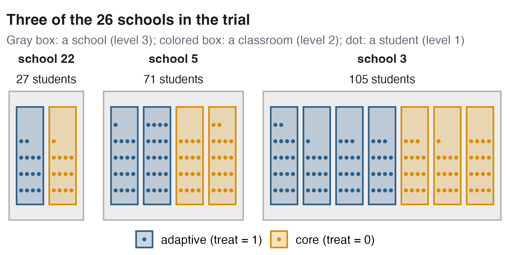
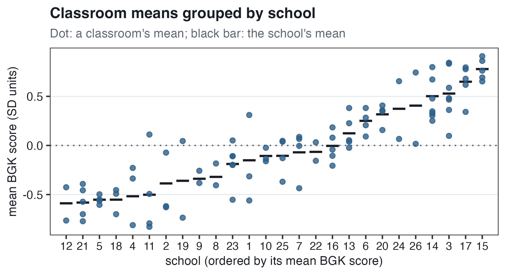
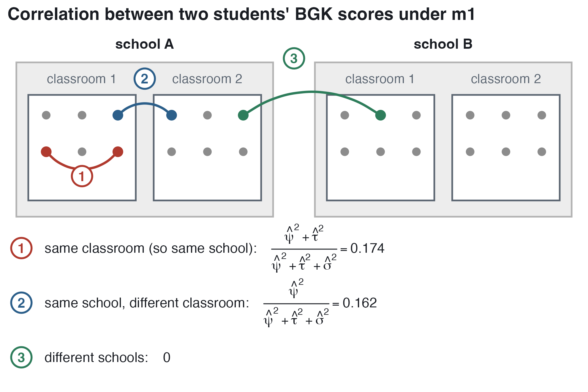
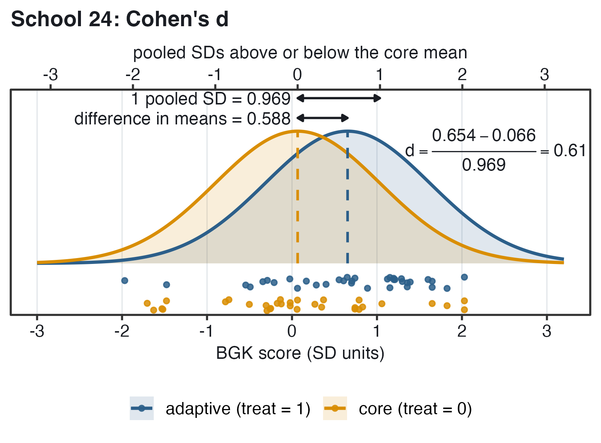
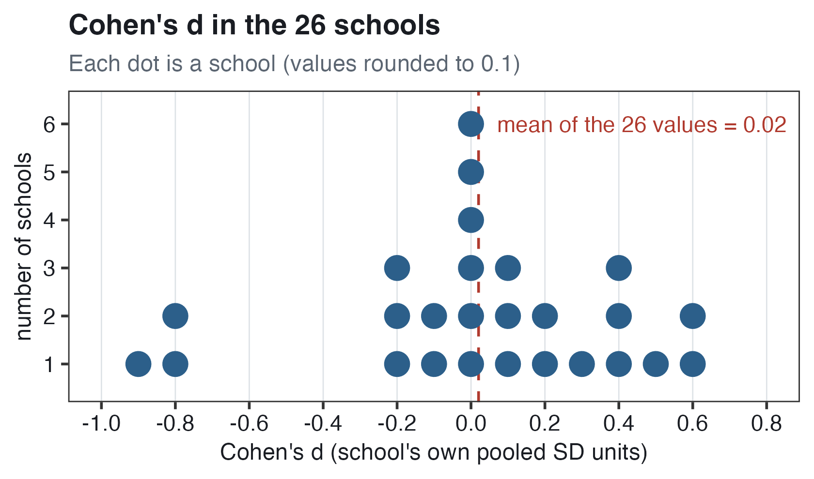
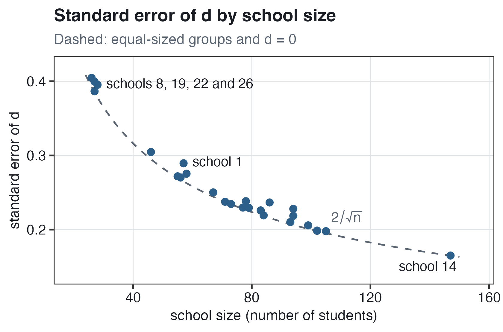
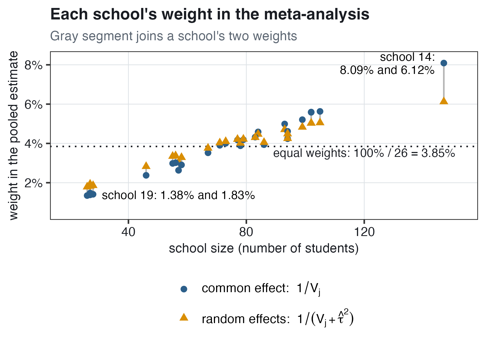

# Higher-Level Models and Meta-Analysis {#sec-higher-level}

:::: chapter-lead
::: lead-label
The chapter in one paragraph
:::

This chapter returns to the Relyea et al. (2025) trial, with one **background knowledge** (BGK) score per student, standardized to mean 0 and SD 1. Within each of 26 schools, whole classrooms were randomly assigned to an **adaptive** or a **core** version of a literacy intervention: a **multisite cluster randomized trial**, with students ($i$) in classrooms ($j$) in schools ($k$). In a single-level regression, the SEs are computed as if the 1,914 students were independent; ignoring classrooms can make the SE on the treatment too small, and ignoring schools too large. In the **three-level variance components model** (m1), each score is a grand mean plus a school, a classroom and a student departure. Each level's share of the total variance is its **variance partition coefficient** (VPC): 0.162 for schools and 0.012 for classrooms. Two students in the same classroom also share a school, so the correlation of their scores, the classroom **intraclass correlation** (ICC), is $0.162 + 0.012 = 0.174$. In m2, with the treatment and the classroom's mean pretest added, the adaptive version is estimated to raise BGK by 0.085 SD, compared with the core version, for classrooms in the same school with the same pretest mean. m3 has a **random slope** for the treatment across schools. m3 is an **individual participant data meta-analysis**: the 26 school trials are analyzed with every student's score, not one summary per school. m3's average treatment effect is 0.094, and the true school-specific effects differ from the average by about 0.061 in SD terms. A likelihood ratio test of the random slope has $p = 0.42$, or about 0.20 to 0.30 with a correction for testing whether a variance is 0, so there is no evidence that the effect differs across schools (**treatment heterogeneity**) beyond chance. In a **meta-analysis**, each school has one summary, such as the difference in mean BGK or an **effect size** (**Cohen's** $\boldsymbol{d}$). In the meta-analytic **random-effects model**, $\tau^2$ is the variance of the true effects across schools, and schools with more precise estimates have more weight. In this chapter's meta-analysis of the schools' values of $d$, the pooled effect size of the adaptive version, compared with the core version in the same school, is 0.057 pooled within-school SDs, not distinguishable from zero. The true school effect sizes are typically about $\tau = 0.17$ above or below 0.057. $I^2 = 41.8\%$ is the share of the variation in the observed effect sizes that is from true differences between schools. The treatment effects in m2 and m3 differ from the meta-analytic average effect mainly because m2 and m3 include the pretest and the meta-analysis does not. The meta-analytic $\tau = 0.17$ is larger than m3's 0.061 partly because each school's SE is computed as if its students were independent, although whole classrooms were assigned, so differences between classrooms are counted in $\tau$. In a final section, a likelihood ratio test of m1 against m1a, a two-level model of students in schools, has $p = 0.047$: some evidence that classrooms in the same school differ in mean BGK beyond chance.
::::

## The trial and its data {#sec-hl-trial}

This section describes the randomized trial, its variables and its three levels: students in classrooms in schools.

### The background knowledge data {#sec-hl-data}

The data come from Relyea et al. ([2025](https://doi.org/10.1002/rrq.70048)), an evaluation of a literacy intervention, MORE, in a randomized controlled trial with Grade 3 students in a large urban school district in the southeastern United States, available as [`relyea.csv`](../data/relyea.csv). In @sec-cross-classified, the data were the same students' responses to 36 vocabulary items. Here the outcome is **background knowledge** (BGK): each student's score on a nine-item test, computed from the item responses with **item response theory** (IRT). Each row of the data is one student.

An example item: *Which muscles can you control?* (1) the skeletal muscles, (2) the smooth muscles, (3) the heart muscles, (4) the fiber muscles. Each item is scored 1 (correct) or 0 (incorrect); here the correct answer is the skeletal muscles.

- `id` is the student.
- `cluster_id` is the classroom teacher, so each value is one classroom.
- `block_id` is the school, within which classrooms were randomly assigned.
- `treat` is 1 for the **adaptive** version of the intervention and 0 for the **core** version (@sec-hl-design); it is converted to a factor with `mutate(treat = factor(treat))`, so R labels its coefficient `treat1`.
- `bgk_score` is the student's BGK score, standardized to mean 0 and SD 1 over all 1,914 students.
- `t_pretest` is the classroom's mean **BOY MAP** score, a **pretest**: the beginning-of-year reading comprehension test (Measures of Academic Progress) of @sec-random-intercepts, standardized over students. It is the mean over the classroom's students who have a MAP score, so the 171 students with no MAP score still have a pretest value.

The table below shows the number of units at each level and a summary of each variable.

| Feature | Value |
|:---|:---|
| Students | 1,914 |
| Classrooms (`cluster_id`) | 98, with 10 to 51 students each (median 17.5) |
| Schools (`block_id`) | 26, with 2 to 7 classrooms (median 4) and 26 to 147 students (median 77.5) |
| `treat` | 50 adaptive classrooms (962 students) and 48 core (952 students); every school has both |
| `bgk_score` | mean 0, SD 1; from $-2.16$ to 2.03 |
| `t_pretest` | 98 values, one per classroom: mean 0.03, SD 0.53, from $-1.26$ to 1.04 |

The first six rows of the data, rounded to two decimals, are six students in school 22:

| `id` | `cluster_id` | `block_id` | `treat` | `bgk_score` | `t_pretest` |
|-----:|-------------:|-----------:|--------:|------------:|------------:|
|  909 |           47 |         22 |       1 |     $-0.74$ |     $-0.35$ |
|  460 |            4 |         22 |       0 |     $-1.31$ |     $-0.03$ |
|  932 |           47 |         22 |       1 |        0.31 |     $-0.35$ |
|  279 |           47 |         22 |       1 |     $-0.63$ |     $-0.35$ |
| 1534 |            4 |         22 |       0 |     $-1.56$ |     $-0.03$ |
|  187 |            4 |         22 |       0 |     $-0.17$ |     $-0.03$ |

**What do the rows have in common?** Students 909, 932 and 279 are in classroom 47 (adaptive), and students 460, 1534 and 187 in classroom 4 (core). `treat` and `t_pretest` are the same for every student in a classroom because both are **classroom variables**, with one value per classroom. Within a classroom, only `id` and `bgk_score` differ from student to student.

### Adaptive versus core: a multisite cluster randomized trial {#sec-hl-design}

What are the two versions, and how were they assigned? Every classroom used the intervention, in one of two versions: **core** (`treat` = 0) or **adaptive** (`treat` = 1). In the adaptive version, teachers had more flexibility to adapt the instructional materials to their needs. So the comparison is between two versions, not between the intervention and no intervention. The assignment has two features:

- **Multisite trial.** The random assignment was carried out within each school (each **site**): in every school, some classrooms were assigned to the adaptive version and the others to the core version.
- **Cluster randomized trial (cluster RCT).** Whole classrooms (the **clusters**) were randomly assigned, not single students. Every student in a classroom has the same version.

So this trial is a **multisite cluster RCT**. Each school is a small cluster RCT, and the data have three levels: students within classrooms within schools.

{#fig-hl-design width="78%"}

**Reading @fig-hl-design.** School 22 has two classrooms: classroom 47 (adaptive, 14 students) and classroom 4 (core, 13 students). School 5 has two of each version, and school 3 has 4 adaptive and 3 core classrooms. Every one of the 26 schools has at least one classroom of each version, and seven, including school 22, have exactly one of each. In these seven schools, the comparison of the two versions is a comparison of two classrooms.

### Three levels and three sample sizes {#sec-hl-sizes}

How many units are there at each level? Three-level data have three sample sizes:

``` r
nrow(relyea)                                 # 1,914 students
relyea %>% distinct(cluster_id) %>% nrow()   # 98 classrooms
relyea %>% distinct(block_id) %>% nrow()     # 26 schools
```

Classrooms have 10 to 51 students, and schools have 2 to 7 classrooms (26 to 147 students). A quantity about the schools as a group, such as how much schools differ in BGK, is estimated from only 26 schools.

**Levels.** The student is level 1, the classroom level 2 and the school level 3: $\text{BGK}_{ijk}$ is the BGK score of student $i$ in classroom $j$ in school $k$. In @sec-variance-components to @sec-binary-outcomes, $j$ was the level-2 unit, such as the school, and $\tau^2$ was the variance between those units. In this chapter, $\tau^2$ is still the level-2 variance, so its meaning changes with the level-2 unit. In the three-level models of @sec-hl-three-level to @sec-hl-heterogeneity, level 2 is the classroom: $\tau^2$ is the variance between **classrooms**, and the variance between schools is $\psi^2$ ($\psi$ is the Greek letter psi). In the meta-analysis of @sec-hl-meta, level 2 is the school: $j$ is the school, and $\tau^2$ is the variance of the true treatment effects across schools.

### Looking at the data {#sec-hl-look}

How are the BGK scores distributed, and how do they differ by classroom pretest mean, by school and by version?

{#fig-hl-bgk width="80%"}

**Reading @fig-hl-bgk.**

- **Left.** The scores range from $-2.16$ to 2.03, and the middle 50% of the students score between $-0.74$ and 0.74 (the first and third quartiles).
- **Right, the dots.** The dots form vertical **stripes** because `t_pretest` is the classroom's mean, so every student in a classroom has the same horizontal position. Each of the 98 stripes is one classroom. Within a stripe, the dots differ in height because students in the same classroom differ in BGK.
- **Right, the lines.** The lines are the single-level regression of @sec-hl-ols. Along either line, so for the same treatment status, students in classrooms with a higher pretest mean have higher predicted BGK scores: 0.72 higher per unit of the pretest mean. The adaptive line is 0.065 above the core line at every pretest mean.

{#fig-hl-schools width="80%"}

**Reading @fig-hl-schools.** Each panel is one school, a small randomized trial of the two versions. Two things differ across the panels.

- **The schools' scores.** In some panels both boxes are mostly above 0, and in others mostly below. The mean BGK score of a school's students ranges from $-0.59$ (school 12) to 0.78 (school 15).
- **The comparison of the versions.** In some schools the adaptive box is higher, and in others the core box is. The difference in mean BGK, adaptive minus core, ranges from $-0.78$ (school 19) to 0.60 (school 1), and in school 14 it is $-0.004$. School 19 has 27 students and school 14 has 147, so part of the spread of these differences is from chance, especially in the small schools.

::: callout-important
## A multisite cluster randomized trial has three levels

The 1,914 students are in 98 classrooms in 26 schools. Within each school, whole classrooms were randomly assigned to the adaptive or the core version, so each school is a small randomized trial. The version and the mean MAP pretest are classroom variables; the BGK score is a student variable.
:::

## A model without classrooms or schools {#sec-hl-single}

@sec-hl-trial described three levels. This section is about a single-level regression with no terms for classrooms or schools, fitted by ordinary least squares (OLS; `m0` in R), and about its SE on `treat`.

### The single-level regression {#sec-hl-ols}

The single-level regression has two predictors, the version and the classroom's mean MAP pretest:

$$\begin{aligned}
\text{BGK}_i &= \beta_0 + \beta_1\,\text{treat}_i + \beta_2\,\text{MAP}_i + e_i \\
e_i &\sim N(0, \sigma^2)
\end{aligned}$$

- $\text{BGK}_i$ is student $i$'s BGK score (`bgk_score`), with one subscript because the model has no classrooms or schools.
- $\text{treat}_i$ is 1 if student $i$'s classroom used the adaptive version and 0 if it used the core version.
- $\text{MAP}_i$ is the mean BOY MAP score of student $i$'s classroom (`t_pretest`).
- $\beta_0$ is the predicted BGK score of a student in a core classroom whose mean MAP score is 0.
- $\beta_1$ is the **treatment effect**: the difference in BGK caused by the adaptive version, compared with the core version, for classrooms with the same mean MAP score.
- $\beta_2$ is the difference in predicted BGK per difference of 1 in classroom mean MAP score, for the same treatment status.
- $e_i$ is the **residual**: how far student $i$'s score is from the predicted score. The residuals are **assumed** normal with mean 0 and variance $\sigma^2$. They are also assumed **independent**: two students in the same classroom are assumed to be no more alike than two students in different schools.

``` r
m0 <- lm(bgk_score ~ 1 + treat + t_pretest, data = relyea)
```

The `1` is $\beta_0$, `treat` is $\beta_1$ and `t_pretest` is $\beta_2$. The table below shows the estimates, their SEs and $t$, the estimate divided by its SE. An estimate with $t$ beyond about $\pm 2$ is distinguishable from zero.

| Term                              |  Estimate |     SE |     $t$ |
|:----------------------------------|----------:|-------:|--------:|
| $\widehat{\beta_0}$ `(Intercept)` | $-0.0482$ | 0.0301 | $-1.60$ |
| $\widehat{\beta_1}$ `treat1`      |    0.0649 | 0.0425 |    1.53 |
| $\widehat{\beta_2}$ `t_pretest`   |    0.7154 | 0.0402 |   17.78 |

$\widehat{\beta_1} = 0.065$. *Interpretation.* Classrooms were randomly assigned, so 0.065 is an estimate of the causal effect of the adaptive version. For classrooms with the same mean MAP score, the adaptive version is estimated to raise BGK by 0.065 SD compared with the core version. With $t = 1.53$, this estimate is not distinguishable from zero.

$\widehat{\beta_2} = 0.72$. *Interpretation.* Two students whose classrooms have the same treatment status but mean MAP scores that differ by 1 are predicted to differ by 0.72 SD in BGK. A difference of 1 is about 1 SD of students' MAP scores. Classroom mean MAP scores have SD 0.53, so a difference of 1 between two classrooms is large. With $t = 17.78$, far beyond 2, the association is well established.

$\widehat{\beta_0} = -0.05$. *Interpretation.* A student in a core classroom whose mean MAP score is 0 has a predicted BGK score of $-0.05$, 0.05 SD below the mean of all students.

$\widehat{\sigma} = 0.93$, the estimate of $\sigma$ (R prints it as the residual standard error). *Interpretation.* A student's BGK score is typically about 0.93 above or below the score predicted from the classroom's treatment status and mean MAP score.

### Is the SE on treat too big or too small? {#sec-hl-ols-se}

The SE on `treat`, 0.0425, is computed as if the 1,914 students were independent. Two features of the design affect this SE, in opposite directions.

**Classrooms: the SE can be too small.** Students in the same classroom have the same teacher, and their BGK scores can be more alike than the scores of students in different classrooms. Whole classrooms were assigned, so the comparison of the versions is a comparison of 98 classrooms (50 adaptive and 48 core), not of 1,914 independent students. If one adaptive classroom has an unusually effective teacher, all of its students tend to score higher, for a reason other than the version. A teacher affects all of a classroom's students at once, so the difference between the versions varies more from sample to sample than it would with 1,914 independent students. So if classmates' scores are alike, the OLS SE is too small for a classroom variable.

**Schools: the SE can be too large.** Schools' mean BGK scores range from $-0.59$ to 0.78 (@fig-hl-schools). Every school has both versions, so the versions can be compared within each school, and a comparison within one school does not contain the differences between schools. In school 15, which has the highest mean, both versions, or **arms**, score high (core 0.786, adaptive 0.765), but the adaptive-minus-core difference is only $-0.021$: the school's high mean is part of both arms' means, so it is not part of their difference. The single-level regression has no term for schools, so the school differences are part of its residuals, and of $\widehat{\sigma} = 0.93$. A larger residual variance means a larger SE, so the SE can be too large.

So ignoring how students are grouped does not always make an SE too small. For a variable that is the same for every student in a group, such as `treat` within a classroom, the SE is too small if group members' scores are alike. For a variable that differs within groups, such as `treat` within a school, the SE can be too small or too large. `treat` is both: a classroom variable that differs within every school. So the point about classrooms and the point about schools both apply to its SE, in opposite directions, and whether the OLS SE is too small or too large depends on the data.

A three-level model with the same two predictors and terms for classrooms and schools (m2) has an SE on `treat` of 0.0422, slightly smaller than 0.0425. In m2, the classroom variance is estimated at 0, and the school differences are not part of the residuals (@sec-hl-m2-se).

::: callout-important
## Why the SE on treat can be too small or too large

In the single-level regression, the SEs are computed as if the 1,914 students were independent. Ignoring classrooms makes the SE on treat too small when classmates' scores are alike, because every student in a classroom has the same version. Ignoring schools can make the SE too large, because the school differences are part of the residuals, while the versions can be compared within schools.
:::

## Three-level models {#sec-hl-three-level}

The single-level regression of @sec-hl-single has no term for classrooms or schools. But the 1,914 students are in 98 classrooms in 26 schools, and students in the same classroom have the same teacher and the same school. A **three-level model** has a random intercept for classrooms and one for schools. This section is about the simplest one, **m1**, which has no predictors. Its three variances describe how much BGK scores differ between schools, between classrooms in the same school and between students in the same classroom.

### The three-level variance components model (m1) {#sec-hl-m1-model}

m1 is a **variance components model** (random intercepts and no predictors) with three levels: student $i$ in classroom $j$ in school $k$.

$$\begin{aligned}
\textbf{Level 1:} \qquad && \text{BGK}_{ijk} &= \beta_{0jk} + e_{ijk} \\
&& e_{ijk} &\sim N(0, \sigma^2) \\
\textbf{Level 2:} \qquad && \beta_{0jk} &= \gamma_{0k} + u_{jk} \\
&& u_{jk} &\sim N(0, \tau^2) \\
\textbf{Level 3:} \qquad && \gamma_{0k} &= \delta_0 + r_k \\
&& r_k &\sim N(0, \psi^2)
\end{aligned}$$

- $i$ is the student, $j$ the classroom and $k$ the school. A classroom has two subscripts, $jk$: classroom $j$ of school $k$.
- $\text{BGK}_{ijk}$ is the background knowledge score (`bgk_score`) of student $i$ in classroom $j$ of school $k$, standardized to mean 0 and SD 1 over all 1,914 students.
- $\beta_{0jk}$ is the **mean of classroom** $jk$: the BGK score expected for a student in that classroom.
- $e_{ijk}$ is the **student departure**, the residual: how far student $i$'s score is above or below the mean of the student's classroom.
- $\gamma_{0k}$ is the **mean of school** $k$: the mean of its classrooms' means.
- $u_{jk}$ is the **classroom departure**: how far classroom $jk$'s mean is above or below its school's mean. It is the same for every student in the classroom.
- $\delta_0$ ($\delta$ is the Greek letter delta) is the **grand mean**: the mean of the school means, the mean BGK score of a school with $r_k = 0$. It is one fixed number for all schools.
- $r_k$ is the **school departure**: how far school $k$'s mean is above or below the grand mean. It is the same for every student in the school.
- $\sigma^2$ is the **student variance**: the variance of the $e_{ijk}$, the same in every classroom.
- $\tau^2$ is the **classroom variance**: the variance of the $u_{jk}$.
- $\psi^2$ is the **school variance**: the variance of the $r_k$.
- The three departures are **assumed** to be normal with mean 0 and independent of each other. These are assumptions, not estimates.

**From two levels to three.** The variance components model of @sec-variance-components, with $Y_{ij}$ the reading score of student $i$ in school $j$, was

$$\begin{aligned}
\textbf{Level 1:} \qquad && Y_{ij} &= \beta_{0j} + e_{ij}, \qquad e_{ij} \sim N(0, \sigma^2) \\
\textbf{Level 2:} \qquad && \beta_{0j} &= \gamma_0 + u_j, \qquad u_j \sim N(0, \tau^2)
\end{aligned}$$

with $\gamma_0$ the grand mean, $u_j$ school $j$'s departure, $\tau^2$ the school variance and $\sigma^2$ the student variance. m1 has one more level, so it has one more equation, one more random intercept ($r_k$) and one more variance ($\psi^2$). Two letters change meaning. In three-level notation, a $\gamma$ with a $k$ subscript is a school's coefficient (in m1, its mean), and the fixed grand mean is $\delta_0$, not $\gamma_0$. And $\tau^2$ is the classroom variance, not the school variance.

Substituting level 3 into level 2, and level 2 into level 1, gives the **reduced form**:

$$\begin{aligned}
\text{BGK}_{ijk} &= \beta_{0jk} + e_{ijk} \\
&= \gamma_{0k} + u_{jk} + e_{ijk} \\
&= \delta_0 + r_k + u_{jk} + e_{ijk}
\end{aligned}$$

Line one is level 1. Line two replaces $\beta_{0jk}$ with its level-2 equation, $\gamma_{0k} + u_{jk}$. Line three replaces $\gamma_{0k}$ with its level-3 equation, $\delta_0 + r_k$. Each term of line three has a name:

$$\text{BGK}_{ijk} = \underbrace{\delta_0}_{\text{grand mean}} + \underbrace{r_k}_{\text{school deviation}} + \underbrace{u_{jk}}_{\text{classroom deviation}} + \underbrace{e_{ijk}}_{\text{student deviation}}$$

The three deviations are the three departures, $r_k$, $u_{jk}$ and $e_{ijk}$. The grand mean $\delta_0$ is one fixed number, the same for every student, so it has no variance. The departures are assumed independent, and the variance of a sum of independent terms is the sum of their variances, so under m1 the variance of BGK is $\psi^2 + \tau^2 + \sigma^2$: one part per level.

``` r
m1 <- lmer(bgk_score ~ 1 + (1 | cluster_id) + (1 | block_id), data = relyea)
```

The `1` is $\delta_0$. `(1 | cluster_id)` is $u_{jk}$: one random intercept per classroom (`cluster_id`, the classroom teacher), with variance $\tau^2$. `(1 | block_id)` is $r_k$: one random intercept per school (`block_id`), with variance $\psi^2$. The residual $e_{ijk}$ is not written: `lmer` includes it by default. Each level above the student is one `(1 | ...)` term. In @sec-cross-classified, code of the same form, `(1 | id) + (1 | item)`, was used for students and items, which are crossed, not nested: each student answered many items, and each item was answered by many students. Here the classrooms are nested in schools because each `cluster_id` value is in only one school: the nesting is in the ID values of the data, not in the code.

### A picture of the three deviations {#sec-hl-dgp}

In @fig-hl-dgp, the reduced form is drawn for one student, with made-up numbers on a scale whose grand mean is 100.

{#fig-hl-dgp width="72%"}

**Reading @fig-hl-dgp.** The horizontal axis is the score, and each curve is the distribution at one level. The student's score is built one level at a time, starting with the school:

- **School.** School $k$'s mean is 10 above the grand mean: $r_k = 10$, so $\gamma_{0k} = 100 + 10 = 110$.
- **Classroom.** Classroom $jk$'s mean is 5 below its school's mean: $u_{jk} = -5$, so $\beta_{0jk} = 110 - 5 = 105$.
- **Student.** The student's score is 3 above the classroom's mean: $e_{ijk} = 3$, so the made-up score, written $Y_{ijk}$ in @fig-hl-dgp, is $105 + 3 = 108$.

In the reduced form, $Y_{ijk} = \delta_0 + r_k + u_{jk} + e_{ijk} = 100 + 10 + (-5) + 3 = 108$. The width of each curve is the SD at its level: $\psi$ for the school curve, $\tau$ for the classroom curve and $\sigma$ for the student curve. The widths are made up too.

### Fitting m1 {#sec-hl-m1}

We fit m1 to the 1,914 students and ask two questions: which estimate is which Greek letter, and which level has the most variation? The table below has R's output: the estimated grand mean with its SE and $t$, and the three estimated SDs, for which R prints no SE.

| Term | Estimate | SE | $t$ |
|:---|---:|---:|---:|
| $\widehat{\delta_0}$ `(Intercept)` | $-0.0529$ | 0.0826 | $-0.64$ |
| $\widehat{\tau}$ `sd__(Intercept)`, group `cluster_id` | 0.1109 |  |  |
| $\widehat{\psi}$ `sd__(Intercept)`, group `block_id` | 0.4004 |  |  |
| $\widehat{\sigma}$ `sd__Observation`, group `Residual` | 0.9055 |  |  |

**Which estimate is which Greek letter?** R prints SDs, not variances, each next to its grouping variable. `cluster_id` is the classroom, so its SD is $\widehat{\tau}$; `block_id` is the school, so its SD is $\widehat{\psi}$; `Residual` is the student level, $\widehat{\sigma}$. BGK has SD 1 over all students, so every estimate is in SD units of BGK: $\widehat{\psi} = 0.40$ is 0.40 of one SD of students' scores.

$\widehat{\delta_0} = -0.05$. *Interpretation.* For a student in a school of average BGK ($r_k = 0$), in a classroom of average BGK for that school ($u_{jk} = 0$), the predicted BGK score is $-0.05$: 0.05 SD below 0, the mean of all 1,914 students. **Why is** $\widehat{\delta_0}$ **not 0?** In the mean of all students, each student counts once, so a school with 147 students counts more than a school with 26. $\widehat{\delta_0}$ is close to the simple average of the 26 school means, $-0.06$, in which each school counts once. Larger schools tend to have higher mean BGK scores (the correlation between a school's number of students and its mean BGK score is 0.36), so the mean of all students, 0, is above the simple average of the school means.

$\widehat{\psi} = 0.40$. *Interpretation.* Schools' mean BGK scores differ from the grand mean by about 0.40 in SD terms. About 95% of schools are expected to have mean BGK scores between $-0.0529 - 1.96(0.4004) = -0.84$ and $-0.0529 + 1.96(0.4004) = 0.73$.

$\widehat{\tau} = 0.11$. *Interpretation.* Within any school, classrooms' mean BGK scores differ from the school's mean by about 0.11 in SD terms. About 95% of classrooms are expected to have means within $1.96(0.1109) = 0.22$ of their school's mean.

$\widehat{\sigma} = 0.91$. *Interpretation.* A student's BGK score is typically about 0.91 above or below the mean of the student's classroom.

**Which level has the most variation?** In the table below, each SD is squared to get the variance at its level. Each variance is divided by the sum of the three variances to get the level's share of the variance of BGK.

| Level | SD | Variance | Share of variance |
|:---|---:|---:|---:|
| School | $\widehat{\psi} = 0.4004$ | $\widehat{\psi}^2 = 0.1603$ | 0.1615 (16.2%) |
| Classroom | $\widehat{\tau} = 0.1109$ | $\widehat{\tau}^2 = 0.0123$ | 0.0124 (1.2%) |
| Student | $\widehat{\sigma} = 0.9055$ | $\widehat{\sigma}^2 = 0.8199$ | 0.8261 (82.6%) |

For schools, the share is $0.1603/(0.1603 + 0.0123 + 0.8199) = 0.1615$. The three variances add to about 0.99, close to 1, the variance of BGK over all students.

*Interpretation.* 82.6% of the variance of BGK scores is between students in the same classroom, 16.2% is between schools, and 1.2% is between classrooms in the same school. So the student level has the most variation, and the classroom level very little. In the made-up picture of @fig-hl-dgp, the student curve is the narrowest; in our data, the student SD (0.91) is the largest of the three.

@fig-hl-classrooms has the observed mean BGK score of each classroom, grouped by school.

{#fig-hl-classrooms width="78%"}

**Reading @fig-hl-classrooms.** In the plot of reading scores by school in @sec-variance-components, each black dot was a student's score and each red dot a school's mean. @fig-hl-classrooms is the same plot one level up: each dot is a classroom's mean, and each bar a school's mean. The vertical axis is the mean BGK score, in SD units; the dotted line is at 0, the mean of all students. The school means range from $-0.59$ to 0.78, so schools differ a lot. Within a school, the classroom means are nearer each other than the school means are: the SD of the classroom means within a school, pooled over the 26 schools, is 0.24, against an SD of 0.42 for the 26 school means. So most of the differences between the 98 classroom means are differences between the schools the classrooms are in.

**Does the classroom variance include the treatment effect?** Yes. In m1, which has no predictors, $u_{jk}$ is the whole difference between a classroom's mean and its school's mean, including any difference between adaptive and core classrooms and between classrooms with higher and lower pretest means. Even so, the classroom variance is small: 1.2% of the variance of BGK.

**Why do the dots in a school differ by more than** $\widehat{\tau} = 0.11$**?** $\widehat{\tau} = 0.11$ is the SD of the true classroom means around their school's mean, and each dot is an observed mean. As with the school means in @sec-variance-components, an observed mean is the true mean plus sampling error, so observed means differ more than true means do. Each dot is an average of about 20 students' scores (1,914 students in 98 classrooms). One student's score is typically about 0.91 above or below the classroom's mean. So even if every classroom in a school had the same true mean, an average of 20 scores would typically be about $0.9055/\sqrt{20} = 0.20$ above or below that true mean. In m1, this sampling error is the mean of the classroom's student departures $e_{ijk}$. The true means and the sampling errors are independent, so the variance of the observed classroom means within a school is about the sum of the two variances, $\tau^2 + \sigma^2/20$. Its square root is $\sqrt{0.11^2 + 0.20^2} = 0.23$, close to 0.24, the pooled SD of the classroom means within schools. In @sec-hl-appendix, a likelihood ratio test of $\tau^2 = 0$ has $p = 0.047$: some evidence that classrooms in the same school differ in mean BGK beyond chance.

### ICCs and VPCs with three levels {#sec-hl-icc}

The shares in @sec-hl-m1 describe how the variance of BGK is divided among the three levels. In @sec-variance-components, with two levels, the **intraclass correlation** (ICC) was both a share of the variance and the correlation between the scores of two students in the same school. With three levels, the classroom's share and the classmates' correlation are no longer the same number, and three quantities are defined:

$$\text{ICC}_{\text{school}} = \frac{\psi^2}{\psi^2 + \tau^2 + \sigma^2}, \qquad \text{ICC}_{\text{tch}} = \frac{\psi^2 + \tau^2}{\psi^2 + \tau^2 + \sigma^2}, \qquad \text{VPC}_{\text{tch}} = \frac{\tau^2}{\psi^2 + \tau^2 + \sigma^2}$$

- The denominator, $\psi^2 + \tau^2 + \sigma^2$, is the variance of BGK: the school, classroom and student variances added together.
- "tch" is for teacher. Each classroom has one teacher, so $\text{ICC}_{\text{tch}}$ is the **classroom ICC** and $\text{VPC}_{\text{tch}}$ the classroom VPC.
- A **variance partition coefficient** (VPC) is one level's own share of the variance: that level's variance over the total. The VPCs of the three levels are the shares in @sec-hl-m1's table, and they add to 1. The school's VPC, $\psi^2/(\psi^2 + \tau^2 + \sigma^2)$, is $\text{ICC}_{\text{school}}$.
- $\text{ICC}_{\text{tch}}$ has $\psi^2 + \tau^2$ in its numerator: it **contains** the school variance. $\text{VPC}_{\text{tch}}$ has only $\tau^2$.

With m1's variances, $\widehat{\psi}^2 = 0.1603$, $\widehat{\tau}^2 = 0.0123$ and $\widehat{\sigma}^2 = 0.8199$:

$$\begin{aligned}
\text{ICC}_{\text{school}} &= \frac{0.1603}{0.1603 + 0.0123 + 0.8199} = 0.1615 \\
\text{VPC}_{\text{tch}} &= \frac{0.0123}{0.1603 + 0.0123 + 0.8199} = 0.0124 \\
\text{ICC}_{\text{tch}} &= \frac{0.1603 + 0.0123}{0.1603 + 0.0123 + 0.8199} = 0.1739
\end{aligned}$$

The `icc()` function of the performance package prints the VPCs:

``` r
icc(m1, by_group = TRUE)
#  Group      |   ICC
#  cluster_id | 0.012
#  block_id   | 0.162
```

Both numbers are labeled ICC, but each is one level's own share. The classroom's number (`cluster_id`), 0.012, is $\text{VPC}_{\text{tch}}$. The school's number (`block_id`), 0.162, is the school's VPC, equal to $\text{ICC}_{\text{school}}$. The classroom ICC is the sum of the two numbers: $0.012 + 0.162 = 0.174$.

**The ICC as a share of variance.**

- *In @sec-variance-components:* 17% of the variance in students' reading scores was between schools.
- *Here:* each level has its own share, its VPC. The classroom ICC is the share of the variance of BGK that is between classrooms when classrooms in all 26 schools are compared. A classroom's mean differs from the grand mean by $r_k + u_{jk}$, so this share includes the school variance.

*Interpretation.* Comparing classrooms in all 26 schools, 17.4% of the variance of BGK is between classrooms: 16.2% from their schools and 1.2% from the classrooms themselves. The other 82.6% is between students in the same classroom.

**The ICC as a correlation.**

- *In @sec-variance-components:* the reading scores of two students in the same school were correlated 0.17. For a student 1 SD above the mean, our best guess for a schoolmate was 0.17 SD above the mean.
- *Here:* two students can be in the same classroom, in the same school but different classrooms, or in different schools (@fig-hl-pairs). The departures they do not have in common are independent, so the two scores are alike only through the departures they share. The correlation between their scores is the variance of the departures they have in common divided by the variance of BGK.

{#fig-hl-pairs width="78%"}

**Reading @fig-hl-pairs.**

- **Same classroom.** Two classmates also have the same school, so both scores contain the same $r_k$ and the same $u_{jk}$. Their correlation is $(\psi^2 + \tau^2)/(\psi^2 + \tau^2 + \sigma^2) = 0.1739$, the classroom ICC.
- **Same school, different classrooms.** Both scores contain the same $r_k$ but different $u_{jk}$. Their correlation is $\psi^2/(\psi^2 + \tau^2 + \sigma^2) = 0.1615$, the school ICC.
- **Different schools.** The two scores have no departure in common, so their correlation is 0.

*Interpretation.* Suppose a student's BGK score is 1 SD above the mean. Our best guess for a classmate's score is 0.17 SD above the mean; for a student in another classroom of the same school, 0.16 SD above the mean; and for a student in another school, the mean itself. So 0.17 is low: one student's score contains little information about a classmate's score. And classmates are only a little more alike than two students in different classrooms of the same school. The ICC of @sec-variance-components and the classroom ICC here only round to the same value, 0.17; they come from different students and different tests.

**Why do the classroom VPC and the classmates' correlation differ?** Classmates always have the same school, so the correlation between their scores contains the school variance: $0.162 + 0.012 = 0.174$. The classroom's own share, the VPC, contains only the classroom variance: 0.012. For schools, the VPC and the ICC agree: 0.1615 is both the school's own share of the variance and the correlation between two students in different classrooms of the same school.

**Which number to report?** The answer depends on the question. The VPCs describe how the variance of BGK is divided among the levels; the classroom ICC, 0.17, describes how alike two classmates are. Reporting both is also an option.

::: callout-important
## Three levels: three variances and two kinds of ICC

Under m1, a student's BGK score is the grand mean plus a school departure, a classroom departure and a student departure, with variances $\psi^2$, $\tau^2$ and $\sigma^2$. 16.2% of the variance of BGK is between schools, 1.2% between classrooms in the same school and 82.6% between students in the same classroom: these shares are the VPCs. Two classmates also have the same school, so the correlation between their scores, the classroom ICC, is the school VPC plus the classroom VPC: $0.162 + 0.012 = 0.174$. The scores of two students in different classrooms of the same school are correlated 0.16, the school ICC. The VPCs describe how the variance is divided among the levels; the ICCs describe how alike two students in the same classroom or school are.
:::

## Adding the treatment and the pretest (m2) {#sec-hl-treatment}

m1 (@sec-hl-three-level) has no predictors, so it has no term for the two versions. **m2** is m1 with two classroom variables added: the version, or **arm** (adaptive or core), and the classroom pretest mean. The question of the trial is whether the adaptive version raised BGK scores, compared with the core version in the same school.

### The model {#sec-hl-m2-model}

`treat` is 1 for an adaptive classroom and 0 for a core one. `t_pretest`, written $\overline{\text{MAP}}_{jk}$ (the bar is for a mean; the same variable was written $\text{MAP}_i$ in @sec-hl-single), is the classroom's mean MAP pretest score. Every student in a classroom has the same value of both, so both are in the level-2 (classroom) equation:

$$\begin{aligned}
\textbf{Level 1:} \qquad && \text{BGK}_{ijk} &= \beta_{0jk} + e_{ijk} \\
&& e_{ijk} &\sim N(0, \sigma^2) \\
\textbf{Level 2:} \qquad && \beta_{0jk} &= \gamma_{0k} + \gamma_1\,\text{treat}_{jk} + \gamma_2\,\overline{\text{MAP}}_{jk} + u_{jk} \\
&& u_{jk} &\sim N(0, \tau^2) \\
\textbf{Level 3:} \qquad && \gamma_{0k} &= \delta_0 + r_k \\
&& r_k &\sim N(0, \psi^2)
\end{aligned}$$

- $\text{BGK}_{ijk}$ is the score of student $i$ in classroom $j$ of school $k$, standardized to mean 0 and SD 1 over all 1,914 students. $\beta_{0jk}$ is the classroom's mean score. The **residual** $e_{ijk}$, with variance $\sigma^2$, is how far student $i$'s score is above or below that mean.
- $\text{treat}_{jk}$ and $\overline{\text{MAP}}_{jk}$ have the subscripts $jk$ because they describe classroom $j$ of school $k$.
- $\gamma_1$ is the **treatment effect**: the difference in mean BGK caused by the adaptive version, compared with the core version, for classrooms in the same school with the same pretest mean. $\gamma_1$ has no $k$: m2 assumes the same effect in every school. $\gamma_2$ is the difference in mean BGK between two classrooms in the same school with the same treatment status whose pretest means differ by 1.
- $u_{jk}$ is the classroom's **departure** from the prediction for its school, arm and pretest mean. Its variance, $\tau^2$, is the **classroom** variance; in @sec-variance-components to @sec-binary-outcomes, $\tau^2$ was the level-2 variance, such as the school variance.
- $\gamma_{0k}$ is school $k$'s predicted mean for a core classroom with pretest mean 0 and $u_{jk} = 0$; in three-level notation, a $\gamma$ with a $k$ subscript is a school's coefficient. $\delta_0$ is the average of the $\gamma_{0k}$. $r_k$ is school $k$'s departure from $\delta_0$, with variance $\psi^2$.
- $r_k$, $u_{jk}$ and $e_{ijk}$ are **assumed** normal with mean 0 and independent of each other.

Substituting level 3 ($\gamma_{0k} = \delta_0 + r_k$) into level 2, and level 2 into level 1, gives the **reduced form**, with the school, classroom and student terms last:

$$\text{BGK}_{ijk} = \delta_0 + \gamma_1\,\text{treat}_{jk} + \gamma_2\,\overline{\text{MAP}}_{jk} + r_k + u_{jk} + e_{ijk}$$

``` r
m2 <- lmer(bgk_score ~ 1 + treat + t_pretest + (1 | cluster_id) + (1 | block_id),
           data = relyea)
```

The `1` is $\delta_0$; `treat` is $\gamma_1$ (a factor, so R prints it as `treat1`); `t_pretest` is $\gamma_2$; `(1 | cluster_id)` is $u_{jk}$, one random intercept per classroom; `(1 | block_id)` is $r_k$, one per school.

### Did the adaptive version help? {#sec-hl-m2}

The table below shows m2's estimates, with symbols and R's labels; R prints no SE or $t$ for an SD. `bgk_score` has SD 1 over all students, so the estimates are in SD units of BGK.

| Term | Estimate | SE | $t$ |
|:---|---:|---:|---:|
| $\widehat{\delta_0}$ `(Intercept)` | $-0.0858$ | 0.0533 | $-1.61$ |
| $\widehat{\gamma_1}$ `treat1` | 0.0846 | 0.0422 | 2.01 |
| $\widehat{\gamma_2}$ `t_pretest` | 0.6104 | 0.0685 | 8.90 |
| $\widehat{\tau}$ `sd__(Intercept)`, group `cluster_id` | 0.0000 |  |  |
| $\widehat{\psi}$ `sd__(Intercept)`, group `block_id` | 0.2215 |  |  |
| $\widehat{\sigma}$ `sd__Observation`, group `Residual` | 0.9030 |  |  |

$\widehat{\gamma_1} = 0.085$. *Interpretation.* Classrooms were randomly assigned within schools, so 0.085 is an estimate of the causal effect of the adaptive version. For classrooms in the same school with the same pretest mean, the adaptive version is estimated to raise BGK by 0.085 SD compared with the core version, a small benefit. With $t = 2.01$, about 2 SEs from zero, the effect is distinguishable from zero.

$\widehat{\gamma_2} = 0.61$. *Interpretation.* Comparing two classrooms (within or across schools) with the same treatment status whose pretest means differ by 1, the classroom with the higher pretest mean has predicted scores 0.61 SD higher. The 98 classroom pretest means have SD 0.53, so two classrooms whose pretest means differ by 0.53 are predicted to differ by $0.6104 \times 0.53 = 0.32$ SD.

$\widehat{\delta_0} = -0.09$. *Interpretation.* In a core classroom with pretest mean 0 (the 98 means average 0.03) and $u_{jk} = 0$, in a school with $r_k = 0$, the predicted score is 0.09 SD below the mean of all students.

$\widehat{\sigma} = 0.90$. *Interpretation.* A student's score is typically about 0.90 above or below the classroom's predicted score, close to m1's 0.91. The added variables are the same for all classmates, so they contain no information about differences among classmates.

$\widehat{\psi} = 0.22$. *Interpretation.* For classrooms with the same treatment status and pretest mean, schools' predicted scores differ from those of a school with $r_k = 0$ by about 0.22 in SD terms. The school variance fell from 0.1603 in m1 to $0.2215^2 = 0.0491$ in m2. In a model with the treatment and no pretest, the school SD is 0.40, as in m1, so the decrease is associated with the pretest: schools differ in their classrooms' pretest means.

$\widehat{\tau} = 0$. *Interpretation.* The classroom SD fell from 0.11 in m1 to exactly 0. Within a school, the means of classrooms with the same treatment status and pretest mean differ no more than expected from the differences among their students alone. So the estimate of the classroom variance would be 0 or below. A variance cannot be negative, so the estimate is 0, its lowest possible value. In a model with the treatment and no pretest, the classroom SD is 0.11, as in m1, so the decrease is associated with the pretest: classrooms in the same school differ in their pretest means. A classroom SD of 0 does not mean that the classrooms are identical: the true classroom SD can be small and positive, and the data contain no evidence of further classroom differences.

::: callout-note
## A note on the singular-fit message

When m2 is fit, R prints `boundary (singular) fit: see help('isSingular')`. A fit is **singular** when an estimated variance is exactly 0 or an estimated correlation is exactly $-1$ or 1, the boundary of its possible values. R still prints the estimates. Because the classroom SD is 0, m2 without `(1 | cluster_id)` has the same estimates and SEs. R prints the same message for m3 (@sec-hl-heterogeneity).
:::

### What happened to the standard errors? {#sec-hl-m2-se}

In @sec-hl-ols-se, the question was whether the SE on `treat` in the single-level regression (OLS), with no terms for classrooms or schools, is too big or too small. The table below has the SEs of the two classroom variables in OLS and m2.

| Term                                 | OLS SE |  m2 SE |
|:-------------------------------------|-------:|-------:|
| `treat` (adaptive = 1)               | 0.0425 | 0.0422 |
| `t_pretest` (classroom pretest mean) | 0.0402 | 0.0685 |

**Why is the SE on the pretest larger?** `t_pretest` has only 98 values, one per classroom, and 78% of the variance of these 98 classroom means is between schools. In OLS, its SE is computed as if the 1,914 students were independent pieces of information. In m2, students in the same school share the school departure $r_k$: school means also differ for reasons other than the pretest. So comparisons between the 26 schools contain less information than 1,914 independent students would, and the SE on the pretest is larger in m2 than in OLS.

**Why is the SE on the treatment slightly smaller?** Two things happen at once.

- **Classrooms.** Treatment was assigned to whole classrooms, so if classrooms differ, the OLS SE is too small. In m2, the classroom variance is estimated at 0, so m2's SE, like the OLS SE, contains no classroom variance, and classrooms do not make it larger.
- **Schools.** Every school has both arms, so the arms are compared within schools. In OLS, school differences are part of the residuals, and the residual SD is 0.93. In m2, school differences are in $r_k$, and the smaller residual SD, 0.90, makes the SE smaller.

As in @sec-hl-ols-se, ignoring classrooms can make the OLS SE on `treat` too small, and ignoring schools can make it too large. In m2, only the point about schools applies, so the SE is slightly smaller than in OLS: 0.0422 against 0.0425.

**Classrooms within schools, or whole schools?** In another design, whole schools are randomly assigned to one version: a cluster RCT with schools as the clusters.

For randomizing classrooms within schools (a multisite trial, as here):

- The versions are compared within schools, so the school differences are not part of the SE on `treat`. Fewer schools are needed for the same SE.
- The effect can differ from school to school, and its SD across schools can be estimated (@sec-hl-heterogeneity).

For randomizing whole schools:

- Adaptive and core teachers are in different schools, so core teachers cannot adopt parts of the adaptive version from colleagues, which would make the two arms more alike.
- Every classroom in a school has the same version, which is simpler for a school leader to organize.

So the choice depends on how likely teachers in the same school are to share materials, and on how many schools can take part.

::: callout-important
## m2: an estimated treatment effect of 0.085 SD

For classrooms in the same school with the same pretest mean, the adaptive version is estimated to raise BGK by 0.085 SD. The school variance fell from 0.1603 to 0.0491, and the classroom variance is estimated at 0. Compared with OLS, the SE on the pretest is larger, because the pretest varies mostly between schools, and students in the same school are alike. The SE on the treatment is slightly smaller, because the arms are compared within schools.
:::

## Does the effect differ across schools? (m3) {#sec-hl-heterogeneity}

m2 has one treatment effect for all 26 schools, but each school is a small randomized trial, and the effect may differ between them. **m3** has an effect for each school and an SD of these effects. Is the treatment effect consistent across schools?

### A random slope for treatment {#sec-hl-m3-model}

In m3, the coefficient on $\text{treat}_{jk}$ has a $k$ and its own level-3 equation, a **random slope** for treatment, as in @sec-random-slopes. `treat` is 0 or 1, so its slope is the difference between adaptive and core classrooms: a random slope for treatment is a treatment effect that can differ from school to school. Level by level, m3 is:

$$\begin{aligned}
\textbf{Level 1:} \qquad && \text{BGK}_{ijk} &= \beta_{0jk} + e_{ijk} \\
&& e_{ijk} &\sim N(0, \sigma^2) \\
\textbf{Level 2:} \qquad && \beta_{0jk} &= \gamma_{0k} + \gamma_{1k}\,\text{treat}_{jk} + \gamma_2\,\overline{\text{MAP}}_{jk} + u_{jk} \\
&& u_{jk} &\sim N(0, \tau^2) \\
\textbf{Level 3:} \qquad && \gamma_{0k} &= \delta_0 + r_{0k} \\
&& \gamma_{1k} &= \delta_1 + r_{1k} \\
&& \begin{bmatrix} r_{0k} \\ r_{1k} \end{bmatrix} &\sim N\!\left(\begin{bmatrix} 0 \\ 0 \end{bmatrix}, \Psi\right), \qquad \Psi = \begin{bmatrix} \psi_0^2 & \psi_{01} \\ \psi_{01} & \psi_1^2 \end{bmatrix}
\end{aligned}$$

- As in m2, $e_{ijk}$ is the residual, with variance $\sigma^2$; $u_{jk}$ the classroom departure, with variance $\tau^2$; and $\gamma_2$ the pretest slope.
- $\gamma_{1k}$ is school $k$'s **treatment effect**, and $\gamma_{0k}$ its predicted mean for a core classroom with pretest mean 0.
- $\delta_1$ is the **average treatment effect** across schools, and $\delta_0$ the average of the $\gamma_{0k}$. In the level-3 equations, an average across schools is a $\delta$. In m2, the one effect for every school was the level-2 coefficient $\gamma_1$.
- $r_{0k}$ and $r_{1k}$ are school $k$'s departures in the intercept and in the treatment effect. The pair is **assumed** bivariate normal, a normal distribution in two dimensions, with means 0 and **covariance matrix** $\Psi$ (capital psi). Both are assumed independent of $u_{jk}$ and $e_{ijk}$.
- $\psi_1$ is the **SD of the school-specific treatment effects**, and $\psi_0$ that of the intercepts. $\psi_{01}$ is the **covariance** of $r_{0k}$ and $r_{1k}$, and $\rho = \psi_{01}/(\psi_0\psi_1)$ is their correlation.

Substituting the level-3 equations into level 2, and level 2 into level 1, gives the **reduced form**:

$$\begin{aligned}
\text{BGK}_{ijk} &= (\delta_0 + r_{0k}) + (\delta_1 + r_{1k})\,\text{treat}_{jk} + \gamma_2\,\overline{\text{MAP}}_{jk} + u_{jk} + e_{ijk} \\
&= \delta_0 + \delta_1\,\text{treat}_{jk} + \gamma_2\,\overline{\text{MAP}}_{jk} + r_{0k} + r_{1k}\,\text{treat}_{jk} + u_{jk} + e_{ijk}
\end{aligned}$$

Line one replaces $\gamma_{0k}$ and $\gamma_{1k}$ with their equations; line two multiplies out $(\delta_1 + r_{1k})\,\text{treat}_{jk}$. The new term, $r_{1k}\,\text{treat}_{jk}$, is 0 in core classrooms, so in school $k$ the effect of the adaptive version, for classrooms with the same pretest mean, is $\delta_1 + r_{1k}$.

``` r
m3 <- lmer(bgk_score ~ 1 + treat + t_pretest +
             (1 | cluster_id) + (1 + treat | block_id), data = relyea)
```

The only change from m2 is `(1 + treat | block_id)`: its `1` is $r_{0k}$ and its `treat` is $r_{1k}$. With `treat` inside the parentheses, the treatment effect can differ across schools; `treat` outside them is $\delta_1$.

**An individual participant data meta-analysis.** In a **meta-analysis**, the results of several studies are combined. With m3, the average effect over 26 small trials ($\delta_1$) and the SD of their effects ($\psi_1$) are estimated from every student's score: an **individual participant data (IPD) meta-analysis**. In @sec-hl-meta, an average effect and an SD of effects are estimated from one summary per school, without the pretest.

### Fitting m3 {#sec-hl-m3}

We fit m3 to the same 1,914 students and ask two questions: how did the meaning of the treatment effect change from m2, and how much do the schools' effects differ? The table below shows m3's estimates, with symbols and R's labels; R prints no SE or $t$ for an SD or a correlation.

| Term | Estimate | SE | $t$ |
|:---|---:|---:|---:|
| $\widehat{\delta_0}$ `(Intercept)` | $-0.0922$ | 0.0589 | $-1.56$ |
| $\widehat{\delta_1}$ `treat1` | 0.0942 | 0.0439 | 2.15 |
| $\widehat{\gamma_2}$ `t_pretest` | 0.5998 | 0.0670 | 8.96 |
| $\widehat{\tau}$ `sd__(Intercept)`, group `cluster_id` | 0.0000 |  |  |
| $\widehat{\psi_0}$ `sd__(Intercept)`, group `block_id` | 0.2548 |  |  |
| $\widehat{\psi_1}$ `sd__treat1`, group `block_id` | 0.0610 |  |  |
| $\widehat{\rho}$ `cor__(Intercept).treat1`, group `block_id` | $-1.0000$ |  |  |
| $\widehat{\sigma}$ `sd__Observation`, group `Residual` | 0.9024 |  |  |

$\widehat{\delta_1} = 0.094$. *Interpretation.* The adaptive version is estimated to raise BGK by 0.094 SD compared with the core version *in the average school*, for classrooms in the same school with the same pretest mean. With $t = 2.15$, the average effect is distinguishable from zero.

**How did the meaning of the treatment effect change?** In m2, $\widehat{\gamma_1} = 0.085$ is one effect, assumed the same in every school; in m3, $\widehat{\delta_1} = 0.094$ is the average of school effects that can vary. The SE of the treatment effect is larger in m3 than in m2, 0.0439 against 0.0422, because an average of 26 effects that differ is less precisely known than one common effect.

$\widehat{\psi_1} = 0.061$. *Interpretation.* Schools' treatment effects differ from the average effect by about 0.061 in SD terms. About 95% of schools are expected to have an effect between $0.0942 - 1.96(0.0610) = -0.025$ and $0.0942 + 1.96(0.0610) = 0.214$: small and positive in most schools, small and negative in a few. This range is for the true effects, not for the estimated school effects in @sec-hl-school-effects.

$\widehat{\psi_0} = 0.25$. *Interpretation.* For core classrooms with the same pretest mean, schools' predicted scores differ from those of a school with $r_{0k} = 0$ by about 0.25 in SD terms.

$\widehat{\rho} = -1.000$ is the estimated correlation between the schools' intercept and treatment-effect departures. A correlation of exactly $-1$ is at the edge of its possible values, so be aware that it is a boundary estimate, part of the singular fit, not a finding to interpret.

$\widehat{\tau} = 0$, $\widehat{\gamma_2} = 0.60$, $\widehat{\delta_0} = -0.09$ **and** $\widehat{\sigma} = 0.90$. *Interpretation.* All four estimates barely changed from m2. The classroom SD is still 0. Two classrooms in the same school with the same treatment status whose pretest means differ by 1 are predicted to differ by 0.60 SD. A core classroom with pretest mean 0 and $u_{jk} = 0$, in a school with $r_{0k} = 0$, has a predicted score 0.09 SD below the mean of all students. A student's score is typically about 0.90 above or below the classroom's predicted score.

### Is the variation across schools more than chance? {#sec-hl-m3-test}

Under m3, schools' effects differ by an SD of 0.061. Is an SD this large more than expected by chance? m2 is m3 with $\psi_1^2$ and $\psi_{01}$ set to 0, so m2 and m3 can be compared with a **likelihood ratio (LR) test**, `anova(m2, m3)`, which first refits both models by maximum likelihood. In the table, $\ell$ is the **log-likelihood** of each refit: the logarithm of how probable the data would be if its estimates were the true values, larger for a better fit.

| Model | Parameters |     AIC |     BIC |     $\ell$ | $\chi^2$ |  df |   $p$ |
|:------|-----------:|--------:|--------:|-----------:|---------:|----:|------:|
| m2    |          6 | 5092.68 | 5126.02 | $-2540.34$ |          |     |       |
| m3    |          8 | 5094.94 | 5139.39 | $-2539.47$ |     1.74 |   2 | 0.418 |

*Interpretation.* With $\chi^2 = 1.74$ on 2 degrees of freedom (df) and $p = 0.42$, there is no evidence that the treatment effect differs across schools beyond chance. A large p-value is not evidence that the effects are all the same.

**How the test works.** The LR statistic is twice the increase in log-likelihood from m2 to m3, a measure of how much better m3 fits: $\chi^2 = -2(\ell_{\text{m2}} - \ell_{\text{m3}}) = -2(-2540.34 - (-2539.47)) = 1.74$. m3 has two more parameters, the slope variance $\psi_1^2$ and the covariance $\psi_{01}$, so the test has 2 df, one per added parameter.

**The boundary.** The usual p-value, 0.42, is from the $\chi^2_2$ distribution, which holds when each added parameter can be above or below its null value. A variance cannot be negative, so the null value $\psi_1^2 = 0$ is at the edge of its possible values, and 0.42 is too large. For one variance, as in the test of $\tau^2$ in @sec-hl-appendix, the LR statistic is 0 in about 50% of samples when that variance is truly 0, and follows $\chi^2_1$ in the other 50%, so the $\chi^2_1$ p-value is divided by 2. Here, the covariance $\psi_{01}$ is added with $\psi_1^2$. The covariance can be positive or negative, so m3 almost always fits a little better than m2, and the statistic is almost never exactly 0. The usual correction is then a 50:50 mixture of the $\chi^2_1$ and $\chi^2_2$ distributions: the statistic follows $\chi^2_1$ in about 50% of samples and $\chi^2_2$ in the other 50%. So the p-value is the average of the p-values of $\chi^2 = 1.74$ under each, $(0.187 + 0.418)/2 = 0.30$. This mixture is an approximation for large samples.

**AIC and BIC.** Both are measures of fit with a penalty for each parameter; smaller is better. AIC and BIC are both smaller for m2 than for m3. So by the LR test, AIC and BIC, m2 is the better choice here.

**Should we hope for heterogeneity?** **Treatment heterogeneity** means that the treatment effect differs across schools.

For consistent effects:

- One effect, about 0.09 SD, then describes every school and is more likely to hold in new schools like these.

For heterogeneity:

- Schools with larger effects can be compared with the others to learn where the adaptive version helps most.

**Why might the effects differ across schools, and how could an explanation be tested?** Differences could be associated with school characteristics, such as the share of English learners. To test such an association, a school variable $X_k$ is added to both level-3 equations, $\gamma_{0k} = \delta_0 + \delta_2 X_k + r_{0k}$ and $\gamma_{1k} = \delta_1 + \delta_3 X_k + r_{1k}$, so the reduced form has $\delta_2 X_k$ and the **interaction** $\delta_3\,\text{treat}_{jk} X_k$ (in R, `treat * X`). $\delta_3$ is a difference in differences: for two schools whose $X_k$ values differ by 1, how much larger the effect of the adaptive version is in the school with the higher $X_k$.

### School-specific effects {#sec-hl-school-effects}

Even with no evidence that the effects differ across schools (@sec-hl-m3-test), each school's effect can be estimated. Under m3, school $k$'s estimated effect is $\widehat{\delta_1} + \widehat{r}_{1k}$, where $\widehat{r}_{1k}$ is the school's **empirical Bayes (EB)** estimate of its departure from the average effect. The EB estimate is a best guess based on the school's own data, shrunk toward 0, so the school's estimated effect is pulled toward the average effect, 0.094. The less precise the school's data, the stronger the shrinkage.

![Left: each school's difference in mean BGK, adaptive minus core, with a 95% confidence interval (estimate $\pm$ 1.96 SE from a within-school regression). Right: m3's estimated effect for each school, $\widehat{\delta_1} + \widehat{r}_{1k}$, with a 95% interval computed with $\widehat{\delta_1}$ treated as known. In both panels, point size is the number of students in the school, and schools are ordered by m3's estimate, lowest at the top; the horizontal scales differ. Dashed line: m3's average effect, 0.094; dotted line: 0.](images/09/fig07_school_effects.png){#fig-hl-schooleffects width="80%"}

**Reading @fig-hl-schooleffects.** Each school has a point and an interval, in SD units of BGK over all students; larger points are larger schools. The dotted line at 0 marks no difference between the arms, and the dashed line marks m3's average effect, 0.094.

- **Left: the schools' own differences** range from $-0.78$ (school 19) to 0.60 (school 1). The intervals are 0.59 to 1.52 wide, because each school has only 26 to 147 students; larger schools tend to have narrower intervals. Of the 26 intervals, 21 include 0.
- **Right: m3's estimates** range only from $-0.002$ (school 3) to 0.180 (school 18). Their 95% intervals are 0.07 to 0.15 wide. Each interval is computed with $\widehat{\delta_1}$ treated as known, so the uncertainty in the average effect (SE 0.044) is not included.

**Why do m3's estimates differ so much from the schools' own differences?**

- **The pretest.** In m3, adaptive and core classrooms are compared at the same pretest mean; in the left panel, they are not. In school 26, the adaptive classroom scored 0.73 lower than the core classroom, but its pretest mean was 1.36 lower. With m3's pretest slope of 0.60, a pretest mean 1.36 lower goes with a predicted score $0.60 \times 1.36 = 0.82$ lower, more than the 0.73. So for the same pretest mean, the adaptive classroom is predicted to score higher. Holding the pretest fixed also makes the comparisons more precise: the SE of m3's average effect is 0.0439, against 0.0484 in m3 without the pretest.
- **Shrinkage.** The true effects differ by an estimated SD of only 0.061. Each school's own difference has a much larger SE, between 0.15 and 0.39, so each school's estimated effect is pulled strongly toward the average. The 26 estimates have SD 0.054, less than $\widehat{\psi_1} = 0.061$. Shrunken estimates are less spread out than the true effects, so $\widehat{\psi_1}$, not the SD of the 26 estimates, is the estimate of how much the true effects differ.

::: callout-important
## m3: an average effect and an SD of school effects

In m3, each school has its own treatment effect, $\gamma_{1k} = \delta_1 + r_{1k}$. The average is 0.094 SD (SE 0.044). The school effects differ by an estimated SD of 0.061, so about 95% of schools are expected to have an effect between $-0.025$ and 0.214. There is no evidence that the effects differ beyond chance (LR test $p = 0.42$, or about 0.20 to 0.30 when corrected for the boundary). The classroom SD of 0 is a boundary value, not a finding. The estimated school treatment effects are pulled close to 0.094.
:::

## Meta-analysis {#sec-hl-meta}

In @sec-hl-treatment and @sec-hl-heterogeneity, every student's score was used to ask whether the adaptive version raised BGK and whether its effect differs across schools. This section is about the same two questions, with only one summary per school. The method, **meta-analysis**, is a multilevel model.

### The same question with one summary per school {#sec-hl-meta-idea}

Suppose only one result per school were available: its difference in mean BGK between adaptive and core classrooms, with its SE. Classrooms were randomly assigned within each school, so each school is a small randomized trial. In a **meta-analysis**, the results of several studies of the same question are pooled to estimate the average effect and how much the effects differ across studies. Here, each "study" is a school. Three reasons to conduct a meta-analysis:

1.  **To build evidence and synthesize a literature.**
2.  **To test hypotheses about what predicts how effective an intervention is** (@sec-hl-extensions).
3.  **The data are publicly accessible:** each study's estimate and SE are in its published paper.

Meta-analyses are usually done on **secondary data**, results reported by many researchers. Here, the school summaries are computed from the **primary data** of one trial, its students' scores, for comparison with the three-level models.

### One effect size per school: Cohen's d {#sec-hl-cohen-d}

Each school's result is first written as one **effect size**: the size of the difference between the treatment and control groups, on a scale that can be compared across studies. A common one is **Cohen's** $\boldsymbol{d}$, computed in each school:

$$d = \frac{\overline{Y}_T - \overline{Y}_C}{\text{pooled SD}}$$

- $\overline{Y}_T$ and $\overline{Y}_C$ are the mean BGK scores of the school's students in adaptive (T, treatment) and in core (C, control) classrooms.
- The **pooled SD** is the SD of the students' BGK scores around their own arm's mean, combined over the school's two arms: $$\text{pooled SD} = \sqrt{\frac{(n_T - 1)s_T^2 + (n_C - 1)s_C^2}{n_T + n_C - 2}},$$ the square root of an average of the arms' variances $s_T^2$ and $s_C^2$, weighted by their numbers of students ($n_T$, $n_C$) minus 1.

So $d$ is a **standardized mean difference**, in units of the school's pooled SD. **Why standardize?** Studies often use tests with different scales, and dividing by the SD puts every study on the same scale.

In `lm(bgk_score ~ 1 + treat)` fitted to one school's students, the coefficient on `treat` is $\overline{Y}_T - \overline{Y}_C$, and the residual SD, `sigma`, is the pooled SD:

``` r
agg <- relyea %>%
  group_by(block_id) %>%
  nest() %>%
  mutate(mod   = map(data, ~ lm(bgk_score ~ 1 + treat, data = .x)),
         coefs = map(mod, ~ tidy(.x) %>% filter(term == "treat1")),
         sigma = map_dbl(mod, ~ glance(.x)$sigma),  # pooled SD
         nobs  = map_dbl(data, nrow),
         n_T   = map_dbl(data, ~ sum(.x$treat == "1")),   # adaptive students
         n_C   = map_dbl(data, ~ sum(.x$treat == "0"))) %>%  # core students
  unnest(coefs) %>%                 # estimate: adaptive mean minus core mean
  mutate(d = estimate / sigma)      # Cohen's d
```

The table below has six schools: `block_id` (the school), `nobs` (number of students), `estimate` (adaptive mean minus core mean), `sigma` (pooled SD) and `d`. `bgk_score` has SD 1 over all 1,914 students, so `estimate` is in SD units over all students; `d` is in units of the school's own pooled SD.

| `block_id` | `nobs` | `estimate` | `sigma` |      `d` |
|-----------:|-------:|-----------:|--------:|---------:|
|         22 |     27 |   $-0.188$ |   0.809 | $-0.233$ |
|         14 |    147 |   $-0.004$ |   0.916 | $-0.004$ |
|         16 |    102 |   $-0.077$ |   0.909 | $-0.085$ |
|         13 |     93 |      0.047 |   0.997 |    0.047 |
|         15 |     99 |   $-0.021$ |   0.765 | $-0.028$ |
|          8 |     26 |   $-0.222$ |   0.937 | $-0.237$ |

$d = -0.233$ (school 22). *Interpretation.* In school 22, the mean BGK score of the students in the adaptive classroom is 0.233 pooled SDs lower than that of the students in the core classroom ($-0.1883/0.8085 = -0.233$, from the 4-decimal values).

{#fig-hl-cohen-d width="64%"}

**Reading @fig-hl-cohen-d.** The core mean is 0.066 and the adaptive mean 0.654, a difference of $0.654 - 0.066 = 0.588$ in SD units over all students. With the school's pooled SD of 0.969, $d = 0.588/0.969 = 0.61$ pooled SDs, the distance between the two means on the top axis. $d$ is larger than the raw difference, 0.588, because school 24's pooled SD is smaller than 1, the SD over all students. The SD over all students is computed around the mean of all 1,914 students, so it includes the differences between the schools' means. A school's pooled SD is computed around the mean of each of the school's two arms, so it does not. Pooled SDs are below 1 in 23 of the 26 schools.

{#fig-hl-d-dots width="66%"}

**Reading @fig-hl-d-dots.** A dot to the right of 0 is a school whose adaptive arm has the higher mean BGK. The values range from $-0.89$ (school 11) to 0.63 (school 4); 13 are negative and 13 positive. In the plot, the six values closest to 0 are drawn at 0.0. Part of the spread in $d$ across schools is **sampling error**: chance differences from having only 26 to 147 students in a school.

### Why not average the 26 numbers? {#sec-hl-why-weight}

The simplest summaries of the 26 values of $d$ are their mean, 0.02 (`mean(agg$d)`), and their variance, 0.16 (`var(agg$d)`). *Interpretation.* Averaging over the 26 schools, the adaptive version is estimated to raise BGK by 0.02 pooled SDs compared with the core version in the same school. The 26 values of $d$ are typically about $\sqrt{0.16} = 0.40$ above or below 0.02. There are two problems with the mean and the variance. First, every school counts equally in both: school 8, with 26 students, as much as school 14, with 147. But a $d$ from 26 students contains more sampling error (also called measurement error) than a $d$ from 147. A better average has **precision weights**: each $d$ is weighted by its **precision**, 1 divided by the square of its SE, so a $d$ with a smaller SE has a larger weight. Second, the variance, 0.16, contains both true differences between schools and sampling error, so the variance of the schools' true effects is expected to be smaller than 0.16.

The usual large-sample SE of $d$ is computed as if the school's students were independent: as if two students in the same classroom were no more alike than two students in different classrooms. Whole classrooms were assigned, so this SE can be too small (@sec-hl-compare). The formula is

$$\text{SE}(d) = \sqrt{\frac{n_T + n_C}{n_T\, n_C} + \frac{d^2}{2(n_T + n_C)}}$$

with $n_T$ and $n_C$ the numbers of students in the two arms. In R, it is one more column of `agg`:

``` r
agg <- agg %>%
  mutate(se_d = sqrt((n_T + n_C) / (n_T * n_C) + d^2 / (2 * (n_T + n_C))))
```

The first term, $(n_T + n_C)/(n_T n_C) = 1/n_T + 1/n_C$, is from the sampling error of the difference in means. In pooled-SD units, the variance of an arm's mean is 1 divided by its number of students, and the variance of a difference between two independent means is the sum of their variances. With $n$ students in two equal arms, the first term is $1/(n/2) + 1/(n/2) = 2/n + 2/n = 4/n$. The second term, from the sampling error of the pooled SD in the denominator of $d$, is small unless $d$ is large. For school 14 (76 adaptive and 71 core students, $d = -0.004$) and school 19 (14 and 13, $d = -0.775$):

$$\text{SE}_{14} = \sqrt{\frac{147}{76 \times 71} + \frac{(-0.004)^2}{2 \times 147}} = \sqrt{0.0272 + 0.0000} = 0.165$$

$$\text{SE}_{19} = \sqrt{\frac{27}{14 \times 13} + \frac{(-0.775)^2}{2 \times 27}} = \sqrt{0.1484 + 0.0111} = \sqrt{0.1595} = 0.399$$

$\text{SE}_{19} = 0.399$. *Interpretation.* If the trial were run again in school 19 with different students, its $d$ would typically be about 0.40 above or below the school's **true effect size**. The true effect size is the $d$ the school would have with a very large number of students in each arm. For school 14, the typical distance is about 0.17.

{#fig-hl-se-n width="66%"}

**Reading @fig-hl-se-n.** The SE is largest in the smallest school, 0.404 for school 8 (26 students), and smallest in the largest, 0.165 for school 14 (147 students). The reason is the formula's first term, $1/n_T + 1/n_C$: with two equal arms, it is 4 divided by the number of students, so the SE is about $2/\sqrt{n}$, the dashed curve. The curve is the smallest SE possible for a school of that size: unequal arms and a nonzero $d$ both make the SE larger, so no school is below the curve. School 1 is farthest above it, mainly because its arms are unequal: 39 adaptive and 18 core students.

### The meta-analytic model {#sec-hl-meta-model}

The 26 values of $d$ differ because the schools' true effects may differ and because each $d$ contains sampling error (@sec-hl-why-weight). The **meta-analytic model** has one term for each.

**New notation from here on.** In m1 to m3, $\tau^2$ is the variance at level 2, the classroom. The meta-analytic model has two levels, and $\tau^2$ is again the variance at level 2, here the school. So in the rest of @sec-hl-meta, $j$ is a school, not a classroom, and $\tau^2$ is the variance of the schools' true effects, not the classroom variance of @sec-hl-three-level to @sec-hl-heterogeneity.

$$\begin{aligned}
\textbf{Level 1:} \qquad && d_j &= \beta_{0j} + e_j \\
&& e_j &\sim N(0, \sigma^2_j), \quad \sigma^2_j \text{ known} \\
\textbf{Level 2:} \qquad && \beta_{0j} &= \gamma_0 + u_j \\
&& u_j &\sim N(0, \tau^2)
\end{aligned}$$

Substituting level 2 into level 1 gives the **reduced form**:

$$\underbrace{d_j}_{\text{effect size for school } j} = \underbrace{\gamma_0}_{\text{pooled effect size}} + \underbrace{u_j}_{\text{school deviation}} + \underbrace{e_j}_{\text{sampling error}}$$

- $d_j$ is school $j$'s estimated effect size ($j = 1, \dots, 26$), and $\beta_{0j}$ its **true effect size**.
- $e_j = d_j - \beta_{0j}$ is the **sampling error**, **assumed** normal with mean 0 and variance $\sigma^2_j$, the square of the school's SE. $\sigma^2_j$ has a $j$ subscript because each school has its own SE. $\sigma^2_j$ is **treated as known**: each school's value is computed from its students' scores before the meta-analytic model is fit, and is not estimated by the model. $\sigma^2_j$ is not the student residual variance $\sigma^2$ of @sec-hl-three-level to @sec-hl-heterogeneity.
- $\gamma_0$ is the **pooled effect size**, the mean of the true effect sizes: the average treatment effect.
- $u_j$ is school $j$'s **departure**, how far its true effect size is above or below $\gamma_0$, **assumed** normal with mean 0 and variance $\tau^2$. $\tau^2 = 0$ would mean that every school has the same true effect.

**Where is the nesting?** The data have one row per school, but each $d_j$ is a summary of one school's students, who are nested in the school. The sampling error of $d_j$ is the level-1 term, with a known variance.

**Why can** $\boldsymbol{\tau^2}$ **be estimated?** Under the model, the variance of the observed $d_j$ across schools is about $\tau^2$ plus the typical sampling variance $\sigma^2_j$. Only $\tau^2$ is unknown, so the observed variance minus the typical sampling variance is an estimate of $\tau^2$ (0 if the $d_j$ differ no more than expected from their SEs).

{#fig-hl-fe-re width="80%"}

**Reading @fig-hl-fe-re.** In the **common-effect model** (left; also called the **fixed-effect model**), $\tau^2 = 0$: every circle is on the vertical line, and each dot differs from the line only by sampling error, $d_j = \gamma_0 + e_j$. In the **random-effects model** (right), each circle differs from the vertical line by $u_j$, with SD $\tau$, and each dot differs from its circle by sampling error, $d_j = \gamma_0 + u_j + e_j$. So the dots are more spread out on the right.

### Weights {#sec-hl-weights}

The pooled effect size is estimated by a weighted average, $\widehat{\gamma_0} = \sum_j W_j d_j / \sum_j W_j$, with $\sum_j$ the sum over the 26 schools. Under the random-effects model, school $j$'s weight is

$$W_j = \frac{1}{V_j + \tau^2}$$

where $V_j = \sigma^2_j$ is the variance of school $j$'s estimate and $\tau^2$ the variance of the true effects (it is often written for study $i$: $W_i = 1/(V(d_i) + \tau^2)$). Under the common-effect model, $\tau^2 = 0$, so $W_j = 1/V_j$, the precision.

- **More precise schools have larger weights**, because a smaller $V_j$ is a smaller denominator.
- **The larger** $\boldsymbol{\tau^2}$**, the closer the weights are to equal.** Under the random-effects model, $d_j = \gamma_0 + u_j + e_j$, so the variance of $d_j$ around $\gamma_0$ is $\tau^2 + V_j$, and $W_j$, 1 divided by this variance, is the precision of $d_j$ as an estimate of $\gamma_0$. More students make $V_j$ smaller, but not $\tau^2$: even with no sampling error, a school's true effect differs from $\gamma_0$ by $u_j$. When $\tau^2$ is large compared with the $V_j$, every denominator is close to $\tau^2$.

{#fig-hl-weights width="70%"}

**Reading @fig-hl-weights.** The random-effects weights (triangles) are less spread out than the common-effect weights (circles), and closer to equal weights, $100/26 = 3.85\%$ per school. The weights depend on the SE of $d$, not on the number of students alone: the SE also depends on how the students are split between the arms and, a little, on $d$ itself (@sec-hl-why-weight). So school 1, with 57 students split 39 and 18, has a smaller common-effect weight (2.63%) than school 12, with 56 students split 29 and 27 (3.02%).

The table below has two schools' weights from @sec-hl-meta-fit's meta-analysis, in which $V_j$ is the square of the school's SE of $d$ and $\widehat{\tau}^2 = 0.0290$ is the estimated variance of the schools' true effect sizes. School 14 (147 students) has $V_{14} = 0.1651^2 = 0.0272$; school 19 (27 students) has $V_{19} = 0.3994^2 = 0.1595$ (@sec-hl-why-weight). "Share" is R's percentage of the 26 schools' total weight.

| School | $V_j$ | Common effect, $1/V_j$ | Share | Random effects, $1/(V_j + 0.0290)$ | Share |
|---:|---:|---:|---:|---:|---:|
| 14 | 0.0272 | 36.7 | 8.09% | 17.8 | 6.12% |
| 19 | 0.1595 | 6.3 | 1.38% | 5.3 | 1.83% |

*Interpretation.* School 14's weight is 5.9 times school 19's under the common-effect model ($8.09/1.38$), and 3.3 times under the random-effects model ($6.12/1.83$). With $\widehat{\tau}^2 = 0.0290$ added to both denominators, school 14's denominator is 2.1 times as large, 0.0562 against 0.0272. School 19's is only 1.2 times as large, 0.1885 against 0.1595. So the two weights are closer to equal.

### Fitting the meta-analytic model {#sec-hl-meta-fit}

The model is fit with `metagen()` from the **meta** package.

``` r
library(meta)
meta_mod <- metagen(TE = d, seTE = se_d, studlab = block_id,
                    data = agg)
meta_mod
forest(meta_mod, sortvar = TE)
```

`TE` (treatment effect) is $d_j$, `seTE` is $\sigma_j$, and `studlab` is the school label. The first table has the pooled effect size under each model, its 95% confidence interval (CI), and $z$ for testing whether the pooled effect size is 0. $z$ is the estimate divided by its SE.

| Model | Pooled $d$ | 95% CI | $z$ | $p$ |
|:---|---:|:--:|---:|---:|
| Common effect | 0.0604 | $[-0.0316, 0.1524]$ | 1.29 | 0.1981 |
| Random effects, $\widehat{\gamma_0}$ | 0.0567 | $[-0.0584, 0.1717]$ | 0.97 | 0.3344 |

The second table has the measures of **heterogeneity**: how much the true effect sizes vary across schools.

| Heterogeneity              | Estimate |       95% CI        |    $p$ |
|:---------------------------|---------:|:-------------------:|-------:|
| $\widehat{\tau}^2$ `tau^2` |   0.0290 | $[0.0045,\ 0.1984]$ |        |
| $\widehat{\tau}$ `tau`     |   0.1704 | $[0.0670,\ 0.4454]$ |        |
| $I^2$ `I^2`                |    41.8% | $[7.1\%,\ 63.5\%]$  |        |
| $Q$ (25 df)                |    42.94 |                     | 0.0142 |

$\widehat{\gamma_0} = 0.057$. *Interpretation.* Averaged over schools like these, the adaptive version is estimated to raise mean BGK by 0.057 pooled within-school SDs compared with the core version in the same school. The 95% CI, $-0.058$ to 0.172, includes 0 ($p = 0.33$), so the pooled effect size is not distinguishable from zero. The common-effect estimate, 0.060, is the estimate if every school had the same true effect size. Its CI, $-0.032$ to 0.152, is narrower: the common-effect model has no $u_j$, so its only uncertainty is sampling error. Under the random-effects model, the schools' true effects also differ, so another set of 26 schools would have a different average true effect; the CI for $\gamma_0$ includes this uncertainty too.

{#fig-hl-forest width="80%"}

**Reading @fig-hl-forest.** A **forest plot** has one row per study, with its estimate and CI. The values of $d$ range from $-0.89$ (school 11) to 0.63 (school 4). Most CIs are wide; the narrowest, school 14's, is $-0.004 \pm 1.96(0.165)$, from $-0.33$ to 0.32. Four CIs exclude 0: schools 11 and 26 below, and schools 24 and 4 above; school 19's ends just above 0, at 0.007. The random-effects diamond, from $-0.058$ to 0.172, includes 0.

$\widehat{\tau} = 0.17$, the square root of $\widehat{\tau}^2 = 0.0290$. *Interpretation.* Schools' true effect sizes are typically about 0.17 above or below 0.057. About 95% of schools like these are expected to have a true effect size between $0.057 - 1.96(0.170) = -0.28$ and $0.057 + 1.96(0.170) = 0.39$: a negative effect of the adaptive version in some schools and a positive one in others.

$Q = 42.94$. $Q = \sum_j (d_j - 0.0604)^2/V_j$ is a sum over the 26 schools: the squared distance of each school's $d$ from the common-effect estimate, 0.0604, divided by its sampling variance $V_j$. If every school had the same true effect, each squared distance would be from sampling error alone, about $V_j$ on average, so each term would be about 1. $Q$ would then be expected to be about its degrees of freedom (df), $26 - 1 = 25$: 1 less than 26 because 0.0604 is estimated from the same 26 values. *Interpretation.* With $Q = 42.94$, well above 25, the 26 observed effect sizes vary more than expected from sampling error alone. With $p = 0.014$, there is evidence that the schools' true effects differ, although part of this variation may be from classrooms (@sec-hl-compare).

$I^2 = 41.8\%$. *Interpretation.* Of the variation in the 26 observed effect sizes, 41.8% is from variation in the schools' true effects and 58.2% from sampling error. R computes $I^2$ from $Q$ and its 25 df. $Q - 25$ is how far $Q$ is above the value expected from sampling error alone, and $I^2 = (42.94 - 25)/42.94 = 0.418$ is this excess as a share of $Q$. $I^2$ is a share, not a size: with more students per school, sampling error would be smaller, so with the same $\tau$, $I^2$ would be larger. The size of the variation is $\widehat{\tau} = 0.17$, the estimated SD of the schools' true effect sizes.

### The two analyses side by side {#sec-hl-compare}

The three-level models of @sec-hl-treatment and @sec-hl-heterogeneity and the meta-analysis of @sec-hl-cohen-d to @sec-hl-meta-fit are about the same two questions: the average effect of the adaptive version, and how much the effect differs across schools. In m3, the three-level model with a random slope for treatment, school $k$'s treatment effect is $\gamma_{1k} = \delta_1 + r_{1k}$, with $r_{1k} \sim N(0, \psi_1^2)$. The average treatment effect is $\delta_1$, and the SD of the school effects is $\psi_1$. In two-level notation, these are often written $\gamma_1$ and $\tau_1$. m3 also has the classroom pretest mean and random terms for schools' intercepts and for classrooms.

|   | Three-level model (m3) | Meta-analysis |
|:---|:---|:---|
| Outcome | a student's BGK score | a school's Cohen's $d$ |
| Standardization | across all students | within each school, for $d$ |
| Average effect | $\delta_1$, coefficient on `treat`: 0.094 | $\gamma_0$, the intercept: 0.057 |
| SD of school effects | $\psi_1$: 0.061 | $\tau$: 0.170 |

The meta-analysis numbers in the table are from @sec-hl-meta-fit's fit to $d$, so they are in units of each school's pooled within-school SD; m3's are in SD units of BGK over all students. Pooled SDs are below 1 in 23 of the 26 schools, so a school's $d$ is usually a little larger than its difference in mean BGK. In the meta-analysis, the outcome is already a difference between the arms, so its mean, the intercept $\gamma_0$, is the average treatment effect.

**Why do the numbers differ?**

- **The average effect: the pretest.** In m2 (m3 without the random slope) and m3, adaptive and core classrooms are compared at the same classroom pretest mean: 0.085 and 0.094. The meta-analysis has no pretest adjustment: 0.057. With 1 to 4 classrooms per arm, a school's two arms can differ in pretest by chance. Here, adaptive classrooms tended to have lower pretest means than core classrooms in the same school. Classrooms with lower pretest means are predicted to score lower on BGK, so the unadjusted difference is smaller than the difference between adaptive and core classrooms with the same pretest mean. Refitted without the pretest (`t_pretest`), m2 and m3 have treatment coefficients of 0.045 and 0.053. The same meta-analysis fitted to the schools' differences in mean BGK, in m3's unit, gives 0.046; dividing by pooled SDs below 1 makes the pooled $d$, 0.057, a little larger.
- **The SD of the effects: the classrooms.** m3's estimated SD of the school effects is 0.061, and its likelihood-ratio test has $p = 0.42$: no evidence that the effect differs across schools beyond chance. The meta-analysis's $\widehat{\tau}$ is 0.170, and its $Q$ test has $p = 0.014$. One reason: each school's SE of $d$ is computed as if the students were independent, although whole classrooms were assigned to adaptive or core. In the 7 schools with one classroom per arm, the school's difference is also the difference between two classrooms, which differ for reasons other than the treatment. The SE of $d$ does not include these classroom differences, and the meta-analysis has no other term for them, so they are counted in $\tau$, as if they were differences between the schools' true effects. In the three-level models, classroom differences have terms of their own, apart from $\psi_1$. Without the pretest, they are part of the classroom departures $u_{jk}$; in m2 and m3, they are associated with the classroom pretest mean, and the classroom SD is estimated at 0.

**Which to use with these data?**

For the three-level model:

- every student's score and the classroom pretest mean are in one model;
- the classrooms, the units randomly assigned, have their own term.

For the meta-analysis:

- only each school's estimate and SE are needed, so the method applies to published results.

So with individual data, as here, the three-level model is the better choice; with only each study's estimate and SE, meta-analysis is the method available.

### Extensions {#sec-hl-extensions}

How can differences between the schools' true effects be explained or modeled? Two extensions of the meta-analytic model follow.

**Moderators: meta-regression.** A **moderator** is a characteristic of a study, here a school, that may be associated with the size of the effect. In a **meta-regression**, a moderator $X_j$ is added to the meta-analytic model:

$$\begin{aligned}
\textbf{Level 1:} \qquad && d_j &= \beta_{0j} + e_j \\
&& e_j &\sim N(0, \sigma^2_j), \quad \sigma^2_j \text{ known} \\
\textbf{Level 2:} \qquad && \beta_{0j} &= \gamma_0 + \gamma_1 X_j + u_j \\
&& u_j &\sim N(0, \tau^2)
\end{aligned}$$

Substituting level 2 into level 1 gives the **reduced form**, $d_j = \gamma_0 + \gamma_1 X_j + u_j + e_j$.

- $d_j$, $\beta_{0j}$, $e_j$ and $\sigma^2_j$ are as in @sec-hl-meta-model: school $j$'s effect size, true effect size, sampling error and known sampling variance. $X_j$ is the moderator.
- $\gamma_1$, the moderator's coefficient (not m2's treatment effect), is the difference in the average true effect size between schools whose $X_j$ differ by 1. $\gamma_0$ is the average true effect size for schools with $X_j = 0$.
- $u_j$ is school $j$'s departure from the average true effect of schools with the same $X_j$. Its variance, $\tau^2$, is now the variance of the true effects among schools with the same $X_j$; if $X_j$ is associated with the effects, this variance is smaller than the variance of all schools' true effects.

The test of whether the effects differ systematically with $X_j$ is a test of whether $\gamma_1$ is 0. Example moderators: the school's mean pretest score, its percentage of English learners, and how closely its teachers followed the materials. In the three-level model of @sec-hl-m3-test, the same question is asked with an interaction between `treat` and the school characteristic $X_k$ (in R, `treat * X`). The two forms differ because the outcomes differ. In the meta-regression, the outcome $d_j$ is already a difference between the arms, so $\gamma_1$, the coefficient on $X_j$ itself, is a difference in effects. In the three-level model, the outcome is a student's score, so a difference in effects is the coefficient on the product $\text{treat}_{jk} X_k$, written $\delta_3$ in @sec-hl-m3-test: the difference in the treatment effect between schools whose values of the characteristic differ by 1. So $\gamma_1$ and $\delta_3$ are the same kind of quantity, estimated from one summary per school or from every student's score.

**Multilevel meta-analysis.** One study often has several effect sizes, for several outcomes or grades. Effect sizes from the same study are not independent: they are nested in studies. A **multilevel meta-analysis** has three levels: the sampling error of each effect size (level 1), the effect sizes within a study (level 2) and the studies (level 3).

::: callout-important
## A meta-analysis is a multilevel model for one result per study

In $d_j = \gamma_0 + u_j + e_j$, $u_j$ is how far a school's true effect is from the average $\gamma_0$ (variance $\tau^2$), and $e_j$ is the sampling error, with variance known from the school's SE. The pooled effect is a weighted average with weights $1/(V_j + \tau^2)$, where $V_j$ is the square of the school's SE. More precise schools have larger weights, and the larger $\tau^2$, the closer the weights are to equal. The pooled effect size is $d = 0.057$ (95% CI $-0.058$ to 0.172), not distinguishable from zero. The estimated SD of the schools' true effect sizes is $\widehat{\tau} = 0.17$, and the $Q$ test of equal true effects has $p = 0.014$. Part of the variation across schools may be from classrooms, because each school's SE is computed as if its students were independent. With the classroom pretest mean held fixed, the estimated effects, in SD units of BGK over all students, are 0.085 in m2 and 0.094 in m3.
:::

## Is the three-level model necessary? {#sec-hl-appendix}

This section goes beyond the core of the chapter: a likelihood ratio test of whether m1 needs its classroom level.

Is m1's classroom term necessary? **m1a** is a two-level model of students in schools, with no classroom term. With student $i$ in school $k$:

$$\begin{aligned}
\textbf{Level 1:} \qquad && \text{BGK}_{ik} &= \beta_{0k} + e_{ik}, \qquad e_{ik} \sim N(0, \sigma^2) \\
\textbf{Level 2:} \qquad && \beta_{0k} &= \delta_0 + r_k, \qquad r_k \sim N(0, \psi^2)
\end{aligned}$$

Here level 2 is the school: $\beta_{0k}$ is school $k$'s mean, $\delta_0$ the grand mean and $r_k$ school $k$'s departure from it. $r_k$ and $e_{ik}$ are **assumed** normal with mean 0 and independent. Substituting level 2 into level 1 gives the reduced form, $\text{BGK}_{ik} = \delta_0 + r_k + e_{ik}$: m1's reduced form, $\delta_0 + r_k + u_{jk} + e_{ijk}$, without the classroom departure $u_{jk}$. So m1a is m1 with the classroom variance $\tau^2$ set to 0. Its residual $e_{ik}$ contains any classroom departure, so its $\sigma^2$ is not quite m1's student variance. The two models are compared with a **likelihood ratio (LR) test**:

``` r
m1a <- lmer(bgk_score ~ 1 + (1 | block_id), data = relyea)
anova(m1, m1a)
```

`anova()` refits both models by maximum likelihood. In the table, $\ell$ is the **log-likelihood** of each refit (larger for a better fit), and AIC and BIC are measures of fit with a penalty for each parameter (smaller for a better fit).

| Model | Parameters |     AIC |     BIC |      $\ell$ | $\chi^2$ |  df |   $p$ |
|:------|-----------:|--------:|--------:|------------:|---------:|----:|------:|
| m1a   |          3 | 5147.11 | 5163.78 | $-2570.555$ |          |     |       |
| m1    |          4 | 5146.30 | 5168.53 | $-2569.151$ |     2.81 |   1 | 0.094 |

m1 has one more parameter, $\tau^2$, so the test has 1 degree of freedom (df): $\chi^2 = -2(\ell_{\text{m1a}} - \ell_{\text{m1}}) = -2(-2570.555 - (-2569.151)) = 2.81$, with $p = 0.094$ from the $\chi^2_1$ distribution. AIC is smaller for m1; BIC, whose penalty per parameter is larger, is smaller for m1a.

**The boundary.** A variance cannot be negative, so the null value $\tau^2 = 0$ is at the edge of its possible values. If $\tau^2 = 0$ is true, classroom means in a school differ only by chance. In about 50% of samples, they differ by less than expected from the differences among students alone, so the estimate of $\tau^2$ is 0 and the LR statistic is 0. In the other 50%, the statistic has approximately the $\chi^2_1$ distribution. So the chance of a statistic of 2.81 or larger is the usual p-value halved: $0.094/2 = 0.047$. In 1,000 data sets simulated from the m1a fit, the statistic was exactly 0 in 52% of them and was 2.81 or larger in 4%, close to 0.047.

*Interpretation.* With $p = 0.047$, there is some evidence that classrooms in the same school differ in mean BGK beyond chance. m1 has no predictors, so these differences include any difference between adaptive and core classrooms and between classrooms with higher and lower pretest means. Whole classrooms were randomly assigned, so the classroom term also belongs in the model by design (@sec-hl-ols-se). With the pretest added (m2, @sec-hl-m2), the classroom SD is estimated at 0.

## Vocabulary decoder {#sec-hl-vocab}

| Term | What it means here |
|:---|:---|
| OLS (m0), m1, m1a, m2, m3 | OLS: single-level regression on `treat` and `t_pretest`; m1: $\delta_0 + r_k + u_{jk} + e_{ijk}$; m1a: m1 without $u_{jk}$, a two-level model of students in schools (@sec-hl-appendix); m2: m1 + `treat` + `t_pretest`; m3: m2 + a treatment effect per school |
| Multisite trial; cluster RCT | Randomization within each school (each school a small trial); randomization of whole classrooms. Here, classrooms within schools: a multisite cluster RCT |
| $\delta_0$; $\psi^2$, $\tau^2$, $\sigma^2$ | The grand mean ($\delta$, delta); the school ($\psi$, psi), classroom and student variances: 0.1603, 0.0123 and 0.8199 in m1 |
| VPC (variance partition coefficient) | One level's own share of the variance: school 0.162, classroom 0.012, student 0.826 |
| ICC (intraclass correlation): classroom, school | Correlation of two students in the same classroom (so the same school), $(\psi^2 + \tau^2)/\text{total} = 0.174$; in the same school but different classrooms, $\psi^2/\text{total} = 0.162$ |
| Singular (boundary) fit | A variance estimated at exactly 0 or a correlation at $\pm 1$: the classroom SD in m2 and m3 |
| $\gamma_1$; $\delta_1$, $\gamma_{1k}$, $\psi_1$ | m2's treatment effect, assumed the same in every school (0.085); m3's average treatment effect (0.094); school $k$'s effect in m3, $\delta_1 + r_{1k}$ (a random slope); the SD of the school effects, a measure of **treatment heterogeneity** (0.061) |
| IPD meta-analysis | Individual participant data: all students' scores in one model with a treatment effect per school (m3) |
| Cohen's $d$ (standardized mean difference) | An effect size: (treated mean $-$ control mean)/pooled SD, the SD within the two arms of one school; school 22: $-0.233$ |
| Common-effect (fixed-effect) model | One true effect for all schools; precision weights $1/V_j$; pooled $d$, 0.0604 |
| Random-effects model | True school effects with variance $\tau^2$; weights $1/(V_j + \tau^2)$; pooled $d$, 0.0567 |
| $\tau^2$, $j$ (two meanings) | In m1 to m3, $\tau^2$ is the classroom variance and $j$ a classroom (student $i$ in classroom $j$ in school $k$); in the meta-analysis of @sec-hl-meta, $\tau^2$ is the variance of the true school effect sizes (0.0290) and $j$ a school |
| $I^2$; $Q$ | Share of the variation in the observed effect sizes from true differences rather than sampling error (41.8%); test of equal true effects (42.94, $p = 0.014$) |
| Forest plot | Each school's estimate (a square sized by its weight) with its 95% CI; a diamond for the pooled estimate |
| Moderator; meta-regression | A school characteristic $X_j$ used to predict the effect sizes; the meta-analytic model with $\gamma_1 X_j$ added |
| Multilevel meta-analysis | Several effect sizes per study, nested in studies: three levels |

## Common mistakes {#sec-hl-mistakes}

1.  **Reading** $\tau^2$ **as the school variance.** In m1 to m3, $\tau^2$ is the classroom variance ($\widehat{\tau} = 0.11$ in m1) and $\psi^2$ the school variance ($\widehat{\psi} = 0.40$). In @sec-hl-meta, $\tau^2$ is the variance of the true school effects.

2.  **Reading the classroom VPC as the correlation of two classmates.** The classroom VPC, 0.012, is the share of variance from classroom departures alone. Classmates also share a school, so their scores are correlated $(\psi^2 + \tau^2)/\text{total} = 0.174$.

3.  **Giving** `treat` **and** `t_pretest` **the subscripts of a student variable.** Each has one value per classroom, so in m2 and m3 the subscripts are $jk$. In OLS, both have the student subscript $i$, and the SE of `t_pretest`, 0.0402, is computed as if the 1,914 students were independent; in m2, the SE is 0.0685.

4.  **Assuming the SE on** `treat` **must be larger in m2 than in OLS.** The SE is 0.0422, against 0.0425 in OLS. The arms are compared within schools, and in m2 the school differences are in $r_k$, not in the residual. With the classroom variance estimated at 0, the SE contains no classroom variance.

5.  **Reading m2's classroom SD of 0.00 as evidence that classrooms are identical.** Zero is a boundary estimate: among classrooms in the same school with the same treatment status and classroom pretest mean, these data contain no evidence of further differences. The true variance can be small and positive.

6.  **Reading the pooled effect's CI as the range of the school effects.** The 95% CI, $-0.058$ to 0.172, describes the average effect. With $\widehat{\tau} = 0.17$, about 95% of true school effect sizes are expected to be between $-0.28$ and 0.39, from $0.0567 \pm 1.96(0.1704)$.

7.  **Reading the meta-analysis's 0.057 and m3's 0.094 as the same quantity.** The meta-analysis of @sec-hl-meta-fit is of unadjusted values of $d$, in pooled within-school SD units; in m2 and m3, the classroom pretest mean is held fixed, and the unit is the SD of BGK over all students. Without `t_pretest`, the treatment effect is 0.045 in m2 and the average effect 0.053 in m3.

8.  **Using the usual p-value in an LR test of a variance.** A variance cannot be negative, so the null value 0 is at the edge of its possible values, and the usual p-value is too large. For one variance, as for $\tau^2$ in @sec-hl-appendix, the p-value is halved: $0.094/2 = 0.047$. For m3's slope variance, added with its covariance, the usual correction is the average of the $\chi^2_1$ and $\chi^2_2$ p-values, $(0.187 + 0.418)/2 = 0.30$; in 1,000 data sets simulated from m2, the statistic was 1.74 or larger in 20% of them.

## Quick reference {#sec-hl-quickref}

:::::::: quickref
::: {}
**Three-level models (m3 below).** m2 has $\gamma_1$ in place of $\gamma_{1k}$ and $\gamma_{0k} = \delta_0 + r_k$, $r_k \sim N(0, \psi^2)$; m1 also has no $\text{treat}_{jk}$ or $\overline{\text{MAP}}_{jk}$.

$$\begin{aligned}
\textbf{Level 1:} \qquad && \text{BGK}_{ijk} &= \beta_{0jk} + e_{ijk}, \qquad e_{ijk} \sim N(0, \sigma^2) \\[2pt]
\textbf{Level 2:} \qquad && \beta_{0jk} &= \gamma_{0k} + \gamma_{1k}\,\text{treat}_{jk} + \gamma_2\,\overline{\text{MAP}}_{jk} + u_{jk}, \qquad u_{jk} \sim N(0, \tau^2) \\[2pt]
\textbf{Level 3:} \qquad && \gamma_{0k} &= \delta_0 + r_{0k}, \qquad \gamma_{1k} = \delta_1 + r_{1k}, \qquad \begin{bmatrix} r_{0k} \\ r_{1k} \end{bmatrix} \sim N\!\left(\begin{bmatrix} 0 \\ 0 \end{bmatrix}, \begin{bmatrix} \psi_0^2 & \psi_{01} \\ \psi_{01} & \psi_1^2 \end{bmatrix}\right)
\end{aligned}$$
:::

::: {}
**Reduced forms**

- OLS (m0, one level): $\text{BGK}_i = \beta_0 + \beta_1\,\text{treat}_i + \beta_2\,\text{MAP}_i + e_i$
- m1: $\text{BGK}_{ijk} = \delta_0 + r_k + u_{jk} + e_{ijk}$
- m1a (two levels, student $i$ in school $k$): $\text{BGK}_{ik} = \delta_0 + r_k + e_{ik}$
- m2: $\text{BGK}_{ijk} = \delta_0 + \gamma_1\,\text{treat}_{jk} + \gamma_2\,\overline{\text{MAP}}_{jk} + r_k + u_{jk} + e_{ijk}$
- m3: $\text{BGK}_{ijk} = \delta_0 + \delta_1\,\text{treat}_{jk} + \gamma_2\,\overline{\text{MAP}}_{jk} + r_{0k} + r_{1k}\,\text{treat}_{jk} + u_{jk} + e_{ijk}$
:::

::: {}
**VPCs and ICCs (m1)**

$$\text{VPC}_{\text{school}} = \text{ICC}_{\text{school}} = \frac{\psi^2}{\psi^2 + \tau^2 + \sigma^2}, \qquad \text{VPC}_{\text{tch}} = \frac{\tau^2}{\psi^2 + \tau^2 + \sigma^2}, \qquad \text{ICC}_{\text{tch}} = \frac{\psi^2 + \tau^2}{\psi^2 + \tau^2 + \sigma^2}$$
:::

::: {}
**Meta-analysis.** $n$, $s$ and $\overline{Y}$: number of students, SD and mean in the treated ($T$) or control ($C$) arm; $V_j = \sigma^2_j$: variance of school $j$'s estimate.

$$\begin{aligned}
d_j &= \frac{\overline{Y}_T - \overline{Y}_C}{\text{SD}_{\text{pooled}}}, \qquad \text{SD}_{\text{pooled}} = \sqrt{\frac{(n_T - 1)\,s_T^2 + (n_C - 1)\,s_C^2}{n_T + n_C - 2}} \\[2pt]
d_j &= \gamma_0 + u_j + e_j, \qquad u_j \sim N(0, \tau^2), \qquad e_j \sim N(0, \sigma^2_j) \\[2pt]
W_j &= \frac{1}{V_j} \ \text{(common effect)}, \qquad W_j = \frac{1}{V_j + \tau^2} \ \text{(random effects)}, \qquad \widehat{\gamma_0} = \frac{\sum_j W_j\, d_j}{\sum_j W_j} \\[2pt]
d_j &= \gamma_0 + \gamma_1 X_j + u_j + e_j \ \text{(meta-regression)}
\end{aligned}$$
:::

::: {}
**The R calls**

``` r
m0 <- lm(bgk_score ~ 1 + treat + t_pretest, data = relyea)
m1 <- lmer(bgk_score ~ 1 + (1 | cluster_id) + (1 | block_id), data = relyea)
m1a <- lmer(bgk_score ~ 1 + (1 | block_id), data = relyea)
m2 <- lmer(bgk_score ~ 1 + treat + t_pretest + (1 | cluster_id) + (1 | block_id),
           data = relyea)
m3 <- lmer(bgk_score ~ 1 + treat + t_pretest + (1 | cluster_id) +
               (1 + treat | block_id), data = relyea)
anova(m1, m1a)
anova(m2, m3)
# meta-analysis of Cohen's d (package meta)
metagen(TE = d, seTE = se_d, studlab = block_id, data = agg)
```
:::
::::::::

**Our numbers (1,914 students in 98 classrooms in 26 schools)**

| Quantity | Value |
|:---|---:|
| m1: $\widehat{\psi}$, $\widehat{\tau}$, $\widehat{\sigma}$; VPCs (school, classroom); classroom ICC | 0.40, 0.11, 0.91; 0.162, 0.012; 0.174 |
| m1 against m1a (LR test) | $\chi^2 = 2.81$, 1 df, $p = 0.094/2 = 0.047$ |
| `treat` (SE): OLS / m2 / m3 | 0.0649 (0.0425) / 0.0846 (0.0422) / 0.0942 (0.0439) |
| m3: $\widehat{\psi_1}$; LR test against m2 | 0.061; $\chi^2 = 1.74$, 2 df, $p = 0.42$ (about 0.20 to 0.30 corrected for the boundary) |
| Meta-analysis of $d$: estimate (95% CI); $\widehat{\tau}$; $I^2$; $Q$ ($p$) | 0.057 ($-0.058$ to 0.172); 0.17; 41.8%; 42.94 (0.014) |

## Worked examples {#sec-hl-worked}

### Example 1: our trial

*Use m1 (@sec-hl-m1):* $\widehat{\psi} = 0.4004$, $\widehat{\tau} = 0.1109$, $\widehat{\sigma} = 0.9055$*; m3 (@sec-hl-m3):* $\widehat{\delta_1} = 0.0942$, $\widehat{\psi_1} = 0.0610$*.*

**(a) Compute and interpret the classroom ICC and the classroom VPC.**

::: {.callout-tip collapse="true" icon="false"}
## Show solution

The variances are the squares of the SDs: $0.4004^2 = 0.16032$, $0.1109^2 = 0.01230$ and $0.9055^2 = 0.81993$, with total $0.99255$.

$\text{ICC}_{\text{tch}} = (0.16032 + 0.01230)/0.99255 = 0.17262/0.99255 = 0.174$. *Interpretation.* Two students in the same classroom, and so in the same school, have BGK scores correlated 0.17: for a student 1 SD above the mean, our best guess for a classmate is 0.17 SD above the mean.

$\text{VPC}_{\text{tch}} = 0.01230/0.99255 = 0.012$. *Interpretation.* 0.012, so 1.2% of the variance in BGK is between classrooms in the same school, against $0.16032/0.99255 = 16.2\%$ between schools.
:::

**(b) Under m3, about 95% of schools' treatment effects are expected to be between which values?**

::: {.callout-tip collapse="true" icon="false"}
## Show solution

$0.0942 \pm 1.96 \times 0.0610$: $-0.025$ to 0.214. *Interpretation.* Schools' true effects differ from the average effect, 0.094 SD of BGK, by about 0.061 in SD terms. So about 95% of schools are expected to have a true effect between $-0.025$ and 0.214.
:::

**(c) School 12 has 27 core students (mean BGK** $-0.7646$**, SD 0.7794) and 29 adaptive students (mean** $-0.4259$**, SD 0.8591). Compute its Cohen's** $d$**.**

::: {.callout-tip collapse="true" icon="false"}
## Show solution

The difference is $-0.4259 - (-0.7646) = 0.3387$, and the pooled SD is

$$\sqrt{\frac{(29 - 1)\,0.8591^2 + (27 - 1)\,0.7794^2}{29 + 27 - 2}} = \sqrt{\frac{36.46}{54}} = \sqrt{0.6752} = 0.8217$$

so $d = 0.3387/0.8217 = 0.412$. *Interpretation.* In school 12, the mean BGK score of the 29 adaptive students is 0.41 pooled within-school SDs higher than that of the 27 core students. The raw difference, 0.3387, is in SD units over all 1,914 students; $d$ is larger because school 12's pooled SD, 0.82, is smaller than 1.
:::

**(d) The SE of** $d$ **is 0.2703 in school 12 and 0.2894 in school 1 (57 students). With** $\widehat{\tau}^2 = 0.0290$**, the variance of the true school effect sizes (@sec-hl-meta-fit), compute both schools' common-effect and random-effects weights. Which school has the larger weight?**

::: {.callout-tip collapse="true" icon="false"}
## Show solution

$V_{12} = 0.2703^2 = 0.07306$ and $V_1 = 0.2894^2 = 0.08375$.

| School | Students | Common effect, $1/V_j$ | Random effects, $1/(V_j + 0.0290)$ |
|:-------|---------:|-----------------------:|-----------------------------------:|
| 12     |       56 |                  13.69 |                 $1/0.10206 = 9.80$ |
| 1      |       57 |                  11.94 |                 $1/0.11275 = 8.87$ |

$13.69/11.94 = 1.15$ and $9.80/8.87 = 1.10$. *Interpretation.* School 12 has 1.15 times school 1's weight in the common-effect average and 1.10 times in the random-effects average. So with $\tau^2$ added, the weights are more equal. The schools are about the same size, but school 1's SE is larger, mainly because its students are split 39 and 18 between the arms (school 12: 29 and 27); its larger $d$, 0.54 against 0.41, adds a little.
:::

### Example 2: a new setting

*A health network records one systolic blood pressure reading (`sbp`, mmHg) for each of 2,400 patients (`patient_id`). Each patient sees one of 120 doctors (`doctor_id`), and each doctor works in one of 30 clinics (`clinic_id`). In each clinic, 50% of the doctors were randomly assigned to a reminder program (`remind` = 1) and the others to usual care (`remind` = 0). The data frame is `bp`.*

**(a) Write a three-level model, level by level, with the program, an intercept for each doctor, and an intercept and a program effect for each clinic. Give the** `lmer` **call.**

::: {.callout-tip collapse="true" icon="false"}
## Show solution

With patient $i$ of doctor $j$ in clinic $k$:

$$\begin{aligned}
\textbf{Level 1:} \qquad && \text{SBP}_{ijk} &= \beta_{0jk} + e_{ijk} \\
&& e_{ijk} &\sim N(0, \sigma^2) \\
\textbf{Level 2:} \qquad && \beta_{0jk} &= \gamma_{0k} + \gamma_{1k}\,\text{remind}_{jk} + u_{jk} \\
&& u_{jk} &\sim N(0, \tau^2) \\
\textbf{Level 3:} \qquad && \gamma_{0k} &= \delta_0 + r_{0k} \\
&& \gamma_{1k} &= \delta_1 + r_{1k} \\
&& \begin{bmatrix} r_{0k} \\ r_{1k} \end{bmatrix} &\sim N\!\left(\begin{bmatrix} 0 \\ 0 \end{bmatrix}, \begin{bmatrix} \psi_0^2 & \psi_{01} \\ \psi_{01} & \psi_1^2 \end{bmatrix}\right)
\end{aligned}$$

- $\text{SBP}_{ijk}$ is patient $i$'s blood pressure. $\text{remind}_{jk}$ has the subscripts $jk$ because all of a doctor's patients have the same value.
- $\beta_{0jk}$: the mean SBP of doctor $j$'s patients; $u_{jk}$: the doctor's departure from the prediction for the clinic and arm, with variance $\tau^2$; $e_{ijk}$: the residual, with variance $\sigma^2$.
- $\gamma_{0k}$: clinic $k$'s predicted mean SBP for a usual-care doctor with $u_{jk} = 0$; $\gamma_{1k}$: clinic $k$'s program effect.
- $\delta_0$ and $\delta_1$: the averages of the $\gamma_{0k}$ and of the $\gamma_{1k}$ across clinics; $\delta_1$ is the average program effect.
- $r_{0k}$, $r_{1k}$: clinic $k$'s departures from $\delta_0$ and from $\delta_1$, with variances $\psi_0^2$, $\psi_1^2$ and covariance $\psi_{01}$.

Reduced form: $\text{SBP}_{ijk} = \delta_0 + \delta_1\,\text{remind}_{jk} + r_{0k} + r_{1k}\,\text{remind}_{jk} + u_{jk} + e_{ijk}$.

``` r
lmer(sbp ~ 1 + remind + (1 | doctor_id) + (1 + remind | clinic_id), data = bp)
```

`1` is $\delta_0$, `remind` is $\delta_1$, `(1 | doctor_id)` is $u_{jk}$, and `(1 + remind | clinic_id)` is $r_{0k}$ and $r_{1k}$.
:::

**(b) In a three-level variance components model with no** `remind` **term,** $\widehat{\psi}^2 = 20$ **(clinics),** $\widehat{\tau}^2 = 60$ **(doctors) and** $\widehat{\sigma}^2 = 120$ **(patients). Compute and interpret the correlation of the SBP readings of two patients of the same doctor and of two patients of different doctors in the same clinic.**

::: {.callout-tip collapse="true" icon="false"}
## Show solution

The total variance is $20 + 60 + 120 = 200$.

- Same doctor, so the same clinic: $(20 + 60)/200 = 0.40$. *Interpretation.* The SBP readings of two patients of the same doctor are correlated 0.40: for a patient 1 SD above the mean, our best guess for another patient of the same doctor is 0.40 SD above the mean.
- Different doctors in the same clinic: $20/200 = 0.10$. *Interpretation.* The SBP readings of two patients of different doctors in the same clinic are correlated 0.10: for a patient 1 SD above the mean, our best guess for a patient of another doctor in the same clinic is 0.10 SD above the mean. 10% of the variance is between clinics.
:::

**(c) Four of the clinics each computed a Cohen's** $d$ **for SBP, program minus usual care. The table has each clinic's** $d$ **and its SE. Here** $j$ **is a clinic, not a doctor as in part (a), and the estimated variance of the clinics' true effects is** $\widehat{\tau}^2 = 0.01$**. Compute the random-effects weights and pooled estimate.**

::: {.callout-tip collapse="true" icon="false"}
## Show solution

| Clinic |   $d_j$ |   SE | $V_j$ | $W_j = 1/(V_j + 0.01)$ |
|:-------|--------:|-----:|------:|-----------------------:|
| A      | $-0.30$ | 0.10 |  0.01 |                     50 |
| B      | $-0.50$ | 0.20 |  0.04 |                     20 |
| C      |    0.10 | 0.30 |  0.09 |                     10 |
| D      | $-0.20$ | 0.20 |  0.04 |                     20 |
| Sum    |         |      |       |                    100 |

$$\widehat{\gamma_0} = \frac{50(-0.30) + 20(-0.50) + 10(0.10) + 20(-0.20)}{100} = \frac{-28}{100} = -0.28$$

*Interpretation.* $-0.28$: averaging over clinics like these, the program is estimated to lower mean SBP by 0.28 pooled SDs compared with usual care. With $\widehat{\tau} = \sqrt{0.01} = 0.10$, the clinics' true effects are typically about 0.10 above or below $-0.28$.
:::

## Check your understanding {#sec-hl-self-check}

Try each one before opening the answer. The section reference points to the fuller explanation.

::::::::::::::: self-check
::: {.callout-note collapse="true" icon="false"}
## Describe the design and its three levels.

Whole classrooms randomly assigned to the adaptive or core version within each of 26 schools: a multisite cluster RCT; student $i$ in classroom $j$ in school $k$; `treat` and `t_pretest` are classroom variables. *See @sec-hl-data to @sec-hl-sizes.*
:::

::: {.callout-note collapse="true" icon="false"}
## Explain why the OLS SE on `treat` could be too small or too large.

Too small if classmates are alike and whole classrooms were assigned. Too large: school differences are in the residual, although the arms are compared within schools. *See @sec-hl-ols-se.*
:::

::: {.callout-note collapse="true" icon="false"}
## Write m1 level by level and in reduced form, with its `lmer` call.

$\delta_0 + r_k + u_{jk} + e_{ijk}$; `(1 | cluster_id)` is $u_{jk}$, `(1 | block_id)` is $r_k$. *See @sec-hl-m1-model.*
:::

::: {.callout-note collapse="true" icon="false"}
## Interpret m1's SDs, VPCs and ICCs.

School means differ by about 0.40 in SD terms, classroom means in a school by 0.11, students in a classroom by 0.91. VPCs 0.162 and 0.012; classroom ICC $0.162 + 0.012 = 0.174$. *See @sec-hl-m1 and @sec-hl-icc.*
:::

::: {.callout-note collapse="true" icon="false"}
## Interpret m2's treatment coefficient and classroom SD of 0, and explain the SE changes from OLS.

The adaptive version is estimated to raise BGK by 0.085 SD, for classrooms in the same school with the same pretest mean; the SD of 0 is a boundary estimate. `t_pretest`, 0.0402 to 0.0685: its 98 values vary mostly between schools, whose students share $r_k$. `treat`, 0.0425 to 0.0422: school differences no longer in the residual. *See @sec-hl-m2 and @sec-hl-m2-se.*
:::

::: {.callout-note collapse="true" icon="false"}
## Write m3 with both level-3 equations and $\Psi$.

$\gamma_{0k} = \delta_0 + r_{0k}$, $\gamma_{1k} = \delta_1 + r_{1k}$, variances $\psi_0^2$, $\psi_1^2$, covariance $\psi_{01}$; `(1 + treat | block_id)`. *See @sec-hl-m3-model.*
:::

::: {.callout-note collapse="true" icon="false"}
## Interpret m3's average effect, slope SD and LR test.

The adaptive version is estimated to raise BGK by 0.094 SD, averaged over schools; SD 0.061, so about 95% of schools between $-0.025$ and 0.214; $p = 0.42$ on 2 df (0.30 with the boundary correction, about 0.20 by simulation), so no evidence of heterogeneity. *See @sec-hl-m3 and @sec-hl-m3-test.*
:::

::: {.callout-note collapse="true" icon="false"}
## Explain why m3's school-specific estimates differ from the schools' own differences.

In m3, classrooms are compared at the same pretest mean; each estimate is shrunk toward 0.094, more so when the school's data are less precise. *See @sec-hl-school-effects.*
:::

::: {.callout-note collapse="true" icon="false"}
## Compute Cohen's $d$, write the meta-analytic model and compute its weights.

School 22: $-0.1883/0.8085 = -0.233$. $d_j = \gamma_0 + u_j + e_j$, $\sigma^2_j$ known; $W_j = 1/(V_j + \tau^2)$, more equal as $\tau^2$ increases. *See @sec-hl-cohen-d to @sec-hl-weights.*
:::

::: {.callout-note collapse="true" icon="false"}
## Interpret the pooled effect, $\tau$, $I^2$ and $Q$.

$d = 0.057$ ($-0.058$ to 0.172); true effect sizes typically about 0.17 above or below 0.057; 41.8% of the observed variation from differences in true effects ($I^2$); $Q = 42.94$, $p = 0.014$, so evidence that the true effects differ. *See @sec-hl-meta-fit.*
:::

::: {.callout-note collapse="true" icon="false"}
## Compare the two analyses, and test for systematic heterogeneity in each.

0.094 is pretest-adjusted, 0.057 is not (0.053 in m3 without the pretest) and is in pooled within-school SD units. $\widehat{\tau} = 0.17$ is larger than $\widehat{\psi_1} = 0.061$, partly because each school's SE of $d$ is computed as if its students were independent, although whole classrooms were assigned. Meta-regression; in the student data, a treatment-by-school-variable interaction. *See @sec-hl-compare and @sec-hl-extensions.*
:::

::: {.callout-note collapse="true" icon="false"}
## Test whether the classroom level is needed.

`anova(m1, m1a)`: $\chi^2 = 2.81$ on 1 df; $\tau^2 = 0$ is at the boundary, so $p = 0.094/2 = 0.047$. *See @sec-hl-appendix.*
:::
:::::::::::::::

## Going deeper {#sec-hl-deeper}

From Luke Miratrix's online MLM handouts:

- [Example of a three-level model of clustered data](https://lmiratrix.github.io/MLM/perf_ex.html) — two random intercepts, as in m1 (@sec-hl-m1-model).
- [Example of a three-level longitudinal model](https://lmiratrix.github.io/MLM/kenya_ex.html) — children in schools, with a random slope at the school level, as in m3 (@sec-hl-m3-model).
- [Error Messages and Optimization Algorithms for MLMs](https://lmiratrix.github.io/MLM/lmer_optimization.html) — what "boundary (singular) fit" means (@sec-hl-m2).

**An empirical application.** Gilbert, J. B., Himmelsbach, Z., Miratrix, L. W., Ho, A. D., & Domingue, B. W. ([2025](https://doi.org/10.3102/10769986251393339)). Item-level heterogeneity in value added models: Implications for reliability, cross-study comparability, and effect sizes. *Journal of Educational and Behavioral Statistics*. In a standard value-added model of item responses ($i$ is the item, $j$ the student and $k$ the cluster), a teacher's or school's effect is one random intercept, the same on every test item. The authors add a cluster-by-item random effect, so the effect can differ by item. Leaving the cluster-by-item effect out overstates the SD of the cluster effects and their reliability, more so on short tests. The cluster-by-item effect has the structure of m3's random slope (@sec-hl-m3-model): a cluster's average effect plus each item's departure from it, with a variance for the heterogeneity.

## Code for this chapter's figures {#sec-hl-code}

Every figure in this chapter is computed live from the data by one R script. It fits the models used throughout and then builds each figure in turn. [Download `09-figures.R`](../code/09-figures.R) and the data it reads, [`relyea.csv`](../data/relyea.csv), then run the script from a folder where the data sits at `data/relyea.csv`.

::: {.callout-note collapse="true" icon="false"}
## Show the full script

``` r

```
:::

## What comes next {.unnumbered}

This is the last chapter for now. A natural next step is to return to the **reading comprehension** data of @sec-variance-components to @sec-random-slopes to introduce **Bayesian inference**: **priors**, **prior and posterior predictive checks**, **posterior distributions** and **credible intervals**, including intervals for variance components. A second step is **distributional models**: with the full data (7,797 students in 110 schools), a **mixed effects location scale (MELS) model** has a treatment effect on the log residual variance as well as on the mean. In this chapter, the question was whether the treatment effect differs across schools; in a MELS model, it is whether the treatment makes scores more consistent.
