# Bayesian and Distributional Models {#sec-bayesian}

:::: chapter-lead
::: lead-label
The chapter in one paragraph
:::

This chapter returns to the reading data of @sec-variance-components to @sec-random-slopes and fits familiar models in a new way: **Bayesian inference**, with the R package **brms** in place of `lmer`. In the **frequentist** approach of @sec-variance-components to @sec-higher-level, a parameter, such as the slope on the BOY MAP score, is one fixed but unknown number, and an SE describes how much its estimate would vary from sample to sample. In the Bayesian approach, the uncertainty about a parameter is described by a **probability distribution**. The **prior** is a distribution of the values that are plausible before the data are used; the **likelihood** is how probable the observed scores are under each value; and the **posterior**, proportional to the likelihood times the prior (**Bayes' theorem**), is a combination of the prior and the data. The priors here are **weakly informative**: essentially impossible values have almost no probability under them, and the priors are wide, so that the posterior depends mostly on the data. In a **prior predictive check**, fake data are simulated from the priors alone, to check that the priors lead to scores on a believable scale. The posterior is computed by **Hamiltonian Monte Carlo** (HMC) as a set of 2,000 **draws**, each a complete set of plausible parameter values; the estimates and intervals in the output are summaries of the draws. In the random intercepts model fitted to 780 students in 10 schools (m1), the MAP slope is 7.17, almost the same as `lmer`'s 7.21, because 780 students contain far more information than the prior. There is a 95% probability that the slope is between 6.71 and 7.65: a **credible interval**. This probability reading is correct for a credible interval but not for a confidence interval. In a **posterior predictive check**, fake data simulated from the fitted model are compared with the real scores. The second part is about **distributional models**. Every earlier model had one residual SD for all students. A **mixed effects location scale (MELS) model** has a second equation, for the log of the residual SD, so that a program can be tested for an effect on how spread out scores are, not only on their mean. With all 7,797 students in 110 schools (m3), the program is estimated to raise EOY scores by 0.43 points, with a credible interval from $-0.67$ to 1.46, so there is no clear effect on the mean. There is no clear effect on the spread either: the residual SD of treated students is estimated to be about 1% smaller. Each 1 SD higher BOY MAP score is associated with a residual SD about 7% smaller, so students with higher BOY scores have EOY scores closer to their predicted scores. A difference in spread can have other causes, such as an effect of the program on the mean of one group of students when the model has no term for that group. A final section describes the sampler's chains and warmup, and the Rhat and ESS checks of its draws.
::::

## The reading data, again {#sec-bm-data}

This section describes the data of this chapter: the same reading study as @sec-variance-components to @sec-random-slopes, in a 10-school sample for the first part and in full for the second.

### Two samples from one study {#sec-bm-samples}

The data come from a study of a reading program for third graders, available as [`jebs_sub.csv`](../data/jebs_sub.csv) for the 10-school sample and [`jebs_full.csv`](../data/jebs_full.csv) for all 110 schools. Each row is one student.

- `cluster_id` is the student's school.
- `read_comp` is the student's **end-of-year (EOY)** reading comprehension score, from a test designed by the researchers. It is rescaled to mean 50 and SD 10 over all 7,797 students in the study.
- `std_baseline` is the student's **beginning-of-year (BOY) MAP** score. MAP (Measures of Academic Progress) is a different reading test, given at the start of the year and standardized to mean 0 and SD 1 (a z-score) over all 7,797 students. So a student with `std_baseline` = 1 scored 1 SD above the mean of all 7,797 students at the start of the year.
- `treat` is 1 if the student's school was randomly assigned to the reading program and 0 if it was assigned to the control group. Whole schools were assigned, so every student in a school has the same value.

The BOY and EOY scores come from two different tests, so a 1-point difference in `read_comp` and a 1-unit difference in `std_baseline` are on different scales: 10 EOY points is 1 SD of EOY scores, and 1 unit of BOY MAP is 1 SD of BOY scores.

The table below holds the two samples used in this chapter.

| Feature | 10-school sample (first part) | Full data (second part) |
|:-----------------------|:-----------------------|:-----------------------|
| Students | 780 | 7,797 |
| Schools | 10, with 13 to 116 students | 110, with 1 to 151 students (median 74.5) |
| `read_comp` | mean 47.92, SD 9.54, from 28.18 to 68.93 | mean 50, SD 10, from 28.18 to 68.93 |
| `std_baseline` | mean $-0.09$, SD 0.97 | mean 0, SD 1 |
| `treat` | not used | 56 treated schools (3,896 students), 54 control (3,901) |

**Levels.** The student is level 1 and the school is level 2: $Y_{ij}$ is the EOY score of student $i$ in school $j$, and $\text{MAP}_{ij}$ is the same student's BOY MAP score.

In the first part of the chapter, the question of @sec-random-intercepts to @sec-random-slopes is asked again: how are BOY MAP scores associated with EOY reading scores, in 10 schools? The model is the random intercepts model of @sec-random-intercepts to @sec-random-slopes; what is new is how it is estimated and interpreted. The second part, with all 110 schools, has three research questions about the mean and the spread of the EOY scores (@sec-bm-full-data).

### Looking at the 10 schools {#sec-bm-look}

How are the EOY scores of the 780 students distributed, and how are they related to the BOY MAP scores?

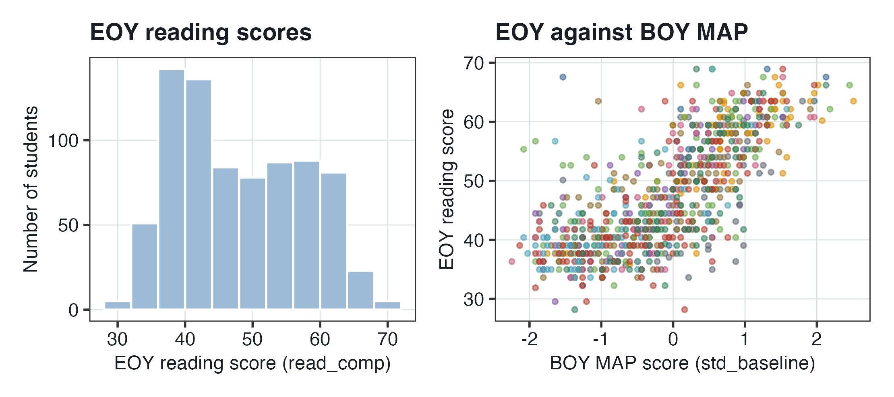{#fig-bm-data width="82%"}

**Reading @fig-bm-data.**

- **Left.** The EOY scores range from 28.18 to 68.93. Many students score between 36 and 44; above 44, the counts are lower and about even up to 64. So the scores are not a symmetric bell curve; whether the model fits this shape is checked in @sec-bm-ppc.
- **Right.** The horizontal axis is the BOY MAP score in SD units, with 0 at the average of all 7,797 students. Students with higher BOY scores tend to have higher EOY scores, and the students of one school (one color) are spread over most of the BOY range.

::: callout-important
## One study, two samples

The EOY score (`read_comp`) has mean 50 and SD 10 over all 7,797 students, and the BOY MAP score (`std_baseline`) is a z-score from a different test. In the first part of the chapter, 780 students in 10 schools are used to introduce Bayesian estimation; in the second part, all 110 schools are used to ask whether the program changed the mean and the spread of the scores.
:::

## Two ways to think about probability {#sec-bm-probability}

Every multilevel model in @sec-variance-components to @sec-higher-level was fitted with `lmer` or `glmer`, under the **frequentist** view of probability. This section describes that view and the **Bayesian** view, and why a Bayesian multilevel model can be useful.

### Frequentist and Bayesian inference {#sec-bm-freq-bayes}

The two views differ in what a probability is and in what a parameter is.

**Frequentist inference (@sec-variance-components to @sec-higher-level).**

- A probability is a **long-run frequency**: how often something happens if a process is repeated many times. A fair coin has a probability of 0.5 of heads because in many tosses, about 50% are heads.
- A parameter, such as the MAP slope $\beta_1$, is **one fixed but unknown number** for the population of students and schools.
- **Maximum likelihood** estimates are the parameter values under which the observed data are most probable. An SE describes how much an estimate would vary from one sample of students to the next, and a 95% confidence interval comes from a procedure whose intervals contain the true value in 95% of repeated samples.

**Bayesian inference (this chapter).**

- A probability is a **degree of belief**: how plausible a statement is, given the information used. A forecast of a 70% chance of rain tomorrow is a probability of this kind: the forecast is about a single day, not about a process repeated many times.
- A parameter is treated as a **random variable**: the uncertainty about its value is described by a probability distribution, a curve over the possible values that is high where values are plausible and low where they are not. The true slope is still one number; "random" describes our uncertainty about it, not a slope that changes.
- The **posterior distribution** is a combination of what was believed before the data (the **prior**) and the data. It is computed by **Markov chain Monte Carlo** (MCMC) methods, as a large simulated set of plausible values of the parameters (@sec-bm-computing).

So in a frequentist analysis, the answer for $\beta_1$ is one estimate with an SE. In a Bayesian analysis, the answer is a whole distribution of plausible values for $\beta_1$.

### Why use a Bayesian multilevel model? {#sec-bm-why}

Bayesian multilevel models have six advantages.

1.  **Scientific information can be included.** What is known before the data, such as the scale of a test, is written into the priors.
2.  **Overfitting can be avoided with priors.** An estimate is **overfitted** when it fits the chance features of one sample and would not hold in a new sample. With a prior, extreme estimates are pulled toward plausible values, in the same way that a small school's estimated mean is shrunk toward the average: priors are partial pooling for every parameter, not only for the random effects (@sec-bm-map-slope).
3.  **Uncertainty has a more direct reading.** "There is a 95% probability that the MAP slope is between 6.71 and 7.65", from the Bayesian model of @sec-bm-m1, is a correct sentence about a Bayesian interval (@sec-bm-intervals).
4.  **Small samples.** With few clusters, such as the 10 schools here, the frequentist SEs and tests are based on approximations meant for large samples, and an estimate from little data can be far from believable, such as an SD estimated at exactly 0. Under a prior, values that are not believable have little probability, so the estimates are within a believable range even when the data contain little information.
5.  **Uncertainty for variance components.** `lmer` prints the estimated SDs $\widehat{\tau}$ and $\widehat{\sigma}$ with no SE. In brms, every parameter, the SDs included, has a posterior with an interval.
6.  **Distributional models.** Models for the spread of the scores, not only their mean, are straightforward to fit (@sec-bm-spread and @sec-bm-mels).

::: callout-important
## Two views of the same model

In the frequentist view, the MAP slope is one fixed number, estimated by maximum likelihood, with an SE that describes variation from sample to sample. In the Bayesian view, the uncertainty about the slope is a probability distribution: the posterior, a combination of the prior and the data. The model itself, a random intercepts model, is the same in the frequentist and the Bayesian analysis; only the way it is estimated and interpreted differs.
:::

## Prior, likelihood and posterior {#sec-bm-bayes-rule}

In a Bayesian analysis (@sec-bm-probability), what was believed before the data is combined with the data. This section writes that combination as a formula, **Bayes' theorem**, and works it through for the MAP slope.

### Bayes' theorem {#sec-bm-theorem}

Bayes' theorem is the rule by which the prior and the data are put together into the posterior. In symbols, and then in words:

$$\Pr(\text{Parameters} \mid \text{Data}) \propto \Pr(\text{Data} \mid \text{Parameters}) \times \Pr(\text{Parameters})$$

$$\text{Posterior} \propto \text{Likelihood} \times \text{Prior}$$

Each piece:

- $\Pr(A \mid B)$ is read "the probability of $A$ given $B$": the probability of $A$ if $B$ is known.
- $\Pr(\text{Parameters})$ is the **prior**: a probability distribution for the parameters, chosen **before** the data are used. In the reading model (@sec-bm-reading-priors), the parameters are the intercept $\gamma_0$, the MAP slope $\beta_1$, the SD of the school intercepts $\tau$ and the residual SD $\sigma$.
- $\Pr(\text{Data} \mid \text{Parameters})$ is the **likelihood**: for each possible set of parameter values, how probable the observed EOY scores would be if those values were true. It is the likelihood of @sec-variance-components to @sec-higher-level: maximum likelihood estimates are the parameter values at its highest point.
- $\Pr(\text{Parameters} \mid \text{Data})$ is the **posterior**: the distribution of the parameters after the data are used. The estimates and intervals in a brms output table are summaries of the posterior.
- $\propto$ means "is proportional to": equal up to a constant multiplier. In the full theorem, the right-hand side is divided by $\Pr(\text{Data})$, one number that is the same for every set of parameter values. Dividing by it scales the curve of likelihood $\times$ prior so that its total area is 1, without changing its shape. So the shape of the posterior is the shape of the likelihood times the prior.

*Interpretation.* Values of a parameter are plausible under the posterior when they were plausible under the prior and also make the observed data probable. Values that make the data improbable are implausible under the posterior, however plausible they were under the prior, and so are values that are essentially impossible under the prior.

### The MAP slope, worked through {#sec-bm-map-slope}

How much does the estimate of the MAP slope differ with and without the prior? For one coefficient, the posterior can be worked out approximately by hand.

- **The prior** for $\beta_1$ is $N(5, 2)$ (@sec-bm-reading-priors): a normal curve with mean 5 and SD 2.
- **The data alone.** `lmer` estimates the slope at 7.21 with SE 0.2437 (@sec-random-intercepts to @sec-random-slopes). The likelihood for $\beta_1$ is approximately a normal curve with mean 7.21 and SD 0.2437.

When the prior and the likelihood are both normal curves, the posterior is a normal curve too, and its mean is a **precision-weighted average** of the prior mean and the data's estimate. The **precision** of a curve is 1 divided by the square of its SD: a narrow curve, which describes less uncertainty, has a large precision.

- Prior precision: $1/2^2 = 0.25$.
- Data precision: $1/0.2437^2 = 16.8$.
- Weight on the data: $16.8/(16.8 + 0.25) = 0.985$, so 98.5%; weight on the prior: 1.5%.

$$\text{posterior mean} = 0.015 \times 5 + 0.985 \times 7.21 = 7.18$$

The posterior SD is $1/\sqrt{16.8 + 0.25} = 0.242$. These are close to brms's output for the slope (@sec-bm-m1-output): 7.17 with posterior SD 0.24. The match is not exact, because brms estimates all the parameters together and its draws are random.

*Interpretation.* The 780 students contain about 67 times as much information about the slope as the prior ($16.8/0.25 = 67$), so the estimate with the prior differs from the estimate from the data alone by only 0.03 points: 7.18 against 7.21.

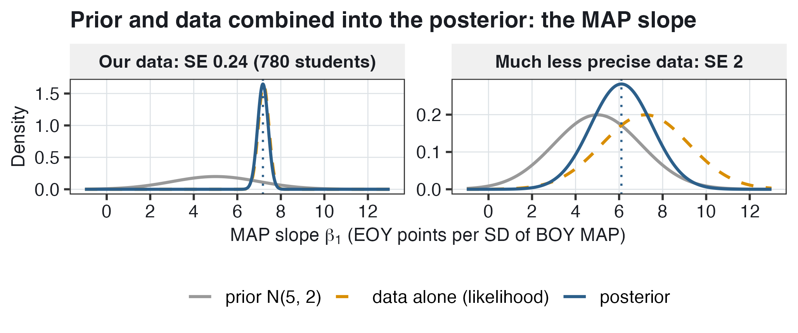{#fig-bm-update width="76%"}

**Reading @fig-bm-update.** The horizontal axis is the MAP slope, in EOY points per SD of BOY MAP. Each curve is high where values of the slope are plausible.

- **Left, our data.** The prior is wide and low: before the data, slopes from about 1 to 9 are plausible. The likelihood (orange, dashed) is narrow, centered at 7.21. The posterior (blue) is almost the same curve, centered at 7.18, because the data have 98.5% of the weight. The two curves overlap almost completely, so the orange dashed curve is hard to see.
- **Right, much less precise data.** Suppose the same estimate, 7.21, had an SE of 2, as it might from a very small sample. Then the data and the prior would have the same precision, $1/2^2 = 0.25$, and each would have 50% of the weight. The posterior mean would be $0.5 \times 5 + 0.5 \times 7.21 = 6.105$, halfway between them. The posterior SD would be $1/\sqrt{0.25 + 0.25} = 1.41$, smaller than either curve's SD of 2, so the posterior is narrower and taller than both: it contains the information of the prior and of the data together.

So the less information the data contain, the larger the weight of the prior.

**The same weighting as shrinkage.** In @sec-variance-components, each school's departure from the grand mean was estimated by shrinking its raw residual toward 0:

$$\widehat{u_j} = \underbrace{(\overline{Y}_j - \widehat{\gamma_0})}_{\text{raw residual}} \times \underbrace{\frac{\tau^2}{\tau^2 + \sigma^2/n_j}}_{\text{shrinkage factor } R_j}$$

Here $\overline{Y}_j$ is school $j$'s mean EOY score, $n_j$ its number of students and $\widehat{\gamma_0}$ the estimated grand mean. The shrinkage factor is also a weight on the data. As an estimate of $u_j$, the raw residual has SE $\sigma/\sqrt{n_j}$, the SE of a mean of $n_j$ scores, so its precision is $1/(\sigma^2/n_j)$. The distribution of school departures, $u_j \sim N(0, \tau^2)$, has mean 0 and precision $1/\tau^2$. Dividing the numerator and the denominator of $R_j$ by $\tau^2 \sigma^2/n_j$ gives

$$R_j = \frac{\tau^2}{\tau^2 + \sigma^2/n_j} = \frac{1/(\sigma^2/n_j)}{1/(\sigma^2/n_j) + 1/\tau^2}$$

the data's precision divided by the sum of the two precisions. So $\widehat{u_j}$ is a precision-weighted average of the raw residual (weight $R_j$) and 0, the mean of the distribution of school departures (weight $1 - R_j$). The shrunken estimates are called **empirical Bayes** estimates because the distribution of school departures has the role of a prior, with its SD $\tau$ estimated from the data. The meta-analytic weights of @sec-higher-level, 1 divided by a variance, are precisions too. Precision weighting is not limited to the random effects: priors are **partial pooling** for every parameter. Each estimate is approximately a precision-weighted average of the prior mean and the data's estimate. The less information the data contain about a parameter, the more its estimate is pulled toward its prior mean.

::: callout-important
## The posterior mean is a precision-weighted average

Posterior $\propto$ likelihood $\times$ prior. For one normal prior and a normal likelihood, the posterior mean is a weighted average of the prior mean and the data's estimate, each weighted by its precision, 1/SD$^2$. With 780 students, the data have 98.5% of the weight on the MAP slope, and the estimate changed only from 7.21 to 7.18. The less information the data contain, the larger the weight of the prior, in the same way that a small school's mean is shrunk more toward the average.
:::

## Choosing the priors {#sec-bm-priors}

In Bayes' theorem (@sec-bm-bayes-rule), every parameter has a prior, chosen before the data are used. This section is about how priors are chosen, the priors for the reading model, and how to check them before fitting.

### How are priors chosen? {#sec-bm-choose}

Choosing a prior can look unscientific, as if the analyst could pick any answer. This objection is answered with three principles.

- **Justify and report the priors.** A prior is an assumption of the model, like normal residuals or a straight-line association with BOY MAP. Like any assumption, it is stated, explained and open to criticism.
- **Exclude essentially impossible values.** A value that cannot be true, such as a negative SD, has no probability under a half-normal prior. Under a normal prior, every value has some probability. But essentially impossible values have almost none: for example, a slope of 50 EOY points per SD of BOY MAP, on a test whose SD is 10.
- **Keep the priors wide.** Within the possible values, a prior is wide enough that the posterior depends mostly on the data.

A prior that follows these principles is **weakly informative**: it contains what is known about the scale of the variables, and little else. For the MAP slope, the data have 98.5% of the weight (@sec-bm-map-slope), so with a different weakly informative prior, the estimate would be almost the same. Refitting with other priors to see how much the results change is a **sensitivity analysis**.

### Priors for the reading data {#sec-bm-reading-priors}

The model is the random intercepts model of @sec-random-intercepts to @sec-random-slopes, for student $i$ in school $j$:

$$\begin{aligned}
\textbf{Level 1:} \qquad && Y_{ij} &= \beta_{0j} + \beta_1\,\text{MAP}_{ij} + e_{ij} \\
&& e_{ij} &\sim N(0, \sigma^2) \\
\textbf{Level 2:} \qquad && \beta_{0j} &= \gamma_0 + u_j \\
&& u_j &\sim N(0, \tau^2)
\end{aligned}$$

Substituting level 2 into level 1 gives the **reduced form**:

$$Y_{ij} = \gamma_0 + \beta_1\,\text{MAP}_{ij} + u_j + e_{ij}$$

- $Y_{ij}$ is the EOY reading score (`read_comp`) of student $i$ in school $j$, and $\text{MAP}_{ij}$ the same student's BOY MAP score (`std_baseline`), a z-score.
- $\beta_{0j}$ is school $j$'s intercept: the predicted EOY score in school $j$ for a student with a BOY MAP score of 0, the average of all 7,797 students.
- $\gamma_0$ is the average intercept, and $u_j$ is school $j$'s **departure** from it, the same for every student in the school.
- $\beta_1$ is the **MAP slope**: the difference in predicted EOY score per 1 SD difference in BOY MAP score. As in @sec-random-intercepts to @sec-random-slopes, it is a combination of the within-school and between-school associations of BOY MAP and EOY scores.
- $e_{ij}$ is the **residual**: how far the student's EOY score is from the score predicted for the student.
- $u_j$ and $e_{ij}$ are **assumed** normal, with mean 0 and variances $\tau^2$ and $\sigma^2$, and independent of each other. So $\tau$ is the SD of the school departures and $\sigma$ the SD of the residuals.

A prior is chosen for each of the model's four parameters: $\gamma_0$, $\beta_1$, $\tau$ and $\sigma$. The priors come from what is known about the variables before the data are used. EOY scores are scaled to mean 50 and SD 10 over all 7,797 students, and BOY MAP is a z-score.

$$\begin{aligned}
\gamma_0 &\sim N(50, 10) \\
\beta_1 &\sim N(5, 2) \\
\tau, \sigma &\sim HN(0, 5)
\end{aligned}$$

Each piece:

- **In a prior, the second number is an SD.** $N(50, 10)$ is a normal curve with mean 50 and SD 10, as in brms's `normal(50, 10)`. In $u_j \sim N(0, \tau^2)$ above, the second entry is a variance. Both ways of writing a normal distribution are common.
- $\gamma_0 \sim N(50, 10)$. **Why 50 and 10?** $\gamma_0$ is the predicted EOY score of a student with a BOY MAP score of 0. BOY MAP is a z-score, so 0 is the average BOY score: $\gamma_0$ is the predicted EOY score of a student with an average BOY score, in a school with $u_j = 0$. Such a student is expected to have an EOY score near the average, and EOY scores are scaled to mean 50, so the prior is centered at 50. Its SD is 10, the SD of all EOY scores, so the prior is wide: 95% of it is between $50 - 1.96(10) = 30.4$ and $50 + 1.96(10) = 69.6$.
- $\beta_1 \sim N(5, 2)$. **Why 5 and 2?** Because BOY MAP is a z-score, $\beta_1$ is the difference in EOY points per 1 SD of BOY MAP, so a believable slope can be judged from the SD of EOY scores alone. (On a scale with many points per SD, the slope per point would be much smaller, and a different prior would be chosen.) A slope of 5 means that a student 1 SD higher on BOY MAP is predicted to be 5 points, 0.5 SD of EOY scores, higher at EOY: a moderate association between two reading tests, as expected before the data are used. With an SD of 2, the prior is wide: 95% of it is between $5 - 1.96(2) = 1.08$ and $5 + 1.96(2) = 8.92$, from a weak to a strong association. Under this prior, a negative slope is implausible but not impossible.
- $\tau, \sigma \sim HN(0, 5)$. HN is a **half-normal** distribution: a normal curve with mean 0 and SD 5 whose negative half is removed, because an SD cannot be negative. **Why 0?** The 0 is where the curve starts, not a guess that the SD is 0. A half-normal is highest at 0 and lower for larger values, so small SDs are plausible and very large ones are not, with no particular positive value singled out. Under a normal curve centered at 10, each SD would probably be near 10, a claim there is no basis for before the data are used. **Why 5?** Under the model, the variance of EOY scores is the sum of three parts: the part associated with BOY MAP scores, $\tau^2$ and $\sigma^2$. All EOY scores together have SD 10, so variance 100, and neither $\tau$ nor $\sigma$ is expected to be larger than 10 points. With SD 5, most of the prior is below 10 points: 50% of a normal curve is within 0.674 SDs of its mean, and 95% is within 1.96 SDs. With the negative half removed, 50% of this prior is below $0.674 \times 5 = 3.37$, and 95% is below $1.96 \times 5 = 9.80$.

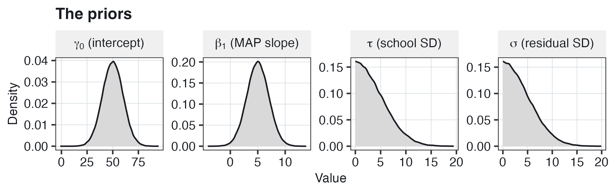{#fig-bm-priors width="84%"}

**Reading @fig-bm-priors.** The horizontal axis of each panel is the value of the parameter, and each curve is high where values are plausible under the prior. The intercept's prior is centered at 50, from about 25 to 75; the slope's prior is centered at 5, from about 0 to 10. The two SD priors have no probability below 0, are highest near 0, and have long right tails: SDs of 10 points or more, at least as large as the SD of all EOY scores, have a low but nonzero prior probability, about 5%.

Priors can be easier to set when the variables are standardized; the EOY scores are left on their mean-50, SD-10 scale here, for illustration.

### The prior predictive check {#sec-bm-prior-pc}

Are these priors reasonable? In a **prior predictive check**, fake data are simulated from the priors alone, with no data used, and the fake data are compared with what is known about real scores. As it is sometimes put, the minimum sample size in Bayesian inference is zero. With no data, the posterior is the prior, and fake data can still be simulated from it.

In brms, the model is fitted with `sample_prior = "only"` (called **m0**): the observed scores are ignored, and each **draw**, one simulated value of every parameter, comes from the priors alone. Each simulated data set is made in two steps: draw one value of each parameter from its prior, then simulate 780 EOY scores from the model with those values.

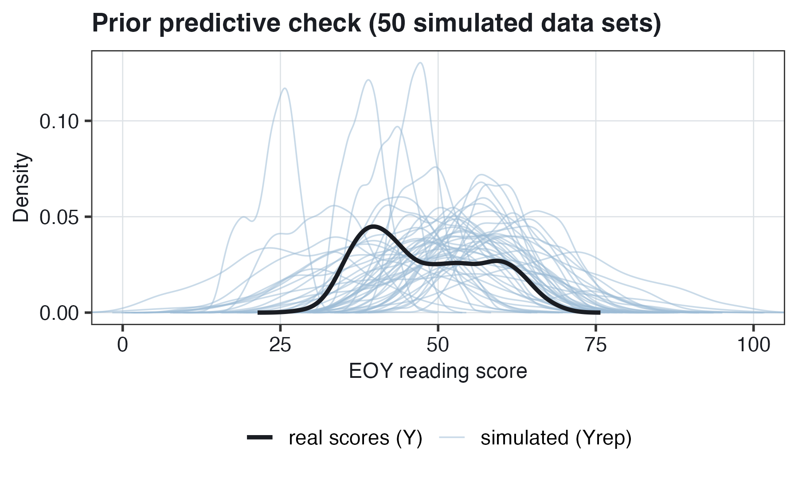{#fig-bm-prior-pc width="70%"}

**Reading @fig-bm-prior-pc.** The horizontal axis is the EOY score, and each curve is a **density**: a smoothed histogram, high where many scores are. The dark line is the real scores, $Y$, and each light line is one fake data set, $Y_{\text{rep}}$ ("replicated $Y$"). In the legend of R's `pp_check()` plots, $Y$ and $Y_{\text{rep}}$ are labeled y and yrep. The question is not whether the light lines match the dark line; before the data are used, they are not expected to. The question is whether the fake scores are on a believable scale. Most light lines are centered between about 25 and 70 and are within 0 to 100, 5 SDs below and above the mean EOY score of 50. Some are very narrow (a draw with small $\tau$ and $\sigma$) and some very wide (large $\tau$ and $\sigma$). Over 2,000 fake data sets, the middle 95% of the fake scores is from about 24 to 76, and about 0.1% are below 0 or above 100. So the priors are wider than the real data, as weakly informative priors are meant to be, without being absurd.

The prior predictive check can also be drawn as regression lines. For each of 50 draws from the priors, the predicted EOY score of each of the 10 schools is drawn against the BOY MAP score.

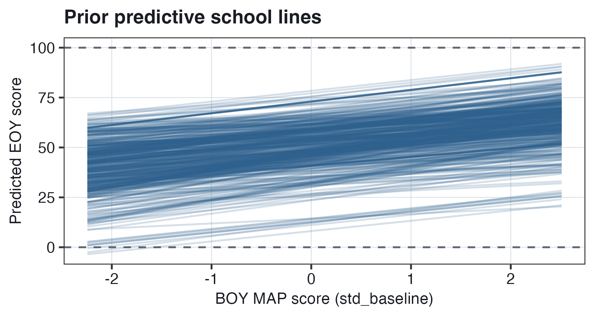{#fig-bm-prior-lines width="70%"}

**Reading @fig-bm-prior-lines.** The horizontal axis is the BOY MAP score, and the vertical axis is the predicted EOY score. Every line slopes upward, because almost all of the prior probability for $\beta_1$ is on positive slopes. The lines differ in intercept (from $\gamma_0$ and $u_j$) and in slope (from $\beta_1$). The lines range from about $-3.5$ to 92: almost all are between 0 and 100, and a few are just below 0 at the lowest BOY scores. So under the priors, the predicted scores are on a believable scale, but they are much more spread out than the real scores, which range from 28.18 to 68.93.

**Why check the priors before fitting?** In a prior predictive check, the priors are judged by the fake data simulated from them, which is easier than judging the priors themselves. A prior for an SD written as $HN(0, 5)$ is hard to judge; fake scores of $-40$ or 140, 9 SDs below and above the mean of 50, are easy to recognize as absurd. If most of the fake data were absurd, the priors would be revised before the model is fitted to the real data.

::: callout-important
## Priors are stated, justified and checked

Each prior comes from what is known before the data: EOY scores have mean 50 and SD 10, BOY MAP is a z-score, and an SD cannot be negative. So $\gamma_0 \sim N(50, 10)$, $\beta_1 \sim N(5, 2)$, and $\tau$ and $\sigma$ have the half-normal prior $HN(0, 5)$. Under these weakly informative priors, essentially impossible values have almost no probability, and the priors are wide, so that the posterior depends mostly on the data. In a prior predictive check, fake data simulated from the priors alone are mostly on a believable scale: the middle 95% of fake scores is from about 24 to 76.
:::

## How the posterior is computed {#sec-bm-computing}

With the priors chosen, the next step is to compute the posterior. For a model with many parameters, the posterior cannot be worked out by hand, as it was for one coefficient in @sec-bm-map-slope. This section describes how brms computes it: as a large set of draws.

### From the peak of the likelihood to a set of draws {#sec-bm-draws}

**Maximum likelihood.** In `lmer`, the estimates are the parameter values at which the likelihood is highest, the **peak** of the likelihood (`lmer`'s default, REML, is a version of maximum likelihood). The result is one value per parameter, plus SEs for the intercept and the slope.

**The posterior as a bowl.** In a Bayesian analysis, the whole posterior is used, not only its peak. Taking the negative log of the posterior turns its peak into the lowest point of a bowl. This lowest point is the **maximum a posteriori** estimate, also abbreviated **MAP**: the set of parameter values at the highest point of the posterior. This MAP is unrelated to the BOY MAP test (Measures of Academic Progress). Everywhere else in this chapter, MAP is the test.

**Hamiltonian Monte Carlo (HMC).** HMC is a physics simulation of a marble in this bowl. Each step has three parts:

1.  give the marble a random push;
2.  simulate its path in the bowl for a short time;
3.  record where it ends: one **draw**, a complete set of values for every parameter.

Because of the simulated gravity, the marble is more often near the bottom of the bowl, where the posterior is high, and less often on the sides, where the posterior is low. So values with high posterior probability appear in many draws, and values with low posterior probability in few. A histogram of the draws of a parameter is therefore a picture of its posterior. HMC is a kind of **Markov chain Monte Carlo** (MCMC) method: each draw starts where the previous one ended (a **Markov chain**), and the method is based on random numbers (**Monte Carlo**). Stan, the software that brms uses, runs HMC. An interactive version of this simulation is at <https://chi-feng.github.io/mcmc-demo/app.html>.

### From draws to the output {#sec-bm-output-draws}

How do the draws become the numbers in brms's output? In this chapter's code, the sampler, HMC, is run four times, as four **chains**, and 2,000 draws are kept. @sec-bm-appendix describes the chains and the first steps of each chain, which are discarded. Each of the 2,000 draws is one complete set of values: $\gamma_0$, $\beta_1$, $\tau$, $\sigma$ and the 10 school departures $u_j$. The estimates and intervals in brms's output are summaries of the 2,000 draws of one parameter: the **posterior mean** is their mean, the **posterior SD** their SD, and the 95% **credible interval** is from their 2.5th to their 97.5th percentile. The sampler is based on random numbers, so the draws of a rerun of the same model are slightly different, and the summaries can differ slightly, for some parameters in the first decimal.

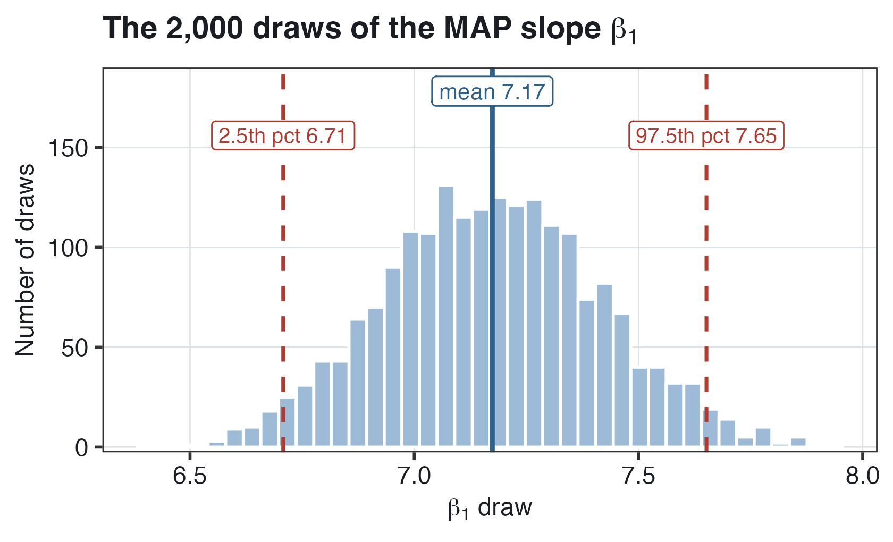{#fig-bm-draws width="66%"}

**Reading @fig-bm-draws.** The horizontal axis is the value of $\beta_1$ in a draw, and the vertical axis is the number of draws. The 2,000 draws form a bell-shaped histogram. Their mean, 7.17, is the posterior mean. 2.5% of the draws are below 6.71 and 2.5% above 7.65, so 95% are between 6.71 and 7.65: the 95% credible interval.

::: callout-important
## The posterior is a set of draws

Hamiltonian Monte Carlo is a simulation of a marble in a bowl, the negative log of the posterior; the marble is most often near the bottom, where the posterior is high. In this chapter's code, 2,000 draws are kept, each a complete set of parameter values. A histogram of a parameter's draws is its posterior, and the estimates and intervals in the output are summaries of the draws: their mean, their SD, and their 2.5th and 97.5th percentiles.
:::

## The fitted model (m1) {#sec-bm-m1}

The priors (@sec-bm-priors) and the sampler (@sec-bm-computing) are combined in **m1**, the random intercepts model fitted to the 780 students. This section is about the code, the output, a comparison with `lmer`'s output, a check of the fit, and two plots of the posterior.

### From lmer to brms {#sec-bm-brms}

The model formula is the same as in `lmer`:

``` r
priors <- prior(normal(5, 2), class = "b") +
  prior(normal(50, 10), class = "Intercept") +
  prior(normal(0, 5), class = "sd") +
  prior(normal(0, 5), class = "sigma")

m1 <- brm(read_comp ~ 1 + std_baseline + (1 | cluster_id), data = jebs_sub,
          prior = priors, chains = 4, iter = 1000, cores = 4)
```

- The formula is `lmer`'s: the `1` is $\gamma_0$, `std_baseline` is $\beta_1$, and `(1 | cluster_id)` is $u_j$. The residual $e_{ij}$ is included by default, as in `lmer`.
- `prior = priors` is where the priors are set: `class = "b"` is the prior for the slopes ($\beta_1$), `class = "Intercept"` for $\gamma_0$, `class = "sd"` for the SD of the random effects ($\tau$), and `class = "sigma"` for the residual SD ($\sigma$). brms cuts a `normal(0, 5)` prior for an SD off at 0, which makes it the half-normal $HN(0, 5)$.
- `chains = 4` and `iter = 1000` are the sampler settings: four chains of 1,000 steps each. The first 500 steps of each chain are discarded (@sec-bm-appendix explains why) and the other 500 are kept, so there are $4 \times 500 = 2{,}000$ draws. With `cores = 4`, the four chains run at the same time.
- m0, the prior-only model of @sec-bm-prior-pc, is the same call with `sample_prior = "only"` added.

Adding `backend = "cmdstanr"` runs Stan through the R package `cmdstanr` instead of the default, `rstan`; the model is the same with either.

### The output {#sec-bm-m1-output}

The table below holds brms's output, from `tidy(m1)`. Each row is one parameter, and each column is a summary of its 2,000 draws:

- `estimate`: the **posterior mean**, the mean of the draws;
- `std.error`: the **posterior SD**, the SD of the draws, although R labels it `std.error`. It describes the uncertainty about the parameter, as an SE does in `lmer`;
- `conf.low` and `conf.high`: the 2.5th and 97.5th percentiles of the draws, the limits of the 95% **credible interval**.

| Term | `estimate` | `std.error` | `conf.low` | `conf.high` |
|:-------------------------|-----------:|-----------:|-----------:|-----------:|
| $\widehat{\gamma_0}$ `(Intercept)` | 48.85 | 0.74 | 47.50 | 50.40 |
| $\widehat{\beta_1}$ `std_baseline` | 7.17 | 0.24 | 6.71 | 7.65 |
| $\widehat{\tau}$ `sd__(Intercept)`, group `cluster_id` | 2.09 | 0.67 | 1.10 | 3.72 |
| $\widehat{\sigma}$ `sd__Observation`, group `Residual` | 6.17 | 0.16 | 5.88 | 6.47 |

$\widehat{\beta_1} = 7.17$. *Interpretation.* Students whose BOY MAP scores differ by 1 SD are predicted to differ by 7.17 points at EOY. There is a 95% probability that the slope is between 6.71 and 7.65 points, given the model, the priors and the data. As in @sec-random-intercepts to @sec-random-slopes, this slope is a combination of the within-school and between-school associations. The slope equals the within-school association only if the random effects assumption holds: that the school departures $u_j$ are unrelated to the schools' mean BOY MAP scores. This assumption is needed with Bayesian estimation, as with `lmer`. With the school's mean BOY MAP score added as a predictor (the Mundlak model of @sec-within-between), the within-school and between-school associations are estimated separately, in brms too.

$\widehat{\gamma_0} = 48.85$. *Interpretation.* For a student with a BOY MAP score of 0, the average of all 7,797 students, in a school with $u_j = 0$, the predicted EOY score is 48.85. There is a 95% probability that $\gamma_0$ is between 47.50 and 50.40.

$\widehat{\tau} = 2.09$. *Interpretation.* For students with the same BOY MAP score, schools' mean EOY scores differ from the average by about 2.09 points in SD terms. About 95% of schools are expected to have intercepts between $48.85 - 1.96(2.09) = 44.75$ and $48.85 + 1.96(2.09) = 52.95$. The credible interval for $\tau$, 1.10 to 3.72, is wide and lopsided: its lower limit is 0.99 below 2.09 and its upper limit 1.63 above. With only 10 schools, the data contain little information about $\tau$ (@sec-bm-tau).

$\widehat{\sigma} = 6.17$. *Interpretation.* A student's EOY score is typically about 6.17 points above or below the score predicted for the student from the school and the BOY MAP score. There is a 95% probability that $\sigma$ is between 5.88 and 6.47. This interval is narrow and almost symmetric, 0.29 below 6.17 and 0.30 above, because $\sigma$ is estimated from the differences among 780 students, while $\tau$ is estimated from only 10 schools.

**Comparing with lmer.** The same model was fitted with `lmer` in @sec-random-intercepts to @sec-random-slopes. In the table below, the `lmer` intervals are 95% confidence intervals, computed with `confint()`.

| Parameter | brms: posterior mean \[95% credible interval\] | `lmer`: estimate \[95% confidence interval\] |
|:------------------------|:----------------------:|:----------------------:|
| $\gamma_0$ | 48.85 \[47.50, 50.40\] | 48.82 \[47.57, 50.12\] |
| $\beta_1$ | 7.17 \[6.71, 7.65\] | 7.21 \[6.73, 7.69\] |
| $\tau$ | 2.09 \[1.10, 3.72\] | 1.79 \[0.95, 3.05\] |
| $\sigma$ | 6.17 \[5.88, 6.47\] | 6.16 \[5.86, 6.48\] |

*Interpretation.* For $\gamma_0$, $\beta_1$ and $\sigma$, the two fits are almost the same: the 780 students contain far more information than the weakly informative priors. The one clear difference is $\tau$, 2.09 in brms against 1.79 in `lmer`.

### Why is the school SD larger in brms? {#sec-bm-tau}

In m1, the posterior mean of the school SD $\tau$ is 2.09, and `lmer`'s estimate is 1.79. $\tau$ is estimated from only 10 schools, so its posterior is wide. The posterior also has a long right tail: an SD cannot be below 0, but values well above 2 are still plausible with 10 schools.

{#fig-bm-tau width="70%"}

**Reading @fig-bm-tau.** The horizontal axis is the value of $\tau$ in a draw, in EOY points. The histogram is highest at about 1.5 to 1.8 and has a long right tail, with a few draws above 5. In a distribution with a long right tail, the mean is usually larger than the median, and the median usually larger than the peak, because the few large values increase the mean the most. Here the posterior mean is 2.09, the median about 2.0, and the peak about 1.7. `lmer`'s estimate, 1.79, is the value at the peak of the likelihood. With weakly informative priors, the posterior has nearly the shape of the likelihood, so 1.79 is close to the peak of the posterior, not to its mean.

So 1.79 and 2.09 are different summaries of similar information about $\tau$: `lmer`'s 1.79 is the value at the peak of the likelihood, and brms's 2.09 is the posterior mean. The prior is not the reason for the difference: when m1 is refitted with priors under which every value is equally plausible (flat priors), the posterior mean of $\tau$ is about 2.15.

### Checking the fit: the posterior predictive check {#sec-bm-ppc}

The prior predictive check (@sec-bm-prior-pc) was run before the data were used. A **posterior predictive check** is the same plot with the fake data simulated from the posterior: each fake data set is simulated with one of m1's 2,000 draws. If the model fits, the fake data look like the real data.

{#fig-bm-ppc width="82%"}

**Reading @fig-bm-ppc.** On the left, before the data, the fake data sets differ widely in center and spread. On the right, after the data, the 50 fake data sets are close to each other, with about the same center and spread as the real scores. But their shape differs from the real scores. The real scores have a tall peak near 40 and a lower, flatter part from about 50 to 62. The fake data sets have one smooth hump, highest near 48. So the fake data have too many scores in the middle: over 2,000 fake data sets, about 38% of the fake scores are between 45 and 55, against 24% of the real scores. And about 3% of the fake scores are below 28.18 or above 68.93, the lowest and highest scores among all 7,797 students. The model fits the center and the spread of the scores, but not their shape. With all 110 schools, the fake data also have one hump, while the real scores have two peaks (@sec-bm-mels-ppc).

### Posterior school lines {#sec-bm-post-lines}

Each draw also contains each school's departure $u_j$, so each draw has a predicted line for each school: $\gamma_0 + u_j + \beta_1\,\text{MAP}_{ij}$, with the draw's values.

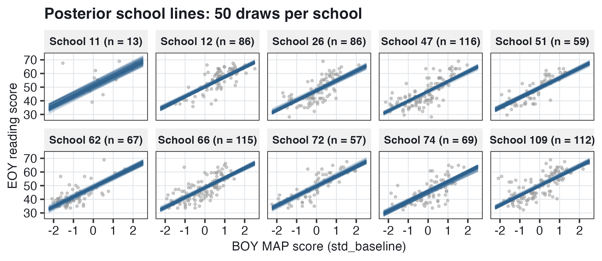{#fig-bm-post-lines width="84%"}

**Reading @fig-bm-post-lines.** In each panel, the 50 lines are close together: they differ only because of the uncertainty about the school's intercept and about the slope. The lines are widest apart in school 11, which has only 13 students, so the uncertainty about its intercept is the largest. The gray dots are much more spread out around the lines than the lines are around each other. The spread of the dots around the line is the residual SD, $\sigma = 6.17$; the spread of the lines is the uncertainty about where the line is. In any one draw, the 10 schools' lines have the same slope, because the model has one slope for all schools.

### From prior to posterior {#sec-bm-prior-post}

@fig-bm-prior-post has each parameter's prior (@fig-bm-priors) and posterior on the same axis. The change from the prior to the posterior, due to the information in the data, is **Bayesian updating**.

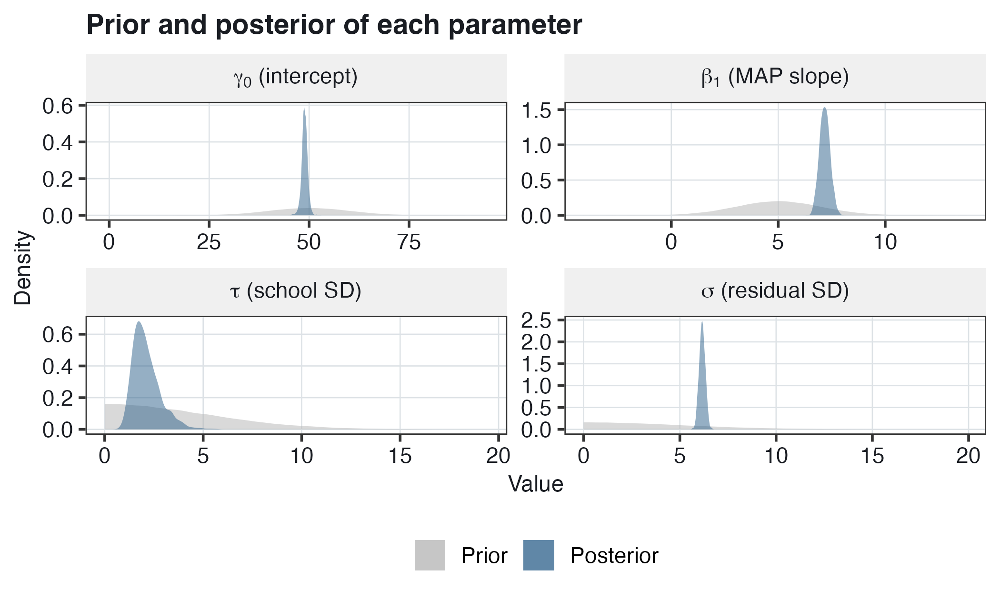{#fig-bm-prior-post width="84%"}

**Reading @fig-bm-prior-post.** In every panel, the posterior is much narrower and taller than the prior. For $\beta_1$, the prior has SD 2 and the posterior SD 0.24, so the range of plausible slopes is from about 1 to 9 under the prior and from about 6.7 to 7.7 under the posterior. For $\sigma$, estimated from 780 students, the posterior is the narrowest of the four relative to its prior. For $\tau$, estimated from only 10 schools, the posterior is the widest of the four relative to its prior: 95% of the posterior is between about 1 and 4.

::: callout-important
## m1: almost the same estimates as lmer, with a distribution for every parameter

With 780 students, the posterior mean of the MAP slope is 7.17, with a 95% credible interval from 6.71 to 7.65, against lmer's 7.21. The intercept and the residual SD are also almost the same. The school SD is 2.09 in brms and 1.79 in lmer, because its posterior, from only 10 schools, has a long right tail: its mean is larger than its peak. In the posterior predictive check, fake data simulated from m1 have the right center and spread, but one smooth hump, while the real scores have a tall peak near 40.
:::

## Credible and confidence intervals {#sec-bm-intervals}

@sec-bm-m1-output has, for the MAP slope, a 95% credible interval from 6.71 to 7.65 and a 95% confidence interval from 6.73 to 7.69. The numbers are almost the same, but the two intervals are read in different ways.

- **A 95% confidence interval** (@sec-variance-components to @sec-higher-level) comes from a procedure: if the study were repeated many times with new samples, and an interval computed from each sample, 95% of the intervals would contain the true slope. The slope is one fixed number, so any one interval either contains it or does not. The 95% describes the procedure, not this one interval.
- **A 95% credible interval** contains 95% of the posterior. So there is a 95% probability that the slope is between 6.71 and 7.65, given the model, the priors and the data.

So "there is a 95% probability that the parameter is in the interval" is not a correct reading of a confidence interval, but it is the correct reading of a credible interval. Put another way, in Bayesian inference, the reading that everyone was taught to avoid is the correct one.

{#fig-bm-intervals width="82%"}

**Reading @fig-bm-intervals.**

- **Left.** Each row is one simulated repetition of the study: 780 new EOY scores for the same students and schools, simulated from the `lmer` fit, so the true slope is known, 7.21. Each row has its estimate (dot) and its 95% confidence interval (line). 19 of the 20 intervals contain the true slope and 1, in red, does not. In 400 such samples, 95.25% of the intervals contained it. A real study has only one interval, and there is no way to tell whether that interval contains the true slope.
- **Right.** The horizontal axis is the MAP slope, and the curve is m1's posterior, from our one sample. The shaded area, from 6.71 to 7.65, has 95% of the posterior's area: the credible interval.

**Why are the two intervals so close here?** With weakly informative priors and 780 students, the posterior depends almost only on the data (@sec-bm-map-slope). With fewer data or more informative priors, the two intervals can differ, as they do for $\tau$ with only 10 schools: 1.10 to 3.72 in brms against 0.95 to 3.05 in `lmer` (@sec-bm-m1-output). A credible interval's 95% is a probability given the model and the priors, so if the model or the priors are wrong, the 95% can be wrong too. The fake data in @fig-bm-ppc do not have the shape of the real scores, so the model is a simplification of the data.

::: callout-important
## The same numbers, read in two ways

A 95% confidence interval comes from a procedure whose intervals contain the true value in 95% of repeated samples; any one interval contains it or does not. A 95% credible interval contains 95% of the posterior, so there is a 95% probability that the parameter is in it, given the model, the priors and the data. For the MAP slope, the two intervals are almost the same, 6.71 to 7.65 and 6.73 to 7.69, because 780 students contain much more information than the weakly informative prior.
:::

## Treatment effects on the spread of scores {#sec-bm-spread}

@sec-bm-probability to @sec-bm-intervals introduced Bayesian estimation with a familiar model. In the second part of the chapter, Bayesian estimation is used for a new kind of model, a **distributional model**, in which a program can have an effect on how spread out the scores are, not only on their mean.

### Beyond the mean {#sec-bm-beyond-mean}

Every treatment effect in @sec-variance-components to @sec-higher-level was an effect on a mean: does the program raise the average score? Wiedermann et al. (2024) point out that, statistically, there is no reason to look only at the mean. The mean is one of many features of the distribution of scores that a program can change, and the effect of a program can be described as a **distributional causal effect**: an effect on the whole distribution.

**Why would the spread matter?** A program can leave the mean unchanged and still change the spread. If it helps struggling readers most, the gaps between students become smaller and the spread decreases. If it helps strong readers most, the gaps become larger. So two programs with the same mean effect can have very different consequences for the students with the lowest BOY scores. A principal who cares only about the mean would not see this difference. A smaller spread can also mean more consistent results: if every student gains about the same amount, a school can be more confident about what the program will do for any one student.

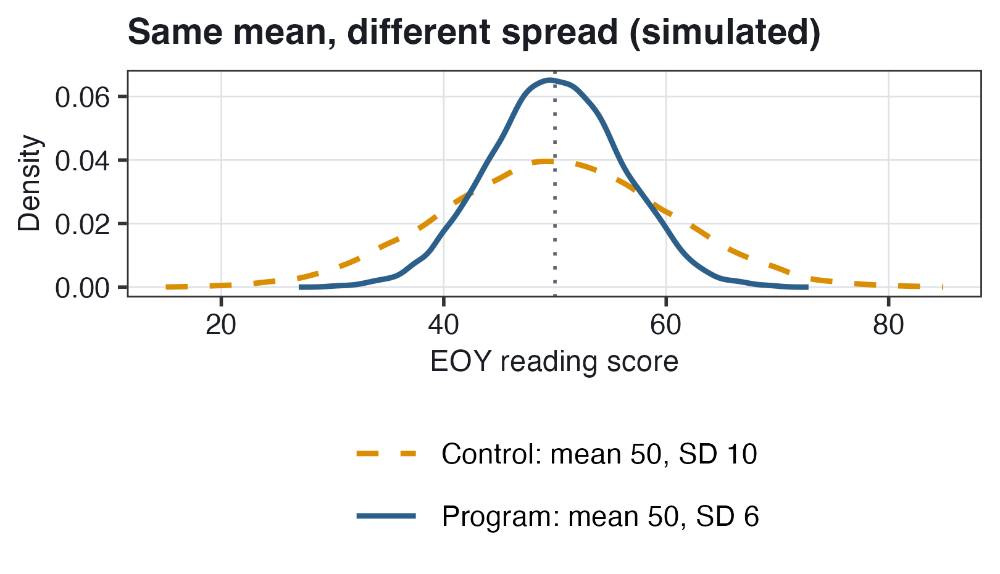{#fig-bm-spread width="66%"}

**Reading @fig-bm-spread.** The horizontal axis is the EOY score. Both curves are centered at 50, so the treatment effect on the mean is 0. But the program group's scores are closer together: about 95% of them are between $50 - 1.96(6) = 38.2$ and $50 + 1.96(6) = 61.8$. In the control group, about 95% are between $50 - 1.96(10) = 30.4$ and $50 + 1.96(10) = 69.6$. In this simulated example, fewer program students have very low scores, and fewer have very high scores.

**When is more spread desirable?** When a program aims to let every student progress at the student's own pace, as in an enrichment program, every student can gain while the fastest learners gain the most. Then the spread increases although no student is worse off.

### The full data and three research questions {#sec-bm-full-data}

The second part of the chapter uses the full data: 7,797 students in 110 schools. Whole schools were randomly assigned to the reading program or to control, so `treat` is a school variable: 56 schools (3,896 students) were assigned to the program and 54 schools (3,901 students) to control. The three research questions:

1.  Does the program improve **mean** EOY reading comprehension scores?
2.  Does the program make EOY reading comprehension scores **more consistent**?
3.  Are students with higher BOY scores **more consistent** than students with lower BOY scores?

"More consistent" means a smaller residual SD: the EOY scores of students with the same predicted score are closer to their predicted score (@sec-bm-ri).

### Looking at the spread by treatment status {#sec-bm-spread-look}

Before any model, do the EOY scores of treated and control students differ in spread?

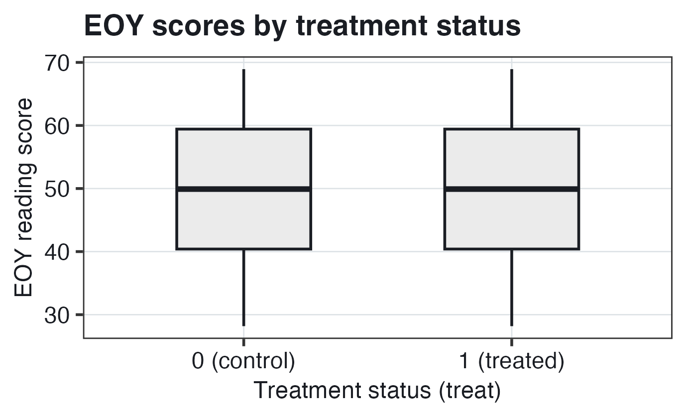{#fig-bm-boxplot width="60%"}

**Reading @fig-bm-boxplot.** The two boxes are almost the same: in both groups the median is 49.9, the middle 50% of the scores is between 40.4 and 59.4, and the scores range from 28.18 to 68.93.

The table below holds, for each group, the number of students and the mean, variance and SD of the EOY scores.

| `treat`     | Students |  Mean | Variance |    SD |
|:------------|---------:|------:|---------:|------:|
| 0 (control) |    3,901 | 50.11 |    102.5 | 10.12 |
| 1 (treated) |    3,896 | 49.89 |     97.5 |  9.87 |

The treated students' mean is slightly lower and their variance slightly smaller: 97.5 against 102.5.

**An F-test of the two variances.** The two variances can be compared with an **F-test**, `var.test(read_comp ~ treat, data = jebs)`. Its statistic is the ratio of the two variances, control over treated: $F = 102.5/97.5 = 1.05$. The 95% confidence interval for this ratio is 0.99 to 1.12, and $p = 0.118$. *Interpretation.* The control group's variance is estimated to be 5% larger than the treated group's. The interval includes 1, the value for equal variances, so there is no evidence of a difference in variance. The F-test has two limits. No other variable, such as the BOY MAP score, is held fixed in the F-test. And it is computed as if the 7,797 students were independent, although whole schools were assigned. In a MELS model (@sec-bm-mels), the BOY MAP score is held fixed and school differences in mean scores are part of the model.

::: callout-important
## A program can change the spread of the scores, not only their mean

A program that helps struggling readers most can make scores closer together, with the same mean. With all 110 schools, whole schools randomly assigned, the three questions are whether the program changes the mean EOY score, whether it makes the scores more consistent, and whether students with higher BOY scores have more consistent EOY scores. A simple F-test of the two groups' variances has $p = 0.118$, but no other variable is held fixed in it, and it is computed as if the students were independent.
:::

## Mixed effects location scale (MELS) models {#sec-bm-mels}

Two of the research questions of @sec-bm-spread are about the spread of the scores: does the program make EOY scores more consistent, and do students with higher BOY scores have more consistent EOY scores? This section is about a model for the spread with the BOY MAP score held fixed and with a random intercept for each school: the **mixed effects location scale (MELS)** model, fitted with brms.

### The standard random intercepts model {#sec-bm-ri}

With the program added, the random intercepts model of @sec-random-intercepts to @sec-random-slopes, for student $i$ in school $j$, is

$$\begin{aligned}
\textbf{Level 1:} \qquad && Y_{ij} &= \beta_{0j} + \beta_1\,\text{MAP}_{ij} + e_{ij} \\
&& e_{ij} &\sim N(0, \sigma^2) \\
\textbf{Level 2:} \qquad && \beta_{0j} &= \gamma_0 + \gamma_1\,\text{treat}_j + u_j \\
&& u_j &\sim N(0, \tau^2)
\end{aligned}$$

with reduced form $Y_{ij} = \gamma_0 + \gamma_1\,\text{treat}_j + \beta_1\,\text{MAP}_{ij} + u_j + e_{ij}$.

- $Y_{ij}$ and $\text{MAP}_{ij}$ are the EOY score and the BOY MAP score of student $i$ in school $j$.
- $\text{treat}_j$ is 1 if school $j$ was assigned to the program and 0 if to control. It has only the school subscript $j$ because it is a school variable.
- $\beta_{0j}$ is school $j$'s intercept; $\gamma_0$ is the predicted EOY score of a control student with a BOY MAP score of 0 in a school with $u_j = 0$; $\gamma_1$ is the **treatment effect** on the mean; $\beta_1$ is the MAP slope; $u_j$ is school $j$'s departure, **assumed** normal with mean 0 and variance $\tau^2$.
- $e_{ij}$ is the residual, **assumed** normal with mean 0 and variance $\sigma^2$.

**One residual SD for every student.** In this model, $\sigma$ has no subscript: every student's residual has the same SD, whatever the student's treatment status or BOY MAP score. Equal residual variance is **homoskedasticity**. When the residual variance differs, for example between groups or with a predictor, the residuals are **heteroskedastic**.

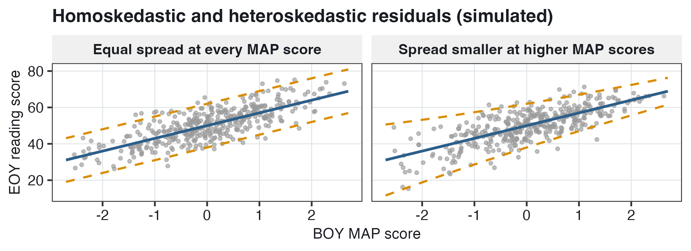{#fig-bm-hetero width="82%"}

**Reading @fig-bm-hetero.** In both panels, the horizontal axis is the BOY MAP score and the vertical axis the EOY score, and the blue line is the predicted score, $50 + 7\,\text{MAP}$. On the left, the dashed lines are the same distance from the blue line at every BOY score: about 95% of the dots are within 2 residual SDs (12 points) of the line, anywhere along it. On the right, the dashed lines are far apart at low BOY scores and close together at high ones: students with high BOY scores have EOY scores close to their predicted scores. The decrease in the residual SD is larger than in our data, so that it is visible.

### A model for the residual SD {#sec-bm-scale-model}

A **MELS model** has two equations, one for the location of the scores (their center) and one for their scale (their spread). The **location** equation is the model for the mean, the random intercepts model above. The **scale** equation is a model for the residual SD:

$$\begin{aligned}
\textbf{Location:} \qquad && Y_{ij} &= \beta_{0j} + \beta_1\,\text{MAP}_{ij} + e_{ij}, \qquad e_{ij} \sim N(0, \sigma_{ij}^2) \\
&& \beta_{0j} &= \gamma_0 + \gamma_1\,\text{treat}_j + u_j, \qquad u_j \sim N(0, \tau^2) \\
\textbf{Scale:} \qquad && \log \sigma_{ij} &= \delta_0 + \delta_1\,\text{treat}_j + \delta_2\,\text{MAP}_{ij}
\end{aligned}$$

Substituting the school equation into the student equation gives the reduced form of the location equation, $Y_{ij} = \gamma_0 + \gamma_1\,\text{treat}_j + \beta_1\,\text{MAP}_{ij} + u_j + e_{ij}$, as in @sec-bm-ri.

Each piece:

- $\sigma_{ij}$ has subscripts $ij$: each student has a residual SD of the student's own, which depends on the student's treatment status and BOY MAP score.
- $\log \sigma_{ij}$ is the natural log of the residual SD. The log is used because an SD must be positive. Whatever values the $\delta$'s and the predictors take, $\sigma_{ij} = \exp(\delta_0 + \delta_1\,\text{treat}_j + \delta_2\,\text{MAP}_{ij})$ is positive, because $\exp$ of any number is positive.
- The $\delta$'s are the coefficients of the scale equation (in @sec-higher-level, $\delta$ was a level-3 coefficient; here it has a new meaning):
  - $\delta_0$ is $\log \sigma_{ij}$ for a control student ($\text{treat}_j = 0$) with a BOY MAP score of 0;
  - $\delta_1$ is the treatment effect on $\log \sigma_{ij}$, for students with the same BOY MAP score;
  - $\delta_2$ is the difference in $\log \sigma_{ij}$ per 1 SD difference in BOY MAP score, for students with the same treatment status.
- There is no residual in the scale equation: the residual SD of a student is fully determined by the student's treatment status and BOY MAP score.

The same equation can be written for the log of the residual **variance**: $\log \sigma_{ij}^2 = 2 \log \sigma_{ij}$, so each coefficient for the log variance is twice the coefficient for the log SD. brms's equation for `sigma`, and its output, are for the log SD.

**Reading a coefficient on the log scale.** The log is undone with $\exp$. A difference of $\delta$ in $\log \sigma$ multiplies the SD by $\exp(\delta)$. The table below holds three values of $\delta$, their $\exp(\delta)$ and the change in the residual SD.

| $\delta$ | $\exp(\delta)$ | The residual SD is                     |
|---------:|---------------:|:---------------------------------------|
|  $-0.07$ |          0.932 | about 7% smaller ($1 - 0.932 = 0.068$) |
|        0 |              1 | unchanged                              |
|     0.07 |          1.073 | about 7% larger                        |

So $\exp(\delta_1)$ is the ratio of a treated student's residual SD to a control student's, for students with the same BOY MAP score, and $\exp(\delta_0)$ is the residual SD of a control student with a BOY MAP score of 0.

**Why not heteroskedasticity-robust SEs?** **Heteroskedasticity-robust SEs** are SEs computed so that they are correct even when the residual variance differs between students. They are SEs of the location coefficients, such as $\gamma_1$, **corrected** for heteroskedasticity, but they are not a **model** of it: they contain no estimate of how much the residual SD differs between treated and control students, or across BOY MAP scores. When the research question is about the spread itself, as in research questions 2 and 3, a model with coefficients for the spread, the $\delta$'s, is needed.

### Priors for the MELS model {#sec-bm-mels-priors}

Like m1 (@sec-bm-reading-priors), the MELS model has a prior for each parameter, chosen before the data are used. The priors for $\gamma_0$, $\beta_1$ and $\tau$ are the same as in m1, and the priors for $\gamma_1$ and the three $\delta$'s are new:

$$\begin{aligned}
\gamma_0 &\sim N(50, 10), \qquad \gamma_1 \sim N(0, 5), \qquad \beta_1 \sim N(5, 2) \\
\delta_0 &\sim N(1, 0.5), \qquad \delta_1, \delta_2 \sim N(0, 0.5) \\
\tau &\sim HN(0, 5)
\end{aligned}$$

- $\gamma_1 \sim N(0, 5)$: a treatment effect on the mean is equally plausible in either direction, and 95% of this prior is between $-9.8$ and 9.8 points, within about 1 SD of EOY scores.
- $\delta_0 \sim N(1, 0.5)$: on the log-SD scale, 95% of this prior is between $1 - 1.96 \times 0.5 = 0.02$ and $1 + 1.96 \times 0.5 = 1.98$. On the SD scale, 95% of this prior is between $\exp(0.02) = 1.02$ and $\exp(1.98) = 7.24$ points, so a control student's residual SD at a BOY MAP score of 0 is expected to be between about 1 and 7 points.
- $\delta_1, \delta_2 \sim N(0, 0.5)$: 95% of each prior is between $-1.96 \times 0.5 = -0.98$ and 0.98, so a factor between $\exp(-0.98) = 0.38$ and $\exp(0.98) = 2.66$ on the residual SD. Before the data are used, the program could make the residual SD anything from 0.38 times to 2.66 times as large.
- There is no prior for $\sigma$, as there was in m1: in the MELS model, $\sigma_{ij}$ is computed from the $\delta$'s, so its prior comes from the priors on $\delta_0$, $\delta_1$ and $\delta_2$.

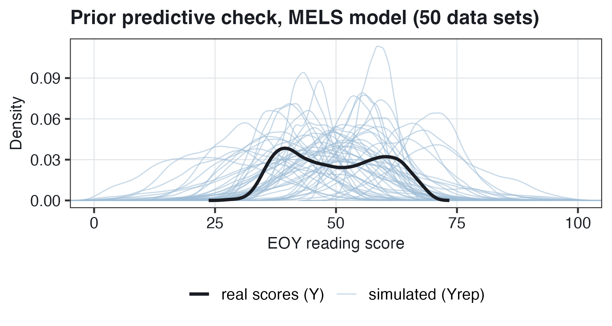{#fig-bm-prior-pc-mels width="70%"}

**Reading @fig-bm-prior-pc-mels.** As in @sec-bm-prior-pc, the question is whether the fake scores are on a believable scale. Most fake data sets are centered between about 30 and 70, and over 500 fake data sets, the middle 95% of the fake scores is from about 23 to 75, with 0.2% below 0 or above 100. So the priors are wider than the data but believable.

### The fitted MELS model (m3) {#sec-bm-m3}

In brms, the two equations are combined into one model with `bf()`:

``` r
priors_mels <- prior(normal(50, 10), class = "Intercept") +    # gamma_0
  prior(normal(0, 5), class = "b", coef = "treat") +           # gamma_1
  prior(normal(5, 2), class = "b", coef = "std_baseline") +    # beta_1
  prior(normal(0, 5), class = "sd") +                          # tau
  prior(normal(1, 0.5), class = "Intercept", dpar = "sigma") + # delta_0
  prior(normal(0, 0.5), class = "b", dpar = "sigma")           # delta_1, delta_2

mod <- bf(read_comp ~ 1 + treat + std_baseline + (1 | cluster_id),
          sigma ~ 1 + treat + std_baseline)

m3 <- brm(mod, data = jebs, prior = priors_mels,
          chains = 4, iter = 1000, cores = 4)
```

- The first formula is the location equation: the `1` is $\gamma_0$, `treat` is $\gamma_1$, `std_baseline` is $\beta_1$, and `(1 | cluster_id)` is $u_j$.
- `sigma ~ 1 + treat + std_baseline` is the scale equation, for $\log \sigma_{ij}$: the `1` is $\delta_0$, `treat` is $\delta_1$ and `std_baseline` is $\delta_2$. brms models the log of `sigma` by default. In `priors_mels`, the two priors with `dpar = "sigma"` are for the scale equation: `class = "Intercept"` is the prior for the sigma intercept, $\delta_0$, and `class = "b"` the prior for $\delta_1$ and $\delta_2$.
- m2, the prior-only version used for the prior predictive check, is the same call with `sample_prior = "only"`.

The table below holds the output of `m3`. The `sigma_` rows are the scale equation.

| Term | Estimate | Est.Error | l-95% CI | u-95% CI | Rhat | Bulk_ESS | Tail_ESS |
|:------------|--------:|--------:|--------:|--------:|--------:|--------:|--------:|
| $\widehat{\gamma_0}$ `Intercept` | 49.40 | 0.40 | 48.66 | 50.20 | 1.01 | 189 | 430 |
| $\widehat{\gamma_1}$ `treat` | 0.43 | 0.55 | $-0.67$ | 1.46 | 1.01 | 173 | 277 |
| $\widehat{\beta_1}$ `std_baseline` | 7.13 | 0.08 | 6.96 | 7.29 | 1.00 | 2018 | 1441 |
| $\widehat{\tau}$ `sd(Intercept)` | 2.66 | 0.22 | 2.27 | 3.10 | 1.01 | 291 | 607 |
| $\widehat{\delta_0}$ `sigma_Intercept` | 1.82 | 0.01 | 1.80 | 1.84 | 1.00 | 2953 | 1567 |
| $\widehat{\delta_1}$ `sigma_treat` | $-0.01$ | 0.02 | $-0.04$ | 0.02 | 1.00 | 2413 | 1480 |
| $\widehat{\delta_2}$ `sigma_std_baseline` | $-0.07$ | 0.01 | $-0.09$ | $-0.05$ | 1.00 | 3039 | 1530 |

The columns:

- `Estimate`, `Est.Error`: the posterior mean and the posterior SD;
- `l-95% CI`, `u-95% CI`: the lower and upper limits of the 95% credible interval;
- `Rhat`, `Bulk_ESS` and `Tail_ESS` are checks of the draws, not summaries of the posterior. When the four chains have the same distribution, Rhat is close to 1.00, and an ESS (effective sample size) above about 400 means that the draws contain enough information for stable summaries. Rhat and ESS are explained in @sec-bm-appendix.

**A note on Rhat and ESS.** Every Rhat in m3's output is 1.00 or 1.01, within or at the edge of the usual guideline of Rhat below 1.01 (@sec-bm-appendix). The Bulk_ESS values of `treat` (173), the `Intercept` (189) and $\tau$ (291) are below 400, so these three rows' summaries would change more than the others' in a rerun of the model. The usual remedy is to run the chains longer, with a larger `iter`. A rerun with the same settings had a `treat` estimate of 0.47, with interval $-0.64$ to 1.60, so the conclusion about `treat` is the same.

**The location equation.**

$\widehat{\gamma_1} = 0.43$. *Interpretation.* Whole schools were randomly assigned, so 0.43 is an estimate of the causal effect of the program. For students with the same BOY MAP score, the program is estimated to raise EOY scores by 0.43 points compared with control, 0.04 SD of EOY scores. The 95% credible interval, $-0.67$ to 1.46, includes 0. So for research question 1: no clear effect of the program on mean EOY scores.

$\widehat{\beta_1} = 7.13$. *Interpretation.* Students with the same treatment status whose BOY MAP scores differ by 1 SD are predicted to differ by 7.13 points at EOY. As in m1, this slope is a combination of the within-school and between-school associations.

$\widehat{\gamma_0} = 49.40$. *Interpretation.* A control student with a BOY MAP score of 0 in a school with $u_j = 0$ has a predicted EOY score of 49.40.

$\widehat{\tau} = 2.66$. *Interpretation.* For students with the same BOY MAP score and treatment status, schools' mean EOY scores differ from the average by about 2.66 points in SD terms. With 110 schools, the credible interval, 2.27 to 3.10, is much narrower than m1's from 10 schools (1.10 to 3.72).

### Reading the scale coefficients {#sec-bm-scale-coefs}

How are the scale coefficients $\delta_0$, $\delta_1$ and $\delta_2$ in m3's output interpreted? Each is on the log-SD scale, so the log is undone with $\exp$.

$\widehat{\delta_0} = 1.82$, so $\exp(1.82) = 6.17$. *Interpretation.* For a control student with a BOY MAP score of 0, the EOY score is typically about 6.17 points above or below the score predicted for the student from the school and the BOY MAP score.

$\widehat{\delta_1} = -0.01$, so $\exp(-0.01) = 0.99$. *Interpretation.* For students with the same BOY MAP score, the residual SD of treated students is estimated to be about 1% smaller than that of control students. The credible interval, $-0.04$ to 0.02, is a factor from $\exp(-0.04) = 0.96$ to $\exp(0.02) = 1.02$: from about 4% smaller to about 2% larger. The interval includes 0. So for research question 2: no clear evidence that the program makes EOY scores more consistent.

$\widehat{\delta_2} = -0.07$, so $\exp(-0.07) = 0.93$. *Interpretation.* For students with the same treatment status, each 1 SD higher BOY MAP score is associated with a residual SD about 7% smaller. The credible interval, $-0.09$ to $-0.05$, is a factor from $\exp(-0.09) = 0.91$ to $\exp(-0.05) = 0.95$: from about 9% to about 5% smaller. The interval excludes 0. So for research question 3: yes, students with higher BOY scores have more consistent EOY scores.

**From the coefficients to residual SDs.** To three decimals, $\widehat{\delta_0} = 1.819$ and $\widehat{\delta_2} = -0.073$. For a control student:

- with a BOY MAP score of $-2$: $\exp(1.819 - 0.073 \times (-2)) = \exp(1.965) = 7.1$ points;
- with a BOY MAP score of 0: $\exp(1.819) = 6.2$ points;
- with a BOY MAP score of 2: $\exp(1.819 - 0.073 \times 2) = \exp(1.673) = 5.3$ points.

*Interpretation.* A control student who scored 2 SD below average at BOY has an EOY score typically about 7.1 points above or below the predicted score; a student who scored 2 SD above average, about 5.3 points. On the variance scale, each 1 SD higher BOY MAP score is associated with a residual variance $\exp(2 \times -0.073) = 0.86$ times as large, about 14% smaller.

### Checking the fit {#sec-bm-mels-ppc}

Does m3 fit the scores of all 7,797 students? As for m1 in @sec-bm-ppc, fake data sets are simulated from m3's posterior and compared with the real scores. If the model fits, the fake data look like the real data.

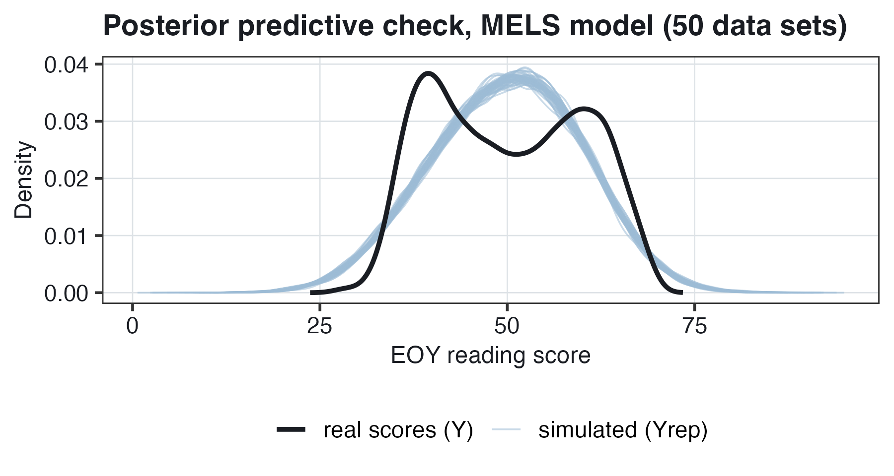{#fig-bm-ppc-mels width="70%"}

**Reading @fig-bm-ppc-mels.** The real scores have two peaks, near 39.5 and 60.2, with fewer scores in between, near 50. The fake data sets have one hump, highest near the middle, about 50. So, as with m1 in the 10 schools (@sec-bm-ppc), the model fits the center and the spread of the scores but not their shape. A lot has been learned, but the model is perhaps too simple for the data.

### Residual SD and the BOY MAP score {#sec-bm-sigma-map}

How does m3's predicted residual SD differ across BOY MAP scores, for treated and control students?

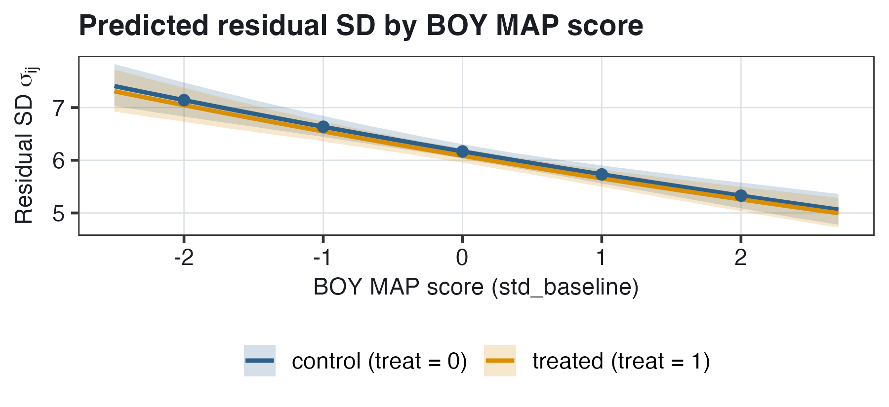{#fig-bm-sigma-map width="72%"}

**Reading @fig-bm-sigma-map.** The horizontal axis is the BOY MAP score, and the vertical axis is the predicted residual SD in EOY points. Each line is the mean of $\exp(\delta_0 + \delta_1\,\text{treat}_j + \delta_2\,\text{MAP}_{ij})$ over m3's 2,000 draws, and each band covers the middle 95% of those values. For control students, the residual SD is 7.1 at a BOY MAP score of $-2$, 6.6 at $-1$, 6.2 at 0, 5.7 at 1 and 5.3 at 2: about 7% smaller for each 1 SD higher BOY score. The treated line is just below the control line, about 1% lower at every BOY score. The credible interval for $\delta_1$, $-0.04$ to 0.02, includes 0, so there is no clear treatment effect on the residual SD. Students with higher BOY scores have both higher predicted EOY scores and EOY scores closer to their predicted scores.

### Extensions {#sec-bm-extensions}

How else can distributional models be used? Two extensions:

- **Value-added models for variances.** A random effect for each school can be added to the scale equation, so that each school has its own residual SD. Then schools can be compared on how consistent their students' scores are, not only on their mean scores (Leckie et al., 2024).
- **Other parameters.** Predictors can be added to other parameters of a model, such as the parameters of an item response model that describe how strongly each item is related to proficiency.

### A warning about interpreting differences in spread {#sec-bm-warning}

A difference in residual SD can have more than one explanation, even in a randomized trial. For example, a program can appear to cause a smaller residual variance when it has an effect on the mean of one group of students only, and the model has no term for that group or for its interaction with treatment.

{#fig-bm-warning width="80%"}

**Reading @fig-bm-warning.** In control, the two groups' means are 16 points apart, so the scores of all students together are spread out, with SD 9.5. In the program group, group A's mean is raised by 8 points, so the two groups are only 8 points apart, and the SD of all students together is 6.3. Within each group, the SD is 5 in both panels: the program changed only group A's mean. Under a model with no term for the group, the residual SD of program students would be estimated to be smaller, although the program made no group's scores more consistent. With a term for the group and its interaction with treatment, the residual SDs of program and control students would be the same.

The test's maximum score is a possible cause of the smaller residual SD of students with high BOY scores. The highest EOY score, 68.93, is the score of 73 of the 7,797 students. A control student with a BOY MAP score of 2, in a school with $u_j = 0$, has a predicted EOY score of $49.40 + 7.13 \times 2 = 63.66$. So such a student's score can be at most $68.93 - 63.66 = 5.27$ points above the predicted score, which limits how spread out the residuals of students with high BOY scores can be. This 5.27 and the predicted residual SD at a BOY MAP score of 2, 5.3 (@sec-bm-scale-coefs), are different quantities that only round to the same value.

::: callout-important
## A MELS model has an equation for the mean and one for the log residual SD

In m3, the location equation is the random intercepts model with the program; the scale equation is $\log \sigma_{ij} = \delta_0 + \delta_1\,\text{treat}_j + \delta_2\,\text{MAP}_{ij}$, and for $\delta_1$ and $\delta_2$, $\exp(\delta)$ is the factor by which the residual SD differs per 1-unit difference in the predictor. The program is estimated to raise EOY scores by 0.43 points (credible interval $-0.67$ to 1.46) and to make the residual SD about 1% smaller (from about 4% smaller to 2% larger): no clear effect on either. Each 1 SD higher BOY MAP score is associated with a residual SD about 7% smaller, from about 7.1 points at a BOY score of $-2$ to 5.3 at 2 for control students. A difference in spread can have other causes, such as a program effect on the mean of one group of students, when the model has no term for that group.
:::

## Chains, warmup, Rhat and ESS {#sec-bm-appendix}

This section goes beyond the core of the chapter: how the sampler is run in this chapter's code, and the two checks of its draws that brms prints with m3's output (@sec-bm-m3).

### Chains and warmup {#sec-bm-chains}

Each HMC step of @sec-bm-draws ends in one draw. How many steps are run, and which draws are kept? In this chapter's code, `chains = 4` and `iter = 1000`:

- A **chain** is one run of the sampler, started at random values. Four chains run independently.
- Each chain has 1,000 **iterations** (steps). The first 500 are **warmup**: over these steps, the chain's values change from the random starting values to values with high posterior probability. Warmup draws are discarded.
- The other 500 per chain are kept: $4 \times 500 = 2{,}000$ draws.

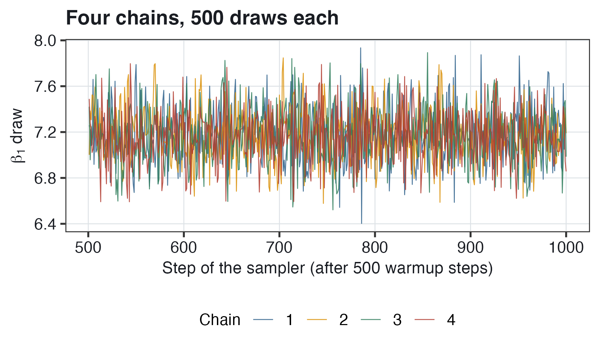{#fig-bm-chains width="72%"}

**Reading @fig-bm-chains.** The horizontal axis is the step of the sampler after warmup, and the vertical axis is the value of $\beta_1$ in each draw. Each chain's draws vary from step to step, mostly between 6.7 and 7.7, and the four chains (four colors) overlap over the same range. If one chain's draws were in a different range from the others', the four chains would describe different distributions, and their draws could not be combined.

### Rhat and effective sample size {#sec-bm-rhat}

brms's summary output, such as m3's table in @sec-bm-m3, has three columns that are checks of the draws, not summaries of the posterior:

- `Rhat` is a comparison of the variation between the four chains with the variation within each chain. If the four chains have the same distribution, Rhat is 1.00; larger values mean that the chains differ. A common guideline is Rhat below 1.01; R prints two decimals, so a printed 1.01 is at the edge of this guideline.
- `Bulk_ESS` and `Tail_ESS` are **effective sample sizes** (ESS). Each draw starts where the previous one ended, so neighboring draws are usually similar, and 2,000 such draws contain less information than 2,000 independent draws would. The ESS is the number of independent draws that would contain as much information as the 2,000 draws: Bulk_ESS for the middle of the posterior (the posterior mean and median), Tail_ESS for its tails, where the limits of the credible interval are. The ESS can be above 2,000, as for the Bulk_ESS of m3's `sigma_` rows, when neighboring draws tend to be on opposite sides of the posterior mean. A common guideline is an ESS above about 400.

## Vocabulary decoder {#sec-bm-vocab}

| Term | What it means here |
|:-------------------------|:--------------------------------------------|
| m0, m1, m2, m3 | m1: random intercepts model of EOY on BOY MAP, 780 students in 10 schools, fitted with brms; m0: m1 with the priors only (`sample_prior = "only"`); m3: MELS model, all 7,797 students in 110 schools; m2: m3 with the priors only |
| Frequentist; Bayesian | Probability as long-run frequency, a parameter as one fixed number (@sec-variance-components to @sec-higher-level); probability as degree of belief, uncertainty about a parameter as a distribution (this chapter) |
| Prior; likelihood; posterior | The distribution of a parameter before the data are used, such as $\beta_1 \sim N(5, 2)$; how probable the data are under each parameter value; the distribution after the data are used |
| $\propto$ (proportional to) | Equal up to a constant multiplier: posterior $\propto$ likelihood $\times$ prior |
| Precision | 1/SD$^2$; for the MAP slope, 0.25 for the prior and 16.8 for the data, so weights of 1.5% and 98.5% in the posterior mean |
| Weakly informative prior | A prior under which essentially impossible values have almost no probability, and which is wide, so that the posterior depends mostly on the data |
| Half-normal, $HN(0, 5)$ | A normal curve with mean 0 and SD 5 with its negative half removed; the prior for $\tau$ and $\sigma$ in m1 |
| Prior / posterior predictive check | Fake data simulated from the priors alone / from the posterior, compared with the real scores ($Y$ against $Y_{\text{rep}}$) |
| HMC; MCMC | Hamiltonian Monte Carlo, the sampler Stan runs (a simulated marble in a bowl); the family of methods it belongs to |
| Draw; chain; warmup | One complete set of parameter values; one run of the sampler; its first 500 steps, discarded. 4 chains $\times$ 500 = 2,000 draws (@sec-bm-appendix) |
| Posterior mean; posterior SD | The mean and the SD of a parameter's draws (`estimate`, `std.error` in `tidy()`; `Estimate`, `Est.Error` in brms's summary) |
| Credible interval | From the 2.5th to the 97.5th percentile of the draws; a 95% probability that the parameter is in it, given the model, priors and data |
| MAP (two meanings) | The BOY reading test (Measures of Academic Progress), everywhere in this chapter but one place; the maximum a posteriori estimate, the parameter values at the highest point of the posterior (@sec-bm-draws) |
| Rhat; Bulk_ESS, Tail_ESS | A comparison of the four chains (1.00 when they have the same distribution; guideline below 1.01); effective number of independent draws, for the middle and the tails of the posterior (guideline above about 400) |
| Empirical Bayes | The shrunken school estimates of @sec-variance-components: a precision-weighted average of the school's raw residual and 0, with the distribution of school departures as the prior |
| Homoskedastic; heteroskedastic | The same residual variance for every student; a residual variance that differs between students |
| Location; scale | The equation for the mean; the equation for the log residual SD, $\log \sigma_{ij} = \delta_0 + \delta_1\,\text{treat}_j + \delta_2\,\text{MAP}_{ij}$ |
| MELS model | Mixed effects location scale model: a multilevel location equation plus a scale equation |
| $\exp(\delta)$ | The factor by which the residual SD differs: $\exp(-0.07) = 0.93$, about 7% smaller per SD of BOY MAP |
| Distributional causal effect | An effect of a program on any feature of the distribution of scores, such as the spread, not only the mean |

## Common mistakes {#sec-bm-mistakes}

1.  **Reading "the parameter is a random variable" as a parameter that changes.** The true MAP slope is one number. The posterior describes the uncertainty about it: centered at 7.17, with SD 0.24.

2.  **Reading the second number in a prior as a variance.** $\beta_1 \sim N(5, 2)$ has SD 2, as in brms's `normal(5, 2)`, so 95% of the prior is between 1.08 and 8.92. In $u_j \sim N(0, \tau^2)$, the second entry is a variance.

3.  **Expecting the prior predictive check to match the data.** It is run before the data are used, only to check that the fake scores are believable: from about 24 to 76 for the middle 95% of fake scores. In the posterior predictive check, the fitted model is compared with the data.

4.  **Calling a credible interval a confidence interval, or the posterior SD an SE.** brms's `std.error` and `conf.low`/`conf.high` columns are the SD and percentiles of the 2,000 draws. Only the credible interval is read as "a 95% probability that the parameter is in the interval".

5.  **Leaving out "given the model and the priors".** The 95% probability of a credible interval holds under the model and the priors. m1's fake data do not have the shape of the real scores (@sec-bm-ppc), so the model is a simplification.

6.  **Thinking that the prior is the reason the school SD is larger in brms.** brms's 2.09 is the mean of a posterior with a long right tail; `lmer`'s 1.79 is the value at the peak of the likelihood. With flat priors, the posterior mean is about 2.15.

7.  **Reading the maximum a posteriori (MAP) estimate as the MAP test.** Two different things share the abbreviation. brms's output has posterior means, not the maximum a posteriori estimate.

8.  **Reading a scale coefficient in EOY points.** $\widehat{\delta_1} = -0.01$ is on the log-SD scale: the residual SD of treated students is $\exp(-0.01) = 0.99$ times that of control students, about 1% smaller, not 0.01 points smaller.

9.  **Using the F-test of the two variances for research question 2.** In the F-test ($p = 0.118$), no other variable, such as the BOY MAP score, is held fixed. Its p-value is computed as if the 7,797 students were independent, although whole schools were assigned. In m3, $\widehat{\delta_1}$ is estimated with the BOY MAP score held fixed and with a random intercept for each school.

10. **Using heteroskedasticity-robust SEs to answer a question about the spread.** They are location SEs corrected for heteroskedasticity, and contain no estimate of how the residual SD differs. Research questions 2 and 3 are answered with the $\delta$'s.

11. **Reading a smaller residual SD for treated students as proof that the program made the scores of every group of students more consistent.** A program effect on one group's mean, with no term for the group in the model, can appear as a smaller residual SD (@sec-bm-warning).

12. **Ignoring Rhat and ESS.** In m3, `treat` has Bulk_ESS 173, below the usual guideline of about 400, so its summary would change more than the other rows' in a rerun. Running the chains longer is the usual remedy (@sec-bm-appendix).

## Quick reference {#sec-bm-quickref}

:::::::: quickref
::: {}
**Bayes' theorem.** Posterior $\propto$ likelihood $\times$ prior:

$$\Pr(\text{Parameters} \mid \text{Data}) \propto \Pr(\text{Data} \mid \text{Parameters}) \times \Pr(\text{Parameters})$$
:::

::: {}
**Precision weighting** (normal prior with mean $\mu_0$ and SD $s_0$; data estimate $\hat\theta$ with SE $s$):

$$\begin{gathered}
\text{posterior mean} = \frac{(1/s_0^2)\,\mu_0 + (1/s^2)\,\hat\theta}{1/s_0^2 + 1/s^2}, \qquad \text{posterior SD} = \frac{1}{\sqrt{1/s_0^2 + 1/s^2}} \\
R_j = \frac{\tau^2}{\tau^2 + \sigma^2/n_j} = \frac{1/(\sigma^2/n_j)}{1/(\sigma^2/n_j) + 1/\tau^2}
\end{gathered}$$
:::

::: {}
**m1 and its priors.**

$$\begin{aligned}
Y_{ij} &= \beta_{0j} + \beta_1\,\text{MAP}_{ij} + e_{ij}, \qquad e_{ij} \sim N(0, \sigma^2) \\
\beta_{0j} &= \gamma_0 + u_j, \qquad u_j \sim N(0, \tau^2) \\
\gamma_0 &\sim N(50, 10), \qquad \beta_1 \sim N(5, 2), \qquad \tau, \sigma \sim HN(0, 5)
\end{aligned}$$
:::

::: {}
**m3 (MELS) and its priors.**

$$\begin{aligned}
\textbf{Location:} \qquad && Y_{ij} &= \beta_{0j} + \beta_1\,\text{MAP}_{ij} + e_{ij}, \qquad e_{ij} \sim N(0, \sigma_{ij}^2) \\
&& \beta_{0j} &= \gamma_0 + \gamma_1\,\text{treat}_j + u_j, \qquad u_j \sim N(0, \tau^2) \\
\textbf{Scale:} \qquad && \log \sigma_{ij} &= \delta_0 + \delta_1\,\text{treat}_j + \delta_2\,\text{MAP}_{ij} \\
\textbf{Priors:} \qquad && \gamma_0 &\sim N(50, 10), \qquad \gamma_1 \sim N(0, 5), \qquad \beta_1 \sim N(5, 2), \qquad \tau \sim HN(0, 5) \\
&& \delta_0 &\sim N(1, 0.5), \qquad \delta_1, \delta_2 \sim N(0, 0.5)
\end{aligned}$$

$\sigma_{ij} = \exp(\delta_0 + \delta_1\,\text{treat}_j + \delta_2\,\text{MAP}_{ij})$; a difference of $\delta$ in $\log \sigma$ multiplies the residual SD by $\exp(\delta)$.
:::

::: {}
**The R calls**

``` r
m0 <- brm(read_comp ~ 1 + std_baseline + (1 | cluster_id), data = jebs_sub,
          prior = priors, sample_prior = "only", chains = 4, iter = 1000)
m1 <- brm(read_comp ~ 1 + std_baseline + (1 | cluster_id), data = jebs_sub,
          prior = priors, chains = 4, iter = 1000)
pp_check(m0); pp_check(m1)     # prior and posterior predictive checks
m3 <- brm(bf(read_comp ~ 1 + treat + std_baseline + (1 | cluster_id),
             sigma ~ 1 + treat + std_baseline),
          data = jebs, prior = priors_mels, chains = 4, iter = 1000)
```
:::
::::::::

**Our numbers (m1: 780 students in 10 schools; m3: 7,797 students in 110 schools)**

| Quantity | Value |
|:------------------------------------------------|----------------------:|
| MAP slope: prior and data precisions; weight on the data | 0.25 and 16.8; 98.5% |
| m1: $\widehat{\gamma_0}$, $\widehat{\beta_1}$ \[95% credible interval\] | 48.85; 7.17 \[6.71, 7.65\] |
| m1: $\widehat{\tau}$ \[interval\]; `lmer`'s $\widehat{\tau}$ | 2.09 \[1.10, 3.72\]; 1.79 |
| m1: $\widehat{\sigma}$ \[interval\] | 6.17 \[5.88, 6.47\] |
| F-test of variances (control/treated) | $F = 1.05$, $p = 0.118$ |
| m3: $\widehat{\gamma_1}$ (treat) \[interval\] | 0.43 \[$-0.67$, 1.46\] |
| m3: $\widehat{\delta_0}$; residual SD at BOY MAP 0 (control) | 1.82; $\exp(1.82) = 6.17$ |
| m3: $\widehat{\delta_1}$ \[interval\]; factor | $-0.01$ \[$-0.04$, 0.02\]; 0.99 |
| m3: $\widehat{\delta_2}$ \[interval\]; factor per SD of BOY MAP | $-0.07$ \[$-0.09$, $-0.05$\]; 0.93 |
| m3: residual SD at BOY MAP $-2$, 0, 2 (control) | 7.1, 6.2, 5.3 |

## Worked examples {#sec-bm-worked}

### Example 1: our data

*Use* `lmer`*'s MAP slope, 7.21 with SE 0.2437 (precision 16.8); m1's* $\widehat{\tau} = 2.09$ *with 95% credible interval 1.10 to 3.72; and m3's scale coefficients to three decimals:* $\widehat{\delta_0} = 1.819$*,* $\widehat{\delta_1} = -0.013$*,* $\widehat{\delta_2} = -0.073$*.*

**(a) Suppose the prior for the MAP slope were** $N(5, 0.5)$ **instead of** $N(5, 2)$**. Compute the posterior mean and SD by precision weighting. Is this prior weakly informative?**

::: {.callout-tip collapse="true" icon="false"}
## Show solution

The prior precision is $1/0.5^2 = 4$, so the weight on the data is $16.8/(16.8 + 4) = 16.8/20.8 = 0.808$ and the weight on the prior $1 - 0.808 = 0.192$.

$$\text{posterior mean} = 0.192 \times 5 + 0.808 \times 7.21 = 0.960 + 5.826 = 6.79, \qquad \text{posterior SD} = 1/\sqrt{20.8} = 0.22$$

*Interpretation.* With this prior, the posterior mean is 6.79, 0.42 below the data's 7.21, against 7.18 with the $N(5, 2)$ prior. The prior is not weakly informative: 95% of it is between $5 - 1.96(0.5) = 4.02$ and $5 + 1.96(0.5) = 5.98$, so under this prior the data's estimate, 7.21, is implausible, and the prior has 19.2% of the weight.
:::

**(b) Interpret m1's 95% credible interval for** $\tau$**, and explain why it is not centered on 2.09.**

::: {.callout-tip collapse="true" icon="false"}
## Show solution

*Interpretation.* There is a 95% probability that the SD of the schools' intercepts is between 1.10 and 3.72 points, given the model, the priors and the data. The interval's lower limit is 0.99 below 2.09 and its upper limit 1.63 above, because the posterior of $\tau$ has a long right tail: an SD cannot be below 0, and with only 10 schools, values well above 2 are still plausible.
:::

**(c) Compute the predicted residual SD of a treated student with a BOY MAP score of 1.**

::: {.callout-tip collapse="true" icon="false"}
## Show solution

$$\widehat{\sigma_{ij}} = \exp(1.819 + (-0.013) \times 1 + (-0.073) \times 1) = \exp(1.733) = 5.66$$

*Interpretation.* A treated student who scored 1 SD above average at BOY has an EOY score typically about 5.66 points above or below the score predicted for the student from the school, the treatment status and the BOY MAP score.
:::

### Example 2: a new setting

*A study has 3,000 students in 60 classrooms. Whole classrooms were randomly assigned to a math tutoring program (*`tutor` *= 1) or to usual instruction (*`tutor` *= 0). The outcome is an end-of-year math score (*`math`*, mean 100, SD 15), and* `pretest` *is a beginning-of-year math score, a z-score. A MELS model has a random intercept for classrooms (*`class_id`*) and these estimates, with 95% credible intervals: for the mean,* $\widehat{\gamma_1} = 2.4$ $[0.8, 4.0]$*; for the log residual SD,* $\widehat{\delta_0} = 2.40$*,* $\widehat{\delta_1} = -0.12$ $[-0.20, -0.04]$ *and* $\widehat{\delta_2} = 0.05$ $[-0.01, 0.11]$*.*

**(a) Write the model, with student** $i$ **in classroom** $j$**, and the brms formula.**

::: {.callout-tip collapse="true" icon="false"}
## Show solution

$$\begin{aligned}
\textbf{Location:} \qquad && \text{Math}_{ij} &= \beta_{0j} + \beta_1\,\text{Pre}_{ij} + e_{ij}, \qquad e_{ij} \sim N(0, \sigma_{ij}^2) \\
&& \beta_{0j} &= \gamma_0 + \gamma_1\,\text{tutor}_j + u_j, \qquad u_j \sim N(0, \tau^2) \\
\textbf{Scale:} \qquad && \log \sigma_{ij} &= \delta_0 + \delta_1\,\text{tutor}_j + \delta_2\,\text{Pre}_{ij}
\end{aligned}$$

Substituting the classroom equation into the student equation gives the reduced form of the location equation, $\text{Math}_{ij} = \gamma_0 + \gamma_1\,\text{tutor}_j + \beta_1\,\text{Pre}_{ij} + u_j + e_{ij}$.

- $\text{Math}_{ij}$ is the end-of-year math score of student $i$ in classroom $j$, and $\text{Pre}_{ij}$ the student's pretest score.
- $\text{tutor}_j$ has only the classroom subscript because whole classrooms were assigned.
- $\beta_{0j}$ is classroom $j$'s intercept; $\gamma_0$ is the predicted score of a student in usual instruction with a pretest score of 0, in a classroom with $u_j = 0$; $\gamma_1$ is the tutoring effect on the mean; $\beta_1$ is the pretest slope; $u_j$ is classroom $j$'s departure, **assumed** normal with mean 0 and variance $\tau^2$; $e_{ij}$ is the residual, **assumed** normal with mean 0 and SD $\sigma_{ij}$.
- $\delta_0$, $\delta_1$ and $\delta_2$ are the coefficients of the scale equation, for $\log \sigma_{ij}$. In brms: `bf(math ~ 1 + tutor + pretest + (1 | class_id), sigma ~ 1 + tutor + pretest)`.
:::

**(b) Interpret** $\widehat{\gamma_1}$**.**

::: {.callout-tip collapse="true" icon="false"}
## Show solution

*Interpretation.* Classrooms were randomly assigned, so 2.4 is an estimate of the causal effect of tutoring: for students with the same pretest score, tutoring is estimated to raise end-of-year math scores by 2.4 points compared with usual instruction. There is a 95% probability that the effect is between 0.8 and 4.0 points; the interval excludes 0.
:::

**(c) Interpret** $\widehat{\delta_0}$ **and** $\widehat{\delta_1}$**.**

::: {.callout-tip collapse="true" icon="false"}
## Show solution

$\exp(2.40) = 11.02$. *Interpretation.* For a student in usual instruction with a pretest score of 0, the math score is typically about 11.02 points above or below the score predicted for the student.

$\exp(-0.12) = 0.89$, and the interval is from $\exp(-0.20) = 0.82$ to $\exp(-0.04) = 0.96$. *Interpretation.* For students with the same pretest score, the residual SD of tutored students is estimated to be about 11% smaller than that of students in usual instruction, from about 18% to about 4% smaller. The interval excludes 0, so tutored students' scores are more consistent. Before concluding that tutoring makes the scores of every group of students more consistent, consider whether tutoring could have raised the mean of one group of students when the model has no term for that group.
:::

**(d) Interpret** $\widehat{\delta_2}$**.**

::: {.callout-tip collapse="true" icon="false"}
## Show solution

$\exp(0.05) = 1.05$. *Interpretation.* For students with the same treatment status, each 1 SD higher pretest score is associated with a residual SD about 5% larger. The interval, $-0.01$ to 0.11, includes 0, so there is no clear association between the pretest score and the residual SD.
:::

## Check your understanding {#sec-bm-self-check}

Try each one before opening the answer. The section reference points to the fuller explanation.

::::::::::::::::: self-check
::: {.callout-note collapse="true" icon="false"}
## Contrast frequentist and Bayesian inference.

Frequentist: probability as long-run frequency, the slope one fixed number, an SE for its estimate. Bayesian: probability as degree of belief, the uncertainty about the slope a distribution, the posterior. *See @sec-bm-freq-bayes.*
:::

::: {.callout-note collapse="true" icon="false"}
## Explain prior, likelihood and posterior, and compute a posterior mean by precision weighting.

Posterior $\propto$ likelihood $\times$ prior. Prior precision 0.25, data precision 16.8, so 98.5% of the weight on the data: $0.015 \times 5 + 0.985 \times 7.21 = 7.18$. *See @sec-bm-theorem and @sec-bm-map-slope.*
:::

::: {.callout-note collapse="true" icon="false"}
## Connect precision weighting to shrinkage.

$R_j = \tau^2/(\tau^2 + \sigma^2/n_j)$ is the data's precision over the sum of the precisions; the distribution of school departures has the role of a prior, hence "empirical Bayes". *See @sec-bm-map-slope.*
:::

::: {.callout-note collapse="true" icon="false"}
## Defend weakly informative priors and read each prior.

Justified and reported; essentially impossible values have almost no prior probability; wide, so that the posterior depends mostly on the data. $\gamma_0 \sim N(50, 10)$ from the scaling of EOY scores, $\beta_1 \sim N(5, 2)$ (SD 2), $\tau, \sigma \sim HN(0, 5)$ because an SD cannot be negative. *See @sec-bm-choose and @sec-bm-reading-priors.*
:::

::: {.callout-note collapse="true" icon="false"}
## Explain a prior predictive check and why it is run before fitting.

Fake data from the priors alone; the question is whether they are on a believable scale (middle 95% from about 24 to 76), not whether they match the data. *See @sec-bm-prior-pc.*
:::

::: {.callout-note collapse="true" icon="false"}
## Describe how brms computes the posterior.

HMC is a simulation of a marble in a bowl, the negative log posterior; 4 chains of 1,000 steps, 500 warmup each, 2,000 draws; the output is a summary of the draws. *See @sec-bm-draws, @sec-bm-output-draws and @sec-bm-appendix.*
:::

::: {.callout-note collapse="true" icon="false"}
## Read m1's output and compare it with lmer's.

Posterior mean, posterior SD, credible interval. Slope 7.17 \[6.71, 7.65\] against 7.21; $\tau$ 2.09 against 1.79, because the mean of a posterior with a long right tail is larger than its peak. *See @sec-bm-m1-output and @sec-bm-tau.*
:::

::: {.callout-note collapse="true" icon="false"}
## Read a posterior predictive check.

Fake data from the posterior: right center and spread, but one hump, while the real scores have a tall peak near 40 (two peaks in all 110 schools). *See @sec-bm-ppc and @sec-bm-mels-ppc.*
:::

::: {.callout-note collapse="true" icon="false"}
## Interpret a credible interval and contrast it with a confidence interval.

95% probability that the slope is between 6.71 and 7.65, given the model, priors and data; a confidence interval's 95% describes the procedure over repeated samples. *See @sec-bm-intervals.*
:::

::: {.callout-note collapse="true" icon="false"}
## Explain why a program's effect on the spread can matter, and why the effect on the spread cannot be estimated with robust SEs.

The same mean effect can narrow or widen gaps; robust SEs are location SEs corrected for heteroskedasticity, with no estimate of how the residual SD differs. *See @sec-bm-beyond-mean and @sec-bm-scale-model.*
:::

::: {.callout-note collapse="true" icon="false"}
## Write the MELS model and its brms formula.

Location: the random intercepts model with `treat`; scale: $\log \sigma_{ij} = \delta_0 + \delta_1\,\text{treat}_j + \delta_2\,\text{MAP}_{ij}$; `bf(read_comp ~ ..., sigma ~ 1 + treat + std_baseline)`. *See @sec-bm-scale-model and @sec-bm-m3.*
:::

::: {.callout-note collapse="true" icon="false"}
## Interpret m3's coefficients, the scale ones with exp.

Program effect on the mean 0.43 \[$-0.67$, 1.46\] and on the residual SD about 1% smaller \[4% smaller, 2% larger\]: no clear effect on either. $\exp(-0.07) = 0.93$: about 7% smaller per SD of BOY MAP, from 7.1 at $-2$ to 5.3 at 2. *See @sec-bm-m3 and @sec-bm-scale-coefs.*
:::

::: {.callout-note collapse="true" icon="false"}
## Read Rhat and ESS.

Rhat is a comparison of the chains (guideline below 1.01); ESS is the number of independent draws that would contain as much information as the 2,000 draws (guideline above about 400). `treat`: Bulk_ESS 173, so run the chains longer. *See @sec-bm-m3 and @sec-bm-appendix.*
:::

::: {.callout-note collapse="true" icon="false"}
## Give other causes of a difference in spread.

A program effect on one group's mean, with no term for the group in the model; the maximum score of the test. *See @sec-bm-warning.*
:::
:::::::::::::::::

## Going deeper {#sec-bm-deeper}

Luke Miratrix's online MLM handouts have no chapter on Bayesian models; this one relates to @sec-bm-scale-model:

- [MLM and Cluster-Robust Standard Errors](https://lmiratrix.github.io/MLM/robust_mlm.html) — robust SEs for multilevel models: what is corrected, and what is not.

Other sources:

- [Statistical Rethinking](https://xcelab.net/rm/) (McElreath, 2020) — a book and video lectures on Bayesian modeling, including how HMC works (@sec-bm-computing).
- [MCMC Interactive Gallery](https://chi-feng.github.io/mcmc-demo/app.html) — an animated demonstration of HMC and other samplers (@sec-bm-draws).
- [Estimating distributional models with brms](https://paulbuerkner.com/brms/articles/brms_distreg.html) — brms's guide to models with a `sigma ~` equation, on the log-SD scale (@sec-bm-scale-model).
- [Wiedermann et al. (2024)](https://doi.org/10.1037/met0000533), "Distributional causal effects: Beyond an 'averagarian' view of intervention effects," *Psychological Methods* — why program effects on features other than the mean matter (@sec-bm-beyond-mean).
- [Leckie et al. (2024)](https://doi.org/10.3102/10769986231210808), "Mixed-effects location scale models for joint modeling school value-added effects on the mean and variance of student achievement," *Journal of Educational and Behavioral Statistics* — school random effects in the scale equation (@sec-bm-extensions).

**An empirical application.** Kim et al. ([2021](https://doi.org/10.1177/23328584211004183)). Measures matter: A meta-analysis of the effects of educational apps on preschool to grade 3 children's literacy and math skills. *AERA Open, 7*, 23328584211004183. The authors pool 36 studies of the causal effects of educational apps for children from preschool to grade 3, with the random-effects meta-analytic model of @sec-higher-level. The average effect size (Hedges's $g$, Cohen's $d$ with a small-sample correction) is 0.30 SD, 95% CI 0.19 to 0.41. The true effects differ a lot across studies: their SD, $\tau$ in the meta-analytic model of @sec-higher-level, is about 0.26. $I^2 = 71\%$ is the share of the variation in the studies' estimates that is from differences in true effects. Effects are larger on tests made by the researchers than on standardized tests, which is why "measures matter".

## Code for this chapter's figures {#sec-bm-code}

Every figure in this chapter is computed live from the data by one R script. It fits the Bayesian models used throughout with brms, which takes about five minutes, and then builds each figure in turn. [Download `10-figures.R`](../code/10-figures.R) and the data it reads, [`jebs_sub.csv`](../data/jebs_sub.csv) and [`jebs_full.csv`](../data/jebs_full.csv), then run the script from a folder where the data sit at `data/jebs_sub.csv` and `data/jebs_full.csv`.

::: {.callout-note collapse="true" icon="false"}
## Show the full script

``` r

```
:::

## What comes next {.unnumbered}

This is the final chapter (for now). Across the ten chapters, the book has covered nested data, the intraclass correlation and reliability; longitudinal, nonlinear growth, autoregressive and dynamic models; cross-classified, logistic and item response models; three-level models, meta-analysis and multisite trials; and Bayesian inference and distributional models. Topics for further study include multilevel $R^2$, latent centering, measurement models, power analysis and three-level versions of the Mundlak and REWB models of @sec-within-between. At the Harvard Graduate School of Education, related courses include S-032 (research synthesis and meta-analysis), S-061 (educational measurement and psychometrics), S-090 (structural equation modeling) and S-290 (causal inference).
